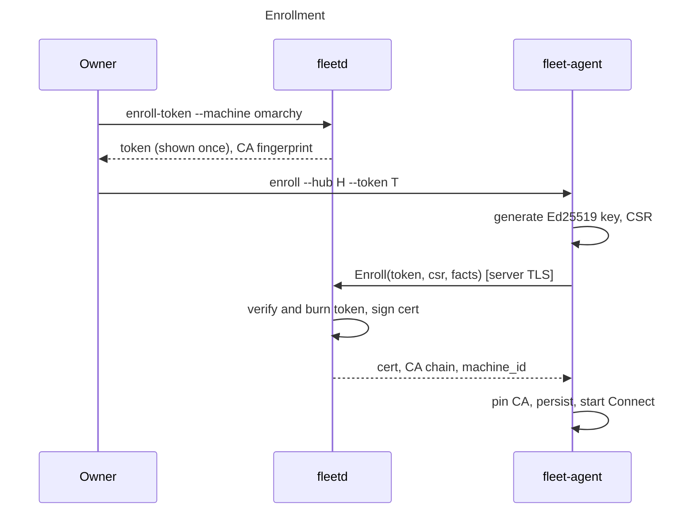
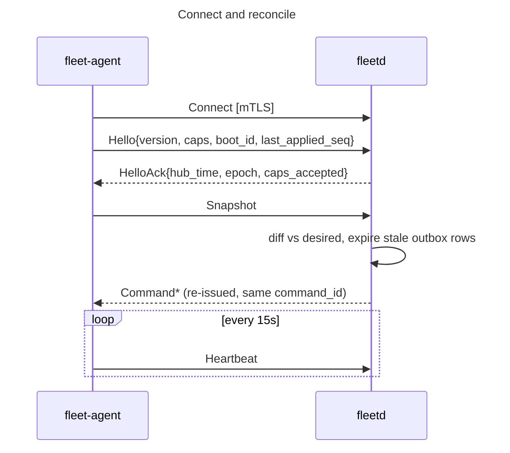
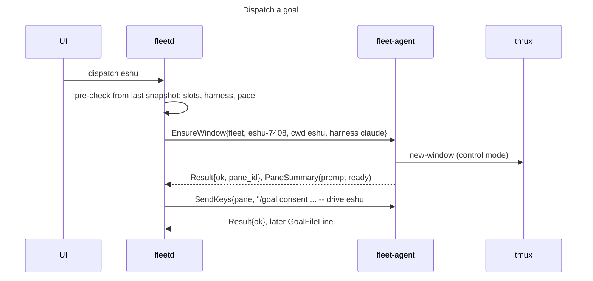
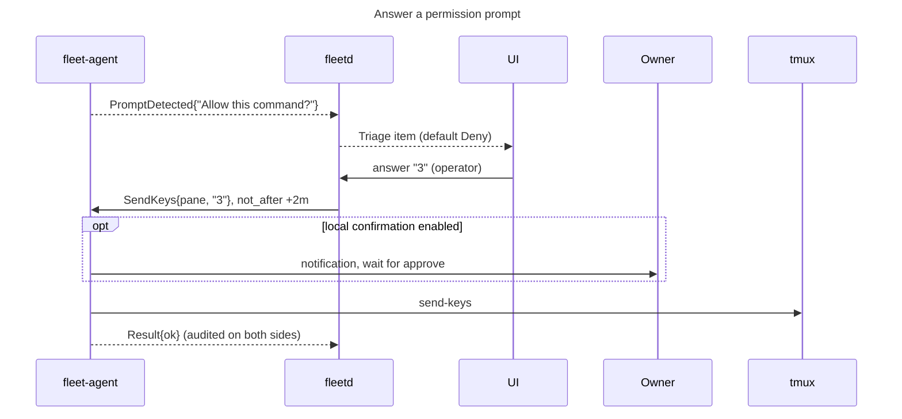
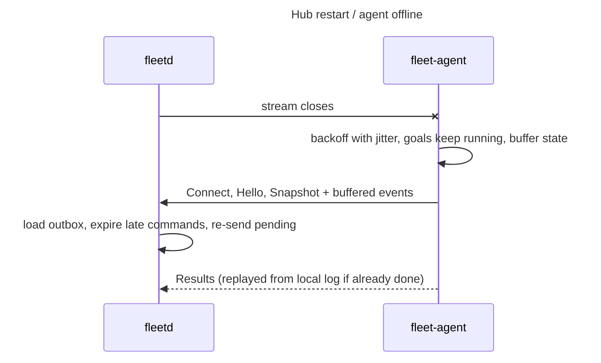

# 0004. Agent connectivity and command model

- Status: Accepted
- Date: 2026-09-29
- Deciders: linuxdynasty (design drafted with Claude Fable 5.1, reviewed)

## Context

The hub must make 2–50 machines create tmux sessions and windows, start an
unmodified harness, type into panes (`/goal …`, permission answers),
restart and stop goals, probe weekly usage, and later stream a pane to a
browser with keystrokes going back.

The mockup did this by having the hub run `ssh user@ip tmux send-keys …`. That
puts an SSH key for every machine on the hub, needs inbound reachability to
every worker (NAT, containers and sleeping laptops break it), and makes a shell
string the authorization surface.

Constraints: the hub is often a laptop that sleeps and roams; workers sit
behind NAT or in containers; no extra services ([0001](0001-system-architecture.md));
no Tailscale requirement; provider credentials never leave a machine.

## Options

| | A. Agent dials out, one bidi gRPC stream, mTLS | B. Hub dials agents | C. Hub SSHes in | D. HTTP long-poll | E. Broker (NATS/MQTT) | F. Require an overlay network |
|---|---|---|---|---|---|---|
| NAT, sleep, roaming | Only the hub needs a stable name | Every worker needs an inbound path | Same as B, plus `sshd` everywhere | Same as A | Broker needs the stable name | Solves reachability only |
| Credentials on the hub | A CA key; each agent holds only its own cert | Client creds for every agent | SSH keys = full shell everywhere | Same as A | Broker creds; a third trusted party | Depends |
| If the hub is compromised | Bounded by the agent's typed policy | Same if typed | Unbounded shell everywhere | Same as A | Same as A, plus broker | Depends |
| Self-hoster burden | One binary each side, one port on the hub | Firewall per worker | Keys, `sshd`, known_hosts | Same as A, more streaming code | Run and secure a broker | Overlay on every node |
| Interactive attach | Native HTTP/2 streams | Native | Good, but hub→worker path | Poor | Poor fit for byte streams | Depends |
| Containers | Outbound only; token via env | Published ports | `sshd` in image | Trivial | Broker reachable | Awkward |

## Decision

**Option A.** Each agent dials out to the hub and holds one long-lived
bidirectional gRPC stream (`FleetAgent.Connect`) over HTTP/2 with mutual TLS.
Commands flow down that stream as typed messages. Each interactive attach is
a separate `FleetAgent.Terminal` stream on the same connection. Enrollment
exchanges a one-time token for a client certificate.

- The hub machine runs its own `fleet-agent` too, dialing loopback, so there is
  one code path. Installing the hub installs its agent by default; it can be
  removed if the hub machine should never run goals. An agent is preferred
  over SSH everywhere: tmux control mode pushes output over the agent's
  persistent connection (streaming), typed commands and reconnect logic live in
  one place (correctness), and hub and agent can each be tested against a fake
  of the other over an in-memory connection, with no `sshd` or keys in tests
  (testability).
- **Finding the hub** (addresses change with DHCP). The agent never trusts an
  address; it trusts the hub CA it pinned at enrollment. Discovery only
  produces candidates, and a candidate is used only if the TLS check passes, so
  an impostor at a discovered address is rejected. The agent tries, in order:
  1. the last address that worked (cached),
  2. mDNS on the LAN (`_fleetd._tcp`, e.g. `fleetd.local`); built into macOS,
     `avahi` on Linux; does not cross VPNs or subnets,
  3. addresses the owner configured (hostname, DHCP reservation, DNS name),
  4. a Tailscale name, only if the owner enabled it and both ends are on a
     tailnet.
  **Tailscale is optional and never required.** Defaults need no setup on a
  home LAN; configured addresses always work as the override.
- The hub exposes one TLS port (default 7443). Workers expose nothing.

Comparable systems (from general knowledge, not verified for this ADR): GitHub
Actions self-hosted runners and Buildkite agents connect outbound; Teleport
nodes use outbound reverse tunnels; Kubernetes API servers dial kubelets for
`exec`/`logs`, and the Konnectivity proxy exists to reverse that for networks
where nodes are unreachable. fleet-board goes further than runners in one
respect: runners accept arbitrary job scripts; fleet-board agents accept only a
closed set of typed command kinds, because typing into a harness is already
equivalent to running code, and the agent, not the hub, must be the last line
of defense.

## Security model

**Enrollment.** `fleetd enroll-token --machine <name> --ttl 15m` stores a hash
of a random single-use token and prints it once. `fleet-agent enroll --hub
<addr> --token <t>` generates an Ed25519 key locally, sends a CSR plus machine
facts over server-authenticated TLS, and receives a client certificate with a
URI SAN `fleet://machine/<machine_id>` and the hub CA chain. The agent pins the
CA fingerprint, which `fleetd` prints and the UI shows so the owner can
compare. Containers pass the token as `FLEET_ENROLL_TOKEN` on first boot.

**Rotation and revocation.** The certificate is the agent's identity: it is how
the hub knows a connection really is a given machine, replacing SSH keys.
Expiry limits the damage when agent files are copied without the owner knowing
(stolen laptop, cloned VM, leaked backup); revocation only helps when the owner
knows. Lifetime is configurable per machine and per group, **default 90 days,
capped at 1 year** (longer is refused with a warning). Agents renew
automatically at two-thirds of the lifetime over the existing connection
(`RenewCert`), so an online machine never needs attention. A machine offline
longer than the full lifetime re-enrolls with one command and a new token. Deleting a
machine revokes its certificate serials; the hub is the only relying party, so
revocation is a lookup at handshake and on every `Hello`.

**Agent-side command policy (the key control).** Accepted kinds:
`EnsureSession`, `EnsureWindow`, `KillWindow`, `SendKeys`, `Interrupt`,
`RespawnPane`, `CapturePane`, `ProbeUsage`, `OpenAttach`, `CloseAttach`,
`Drain`. There is no raw command execution unless
`~/.config/fleet-agent/policy.yaml` sets `exec.raw: true`. The hub cannot write
that file; there is deliberately no config-push RPC. Policy also sets:

- which harnesses may be launched (resolved locally; the hub never sends a
  path),
- allowed working-directory roots (the hub sends a repo short name; the agent
  joins it to a root and rejects `..`),
- `default_server: none | observe | control` for the owner's own tmux server,
  **default `none`** ([0006](0006-tmux-sessions.md)),
- a maximum number of windows and per-kind rate limits.

**Layered settings (per machine and per group).** Machines carry labels (for
example `laptop`, `always-on`, `container`). Settings resolve machine → group →
fleet default. The local policy file is the **ceiling**: hub-side machine and
group settings can only tighten within it, never loosen it. The hub can turn
local approval on for a group, but cannot turn it off on a machine whose local
file requires it, and cannot enable raw exec or `default_server: control`.

`SendKeys` takes literal text and a small set of named keys (`Enter`, `C-c`,
`Escape`, arrows), never a tmux command string.

**Local confirmation.** Kinds marked dangerous (`KillWindow`, `RespawnPane`,
`SendKeys` when enabled, raw exec) can require approval on the machine itself
(`fleet-agent approve <command_id>` or a desktop notification) before the
command's deadline. Configurable per machine and per group (layered as above);
off by default.

**Confirming typed input in the UI.** Typing into a pane asks for confirmation
in the UI only when it looks risky: answering a detected permission prompt, or
typing into a goal that is running. Typing into a session the owner created
goes straight through. Configurable per machine and per group.

**Envelope.** Every command carries `command_id` (also the idempotency key),
`issued_at` and `not_after` in hub time, the connection `epoch` and a
per-epoch sequence number. The agent refuses expired, out-of-epoch and
replayed commands (a known `command_id` returns its logged result). mTLS is the
authentication boundary. An optional detached signature field exists in the
contract for deployments that keep a signing key in hardware; it is not
required in v1 because a compromised hub would hold the key anyway.

**If the hub is compromised,** an attacker can issue allowed kinds to every
connected machine: start harnesses and type into them as the logged-in user,
within allowed repo roots and rate limits. They cannot read files on workers
(there is no file RPC), run arbitrary binaries (no raw exec by default),
escalate beyond the user, reach offline machines, or get provider credentials
(the agent never opens `auth.json`, keychain items or harness config;
`ProbeUsage` types the harness's own status command and reads the pane).
Rotating the hub CA cuts every agent off in one step.

**If an agent is compromised,** it can lie about its own machine and flood
events. It cannot address other machines (every message is checked against the
certificate's `machine_id`), read the hub database, or reach peers (there is no
agent-to-agent path). The hub enforces per-agent rate and size limits.

**People on the hub.** Roles `viewer`, `operator`, `owner`. Viewing panes needs
`viewer`; sending keys, typing into an attach and goal lifecycle need
`operator`; enrollment tokens, machine deletion and settings need `owner`.
Destructive permission prompts default to Deny and are never auto-answered.

## Reliability

- **Level-triggered reconcile.** On every connect the agent sends `Hello`, then
  a full `Snapshot`: tmux servers, sessions, windows, panes (tagged with
  `FLEET_*` environment variables), goal-file first lines, harness inventory,
  latest usage readings, the last applied sequence number, and results never
  acknowledged. The hub diffs desired state against it and re-issues or closes
  commands. Events between snapshots are optimizations, never the source of
  truth.
- **At-least-once commands with idempotency.** The hub stores an outbox row per
  command (`pending → delivered → done | expired | failed`) in SQLite. The agent
  keeps a bounded local log (last 10,000 or 7 days) keyed by `command_id`;
  duplicates return the logged result. Commands are declarative where possible
  (`EnsureWindow`, not `NewWindow`), so re-running one after a crash is a no-op.
- **Deadlines.** Default `not_after` is 2 minutes for interactive actions
  (`SendKeys`, permission answers) and 30 minutes for dispatch. A late command
  returns `EXPIRED`, and the UI shows "not delivered, machine was offline"
  rather than typing a stale answer into a prompt that has moved on.
- **Liveness.** Transport keepalive (10 s ping, 20 s timeout) plus an
  application `Heartbeat` every 15 s. The hub marks a machine stale at 45 s and
  offline at 3 minutes. The agent reconnects with exponential backoff and full
  jitter (1 s to 60 s) and immediately on wake or network change.
- **Hub restart.** Agents reconnect and send a snapshot; the outbox re-sends
  pending commands with the same IDs unless expired. Nothing on the workers
  notices, because goals live in tmux, not in the connection.
- **Agent restart mid-command.** The agent re-snapshots. A command logged as
  started but not finished is re-checked against tmux (declarative kinds) or
  reported `UNKNOWN_OUTCOME` (`SendKeys`), and the hub asks a person instead of
  typing again.
- **Hub asleep for hours, or a partition.** Goals keep running. The agent keeps
  observing and probing usage, and buffers state transitions in a bounded ring
  (latest state per pane wins; kept 1 week, size-capped). Pane output is not
  buffered. On reconnect it sends a snapshot plus the ring so the timeline can
  be backfilled. The hub marks the machine offline and schedules nothing there.
- **Duplicate identity** (cloned VM, copied state directory): newest connection
  wins; the hub closes the old stream, bumps the epoch and warns in the UI.
- **Clock skew.** `HelloAck` carries hub time; the agent evaluates deadlines in
  hub time and reports skew over 5 minutes. Certificates are backdated 5
  minutes.
- **Backpressure.** HTTP/2 flow control, plus a bounded agent send queue that
  drops pane summaries and heartbeats first and never drops state transitions
  or command results. The hub's single writer sheds pane summaries first if it
  falls behind.

## Interactive attach and observation

The agent runs two kinds of tmux client per fleet server:

1. **One control-mode observer** (`tmux -L fleet -C attach`). It parses session,
   window and output notifications for pane summaries (last lines, time of last
   output), goal-file lines and permission-prompt detection, and it executes
   `SendKeys` and `CapturePane` as control-mode commands rather than a
   subprocess per keystroke.
2. **One PTY-backed client per attach** (`tmux -L fleet attach -t <target>` in
   a PTY at the requested size). On `OpenAttach` the agent opens a `Terminal`
   stream; bytes go up, input, resize and close come down; the hub bridges it
   to a WebSocket for xterm.js. A real PTY gives correct redraws on connect and
   resize.

Flow control relies on HTTP/2 windows for the terminal stream and on tmux
control-mode pause/continue for the observer. The exact flags must be verified
against tmux 3.2+ (open question 4). Attaches close after an idle timeout and
when the hub disconnects. `viewer` attaches are read-only (the hub drops
input); attaching to a goal window shows a banner because keystrokes go to a
running harness.

## Sessions

- The agent runs a fleet-owned server with an agent-managed config
  (`tmux -L fleet -f <fleet.conf>`) so options are predictable. Goal windows
  live in session `fleet`, named `<repo>-<issue>`.
- Sessions from the UI: `EnsureSession{session_id, name, cwd_repo, harness?,
  reuse}` creates the named session or, with `reuse`, attaches to it if it
  already exists, and optionally starts a harness in it (`claude`, `codex`,
  `muse`, or any harness the machine's policy allows). Names match `[a-z0-9][a-z0-9-]{0,31}` and are unique per
  machine. The agent sets `FLEET_SESSION_ID` and `FLEET_OWNER` in the session
  environment so the session is recognized in every snapshot even after a
  rename; the hub keys it by `session_id`.
- The owner's default tmux server is untouched unless local policy says
  `observe` or `control`; the UI labels those windows "not fleet-managed".

## Diagrams











## Contract outline (`api/fleet/v1`)

```
service FleetAgent {                                         // served by fleetd
  rpc Enroll(EnrollRequest) returns (EnrollResponse);          // server TLS + token
  rpc Connect(stream AgentMessage) returns (stream HubMessage); // mTLS, one per agent
  rpc Terminal(stream TermUp) returns (stream TermDown);       // mTLS, one per attach
  rpc RenewCert(RenewRequest) returns (RenewResponse);
  rpc SessionLog(stream LogChunk) returns (stream LogAck);     // mTLS, session logs (0010)
}

AgentMessage = oneof {
  Hello         { machine_id, agent_version, proto_min, proto_max, capabilities[], boot_id, last_applied_seq }
  Snapshot      { tmux_servers[], goal_lines[], harnesses[], usage[], unacked_results[] }
  Heartbeat     { load1, free_active, free_total, wall_time }
  Event         { seq, at, oneof { SessionEvent, WindowEvent, PaneSummary, GoalFileLine, UsageReading, PromptDetected } }
  CommandAck    { command_id }
  CommandResult { command_id, status (OK | FAILED | EXPIRED | REJECTED_BY_POLICY | UNSUPPORTED
                                      | UNKNOWN_OUTCOME | AWAITING_LOCAL_CONFIRM), message }
}

HubMessage = oneof {
  HelloAck        { hub_version, hub_time, epoch, capabilities_accepted[] }
  Command         { command_id, epoch, seq, issued_at, not_after, requested_by, sig?,
                    oneof kind { EnsureSession, EnsureWindow, KillWindow, SendKeys, Interrupt,
                                 RespawnPane, CapturePane, ProbeUsage, OpenAttach, CloseAttach,
                                 Drain, RunExec /* only with capability exec.raw */ } }
  SnapshotRequest {}
  Bye             { reason }   // duplicate identity, revoked
}

TermUp   { attach_id, oneof { output bytes, closed { exit_reason } } }
TermDown { oneof { input bytes, resize { cols, rows }, close {} } }
LogChunk { session_id, stream (terminal | harness_transcript), offset, zstd bytes }
LogAck   { session_id, stream, acked_offset }
```

New command kinds are gated by capability strings in `Hello`
(`tmux.control`, `attach.pty`, `exec.raw`, `confirm.local`,
`usage.probe.<harness>`, `default_server.control`). Unknown kinds return
`UNSUPPORTED` and never crash the agent.

## Consequences

- On a home LAN the agent finds the hub with no setup (mDNS). Across networks,
  the owner adds an address, or enables the optional Tailscale lookup.
- The hub's SQLite is the durable command outbox and event log; the agent keeps
  a small state directory (`~/.local/state/fleet-agent/`: certificate, key,
  pinned CA, command log, event ring).
- Every mockup action that rendered a shell string becomes a typed command. The
  "copy an `ssh … tmux attach` command" fallback stays, generated in the
  browser only.
- Workers need tmux 3.2 or newer (control-mode flow control). The agent
  refuses to start goals on older tmux and says why.

## Rejected

- **B, hub dials agents:** needs inbound reachability to laptops, NAT'd hosts
  and containers.
- **C, hub SSHes in:** every machine's SSH key on the hub is an unrestricted
  shell on the fleet; no liveness or reconcile model; no `sshd` in containers;
  shell strings as the authorization surface.
- **D, HTTP long-poll:** fine for commands, poor for pane streaming and
  sub-second prompt answers; it would need a second streaming path.
- **E, broker:** an extra service and a third trusted party; poor fit for PTY
  byte streams.
- **F, mandatory overlay network:** solves reachability, not authorization;
  kept as an optional way to name the hub.
- **Multiplexing attaches inside the control stream:** HTTP/2 already
  multiplexes; a separate RPC per attach keeps terminal bytes from delaying
  commands.
- **Mandatory command signatures in v1:** no protection against the realistic
  threat (a compromised hub holds the key); kept as an optional field.

## Resolved questions (2026-09-29)

1. Hub addressing: automatic discovery (cached → mDNS → configured → optional
   Tailscale) guarded by the pinned CA; manual override always available.
2. UI confirmation for typed input: only when risky; configurable per machine
   and group.
3. Local approval for dangerous kinds: configurable per machine and group,
   local file is the ceiling.
4. Minimum tmux: 3.2.
5. Certificates: needed as agent identity; default 90 days, capped at 1 year,
   auto-renewed, configurable per machine and group.
6. The hub machine runs an agent by default; agents over SSH everywhere.
7. Live-state retention: 1 week. Full session logs: [0010](0010-session-logs.md).
