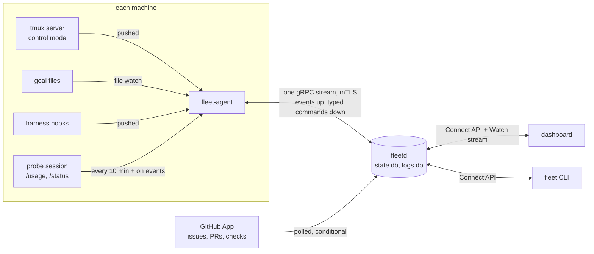

# fleet-board design

Overview of the design, first written 2026-09-28 and brought in line with the contracts, ADRs and
specs on 2026-10-02. Where another document disagrees, the order of authority is the protos
([`api/fleet/`](../api/fleet/)), the ADRs (newest wins), the specs, the flows, then this page.
Detail lives in the specs; this page says what the product is and where to look.

- Every feature by release, with its spec and issue: [features.md](features.md). How it is deployed,
  configured and released: [design-deployment-and-milestones.md](design-deployment-and-milestones.md).
- Decisions: [docs/adr/](adr/README.md). Specs: [docs/specs/](specs/README.md); every tunable
  number: [defaults](specs/defaults.md). Flows with diagrams: [docs/flows/](flows/README.md). Build
  order: [v1 plan](plan/v1-implementation-plan.md).
- Mockup: [`mockup/`](../mockup/README.md); its `ssh` line is only the copyable attach fallback, the
  hub never runs `ssh` ([ADR 0004](adr/0004-agent-connectivity.md)).
- Facts checked by running the harnesses: [research/verified-facts.md](research/verified-facts.md).

## Goal

A controller for a fleet of AI coding workers, for people who pay for harness subscriptions (Claude,
ChatGPT/Codex, Muse, others later) because API pricing is too expensive, and want full value from
them.

A **worker** is a machine (physical, VM or container, any OS, CPU and memory) with a harness signed
in to a subscription account. Claude Code, Codex and Muse have a native `/goal`. OpenCode is a
fourth in-scope harness: inventoried and attachable, no `/goal` yet, and never auto-dispatched on
an Anthropic subscription. The controller:

- tracks every worker, session and issue on one kanban,
- tracks **weekly usage** of every harness account, which is the real budget,
- assigns the next suitable issue to a worker as soon as it finishes its goal, pacing work so each
  account's weekly quota is used before it resets without running out early.

This is a management tool, not a monitor. The operator mostly acts while switching between sessions
and machines, so fast switching is the core of the UI. It is meant to be self-hosted by other
people, so everything specific to one fleet (hosts, users, repos) is configuration.

## Example fleet (the author's)

Used for the mockup and first build. The hub never connects to a machine, so addresses and users are
not configuration: machines enroll and the agent reports RAM. All four have tmux, claude, codex,
muse and opencode (on macOS only on the login-shell PATH, so the agent resolves absolute paths,
[ADR 0006](adr/0006-tmux-sessions.md)).

| Host | Address | SSH user | RAM | Max active goals |
|---|---|---|---|---|
| Linuxdynasty-MacBook-Pro-14 (hub) | 192.168.1.118 | asanabria | 64 GB | 2 |
| omarchy | 192.168.1.150 | linuxdynasty | 62 GB | 2 |
| allens-Apple-MacBook-Pro | 192.168.1.232 | allen | 128 GB | 4 |
| ip-192-168-1-124 | 192.168.1.124 | linuxdynasty | 64 GB | 2 |

The author sets 4 active goals on the 128 GB machine and 2 elsewhere; the limit is a per-machine setting, not a product rule.

## Architecture

Three Go programs ([ADR 0001](adr/0001-system-architecture.md)): `fleetd`
(the hub), `fleet-agent` (one per machine, running as the logged-in user) and
`fleet` (the CLI), plus a React dashboard served by `fleetd`. Every arrow below
is a stream unless it says otherwise; the full set of diagrams is in
[docs/flows/](flows/README.md).



**Agent and hub.** The agent dials out to the hub and holds one long-lived,
mutually authenticated gRPC stream ([ADR 0004](adr/0004-agent-connectivity.md)).
Events go up as they happen; the hub sends typed commands (start a goal, answer
a prompt, attach) down the same stream, and the agent accepts only command
kinds its local policy allows. The hub never runs `ssh` or a shell string.
Nothing on a worker listens on the network.

**Inputs on each machine, and how they arrive:**

| Input | How | Why not the other way |
|---|---|---|
| tmux panes (output, windows, lifecycle, activity) | **Streamed**: one `tmux -C` control-mode client per server pushes changes; a snapshot only on reconnect ([01](specs/01-agent-capabilities.md) E1-E5) | Polling `list-panes`/`capture-pane` would lag and cost CPU |
| Goal files (`DONE`, `BLOCKED …`, working) | **Watched** with file-system notifications (library: [ADR 0020](adr/0020-dependencies.md)), plus a rescan every 60 s for missed events. The agent also looks for a goal file in the checkout of any pane running a harness, to show goals the owner started by hand ([02h](specs/02h-goal-binding-and-pane-signals.md#observed-goals-v1)) | |
| Harness hooks (Stop, interrupt, permission, session start) | **Pushed** by the harness ([01d](specs/01d-goal-hooks.md)) | |
| Developer typing in a goal pane | **Polled** every 2 s from `tmux list-clients` activity ([02h](specs/02h-goal-binding-and-pane-signals.md)): the one polled pane input; the tmux probe (plan 0.5) looks for a push source, and until it finds one the poll stays | control mode is not known to report keyboard input |
| Weekly usage | **Probe every 10 min** per account in an idle probe session, **plus** an immediate probe when a goal starts or finishes or when a usage banner seen in a pane differs from the last reading ([03b](specs/03b-usage-and-sync.md)) | No harness offers a usage API or event today; a probe of push sources is [#46](https://github.com/linuxdynasty/fleet-board/issues/46) |
| Heartbeat, resource samples | Periodic (15 s, 30 s) | Liveness is periodic by nature |

"Poll only usage and GitHub" has two allowed exceptions ([ADR 0024](adr/0024-pre-build-owner-decisions.md),
decision 9): typing detection from `tmux list-clients` (2 s) and the goal-file rescan (60 s).

**Hub and the outside world.** GitHub is **polled** with conditional requests
through a read-only GitHub App ([ADR 0005](adr/0005-github-app.md),
[03j](specs/03j-provider-sync-and-trust.md)): a `304` costs nothing against the
rate limit, and webhooks would need a public URL and are not redelivered when
missed, so they stay an optional addition with polling as the backstop. When a
goal says `DONE`, the hub checks that change request at once.

**Hub and people.** The dashboard and the CLI use the hub API (`fleet.hub.v1`,
[02b](specs/02b-hub-api.md)); live updates come over `Watch`, one resumable
server stream per browser tab ([ADR 0016](adr/0016-browser-transport.md),
[02c](specs/02c-hub-watch-and-filters.md)), and terminal attach over a
WebSocket.

Every agent event shares one envelope (`Event` in
[events.proto](../api/fleet/agent/v1/events.proto)): a per-agent sequence
number, a delivery class (shed under pressure, keep latest, or never drop) and
a typed body ([02i](specs/02i-delivery-and-sequencing.md)). A worker without
hooks still shows up fully through tmux and its goal files.


**Work sources.** Trackers and code hosts are two roles behind one read-only
adapter interface ([ADR 0012](adr/0012-integration-model.md)); a goal pairs a work
item from any tracker with a repo on any code host. GitHub is the only v1 adapter
(Jira or GitLab would come later). The hub owns the polling loop and never pushes,
merges or comments; goals do that with the `gh` login already on the worker, which
fleet-board never reads ([ADR 0005](adr/0005-github-app.md)).

**Contracts.** Four proto packages under [`api/fleet/`](../api/fleet/)
([ADR 0017](adr/0017-contract-packages.md)): `fleet.type.v1` (shared types),
`fleet.agent.v1` (agent and hub), `fleet.integration.v1` (adapters) and
`fleet.hub.v1` (dashboard, CLI, phone; it never imports `agent.v1`). They are
unfrozen until the `v0.1` tag and additive-only after
([ADR 0019](adr/0019-pre-implementation-contract-decisions.md)). The machine behind
an event comes from the mTLS connection, never from the payload.

## Goal protocol

Work runs as **goals**, not as a series of prompts. Each dispatched session gets one goal and keeps
working until it is complete. Claude, Codex and Muse all have a native `/goal` that does the
looping; fleet-board adds a goal-file convention and a few hooks ([01d](specs/01d-goal-hooks.md)). A
goal runs through CI and review until its PR merges. The reference setup is the eshu repo:

- `/goal consent <acts> -- <text>` writes the goal file; its `CONSENT:` line records what the owner
  already allowed.
- A `Stop` hook refuses to end the turn while the goal is unfinished, and the `eshu-issue-driver`
  skill takes an issue to merged (worktree, claim comment, review, CI, merge). Questions go to an
  arbiter model, not the owner.

The first line of the goal file is the state the hub reads:

| First line | Meaning | Controller |
|---|---|---|
| (goal text) | working | running |
| `BLOCKED: <reason> WATCH=<live pid>` | waiting on CI, review or another outside event | waiting; normal, no Triage item |
| `BLOCKED: <reason> OWNER=<who> ACTION=<what>` | needs a named person to act | Triage, one item; "notified" means the Triage item and a browser indicator until the v3 phone push |
| `BLOCKED: <reason>` (no live watcher, no owner) | stuck | Triage as stuck |
| `DONE` | the agent says the goal is met | verify with the code host, then free the worker |

A goal the owner starts by hand is an **observed goal**: the agent finds the goal file in the
pane's folder and reports it; the fleet never starts, nudges or controls it.

A `BLOCKED` line must say how it gets unblocked (a rule from Paperclip,
[research](research/paperclip.md)). Where a repo does not ship eshu's hooks, fleet installs its own
at user level from one definition (Claude `settings.json`, Codex `hooks.json`, a Muse plugin). They
are inert outside fleet goals, report turn ends, interrupts and session mapping, and guard the stop;
they never type, answer a prompt or resume a goal the developer interrupted. Codex and Muse need a
one-time human approval, shown on Machines, and `fleet-agent` writes the initial goal file
([01d](specs/01d-goal-hooks.md)).

**Goal identity.** A goal is tied to one tmux pane by the agent's **goal registry** (pane, harness
session id, worktree), written before the goal is typed and removed when it ends
([02h](specs/02h-goal-binding-and-pane-signals.md)). Hooks, goal-file reads and "available for work"
all key off it, so every harness works the same, including Muse, whose hooks cannot see the pane
environment.

### Dispatching a goal

Dispatch is one agent command, `StartGoal`, of 14 steps (preflight, pick a session, prepare the
branch, make the window, register the goal, type it, confirm the goal file appeared; 02h).

- **Reuse a pane.** The planner prefers a pane that is available for work, at its ready prompt, in a
  clean checkout of the goal's repo: a new branch in place, no new worktree
  ([ADR 0019](adr/0019-pre-implementation-contract-decisions.md) decisions 1 and 17). A pane the
  fleet started may be cleared with `/clear` first. A pane the developer marked "available for work"
  keeps its context unless the developer ticked "clear context on reuse" when marking it
  ([ADR 0022](adr/0022-drift-audit-decisions.md)).
- **Otherwise** a new window, in a worktree the agent makes, or in the main checkout when the repo's
  own driver (eshu) makes them.
- **Consent.** Default push, pr-open, merge. A goal gets the repo's consent (else the fleet default)
  intersected with the account's ([ADR 0008](adr/0008-goal-consent-and-account-modes.md)); empty
  refuses the dispatch. In an eshu checkout the typed line is
  `/goal consent push, pr-open, merge -- drive <owner/repo>#<n> to merged`; elsewhere the consent
  goes into the objective. Without `merge` a goal stops at an approved, green PR for a human to
  merge.

### When a worker is free

`DONE` is a claim, not proof. The goal moves to Verifying, and its pane and slot are freed only
when the code host shows the change request merged or the work item closed as done. If the host
still disagrees after 10 minutes the goal becomes Disagree, the worker stays held and Triage gets an
item. A freed pane is reusable at once; its window and any agent-made worktree are cleaned up after
a grace period ([03c](specs/03c-goals.md)).

**Claims.** The issue driver posts a claim before its first edit (a comment on GitHub).
Auto-dispatch never takes a claimed item and re-checks just before. A foreign claim that lands first
raises a `double_claim` Triage item without stopping the goal; a manual dispatch over a claim needs
an owner approval.

**When the world changes under a goal.** A person merges the PR: verify, clear, free. The issue or
PR is closed unmerged: the goal pauses and the owner decides. A usage limit: Limit wait (up to a
week, holding a total slot only, no nudges), resumed at the reset. "Not done" on a `DONE` goal
re-arms it in the same pane. A person interrupts at the machine: the goal pauses as the owner's
choice and nothing resumes it automatically ([03h](specs/03h-goal-phases-in-depth.md)).

## Work items, goals and routines

Machines and accounts are resources; goals are how work runs; the thing managed is the **work
item**: an issue, ticket or pull request from an integration, or a routine run. Its stage machine
(03b) is separate from the goal's phases (03c):

```
SEEN -> READY -> DISPATCHED -> RUNNING -> DONE_CLAIMED -> CLOSED
side exits: MANUAL_ONLY (untrusted, cleared, three failed starts),
            CLAIMED_ELSEWHERE, DISAGREE (the host still shows it open)
```

A goal's phases (Starting, Running, Waiting, Blocked-owner, Stuck, Cooldown, Paused, Limit wait,
Verifying, Merged, Disagree) fall into three classes: **active** (using quota), **held** (keeping
its worker, almost no quota) and **ended**; the class decides which slots a goal holds. CI failures
and review rounds happen inside the goal. A PR no goal owns is taken over like an issue: dispatch a
goal for the change request ("Drive to merge"); there are no separate fix-checks or rebase jobs.
**Routines** are recurring work that is not an issue (a dependency sweep, a weekly report): a cron
or empty-queue trigger starts a run that is an ordinary goal with its own done rule
([03i](specs/03i-routines.md)).

## Reliability rules

Adopted from Paperclip:

- **One corrective nudge**, only for sessions the fleet started. A goal that stops without `DONE` or
  a valid `BLOCKED` gets one automatic nudge, then Triage. Nothing is nudged while a person types in
  the pane (10 minutes), a prompt is waiting, a provider limit shows, or the developer interrupted
  the goal.
- **Escalating cooldown.** After 2 consecutive runs with no progress (no commits, no goal-file
  change) the goal enters Cooldown for min(30 min, 2 min x 2^(n-2)) before the next nudge; progress
  resets it.
- **Review-loop cap.** After 3 review rounds (changes requested, then new commits) with no merge the
  goal pauses and Triage is told. CI failures do not count.
- **Preflight before dispatch.** The agent checks the harness is signed in, `gh` can push, the
  checkout exists, the folder is trusted (read from the harness's own screen) and disk has room, and refuses with a named reason
  (`HARNESS_NOT_SIGNED_IN`, `PUSH_ACCESS_MISSING`, `CHECKOUT_MISSING`, `FOLDER_UNTRUSTED`,
  `DISK_LOW`). The hub adds checks (slots, item or branch busy, empty consent); for a manual
  dispatch each is Block, Confirm (an owner approval), Warn (acknowledge) or Info
  ([03h](specs/03h-goal-phases-in-depth.md)).
- **When a start fails,** that goal ends and the retry is a new goal (attempt plus one), maybe on
  another machine. Durable refusals mark the machine unfit for that harness or repo, re-checked on a
  schedule. Failures on three machines send the item to Manual only. An outcome the agent cannot
  confirm is never retried by itself, and a goal a person cleared is never redispatched.
- **No catch-up floods, no repeats.** After a hub outage dispatch resumes at the normal pace. Stuck
  and verifying states are fingerprinted (goal line, watcher alive, head commit, PR state and head),
  so one state is raised once.

## Views

Seven views over one `Watch` stream per tab; the element-by-element map to the API is
[ui-contract-map](specs/ui-contract-map.md).

| View | Job | Key actions |
|---|---|---|
| Triage (`1`, home) | One ranked decisions feed, by severity then age: permission prompts, stuck, owner-blocked and paused goals, `DONE` claims the host disagrees with, ready-for-human-merge, review-loop pauses, failed starts, limit waits, pacing alerts, hub and machine health, optional suggestions. A goal waiting on CI with a live watcher is not here. Items expire after 7 days | `j`/`k` move, `a` act, `s` snooze, `o` open |
| Work (`2`) | What should run next: a board by stage, routine cards, dispatch with a preview of the keys and checks | dispatch, drive a PR no goal owns, requeue, run a routine |
| Session (`3`) | Step into one session: every window on every machine, a live pane, run history per goal, replay and search of stored terminal logs (`logs.db`, needs the logs scope) | send keys, attach, pause / resume / edit / clear a goal, restart in place, mark a pane available for work |
| Usage (`4`) | Is any subscription idle or going to waste? A waste line and burn-down per account, efficiency, suggestions, API-key "spent so far" as the tool reports it, with no monthly cap | |
| Machines (`5`) | Facts, harness versions, hook status, add (enrollment token), rename and labels, drain, revoke and forget, certificate and policy status, audit log, a 7-day timeline of which goal ran where, and the **System** section: the health of fleet-board itself | |
| Settings (`6`) | Layered settings with the layer that set each value, repos, consent and caps, accounts, integrations, routines, people and roles, API tokens, paired devices, storage, the trusted gate, `fleet.yaml` | |
| Insights (`7`) | Efficiency per subscription, outcomes per harness, model and repo, where work gets stuck, the latest weekly report | run the report now, dismiss a suggestion; changes no pane |

On every view: a summary strip (working, waiting, stuck, need you, free slots, a waste line per
subscription account, a System dot), `⌘K` or `/` to jump, `n` for the next session that needs you,
`1`-`7` to switch. Planned: the same switcher as a tmux popup (`prefix + F`).

**Insights** ([05](specs/05-insights.md), [ADR 0021](adr/0021-insights-and-observability.md)) has
three layers: rollups the hub computes from its own tables, rule-based suggestions with their
evidence, and a weekly report that a subscription harness writes as a built-in routine on spare
quota only. No model API is called, no dollar is spent, and report text is untrusted; suggestions
reach Triage only if the owner turns that on. **Health of fleet-board itself** ([05b](specs/05b-observability.md)): JSON logs, `/metrics` behind loopback or
an admin token, OTLP only if the owner turns it on, and ten System signals (agent connection, probe
freshness, sync lag, writer lag, outbox, watch drops, log store, disk, clock skew, backup age)
evaluated every 15 s. One leaving OK raises one deduplicated Triage item; an unknown signal raises
nothing.

## Scheduling: weekly usage is the budget

Usage belongs to the **account**, not the machine: every machine signed in to one account draws on
the same weekly pool. The scheduler plans per harness account and places work on **(host x harness x
account)**. The weekly limit is the budget; short windows (Claude's session, Muse's "Current") are
only speed limits. Quota expires at each reset, so it is expiring inventory
([03b](specs/03b-usage-and-sync.md)):

1. **Rank accounts by waste.** The **waste line** is what would still be unused of (100 minus
   reserve) at reset, at the burn rate so far. Prefer the most.
2. **Pace against a burn-down line.** Target used % at time *t* is
   `(elapsed / window) x (100 - reserve)`. Over 5 points ahead: one fewer worker on the account;
   over 10: none; over 5 behind: one more. In the last 24 hours before reset the line is ignored.
3. **Keep the owner's reserve.** Each account has its own `reserve_percent` (default 10) the fleet
   never uses; two accounts on one harness can differ.
4. **At the reserve line** stop dispatching to that account and raise a pacing alert; running goals
   continue. Auto-pausing them is an opt-in setting, off.
5. **Cap concurrency per account.** A base cap (fixed at 2 per account) limits active goals, and any short
   window at 95 % blocks new starts. Goals waiting on a watcher use almost no quota and do not
   count.
6. **Read reset times from the harness.** They are per account, not a calendar week.
7. **Track every limit bucket.** Claude has a weekly limit for all models and one for Fable; an
   account is exhausted when any bucket the work needs is.
8. **Spend what is left on routines.** A routine marked "only spare quota" starts only on a
   subscription account that is behind pace, idle while behind, or projected to leave at least 5
   points unused, never into the reserve. The weekly report is one.

The scheduler does not predict what one issue costs: pacing, the reserve and the short-window limit
bound spend.

### Reading usage

Each harness has an in-app status command with remaining usage: Claude Code `/usage`, Codex
`/status`, Muse `/usage` (none has a CLI form; [verified facts](research/verified-facts.md)). The
hub assigns **one probe per account** to a machine's `fleet-agent`, preferring an always-on machine,
then the hub machine, with failover. The agent types the command in an idle session on a hidden
`fleet-probe` tmux server, captures the pane and parses it every 10 minutes and again when a goal
starts or merges (a usage banner only triggers a probe). Status commands should not call the model, so
probing should cost no quota (measured by plan 0.8 before PR 8). A reading older than three intervals is **stale** and the account gets no
new work; a screen that does not parse is "unknown", never guessed, and parsers are tested on
captured screens.

## Dispatch rules

The planner ([03c](specs/03c-goals.md)) runs every 30 s, at most one start per account and machine
per pass. A work item is eligible when:

- it is open, **trusted**, **unclaimed** (a comment, assignee or status change, by provider), in a
  watched, enabled repo, and the sync lag is under 10 minutes;
- its repo is under its cap on live goals (default 3, settable per repo) and no other live goal
  holds the item or branch (**one agent per PR branch**);
- the account is dispatchable: pacing OK, ahead or behind with fewer active goals than allowed.
  Never auto-dispatched: at the reserve, short window full, usage unknown or stale,
  interactive-only, dollar-cap API accounts, OpenCode on Anthropic;
- the machine is online, not draining, has a supported harness, the account signed in, push access,
  a checkout, is not on battery, is not marked unfit, and has a free **active** and a free **total**
  slot.

**Two limits per machine.** A goal until merge holds its worker for hours or days, mostly waiting on
CI or review, using RAM but almost no quota. So `max_active` counts goals using quota and
`max_total` every live goal. Both are settings at the machine, group or fleet layer; the local
policy can only lower them ([ADR 0009](adr/0009-machine-groups-and-layered-settings.md)).

The planner prefers a reusable pane, then a machine other than the hub, then the most free slots.
Auto-dispatch is off until the owner turns it on. A manual dispatch shows every check with its
severity: BLOCK stops it, CONFIRM needs an owner's approval, WARN must be acknowledged ([03h](specs/03h-goal-phases-in-depth.md)).

## Safety rails

- **Typed commands only.** The hub never sends a shell or tmux string, only typed commands, and the
  agent accepts only kinds its local policy allows; that file is the ceiling, hub settings can only
  tighten it. The agent works in the developer's own tmux server at the level the policy says: `none`,
  `observe` or `control` (default `control`, ADR 0011; the local policy can lower it, hub settings only tighten). The UI shows the exact keys first.
- **Typing has a gate per purpose.** A prompt answer needs that prompt still showing, bound to its
  id, with detection verified for that harness version (else the prompt is shown as a notice and cannot be answered from the dashboard). A nudge, resume or
  operator text needs the ready prompt and an empty input line. Nothing is typed into a running
  turn.
- **Approvals.** Typed input asks for a confirm only when risky. A dispatch past a CONFIRM check (an
  untrusted, edited or claimed item, a dollar-cap account), a destructive harness command, killing a
  developer's window and a prompt answer are **approvals**: nothing exists until an owner decides (a
  phone can), and an approval left 30 minutes is denied. A machine can also demand local approval.
- **Prompts never auto-apply**; destructive ones (`docker compose down -v`) default to No. The
  scheduler acts unattended only in sessions the fleet started.
- **Consent** is explicit in every goal and recorded in the audit log. Only push, pr-open and merge
  exist; force-push and releases are not grantable. **Done is confirmed** by the code host or tracker
  before a worker is freed.
- **Trusted items only.** Issue bodies are untrusted input to an agent with push and merge rights.
  Auto-dispatch takes only items opened or labelled (`agent-ready`) by an allow-listed user. An item
  edited by someone else afterward is demoted until an allow-listed person labels it again, and if
  the provider cannot say who acted the item is not trusted
  ([03j](specs/03j-provider-sync-and-trust.md)).
- **Roles and scopes.** Viewer, operator and owner map to the scopes `READ`, `SESSIONS_WRITE`,
  `APPROVALS`, `SETTINGS`, `ADMIN` and `LOGS` ([02d](specs/02d-hub-authz.md)). Stored logs,
  transcripts, scrollback and the raw usage screen need `LOGS`, owner-only unless granted; live
  viewing needs `READ`. Tokens and paired devices are clamped to their user's role, and a phone
  defaults to read plus approvals, never logs.
- **Drain** finishes current work and takes nothing new; it never kills. **Moving a session** is
  stop here, dispatch there; only pushed work carries over.
- **Audit log:** who, what, where, when; permanent, filterable, exportable as CSV.
- **Pass-through.** Harnesses run exactly as the developer runs them: no credential is read, stored
  or proxied, and none runs headless (AGENTS.md).
