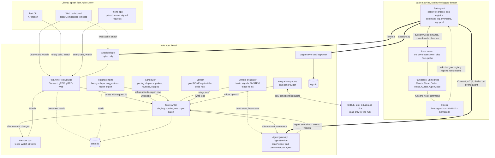

# fleet-board design

The overview: what the product is, the system picture, the words we use, and where each fact
lives. It links to the owner of each fact and does not restate it
([ADR 0026](adr/0026-one-home-per-fact.md)).

**Order of authority** when documents disagree: the protos ([`api/fleet/`](../api/fleet/)), then the
ADRs (the newest wins), then the specs (with [defaults](specs/defaults.md) for every number), then
the overview pages (this page, [features](features.md), the [plan](plan/v1-implementation-plan.md)).
The old flow pages are retired; each workflow is told once, in its spec.

## Where to look

- What the product does for you, by release: [features.md](features.md).
- Decisions: [docs/adr/](adr/README.md). Specs: [docs/specs/](specs/README.md). Every tunable
  number: [defaults](specs/defaults.md).
- Build order and what each PR proves: [v1 plan](plan/v1-implementation-plan.md).
- The clickable mockup: [`mockup/`](../mockup/README.md). Facts checked by running the harnesses:
  [research/verified-facts.md](research/verified-facts.md).
- How agents work on this repo: [AGENTS.md](../AGENTS.md).

## Goal

A controller for a fleet of AI coding workers, for people who pay for harness subscriptions (Claude,
ChatGPT/Codex, Muse, Cursor, others later) because API pricing is too expensive, and want full value from
them.

A **worker** is a machine (physical, VM or container, any OS) with a harness signed in to a
subscription account. Claude Code, Codex, Muse and Cursor (its CLI, `cursor-agent`) have a native
`/goal` and are supported in full; Cursor joined on 2026-10-05
([ADR 0027](adr/0027-cursor-first-class-copilot-and-messaging-later.md)). OpenCode is also in
scope: inventoried and attachable, no `/goal` yet, and never auto-dispatched on an Anthropic
subscription. GitHub Copilot comes later. The controller:

- tracks every worker, session and issue on one kanban,
- tracks **weekly usage** of every harness account, which is the real budget,
- assigns the next suitable issue to a worker as soon as it finishes its goal, pacing work so each
  account's weekly quota is used before it resets without running out early.

This is a management tool, not a monitor. The operator mostly acts while switching between sessions
and machines, so fast switching is the core of the UI. It is meant to be self-hosted by other
people, so everything specific to one fleet (hosts, users, repos) is configuration.

## Example fleet (the author's)

Used for the mockup and first build. The hub never connects to a machine, so addresses and users are
not configuration: machines enroll and the agent reports RAM. All four have tmux, claude, codex,
muse and opencode (on macOS only on the login-shell PATH, so the agent resolves absolute paths,
[ADR 0006](adr/0006-tmux-sessions.md)).

| Host | Address | SSH user | RAM | Max active goals |
|---|---|---|---|---|
| Linuxdynasty-MacBook-Pro-14 (hub) | 192.168.1.118 | asanabria | 64 GB | 2 |
| omarchy | 192.168.1.150 | linuxdynasty | 62 GB | 2 |
| allens-Apple-MacBook-Pro | 192.168.1.232 | allen | 128 GB | 4 |
| ip-192-168-1-124 | 192.168.1.124 | linuxdynasty | 64 GB | 2 |

The author sets 4 active goals on the 128 GB machine and 2 elsewhere; the limit is a per-machine setting, not a product rule.

## Architecture

The Go programs ([ADR 0001](adr/0001-system-architecture.md)): `fleetd` (the hub), `fleet-agent`
(one per machine, running as the logged-in user) and `fleet` (the CLI), plus a React dashboard
served by `fleetd`. The proto packages carry the messages ([ADR 0017](adr/0017-contract-packages.md)).

- **Clients never talk to a machine.** The dashboard, the CLI and a phone call `FleetService` on
  `fleetd` and nothing else. Anything that must reach a machine becomes a typed command that `fleetd`
  queues for the agent ([02b](specs/02b-hub-api.md), [02m](specs/02m-hub-api-actions-and-audit.md)).
- **Machines never accept a connection.** The agent dials out and holds one long-lived stream, so a
  sleeping laptop, a container and a machine behind NAT work alike. The hub machine runs its own agent
  over loopback, so there is one code path ([ADR 0004](adr/0004-agent-connectivity.md)).
- **One writer.** Every change to `state.db` goes through the store writer, one transaction per batch;
  commands go to the gateway only after the commit ([03f](specs/03f-hub-internals.md)).
- **The agent is the only thing that touches tmux and the harness.** It types literal text and named
  keys and reads goal files and the screen. It never reads a harness credential, and there is no shell
  string anywhere in the protocol ([01e](specs/01e-security-and-privacy.md)).
- **Hooks never talk to the hub.** A harness hook runs a local command that asks the agent which goal
  it belongs to ([01d](specs/01d-goal-hooks.md)).
- **Providers are read-only.** The syncers poll GitHub for work items and change requests; claims,
  pushes and merges happen inside goals, by the harness, with the developer's own tools
  ([ADR 0005](adr/0005-github-app.md), [03j](specs/03j-provider-sync-and-trust.md)).
- **Dispatch is part of v1 and off until the owner turns it on**
  ([ADR 0025](adr/0025-v1-includes-dispatch.md)).

## Where each topic lives

| Topic | Owner |
|---|---|
| Goal protocol: the goal file's first line, hooks, goal identity | [01d](specs/01d-goal-hooks.md), [02h](specs/02h-goal-binding-and-pane-signals.md), [03l](specs/03l-goal-lifecycle-and-verification.md) |
| Dispatching a goal (`StartGoal`) | [02h](specs/02h-goal-binding-and-pane-signals.md), [03c](specs/03c-goals.md) |
| When a worker is free: `DONE` is a claim, verified before freeing | [03l](specs/03l-goal-lifecycle-and-verification.md), [03h](specs/03h-goal-phases-in-depth.md) |
| Work item stages, goal phases, routines | [03m](specs/03m-work-source-and-code-host-sync.md), [03l](specs/03l-goal-lifecycle-and-verification.md), [03i](specs/03i-routines.md) |
| Agent connection: enroll, connect, reconnect, the end that stops `run` | [02g](specs/02g-agent-security.md), [03](specs/03-workflows.md) W1, [03n](specs/03n-reconnect.md) W2, [02i](specs/02i-delivery-and-sequencing.md) |
| Reliability: nudges, cooldown, review-loop cap, preflight, failed starts | [03h](specs/03h-goal-phases-in-depth.md) |
| The dashboard views | [ui-contract-map](specs/ui-contract-map.md), [05](specs/05-insights.md), [05b](specs/05b-observability.md) |
| Scheduling by weekly or monthly usage, reading usage | [03b](specs/03b-usage-and-sync.md) |
| Dispatch rules (who may start what, where) | [03c](specs/03c-goals.md) |
| Safety rails: typed commands, typing gates, approvals, trust, scopes | [01e](specs/01e-security-and-privacy.md), [02d](specs/02d-hub-authz.md), [02g](specs/02g-agent-security.md), [03j](specs/03j-provider-sync-and-trust.md) |
| Deployment, the `fleet` CLI, configuration | [02j](specs/02j-hub-runtime.md), [02k](specs/02k-v1-surface-and-cli.md), [02m](specs/02m-hub-api-actions-and-audit.md) |
| Milestones | [plan, section 1](plan/v1-implementation-plan.md#1-what-v1-is-and-is-not) |
| Every number (timeouts, caps, intervals, defaults) | [defaults](specs/defaults.md) |

## Glossary

Plain words first; the proto name is in brackets.

| Term | Meaning |
|---|---|
| **account** | A harness subscription or API key whose usage is a budget. Usage belongs to the account, never to a machine, so every machine signed in to it draws on the same pool [`Account`, `AccountKey`] |
| **agent** | The small program (`fleet-agent`) on each machine. It watches tmux and does what the hub asks |
| **API token** | A long secret string a script sends instead of signing in; it acts for the person who made it [`CreateApiToken`] |
| **approval** | A decision only a person may make: answer a permission prompt, confirm a destructive command or a risky dispatch. Silence never approves [`Approval`, `DecideApproval`] |
| **attach ticket** | A short-lived, single-use secret that a browser terminal attach must carry, so a page on another site cannot open one [`CreateAttachTicket`] |
| **claim URL** | The one-time owner invite `fleetd` prints on first run; whoever opens it becomes the owner |
| **consent** | What a goal may do beyond editing files: push, open a PR, merge. The repo's list (else the fleet default), narrowed by the account's [`ConsentAct`] |
| **cron** | A short way to write a schedule, such as "every Monday at 7 in the morning" |
| **delivery class** | How hard the agent tries to deliver an event: may be dropped, latest per key wins, or never dropped [`DeliveryClass`] |
| **drain** | Finish current work, take nothing new, never kill [`Drain`, `DrainMachine`] |
| **epoch** | A counter that only goes up: one per hub-to-agent connection, one for settings after a restore. A command from another epoch is refused [`HelloAck.epoch`, `settings_epoch`] |
| **`gh`** | GitHub's command-line tool. Harnesses use it to push and open PRs, so the fleet checks it is signed in |
| **goal** | One job handed to a harness, like "get issue #12 merged". Every dispatch attempt is a new goal [`Goal`, `GoalDefinition`, `GoalStatus`] |
| **goal file** | The file whose first line says how the goal is going: the objective while working, `BLOCKED: ...`, or `DONE`. The agent writes the first version (not where the repo ships its own hooks), the model updates it, and hooks only read it ([02h](specs/02h-goal-binding-and-pane-signals.md) step 12, [01d](specs/01d-goal-hooks.md)) [`GoalState`, `GoalLineState`] |
| **goal registry** | The agent's table that ties a goal to a pane, the one goal identity for every harness [`GoalRegistration`] |
| **harness** | The AI coding tool itself, unmodified, in a tmux pane: Claude Code, Codex, Muse, Cursor (`cursor-agent`), OpenCode. Never run headless, never touched for credentials |
| **heartbeat** | The agent's regular "I am alive" message; too many missed make a machine `STALE`, then `OFFLINE` [`Heartbeat`] |
| **hub** | The main program (`fleetd`) on one machine. It keeps track of everything |
| **insight** | A number the hub computes from its own rows with no model: efficiency, outcomes, where work gets stuck [`GetInsights`] |
| **launchd and systemd** | The built-in tools that keep a program running on a Mac (launchd) and on Linux (systemd). "User" units run as you, with no root |
| **limit wait** | A held phase for a goal whose harness hit a usage limit; the hub resumes it at the reset [`GOAL_PHASE_LIMIT_WAIT`] |
| **local policy ceiling** | The machine's own file saying what the fleet may do there. Hub settings can only tighten it |
| **observed goal** | A goal you started yourself in your own pane. The fleet sees it but never starts, nudges or controls it [`obs-` ids, binding `OBSERVED`] |
| **operation** | The handle a hub action returns at once when it makes an agent do something; its final state arrives through `Watch` [`Operation`] |
| **OTLP** | A standard way to send a program's numbers and traces to a monitoring tool. Off unless you turn it on |
| **outbox** | The hub's table of commands for agents, committed with the decision that caused them and sent after commit, so a crash loses nothing |
| **pacing** | The scheduler's per-account decision: compare usage with the burn-down line and allow more or fewer concurrent goals [`AccountPacing`, `PacingState`] |
| **pane, window, session** | tmux's own words; a pane is one terminal. A pane is keyed by server, server start and pane id [`PaneKey`, `Session`] |
| **phase, phase class** | The hub's conclusion about a goal (starting, running, waiting, paused, verifying, merged...). Its class decides which slots it holds: active, held or ended [`GoalPhase`] |
| **preflight** | The agent's read-only check that a goal can start here. The hub adds its own checks, each Block, Confirm, Warn or Info [`Preflight`] |
| **principal, role, scope** | Who asked, what role they hold (viewer, operator, owner) and the scopes the role grants (`READ`, `SESSIONS_WRITE`, `APPROVALS`, `SETTINGS`, `ADMIN`, `LOGS`). `LOGS` reads stored terminal logs and is owner-only by default, because logs can hold anything that was on screen [`Principal`, `Role`, `Scope`] |
| **probe** | An idle harness session on a hidden tmux server that runs the harness's usage command on a schedule and yields usage readings. One per account [`EnsureProbe`, `UsageReading`] |
| **request_id** | A client-made idempotency key on every mutating call: the same key and body returns the stored answer and nothing reaches an agent twice |
| **reserve** | The share of the weekly quota the fleet never spends, so you can still use the harness yourself [`reserve_percent`] |
| **resume token** | An opaque position in the hub's change log, so a reconnecting client continues without a full reload [`WatchResponse.resume_token`] |
| **routine** | Recurring fleet work that is not an issue (a dependency sweep, the weekly report); each run is an ordinary goal [`Routine`] |
| **scratch directory** | A directory the agent owns for a goal with no repository, such as the weekly report [`EnsureScratch`] |
| **seq** | Three unrelated counters: per agent (`Event.seq`), per hub epoch (`Command.seq`) and hub-wide for clients (`hub_seq`). Gaps are normal |
| **snapshot** | The agent's full picture of its machine, sent after every connect; it supersedes older events [`Snapshot`] |
| **spec and status** | Every editable hub resource splits in two: `spec` is what a person or the hub decided (versioned), `status` is what was observed (never versioned) |
| **suggestion** | A fixed rule over the insights, with its evidence. It advises and never changes a setting [`Suggestion`] |
| **System signal** | One of the health checks the hub judges about itself and its agents. One leaving OK raises one triage item; unknown raises nothing [`SystemSignalKind`] |
| **Tailnet** | Your private network of devices made by Tailscale, a VPN service. Optional, v3 only |
| **triage** | The "needs you" list: a prompt, a stuck goal, a pacing alert. Items expire on their own [`TriageItem`, `TriageKind`] |
| **trusted-issues gate** | The rule that only a work item opened or labelled by an allow-listed person is auto-dispatched. It fails closed [`WorkItem.trust`] |
| **view session** | The grouped tmux session the agent makes for one browser attach, so the developer's own client never moves |
| **Watch** | The live feed: one resumable server stream per dashboard tab, with a filter per topic [`FleetService.Watch`, `TopicSubscription`] |
| **WebSocket** | A connection that stays open, so the browser and the hub can pass terminal text back and forth as it happens |
| **weekly report** | The built-in routine where a subscription harness writes a summary of the hub's numbers, on spare quota only; its text is untrusted [`InsightReport`] |
| **work item, change request** | The provider-neutral names for an issue or ticket and for a pull or merge request. A work item drives a goal; a change request is how its result is verified |
| **worktree** | A second copy of the repo folder for a job, made by the agent, so two jobs do not trip over each other [`EnsureWorktree`] |
