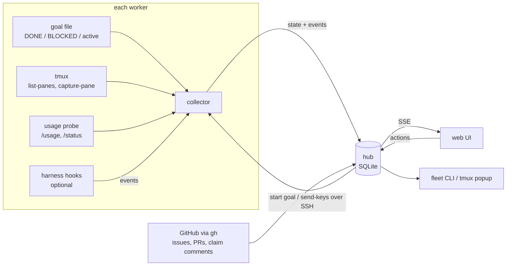
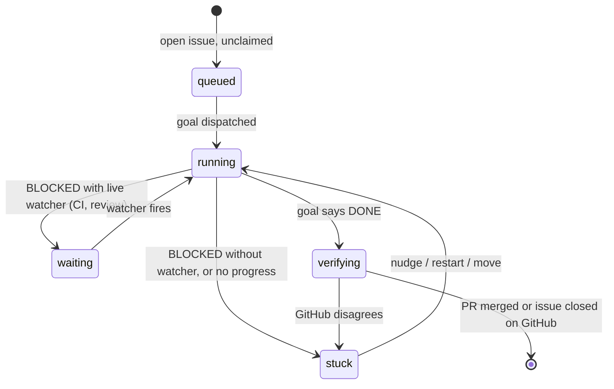

# fleet-board design

Status: agreed direction, pre-implementation (2026-09-28).
Implementation decisions: [docs/adr/](adr/README.md). Where this document or the
mockup shows the hub running `ssh … tmux …`, [ADR 0004](adr/0004-agent-connectivity.md)
supersedes it: agents dial out and receive typed commands.
Mockup: [`mockup/`](../mockup/) (see [mockup/README.md](../mockup/README.md)).

## Goal

A controller for a fleet of AI coding workers, for people who pay for
harness subscriptions (Claude, ChatGPT/Codex, Muse, others later) because API
pricing is too expensive, and want full value from them.

A **worker** is a machine (physical, VM or container, any OS, CPU and memory)
with a harness signed in to a subscription account. The controller:

- tracks every worker, session and GitHub issue on one kanban,
- tracks **weekly usage** of every harness account, which is the real budget,
- assigns the next suitable issue to a worker as soon as it finishes its goal,
  pacing work so each account's weekly quota is used before it resets without
  running out early.

This is a management tool, not a monitor. The operator mostly acts while
switching between sessions and machines, so fast switching is the core of the
UI. It is meant to be self-hosted by other people, so everything specific to
one fleet (hosts, users, repos) is configuration.

## Example fleet (the author's)

The table below is the author's fleet, used for the mockup and first build.

| Host | Address | SSH user | RAM | Max active goals |
|---|---|---|---|---|
| Linuxdynasty-MacBook-Pro-14 (hub) | 192.168.1.118 | asanabria | 64 GB | 2 |
| omarchy | 192.168.1.150 | linuxdynasty | 62 GB | 2 |
| allens-Apple-MacBook-Pro | 192.168.1.232 | allen | 128 GB | 4 |
| ip-192-168-1-124 | 192.168.1.124 | linuxdynasty | 64 GB | 2 |

Rule: 128 GB machine runs up to 4 active goals, everything else up to 2. Limits are
configurable per machine.

All four have tmux, claude, codex and muse. On the macOS remotes these are only
on the login-shell PATH (`/opt/homebrew/bin`, `~/.local/bin`). A plain
`ssh host tmux ...` does not find them. See [Verified facts](#verified-facts).

## Architecture



Inputs per worker, from most general to most specific:

1. **tmux** (polled): every pane, its command, last activity, a text preview.
   Works for any process.
2. **Goal file** (polled): the state of the goal the session is driving. This
   is the main status source (see [Goal protocol](#goal-protocol)).
3. **Usage probe** (polled): one idle session per harness account running the
   harness's status command (see [Reading usage](#reading-usage)).
4. **Hooks** (pushed, optional): instant "waiting on a permission prompt",
   "turn finished".

A worker without hooks still shows up through tmux and its goal file.

All inputs are normalized to one event shape before they reach the hub:

```json
{"machine": "omarchy", "harness": "claude", "account": "claude-max",
 "session": "...", "tmux_pane": "0:1",
 "type": "goal|turn_end|permission|heartbeat|usage", "payload": {}, "ts": "..."}
```

## Goal protocol

Work runs as **goals**, not as a series of prompts. Each dispatched session
gets one goal and keeps working until the goal is complete. Claude, Codex and
Muse all support this (`/goal`), and a goal runs through CI and review until
the issue is merged or closed.

The reference setup is the eshu repo (`eshu-hq/eshu`):

- `/goal consent <acts> -- <text>` writes the goal file
  (`.claude/active-goal.<session_id>` for Claude; `.muse/hooks/` has the same
  pair for Muse). The `CONSENT:` line records what the owner already allowed.
- A `Stop` hook (`goal-continue.sh`) refuses to end the turn while the goal is
  unfinished, so nobody has to type "continue".
- The `eshu-issue-driver` skill takes an issue to merged or closed: a worktree
  per leaf, a claim comment on the issue, review, CI, merge.
- Questions do not go to the owner. Anything the agent cannot settle goes to
  an arbiter model.

The first line of the goal file is the state the collector reads:

| First line | Meaning | Controller |
|---|---|---|
| (goal text) | working | running |
| `BLOCKED: <reason> WATCH=<live pid>` | waiting on something outside the machine (CI, review) | waiting; normal |
| `BLOCKED: <reason> OWNER=<who> ACTION=<what>` | needs a named person to act | Triage, owner notified once |
| `BLOCKED: <reason>` (no watcher, dead pid, or no owner) | stuck | Triage as "recovery required" |
| `DONE` | agent says the goal is met | verify on GitHub, then free the worker |

**fleet-board ships a generic version of this** (goal file, `DONE`/`BLOCKED`
states, and a Stop hook per harness) as its worker protocol, so users without
eshu's hooks get the same "start it and walk away" behavior. Eshu is the first
and most complete implementation.

### Dispatching a goal

Dispatch is one command: create a worktree for the issue, start the harness in
it, and send

```
/goal consent push, pr-open, merge -- drive <owner/repo>#<n> to merged
```

Default consent for dispatched goals is **push, pr-open, merge** (granted by
the owner on 2026-09-28). It is configurable per repo.

### When a worker is free

The agent writes its own goal file, so `DONE` is a claim, not proof. A worker
is free only when the goal says `DONE` **and** GitHub agrees: the linked PR is
merged, or the issue is closed. If they disagree, the goal goes to Triage.

A `BLOCKED` line must say how it gets unblocked: a live watcher, or an owner
and an action (rule adopted from Paperclip). The owner is notified exactly
once per block; leaving and re-entering Blocked is a new block. A `BLOCKED`
line that names neither is treated as stuck, never as waiting.

### Claims

The issue driver posts a claim comment on the issue before its first edit. The
controller reads claim comments and never dispatches an issue that is already
claimed, by this fleet or anyone else.

## Primary object: the work item

Machines and harness accounts are resources. Goals are how work runs. The thing
being managed is the work item (an issue or a PR) moving through a lifecycle:



CI failures and review rounds happen inside the goal, driven by the agents.
Separate PR jobs (fix checks, address reviews) are only for PRs that no goal
owns.

## Reliability rules

Adopted from Paperclip (see [research/paperclip.md](research/paperclip.md)):

- **One corrective nudge.** A goal that stops without `DONE` or a valid
  `BLOCKED` line gets exactly one automatic nudge ("write DONE or BLOCKED
  with an owner or watcher"). If it stops again, it goes to Triage.
- **Escalating cooldown.** After 2 consecutive runs with no progress (no new
  commits, no goal-file change), the goal is paused with a cooldown that grows
  from 2 to 30 minutes before the next nudge.
- **Review-loop cap.** After 3 consecutive CI-fix or review rounds on the same
  PR with no merge, the goal is paused and escalated to Triage.
- **Preflight before dispatch.** On the target machine, check that the harness
  is signed in (usage probe answers), `gh` can push to the repo, the checkout
  exists, the folder is trusted, and disk has room. Refuse with a named reason
  (`harness_not_signed_in`, `push_access_missing`, `checkout_missing`,
  `folder_untrusted`, `disk_low`).
- **No catch-up floods.** After a hub outage or a reset, dispatch resumes at
  the normal pace; it never starts every backlog item at once.
- **Review each stopped state once.** Stuck and verifying states are
  fingerprinted (goal line + head commit + PR state) so the same state is
  never raised twice.

## Views

| View | Job | Key actions |
|---|---|---|
| Triage (home) | One ranked decisions feed: permission prompts, blocked goals by chip (needs decision, recovery required, external wait, owner paused), `DONE` claims GitHub disagrees with, pacing alerts. Items expire after 7 days; snooze per item | `j`/`k` move, `a` act, `s` snooze, `o` open |
| Work | What should run next | Board by lifecycle stage, dispatch a goal for an issue, take over a PR no goal owns |
| Session | Step into one session | Sidebar of all sessions on all machines, pane, send keys, attach, move, restart, stop; run history per goal (restarts, nudges, usage consumed, transcript path) |
| Usage | Is any subscription idle or going to waste? | One waste line per account (left, reset, goals running, projected unused), weekly burn-down per account, API-key spend |
| Machines | Manage the machines | Drain / resume, goal-hook status per harness, attach line, audit log; a timeline of which goal ran where and when (7 days) |
| Settings | Configure the fleet | Repos, consent, reserves, limits with their layer, integrations, privacy, `fleet.yaml` |

On every view: a summary strip (working, needs you, stuck, free slots, usage
left per agent), `⌘K` or `/` jump-to switcher, `n` next session that needs
you, `1`–`6` switch views. Planned: the same switcher as a tmux popup
(`prefix + F`).

## Scheduling: weekly usage is the budget

Usage belongs to the **account**, not the machine. Every machine signed in to
one account draws from the same weekly pool, so the unit the scheduler plans
for is the **harness account**, and the unit it places work on is
**(host × harness × account)**.

The weekly limit is the budget. Short windows (Claude's session window, Muse's
"Current") are only speed limits: "can it start right now?"

Subscription quota expires at each reset, so the scheduler treats it as
expiring inventory:

1. **Rank accounts by what would be wasted.** Prefer the account with the most
   unused weekly quota relative to time left before its reset.
2. **Pace against a burn-down line.** Target used % at time *t* is
   `(elapsed ÷ window) × (100 − reserve)`. Ahead of the line: fewer
   concurrent workers on that account. Behind it: more. In the last ~24 hours
   before reset, loosen the cap so quota is not left unused.
3. **Keep the owner's reserve.** A reserve percentage per harness is never
   used by the fleet, so the owner can still use the harness interactively.
4. **Never start work the budget can't cover.** Each issue gets a size
   estimate (S/M/L from triage); actual cost per size is learned from history.
   An issue running at 2–3× its estimate is paused and flagged.
5. **At the reserve line:** stop dispatching new work to that account and raise
   a pacing alert in Triage; running goals continue. Automatically pausing
   running goals there (with the harness's own `/goal pause`, or an interrupt
   where a harness has none) is an opt-in setting, off by default.
6. **Cap concurrency per account.** Weekly budget left does not mean ten
   sessions can run at once; the short window and per-account limits still
   apply. The cap is learned from observed short-window behavior.
   Only **active** goals count here; goals waiting on a watcher use almost no
   quota.
7. **Read reset times from the harness.** Resets are per account (for example
   Claude Sep 30 10 pm, Codex Oct 4 9:29 pm, Muse Oct 4 8 pm), not a calendar
   week.
8. **Track every limit bucket.** Claude reports a weekly limit for all models
   and a separate one for Fable. An account is exhausted when any bucket the
   work needs is.

### Reading usage

Each harness has an in-app status command that shows remaining usage (checked
2026-09-28):

| Harness | Command | Short window | Weekly |
|---|---|---|---|
| Claude Code 2.1.284 | `/usage` | "Current session … % used · Resets 11:40pm" | "Current week (all models) … 81% used · Resets Sep 30 at 10pm", plus "Current week (Fable)" |
| Codex 0.157.1 | `/status` | none shown | "Weekly limit: … 58% left (resets 9:29 PM on 4 Oct)" |
| Muse Code 1.4.0 | `/usage` (`/status` shows session tokens only) | "Current 0% used · Resets at 9:06 PM" | "Weekly 2% used · Resets Oct 4 at 8:00 PM" |

None of the three has a CLI subcommand for this; they are slash commands in the
interactive app. The collector reads them by keeping **one idle probe session
per harness account** in its own tmux server, sending the command, capturing
the pane, and parsing it. Status commands do not call the model, so probing
costs no quota. One probe per account is enough because usage is per account.

The status command is the source of truth. The Codex session log
(`rate_limits` in `~/.codex/sessions`) showed 81% used on 2026-09-27; `/status`
on 2026-09-28 showed 58% left with a later reset. Logs are only a fallback.

Each parser is tested against captured screens from each harness version. A
screen that no longer parses is reported as "unknown", never guessed.

## Dispatch rules

- Machine must be online, not draining, have the harness installed, and have a
  free **active** slot and a free **total** slot.
- **Two limits per machine.** A goal until merge holds its worker for hours or
  days, much of it in `BLOCKED … WATCH=` waiting on CI or review, using RAM but
  almost no quota. So each machine has `max_active` (goals using quota, set
  by the RAM rule: 4 on 128 GB, 2 elsewhere) and `max_total` (active plus
  waiting, bounded by RAM and disk for worktrees).
- The issue must be open, watched, and **unclaimed** (no claim comment from
  anyone).
- The harness account must be under its pacing line and above the owner's
  reserve (see [Scheduling](#scheduling-weekly-usage-is-the-budget)).
- Unknown usage (parser failed) is never picked automatically.
- Prefer machines other than the hub, then the one with the most free slots.
- **One agent per PR branch.** Two agents on one branch would push over each
  other.
- Work is dispatched as a goal (see [Dispatching a goal](#dispatching-a-goal)).
  Separate PR jobs (fix failing checks, address review comments, rebase) are
  only for PRs that no goal owns.

## Safety rails

- Every state-changing action shows the exact command first
  (`tmux send-keys`, `tmux new-window`, `kill-window`) and needs a confirm.
- Every action is written to the audit log: who, what, where, when.
- Permission prompts (a menu, not free text) never auto-apply. Destructive
  ones (for example `docker compose down -v`) always default to No.
- Dispatched goals carry explicit consent in the goal file (`CONSENT:` line).
  Default is push, pr-open, merge; anything else (force-push, releases,
  deleting branches others own) is never granted by default.
- A goal's `DONE` frees its worker only after GitHub confirms the merge or
  close.
- Send-to-pane is only enabled when the pane is confirmed to be waiting on a
  prompt. Today that is Claude (via its `Notification` hook). Codex and Muse
  are notice-only until waiting detection is verified.
- Drain means "finish current work, take nothing new". It never kills.
- **Trusted issues only.** Issue bodies are untrusted input to an agent with
  push and merge rights. Auto-dispatch only takes issues opened or labelled
  `agent-ready` by an allow-listed user; anything else needs a manual dispatch
  (low-trust idea from Paperclip).
- The audit log is permanent, filterable and exportable (CSV).
- Moving a session only carries pushed work. The collector should warn about
  uncommitted changes in the worktree before a move.
- The hub listens only on the Tailscale interface. Browser terminal attach
  requires login.

## Deployment and CLI

- Two modes (from Paperclip): `local_trusted` (hub on localhost, no login) and
  `authenticated` (login required; private over Tailscale/LAN, or public). The
  first login uses a one-time claim URL printed by the hub.
- `fleet` CLI: `--json` output is the stable interface, exit codes 0/1,
  `FLEET_URL` and `FLEET_TOKEN` env vars for scripts, `--yes` required for
  destructive commands (stop, drain, delete).
- `fleet export` / `fleet import`: `fleet.yaml` plus goal-protocol hooks, no
  secrets, `--dry-run` first; imported machines start drained.

## Configuration

```yaml
hub: 192.168.1.118
repos:
  - eshu-hq/eshu
dispatch:
  consent: [push, pr-open, merge]   # written into every dispatched goal
  prefer_non_hub: true
  one_agent_per_branch: true
  pacing: even            # burn-down line; loosens in the last 24h before reset
accounts:                 # usage is per account, shared by every machine on it
  - harness: claude
    name: claude-max
    reserve_percent: 25   # never used by the fleet; kept for the owner
  - harness: codex
    name: chatgpt-pro
    reserve_percent: 10
  - harness: muse
    name: muse-power
    reserve_percent: 10
machines:
  - name: allens-Apple-MacBook-Pro
    host: allen@192.168.1.232
    ram_gb: 128
    max_active: 4         # goals using quota
    max_total: 8          # active + waiting on CI/review
    accounts: [claude-max, chatgpt-pro, muse-power]
  # ...
```

Watched repos are configurable. Default is `eshu-hq/eshu`.

## Verified facts

Checked on 2026-09-28. Re-verify before relying on them.

| Fact | How it was checked |
|---|---|
| Claude `/usage`, Codex `/status` and Muse `/usage` show weekly usage and reset times; none has a CLI subcommand | Ran each in a throwaway tmux server, `tmux capture-pane` (Claude Code 2.1.284, codex-cli 0.157.1, Muse Code 1.4.0) |
| Claude reports separate weekly buckets: all models, and Fable | Claude `/usage` output |
| Each harness asks to trust a new folder before it starts | Same probe; Claude, Codex and Muse all prompt |
| Codex session logs also carry `rate_limits` (`used_percent`, `window_minutes` 10080, `resets_at`), but can be stale | `rg '"rate_limits"' ~/.codex/sessions/.../rollout-*.jsonl` vs `/status` a day later |
| Codex has hooks (`hooks.json`, events like `UserPromptSubmit`, `PostToolUse`) and a `notify` program for turn-ended | `codex features list` → `hooks stable true`; `~/.codex/config.toml` |
| Codex resumes with `codex resume --last` | `codex --help` |
| Muse hooks come through plugins; `muse plugins hook test <plugin-id>:<hook-id>` | `muse plugins --help` (Muse Code 1.4.0) |
| Muse sessions live in `~/.local/share/muse/sessions/`; resumes with `muse resume --last` | `ls`, `muse --help` |
| Muse schema has a detailed approval model; mentions `quota` once | `muse schema generate-json-schema --out DIR` then `rg` |
| Tools on macOS remotes are only on the login-shell PATH | `ssh allen@192.168.1.232 'zsh -lic "command -v tmux claude codex muse"'` |
| RAM per machine | `sysctl hw.memsize` (macOS), `/proc/meminfo` (Linux) |
| Eshu goal file states (`DONE`, `BLOCKED: … WATCH=<pid>`, `CONSENT:`) and the Stop hook that keeps a goal running | `eshu-hq/eshu` `.claude/hooks/goal-continue.sh`, `docs/internal/agent-hooks.md` |
| Eshu issue driver posts a claim comment and drives an issue to merged/closed | `eshu-hq/eshu` `.agents/skills/eshu-issue-driver/SKILL.md` |
| Codex and Muse `/goal` run until the goal is complete, like Claude's | Owner, 2026-09-28 (not yet probed by the controller) |
| Anthropic paused (June 15, 2026) a change that would move `claude -p`, Agent SDK and third-party app usage off subscription limits; interactive Claude Code stays on them | support.claude.com article 15036540, last updated June 16, 2026 |
| Paperclip shows subscription quota windows but does not schedule on them | docs.paperclip.ing `/guides/day-to-day/costs/` |

## Open questions

- **Terms of service.** Researched 2026-09-28, see
  [research/terms-of-service.md](research/terms-of-service.md). Anthropic is
  the highest risk: its Consumer Terms bar access "through automated or
  non-human means" and its limits assume "ordinary, individual usage".
  OpenAI documents multi-machine sign-in and is lowest risk. Meta's
  subscription and Muse supplemental terms are not read yet. Hard product
  rule from Anthropic's Claude Code terms: never collect, store or proxy
  credentials; only drive the unmodified harness binaries. Get written
  confirmation from each provider before offering fleet-board to others.
- **Merge churn.** Goals merge their own PRs, so the owner's review time is not
  the limit, but many goals merging into one repo at once means rebases, CI
  queue time and conflicts. Likely needs a cap on parallel goals per repo.
- **Generic goal protocol.** The file format and Stop hook each harness needs
  for users who do not have eshu's hooks. Codex and Muse hook payloads must be
  probed per version, as eshu's own hook doc warns.
- **Which issues are agent-ready.** Proposed: an `agent-ready` label set after
  an LLM triage pass (ready / needs owner / too big) that the owner approves.
- **Containers and VMs.** Long-lived workers for v1. Throwaway workers would
  make the hub a provisioner and need harness logins baked in; deferred.
- **Folder trust.** Every harness asks to trust a new folder before starting.
  Dispatch must trust the worktree base once, or answer the prompt.
- **Probe placement.** Where the one-per-account usage probe runs, and what
  happens when that machine is asleep.
- **Muse hook events.** Answered 2026-10-02 in
  [01d](specs/01d-goal-hooks.md#muse-hooks-are-a-plugin-package): user-level
  hooks are a plugin package; 19 events including `Stop`. The `Stop` probe
  (same day) confirmed `decision: block` continues the turn, and found that
  Muse hooks do not see the pane environment, so they recognise fleet goals
  by `cwd`/`session_id` instead of `FLEET_GOAL_ID`.
- **Codex and Muse waiting detection.** Needed before Send-to-pane is enabled
  for them.
- **Collector PATH strategy.** Record absolute tool paths at install time
  (preferred: fast and deterministic) or run everything through `zsh -lc`.
- **Tailscale.** Installed on the hub but stopped; not found on the others.

## Milestones

1. **v1 read-only.** Go hub + collector on all four machines: tmux panes,
   goal files, weekly usage for all three harnesses via status-command
   probes, `gh` PRs and issues, burn-down line per account. Session, Usage and Machines views on
   live data. OTEL spans and metrics on the collector poll loop and hub ingest
   from the start.
2. **v2 dispatch.** Read goal files, verify `DONE` against GitHub, dispatch
   goals into new worktrees with default consent, read claim comments, active
   and total limits, drain / resume, audit log persisted in the hub. Includes
   the reliability rules (preflight, one corrective nudge, cooldown,
   review-loop cap, fingerprinting), the trusted-issues gate, and the
   `fleet` CLI contract.
3. **v3 remote.** Tailscale on every machine, hub bound to the tailnet, browser
   terminal attach with login, push notifications for blocking prompts only.
