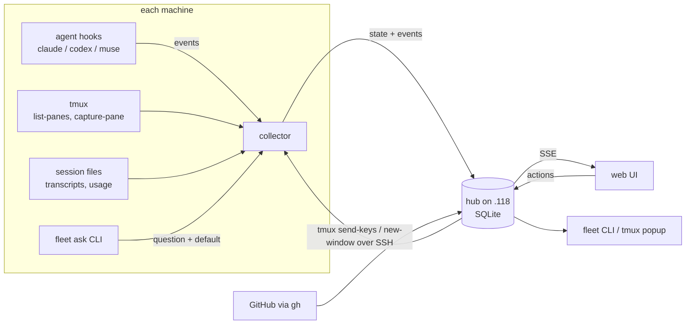
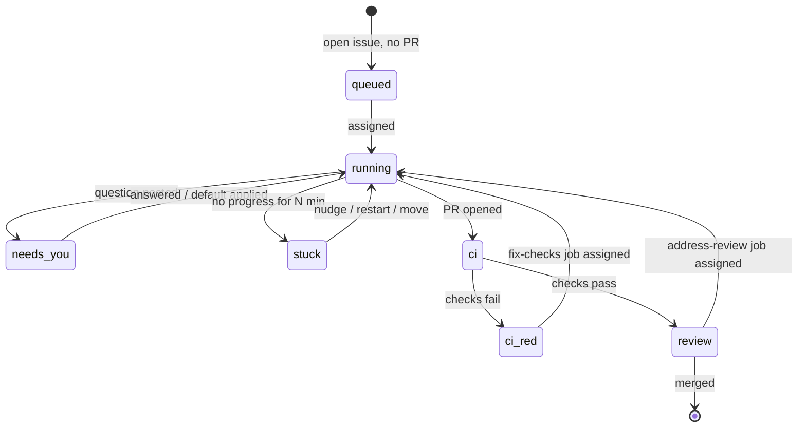

# fleet-board design

Status: agreed direction, pre-implementation (2026-09-28).
Mockup: [`mockup/`](../mockup/) (see [mockup/README.md](../mockup/README.md)).

## Goal

Actively manage coding agents (Claude Code, Codex, Muse, and others later)
running in tmux across several machines on the home network: see what every
session is doing, answer questions, unstick stuck work, and assign issues and
PRs to machines with free capacity.

This is a management tool, not a monitor. The operator mostly acts while
switching between sessions and machines, so fast switching is the core of the
UI.

## Machines

| Host | Address | SSH user | RAM | Max agents |
|---|---|---|---|---|
| Linuxdynasty-MacBook-Pro-14 (hub) | 192.168.1.118 | asanabria | 64 GB | 2 |
| omarchy | 192.168.1.150 | linuxdynasty | 62 GB | 2 |
| allens-Apple-MacBook-Pro | 192.168.1.232 | allen | 128 GB | 4 |
| ip-192-168-1-124 | 192.168.1.124 | linuxdynasty | 64 GB | 2 |

Rule: 128 GB machine runs up to 4 agents, everything else up to 2. Limits are
configurable per machine.

All four have tmux, claude, codex and muse. On the macOS remotes these are only
on the login-shell PATH (`/opt/homebrew/bin`, `~/.local/bin`). A plain
`ssh host tmux ...` does not find them. See [Verified facts](#verified-facts).

## Architecture



Three inputs per machine, from most general to most specific:

1. **tmux** (polled): every pane, its command, last activity, a text preview,
   stuck detection (output unchanged for N minutes). Works for any process.
2. **Session files** (one reader per agent): task list, last message, repo,
   branch, usage limits.
3. **Hooks / notify** (pushed): instant "waiting on you", "turn finished",
   "tool failed".

An agent without hooks still shows up through tmux, with less detail.

All inputs are normalized to one event shape before they reach the hub:

```json
{"machine": "omarchy", "agent": "claude", "session": "...", "tmux_pane": "0:1",
 "type": "question|turn_end|tool|heartbeat|usage", "payload": {}, "ts": "..."}
```

### Questions without hooks

Agents post questions with a small CLI that returns immediately:

```
fleet ask "Store hub state in SQLite or keep it in memory?" --default sqlite
```

Any agent can run a shell command, so one line in CLAUDE.md / AGENTS.md makes
all of them report questions the same way. The agent keeps going with the
default; the question shows up in Triage with a countdown.

## Primary object: the work item

Machines and agent usage are resources. Sessions are how work runs. The thing
being managed is the work item (an issue or a PR) moving through a lifecycle:



Automation hangs off transitions ("CI went red → suggest a fix-checks job").
Default autonomy is **suggest, then approve**. Nothing starts on its own.

## Views

| View | Job | Key actions |
|---|---|---|
| Triage (home) | What needs me right now | `j`/`k` move, `a` act, `d` accept default, `s` snooze, `o` open |
| Work | What should run next | Board by lifecycle stage, assign agent to issue or PR, pick PR job |
| Session | Step into one session | Sidebar of all sessions on all machines, pane, send keys, attach, move, restart, stop |
| Fleet | Manage the machines | Drain / resume, agent limits, capacity, settings, audit log |

On every view: a summary strip (working, needs you, stuck, free slots, usage
left per agent), `⌘K` or `/` jump-to switcher, `n` next session that needs
you, `1`–`4` switch views. Planned: the same switcher as a tmux popup
(`prefix + F`).

## Dispatch rules

- Machine must be online, not draining, have tmux and the agent installed, and
  have a free slot.
- Agent must have at least `headroom_min_percent` (default 25) left in its
  tightest usage window. **Usage is per account, not per machine**: every
  machine signed in to one account draws from the same pool.
- Unknown usage (no reader yet) is never picked automatically.
- Prefer machines other than the hub, then the one with the most free slots.
- **One agent per PR branch.** Two agents on one branch would push over each
  other.
- PR jobs: fix failing checks, address review comments, rebase and resolve
  conflicts, continue the work.

## Safety rails

- Every state-changing action shows the exact command first
  (`tmux send-keys`, `tmux new-window`, `kill-window`) and needs a confirm.
- Every action is written to the audit log: who, what, where, when.
- Permission prompts (a menu, not free text) never auto-apply. Destructive
  ones (for example `docker compose down -v`) always default to No.
- Send-to-pane is only enabled when the pane is confirmed to be waiting on a
  prompt. Today that is Claude (via its `Notification` hook). Codex and Muse
  are notice-only until waiting detection is verified.
- Drain means "finish current work, take nothing new". It never kills.
- Moving a session only carries pushed work. The collector should warn about
  uncommitted changes in the worktree before a move.
- The hub listens only on the Tailscale interface. Browser terminal attach
  requires login.

## Configuration

```yaml
hub: 192.168.1.118
repos:
  - eshu-hq/eshu
dispatch:
  headroom_min_percent: 25
  prefer_non_hub: true
  one_agent_per_branch: true
agents: [claude, codex, muse]
machines:
  - name: allens-Apple-MacBook-Pro
    host: allen@192.168.1.232
    ram_gb: 128
    max_agents: 4
  # ...
```

Watched repos are configurable. Default is `eshu-hq/eshu`.

## Verified facts

Checked on 2026-09-28. Re-verify before relying on them.

| Fact | How it was checked |
|---|---|
| Codex writes usage to its session logs: `rate_limits.primary.used_percent`, `window_minutes` (10080 = weekly), `resets_at` | `rg '"rate_limits"' ~/.codex/sessions/2026/09/27/rollout-*.jsonl` (codex-cli 0.157.1) |
| Codex has hooks (`hooks.json`, events like `UserPromptSubmit`, `PostToolUse`) and a `notify` program for turn-ended | `codex features list` → `hooks stable true`; `~/.codex/config.toml` |
| Codex resumes with `codex resume --last` | `codex --help` |
| Muse hooks come through plugins; `muse plugins hook test <plugin-id>:<hook-id>` | `muse plugins --help` (Muse Code 1.4.0) |
| Muse sessions live in `~/.local/share/muse/sessions/`; resumes with `muse resume --last` | `ls`, `muse --help` |
| Muse schema has a detailed approval model; mentions `quota` once | `muse schema generate-json-schema --out DIR` then `rg` |
| Tools on macOS remotes are only on the login-shell PATH | `ssh allen@192.168.1.232 'zsh -lic "command -v tmux claude codex muse"'` |
| RAM per machine | `sysctl hw.memsize` (macOS), `/proc/meminfo` (Linux) |

## Open questions

- **Claude usage source.** No usage fields found in local transcripts. Need to
  confirm what Claude Code exposes (statusline input, `/usage`, limit
  messages) before the dispatcher can trust Claude headroom.
- **Muse hook events and usage.** Plugin hooks exist; event names and a usage
  source are not confirmed.
- **Codex and Muse waiting detection.** Needed before Send-to-pane is enabled
  for them.
- **Collector PATH strategy.** Record absolute tool paths at install time
  (preferred: fast and deterministic) or run everything through `zsh -lc`.
- **Tailscale.** Installed on the hub but stopped; not found on the others.

## Milestones

1. **v1 read-only.** Go hub + collector on all four machines: tmux panes,
   session files, Codex usage, `gh` PRs and issues. Session and Fleet views on
   live data. OTEL spans and metrics on the collector poll loop and hub ingest
   from the start.
2. **v2 actions.** `fleet ask`, send answers (Claude first), assign agents to
   issues and PRs, drain / resume, audit log persisted in the hub.
3. **v3 remote.** Tailscale on every machine, hub bound to the tailnet, browser
   terminal attach with login, push notifications for blocking prompts only.
