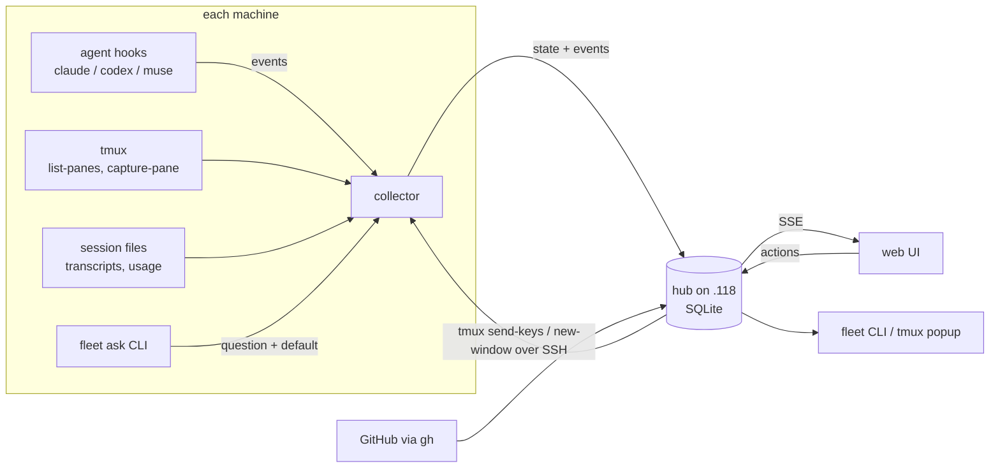
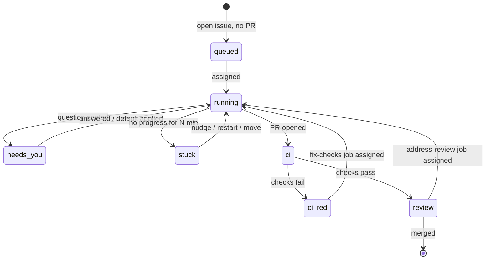

# fleet-board design

Status: agreed direction, pre-implementation (2026-09-28).
Mockup: [`mockup/`](../mockup/) (see [mockup/README.md](../mockup/README.md)).

## Goal

A controller for a fleet of AI coding workers, for people who pay for
harness subscriptions (Claude, ChatGPT/Codex, Muse, others later) because API
pricing is too expensive, and want full value from them.

A **worker** is a machine (physical, VM or container, any OS, CPU and memory)
with a harness signed in to a subscription account. The controller:

- tracks every worker, session and GitHub issue on one kanban,
- tracks **weekly usage** of every harness account, which is the real budget,
- assigns the next suitable issue to a worker as soon as it finishes its goal,
  pacing work so each account's weekly quota is used before it resets without
  running out early.

This is a management tool, not a monitor. The operator mostly acts while
switching between sessions and machines, so fast switching is the core of the
UI. It is meant to be self-hosted by other people, so everything specific to
one fleet (hosts, users, repos) is configuration.

## Example fleet (the author's)

The table below is the author's fleet, used for the mockup and first build.

| Host | Address | SSH user | RAM | Max agents |
|---|---|---|---|---|
| Linuxdynasty-MacBook-Pro-14 (hub) | 192.168.1.118 | asanabria | 64 GB | 2 |
| omarchy | 192.168.1.150 | linuxdynasty | 62 GB | 2 |
| allens-Apple-MacBook-Pro | 192.168.1.232 | allen | 128 GB | 4 |
| ip-192-168-1-124 | 192.168.1.124 | linuxdynasty | 64 GB | 2 |

Rule: 128 GB machine runs up to 4 agents, everything else up to 2. Limits are
configurable per machine.

All four have tmux, claude, codex and muse. On the macOS remotes these are only
on the login-shell PATH (`/opt/homebrew/bin`, `~/.local/bin`). A plain
`ssh host tmux ...` does not find them. See [Verified facts](#verified-facts).

## Architecture



Three inputs per machine, from most general to most specific:

1. **tmux** (polled): every pane, its command, last activity, a text preview,
   stuck detection (output unchanged for N minutes). Works for any process.
2. **Session files** (one reader per agent): task list, last message, repo,
   branch, usage limits.
3. **Hooks / notify** (pushed): instant "waiting on you", "turn finished",
   "tool failed".

An agent without hooks still shows up through tmux, with less detail.

All inputs are normalized to one event shape before they reach the hub:

```json
{"machine": "omarchy", "agent": "claude", "session": "...", "tmux_pane": "0:1",
 "type": "question|turn_end|tool|heartbeat|usage", "payload": {}, "ts": "..."}
```

### Questions without hooks

Agents post questions with a small CLI that returns immediately:

```
fleet ask "Store hub state in SQLite or keep it in memory?" --default sqlite
```

Any agent can run a shell command, so one line in CLAUDE.md / AGENTS.md makes
all of them report questions the same way. The agent keeps going with the
default; the question shows up in Triage with a countdown.

## Primary object: the work item

Machines and agent usage are resources. Sessions are how work runs. The thing
being managed is the work item (an issue or a PR) moving through a lifecycle:



Automation hangs off transitions ("CI went red → suggest a fix-checks job").
Default autonomy is **suggest, then approve**. Nothing starts on its own.

## Views

| View | Job | Key actions |
|---|---|---|
| Triage (home) | What needs me right now | `j`/`k` move, `a` act, `d` accept default, `s` snooze, `o` open |
| Work | What should run next | Board by lifecycle stage, assign agent to issue or PR, pick PR job |
| Session | Step into one session | Sidebar of all sessions on all machines, pane, send keys, attach, move, restart, stop |
| Fleet | Manage the machines | Drain / resume, agent limits, capacity, settings, audit log |

On every view: a summary strip (working, needs you, stuck, free slots, usage
left per agent), `⌘K` or `/` jump-to switcher, `n` next session that needs
you, `1`–`4` switch views. Planned: the same switcher as a tmux popup
(`prefix + F`).

## Scheduling: weekly usage is the budget

Usage belongs to the **account**, not the machine. Every machine signed in to
one account draws from the same weekly pool, so the unit the scheduler plans
for is the **harness account**, and the unit it places work on is
**(host × harness × account)**.

The weekly limit is the budget. Short windows (Claude's session window, Muse's
"Current") are only speed limits: "can it start right now?"

Subscription quota expires at each reset, so the scheduler treats it as
expiring inventory:

1. **Rank accounts by what would be wasted.** Prefer the account with the most
   unused weekly quota relative to time left before its reset.
2. **Pace against a burn-down line.** Target used % at time *t* is
   `(elapsed ÷ window) × (100 − reserve)`. Ahead of the line: fewer
   concurrent workers on that account. Behind it: more. In the last ~24 hours
   before reset, loosen the cap so quota is not left unused.
3. **Keep the owner's reserve.** A reserve percentage per harness is never
   used by the fleet, so the owner can still use the harness interactively.
4. **Never start work the budget can't cover.** Each issue gets a size
   estimate (S/M/L from triage); actual cost per size is learned from history.
   An issue running at 2–3× its estimate is paused and flagged.
5. **At the reserve line:** finish the current step, push work in progress to
   the branch, pause, resume after the reset.
6. **Cap concurrency per account.** Weekly budget left does not mean ten
   sessions can run at once; the short window and per-account limits still
   apply. The cap is learned from observed short-window behavior.
7. **Read reset times from the harness.** Resets are per account (for example
   Claude Sep 30 10 pm, Codex Oct 4 9:29 pm, Muse Oct 4 8 pm), not a calendar
   week.
8. **Track every limit bucket.** Claude reports a weekly limit for all models
   and a separate one for Fable. An account is exhausted when any bucket the
   work needs is.

### Reading usage

Each harness has an in-app status command that shows remaining usage (checked
2026-09-28):

| Harness | Command | Short window | Weekly |
|---|---|---|---|
| Claude Code 2.1.284 | `/usage` | "Current session … % used · Resets 11:40pm" | "Current week (all models) … 81% used · Resets Sep 30 at 10pm", plus "Current week (Fable)" |
| Codex 0.157.1 | `/status` | none shown | "Weekly limit: … 58% left (resets 9:29 PM on 4 Oct)" |
| Muse Code 1.4.0 | `/usage` (`/status` shows session tokens only) | "Current 0% used · Resets at 9:06 PM" | "Weekly 2% used · Resets Oct 4 at 8:00 PM" |

None of the three has a CLI subcommand for this; they are slash commands in the
interactive app. The collector reads them by keeping **one idle probe session
per harness account** in its own tmux server, sending the command, capturing
the pane, and parsing it. Status commands do not call the model, so probing
costs no quota. One probe per account is enough because usage is per account.

The status command is the source of truth. The Codex session log
(`rate_limits` in `~/.codex/sessions`) showed 81% used on 2026-09-27; `/status`
on 2026-09-28 showed 58% left with a later reset. Logs are only a fallback.

Each parser is tested against captured screens from each harness version. A
screen that no longer parses is reported as "unknown", never guessed.

## Dispatch rules

- Machine must be online, not draining, have the harness installed, and have a
  free slot.
- The harness account must be under its pacing line and above the owner's
  reserve (see [Scheduling](#scheduling-weekly-usage-is-the-budget)).
- Unknown usage (parser failed) is never picked automatically.
- Prefer machines other than the hub, then the one with the most free slots.
- **One agent per PR branch.** Two agents on one branch would push over each
  other.
- PR jobs: fix failing checks, address review comments, rebase and resolve
  conflicts, continue the work.

## Safety rails

- Every state-changing action shows the exact command first
  (`tmux send-keys`, `tmux new-window`, `kill-window`) and needs a confirm.
- Every action is written to the audit log: who, what, where, when.
- Permission prompts (a menu, not free text) never auto-apply. Destructive
  ones (for example `docker compose down -v`) always default to No.
- Send-to-pane is only enabled when the pane is confirmed to be waiting on a
  prompt. Today that is Claude (via its `Notification` hook). Codex and Muse
  are notice-only until waiting detection is verified.
- Drain means "finish current work, take nothing new". It never kills.
- Moving a session only carries pushed work. The collector should warn about
  uncommitted changes in the worktree before a move.
- The hub listens only on the Tailscale interface. Browser terminal attach
  requires login.

## Configuration

```yaml
hub: 192.168.1.118
repos:
  - eshu-hq/eshu
dispatch:
  prefer_non_hub: true
  one_agent_per_branch: true
  pacing: even            # burn-down line; loosens in the last 24h before reset
accounts:                 # usage is per account, shared by every machine on it
  - harness: claude
    name: claude-max
    reserve_percent: 25   # never used by the fleet; kept for the owner
  - harness: codex
    name: chatgpt-pro
    reserve_percent: 10
  - harness: muse
    name: muse-power
    reserve_percent: 10
machines:
  - name: allens-Apple-MacBook-Pro
    host: allen@192.168.1.232
    ram_gb: 128
    max_agents: 4
    accounts: [claude-max, chatgpt-pro, muse-power]
  # ...
```

Watched repos are configurable. Default is `eshu-hq/eshu`.

## Verified facts

Checked on 2026-09-28. Re-verify before relying on them.

| Fact | How it was checked |
|---|---|
| Claude `/usage`, Codex `/status` and Muse `/usage` show weekly usage and reset times; none has a CLI subcommand | Ran each in a throwaway tmux server, `tmux capture-pane` (Claude Code 2.1.284, codex-cli 0.157.1, Muse Code 1.4.0) |
| Claude reports separate weekly buckets: all models, and Fable | Claude `/usage` output |
| Each harness asks to trust a new folder before it starts | Same probe; Claude, Codex and Muse all prompt |
| Codex session logs also carry `rate_limits` (`used_percent`, `window_minutes` 10080, `resets_at`), but can be stale | `rg '"rate_limits"' ~/.codex/sessions/.../rollout-*.jsonl` vs `/status` a day later |
| Codex has hooks (`hooks.json`, events like `UserPromptSubmit`, `PostToolUse`) and a `notify` program for turn-ended | `codex features list` → `hooks stable true`; `~/.codex/config.toml` |
| Codex resumes with `codex resume --last` | `codex --help` |
| Muse hooks come through plugins; `muse plugins hook test <plugin-id>:<hook-id>` | `muse plugins --help` (Muse Code 1.4.0) |
| Muse sessions live in `~/.local/share/muse/sessions/`; resumes with `muse resume --last` | `ls`, `muse --help` |
| Muse schema has a detailed approval model; mentions `quota` once | `muse schema generate-json-schema --out DIR` then `rg` |
| Tools on macOS remotes are only on the login-shell PATH | `ssh allen@192.168.1.232 'zsh -lic "command -v tmux claude codex muse"'` |
| RAM per machine | `sysctl hw.memsize` (macOS), `/proc/meminfo` (Linux) |

## Open questions

- **Terms of service.** Running subscription accounts unattended, around the
  clock, across many machines may conflict with provider usage policies. Not
  yet checked for any harness. Must be verified before offering this to
  anyone else.
- **What counts as done.** Proposed: PR open and CI green, checked by the
  controller, never taken from the agent's word. Worker is free at that point;
  review follow-ups go back into the queue.
- **Review capacity.** A WIP limit on "In review" so the fleet can't produce
  PRs faster than the owner can review them. Limit not set yet.
- **Which issues are agent-ready.** Proposed: an `agent-ready` label set after
  an LLM triage pass (ready / needs owner / too big) that the owner approves.
- **Containers and VMs.** Long-lived workers for v1. Throwaway workers would
  make the hub a provisioner and need harness logins baked in; deferred.
- **Probe placement.** Where the one-per-account usage probe runs, and what
  happens when that machine is asleep.
- **Muse hook events.** Plugin hooks exist; event names are not confirmed.
- **Codex and Muse waiting detection.** Needed before Send-to-pane is enabled
  for them.
- **Collector PATH strategy.** Record absolute tool paths at install time
  (preferred: fast and deterministic) or run everything through `zsh -lc`.
- **Tailscale.** Installed on the hub but stopped; not found on the others.

## Milestones

1. **v1 read-only.** Go hub + collector on all four machines: tmux panes,
   session files, weekly usage for all three harnesses via status-command
   probes, `gh` PRs and issues, burn-down line per account. Session and Fleet views on
   live data. OTEL spans and metrics on the collector poll loop and hub ingest
   from the start.
2. **v2 actions.** `fleet ask`, send answers (Claude first), assign agents to
   issues and PRs, drain / resume, audit log persisted in the hub.
3. **v3 remote.** Tailscale on every machine, hub bound to the tailnet, browser
   terminal attach with login, push notifications for blocking prompts only.
