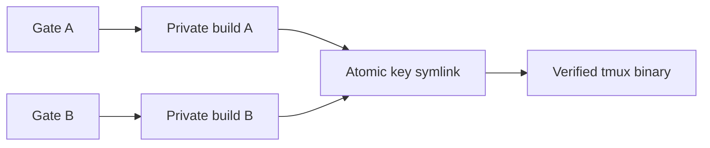

# Agent engineering guide

What [AGENTS.md](../../AGENTS.md) does not say: recipes, traps, the role and
model table, the task-to-skill map, the handoff contract and how to run a role.
The rules themselves (git hygiene, PR and CI, evidence, escalation, security,
documentation, the local gates) are only in AGENTS.md.

## Operating standard

- Understand the flow before editing. Each workflow is told once, in
  [03-workflows.md](../specs/03-workflows.md) and its parts 03b to 03n.
- Fix root causes. A symptom fix that hides a race, swallows an error or
  serializes work is a failure.
- Account for invalid input, empty and stale state, partial failure, duplicates,
  retries, ordering, idempotency and a restart in the middle of a command.
- Product code is not written ahead of its row in
  [the v1 plan](../plan/v1-implementation-plan.md). Until a row lands, `docs/` and
  `api/` are the product.

## Worktrees and git recipes

- One worktree per task:
  `git worktree add ~/personal-repos/fleet-board-worktrees/<name> -b <branch> origin/main`.
  Verify `pwd` before any edit.
- Formatters, generators and `go mod tidy` run only in a worktree, including for
  diagnostics.
- With several worktrees, compare with `git diff`, `git show <ref>:<path>` or a
  throwaway worktree, never `git stash` (one shared stash stack).
- After a push, confirm it landed:
  `git ls-remote origin <branch>` equals `git rev-parse HEAD`.
- Never `git push --force`. Use `--force-with-lease` only for an authorized
  rebase of your own pushed branch.
- Isolate formatter drift into its own commit so the real diff stays reviewable.

## Prove the theory first

Before building on a theory about performance or behavior, run the cheapest
experiment that could falsify it, on representative data:

- store and durability: a program like `spikes/sqlite/` against the real driver,
  pragmas and filesystem;
- compression and volume: `spikes/zstdchunk/` on real terminal output;
- harness behavior: a throwaway-server probe (`fleet-live-probe`);
- code paths: a Go benchmark with `benchstat`.

[04-technology-review.md](../specs/04-technology-review.md) did exactly this and
records what is and is not proven. A diagnosis is a theory too: state a cause
only with the observation behind it, and never treat one passing run as proof of
an intermittent bug. A filtered test run can silently match nothing; confirm
tests ran (`go test -list '.*' ./pkg/...`, or `-v` and read the names). Mark
claims by evidence: observed (date and version), documented (source) or
proposed; probe results follow the shape in
[01d-goal-hooks.md](../specs/01d-goal-hooks.md).

## macOS and zsh notes

- The shell is zsh, which does not word-split an unquoted `$var`. Use an array
  (`files=(a b); cmd "${files[@]}"`), `${=var}`, or a `for` over a literal list.
- zsh has no `PIPESTATUS`; use `rc=$?` right after the command, or
  `set -o pipefail`.
- `/bin/bash` is 3.2. Scripts needing `declare -A` or other bash 4 features run
  with `/opt/homebrew/bin/bash` first on `PATH`. Repo scripts here avoid them.
- `sed` is BSD: in-place is `sed -i ''`, and a pattern with paths needs a
  non-`/` delimiter. Prefer the editor tool or a heredoc for multi-line edits.
- Format, lint and check vulnerabilities with `make fmt`, `make lint` and
  `make vuln`: they use the pinned `gofumpt`, `golangci-lint` (gosec included)
  and `govulncheck` in `.bin/` (`make tools`), the same builds CI uses. The
  copies in `~/go/bin` may be older and disagree with the gate; `benchstat`
  lives there.
- Several agents on one host: separate `GOCACHE`, short `GOTMPDIR` outside the
  worktree, and no overlapping benchmark runs.

## Make targets and the pre-push guard

The `Makefile` is the one entry point; CI runs the same targets, one per step
(`.github/workflows/ci.yml`). Run `make tools gen` first in a new worktree
(`gen/` is never committed).

| Target | What it does |
|---|---|
| `tools` | builds the pinned `golangci-lint`, `gofumpt` and `govulncheck` into `.bin/`; rebuilt when a pin or the Go version changes |
| `gen` | removes `gen/`, then `buf generate` into it (Go and TypeScript), through `go run` at the pinned buf |
| `build`, `smoke` | `CGO_ENABLED=0 go build ./...`; builds each `cmd/<name>` and checks that `--version` prints its name |
| `test` | `go vet ./...`, then on the changed packages `go test -shuffle=on -count=3` (`TEST_COUNT`) and `go test -race -shuffle=on -count=1`; both use a 15-minute timeout outside `gates`; with `COVERPROFILE` set, the first pass writes its coverage profile there |
| `lint` | the pinned `golangci-lint` on the same packages, once for each of linux and darwin on amd64 and arm64 (LINT_PLATFORMS in the Makefile; cgo off; the linter reads only the files that build for its own GOOS and GOARCH, so a `_darwin.go` or `_arm64.go` file would pass the Linux amd64 CI run with one pass; the package list is worked out for each platform too). Linters and settings are in `.golangci.yml`; a `//nolint` names its linter and says why. It includes two process rules: `depguard` lets only `internal/proc`, `internal/agent/tmux` and `internal/agent/attach` import `os/exec` (or `golang.org/x/sys/execabs`) in `internal/` and `cmd/` (tests excepted), and `forbidigo` forbids starting a process any other way outside `internal/proc` (01 principle 8). Two typing rules keep every `send-keys` line in `internal/agent/tmux/typing`: `depguard` lets only `internal/agent/control`, `start`, `probe` and the `internal/agent/tmux` client import it, and `forbidigo` lets only `control`, `start` and `probe` call a `typing.New…` function; a third `depguard` rule bars `unsafe` outside tests, so no `//go:linkname` reaches a constructor (tests excepted; 01f F3); a fourth lets only test files import the tmux test rig `internal/agent/tmux/tmuxtest` |
| `vuln` | the pinned `govulncheck ./...` on every package; a known vulnerability the code can reach fails it (exit 3). Needs `gen/` and network access to vuln.go.dev |
| `test-all` | `go vet ./...`, then `go test -race -shuffle=on -count=TEST_COUNT ./...` on every package (the nightly run sets `TEST_COUNT=10`), with a coverage profile when `COVERPROFILE` is set. Not part of `gates` |
| `fuzz` | each Go fuzz target (`FuzzParse` in `internal/hub/config` and in `internal/agent/tmux`, `FuzzOutputRoundTrip`, `FuzzCheckEnrollRequest`, `FuzzText`) for `FUZZTIME` (default `60s`), one `go test -fuzz` each; the seeds already run in `test`. Not part of `gates` |
| `bench-report` | the benchmarks of the changed packages at the merge base with `BASE_REF` and at `HEAD`, `BENCH_COUNT` times each (default 10, `-benchtime` `BENCH_TIME`, default `1s`), compared by the pinned `benchstat`; a markdown report that marks REVIEW rows and fails only when a `HEAD` benchmark fails. Not part of `gates` |
| `proto-check`, `ts-check` | `buf build` and `buf lint`; the generated TypeScript compiles (`tools/tscheck`) |
| `fmt`, `fmt-check` | the pinned `gofumpt` formats, or only checks, every Go file (the same file set) |
| `mod-check`, `actionlint` | `go mod tidy -diff`; the workflow files |
| `selftest` | the seeded RED/GREEN cases of the gate scripts, including the pre-push hook |
| `diff-check` | `git diff --check` against the merge base, and a refusal of any file named like a git ref (`HEAD`, `main`, ...) |
| `doc-names` | every backticked proto name in the checked docs is in `api/fleet` (hooks.md, "Doc staleness and the folder map") |
| `doc-tables` | the generated spec tables match the proto comment tags, and every tag follows 02e, "Comment tags" |
| `telemetry-names` | every log event and metric name in non-test Go code is a static string listed in the one spec `.agents/telemetry-docs.json` maps its area to (`tools/telemetrynames`); spec names with no code are a report until plan row 17 |
| `capability-tests` | lists the v1 capabilities no product test (Go outside `scripts/` and `testdata/`, or web) names; a report (exit 0) until plan row 17 |
| `docs-stale-ci`, `docs-stale` | a change in `BASE_REF..HEAD` to a mapped folder changes one of its specs or a commit carries `No-Doc-Change: <reason>`, and changed Go packages have their three docs; `docs-stale` only prints the hook reminders |
| `gates` | all of the above (not `docs-stale`, `test-all`, `fuzz` or `bench-report`) plus the file cap, agent canon and roles check; prints the tool versions it used first. When the change reaches tmux tests, `scripts/local-tmux.sh` selects both releases pinned in `tool-versions.env`, builds missing copies in this worktree's ignored `.bin/` cache, and fails if either is unavailable or invalid. A change only to the gate, hook, installer or tmux workflow still runs the tmux packages three times and once with race checks. Its test timeout is 30 minutes because both releases run in one test binary. Direct `make test` still uses the usual tmux on `PATH` when no pin is set |
| `hooks` | turns on the pre-push guard (`core.hooksPath` is `.githooks`; once per clone, and all its worktrees share it) |

"Changed packages" come from `scripts/changed-go-packages.sh`: the files that
differ from the merge base with `BASE_REF` (default `origin/main`; CI uses the
PR's base, and on a `main` push every package), plus untracked files, plus
every package that imports one of them.
A change to `go.mod`, `go.sum`, the Makefile, `tool-versions.env`,
`.golangci.yml` or a contract (`api/`, buf config) runs every package. The race
detector needs cgo on Linux but not on macOS, so `make test` sets
`CGO_ENABLED=1` for the `-race` run on Linux only; shipped binaries stay
cgo-free. The random order and the repeats catch a test that leans on another
test or on state from an earlier run; a failure prints `-test.shuffle <seed>`,
and `go test -shuffle=<seed> -count=3` replays it (go shuffles once per test
binary, and a leak shows only on a repeat). Neither pass reuses cached
results; `make test TEST_COUNT=1` is the quick local loop. `TEST_COUNT` must
be a positive integer; anything else fails before go runs. Both passes set
`-timeout 15m` outside `gates`: the live tmux inventory suite alone runs about
9.5 minutes at `-count=3`, inside test-time variance of go's 10 minute default
(#293).

The local tmux cache is shared by gate processes in one worktree. It uses no
lock and holds no transaction open while downloading or compiling. Each process
builds in its own `.build.*` folder; after version and hash checks, one atomic
symlink publishes a complete folder under a key made from the pin, platform,
compiler, libraries and build scripts. A second process either wins the same
key or checks the winner, then removes its own folder. An interrupted build
leaves an unused folder, never a selectable tmux.

`.githooks/pre-push` is the guard for `main` (ADR 0024, decision 2: the repo is
private on a plan without branch protection). After `make hooks`, a push that
updates or deletes `main` (or `master`) on any remote is refused, and a push of
a branch runs `git fetch --quiet origin main` and then `make gates`, and is
refused if either fails (the gate measures the change against `origin/main`, so
a stale copy would make it look bigger or smaller than it is; `make gates` prints
the base SHA it used). Deleting another branch and pushing a tag run no gate and
no fetch.

The guard is opt-in per clone: until you run `make hooks`, git does not run it.
The gate checks the working tree, so the hook makes sure the tree is exactly the
commit being pushed. It refuses a push of any commit that is not the checked-out
`HEAD` (check out the branch you push, then push again), and a push while any
file is modified, staged or untracked and not ignored (`gen/`, `.bin/` and
`node_modules` are ignored). It lists up to ten paths to commit or remove. That
is the only reason the gate can vouch for the committed `HEAD`. The hook checks
again after the gate passes: if the tree or `HEAD` changed while it ran, the push
is refused ("run it again").

The guard stops mistakes: an accidental push to `main`, a push that was never
gated, a gate that an ambient variable (a parent make's `MAKEFLAGS`, a stray
`BASE_REF` from a shell profile) quietly turned into a no-op. It does not stop a
person or a process that controls the shell, and it is not a lock. To keep the
gate honest, before `make` the hook unsets `BASE_REF`, `TEST_COUNT`,
`COVERPROFILE` (a relative path writes a file into the tree the gate checks),
every `FLEET_*` variable, `MAKEFLAGS`, `MFLAGS`, `MAKEOVERRIDES`, `MAKELEVEL`,
`MAKEFILES`, `GNUMAKEFLAGS`, `GIT_DIR`, `GIT_WORK_TREE` and `GIT_INDEX_FILE`
(`TEST_COUNT=1` runs each test once, not three times; `MAKEFLAGS=n` only prints
the recipes, `=i` ignores failures, `=t` touches targets), runs make with
`GOFLAGS=-count=1` (harmless, but a push runs the tests without the test cache; it
is non-empty so it beats a `GOFLAGS` in the `go.env` config file, which an empty
value would not), and names the base itself (`make BASE_REF=origin/main gates`;
the command line beats the environment inside make).

Trust boundary. The hook trusts the local environment and git configuration:
`BASH_ENV`, `git update-index --assume-unchanged` and `.git/info/exclude` (they
hide changes from the clean-tree check), `GIT_CONFIG_*` and `core.hooksPath`,
`PATH`, the tools in `.bin`, and the `origin` remote that `main` is fetched from,
which the gate takes as the base (an `origin` that serves a moved `main` makes the
change look empty to `make test` and `make lint`). Using any of these to get
around the gate is a deliberate bypass, and the owner's rules forbid it, as they
forbid skipping hooks. The backstops are that CI runs the same gates on every
pull request against the PR's real base, and that the owner merges every pull
request (ADR 0024).
`scripts/test-pre-push.sh` and `scripts/test-pre-push-fetch.sh` drive the real
hook with a real `git push` to a throwaway bare repository, never to `origin`,
with a fake `make` first on `PATH` that records what the gate was given (and
exits 0 or 1).

## CI runs and the minutes budget

CI runs once per change (#107). `.github/workflows/ci.yml` runs the gates on a
pull request (opened, new commits, reopened) and on each push to `main` after a
merge; a branch push alone runs nothing, its PR does. A PR run tests and lints
the packages changed against the PR's base; a `main` push tests and lints every
package, since two PRs that pass alone can break a package neither touched. A
newer push to a PR cancels its older run; every merge to `main` gets its own
full run, never cancelled.
`.bin/` is cached, keyed on `tool-versions.env` and the Go version.
`.github/workflows/pr-meta.yml` is the quick check of the PR's own fields on
every PR event, edits included: the PR targets `main` (`scripts/check-pr-base.sh`;
every PR is based on `main`, never stacked) and its title and body carry no AI
attribution. Editing the title or body reruns only `pr-meta`.

The gates job also fails first thing on a PR whose base is not `main`. After
you change a PR's base, push again: changing the base starts no gates run, and
rerunning the old run reuses the old base (a rerun replays the original event).

`.github/workflows/macos.yml` runs `go test -race` on every package on a macOS
runner on Sundays, on demand (`gh workflow run macos`), and on a PR that
changes the file; the store's F_FULLFSYNC commits and the admin socket's
LOCAL_PEERCRED check exist only there. It fails unless those macOS-only tests
ran and passed (a skip fails). Run on demand only, it also runs the tmux tests
against tmux 3.2a and 3.7c, built and cached as in `ci.yml`; a missing tmux
fails them. macOS
minutes count ten times.

`.github/workflows/nightly.yml` runs at 07:17 UTC, on demand (`gh workflow run
nightly`), and on a PR that changes the file. It runs `make test-all` with
`TEST_COUNT=10`, then `make fuzz` on the corpus earlier nights grew (cached;
only `main` saves it), then `make vuln`, which runs even after a test or fuzz
failure. A crash uploads only the new input files (kept 14 days)
and prints the command that replays each. A scheduled night skips the work when
`main` is still at the commit the last finished scheduled night tested (a failed
one counts; its issue tracks it), except on Sundays; when that is unknown, it
runs (`scripts/nightly-should-run.sh`). The suite job
has 20 minutes; if it passes 15, lower `TEST_COUNT`, never the fuzz time.

When a `main` push or a nightly run fails, its `report` job opens an issue
titled "CI failure: <workflow> on main" with the `ci-failure` label, or comments
on the one already open; the next green run of that workflow at `main`'s tip
closes it (`scripts/ci-report-failure.sh`). The issue holds the run link, the
commit and the failed job names, never log text. The `report` job is the only
one with write access, and only to issues. On a PR it shows as skipped.

On a PR, the last gates step runs `make bench-report` and adds its table to the
job summary: the benchmarks of the changed packages at the base and at the
head, on the same runner, taking turns one sample at a time
(`scripts/bench-report.sh`). `scripts/bench-review.py` marks a
row REVIEW when benchstat calls the change significant (p < 0.05) and time per
op rose more than 10%, or allocations per op rose at all. It is a report, not a
gate: the step never fails the job, and a REVIEW row asks the reviewer to look.
A new benchmark shows as "new" (the base has none to compare). On an M4 Pro,
running all base samples before all head samples made the same code look 8%
slower with p = 0.002; taking turns, two such runs showed no significant row.
A shared runner is noisier, so a time REVIEW near 10% may still be noise; an
allocation REVIEW is not.

Coverage is a report, not a gate (#107; no minimum and no rule against a
drop). In the gates job, `make test` runs with `COVERPROFILE` set,
and the next step adds a table to the job summary: for each package it tested
(every package on a `main` push), the share of statements the tests ran,
leaving out the generated code in `gen/` (`scripts/coverage-report.py`). The
nightly run does the same for `make test-all` and uploads the whole profile as
the `coverage-profile` artifact (kept 14 days); `go tool cover
-html=cover.out` shows it line by line.

The plan includes 2000 GitHub Actions minutes a month. Estimates, in minutes
a month (typical / worst case):

| Workflow | Runs on | Typical | Worst | Status |
|---|---|---|---|---|
| `ci.yml` gates on PRs | PR opened, new commits, reopened | ~383 | ~599 | built; tmux steps (row 7) only on a change that reaches tmux (below) |
| `pr-meta.yml` | every PR event, edits included | ~100 | ~100 | built (#107) |
| `ci.yml` on `main` pushes | each merge: every package, plus the report job | ~183 | ~318 | built (#107); tmux steps as above |
| nightly | daily, skipped when `main` did not move since the last night (Sundays always run) | ~390 | ~520 | built (#107) |
| macOS weekly | Sundays, on demand, and PRs that change it | ~260 | ~394 | built (#107); the tmux steps run on demand only: none typical, one dispatch a month at most in the worst case (below) |
| perf report | PRs whose changed packages hold a benchmark | ~48 | ~48 | built (#107) |
| **Total** | | **~1364** | **~1979** | the sums of the rows above |

How the tmux steps (row 7) were counted, and what that rests on. The table's
run counts are its own assumptions, not measurements: about 21 PR runs and
10 `main` runs a month typical, 32 and 17 worst (its minutes over the 17.6
and 17.4 minute medians of the last 58 `ci.yml` runs). Real use has run far
above them: 95 merges reached `main` in the 30 days to 2026-10-10, bunched
(22 on 10-02, 22 on 10-10); at that pace every row above is low, with or
without tmux, and the owner, who approves every change to CI minutes,
decides. The tmux steps run on a change that reaches the tmux packages:
16 of the last 40 merges would have (40%, by today's import graph of
`./internal/agent/tmux/...`: `internal/proc`, `internal/telemetry`,
`gen/`, plus the build inputs; mostly `api/`, `go.mod` and the Makefile);
worst assumes 60%. Such a run adds about 1.2 minutes: 0.5 for the build
libraries and 0.7 for the real-tmux tests, run once with `-race` in their
own step (`make test` skips them; the step covers only
`./internal/agent/tmux/...`, so a package that starts using `tmuxtest`
must be added to it). A tmux build on a cache miss adds about 3: once
after a pin or script change in the PR that makes it (a PR's cache is its
own; a PR reads `main`'s but not another PR's) and once on `main` after
the merge, and again when a cache unused for 7 days was evicted. Typical:
one change, so one miss in each row; worst: two changes and two evictions
in the PR row, two misses on `main`. PRs +13 / +35, `main` +8 / +18. The
macOS tmux steps run only on a manual dispatch; the worst case allows at
most one a month, with a cache miss: (1 Homebrew + 3 build + 1 tests) x
10 = 50. At the observed pace (about 95 `main` runs and twice as many PR
runs a month) the tmux steps alone would add about 46 + 91 minutes.

A PR that adds CI minutes (a new workflow, job, trigger or a longer step)
updates this table in the same PR. The PR goes to the owner before it merges
if the typical total would pass 1800 a month, or if the worst-case total would
pass 2000 (the free allowance).

## Pinned tool versions

`tool-versions.env` is the one file that holds every pinned version: Go, Node
major, `golangci-lint`, `buf`, `gofumpt`, `govulncheck`, `actionlint`,
`benchstat` (a pseudo-version: `golang.org/x/perf` has no release tags),
`typescript`, the `protoc-gen-es` version, and the two tmux releases the tmux
tests run against with their tarball SHA-256s (`scripts/install-tmux.sh`). The Makefile includes it and CI sources it, so neither
spells out a version. `make tools` builds `golangci-lint`, `gofumpt` and
`govulncheck` with the local Go into `.bin/` (gitignored); the `golangci-lint`
on `PATH` is built with an older Go and refuses a `go 1.27` module, so the
Makefile never uses it. Four copies
that other tools force on us (`.node-version`, the `go` line of `go.mod`,
`buf.gen.yaml`, `tools/tscheck/package.json`) are kept equal by
`scripts/check-versions.sh`. To upgrade a tool, change the file in a dedicated
PR (ADR 0020), run that script, and read the release notes.

## Tiers, roles and models

Quality comes from the gates, which pass or fail the same way for every author,
and from scope boxing: a weaker model gets a narrow, pre-verified task and
limited tools. The skills hold the method; the role files only bind role,
access and model. Roles and models are defined once in
[.agents/roles.json](../../.agents/roles.json), the only place a tier's model
changes. A subagent never changes its own model. OpenCode's and Cursor's models
stay a session choice: the tier table below does not apply to them, and a
Cursor role runs on the session's model.

| Tier | Claude | Codex | Muse | Cost posture |
|---|---|---|---|---|
| fast | haiku | gpt-6-luna (high) | muse-spark-1.3 (low) | cheapest; scanning only |
| workhorse | sonnet | gpt-6-sol (medium) | muse-spark-1.3 (high) | the default for real work |
| deep | opus | gpt-6-sol (high) | muse-wonder-full-1.0 (xhigh) | only on escalation |
| arbiter | fable | gpt-6-astra (high) | muse-wonder-full-1.0 (xhigh) | only for rulings |

| Role | Tier | Access | Skill | Job |
|---|---|---|---|---|
| `scan-fleet` | fast | read | - | bounded evidence scan with `file:line` citations; no verdicts or fixes |
| `develop-fleet` | workhorse | write | loads by surface | implement a scoped handoff test-first, run focused gates, commit; coordinator pushes |
| `develop-fleet-deep` | deep | write | same | concurrency, single-writer store, agent wire protocol, tmux control mode, or a fix the workhorse got wrong |
| `debug-fleet` | workhorse | read | `fleet-diagnostic-rigor` | root cause without editing, returns an implementation handoff |
| `debug-fleet-deep` | deep | read | same | cross-system or intermittent causes |
| `perf-fleet` | workhorse | read | `fleet-performance-rigor` | measurement and bottleneck, no editing |
| `perf-fleet-deep` | deep | read | same | hard performance causes and architecture decisions |
| `review-fleet` | workhorse | read | `fleet-code-review` | independent diff review; the coordinator runs the spec and standards axes as two reviewers in parallel and writes one verdict |
| `review-fleet-deep` | deep | read | same | review of a difficult diff |
| `arbiter-fleet` | arbiter | read | - | binding ruling starting `RULING:` |

**Start cheap, escalate on evidence.** Scan with `scan-fleet` before reading
widely yourself. Default to the workhorse. Escalate to `-deep` on a trigger: the
surface is concurrency, the single-writer store, the agent wire protocol
(delivery, epochs, idempotency) or tmux control mode; a workhorse attempt failed
review or tests for a reason it could not fix; or the cause stayed unknown after
a workhorse pass. Give the deep role the failed attempt's evidence, not a blank
slate. Do not run a deep role to double-check a result you can verify with a
command. Keep handoffs small: the task, the files, the acceptance test, the
skills. Context re-sent to every agent is the largest avoidable cost.

## Task-to-skill map

Load the skills for the surface you touch, in this order (the one-line "use
when" of each skill is in AGENTS.md "Skill Routing").

| Task | Skills |
|---|---|
| Go package, CLI, hub or agent logic | `fleet-go` |
| New or changed RPC, message, field | `fleet-contract-rigor`, then `fleet-go` |
| Hub storage, migrations, log persistence | `fleet-sqlite-store`, `fleet-go` |
| Screen parser, new harness version | `fleet-harness-adapter`, plus `fleet-live-probe` when the behavior is unknown |
| tmux observation or control | `fleet-tmux`, `fleet-security` |
| New metric, span, event kind | `fleet-telemetry-coverage` |
| Dashboard, Connect client, terminal attach | `fleet-frontend`, plus `fleet-contract-rigor` for API gaps |
| Auth, scopes, dispatch gate, prompts | `fleet-security` |
| Unknown cause | `fleet-diagnostic-rigor` |
| Speed, load, disk, memory | `fleet-performance-rigor` |
| Before push or merge | `fleet-code-review` |
| Issue to merged PR | `fleet-issue-driver` |
| Anything the owner reads (replies, PR and issue text, summaries) | `fleet-humanizer` |

## The handoff contract

A dispatch to a leaf role states: the goal in one sentence; the worktree path
and branch; the acceptance test or evidence wanted; the files in scope and out
of scope; the skills to load; the gates to run; what to return. Every return
lists commands with exit codes (`PASS`, `FAIL`, `NOT_CHECKED`), `file:line`
evidence, remaining uncertainty and the next action. The orchestrator
re-verifies a subagent's finding itself before acting on it or passing it on as
verified. Commit before dispatching a reviewer so a stray edit is recoverable.
Read-only roles never edit, switch branches or publish; if a command is blocked
for them, the coordinator supplies its exact output.

## Dispatch and escalation rules

- Executors work in one worktree on one surface at a time; two executors never
  share a worktree.
- Stop leaf agents when their handoff is consumed.
- Ask `arbiter-fleet` one question per ruling, with the raw observations in the
  brief; record the `RULING:` in the goal file or PR.
- The active goal authorizes the acts needed to complete it. Scope approval is
  not permission for unrelated acts. `CONSENT:` lines record grants and are
  never invented or widened ([hooks.md](hooks.md)).

## Running a role in each harness

- **Claude Code:** the generated `.claude/agents/<role>.md` subagents; invoke by
  name (the Agent tool with `subagent_type: <role>`).
- **Codex:** `.codex/agents/<role>.toml`, or
  `python3 scripts/agent-roles.py codex-exec <role> "<task>"`.
- **Muse:** `python3 scripts/agent-roles.py muse-exec <role> "<task>"`.
- **OpenCode:** `.opencode/agent/<role>.md`; pick its model in the session.
- **Cursor:** `.cursor/agents/<role>.md`. Each role uses `model: inherit`, so it
  runs on the session's model (Auto, when the session is on Auto). Cursor also
  loads the `.claude/` and `.codex/` copies, which pin Claude and OpenAI models;
  the `.cursor/` copy wins because it has the same name. Read-only roles set
  `readonly: true` (no file edits and no state-changing shell commands; such a
  role asks the coordinator for command output it cannot produce).

`codex-exec` and `muse-exec` run a role headless. That is allowed for developing
this repo only; the product never runs a harness headless (ADR 0024, AGENTS.md
principle 1). Use `--dry-run` to print the command and prompt first.
