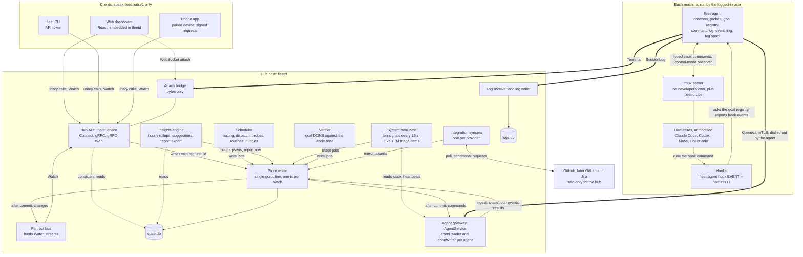
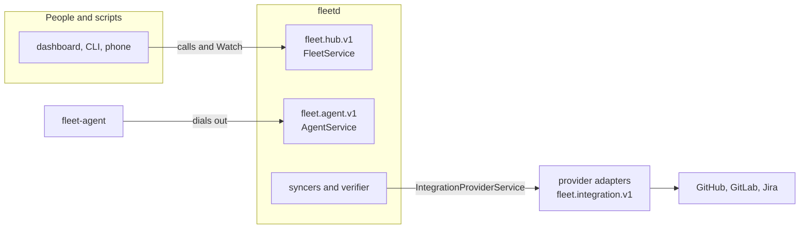

# Flows: how the parts of fleet-board talk to each other

- Status: Accepted
- Date: 2026-10-02
- Contracts: [`api/fleet/`](../../api/fleet/) (`.proto` files, the source of truth)
- Rules and reasons: [docs/specs](../specs/README.md) and [docs/adr](../adr/README.md)

fleet-board is a self-hosted hub (`fleetd`), one agent per machine (`fleet-agent`)
and a CLI (`fleet`), that together manage Claude Code, Codex, Muse and OpenCode
sessions running in tmux. The specs say what each message means and what rules
apply. This folder shows the messages **in motion**: one flow per situation, with
a plain-language summary, a diagram that uses the exact message, RPC and field
names from the protos, numbered steps that explain every arrow, what is stored
where, and what happens when something goes wrong.

It is written for two readers:

- **A developer about to implement fleet-board.** Each flow is a test script:
  who sends what, in which order, what must be committed before the next
  message goes out, and what the receiver does with a duplicate, a late or a
  missing message.
- **The owner.** Each flow answers "what exactly happens when I click this, and
  what if the machine is asleep?" without reading the specs.

## What is in this folder

| Files | Covers | Protocol |
|---|---|---|
| [README.md](README.md) (this file) | The whole system on one page, the protocol packages, the glossary, the index of flows | none |
| `agent-hub*.md`, flows A1 to A14 | `fleetd` and `fleet-agent`: joining the fleet, staying connected, commands, events, usage probing, goals, prompts, terminal bytes, logs, settings, upgrade drift, system health | [`fleet.agent.v1`](../../api/fleet/agent/v1/) |
| `dashboard*.md`, flows D1 to D13 | The web dashboard (and the CLI and a phone, which use the same calls) talking to `fleetd`: sign-in, live data, dispatching and controlling goals, prompts, terminal, machines, routines, settings, logs, pairing a phone, insights and the weekly report | [`fleet.hub.v1`](../../api/fleet/hub/v1/) |

The flow ids belong to this folder. They are **not** the capability ids (`A1`,
`A3`, `D1`, `G3` and so on) that appear in comments inside the `.proto` files and
in the capability map of [02-contracts](../specs/02-contracts.md#capability--message-map);
where a flow needs one it says "capability G3". The tables in the index below link
every flow.

Every flow has the same five parts:

1. **What happens and why.** One paragraph in plain language.
2. **A diagram.** Mermaid, so GitHub renders it: `sequenceDiagram` for messages, `stateDiagram-v2` for a state machine, `flowchart` for structure. Message, RPC, enum and field names are copied from the protos; the first time a message is named, its `.proto` file is linked.
3. **Numbered steps.** The steps follow the diagram's arrows in order and say why each message exists.
4. **What is persisted where.** Hub `state.db`, hub `logs.db`, the agent's state directory, tmux, the provider.
5. **What happens on the common failures.** Offline machine, lost message, duplicate, expired deadline, wrong state.

<!-- names:start -->

Where every message, RPC and enum named in this file is defined

| Proto file | Names |
|---|---|
| [type/v1/consent.proto](../../api/fleet/type/v1/consent.proto) | `ConsentAct` |
| [type/v1/harness.proto](../../api/fleet/type/v1/harness.proto) | `GoalLineState` |
| [type/v1/ids.proto](../../api/fleet/type/v1/ids.proto) | `AccountId`, `AccountKey`, `CommandId`, `GoalId`, `MachineId`, `PaneKey`, `SessionId` |
| [type/v1/status.proto](../../api/fleet/type/v1/status.proto) | `ErrorDetail`, `Principal`, `ReasonCode`, `Role`, `Status` |
| [agent/v1/agent.proto](../../api/fleet/agent/v1/agent.proto) | `AgentHealth`, `AgentService`, `Connect`, `Enroll`, `Heartbeat`, `Hello`, `HelloAck`, `RenewCert`, `ResultAck`, `SessionLog`, `Settings`, `Terminal` |
| [agent/v1/command.proto](../../api/fleet/agent/v1/command.proto) | `Command`, `CommandAck`, `CommandProgress`, `CommandResult` |
| [agent/v1/command_goal.proto](../../api/fleet/agent/v1/command_goal.proto) | `Drain`, `EnsureWorktree`, `Preflight`, `ReleaseGoal`, `StartGoal` |
| [agent/v1/command_scratch.proto](../../api/fleet/agent/v1/command_scratch.proto) | `CollectScratch`, `EnsureScratch` |
| [agent/v1/command_tmux.proto](../../api/fleet/agent/v1/command_tmux.proto) | `EnsureProbe` |
| [agent/v1/events.proto](../../api/fleet/agent/v1/events.proto) | `DeliveryClass`, `Event` |
| [agent/v1/snapshot.proto](../../api/fleet/agent/v1/snapshot.proto) | `GoalRegistration`, `GoalState`, `Snapshot` |
| [agent/v1/streams.proto](../../api/fleet/agent/v1/streams.proto) | `TermDown`, `TermUp` |
| [agent/v1/usage.proto](../../api/fleet/agent/v1/usage.proto) | `ProbeHealth`, `UsageReading` |
| [integration/v1/model.proto](../../api/fleet/integration/v1/model.proto) | `ChangeRequest`, `WorkItem` |
| [integration/v1/service.proto](../../api/fleet/integration/v1/service.proto) | `IntegrationProviderService`, `Watch` |
| [integration/v1/sync.proto](../../api/fleet/integration/v1/sync.proto) | `ProviderError` |
| [hub/v1/account.proto](../../api/fleet/hub/v1/account.proto) | `Account`, `AccountPacing`, `AccountSpec`, `PacingState`, `UsageReading` |
| [hub/v1/common.proto](../../api/fleet/hub/v1/common.proto) | `Operation`, `OperationKind`, `Scope` |
| [hub/v1/goal.proto](../../api/fleet/hub/v1/goal.proto) | `Goal`, `GoalDefinition`, `GoalPhase`, `GoalStatus` |
| [hub/v1/insight_report.proto](../../api/fleet/hub/v1/insight_report.proto) | `InsightReport` |
| [hub/v1/insights.proto](../../api/fleet/hub/v1/insights.proto) | `GetInsights` |
| [hub/v1/routine.proto](../../api/fleet/hub/v1/routine.proto) | `ROUTINE_BUILTIN_INSIGHTS_WEEKLY`, `Routine` |
| [hub/v1/service.proto](../../api/fleet/hub/v1/service.proto) | `ApprovePairing`, `AttachTerminal`, `ControlGoal`, `CreateApiToken`, `CreateAttachTicket`, `CreateEnrollmentToken`, `DecideApproval`, `DrainMachine`, `FleetService`, `GetOperation`, `PreflightGoal`, `ReadSessionLog`, `RequestPairing`, `RunRoutine`, `StartGoal`, `UpdateSettings`, `Watch` |
| [hub/v1/session.proto](../../api/fleet/hub/v1/session.proto) | `Session` |
| [hub/v1/settings.proto](../../api/fleet/hub/v1/settings.proto) | `HubSettings`, `Settings` |
| [hub/v1/suggestion.proto](../../api/fleet/hub/v1/suggestion.proto) | `Suggestion`, `SuggestionEvidence` |
| [hub/v1/system.proto](../../api/fleet/hub/v1/system.proto) | `GetSystemStatus`, `SystemSignalKind`, `SystemState` |
| [hub/v1/terminal.proto](../../api/fleet/hub/v1/terminal.proto) | `AttachOpen`, `AttachTerminalRequest`, `AttachTerminalResponse` |
| [hub/v1/triage.proto](../../api/fleet/hub/v1/triage.proto) | `Approval`, `TriageItem`, `TriageKind`, `TriageState` |
| [hub/v1/watch.proto](../../api/fleet/hub/v1/watch.proto) | `TopicSubscription`, `WatchRequest`, `WatchResponse` |
| [hub/v1/work.proto](../../api/fleet/hub/v1/work.proto) | `ChangeRequest`, `WorkItem` |

<!-- names:end -->

## Reading order

Read this file first. Then:

1. **The agent side, in order.** A1 to A3 (joining and reconnecting; everything else assumes them), then A4 to A6 (commands, events and usage: the vocabulary every later flow uses).
2. **The client side, in order.** D1 to D3 (sign-in, the first load, live updates).
3. **Then by topic.** Each topic has an agent flow and a dashboard flow; read them as a pair. The [index](#flow-index) says which file holds each flow.

| Topic | Agent and hub | Dashboard, CLI, phone |
|---|---|---|
| Goals: start, run, finish | A7, A8 | D4 dispatch, D6 pause, resume and "not done", D9 routines |
| Prompts and approvals | A9 | D5, D12 (from a phone) |
| Terminal in the browser | A10 | D7 |
| Session logs | A11 | D11 |
| Settings, policy, drain | A12, A13 | D10, D8 |
| Joining the fleet, signing in | A1 | D1, D12 |
| System health, insights, the weekly report | A14 | D13 (the System section is read as in A14) |

If you have a question rather than a topic:

| You want to know | Read |
|---|---|
| What happens when I enroll a machine, and why is nothing sent before the CA check? | A1 |
| What does the hub do when a laptop wakes up after eight hours? | A3 |
| Why did my click return an `Operation` and not the result? | A4, D4 |
| Which events can be dropped, and how does the hub know something was lost? | A5 |
| Where does a usage number come from, and why is an account `UNKNOWN`? | A6 |
| What exactly is typed into the harness to start a goal, and in what order? | A7 |
| What stops the fleet nudging a goal I interrupted myself? | A8, D6 |
| How is a permission prompt answered, and who may answer it? | A9, D5 |
| How does a browser tab show a live terminal? | A10, D7 |
| Why can my phone read the fleet and answer approvals, but not type into a pane or read logs? | D12 |
| Why is nothing starting, and where does the dashboard say so? | A6 (pacing), A7 (what the planner checks), D4 |
| How does the fleet tell me it is itself unhealthy, and what raises a SYSTEM item? | A14 |
| How is the weekly report written, on what quota, and what may the model see? | D13 |

## The whole system

Reading the picture:

- **Clients never talk to a machine.** The dashboard, the CLI and a phone call `FleetService` on `fleetd` and nothing else. Anything that must reach a machine becomes a typed command that `fleetd` queues for the agent and answers with an `Operation` handle (flows A4 and D4 in the [index](#flow-index)).
- **Machines never accept a connection.** The agent dials out and holds one long-lived stream, so a sleeping laptop, a container and a machine behind NAT work the same way. The hub machine runs its own agent over loopback, so there is one code path.
- **One writer.** Every change to `state.db` goes through the store writer, in one transaction per batch, and commands are handed to the gateway only after the transaction commits. A hub transaction never spans a network call.
- **The agent is the only thing that touches tmux and the harness.** It types literal text and named keys, runs allow-listed slash commands, reads goal files and the screen, and never reads a harness credential. There is no shell string and no raw exec anywhere in the protocol.
- **Hooks never talk to the hub.** A harness hook runs a local command that asks the agent which goal, if any, this hook call belongs to (matched by session id, pane or, for Muse, directory), and reports through the agent (flow A8).
- **Providers are read-only.** The syncers poll GitHub (and later others) for work items and change requests. The hub never writes to a provider; claims, pushes and merges are done inside goals, by the harness, with the developer's own tools. Sync is described in [03b](../specs/03b-usage-and-sync.md) (W4) and [03j](../specs/03j-provider-sync-and-trust.md), not as a flow in this folder.

Where each box appears in the flows:

| Box | Flows |
|---|---|
| Agent gateway (`AgentService`) | A1 to A14 |
| Store writer and `state.db` | every flow; the transaction named in each step list |
| Scheduler | A6 (probe assignment, pacing), A7 (dispatch plan), D4, D9 |
| Verifier | A8, D13 (collects the report) |
| Insights engine | D13 |
| System evaluator | A14 |
| Fan-out bus and Watch | D2, D3, and the "how the client finds out" step of every dashboard flow |
| Attach bridge | A10, D7 |
| Log receiver, `logs.db` | A11, D11 |
| Hub API and sign-in | D1 to D13 |
| Hooks | A8 |
| tmux, harnesses | A7 to A11 |

## The protocol packages and who speaks which

Four packages, one directory each under [`api/fleet/`](../../api/fleet/). The package
and service names are part of every gRPC path and every JSON client, so they were
fixed before any code existed ([ADR 0017](../adr/0017-contract-packages.md)).

| Package | Service | Client | Server | What it carries | Flows |
|---|---|---|---|---|---|
| [`fleet.agent.v1`](../../api/fleet/agent/v1/) | `AgentService`: `Enroll`, `Connect`, `Terminal`, `SessionLog`, `RenewCert` | `fleet-agent` (always the client) | `fleetd` | The agent wire: enrollment, the `Connect` stream (`Hello`, `Snapshot`, `Heartbeat`, `Event`, `Command`, results, `Settings`), terminal bytes, log chunks | A1 to A14 |
| [`fleet.hub.v1`](../../api/fleet/hub/v1/) | `FleetService`: about 100 RPCs, `Watch`, `AttachTerminal` and `ReadSessionLog` are streams | web dashboard, `fleet` CLI, phone | `fleetd` | The API for people and scripts: resources with `spec` and `status`, actions that return an `Operation`, sign-in, devices, logs, insights, system health | D1 to D13 |
| [`fleet.integration.v1`](../../api/fleet/integration/v1/) | `IntegrationProviderService` (read-only) | `fleetd` | provider adapters, in-process in v1 | The provider-neutral work model: `WorkItem`, `ChangeRequest`, cursors, validators, rate limits, typed `ProviderError` | the sync loop (03b, 03j) |
| [`fleet.type.v1`](../../api/fleet/type/v1/) | none | imported by the other three | | Ids (`MachineId`, `GoalId`, `PaneKey`), `Status`, `ReasonCode`, `ErrorDetail`, `Principal`, `Role`, settings values, harness and usage values | all |

Rules that follow from the layout:

- `fleet.hub.v1` never imports `fleet.agent.v1`. The dashboard never sees an agent wire message. Where the hub API needs the same idea it repeats it under its own name (`AttachTerminalRequest` for the browser, `TermUp` and `TermDown` for the agent; `OperationKind` repeats the numbers of `Command.kind`).
- `fleet.type.v1` imports nothing from the other packages, and a type lives there only when two protocols use it.
- The hub API is where the rules for people live: scopes, `request_id` idempotency, `expected_version`, paging, Watch. The agent wire is where the rules for machines live: epoch, `seq`, `command_id`, delivery classes, the local policy ceiling.

What is **not** a protocol in the protos:

| Thing | What it is |
|---|---|
| Hook to agent | The harness runs `fleet-agent hook <event> --harness <h>`, a local command; the agent answers from its goal registry |
| Agent to tmux | The `tmux` command line and control mode, with typed arguments; never a shell string from the hub |
| GitHub sign-in | Two plain HTTP endpoints (`GET /auth/github/start`, `GET /auth/github/callback`), because it is a browser redirect |
| Terminal in the browser | `AttachTerminalRequest` and `AttachTerminalResponse` over a WebSocket (subprotocol `fleet.attach.v1`), the same messages the CLI streams over HTTP/2 |
| Hub-local commands | On the hub host: `fleetd backup`, `restore`, `claim` and `debug agent-stream` are not RPCs on purpose (a backup holds the CA private key, the claim URL is printed only where the owner is); `fleetd enroll-token` and `token create` also exist as the RPCs `CreateEnrollmentToken` and `CreateApiToken` |

## Glossary

| Term | Meaning |
|---|---|
| **account** | A harness subscription or API key whose usage is a budget. The hub's `Account` (`AccountId`) is discovered from what the agents report; the agent identifies one by an `AccountKey`, a salted hash of the identity the harness shows on its own status screen. Usage belongs to the account, never to a machine |
| **approval** | `Approval`: a decision only a person may make (answer a permission prompt, confirm a destructive command or a risky dispatch), small enough for a phone notification. Decided with `DecideApproval`; silence never approves (`fallback = DENY`) |
| **attach ticket** | A 60 second, single-use secret from `CreateAttachTicket` that the first WebSocket frame of a browser terminal attach must carry, so a page on another site cannot open one |
| **claim URL** | The one-time owner invite `fleetd` prints on first run (`https://<origin>/invite#<token>`); whoever opens it becomes the owner |
| **consent** | The `ConsentAct` list (`PUSH`, `PR_OPEN`, `MERGE`) a goal may use beyond editing files: the repo's (else the fleet default) intersected with the account's |
| **delivery class** | `DeliveryClass` of an agent `Event`: `SHED` (may be dropped), `COALESCE` (latest per key wins), `NEVER_DROP` (kept in the ring and replayed) |
| **drain** | `Drain`: finish current work, take nothing new, never kill. Set from the hub with `DrainMachine` or locally with `fleet-agent drain`; a local drain cannot be undone from the hub |
| **epoch** | `HelloAck.epoch`: the connection epoch, `max(stored, Hello.last_epoch) + 1`, so it only ever increases. Every `Command` carries it and the agent refuses one from another epoch |
| **goal** | One unit of work handed to a harness session through the harness's own `/goal`. The hub's `Goal` has a `spec` (`GoalDefinition`) and a `status` (`GoalStatus`, with a `GoalPhase`). Every dispatch attempt is a new goal (`attempt`, `previous_goal`) |
| **goal file** | The file in the worktree whose first line is the goal's state: the objective while working, `BLOCKED: ...`, or `DONE`. The agent writes the first version; the model updates it; hooks and the agent only read it (a repo that ships its own goal hooks, such as eshu, keeps its own file: `StartGoal` skips `write_goal_file` there and the agent writes nothing). Parsed into `GoalState` (`GoalLineState`) |
| **goal registry** | The agent's table that binds a goal to a pane (`GoalRegistration`: goal, pane, harness, worktree path, harness session id). It is the one goal identity for every harness; `FLEET_GOAL_ID` in the pane environment is only a fast path for a window the fleet just created |
| **harness** | An unmodified interactive coding agent in a tmux pane: Claude Code, Codex, Muse, OpenCode. fleet-board never runs one headless and never reads its credentials |
| **heartbeat** | `Heartbeat`, every 15 s, droppable, no seq. 45 s without one is `STALE`, 3 minutes `OFFLINE` |
| **insight** | A number the hub computes from its own rows with no model: subscription efficiency (quota left unused at each reset), goal outcomes, where work gets stuck, size versus actual. Daily rollups, read with `GetInsights` |
| **LIMIT_WAIT** | `GOAL_PHASE_LIMIT_WAIT`: a held phase of up to a week for a goal whose harness hit a usage or rate limit. The hub resumes it at `limit_wait_until_time` with the harness's own resume action; no nudges meanwhile |
| **local policy ceiling** | The machine's own policy file (`~/.config/fleet-agent/policy.yaml`). Hub settings can only tighten it, never loosen it, and the agent re-checks every command against it. An invalid file puts the agent in safe mode (observe only) |
| **operation** | `Operation`: the handle every hub action that makes an agent do something returns at once, in state `PENDING`. Its id is the agent command's `CommandId`. The final state arrives through `Watch` or `GetOperation` |
| **outbox** | The hub's table of commands for agents (`pending`, `delivered`, `done`, `expired`, `failed`). A command row commits in the same transaction as the decision that caused it, and is sent after commit, so a hub crash loses nothing |
| **pacing** | The scheduler's per-account decision (`AccountPacing`, `PacingState`): compare the used percentage with the burn-down line for the time left before the reset, and allow more or fewer concurrent goals (`allowed_active`) |
| **pane key** | `PaneKey{server, server_start_id, pane_id}`: identifies a tmux pane across tmux server restarts (tmux restarts its pane ids from zero, so the server start id is part of the key). Also in the pane environment as `FLEET_PANE_KEY` |
| **phase** | `GoalPhase`: the hub's conclusion about a goal (`STARTING`, `RUNNING`, `WAITING`, `PAUSED`, `LIMIT_WAIT`, `VERIFYING`, `MERGED` and so on). Not the same as `GoalLineState`, which is only what the goal file says |
| **phase class** | The three classes of `GoalPhase` that decide what a goal occupies. `ACTIVE` uses quota (an active slot and a total slot); `HELD` keeps its worker (a total slot only); `ENDED` holds nothing. A goal is live when it is `ACTIVE` or `HELD`; the unique indexes, the slot counts and the repo cap read this one table |
| **preflight** | `Preflight`: the agent's read-only check of whether a goal can start here (harness signed in, push access, checkout, disk, and more). The hub adds its own checks with a severity (`BLOCK`, `CONFIRM`, `WARN`, `INFO`) |
| **principal, role, scope** | `Principal` is who asked (a user, an API token, a paired device, the scheduler, the arbiter, or the local OS user at a machine). A `Role` (`VIEWER`, `OPERATOR`, `OWNER` for people; `SCHEDULER` for the hub's own scheduler) maps to `Scope`s (`READ`, `SESSIONS_WRITE`, `APPROVALS`, `SETTINGS`, `ADMIN`, `LOGS`); the hub checks scopes and the agent checks the role |
| **probe** | An idle harness session on the hidden `fleet-probe` tmux server that runs the harness's usage command on a schedule (`EnsureProbe`, health in `ProbeHealth`) and yields `UsageReading`s. One probe per account |
| **request_id** | A client-generated idempotency key on every mutating hub RPC. The same key and body returns the stored response; nothing reaches an agent twice |
| **reserve** | `AccountSpec.reserve_percent`: the share of the weekly quota the fleet never spends, so the owner can still use the harness interactively. At the reserve line no new goal is dispatched (`PACING_STATE_RESERVE`) and the owner is alerted; pausing running goals there is an opt-in setting (`HubSettings.auto_pause_at_reserve`) |
| **resume token** | `WatchResponse.resume_token`: an opaque position in the hub's change log plus the subscriptions it covers. A client that reconnects, or changes its subscription, passes the last one in `WatchRequest.resume_token` and continues without a full reload |
| **routine** | `Routine`: recurring fleet work that is not an issue (dependency bumps, a weekly report), triggered by `queue_empty` or `cron`. Each run is a normal goal whose work item has kind `ROUTINE` |
| **seq** | Three unrelated counters. `Event.seq`: agent-wide, never reused, persisted by the agent. `Command.seq`: hub-issued, increasing within one epoch. `WatchResponse.hub_seq`: hub-wide order of committed changes, for clients. Gaps are normal in all three |
| **session, window, pane** | tmux's own words. `Session` in the hub API is a tmux session on any machine, the developer's own or fleet-started, with a hub-assigned `SessionId` |
| **settings generation, epoch** | Hub settings reach an agent ordered by `(settings_epoch, generation)`. A new epoch (after a hub restore) is accepted whatever its generation |
| **suggestion** | `Suggestion`: a fixed rule over the insights that fired, with its evidence numbers (`SuggestionEvidence`). It advises and never changes a setting; dismissing it hides it for 30 days. Shown in Usage, and in Triage only if the owner turns that on |
| **snapshot** | `Snapshot`: the agent's full, level-triggered picture of its machine, sent after every `Hello`. It supersedes every event with a lower `seq`; events are only an optimisation over it |
| **scratch directory** | `<agent state dir>/scratch/<goal id>/`, a directory the agent owns for a goal with no repository (the weekly report). `EnsureScratch` writes its input file, `CollectScratch` reads back the one file the goal wrote, `ReleaseGoal` removes it. The hub never sends a path |
| **spec and status** | Every editable hub resource splits in two. `spec` is what the owner or the hub decided (covered by `version` and `expected_version`); `status` is what was observed or computed (never versioned, so a heartbeat can never make an open form stale) |
| **System signal** | One of ten health checks the hub judges every 15 s (`SystemSignalKind`: agent connected, usage freshness, sync lag, writer lag, outbox backlog, Watch drops, log store usage, disk free, clock skew, backup age) with a state `OK`, `WARNING`, `CRITICAL` or `UNKNOWN`. A signal that leaves OK raises one `TRIAGE_KIND_SYSTEM` item; `UNKNOWN` raises nothing |
| **triage item** | `TriageItem`: something a person should look at (a prompt, a stuck goal, a pacing alert). Kinds in `TriageKind`, states in `TriageState`; items expire after 7 days. A prompt raises both an item (explains) and an approval (acts) |
| **weekly report** | The built-in routine `ROUTINE_BUILTIN_INSIGHTS_WEEKLY`: a subscription harness writes a markdown summary of the hub's numbers, on spare quota only, in a scratch directory. Stored as an `InsightReport`; its text is untrusted and rendered sanitized |
| **trusted-issues gate** | The hub's rule that only a work item opened or labelled by an allow-listed person is auto-dispatched, evaluated from provider evidence (`WorkItem.trust`). It fails closed |
| **view session** | The grouped tmux session (`new-session -t <session>`) the agent creates for one browser attach, so switching windows in the browser never moves the developer's own client. Marked `internal` and never listed |
| **Watch** | `FleetService.Watch`: one server stream per client view, with a filter per topic (`TopicSubscription`), an initial state, live changes, and checkpoints. Changing the subscription opens a new stream with the last resume token |
| **work item, change request** | The provider-neutral names for an issue or ticket and for a pull or merge request. A work item drives a goal; a change request is how the goal's result is verified |
| **worktree** | A git worktree the agent creates for a goal (`EnsureWorktree`) when the repo's mode is `AGENT_ENSURES`. A reused pane never gets one: it keeps its directory and the goal starts a new branch in it |

## Flow index

Agent and hub (`fleet.agent.v1`, between `fleetd` and `fleet-agent`):

| Id | Flow | One line | File |
|---|---|---|---|
| A1 | Enrollment | A one-time token carries the CA fingerprint; the agent checks the hub before sending anything, then exchanges a CSR for a client certificate | [agent-hub.md](agent-hub.md#a1-enrollment-and-certificates) |
| A2 | Connect, Hello and Snapshot | The agent dials out, says who it is, gets an epoch, and sends the full state of its machine | [agent-hub.md](agent-hub.md#a2-connect-hello-helloack-snapshot) |
| A3 | Reconnect and replay | After a sleep or a restart both sides reconcile their counters; the snapshot is the truth, the ring is history | [agent-hub.md](agent-hub.md#a3-reconnect-and-replay) |
| A4 | Command lifecycle | Outbox, `CommandAck`, `CommandProgress`, `CommandResult`, `ResultAck`, deadlines and idempotency | [agent-hub-2.md](agent-hub-2.md#a4-command-lifecycle) |
| A5 | Events and delivery classes | What may be dropped, what is replayed, and how the hub tells shedding from loss | [agent-hub-2.md](agent-hub-2.md#a5-events-delivery-classes-and-seq) |
| A6 | Usage probing | Probes read each account's usage; the readings feed pacing | [agent-hub-2.md](agent-hub-2.md#a6-usage-probing-and-the-inputs-to-pacing) |
| A7 | Starting a goal | The 14 steps of `StartGoal`, a reused pane or a new window, the registry written first | [agent-hub-3.md](agent-hub-3.md#a7-starting-a-goal) |
| A8 | A goal running | Goal file, hooks, `LIMIT_WAIT`, interrupts, nudges, verification, freeing the worker | [agent-hub-4.md](agent-hub-4.md#a8-a-goal-running) |
| A9 | Prompts and answers | A permission prompt becomes a triage item and an approval; the answer is typed once | [agent-hub-4.md](agent-hub-4.md#a9-prompts-detected-and-answered) |
| A10 | Terminal attach | A grouped view session and a PTY, bridged as bytes | [agent-hub-4.md](agent-hub-4.md#a10-terminal-attach) |
| A11 | Session logs | Compressed chunks by byte offset, acknowledged by the hub, gaps declared | [agent-hub-5.md](agent-hub-5.md#a11-session-logs) |
| A12 | Settings and policy | Layered settings merged under the local ceiling; drain | [agent-hub-5.md](agent-hub-5.md#a12-settings-and-the-local-policy-ceiling) |
| A13 | Harness upgrade drift | A harness update changes parsing support, the catalog and scheduling | [agent-hub-5.md](agent-hub-5.md#a13-harness-upgrade-drift-and-parser-support) |
| A14 | System health | `AgentHealth` rides the heartbeat; the hub judges ten signals every 15 s and raises one deduplicated SYSTEM item | [agent-hub-6.md](agent-hub-6.md#a14-system-health-how-fleetd-and-the-agents-report-on-themselves) |

Dashboard, CLI and phone (`fleet.hub.v1`, between the clients and `fleetd`):

| Id | Flow | One line | File |
|---|---|---|---|
| D1 | Sign-in | Claim URL, passkey or GitHub, API tokens; one credential per transport | [dashboard-hub-agent.md](dashboard-hub-agent.md#d1-sign-in-claim-url-passkey-github-session-api-token) |
| D2 | Dashboard load and Watch | The first load: server info, summary, one `Watch` with a subscription per topic | [dashboard-hub-agent.md](dashboard-hub-agent.md#d2-dashboard-load-getserverinfo-initial-reads-watch) |
| D3 | Live updates and resync | Dedupe, volatile fields, changing a subscription, `RESYNC_REQUIRED` | [dashboard-hub-agent-2.md](dashboard-hub-agent-2.md#d3-live-updates-resume-token-resync_required-slow-consumers) |
| D4 | Dispatch a goal end to end | Next up, `PreflightGoal`, `StartGoal`, an `Operation`, the goal appearing | [dashboard-hub-agent-2.md](dashboard-hub-agent-2.md#d4-dispatch-a-goal-end-to-end) |
| D5 | Answer a prompt end to end | Triage item, approval, `DecideApproval`, one answer in flight | [dashboard-hub-agent-2.md](dashboard-hub-agent-2.md#d5-answer-a-prompt-end-to-end-via-approvals) |
| D6 | Goal control: pause, resume, not done | `ControlGoal` by phase, and "not done" as a re-arm | [dashboard-hub-agent-3.md](dashboard-hub-agent-3.md#d6-goal-control-pause-resume-not-done-clear) |
| D7 | Terminal attach in the browser | Ticket, WebSocket, `AttachOpen`, flow control, close codes | [dashboard-hub-agent-3.md](dashboard-hub-agent-3.md#d7-terminal-attach-in-the-browser) |
| D8 | Drain a machine | `DrainMachine` cancels what has not left; running goals continue | [dashboard-hub-agent-3.md](dashboard-hub-agent-3.md#d8-drain-a-machine) |
| D9 | Run a routine | `RunRoutine` and the three done rules | [dashboard-hub-agent-4.md](dashboard-hub-agent-4.md#d9-run-a-routine) |
| D10 | Change a setting | `UpdateSettings` with `expected_version`, delivery to agents, what the machine says back | [dashboard-hub-agent-4.md](dashboard-hub-agent-4.md#d10-change-a-setting-settingsack-and-tighten-only-capping) |
| D11 | Replay a session log | Find the stored session, `ReadSessionLog`, search and delete; scope `LOGS` | [dashboard-hub-agent-4.md](dashboard-hub-agent-4.md#d11-replay-a-session-log-from-logsdb) |
| D12 | Pair a phone and approve from it | `RequestPairing`, the six-digit code, `ApprovePairing`, signed requests, `DecideApproval` | [dashboard-hub-agent-4.md](dashboard-hub-agent-4.md#d12-pair-a-phone-and-approve-from-it-with-scopes) |
| D13 | Insights, suggestions and the weekly report | Hourly rollups read with `GetInsights`, suggestion rules, and a routine that has a subscription harness write a report in a scratch directory | [dashboard-hub-agent-5.md](dashboard-hub-agent-5.md#d13-insights-suggestions-and-the-weekly-report) |

## Keeping the flows true

- The `.proto` files are the contract. If a flow and a proto disagree, the proto is right and the flow is a bug. Until the first implementation release is tagged `v0.1` the contracts are unfrozen (ADR 0019), so names can change; `buf build` and `buf lint` do not check these documents, so a rename must update the flows that use the name.
- The specs ([02](../specs/02-contracts.md) to [03j](../specs/03j-provider-sync-and-trust.md)) own the rules and the numbers; the flows link to them instead of repeating every table.
- The step list under a diagram follows its arrows in order, so a reviewer can check a diagram against its text and an implementer can turn each step into a test.
