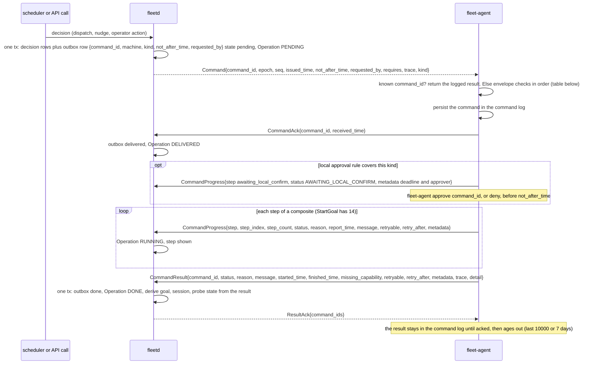
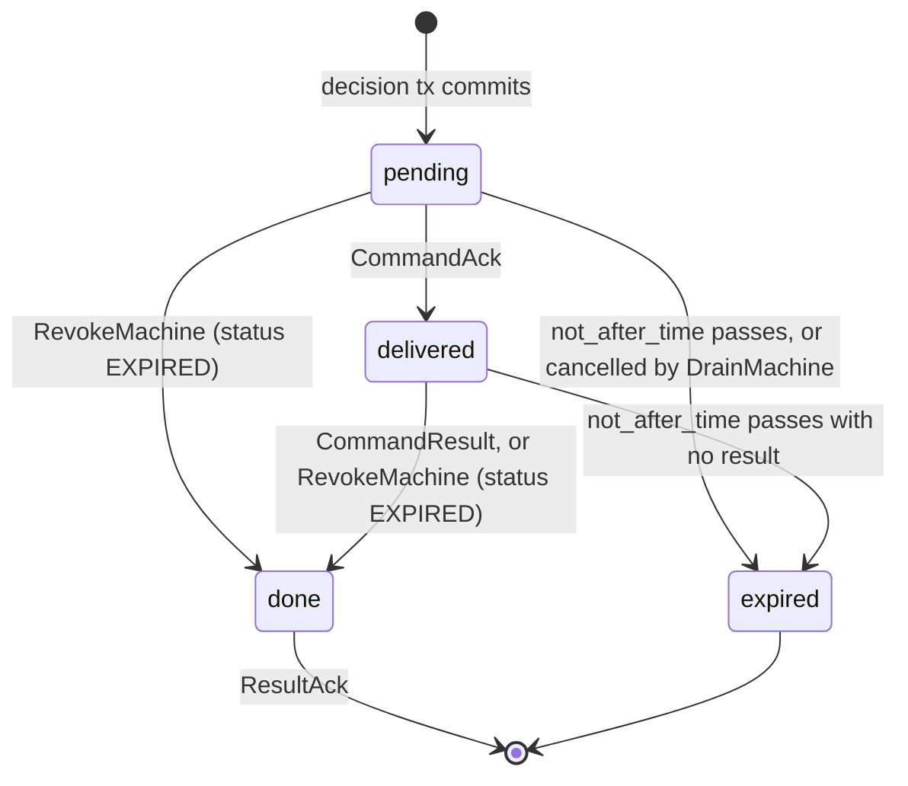
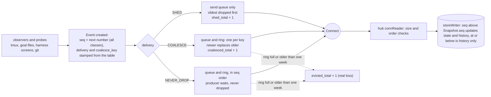
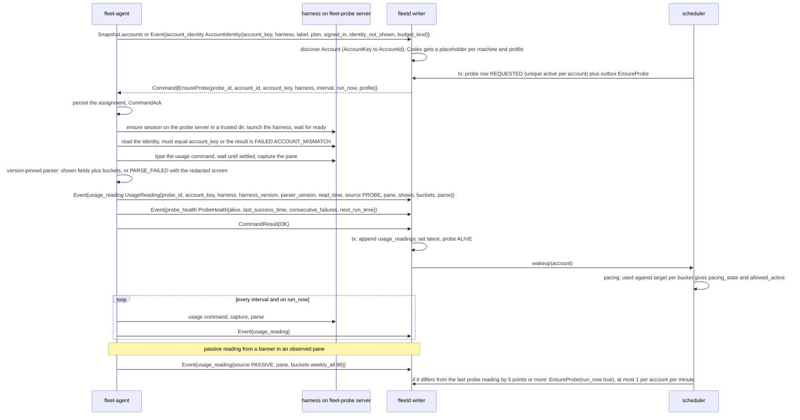
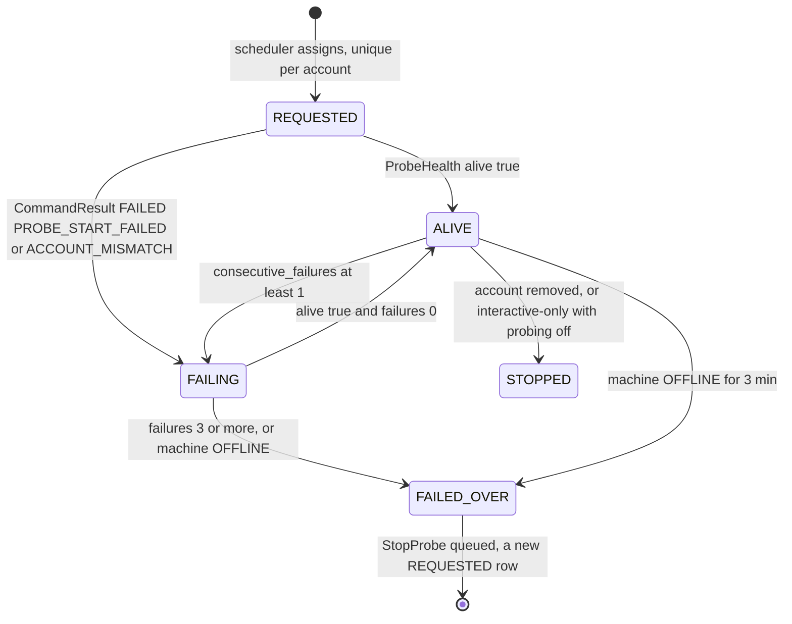

# Agent and hub flows, part 2: commands, events, usage (A4 to A6)

- Parts: [1](agent-hub.md) (A1 to A3) | **2** (this file, A4 to A6) |
  [3](agent-hub-3.md) (A7) | [4](agent-hub-4.md) (A8 to A10) | [5](agent-hub-5.md) (A11 to A13)
- Read [part 1](agent-hub.md) first for the wiring, the counters and the
  storage names (hub store `state.db`, log store `logs.db`, agent state dir).
- Protos named in this part: [`command.proto`][command] (`Command`, `CommandAck`,
  `CommandProgress`, `CommandResult`), [`agent.proto`][agent] (`ResultAck`,
  `Heartbeat`, `SnapshotRequest`, `Settings`), [`command_tmux.proto`][command-tmux]
  (`EnsureProbe`, `StopProbe`, `SendKeys`), [`command_goal.proto`][command-goal]
  (`StartGoal`), [`events.proto`][events] (`Event`, `DeliveryClass`),
  [`snapshot.proto`][snapshot] (`Snapshot`, `GoalState`), [`usage.proto`][usage-a]
  (`UsageReading`, `ProbeHealth`, `AccountIdentity`), [`screen.proto`][screen]
  (`HarnessCondition`), type [`usage.proto`][usage-t] (`LimitBucket`, `ShownUsage`,
  `ResetTime`), [`status.proto`][status] (`Status`, `ReasonCode`, `ErrorDetail`),
  hub [`common.proto`][common] (`Operation`).

---

## A4. Command lifecycle

**What happens and why.** A command is how the hub asks an agent to do anything:
probe an account, open a window, type a key, start a goal. It is always a typed
message from a closed list, never a shell string, and the agent checks it again
against its own policy before acting. The hub writes the command into its outbox in
the same database transaction as the decision that caused it, and only then sends
it. The agent saves the command, answers with an acknowledgement, runs it (a
composite such as `StartGoal` reports progress step by step) and finally sends
exactly one result. The hub acknowledges the result so the agent can forget it.
Delivery is at least once, and the command id makes every repeat harmless: a
command the agent already ran returns its logged result and is never run twice.

**Steps**

1. **Decide and enqueue.** A scheduler pass or an API call (`SendKeys`, `StartGoal`,
   `ControlGoal`, ...) makes its decision and, in the same transaction, inserts the
   outbox row. Each API call returns an `Operation` ([`common.proto`][common]); its
   `id` is the `CommandId`, so the dashboard, the audit log and the agent's log name
   the same thing. `OperationState` follows the row: `PENDING` (in the outbox, the
   machine may be offline), `DELIVERED` (`CommandAck` arrived), `RUNNING` (progress
   or a wait for local approval), `DONE` (a final result, or the hub expired it).
   An action that needs an approval returns the approval and no operation; the
   operation exists only once the approval is approved.
2. **Send after commit.** The hub fills the envelope ([`command.proto`][command]):
   `command_id` (the idempotency key), `epoch` from `HelloAck`, a per-epoch `seq`,
   `issued_time` and `not_after_time` (hub time), `requested_by` (a `Principal`: for
   a device or API token the role the hub derives from its scopes), `requires` (the
   one capability the kind needs, with a minimum version) and an optional `trace`
   (W3C trace context). `kind` is one of the 24 message types in the `oneof`; numbers
   are grouped (10 probes, 20 tmux control, 40 goals and worktrees, 50 attach, 60
   logs, 70 drain), and `OperationKind` in the hub API uses the same numbers.
   `sig` is reserved for a hardware signing key and unused in v1. There is no
   `run_exec`: field 99 is reserved on purpose.
3. **Envelope checks on the agent, in order.** The first one wins and its answer is
   the result.

   | # | Check | Answer |
   |---|---|---|
   | 0 | `command_id` already in the command log | the logged result, nothing re-checked or re-run (so a re-send never trips the `seq` check) |
   | 1 | `not_after_time` passed (hub time: `HelloAck.hub_time` plus local monotonic elapsed) | `EXPIRED` / `EXPIRED` |
   | 2 | `epoch` equals the current `HelloAck.epoch` | `FAILED` / `EPOCH_MISMATCH`, `retryable` (the hub re-issues it under the new epoch) |
   | 3 | `seq` above the last applied for this epoch | `REJECTED_BY_POLICY` / `SEQ_REPLAYED` |
   | 4 | `requires` capability advertised | `UNSUPPORTED`, `reason CAPABILITY_MISSING`, `missing_capability` (also for a kind the agent cannot decode) |
   | 5 | local policy and effective settings (harness allowed, repo root allowed, draining, safe mode, rate limit) | `REJECTED_BY_POLICY` with `POLICY_DENIED`, `HARNESS_NOT_ALLOWED`, `REPO_ROOT_NOT_ALLOWED`, `DRAINING`, `POLICY_SAFE_MODE`, `COMMAND_CLASS_DENIED`, or `FAILED` / `RATE_LIMITED` |
   | 6 | `requested_by.role` against the role by command matrix ([02g](../specs/02g-agent-security.md#what-each-principal-may-ask-an-agent-to-do)) | `REJECTED_BY_POLICY` / `ROLE_INSUFFICIENT` |
   | 7 | local approval, when the machine's rule covers the kind | progress `AWAITING_LOCAL_CONFIRM`, then run; a denial is `REJECTED_BY_POLICY` / `LOCAL_DENIED`, a timeout `LOCAL_CONFIRM_TIMEOUT` |

4. **Persist, then acknowledge.** The agent writes the command to its command log
   before it sends `CommandAck`, so an acknowledged command survives a crash.
5. **Progress.** `CommandProgress` reports one step of a composite as
   `command_id` plus `step`, with `step_index` and `step_count` so a progress bar is
   stable when steps are skipped. It is never dropped, and a `FAILED` step ends the
   composite. It also carries the one interim state any command can have, the wait
   for local approval: `step "awaiting_local_confirm"`, `step_index` and
   `step_count` 0, `status AWAITING_LOCAL_CONFIRM`, `metadata{"deadline", "approver"}`.
   That status never appears in a `CommandResult`.
6. **Result.** `CommandResult` is final and sent exactly once per `command_id`. The
   `oneof detail` wraps what the kind returns (`EnsureSessionResult`,
   `CapturePaneResult`, `RunHarnessCommandResult`, `PreflightResult`,
   `StartGoalResult`, `EnsureWorktreeResult`, `EnsureGoalHooksResult`,
   `OpenAttachResult`, ...). `retryable` says the same kind may be sent again with a
   **new** `command_id` (`EPOCH_MISMATCH`, `PANE_BUSY`, `RATE_LIMITED`,
   `READY_TIMEOUT`); it is never true for `UNKNOWN_OUTCOME`. `message` is at most 1
   KiB with no screen text; `metadata` has at most 16 entries of 256 bytes.
7. **Acknowledge the result.** The hub's transaction closes the outbox row, completes
   the `Operation` and derives state from the result, then sends `ResultAck`. If the
   connection drops first, `Snapshot.unacked_results` lists the ids and the results
   are sent again right after the snapshot (A2, A3).

**Statuses.** `Status` ([`status.proto`][status]) is the coarse outcome and
`ReasonCode` the cause; the hub API shows the same four fields (`reason`,
`retryable`, `retry_after`, `metadata`) as `ErrorDetail`.

| `Status` | Meaning |
|---|---|
| `OK` | done |
| `FAILED` | attempted and failed, `reason` says why |
| `EXPIRED` | arrived after `not_after_time`, nothing was done |
| `REJECTED_BY_POLICY` | local policy, settings, role or a local denial refused it, nothing was done |
| `UNSUPPORTED` | the agent lacks the capability |
| `UNKNOWN_OUTCOME` | the agent cannot tell whether the effect happened (typed input after a crash); never retried automatically, a person decides |

**Deadlines.** `not_after_time` is hub time, so a wrong wall clock on a laptop can
neither expire nor extend a command. Defaults set by the hub:

| Kind | Default |
|---|---|
| `SendKeys`, `Interrupt`, `RunHarnessCommand`, `CapturePane`, `OpenAttach` | 2 minutes |
| `StartGoal`, `EnsureWorktree`, `PruneWorktree`, `EnsureGoalHooks` | 30 minutes |
| `StopProbe` | 24 hours (its machine may be asleep; the snapshot reconcile covers longer) |
| everything else | 10 minutes |

A command still `pending` after its deadline is marked `EXPIRED` by the hub without
being sent ("not delivered, machine was offline"). A composite past its deadline
finishes the step in flight and reports `EXPIRED` for the rest; a window it already
created is left in place, tagged, for a person to decide.

**Idempotency by kind.**

| Class | Kinds | After a repeat or a crash |
|---|---|---|
| Declarative, repeat is a no-op | `EnsureProbe` (but `run_now` runs once per distinct `command_id`), `StopProbe`, `EnsureSession`, `EnsureWindow`, `EnsureWorktree`, `PruneWorktree`, `EnsureGoalHooks`, `RegisterGoal`, `ReleaseGoal`, `SetPaneAvailability`, `KillWindow`, `RespawnPane`, `Drain`, `Undrain`, `OpenAttach` | same end state |
| Read only | `Preflight`, `CapturePane`, `RunHarnessCommand` of class `OBSERVE` | run again |
| Typed input, not idempotent | `SendKeys`, `RunHarnessCommand` of any other class, `StartGoal` steps `clear_context` and `type_goal` | `UNKNOWN_OUTCOME`; the hub never retries it and asks a person |
| Composite | `StartGoal` | each step has its own restart class (A7); the agent persists `started` and `done` per step and resumes |
| Effectively idempotent | `Interrupt` | harmless to repeat |

**Outbox row (owned by the hub)**

A revoked machine's `pending` and `delivered` rows become `done` with status
`EXPIRED`, and a `DrainMachine` marks `StartGoal` rows still `pending` `EXPIRED`
with the message "cancelled by drain"
([03h](../specs/03h-goal-phases-in-depth.md#drain-the-outbox-and-respawn)).
[02-contracts](../specs/02-contracts.md#delivery-semantics) also lists a state
`failed` without a trigger of its own; an implementation can start with the four
above.

**Stored where**

| What | Where |
|---|---|
| `commands` (outbox, unique on `command_id`) and `command_results`, kept 30 days; each row has `machine_id`, `epoch`, `seq`, `not_after_time`, state | hub store, written in the decision transaction, moved by the delivery and result transactions |
| Audit of who asked for what, and of refusals (`command.refused`) | hub store, permanent |
| Command log: status, result and, for a composite, the step reached; last 10,000 commands or 7 days | agent state dir, written before `CommandAck` and at each step |
| Probe assignments (`EnsureProbe` as received) | agent state dir, with the command log |

**When it goes wrong**

| Failure | What happens |
|---|---|
| The machine is offline when the command is queued | stays `pending`; delivered on reconnect if still inside `not_after_time`, else `EXPIRED`; the goal planner does not re-plan onto an `OFFLINE` machine |
| The hub restarts after sending | the outbox re-sends the same `command_id`; the agent answers from its log or continues the composite |
| The same command arrives twice | check 0: the logged result is returned, nothing is run again |
| The agent restarts in the middle of `SendKeys` | the result is `UNKNOWN_OUTCOME`; no retry, a person looks at the pane (`CapturePane`) |
| A command from the old epoch arrives late | `EPOCH_MISMATCH` unless its `command_id` is already logged |
| The `ResultAck` is lost | the id is in `Snapshot.unacked_results` next time; the result is re-sent and re-acked |
| A result arrives for a command the hub closed | ignored (idempotent by `command_id`) |
| A result arrives for a command the hub never issued | audit log and a triage info item (restored database) |
| The agent is in policy safe mode | every control command is `REJECTED_BY_POLICY` / `POLICY_SAFE_MODE` |
| A person at the machine does not approve in time | `LOCAL_CONFIRM_TIMEOUT`; the hub reacts per kind (A7 reactions, A8 `STUCK`) |
| A machine is revoked | open outbox rows become `DONE` / `EXPIRED`, nothing is sent again |

---

## A5. Events, delivery classes and `seq`

**What happens and why.** Between snapshots the agent tells the hub what changed by
sending events. An event is an optimization: if every event were lost, the next
snapshot would still give the hub the truth. That is why the agent may drop the
unimportant ones under pressure. Every event is stamped when it is created with a
sequence number, a delivery class and, for some, a key. The class decides what may
happen to it when the connection is slow or down: a **shed** event (a pane summary,
a resource sample) can be thrown away, a **coalesce** event (the latest usage
reading, the latest ready state) can be replaced by a newer one with the same key,
and a **never-drop** event (a prompt, a goal state, a pane exit) is kept in a
persisted ring until the hub has it. Numbers are handed out to all of them, so gaps
in `seq` are normal and mean nothing; the agent reports what it dropped in counters
instead.

**Steps**

1. An observer sees a change and creates an `Event` ([`events.proto`][events]).
   `seq` is agent-wide, strictly increasing and never reused. It is persisted as a
   high-water mark in blocks of 1024 (one fsync per block), so numbers handed out
   but never written are skipped after a crash, never reissued. After every
   `HelloAck` the agent also raises its floor above `hub_last_event_seq` (A3).
2. The agent stamps `delivery` ([`DeliveryClass`][events]) and `coalesce_key` from
   one table (below). A hub that does not know a newer body kind still queues,
   sheds or coalesces it correctly, advances its stored `seq` past it, keeps it in
   history as opaque bytes, and never stalls or asks for a snapshot because of it.
3. `observed_time` is when it happened on the agent's clock. It is for display;
   order inside one machine is by `seq`, and order across machines uses the hub's
   adjusted time ([`02i`](../specs/02i-delivery-and-sequencing.md#clocks)).
4. The send queue is bounded. Under pressure it sheds SHED events (oldest first) and
   never goes beyond that. While offline the ring keeps only NEVER_DROP events and
   one COALESCE event per key, for at most one week and a size cap.
5. `replayed = true` marks an event sent from the ring after a reconnect.
6. On the hub the `connReader` checks size and `machine_id` and drops SHED kinds
   first when the ingest queue is full; it blocks (never drops) on NEVER_DROP kinds,
   which blocks only that agent's stream. The `storeWriter` batches up to 100
   messages or 50 ms into one transaction and applies each event in `seq` order:
   only if `seq` is above the machine's stored `hub_last_event_seq` and, for state,
   above `Snapshot.seq`.
7. Inventory events (`tmux_server`, `session`, `window`, `pane_created`,
   `pane_changed`, `repo`) carry the object after the change, so the hub applies
   them as an **upsert** (closed means delete) and reaches the right state even if
   it missed an earlier event for the same object.

**The class of every event body**

| Class | Body (`Event.body`) | `coalesce_key` |
|---|---|---|
| SHED | `resource_sample`, `pane_summary` (at most one per pane per 5 s), `spool_status` | none |
| COALESCE | `account_identity` | `identity:<harness>:<profile>` |
| | `harness_changed` | `harness:<harness>:<profile>` |
| | `probe_health` | `probe:<probe_id>` |
| | `usage_reading` | `usage:<account_key>` |
| | `session_account_link` | `link:<pane>` |
| | `harness_ready` | `ready:<pane>` |
| | `pane_input` (at most one per pane per 10 s) | `input:<pane>` |
| | `pane_changed` | `pane:<pane>` |
| | `branch_state` | `branch:<worktree path>` |
| | `forge_cli_status` | `forge:<tool>:<host>` |
| NEVER_DROP | `power_state`, `tmux_server`, `session`, `window`, `pane_created`, `pane_exited`, `activity`, `prompt_detected`, `prompt_gone`, `harness_hook`, `pane_harness_session`, `availability`, `harness_condition`, `goal_state`, `repo`, `goal_registry`, `policy_changed`, `local_approval`, `drain_state` | none |

`<pane>` is `<server>/<server_start_id>/<pane_id>` of the `PaneKey`. A COALESCE
event is a level or an upsert, so losing an earlier one never matters; the survivor
keeps its own `seq`. `Heartbeat` is SHED and has no `seq`. `CommandAck`,
`CommandProgress`, `CommandResult`, `SettingsAck` and `Bye` are not events, are
never dropped and are replayed from the command log or re-derived.

**What the hub does with the main kinds**

| Event | Hub effect |
|---|---|
| `goal_state` | goal fingerprint and phase (A8); a `watch_alive` flip is its own event |
| `pane_exited` | `STOPPED` and the one-nudge rule, retires prompt and condition items (A8, A9) |
| `prompt_detected`, `prompt_gone` | open and retire a `TRIAGE_KIND_PROMPT` item (A9) |
| `harness_condition` | provider error, limit or interrupt handling (A8) |
| `harness_hook` | the Stop guard's answer and the session id (A8) |
| `availability`, `pane_input`, `pane_changed`, `harness_ready` | scheduler wakeup, "person at the keyboard", Session view |
| `usage_reading`, `probe_health`, `account_identity`, `session_account_link` | usage and pacing (A6) |
| `harness_changed` | version drift (A13) |
| `policy_changed`, `local_approval`, `drain_state` | audit rows, triage, scheduler (A12) |
| `goal_registry`, `pane_harness_session`, `branch_state`, `repo` | registry reconcile, branch and change request lookup (A7, A8) |

**Heartbeat and snapshot requests.** `Heartbeat` goes every 15 s with load,
`PaneCounts` (`fleet_panes`, `panes_by_harness`, `goal_panes_by_state`,
`available_sessions`, `goals_active`, `goals_total`), `draining`, `SpoolStatus`,
`open_attaches`, the highest `event_seq` and `events` (`EventCounters`). The hub
compares only `goals_active` and `goals_total` with its own counts; a difference
above one on two heartbeats in a row sends `SnapshotRequest{reason: "slot_mismatch"}`
and skips the machine for that dispatch pass. The reasons the hub uses for
`SnapshotRequest` are `reconcile`, `ui_refresh`, `after_settings`, `event_lost`,
`seq_rollback` and `slot_mismatch`.

**Stored where**

| What | Where |
|---|---|
| Ring (NEVER_DROP and one COALESCE per key), `seq_hwm`, `EventCounters`, `install_id` | agent state dir |
| `events` history, one week, keyed `(machine, event_generation, seq)`; per machine `hub_last_event_seq`, `event_generation`, last `EventCounters` | hub store, one transaction per writer batch |
| Per-kind counters (`fleet_agent_events_*`, `fleet_hub_event_gap_total`) | metrics only |

**When it goes wrong**

| Failure | What happens |
|---|---|
| The hub is slow | HTTP/2 flow control, then the bounded queue: SHED events are dropped and counted, NEVER_DROP events make the producer wait |
| The ring overflows (size or one week) | the oldest NEVER_DROP or COALESCE events are lost and `evicted_total` rises; the hub sends `SnapshotRequest{"event_lost"}` and marks a gap |
| Pane summaries are being shed | normal; the hub never asks for a snapshot because of it |
| An unknown body kind from a newer agent | queued and stored by `delivery`, kept as opaque history, no stall |
| An event arrives before the epoch's snapshot | discarded with a counter |
| An event arrives out of order | cannot happen on one stream; the hub discards anything out of order and asks for a snapshot |
| A person typed in a goal pane while the hub was away | `TmuxPane.last_input_time` in the snapshot holds it; the replayed `pane_input` is history only |

---

## A6. Usage probing and the inputs to pacing

**What happens and why.** The fleet paces work against each subscription's weekly
budget, so the hub needs to know how much of every account is used and when it
resets. It gets this without ever reading a credential: an agent starts the harness
in a hidden tmux server named `fleet-probe`, types the harness's own usage command
(`/usage` or `/status`), reads the screen with a parser pinned to that harness
version, and reports a `UsageReading` that carries both what the harness showed
(for the owner) and standardized buckets (for the scheduler). One machine probes
each account; if it goes away the hub moves the probe. Passive banners seen in
ordinary panes ("96% of weekly limit") are cheaper hints and only ever cause an
early probe, never a scheduling decision on their own.

**Steps**

1. **Account discovery.** The agent reads the identity the harness shows on its own
   status screen (`AccountIdentity`, [`usage.proto`][usage-a]); it never opens a
   credential file. It computes `account_key` as the salted hash of that identity
   with the salt from enrollment, so the same account has the same key on every
   machine. Email is empty unless the owner turned on `share_identity_email`. A
   harness that shows no identity (Codex) sets `identity_not_shown`, and the hub
   creates a placeholder account per machine and profile for the owner to map.
   OpenCode accounts come from `opencode providers list`, one per signed-in provider,
   with `budget_kind` `BUDGET_KIND_DOLLAR_CAP` for API keys.
2. **Assignment.** The scheduler picks one machine per account: `ONLINE`, not
   draining, showing that `account_key` signed in, a harness version that is
   `SUPPORTED` (or `UNVERIFIED_PARSING` with the usage parser verified or
   `parsing_live`), and advertising `usage.probe.<harness>`. Preference: label
   `always-on`, then not `laptop`, then the hub machine, then the most recently
   successful. A unique index allows one active probe per account.
3. **`EnsureProbe`** ([`command_tmux.proto`][command-tmux]) is declarative. The
   effective interval is `max(hub value, local minimum)` where the hub value is the
   first set of `Settings.probe_interval_by_account`, `SettingValues.probe_interval`,
   then `EnsureProbe.interval` (A12). `run_now` runs once per distinct `command_id`.
4. **The probe session.** The agent keeps one idle harness session per assigned
   account on the `TMUX_SERVER_KIND_PROBE` server. It is `TmuxSession.internal`, so
   the hub never lists it. If a developer attaches to it the agent skips the run and
   says so in `ProbeHealth.message`; a skip is not a failure and never counts toward
   failover.
5. **Reading.** The agent waits for the ready pattern, confirms the identity, types
   the usage command, waits for the screen to settle, captures, and parses. A
   `UsageReading` has two halves: `shown` (`ShownUsage`: recognized `ShownField`s in
   the harness's own words plus the redacted `raw_screen`, omitted from snapshots)
   and `buckets[]` (`LimitBucket`). `parse` is a `ParseOutcome`: `OK`, `PARTIAL`
   (the rest unknown) or `FAILED` (no buckets, raw screen still sent).
6. **Passive readings** (`source = USAGE_SOURCE_PASSIVE`) are emitted only when a
   bucket's `percent_used` or `resets_time` differs from the last passive value, so
   a status line that repaints every second costs nothing.
7. **Health.** `ProbeHealth` (alive, `last_success_time`, `last_attempt_time`,
   `consecutive_failures`, `last_failure`, effective `interval`, `next_run_time`)
   travels as a COALESCE event keyed `probe:<probe_id>` and in every snapshot.
   Events that trigger an extra probe: a `StartGoal` that ended `OK`, a goal
   `MERGED` or `CLEARED`, a jump in a passive reading, or the owner's `ProbeAccount`.

**What the scheduler reads from a reading (the pacing inputs)**

| Field | Used for |
|---|---|
| `LimitBucket.percent_used` (`Percent`, never 0-as-unknown; `PercentUnknown.reason` says why) | how much of the bucket is gone; Codex "% left" is converted and `shown_as_remaining` records it |
| `LimitBucket.resets_time` (`ResetTime{resolved_time, original_text, resolved_with_timezone}`) and `window` | `elapsed = now - (resets_time - window)`; a weekly bucket without a window assumes 7 days. Unresolvable text leaves `resolved_time` unset and the bucket unknown for the line |
| `LimitBucket.kind` (`WindowKind`) | `SHORT`: at 95 percent or more no new dispatch until it resets. `WEEKLY` and `PER_MODEL`: the budget line; an account is exhausted when any bucket the work needs is |
| `LimitBucket.key`, `model` | which bucket a goal's model needs (`weekly_all` plus the model's own) |
| `UsageReading.parse`, `parser_version`, `harness_version` | `FAILED` makes the account `UNKNOWN` for pacing until a good reading arrives; a version outside the parser's support gives `PercentUnknown{HARNESS_VERSION_UNSUPPORTED}` (A13) |
| `read_time` (agent clock, adjusted by the hub for skew) | newest reading wins across machines; older than `stale_after` (default 3 times the interval) makes the account `STALE` |
| `AccountIdentity.budget_kind`, `SpendReading` | `BUDGET_KIND_DOLLAR_CAP` accounts show spend and are never auto-dispatched |
| open `HarnessCondition` of kind `USAGE_LIMIT` on a goal pane | marks the account `SHORT_LIMIT` until the condition's `resets_time` (A8) |

The hub's decision, per account and bucket: `target = elapsed / window * (100 -
reserve)` and `ahead = percent_used - target`. `ahead > 5` lowers `allowed_active`
by one, `ahead > 10` stops new dispatch, `ahead < -5` raises it by one; in the last
24 hours before the weekly reset the line is ignored until the reserve. A bucket at
`100 - reserve` or more is `RESERVE`: no new dispatch, a triage alert, running goals
continue. The result is `pacing_state` (`OK`, `AHEAD`, `BEHIND`, `SHORT_LIMIT`,
`RESERVE`, `UNKNOWN`, `STALE`, `EXCLUDED`), `allowed_active` and a rank
([03b](../specs/03b-usage-and-sync.md#pacing-decision-scheduler-per-account-per-bucket)).

**Probe state (owned by the hub)**

**Stored where**

| What | Where |
|---|---|
| `probes{probe_id, account_id, machine, interval, state, last_health}` | hub store, assignment transaction with the outbox row; health per event |
| `usage_readings` (buckets kept 1 year, `raw_screen` 7 days) and the account's latest reading | hub store, one transaction per reading batch |
| `account_pacing{state, allowed_active, target, ahead, computed_time}` | hub store, rewritten per evaluation (derived) |
| Probe assignment, schedule, last reading (for `Snapshot.usage`), fixtures and parser version | agent state dir and agent binary |

**When it goes wrong**

| Failure | What happens |
|---|---|
| The probe harness crashes | the agent respawns it up to 3 times, 30 s apart, then reports `alive = false`, `last_failure PROBE_START_FAILED`; the hub fails over at 3 failures |
| The screen does not parse (new layout) | reading `PARSE_FAILED` with the redacted raw screen; account `UNKNOWN`, no auto-dispatch; triage `usage_parse_failed` per `(harness, harness_version, parser_version)` |
| Harness version unsupported | `PercentUnknown{HARNESS_VERSION_UNSUPPORTED}`, raw screen still shown; the hub prefers another machine for the probe (A13) |
| Sign-in needed in the probe pane | `HarnessCondition{SIGN_IN_REQUIRED}` and a triage item; account `UNKNOWN`; failover tried first |
| The harness shows another identity | `CommandResult{FAILED, ACCOUNT_MISMATCH}`; the hub re-maps from `Snapshot.accounts[]` and assigns elsewhere |
| The machine sleeps or goes offline | readings stop; after `stale_after` the account is `STALE` (no new dispatch); after `OFFLINE` the probe fails over. A `STALE` machine alone does not move a probe, because a laptop flaps through it |
| The old machine returns after `StopProbe` expired (24 h) | the next snapshot lists the probe and the hub sends a fresh `StopProbe` |
| Two machines briefly probe one account | harmless, status commands cost no quota; the newest hub-adjusted `read_time` wins |
| A machine's clock is off | readings are adjusted by the measured skew; over 15 minutes the machine is `clock_untrusted` and its readings never override a trusted machine's |
| Passive and probe readings disagree | the probe wins; passive only triggers a probe |
| A reading arrives late after a reconnect | stored, but it becomes the latest only if its adjusted `read_time` is newer |

[common]: ../../api/fleet/hub/v1/common.proto
[command]: ../../api/fleet/agent/v1/command.proto
[command-tmux]: ../../api/fleet/agent/v1/command_tmux.proto
[events]: ../../api/fleet/agent/v1/events.proto
[usage-a]: ../../api/fleet/agent/v1/usage.proto
[status]: ../../api/fleet/type/v1/status.proto
[agent]: ../../api/fleet/agent/v1/agent.proto
[command-goal]: ../../api/fleet/agent/v1/command_goal.proto
[snapshot]: ../../api/fleet/agent/v1/snapshot.proto
[screen]: ../../api/fleet/agent/v1/screen.proto
[usage-t]: ../../api/fleet/type/v1/usage.proto
