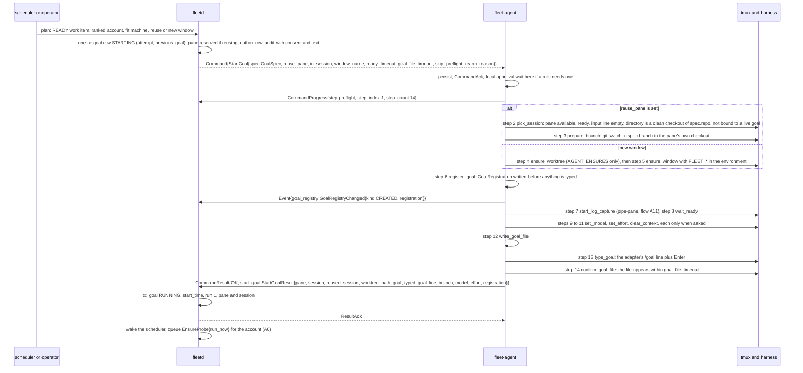
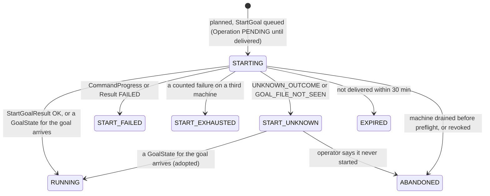

# Agent and hub flows, part 3: starting a goal (A7)

- Parts: [1](agent-hub.md) (A1, A2) | [2](agent-hub-2.md) (A4 to A6) | **3** (this file, A7) |
  [4](agent-hub-4.md) (A8) | [5](agent-hub-5.md) (A11 to A13) | [6](agent-hub-6.md) (A14) |
  [7](agent-hub-7.md) (A3) | [8](agent-hub-8.md) (A9, A10)
- Protos named in this part: [`command_goal.proto`][command-goal] (`StartGoal`,
  `GoalSpec`, `Preflight`, `RegisterGoal`, `ReleaseGoal`), [`command.proto`][command]
  (`Command`, `CommandProgress`, `CommandResult`), [`snapshot.proto`][snapshot]
  (`GoalRegistration`, `GoalState`, `TmuxPane`), [`events.proto`][events]
  (`GoalRegistryChanged`), type [`work.proto`][work] (`Workdir`, `PaneWorkdir`),
  [`consent.proto`][consent] (`ConsentAct`), [`status.proto`][status] (`ReasonCode`),
  hub [`goal_dispatch.proto`][goal-dispatch] (`StartGoalRequest`, `PreflightGoal`),
  [`goal.proto`][goal] (`GoalPhase`).
- A goal is the unit of work: "drive this issue or change request to merge".
  Each harness has its own native `/goal` command and keeps working toward the
  objective by itself. fleet-board only starts it, watches it and steps in at
  the edges (A8). It always drives the unmodified interactive harness inside
  tmux, typing as a person would; it never runs a harness headless and never
  reads a harness credential.

---

## A7. Starting a goal

**What happens and why.** When the scheduler decides that a work item should be
worked on (or an operator dispatches one by hand), the hub sends the agent **one**
command, `StartGoal`, and the agent carries out the whole start on its own. That
way the start survives a hub outage halfway through. The agent first checks that
the machine can do the job. Then it either **reuses** an existing harness pane that
is already sitting in a clean checkout of the goal's repository, starting a new
branch right there, or creates a **new window** in a **new worktree**. Before
anything is typed it writes the goal into its **goal registry**, the one place that
says "this pane is working on goal X", for every harness. It then turns on log
capture, waits for the harness to show its ready prompt, optionally selects a model
and effort and clears the old conversation, writes the goal file, and finally types
the harness's own `/goal` line, including what the goal is allowed to do (push, open
a pull request, merge). It reports each step as progress and ends by confirming that
the goal file appeared.

**Steps**

1. **Plan (hub).** A pass of the scheduler (every 30 s, plus wakeups) or a manual
   `StartGoal` call of the hub API ([`goal_dispatch.proto`][goal-dispatch]; the same
   name as the agent command, a different message) picks a READY work item, an
   account with room (A6), and a machine that is `ONLINE`, undrained, free of a
   durable "unfit" marker, with a supported harness version, the account signed in,
   push access to the repo (`ForgeCliStatus`), a checkout, and a free slot. The hub
   owns slot counting (`SLOTS_FULL` is a hub reason). Manual dispatch can first call
   `PreflightGoal`, which runs the hub's own checks and the agent's `Preflight`
   without starting anything.
2. **Commit, then send.** In one transaction the hub inserts the goal (phase
   `STARTING`, `attempt` one higher than the last try, `previous_goal` set), reserves
   the pane if reusing, inserts the outbox row and writes the audit row (who, consent,
   machine, account, goal text). The goal's consent is the repo's (else the fleet
   default) intersected with the account's, as a list of `ConsentAct`
   ([`consent.proto`][consent]): `PUSH`, `PR_OPEN`, `MERGE`. An empty result blocks the
   dispatch (`CONSENT_EMPTY`).
3. **The command.** `StartGoal` ([`command_goal.proto`][command-goal]) carries a
   `GoalSpec`. The hub never sends an absolute path or any text that is typed raw:
   `workdir` names a repo and a relative path that the agent joins to an allowed
   root, and consent is an enum the adapter renders itself.

   | `GoalSpec` field | Meaning |
   |---|---|
   | `goal_id`, `session_id` | hub-assigned ids; the session id is also the tmux session name for a new session |
   | `workdir` (`Workdir`), `repo` (`RepoRef`) | where the code lives; a reused pane must be in a checkout of exactly this repo |
   | `harness`, `profile` | which harness (and profile) to run under |
   | `account_id`, `account_key` | expected account; `ACCOUNT_MISMATCH` if the harness shows another |
   | `consent` | the `ConsentAct`s written into the goal |
   | `goal_text`, `dispatch_reason` | the objective (4 KiB) and why the hub dispatched it, rendered into the goal text |
   | `worktree_mode` | `AGENT_ENSURES` (the agent makes the worktree) or `REPO_DRIVER` (the repo's own goal driver does, as in eshu) |
   | `branch` | the new worktree's branch, or the branch started in place in a reused pane |
   | `work_item`, `change_request` | an issue or ticket, and an existing change request the goal continues |
   | `model`, `effort`, `fresh_context` | selected before the goal is typed; empty leaves the harness as is |

4. **Preflight (step 1).** The agent checks every precondition and reports all
   failures at once as `PreflightFailure{reason, detail, retryable}`: harness
   installed, supported and signed in, account, push access, checkout present and
   allowed, folder trusted, disk, tmux, battery, policy, drain and its own goal cap.
   A durable fact (`HARNESS_NOT_SIGNED_IN`) marks the machine unfit until something it
   depends on changes; a passing one (`DISK_LOW`, `AGENT_GOAL_CAP_REACHED`) does not.
   `skip_preflight` is set when the hub's own preflight passed within the last minute.
5. **Reuse or new window (steps 2 to 5).** ADR 0019 decides the rule: a goal may reuse
   a pane only when the pane's working directory is a checkout of the goal's repo and
   that checkout is clean. A running harness cannot change directory or gain an
   environment variable, so reuse never moves a pane: the agent starts the new branch
   inside the pane's own checkout (`git switch -c`), makes no worktree, and in
   `REPO_DRIVER` mode makes no branch because the driver does. The hub offers a pane
   only when it sees (`TmuxPane.workdir`, a `PaneWorkdir`) the right `repo`, not
   `dirty`, `availability.available_for_work` and `ready_pattern_showing`; the agent
   rechecks just before typing and refuses with its own reason rather than silently
   opening a window, so the hub's reservation stays true:
   `SESSION_NOT_AVAILABLE`, `PANE_BUSY`, `SESSION_WORKDIR_MISMATCH`, `CHECKOUT_DIRTY`.
   Two goals never share a checkout when the agent makes the worktrees. A new window
   is named by the `{harness} {work}` template (for example `muse eshu#7398`) with
   `FLEET_SESSION_ID`, `FLEET_OWNER`, `FLEET_PANE_KEY` and `FLEET_GOAL_ID` in its
   environment as a fast path only.
6. **The goal registry (step 6).** `GoalRegistration{goal, pane, harness,
   worktree_path, harness_session_id, source, register_time, repo_driver}`
   ([`snapshot.proto`][snapshot]) is written to the agent's state directory before the
   goal is typed, and removed on `ReleaseGoal`, pane exit, `PruneWorktree`, or when
   another goal registers in the same pane. Hooks and goal-file attribution ask the
   registry; the pane environment cannot be trusted for a reused pane (A8).
   `harness_session_id` is empty until the first hook after registration reports it
   (`PaneHarnessSession`, `binding`). The hub compares `Snapshot.goal_registry` with
   its goals and repairs with `RegisterGoal` or `ReleaseGoal`, both declarative.
7. **Model, effort, fresh context (steps 9 to 11).** The adapter uses the harness's
   own `/model` and `/effort` (class SESSION), reading what is shown first and typing
   only when it differs (`MODEL_NOT_AVAILABLE`, `EFFORT_NOT_SUPPORTED`).
   `fresh_context` types `/clear`, which is destructive, so the agent allows it only
   in a session the fleet started (`TmuxSession.started_by_fleet`) or a pane the
   developer marked with `fresh_context_on_reuse` (off by default), otherwise
   `FRESH_CONTEXT_NOT_ALLOWED`. The scheduler sets it for an auto-dispatch into such a
   pane (a pane after `MERGED` still carries the last goal's context); in any other
   developer-marked pane the goal is typed into the existing context.
   The result returns the effective `model` and `effort`, which the hub paces by (A6).
8. **The goal file and the line (steps 12 and 13).** The agent writes the initial goal
   file itself, because Codex hooks never see `/goal` lines, except where the checkout
   ships its own goal hooks (`repo_ships_own`, a `REPO_DRIVER` goal): step 12 is then
   skipped, the repo's own file is the goal file and step 14 reads it. `type_goal` then types
   the adapter's `GoalCommand`. When the checkout ships eshu's hooks the form is
   `/goal consent push,pr-open,merge -- <goal_text>`; otherwise consent goes into the
   objective, `/goal <goal_text> (consent: push, pr-open, merge)`. The exact line is
   returned as `typed_goal_line` for the audit log, and `PreflightResult.goal_line_preview`
   shows it beforehand. An act the agent does not know is `INVALID_ARGUMENT` and
   nothing is typed.
9. **Confirm (step 14).** The goal file must appear within `goal_file_timeout`
   (`GOAL_FILE_NOT_SEEN` otherwise). `StartGoalResult.goal` is the first `GoalState`.
   The hub moves to `RUNNING` on whichever comes first, the result or a
   `goal_state` event for that goal, and treats the other as confirmation.
10. **Startup screens are never answered.** The agent reads the screen before it
    presses any key. A folder-trust, update, login or release-notes screen ends the
    step with `TRUST_PROMPT_SEEN` or `STARTUP_PROMPT_SEEN` (`metadata.kind`); the
    harness's update prompt once ran an upgrade when a key was pressed blind.

**The 14 steps.** The names are a fixed vocabulary (a string, so a newer agent can add steps); `step_count` is always 14 and a
skipped step is simply not reported.

| # | Step | Path | What | If the agent restarts here |
|---|---|---|---|---|
| 1 | `preflight` | both | every check, local goal cap included | run again |
| 2 | `pick_session` | reuse | the reuse checks above | run again (read only) |
| 3 | `prepare_branch` | reuse, `AGENT_ENSURES` | branch started in place | already on that branch is OK |
| 4 | `ensure_worktree` | new, `AGENT_ENSURES` | `EnsureWorktree`, declarative | run again |
| 5 | `ensure_window` | new | session and window, harness launched | reuses a window with the same `FLEET_PANE_KEY` tag |
| 6 | `register_goal` | both | registry entry and event | run again |
| 7 | `start_log_capture` | both | `pipe-pane` on the goal pane | run again |
| 8 | `wait_ready` | both | ready pattern, or a startup screen | read only |
| 9 | `set_model` | when `model` set | `/model` | verify, type only if different |
| 10 | `set_effort` | when `effort` set | `/effort` | verify, as above |
| 11 | `clear_context` | `fresh_context`, reuse | `/clear` | **not idempotent**: `UNKNOWN_OUTCOME` |
| 12 | `write_goal_file` | both, skipped for a `repo_ships_own` checkout | initial goal file | same content again is OK |
| 13 | `type_goal` | both | the `/goal` line plus Enter | **not idempotent**: `UNKNOWN_OUTCOME`, turned into OK if the file already shows this goal id |
| 14 | `confirm_goal_file` | both | file appears | read only |

**Re-arm.** `StartGoal.rearm_reason` (non-empty) re-arms a goal whose harness already
finished it but whom a person says is not done: same `goal_id`, `reuse_pane` the pane
the registry names (checked before step 1, even with `skip_preflight`; otherwise
`SESSION_NOT_AVAILABLE`). Steps 2 to 7 and 9 to 11 are skipped; 1, 8, 12 (first line
rewritten as the objective plus `reopened: <reason>`; skipped for a `repo_ships_own`
checkout), 13 and 14 run. See A8.

**What the hub does with the outcome.** The goal's phase moves as below; the full
phase diagram is in [A8](agent-hub-4.md#goal-phase-state-machine).

`START_FAILED`, `START_EXHAUSTED`, `EXPIRED` and `ABANDONED` are final. Nothing returns
a goal to `STARTING`: the work item goes back to `READY` (or `MANUAL_ONLY` after
`START_EXHAUSTED`) and the next attempt is a new goal with `attempt + 1` and
`previous_goal`, so every attempt keeps its own machine, error and history.

| Group of failure reasons | Hub reaction |
|---|---|
| Durable facts: `HARNESS_NOT_INSTALLED`, `HARNESS_VERSION_UNSUPPORTED`, `HARNESS_NOT_SIGNED_IN`, `PUSH_ACCESS_MISSING`, `CHECKOUT_MISSING`, `FOLDER_UNTRUSTED`, `TMUX_TOO_OLD`, `POLICY_DENIED`, `POLICY_SAFE_MODE`, `CAPABILITY_MISSING`, `HARNESS_PROFILE_MISSING` | mark the machine unfit for that harness or repo until a snapshot, event or the hub's re-check (10 minutes, doubling to 1 hour) shows the fact changed; not counted |
| Passing facts: `DISK_LOW`, `TMUX_SERVER_DOWN`, `ON_BATTERY_BLOCKED`, `AGENT_GOAL_CAP_REACHED`, `MAX_WINDOWS_REACHED`, `LOCAL_CONFIRM_TIMEOUT` | skip the machine for a while (5 to 30 minutes, 30 for `LOCAL_CONFIRM_TIMEOUT`, or until the battery fact changes); not counted |
| Reuse refused: `PANE_BUSY`, `SESSION_NOT_AVAILABLE`, `SESSION_WORKDIR_MISMATCH`, `CHECKOUT_DIRTY`, `FRESH_CONTEXT_NOT_ALLOWED` | retry once in a new window on the same machine; the pane is not offered again for that repo until `PaneChanged` shows its directory moved |
| About this item or account on this machine: `ACCOUNT_MISMATCH`, `READY_TIMEOUT`, `MODEL_NOT_AVAILABLE`, `EFFORT_NOT_SUPPORTED`, `GOAL_FILE_WRITE_FAILED`, `GIT_FAILED`, `WORKTREE_EXISTS` | one new window or a skip, a marker for that account, or plan elsewhere with the machine excluded for the item for an hour, as the normative table says; all are **counted**, and three on three machines end `START_EXHAUSTED` with a triage item |
| A person must act: update or login screen, model missing, leftover worktree, `LOCAL_DENIED` | triage `TRIAGE_KIND_START_FAILED` |
| `UNKNOWN_OUTCOME`, `GOAL_FILE_NOT_SEEN` | `START_UNKNOWN` and a triage item; never retried by itself |
| `DRAINING` | `ABANDONED`, work item `READY`, not a failed attempt |
| `INVALID_NAME`, `INVALID_ARGUMENT`, `ROLE_INSUFFICIENT` | no retry; triage, because the hub built a bad command |

The normative table is in [03h](../specs/03h-goal-phases-in-depth.md#start-failures-reason-to-reaction).

**Stored where**

| What | Where |
|---|---|
| `goals` (id, `attempt`, `previous_goal`, `work_item`, `repo`, machine, account, harness, consent, text, phase, pane, session), unique live per work item and per `(repo, branch)` | hub store, planning transaction, then the result transaction |
| `panes.reserved_for_goal`, the outbox row, the audit row (who, consent, machine, account) | hub store, planning transaction |
| Step reached (`started` and `done` per step), worktree path, pane key | agent command log, before each `CommandProgress` |
| Goal registry (one entry per pane), availability marks | agent state dir (`agent.db`), reported in every snapshot |
| `FLEET_*` tags, the window | tmux on the machine |
| Worktree (agent made) | machine disk |

**When it goes wrong**

| Failure | What happens |
|---|---|
| The machine is offline between planning and sending | the outbox row stays pending; delivered on reconnect inside 30 minutes, else the goal is `EXPIRED` and the work item `READY` |
| The hub restarts after sending | the outbox re-sends the same `command_id`; the agent continues or answers from its log |
| The agent restarts mid composite | declarative, read-only and verify steps run again; step 11 or 13 started but not done ends `UNKNOWN_OUTCOME` unless the goal file now shows the goal |
| The 30 minute deadline passes mid composite | the step in flight finishes, the rest is `EXPIRED`; a window already created stays, tagged, until a person decides |
| The harness crashes in `wait_ready` | `PaneExited`, then `READY_TIMEOUT`; one retry in a new window, then another machine |
| A person is typing in the reused pane | `pick_session` fails `SESSION_NOT_AVAILABLE` or `PANE_BUSY`; new window next pass. Typing in a new window during `wait_ready` makes `type_goal` fail `PANE_BUSY`; one retry after 30 s |
| The agent's state directory is lost | new windows are rebuilt from `FLEET_GOAL_ID` (`source ENV`); a reused pane is missing from `Snapshot.goal_registry` and the hub sends `RegisterGoal` |
| `StartGoal` expired during an outage but the registry binds the goal | adopted as `RUNNING` instead of re-planned |
| A local approval rule needs a person | the wait happens once, before step 1, as `CommandProgress{awaiting_local_confirm}`; a timeout ends the start with `LOCAL_CONFIRM_TIMEOUT`: nobody is at the keyboard, so the hub skips the machine for 30 minutes and plans elsewhere ([03h](../specs/03h-goal-phases-in-depth.md)) |
| A foreign claim appears after dispatch | triage `double_claim`; the goal keeps running until a person decides |
| Slots disagree with the heartbeat | `SnapshotRequest{"slot_mismatch"}`, machine skipped this pass |

[goal-dispatch]: ../../api/fleet/hub/v1/goal_dispatch.proto
[consent]: ../../api/fleet/type/v1/consent.proto
[command-goal]: ../../api/fleet/agent/v1/command_goal.proto
[snapshot]: ../../api/fleet/agent/v1/snapshot.proto
[command]: ../../api/fleet/agent/v1/command.proto
[events]: ../../api/fleet/agent/v1/events.proto
[work]: ../../api/fleet/type/v1/work.proto
[status]: ../../api/fleet/type/v1/status.proto
[goal]: ../../api/fleet/hub/v1/goal.proto
