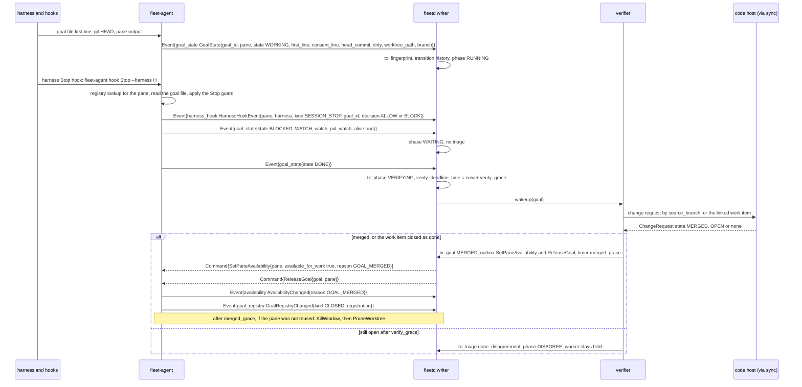
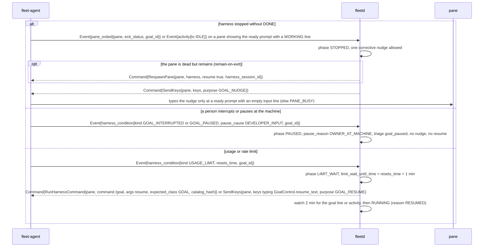

# Agent and hub flows, part 4: a goal running (A8)

- Parts: [1](agent-hub.md) (A1, A2) | [2](agent-hub-2.md) (A4 to A6) |
  [3](agent-hub-3.md) (A7) | **4** (this file, A8) | [5](agent-hub-5.md) (A11 to A13) |
  [6](agent-hub-6.md) (A14) | [7](agent-hub-7.md) (A3) | [8](agent-hub-8.md) (A9, A10)
- Read [A7](agent-hub-3.md) first: it explains the goal registry and the line the
  agent typed. Counters and storage names are in [part 1](agent-hub.md).
- Protos named in this part: [`events.proto`][events], [`snapshot.proto`][snapshot],
  [`screen.proto`][screen], [`streams.proto`][streams] (`TermUp`, `TermDown`),
  [`command_goal.proto`][command-goal], [`command_tmux.proto`][command-tmux], type
  [`harness.proto`][harness], [`status.proto`][status], hub [`goal.proto`][goal],
  [`triage.proto`][triage] (`Approval`, `DecideApproval`), [`terminal.proto`][terminal].

---

## A8. A goal running

**What happens and why.** After the goal line is typed, the harness's own `/goal`
loop does the work. fleet-board does not drive it; it watches and steps in only at
the edges. The agent reads the goal file's first line (the harness keeps it up to
date: working, blocked, done), the git HEAD, the pane's activity and any provider
error on screen, and sends each change as an event. The hub turns that into a goal
**phase** and decides what, if anything, to do: wait for a watcher, ask a person,
type **one** corrective nudge into a pane that stopped, wait out a usage limit and
resume, hold everything when a person at the machine interrupted the goal, or, when
the goal says it is done, check with the code host and free the pane. A small
program installed as a harness hook (the Stop guard) keeps the harness from
stopping while the goal file says it is unfinished. The rule behind every choice: a
person at the keyboard always wins, and the fleet never answers permission prompts
or types into a running turn.

**The edges (what goes wrong while a goal runs)**

**Steps**

1. **Goal file and `GoalState`.** The harness writes the first line of the goal file
   as it works. The agent parses it into `GoalLineState` and reports a `GoalState`
   ([`snapshot.proto`][snapshot]) whenever any fingerprinted field changes: state,
   first line, `head_commit`, `dirty`, `watch_alive` and, for a `REPO_DRIVER` goal,
   the driver's `worktree_path` and `branch` (the hub keeps them as
   `Goal.status.branch`, which is how it finds the change request by `source_branch`
   and enforces one agent per branch). A goal started by hand is `GoalState{binding = OBSERVED}`,
   shown only ([03k](../specs/03k-observed-goals.md)). `GoalState` is NEVER_DROP and is also in
   every snapshot.

   | `GoalLineState` | Meaning | Hub reads it as |
   |---|---|---|
   | `WORKING` | the harness is working | `RUNNING` |
   | `BLOCKED_WATCH` | blocked on a watcher (`watch_pid`, `watch_alive`) | `WAITING` while the pid is alive; `STUCK` when it dies (a `watch_alive` flip is its own event) |
   | `BLOCKED_OWNER` | waiting for a named person (`owner`, `action`) | `BLOCKED_OWNER`, one triage item per `block_epoch` |
   | `BLOCKED_STUCK` | blocked with no watcher and no owner | `STUCK` |
   | `DONE` | the goal says it is finished | `VERIFYING` |
   | `MISSING` | the file is missing or unreadable | reported as is |

   The hub keys triage items and nudges on a fingerprint of `(line_state,
   first_line, head_commit, change request state, change request head)`, so one
   stopped or disagreeing state is reviewed once. Progress means `head_commit` or
   `first_line` changed since the last evaluation.
2. **Hooks.** The agent installs small hooks into each harness (`EnsureGoalHooks`,
   below). Every fleet hook runs `fleet-agent hook <event> --harness <h>` and exits 0
   silently unless it is running for a fleet goal, so a developer's own sessions on
   the same machine see no change. The hooks do three jobs: map the harness session
   id onto the registry entry, report turn ends, and run the **Stop guard**: refuse
   to let the harness stop while the goal file says unfinished and nothing watches it
   (`DONE` allows, `BLOCKED` with a live `WATCH=<pid>` allows, `BLOCKED` without one
   refuses and escalates). Hooks never type into the pane, never answer a prompt and
   never resume an interrupted goal.
3. **How a hook finds its goal.** The pane environment cannot be trusted in a reused
   pane, so the agent's registry decides, in this order: (1) `session_id` from the
   hook payload matches an entry's `harness_session_id`; (2) Claude Code and Codex:
   the pane (`TMUX_PANE`, resolved to a `PaneKey`) matches an entry; (3) Muse, whose
   plugin hooks receive no pane variables: the `cwd` in the payload is at or under an
   entry's `worktree_path`, only until the session id is learned and only when exactly
   one Muse pane is registered for that checkout (with two the hook stays silent);
   (4) otherwise exit 0 silently. In `REPO_DRIVER` mode the registered path is the
   main checkout and is never the match key. The first `UserPromptSubmit` (or
   `PreToolUse` on Codex, which fires no prompt hook for `/goal` lines) after
   registration records the session id, reported as `PaneHarnessSession` with
   `binding`.
4. **Hook events and the Stop guard answer.** The agent reports each as
   `HarnessHookEvent{pane, harness, kind, harness_session_id, raw_event_name,
   goal_id, decision}` ([`events.proto`][events]); `kind` is `SESSION_START`,
   `SESSION_STOP`, `TURN_END`, `PERMISSION_REQUEST`, `INTERRUPT` or `USER_PROMPT`, and
   `decision` is `HookDecision` `ALLOW` or `BLOCK`, so a guard that blocked can be
   told from one that never fired (the hub treats a missing guard as a finding).

   | | Claude Code | Codex | Muse |
   |---|---|---|---|
   | Hooks live in | `~/.claude/settings.json` | `~/.codex/hooks.json` | a plugin package at user scope |
   | Stop guard | `Stop` fired when the goal finished (probed); a block continues a turn | `Stop` fired on a finished goal (probed); continuation by block is not probed | probed: `block` plus a reason continues the turn; the next stop has `stop_hook_active: true`, so the guard allows it to avoid a loop |
   | Interrupt | no hook; read from the screen ("Interrupted") | `Interrupt` fires, output ignored (notify only) | an `Interrupt` hook exists, not probed live |
   | Goal found by | session id, then pane | session id, then pane | session id; `cwd` only until the id is learned |
   | Needs trust | no (`NOT_REQUIRED`) | yes, once in `/hooks` | yes, once with `muse plugins approve fleet-goal-hooks` |

   `GoalHooksState.trust` is a `HookTrustState` (`UNKNOWN` is never read as trusted,
   `PENDING`, `TRUSTED`, `NOT_REQUIRED`) and `trust_approve_command` names what the
   person types. The agent never approves a hook and never passes a bypass flag;
   goals still run without trust, only the hook events and the Stop guard are missing.
5. **Installing hooks.** `EnsureGoalHooks{harness, workdir, expected_version, profile}`
   returns `EnsureGoalHooksResult{state GoalHooksState{installed, verified,
   hook_version, hook_hash, repo_ships_own, trust, trust_approve_command, config_path}}`.
   The agent first checks whether the repo ships its own hooks (eshu does:
   `repo_ships_own`, and the fleet hooks then stay inert there so two Stop guards never
   fight). Otherwise it backs up the user file, merges its entries without touching
   others, writes atomically, and verifies each script with a synthetic payload (no
   output without a registry entry, the expected event with one). The hub sends it
   after a snapshot shows missing, unverified or old hooks (when `Repo.spec.hooks_mode`
   asks for it), on `harness_changed`, after one `GOAL_FILE_NOT_SEEN` per
   machine and harness per day, and when the owner presses `EnsureMachineHooks`; never
   while a goal is live in a pane of that harness.
6. **Stopped without DONE and the one nudge.** A pane that exited
   (`PaneExited{goal_id}`), or that is idle at the ready prompt with a `WORKING` line
   for longer than `idle_threshold`, makes the goal `STOPPED`. The hub allows **one**
   nudge: if the pane is dead but remains (`PaneExited.remains`; the registry entry
   is kept and `RespawnPane` keeps the `PaneKey`), `RespawnPane` with `resume` and the exact
   `harness_session_id` (so `--last` cannot pick another conversation); a pane that is
   gone follows `PANE_LOST`, not a respawn. Then
   `SendKeys{purpose GOAL_NUDGE}` with the hub-authored text. The agent gates it: the
   pane is bound to a fleet goal, the ready pattern shows, the input line is empty
   (`PANE_BUSY` otherwise). A second stop makes the goal `STUCK` and raises a triage
   item. Two evaluations with no progress make it `COOLDOWN` (up to 30 minutes);
   nothing is nudged then. All of this is suppressed while a provider condition is
   open, a prompt is pending, a person typed in the last 10 minutes
   (`human_at_keyboard_until_time`, from `PaneInput` and `TmuxPane.last_input_time`),
   or an interrupt condition is open.
7. **Interrupts and pauses.** A person who presses Esc or Ctrl-C decides the goal
   should stop. The agent reports a `HarnessCondition` of kind `GOAL_INTERRUPTED` or
   `GOAL_PAUSED` ([`screen.proto`][screen]) with `pause_cause`: `DEVELOPER_INPUT` (pane
   input just before), `HARNESS`, `FLEET_COMMAND` (the agent had just run the hub's
   `Interrupt` or `/goal pause`), or `LIMIT`. For the first two the hub sets phase
   `PAUSED` with `pause_reason = OWNER_AT_MACHINE`, raises `TRIAGE_KIND_GOAL_PAUSED`,
   never nudges and never resumes by itself; it ends when the condition clears (the
   goal runs again) or an operator resumes with `ControlGoal` `RESUME`. Only a
   `RESERVE` pause resumes automatically, at `auto_resume_time`.
8. **Limits and automatic resume.** An open `USAGE_LIMIT`, or a `RATE_LIMITED` the
   harness has given up on (or whose `resets_time` is over 10 minutes away), moves the
   goal to `LIMIT_WAIT`: held, a total slot only, for up to a week. The end time
   `limit_wait_until_time` is the condition's `resets_time` plus one minute, else the
   deciding bucket's reset from the latest reading, else now plus 10 minutes
   re-checked every 10 minutes. At that time, if the condition has cleared, the hub
   resumes with the harness's own action from `HarnessInfo.goal_control`
   (`GoalControl`: `/goal resume` for `GOAL_RESUME_MODE_SUBCOMMAND`, or
   `SendKeys{GOAL_RESUME}` typing `resume_text`, "continue" on Claude Code) and
   watches two minutes for work. Resuming after a usage limit is not probed on any
   harness yet (`limit_resume_verified` is false), so the result is marked
   unverified. `PAUSED` wins over `LIMIT_WAIT`. The same limit marks the account
   `SHORT_LIMIT` so no other goal starts into it (A6).
9. **Control by an operator.** Pause, resume, edit and clear are typed as a person
   would: `RunHarnessCommand{pane, command "/goal", args, expected_class GOAL,
   catalog_hash}` at an idle prompt, with an `Interrupt` first if a turn is running.
   The hub keeps no table of harness names: it sends only what `GoalControl`
   (`subcommands`, `pause_mode`, `resume_mode`) lists and fails with
   `GOAL_SUBCOMMAND_UNSUPPORTED` otherwise. Claude Code 2.1.286 has only set and clear,
   so its pause is an `Interrupt` and its resume is the text `continue`.
10. **Done, verify, free the worker.** `DONE` makes the goal `VERIFYING`; the verifier
    asks the code host (via sync) for the change request by `source_branch`. Merged,
    or the item closed as done, makes it `MERGED`: the hub sends
    `SetPaneAvailability{available_for_work true, reason GOAL_MERGED}` and
    `ReleaseGoal`, and the pane can be reused at once (A7). After `merged_grace` a
    pane that was not reused gets `KillWindow` (fleet windows only) then
    `PruneWorktree` (worktrees the agent made, and only when no live pane works in
    them: `WORKTREE_IN_USE` otherwise). Still open after `verify_grace` (10 minutes)
    makes it `DISAGREE` with a triage item and the worker held.
11. **Re-arm.** After `DONE` the harness has cleared its goal, so a typed "not done"
    would be an ordinary prompt with no goal loop. `ControlGoal` `NOT_DONE` or `EDIT`
    in `VERIFYING` or `DISAGREE` therefore sends `StartGoal` with `rearm_reason` for
    the same goal and pane (A7); the goal returns to `RUNNING` with reason `REARMED`.
    Codex and Muse are unprobed for this and the audit row says unverified.
12. **The provider closes the work under a goal.** A change request merged by a person
    makes the goal `VERIFYING` (reason `EXTERNAL_MERGE`) after the hub clears the
    harness goal; a close without a merge pauses it (`PAUSED`, reason
    `WORK_ITEM_CLOSED`) and raises a triage item. Nothing resumes or cancels by itself.

### Goal phase state machine

The hub owns the phase (`GoalPhase`, [`goal.proto`][goal]). It is status, not spec, so
`ControlGoal` guards it with `expected_phase`. Phases fall in three classes: **ACTIVE**
(uses quota and a slot: `STARTING`, `START_UNKNOWN`, `RUNNING`, `STOPPED`), **HELD**
(keeps its worker and a total slot, `WAITING`, `BLOCKED_OWNER`, `STUCK`, `COOLDOWN`,
`PAUSED`, `LIMIT_WAIT`, `VERIFYING`, `DISAGREE`, `PANE_LOST`) and **ENDED** (`MERGED`
already frees the worker, `CLOSED`, `START_FAILED`, `START_EXHAUSTED`, `EXPIRED`,
`ABANDONED`, `CLEARED`, `CANCELLED`). ACTIVE plus HELD is **live**; the unique
indexes (one live goal per work item, one per repo and branch) use it.

```mermaid
stateDiagram-v2
  [*] --> RUNNING: StartGoal OK, or adopted
  RUNNING --> WAITING: BLOCKED_WATCH with watch_alive
  WAITING --> RUNNING: line back to WORKING
  RUNNING --> BLOCKED_OWNER: BLOCKED with OWNER and ACTION
  BLOCKED_OWNER --> RUNNING: goal line changes
  RUNNING --> STUCK: BLOCKED_STUCK, dead watcher, stopped twice, or machine revoked (any live phase)
  WAITING --> STUCK: watch pid dead
  RUNNING --> STOPPED: PaneExited, or idle at ready with a WORKING line
  STOPPED --> RUNNING: one corrective nudge, progress seen
  STOPPED --> STUCK: stops again
  RUNNING --> COOLDOWN: 2 evaluations without progress
  COOLDOWN --> RUNNING: cooldown over, nudge typed
  RUNNING --> PAUSED: operator, review loop, reserve, interrupted at the machine, provider closed it
  PAUSED --> RUNNING: resume, auto_resume_time for RESERVE, or the goal runs again
  RUNNING --> LIMIT_WAIT: USAGE_LIMIT or RATE_LIMITED not retrying
  LIMIT_WAIT --> RUNNING: resumed at limit_wait_until_time
  LIMIT_WAIT --> PAUSED: operator pause cancels the auto resume
  PAUSED --> LIMIT_WAIT: pause ended and the limit still shows
  RUNNING --> VERIFYING: DONE, or merged under it (EXTERNAL_MERGE)
  VERIFYING --> MERGED: change request merged or item closed as done
  VERIFYING --> DISAGREE: still open after verify_grace
  DISAGREE --> VERIFYING: provider changes, or re-check
  VERIFYING --> RUNNING: re-arm, or line back to WORKING
  DISAGREE --> RUNNING: operator not done, re-arm
  VERIFYING --> CANCELLED: change request closed unmerged and item closed
  PAUSED --> CANCELLED: operator clears after the provider closed it
  MERGED --> CLOSED: merged_grace over, worktree pruned
  RUNNING --> CLEARED: operator clears with /goal clear
  RUNNING --> PANE_LOST: pane missing from the snapshot
  PANE_LOST --> RUNNING: pane reappears
  PANE_LOST --> STUCK: 10 minutes, or machine revoked
  STUCK --> RUNNING: operator nudge, restart, or clear and redispatch
```

`ControlGoal` (hub API) is valid only in some phases: `PAUSE` in `RUNNING`, `STOPPED`,
`COOLDOWN`, `WAITING`, `LIMIT_WAIT`; `RESUME` in `PAUSED`, `LIMIT_WAIT`; `EDIT` in
`RUNNING` (and as a re-arm in `VERIFYING`, `DISAGREE`); `CLEAR` in any live phase but
`STARTING`; `RECHECK` and `NOT_DONE` in `VERIFYING`, `DISAGREE`; `MARK_NOT_STARTED` in
`START_UNKNOWN`. Anything else is `FAILED_PRECONDITION` with `GOAL_ACTION_NOT_ALLOWED`; a
stale phase is `GOAL_PHASE_CHANGED`. `CLEARED` makes the work item `MANUAL_ONLY` so the
fleet does not redispatch what a person stopped.

**Stored where**

| What | Where |
|---|---|
| `goals` (phase, line state, flags, fingerprint, counters, timers), `goal_transitions` (seq, from, to, reason, pause_reason, actor, command), `goal_runs` | hub store, one transaction per applying event or timer; commands queued in the same transaction; timers persisted and re-armed at hub start |
| Triage items raised here (`stuck`, `goal_paused`, `blocked_owner`, `done_disagreement`, `limit_wait`, ...) | hub store, same transaction |
| Goal registry and command log | agent state dir |
| The goal file | the worktree, owned by the harness |
| Hook entries (they call `fleet-agent hook`), inert outside fleet goals | the harness's user-level config |

**When it goes wrong**

| Failure | What happens |
|---|---|
| The agent is offline | the goal state is frozen at the last known; stuck and no-progress evaluation is suspended and timers act only when the machine is `ONLINE` |
| `SendKeys` ends `UNKNOWN_OUTCOME` | never retried; triage with a `CapturePane` button |
| The harness crashes | `STOPPED`, respawn and one nudge; the second crash is `STUCK` |
| A provider error, rate limit or usage limit shows | `provider_condition` is set, stop and no-progress counting pause, a usage limit enters `LIMIT_WAIT` |
| A prompt shows | `prompt_pending`, nudges suppressed, flow A9 |
| A person types in the goal pane | nudges and goal control are held for 10 minutes and the board shows "someone is typing" |
| The code host is unavailable | `VERIFYING` waits past `verify_grace` without `DISAGREE` while the integration is `DEGRADED` |
| `RespawnPane` needs local approval and times out | `LOCAL_CONFIRM_TIMEOUT`, goal `STUCK` with that reason |
| The developer kills the session | `SessionEvent{CLOSED}` and `PaneExited`; `STOPPED`, no pane to nudge, so `STUCK` with reason `SESSION_CLOSED` |
| `PruneWorktree` finds uncommitted work | `WORKTREE_DIRTY`, left in place with a triage item; `allow_dirty` needs an owner-level role |
| The pause mode in `GoalControl` is `NONE`, or the version changed | `GOAL_SUBCOMMAND_UNSUPPORTED`; the hub falls back to `Interrupt` and records it |

[snapshot]: ../../api/fleet/agent/v1/snapshot.proto
[events]: ../../api/fleet/agent/v1/events.proto
[screen]: ../../api/fleet/agent/v1/screen.proto
[goal]: ../../api/fleet/hub/v1/goal.proto
[terminal]: ../../api/fleet/hub/v1/terminal.proto
[command-goal]: ../../api/fleet/agent/v1/command_goal.proto
[command-tmux]: ../../api/fleet/agent/v1/command_tmux.proto
[streams]: ../../api/fleet/agent/v1/streams.proto
[harness]: ../../api/fleet/type/v1/harness.proto
[status]: ../../api/fleet/type/v1/status.proto
[triage]: ../../api/fleet/hub/v1/triage.proto
