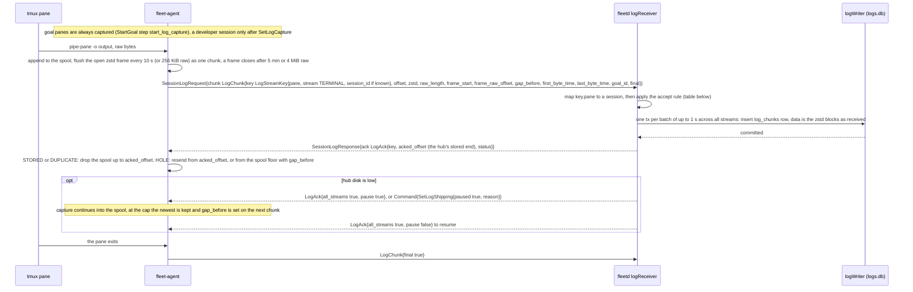
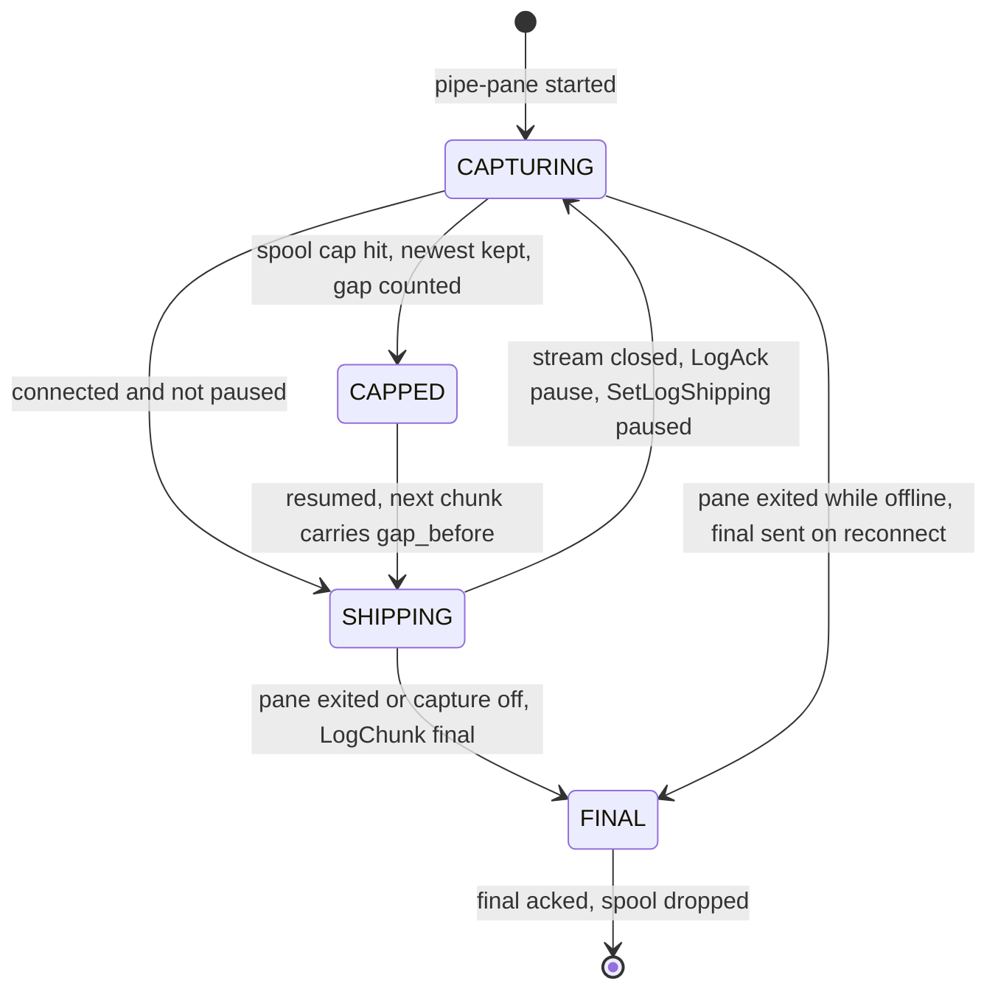
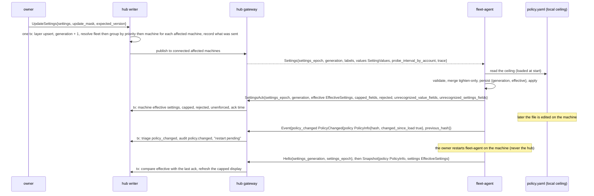
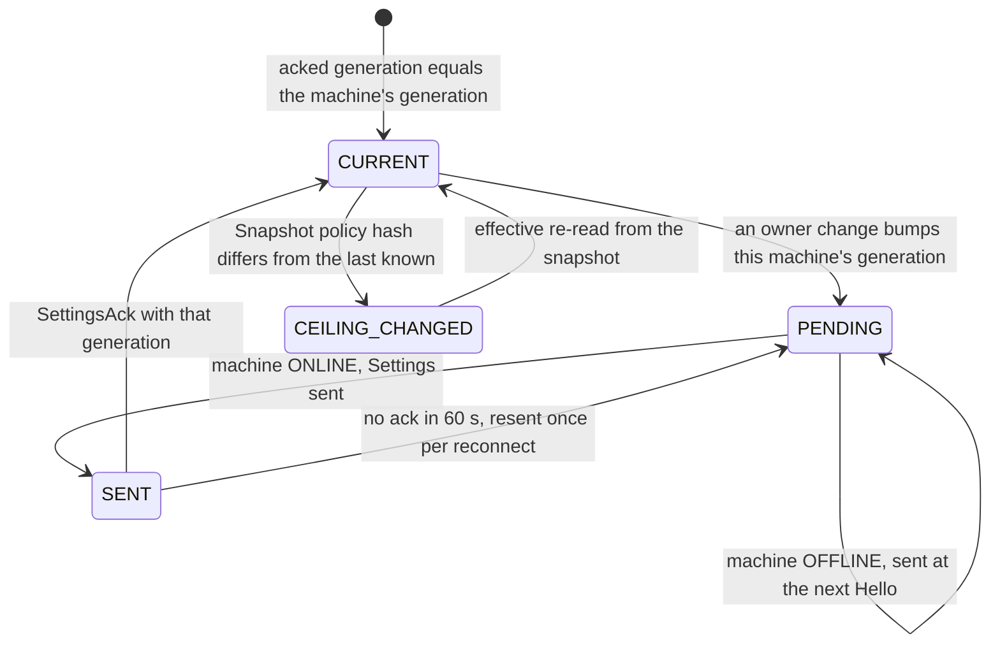
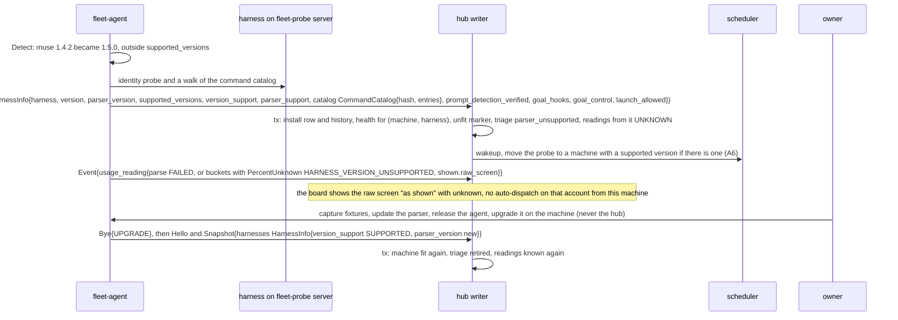
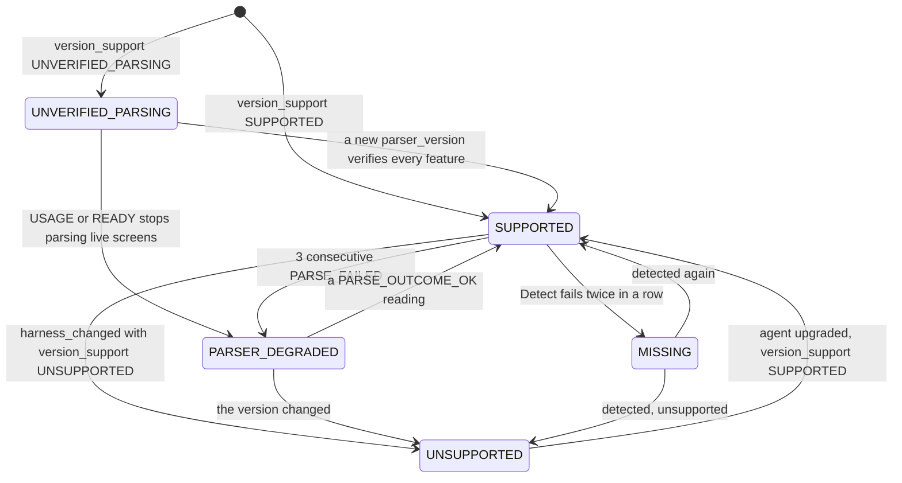

# Agent and hub flows, part 5: logs, settings, upgrade drift (A11 to A13)

- Parts: [1](agent-hub.md) (A1 to A3) | [2](agent-hub-2.md) (A4 to A6) |
  [3](agent-hub-3.md) (A7) | [4](agent-hub-4.md) (A8 to A10) | **5** (this file)
- Counters and storage names are in [part 1](agent-hub.md); the command envelope that
  carries `SetLogCapture`, `Drain` and the rest is in [A4](agent-hub-2.md#a4-command-lifecycle).
- Protos named in this part: [`streams.proto`][streams] (`LogChunk`, `LogAck`,
  `SessionLogRequest`), [`command_goal.proto`][command-goal] (`SetLogCapture`,
  `SetLogShipping`, `Drain`), [`snapshot.proto`][snapshot] (`HarnessInfo`, `SpoolStatus`,
  `PolicyInfo`, `DrainState`), [`agent.proto`][agent] (`Settings`, `SettingsAck`),
  type [`settings.proto`][type-settings] (`SettingValues`, `EffectiveSettings`,
  `SettingRejection`), [`harness.proto`][harness] (`VersionSupport`, `ParserSupport`,
  `GoalControl`, `LogStreamKey`), [`usage.proto`][usage-t], [`status.proto`][status]
  (`ReasonCode`), hub [`settings.proto`][hub-settings] (`UpdateSettings`, `HubSettings`),
  [`terminal.proto`][hub-terminal] (`ReadSessionLog`), [`log_store.proto`][log-store],
  [`machine.proto`][machine] (`HarnessHealth`).

---

## A11. Session logs

**What happens and why.** Everything a goal pane prints is captured, compressed and
shipped to the hub, so that long after a goal ends the owner can replay what the
harness did, scroll to a moment, or search for a word. The agent copies the pane's
output to a spool file on disk, compresses it into chunks and ships each chunk with its
**byte offset** on a stream of its own, so logs can never delay commands. The hub stores
the chunk and answers **every** chunk with where its copy of the stream now ends. That
answer is the whole protocol: if a chunk was lost, repeated, or the hub was restored from
an older backup, the agent learns the hub's true position and either resends or says
"these bytes are gone" and carries on, so a stream never wedges. Reading logs is a
separate permission (`LOGS`), held by owners and granted to others only on purpose,
because terminal output can contain secrets.

**Steps**

1. **Capture.** `pipe-pane -o` copies a pane's output to the agent. Goal panes are
   captured from step 7 of `StartGoal`. For a developer's own session the owner turns it
   on with `SetLogCapture{session SessionTarget, enabled}`
   ([`command_goal.proto`][command-goal]) and the agent starts a stream for each pane in
   it; `TmuxPane.log_capture` reports it. A harness transcript can ship the same way as
   `LogStream` `HARNESS_TRANSCRIPT` from `PaneHarnessSession.transcript_path` (planned for
   a later version, opt in).
2. **Spool and framing.** The agent stores **compressed** data (about 65 bytes a second
   for a busy pane), so hours offline cost megabytes. It keeps one zstd frame open per
   stream for up to 5 minutes or 4 MiB raw and flushes it every 10 seconds, so a
   [`LogChunk`][streams] is a run of zstd blocks, at most 960 KiB, with `frame_start` true
   when it opens a frame and `frame_raw_offset` naming where that frame began. The hub
   stores the blocks as received and a reader decodes from the chunk at `frame_raw_offset`.
   A frame left open by an agent crash still decodes block by block.
3. **Stream identity.** A stream is `(pane, stream)`: a `PaneKey` is unique on the
   machine and the hub knows the machine from the certificate. A developer's own session
   has no hub `SessionId` the agent could know, so `LogStreamKey.session_id` is optional
   on the wire. The hub resolves the pane to the session it assigned to
   `(machine, server_start_id, tmux id)`, stores under it, and echoes the key as sent.
4. **Offsets.** `offset` counts raw bytes of the stream from the start of capture, and a
   lost span still takes up offsets. The hub accepts a chunk only when `offset ==
   stored_end + gap_before`; `gap_before` is non-zero only when the agent had to skip
   bytes it no longer has (spool cap, or a hub behind its spool floor).
5. **The hub answers every chunk** with `LogAck{key, acked_offset, status}`. The ack
   follows the batch commit (one sync per batch). The agent follows `acked_offset` even
   when it is lower than one it saw before, and never treats it as monotonic.

   | Chunk | Hub action | `LogAckStatus` |
   |---|---|---|
   | `offset == stored_end + gap_before` | store, ack the new end (the row records `gap_before` as lost bytes) | `STORED` |
   | `offset + raw_length <= stored_end` | ignore, re-ack | `DUPLICATE` |
   | anything else, a hole or the hub is ahead | store nothing, count `log.hole_refused` | `HOLE`, with the hub's end |
   | the pane maps to no session yet | store nothing | `UNKNOWN_STREAM` |

   On `HOLE` the agent resumes from `acked_offset`: if its spool still has those bytes it
   resends from there; if the hub's end is below its spool floor (it dropped everything up
   to an earlier ack, or the hub was restored from an older backup) it sends its oldest
   chunk with `gap_before = floor - acked_offset`, `offset = floor` and `frame_start`
   true, which the accept rule takes at once. On `UNKNOWN_STREAM` it keeps the spool and
   retries after the next snapshot, at most every 60 seconds.
6. **Backpressure.** `LogAck.pause` (or the command `SetLogShipping{paused, reason}`) stops
   shipping, for example when the hub's disk is low; capture continues into the spool. A
   paused agent sends no chunks to ack, so resuming needs an unsolicited
   `LogAck{all_streams true, pause false}` (key and `acked_offset` unset) or
   `SetLogShipping{paused false}`. When the spool cap (`SettingValues.spool_cap_bytes`) is
   hit the agent keeps the newest data and marks the loss in `gap_before`.
   `SpoolStatus{pending_bytes, cap_bytes, gap_marks, shipping_paused, paused_reason,
   sessions_capturing}` rides in `Heartbeat.spool` and the `spool_status` event.
7. **End of a stream.** `LogChunk.final` is sent when the pane exits or capture is turned
   off (on reconnect if the pane exited offline). A respawn keeps the `PaneKey` (tmux keeps
   the pane id), so the log stream continues: the `final` chunk ends one segment and the
   next chunk on the same key starts with a new `frame_start` at the stored end. A new key
   appears only when the window is recreated or the tmux server restarts. When a session ends the hub moves the last pane
   summary of each pane into `logs.db` and the session row becomes `ENDED`.
8. **Reading and managing logs (hub API, `LOGS` scope).** `ReadSessionLog{key, start
   offset or time, max_bytes, follow}` ([`terminal.proto`][hub-terminal]) streams
   `ReadSessionLogResponse{offset, data, gap_before, first_byte_time, last_byte_time,
   final}`, decompressed from the frame. `ListStoredSessions` and `GetStoredSession`
   ([`log_store.proto`][log-store]) find ended sessions with every stream's key and the
   archived last summary; `DeleteSessionLogs` is refused while a stream captures
   (`LOG_STREAM_OPEN`); `SearchSessionLogs` is a bounded literal scan with no index;
   `GetLogStoreStatus` reports bytes against the cap. The size cap and retention are hub
   settings (`HubSettings.log_size_cap_bytes`, default 50 GiB, and `log_retention`); the
   oldest ended sessions are pruned first and a session with an open stream never is.

**One log stream on the agent**

**Stored where**

| What | Where |
|---|---|
| Spool: compressed chunks and `acked_offset` per stream, under `spool/<server>/<server_start_id>/<pane>/<stream>/`, fsync per chunk batch | agent state dir |
| `log_chunks` (the zstd data and its index in one row, unique on `(session, pane, stream, raw_offset)`), `log_sessions`, `archived_pane_summaries` | `logs.db`, own single writer, one transaction per batch of up to 1 s |
| Per-stream stored end | hub memory, loaded from `logs.db` when the stream opens |
| The audit row of a delete (`logs.delete`: bytes, never content) | hub `state.db`, permanent |
| Retention state | `logs.db` |

**When it goes wrong**

| Failure | What happens |
|---|---|
| The agent is offline for hours | the spool grows, and the agent resends from the hub's `acked_offset` on reconnect |
| The hub restarts | `logs.db` is durable and consistent; the next `LogAck` tells the agent where to resend from |
| The hub was restored from an older backup | the first chunk gets `HOLE` with the lower end; below the spool floor the agent declares a gap and the stream continues |
| A chunk arrives twice (the ack was lost) | `DUPLICATE`, re-acked, not stored |
| A chunk arrives with a hole | `HOLE` with the hub's end; resend or declare a gap |
| The pane maps to no session yet | `UNKNOWN_STREAM`; keep the spool, retry after the next snapshot |
| The hub disk is below its threshold | `LogAck{all_streams, pause}` to every agent, triage `log_disk_low`, resume above a higher threshold (hysteresis) |
| The spool cap is hit | newest kept, `gap_marks` rises, `gap_before` on the next chunk |
| The agent crashes mid chunk | up to one flush interval (10 s) of output not yet durable is lost; the spool file keeps what was written |
| The harness crashes or the tmux server restarts | `final` after the pane exits; a respawn continues on the same key, a new window or server restart starts new keys and streams; old streams are `FINAL` on the next snapshot diff |
| Retention would prune a session with an open stream | never; only `FINAL` sessions older than the cursor are pruned |

---

## A12. Settings and the local policy ceiling

**What happens and why.** The owner sets limits and preferences once, on the hub, in
layers: a fleet default, then machine groups (by label), then single machines. The hub
works out the resolved values for each machine and sends the agent a `Settings` message
with a generation number. On the machine there is also a **local policy file**, written
by whoever owns that machine. It is the **ceiling**: the agent merges the hub's values
under it and the merge can only **tighten**, never loosen (a lower limit, more approvals,
fewer harnesses). The agent applies the result and answers with `SettingsAck`: the
effective values, which ones the ceiling lowered, which it refused, and which it did not
even understand. The dashboard therefore never shows a setting as enforced when it is
not. A hub compromise can raise nothing past what the machine's own file allows.

**Steps**

1. **Edit and resolve (hub).** `UpdateSettings` ([`settings.proto`][hub-settings]) edits one
   layer (`settings.spec.scope`, a `SettingsScope`: fleet, a group label, or one machine). The hub bumps one
   fleet-wide counter, and for each affected machine resolves fleet, group (higher
   `priority` wins when a machine is in several), machine. The machine's `Settings`
   carries the counter value at which **that machine's** resolved values last changed, and
   `HelloAck.settings_generation` is that same per-machine value, so one group's change
   does not resend settings to every machine. `HubSettings` (auto-dispatch, caps, sign-in
   methods and so on) never reach an agent.
2. **Order and delivery.** Settings are ordered by the pair `(settings_epoch, generation)`.
   The agent applies a `Settings` message when the epoch differs from the one it holds
   (any generation, which is how a restored hub gets accepted) or the generation is higher
   under the same epoch; it re-acks an equal one and ignores a lower one. They are sent
   right after `HelloAck` on connect if newer, and published live when connected. A machine
   that is offline stays `PENDING` and gets them at its next `Hello`; no ack in 60 seconds
   resends once per reconnect.
3. **Tighten-only merge (agent).** Per field of `SettingValues`
   ([`settings.proto`][type-settings]):

   | Field | Merge with the local ceiling |
   |---|---|
   | `max_active`, `max_total`, `max_windows`, `rate_limits`, `cert_lifetime`, `spool_cap_bytes`, `attach_idle_timeout` | the smaller (`min`) |
   | `local_approval[]` (`LocalApprovalRule{command_kind, required}`), `block_on_battery` | `hub OR local` |
   | `allowed_harnesses`, `allowed_repo_roots` | intersection |
   | `default_server` (`NONE` < `OBSERVE` < `CONTROL`) | the lower |
   | `probe_interval`, `probe_interval_by_account` | `max(hub value, local minimum)`: a local value can only make probing rarer; precedence among the hub's carriers is `probe_interval_by_account`, then `probe_interval`, then `EnsureProbe.interval` (A6) |
   | `idle_threshold`, `share_identity_email` | the hub's value (no machine safety meaning; the second is the owner's privacy choice) |
   | `merged_grace` | hub only; echoed unchanged |
   | `labels` | the hub's plus local additions; a local file cannot remove a hub label |

   Each field records its `SettingLayer` in `SettingSource` (`AGENT_DEFAULT`,
   `FLEET_DEFAULT`, `GROUP`, `MACHINE`, `LOCAL_CEILING`).
4. **The three honest answers in `SettingsAck`** ([`agent.proto`][agent]).
   - `capped_fields`: the local value won, so the UI says "capped by local policy on
     omarchy".
   - `rejected[]` (`SettingRejection{field, reason, message}`): the agent could not apply
     the field at all, with `INVALID_ARGUMENT` (value out of range, bad duration) or
     `POLICY_SAFE_MODE`. The previous effective value stands. This is **not** a cap.
   - `unrecognized_value_fields` and `unrecognized_settings_fields`: field numbers an older
     agent's schema does not know. The hub maps them to names and shows each as **not
     enforced on this machine** (`Machine.status.unenforced_settings`), never "no
     opinion". If one is a safety limit (`max_*`, `rate_limits`, `local_approval`,
     `block_on_battery`, `allowed_*`, `default_server`, `spool_cap_bytes`) the machine is
     left out of auto-dispatch and a `settings_unenforced` triage item says to upgrade
     the agent; the owner can override per machine.
5. **What applies when.** Rate limits, approval rules, idle threshold, spool cap, window
   template and probe intervals apply at once; `cert_lifetime` at the next renewal;
   the hub enforces `max_active` and `max_total` slots; the agent applies the effective
   values only as a local safety cap at `StartGoal` preflight (`AGENT_GOAL_CAP_REACHED`).
   `merged_grace` is the only echo-only field.
6. **The local policy file** (`~/.config/fleet-agent/policy.yaml`) is read at agent start,
   so a change takes effect only after a restart. The agent reports `PolicyInfo{schema_version,
   hash, loaded_time, changed_since_load, safe_mode, error}` in every snapshot and sends
   `policy_changed` when the hash on disk differs; the hub shows "restart pending". An
   invalid file starts the agent in **safe mode**: observe only, every control command is
   `REJECTED_BY_POLICY` with `POLICY_SAFE_MODE`, every hub setting is rejected with the
   same reason, `safe_mode` is true with a one-line `error` (never the file's contents),
   the hub raises `policy_invalid` and writes the `policy.safe_mode` audit row. A deleted
   file means built-in safe defaults and a `doctor` warning.
7. **Drain.** `Drain{reason}` (`DrainMachine` in the hub API) makes the agent report
   `DrainState{draining, reason, since_time, requested_by_principal}` as a `drain_state`
   event and `Heartbeat.draining`; the scheduler skips the machine. Running goals continue
   (drain never kills) and keep everything that serves them; a `StartGoal` or a harness
   starting `EnsureSession` is refused `DRAINING`, and so is `RespawnPane` unless the pane
   has a registered live goal. The hub also cancels `StartGoal` rows still `pending` in the
   outbox (A4). A drain started locally with `fleet-agent drain` (principal kind
   `LOCAL_USER`) cannot be undone from the hub: `Undrain` answers `REJECTED_BY_POLICY` with
   `DRAINING`, and the UI says "drained on the machine". A drain set at the hub while the agent was
   offline (or `start_drained` at enrollment) reaches it at reconnect: the snapshot diff (A2) compares
   `spec.drain` with `Snapshot.drain` and sends `Drain` or `Undrain`, never undoing a local drain.

**Settings delivery per machine (owned by the hub)**

**Stored where**

| What | Where |
|---|---|
| Settings layers, the generation counter, what was sent per machine, `machine_effective_settings` (effective, capped, rejected, unenforced, ack time), policy hash and safe-mode fields, labels | hub store, the owner's change transaction and the ack transaction |
| The audit row of every change (old and new) and of local decisions | hub store, permanent |
| `settings.json{settings_epoch, generation, values, effective}`, the local policy file and its loaded hash, drain state | agent state dir and config dir, before `SettingsAck` is sent |

**When it goes wrong**

| Failure | What happens |
|---|---|
| The agent is offline | `PENDING`; delivered after the next `Hello` because the generation is newer or the epoch differs |
| The hub restarts | generation and values are durable and re-sent on each Hello as needed |
| The same generation arrives twice | the agent re-acks and does not re-apply |
| An invalid value (`max_windows = 0`, a bad duration) | that field is `rejected` with `INVALID_ARGUMENT`; the previous value stands |
| A drain was set while the agent was offline, or its `Drain` expired | the next `Snapshot.drain.draining` differs from `spec.drain`, so the reconnect diff sends `Drain` (or `Undrain`) |
| The hub sends a field the agent does not know | listed in `unrecognized_value_fields`; shown as not enforced; a safety field keeps the machine out of auto-dispatch |
| The hub store is restored from an older backup | `fleetd restore` mints a new `settings_epoch`, and the agent accepts any generation under a new epoch |
| The policy file is invalid at restart | safe mode, as in step 6 |
| `Drain` arrives while a `StartGoal` is in flight | in the outbox: cancelled and the goal `ABANDONED`; delivered but not past `preflight`: refused `DRAINING`; past `preflight`: it finishes |
| `Undrain` against a local drain | `REJECTED_BY_POLICY` with `DRAINING` |

---

## A13. Harness upgrade drift and parser support

**What happens and why.** Harnesses update themselves, and fleet-board reads their
screens: the usage page, the ready prompt, permission prompts, the status line. A new
version can leave a harness working perfectly while fleet-board can no longer read it
correctly. The agent therefore re-detects every harness every five minutes and before each
probe. When the version or path changes it re-reads the account identity, walks the
harness's slash-command catalog, and reports **one** `harness_changed` event holding the
full `HarnessInfo`, including how much of that version it can parse. The hub reacts to
what is known: it keeps showing the raw screen, refuses to schedule on numbers it cannot
read, stops typing answers into prompts it cannot recognize reliably, and keeps going
where parsing is verified or still reading live screens. It never guesses. The fix is the
owner's: capture fixtures from the new version, update the parser, release the agent.
fleet-board never upgrades a harness.

**Steps**

1. **Detect.** The adapter's `Detect()` runs every 5 minutes and before each probe run. A
   different version or path starts the sequence; a failed detect twice in a row marks the
   harness `MISSING`.
2. **Re-read.** The agent runs the identity probe (account, capability C2) and walks the
   harness's own command list (catalog, capability C4) on the hidden probe server. The
   adapter classifies every command (`CommandClass`: observe, session, goal, review,
   destructive, deny); anything unknown is `DENY` and never sendable, and local policy can
   only move a command to a stricter class. The catalog is identified by a hash.
3. **Report.** `HarnessInfo` ([`snapshot.proto`][snapshot]) carries the version as the binary
   reports it, `parser_version`, `supported_versions`, `version_support`, `parser_support[]`,
   the catalog and its hash, `prompt_detection_verified`, `goal_hooks` (`GoalHooksState`),
   `goal_control` (`GoalControl`), `launch_allowed` and `profile`. It travels in the
   snapshot and, on a change, as the COALESCE event `harness_changed` (key
   `harness:<harness>:<profile>`), so the latest full state wins and the hub never merges
   partial catalogs.
4. **How supported is it.** `VersionSupport` has three values:

   | `VersionSupport` | Meaning | Hub and agent behaviour |
   |---|---|---|
   | `SUPPORTED` | fixtures exist, every parser feature is verified | everything on |
   | `UNVERIFIED_PARSING` | runs, but some `ParserFeature` is unverified for this version | auto-dispatch continues while `USAGE` and `READY` are verified or `parsing_live` and a probe reading agrees with a passive one where one exists; prompts stay notice-only (`answerable = false`) until `PROMPT` is verified; manual dispatch needs a confirm |
   | `UNSUPPORTED` | known not to work (for example `/goal` is missing) | the agent refuses `HARNESS_VERSION_UNSUPPORTED`; auto-dispatch excludes the pair; usage readings are `UNKNOWN`; no override |

   `parser_support[]` is one `ParserSupport{feature, parser_version, supported,
   parsing_live}` per `ParserFeature`: `USAGE`, `IDENTITY`, `PROMPT`, `READY`,
   `CONDITION`. `parsing_live` means "not verified against fixtures, but it has read this
   version's live screens without a parse failure since the version appeared", which keeps
   auto-dispatch going after a harness auto-update until fixtures catch up.
5. **Hub reaction.** In one transaction the hub updates the install row (with history for the
   timeline), sets the health below, marks the `(machine, harness)` unfit when it is
   `UNSUPPORTED`, raises `TRIAGE_KIND_PARSER_UNSUPPORTED` (fingerprint `(harness, version)`),
   and makes readings from that harness `UNKNOWN`. It tries another machine for the probe
   (A6). A `harness_changed` also triggers the goal-hook reconcile (`EnsureGoalHooks`, A8),
   because hooks may no longer verify on the new version.
6. **Catalog changes.** A `RunHarnessCommand` carries `expected_class` and `catalog_hash`;
   with an old hash the agent refuses `CATALOG_STALE` and never types. The hub refreshes
   from `harness_changed` and retries **once, automatically, only for class `OBSERVE`**;
   other classes go back to the operator ("catalog changed, confirm again"). A command that
   moved to a stricter class is stricter at once.
7. **Parser degraded.** Three consecutive `PARSE_OUTCOME_FAILED` readings from one probe on
   a `SUPPORTED` version make it `PARSER_DEGRADED`: treated like unsupported for scheduling,
   with a fingerprinted `TRIAGE_KIND_PARSER_DEGRADED` item; a reading with
   `PARSE_OUTCOME_OK` clears it.
8. **Fix.** `fleet-agent capture-fixtures --harness <h>` is a local job whose output is
   scrubbed of emails, names and installed skill names before commit. The owner updates the
   parser, releases the agent and upgrades it on the machine; the restart sends `Bye{UPGRADE}`
   and the next `Hello` and `Snapshot` carry the new `HarnessInfo`. The `muse` launcher
   updates itself unless `MUSE_NO_AUTO_UPDATE=1`; preflight reports the setting.

**Harness health per machine (owned by the hub, `HarnessHealth`)**

**Stored where**

| What | Where |
|---|---|
| `harness_installs` (machine, harness, version, path, parser version, support, catalog hash, prompt verification, hooks, state, since) plus history, `catalog_entries`, unfit markers, triage items | hub store, the `harness_changed` or snapshot transaction |
| Detected versions, catalog cache, fixtures | agent state dir and the agent binary |

**When it goes wrong**

| Failure | What happens |
|---|---|
| `Detect` fails while an upgrade is replacing the binary | two failures in a row are needed before `MISSING`; a probe in that window reports `PROBE_START_FAILED` once |
| The agent is offline | the drift is learned from the next snapshot, which is authoritative; harnesses absent from it become `MISSING` |
| The same `harness_changed` arrives twice | an idempotent upsert |
| The probe crashes on the new version | `ProbeHealth` failures lead to failover (A6); if every machine runs the new version the account is `UNKNOWN` until fixtures land |
| Prompt detection is silently wrong on the new version | `answerable = false` for an unverified version, so nothing is typed into a misdetected prompt |
| The goal hooks no longer verify | `GoalHooksState.verified = false` after re-verification; a repo that ships its own hooks is left alone |
| A destructive command appears under a new name | unknown means `DENY`, never sendable |
| A `RunHarnessCommand` was issued before the event and arrives after it | refused `CATALOG_STALE`, never typed |

[command-goal]: ../../api/fleet/agent/v1/command_goal.proto
[streams]: ../../api/fleet/agent/v1/streams.proto
[agent]: ../../api/fleet/agent/v1/agent.proto
[snapshot]: ../../api/fleet/agent/v1/snapshot.proto
[hub-terminal]: ../../api/fleet/hub/v1/terminal.proto
[log-store]: ../../api/fleet/hub/v1/log_store.proto
[hub-settings]: ../../api/fleet/hub/v1/settings.proto
[type-settings]: ../../api/fleet/type/v1/settings.proto
[harness]: ../../api/fleet/type/v1/harness.proto
[usage-t]: ../../api/fleet/type/v1/usage.proto
[status]: ../../api/fleet/type/v1/status.proto
[machine]: ../../api/fleet/hub/v1/machine.proto
