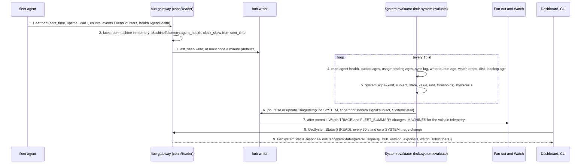

# Agent and hub flows, part 6: system health (A14)

- Status: Accepted
- Date: 2026-10-02
- Parts: [1](agent-hub.md) (A1, A2) | [2](agent-hub-2.md) (A4 to A6) |
  [3](agent-hub-3.md) (A7) | [4](agent-hub-4.md) (A8) | [5](agent-hub-5.md) (A11 to A13) |
  **6** (this file, A14) | [7](agent-hub-7.md) (A3) | [8](agent-hub-8.md) (A9, A10)
- Counters and storage names are in [part 1](agent-hub.md); heartbeats and delivery classes are in
  [A5](agent-hub-2.md#a5-events-delivery-classes-and-seq). The rules and thresholds are in
  [05b](../specs/05b-observability.md) (the spec of this flow) and [ADR 0021](../adr/0021-insights-and-observability.md).
- Protos named in this part: [`agent.proto`][agent] (`Heartbeat`, `AgentHealth`, `EventCounters`),
  hub [`machine.proto`][machine] (`MachineTelemetry`, `MachineAgentHealth`),
  hub [`system.proto`][system] (`GetSystemStatus`, `SystemSignal`, `SystemSignalKind`,
  `SystemState`, `SystemDetail`), hub [`triage.proto`][triage] (`TriageItem`, `TRIAGE_KIND_SYSTEM`),
  hub [`common.proto`][common] (`FleetSummary`).

---

## A14. System health: how fleetd and the agents report on themselves

**What happens and why.** The fleet runs unattended, so the owner needs to hear that the
fleet itself is sick before a goal fails because of it: a machine that stopped
reporting, a usage reading that went stale, the hub's writer falling behind, a disk
filling up, a clock drifting. No collector is needed. Every agent already sends a
`Heartbeat` every 15 seconds; it now carries an `AgentHealth` (ring size, unacknowledged
results, reconnects, memory, tmux control connections down, failing probes, refused
commands). The hub keeps the latest per machine and, every 15 seconds, judges **ten
signals** from numbers it already has, each against fixed thresholds. A signal that
leaves OK raises **one** deduplicated triage item of kind `TRIAGE_KIND_SYSTEM`; a signal
whose input is missing is `UNKNOWN` and raises nothing, because an unknown stays unknown.
The Machines view's System section draws the whole list; the strip's System dot counts
the warnings and criticals.

**Steps**

1. **Heartbeat.** The agent sends [`Heartbeat`][agent] every 15 s, droppable, with no `seq`.
   `health` ([`AgentHealth`][agent]) holds `ring_events`, `ring_bytes`, `unacked_results`,
   `reconnects_total`, `rss_bytes`, `tmux_control_down`, `probes_failing` and
   `commands_refused_total`; `events` repeats the shed, coalesced and evicted counters. Numbers
   only: no names, no paths, no screen text.
2. **Keep the latest.** The gateway stores the newest `AgentHealth` per machine in memory as
   `MachineTelemetry.agent_health` ([`MachineAgentHealth`][machine]) and measures the clock
   skew from `sent_time`. A machine whose agent is too old to send `AgentHealth` has the
   fields unset: unknown, not zero, and the System section says "not reported".
3. **Cheap persistence.** Only `last_seen` is written, at most once a minute per machine
   (one writer transaction, never per heartbeat).
4. **Evaluate every 15 s.** The evaluator reads numbers the hub already holds: heartbeat age
   (only machines labelled `always-on` or holding a live goal count, so a sleeping laptop is
   not a fault), the age of each FLEET-mode account's last good reading, each integration's
   `sync_lag`, the writer's queue and commit times, the oldest pending command per online
   machine, Watch streams ended `RESYNC_REQUIRED` in 10 minutes, `logs.db` size against its
   cap, free bytes under `state.db`, clock skew, and the age of the last backup.
5. **Judge.** Each reading becomes a [`SystemSignal`][system] of one of ten
   `SystemSignalKind`s with `state` `OK`, `WARNING`, `CRITICAL` or `UNKNOWN`, the value, its
   unit and the thresholds it was judged against (the hub's defaults, not settings in v1).
   **Hysteresis:** two consecutive evaluations (30 s) in a worse state to leave OK, five
   minutes in OK to return.
6. **Raise.** A signal that left OK sends one writer job that creates or updates a
   `TriageItem` of kind `TRIAGE_KIND_SYSTEM` with a [`SystemDetail`][system], fingerprint
   `system:<signal>:<subject>`. The unique open fingerprint means a flapping signal is one
   item whose severity changes in place. A WARNING signal raises `SEVERITY_WARNING`, a
   CRITICAL one `SEVERITY_ACTION`, except `DISK_FREE` and `WRITER_BATCH_LAG`, which can lose
   work and raise `SEVERITY_CRITICAL`. Overlaps stay single: `USAGE_PROBE_FRESHNESS` does not
   raise while the parser items that explain the same account are open, and `AGENT_CONNECTED`
   does not repeat the goal items a vanished pane raises (A8).
7. **Tell the clients.** After commit, the `TRIAGE` and `FLEET_SUMMARY` topics carry the item
   and the counts `FleetSummary.system_warnings` and `system_critical`; the volatile machine
   telemetry reaches `MACHINES` subscribers at most once per 30 s.
8. to 9. **Read the whole list.** `GetSystemStatus` (`READ`) returns every evaluated signal, OK
   ones included, with `since_time` and the open item. There is no Watch topic for it: the
   System section re-reads every 30 s and on any change of a SYSTEM item, and shows "System
   status is old" when `observed_time` is over 60 s old.

**Stored where**

| What | Where |
|---|---|
| Latest `AgentHealth`, clock skew, signal states and their `since_time` | hub memory, rebuilt within 30 s after a restart |
| SYSTEM triage items (and their snooze) | hub `state.db`, written by the single writer |
| `last_seen` | hub `state.db`, at most once a minute per machine |
| Agent counters behind `AgentHealth` | the agent process; the ring and `agent.db` for the event and result counts |

**When it goes wrong**

| Failure | What happens |
|---|---|
| Heartbeats stop | `AGENT_CONNECTED` leaves OK after 10 minutes offline (WARNING) and 1 hour (CRITICAL) for always-on machines; for others the machine is only `OFFLINE` |
| The evaluator stalls | `hub.system.evaluate` stops, `observed_time` goes stale, the UI says so above 60 s; `fleet doctor` reads the same status |
| Hub restarts | counters reset, signal state is re-derived within 30 s, SYSTEM items persist in the store |
| A signal's source is not enabled (no backup yet, or `logs.db` not created yet) | `UNKNOWN`: shown as unknown, raises nothing |
| A signal flaps around a threshold | hysteresis (two evaluations out, five minutes back) and one item per fingerprint |
| A machine's agent is too old to send `AgentHealth` | the health fields are unset and nothing is raised from them |
| The same heartbeat arrives twice | latest wins; the second changes nothing |

[agent]: ../../api/fleet/agent/v1/agent.proto
[machine]: ../../api/fleet/hub/v1/machine.proto
[system]: ../../api/fleet/hub/v1/system.proto
[triage]: ../../api/fleet/hub/v1/triage.proto
[common]: ../../api/fleet/hub/v1/common.proto
