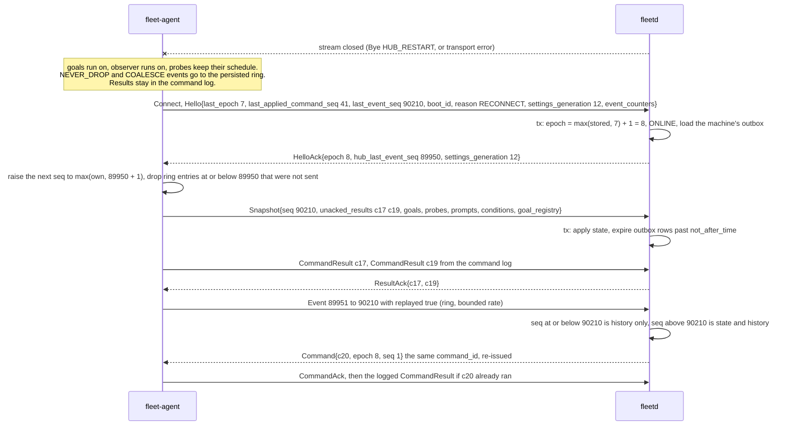

# Agent and hub flows, part 7: reconnect and replay (A3)

- Status: Accepted
- Date: 2026-10-02
- Parts: [1](agent-hub.md) (A1, A2) | [2](agent-hub-2.md) (A4 to A6) |
  [3](agent-hub-3.md) (A7) | [4](agent-hub-4.md) (A8) | [5](agent-hub-5.md) (A11 to A13) |
  [6](agent-hub-6.md) (A14) | **7** (this file, A3) | [8](agent-hub-8.md) (A9, A10)
- Split out of [part 1](agent-hub.md) to keep each file under the 500-line cap. Read part 1 first for
  the wiring, the counters and the storage names, and A1 and A2 there. The same protos apply: see the
  reference list at the end.

## A3. Reconnect and replay

**What happens and why.** Connections drop: the hub restarts, a laptop sleeps, the
network changes. The agent never stops what it is doing meanwhile: goals keep
running, probes keep their schedule, and everything that matters is written to a
local ring and command log. When it reconnects it does the same Hello and Snapshot
as in A2, so the hub learns the truth at once, and then it replays the events the
hub missed. Because the snapshot already holds the effect of those events,
replayed ones only fill in the timeline; they never re-run a rule. Counters that
must never go backwards (the command epoch and the event sequence) are protected
so that even a restored hub or a wiped agent cannot make the other side discard
real data.

**Steps**

1. The stream ends. If the hub shut down cleanly it sent `Bye{HUB_RESTART}` so the
   agent reconnects quickly; otherwise the agent notices through transport
   keepalive. On a hub start every machine is set `STALE`, so the usual 3 minute
   rule turns silent ones `OFFLINE`, and nothing is scheduled on a machine until it
   is `ONLINE` again.
2. While offline the agent writes each NEVER_DROP and COALESCE event to its ring
   (one week, size capped, latest per key for coalesced kinds) and each command
   result to its command log (last 10,000 or 7 days). SHED events are dropped and
   counted (A5).
3. `Hello` carries `last_epoch`, `last_applied_command_seq` (the values of the
   connection that just died), `last_event_seq` (the persisted high-water mark, not
   only what was sent) and `event_counters` ([`EventCounters`][agent]).
4. The hub sets `epoch = max(stored, last_epoch) + 1`. It stores that in the same
   transaction, so a hub restored from an older backup cannot reissue an epoch the
   agent already used (the agent would reject the new epoch's commands as
   `SEQ_REPLAYED`).
5. The agent raises its next event `seq` to `max(own, HelloAck.hub_last_event_seq +
   1)` and discards ring entries at or below `hub_last_event_seq` that it did not
   send, since they cannot be told from another incarnation's. A wiped state
   directory or a restored VM image therefore resumes above what the hub holds
   instead of being dropped as duplicates.
6. The snapshot goes first and the hub applies it in one transaction. Then the
   agent replays ring events with `seq` above `hub_last_event_seq`, in order, at a
   bounded rate (proposed 200 per second; the hub's ingest limit is set in the
   technology review).
7. **The replay apply rule.** An event with `seq <= Snapshot.seq` is history only:
   written to the timeline and run history, runs no rule, changes no goal phase,
   triage item, nudge counter or "person at the keyboard" state. An event with
   `seq > Snapshot.seq` updates state and history. Audit is the exception: a
   replayed `local_approval`, `policy_changed` or `drain_state` event still writes
   its `AuditEntry` once, idempotent on `(machine, event_generation, seq)`.
   Every NEVER_DROP event a rule depends on has a level counterpart in the
   snapshot (`prompts[]`, `conditions[]`, `last_input_time`, `availability`,
   `goals[]`, `goal_registry[]`), which is why a prompt that appeared and left
   while the hub was away is only on the timeline, never a triage item.
8. Commands still pending in the outbox are re-issued under the new epoch with the
   same `command_id`. The agent checks a known `command_id` before anything else, so
   a re-send of a command it already ran returns the logged result and never trips
   the epoch or `seq` check (A4).

**What the hub concludes from the counters**

| Signal | Meaning | Hub action |
|---|---|---|
| `shed_total` or `coalesced_total` rises | deliberate drops | metric only |
| `Heartbeat.event_seq` above the highest stored seq | newer events are in flight, or were shed or coalesced | none |
| `evicted_total` rises in a `Heartbeat` | a NEVER_DROP or COALESCE event was lost while connected | `SnapshotRequest{reason: "event_lost"}` (at most one per 5 minutes per machine) and a gap marker |
| `evicted_total` in `Hello` is above the stored value | ring overflow while offline | gap marker for the seq range between `hub_last_event_seq` and the first replayed seq; the snapshot already repairs state |
| `Hello.last_event_seq` below `hub_last_event_seq`, any counter lower than stored, or a changed `install_id` on a valid certificate | agent rollback (state lost, cloned or restored) | keep history, start a new `event_generation`, timeline marker, audit row `machine.install_changed`; if `Snapshot.seq` is still not above the hub's value, apply it and send `SnapshotRequest{reason: "seq_rollback"}` |

Gaps in `seq` are normal because every event consumes a number, shed ones
included; the hub never compares numbers hole by hole.

**Duplicate identity.** A second `Hello` for a `machine_id` with a live stream
always wins. The old stream gets `Bye{DUPLICATE_IDENTITY}` if it can still be
written to, and the epoch moves on. A sleeping laptop or a restarted agent leaves a
half-open silent stream, so a benign reconnect raises nothing. A triage warning
(`TRIAGE_KIND_DUPLICATE_IDENTITY`) is raised only when the displaced stream had a
heartbeat within 45 s and the two `boot_id`s then displace each other again within
10 minutes: two hosts with one copied state directory. It is re-raised at most once
an hour and auto-dispatch to that machine is suspended until the owner resolves it.

**Hub-side connection state for one machine.** `OFFLINE` becomes `HELLO` when a `Hello`
is accepted (epoch plus one), `ONLINE` when the snapshot is applied and unacked results
are closed, `REPLAYING` while replayed events arrive and `ONLINE` again at the last
replayed `seq`. No heartbeat for 45 s is `STALE`, 3 minutes or a `Bye` is `OFFLINE`, and a
newer `Hello` for the same `machine_id` makes the old connection `DISPLACED` (it is sent
`Bye{DUPLICATE_IDENTITY}` and closed).

**Stored where**

| What | Where |
|---|---|
| Event ring (`seq`, body, one week, size cap); `seq_hwm` (reserved in blocks of 1024), `EventCounters`, `install_id` | `agent.db`, fsync batched to 1 s, one fsync per `seq_hwm` block |
| Command log (status, result, step reached), probe assignments, goal registry, availability marks | `agent.db`, per state change and before `CommandAck` is sent |
| `machine_connections`, per machine `hub_last_event_seq`, `event_generation`, last `EventCounters`, `install_id`, `epoch` | hub store, Hello transaction and writer batches |
| Event history (live and replayed, one week) | hub store |

**When it goes wrong**

| Failure | What happens |
|---|---|
| Agent offline for hours | goals run on; the ring keeps the latest state per coalesced key; on reconnect the snapshot gives the truth and the ring the timeline; ring overflow shows as a rise of `evicted_total` and a gap on the timeline |
| Agent crashed | `seq` resumes above `seq_hwm`, so numbers handed to shed events are skipped, never reissued |
| Agent state directory wiped or VM image reverted | rollback rule above; the agent floors `seq` above `hub_last_event_seq`, so nothing is discarded as a duplicate |
| Hub restart mid snapshot apply | the transaction rolls back; the agent reconnects and sends a fresh snapshot |
| Hub restored from an older backup | epoch rises above the agent's; `hub_last_event_seq` is lower, so the agent replays its ring and the snapshot covers the rest; a registry entry for an unknown goal becomes `orphan_goal_pane`; unknown results go to audit only; a different `settings_epoch` makes the agent accept settings whatever their generation |
| `StartGoal` expired during the outage but `Snapshot.goal_registry` binds that goal to a pane | the goal is adopted as `RUNNING` instead of re-planned (A7) |
| Harness crashed while offline | `PaneExited{goal_id}` is in the ring and replays as history only; the snapshot shows the pane dead and the one-nudge rule is evaluated once from it (A8) |
| Ring replay floods the hub | replay is rate limited per agent and HTTP/2 flow control blocks that agent only |
| Agent receives `HelloAck.epoch` not above its `last_epoch` | logs `epoch_regressed`, closes, reconnects with backoff, accepts no command from that connection |

[agent]: ../../api/fleet/agent/v1/agent.proto
[snapshot]: ../../api/fleet/agent/v1/snapshot.proto
[machine]: ../../api/fleet/hub/v1/machine.proto
[status]: ../../api/fleet/type/v1/status.proto
[principal]: ../../api/fleet/type/v1/principal.proto
[ids]: ../../api/fleet/type/v1/ids.proto
[command]: ../../api/fleet/agent/v1/command.proto
[events]: ../../api/fleet/agent/v1/events.proto
[streams]: ../../api/fleet/agent/v1/streams.proto
