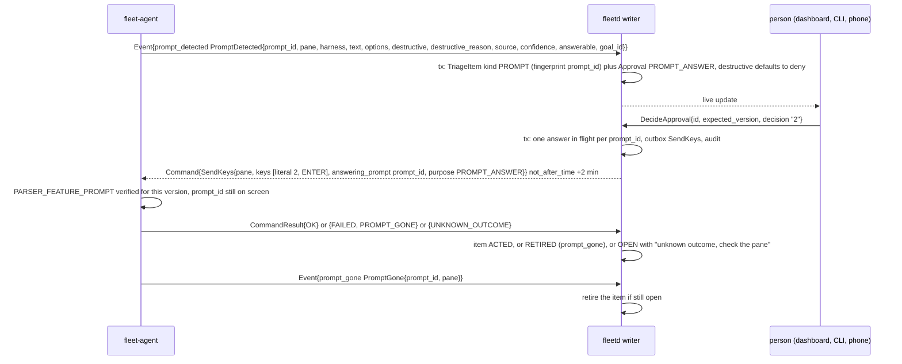
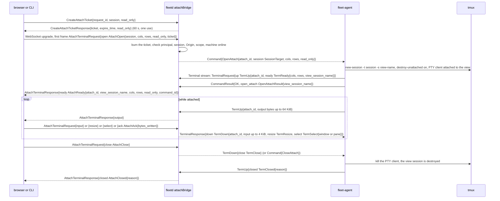

# Agent and hub flows, part 8: prompts and terminal attach (A9, A10)

- Status: Accepted
- Date: 2026-10-02
- Parts: [1](agent-hub.md) (A1, A2) | [2](agent-hub-2.md) (A4 to A6) |
  [3](agent-hub-3.md) (A7) | [4](agent-hub-4.md) (A8) | [5](agent-hub-5.md) (A11 to A13) |
  [6](agent-hub-6.md) (A14) | [7](agent-hub-7.md) (A3) | **8** (this file, A9, A10)
- Split out of [part 4](agent-hub-4.md) to keep each file under the 500-line cap. Read
  [A7](agent-hub-3.md) and [A8](agent-hub-4.md#a8-a-goal-running) first: they explain the goal registry,
  the line the agent typed and the goal phases. Counters and storage names are in [part 1](agent-hub.md).

## A9. Prompts detected and answered

**What happens and why.** A harness sometimes stops to ask permission ("run this
command? 1 yes, 2 no"). The agent notices the prompt on the screen and tells the hub,
which shows it to a person as a triage item with an approval attached. The fleet never
answers a prompt on its own, destructive or not. When a person decides, the hub sends
a `SendKeys` bound to that prompt, and the agent types the answer only if the same
prompt is still on the screen. A prompt that went away in the meantime (answered at
the keyboard, timed out) is refused with `PROMPT_GONE`, so a late answer can never be
typed into something else.

**Steps**

1. The adapter detects the prompt from the screen (`PROMPT_SOURCE_SCREEN_PATTERN`) or
   a hook (`PROMPT_SOURCE_HOOK`, `PermissionRequest`) and sends `PromptDetected`
   ([`screen.proto`][screen]). `text` is up to 16 KiB of untrusted text; `options` are
   the keys and labels as shown; `confidence` is 0 to 100. `destructive` is set for
   `rm -rf`, `docker compose down -v` and any command line that embeds a credential.
   `answerable` is true only when detection is verified for this harness version.
2. In the event's transaction the hub opens a `TRIAGE_KIND_PROMPT` item and an
   `Approval` of kind `APPROVAL_KIND_PROMPT_ANSWER`. A destructive prompt shows deny
   preselected with `destructive_reason`. With `answerable = false` the item is
   notice-only and carries the `ssh -t <user>@<host> tmux attach` line (the hub never
   connects itself).
3. A person with the `APPROVALS` scope calls `DecideApproval` with the approval's
   `expected_version` (a stale decision on a closed approval is `APPROVAL_CLOSED`) and
   one of `allowed_decisions[].key`. The fallback when nobody decides is deny: silence
   never approves.
4. The hub inserts the outbox row and an in-flight marker for the `prompt_id` (unique,
   so two browsers cannot answer twice), then sends `SendKeys` with
   `purpose = SEND_KEYS_PURPOSE_PROMPT_ANSWER`, `answering_prompt` and `keys` (one
   literal, then `ENTER`). Deadline 2 minutes, never typed late.
5. The agent checks `PARSER_FEATURE_PROMPT` for the version and that the prompt is still
   showing. There is no ready-pattern or empty-line check for this purpose, because a
   menu has neither. `SendKeys` is not idempotent: after a crash the result is
   `UNKNOWN_OUTCOME` and the hub never retries.
6. `PromptGone` ([`events.proto`][events]) is NEVER_DROP and tells the hub the prompt
   left the screen (answered locally, timed out, the pane moved on). A later `SendKeys`
   with that id gets `PROMPT_GONE`. `Snapshot.prompts[]` carries only prompts showing
   now, so a reconnect rebuilds Triage, while one that came and went offline stays only
   on the timeline.
7. The agent never answers a startup screen (trust, update, login, release notes), and
   neither the scheduler nor the arbiter may send `PROMPT_ANSWER`: only a person's
   decision does ([02g](../specs/02g-agent-security.md#what-each-principal-may-ask-an-agent-to-do)).

**Stored where.** `triage_items` (unique open fingerprint), the approval,
`prompt_answers_in_flight` and the audit row of every decision (permanent) in the hub
store, in the transactions above. On the agent only the command log.

**When it goes wrong**

| Failure | What happens |
|---|---|
| The machine is offline when a person answers | the `SendKeys` stays pending; delivered only inside 2 minutes, else `EXPIRED` and the item is `OPEN` with "not delivered" |
| The prompt was already answered at the keyboard | `PromptGone` retires the item; a late answer gets `PROMPT_GONE` and nothing is typed |
| A person types while the operator answers | the prompt check still runs; if the prompt moved, `PROMPT_GONE` |
| Two people answer | the unique in-flight marker refuses the second until the first result lands |
| The harness crashes | `PaneExited` retires the prompt and condition items; A8 raises `stuck` instead |
| The prompt is still showing after 7 days | the item expires and is re-raised from the next `Snapshot.prompts[]` marked "expired, still showing" |

---

## A10. Terminal attach

**What happens and why.** A person can open a live terminal to any session in the
browser (or the CLI). The browser cannot talk to the agent: it goes through the hub,
and the hub opens a separate byte stream to the agent. The agent never lets the
browser touch the developer's own tmux client. It creates a **grouped view session**
that shares the real session's windows, runs a pseudo-terminal client attached to that
view, and pipes bytes both ways. Switching windows in the browser therefore never moves
the developer's current window, and when the browser leaves, the view disappears. The
hub only forwards bytes; read-only viewers cannot type, and the agent enforces that
too.

**Steps**

1. **Ticket.** A WebSocket upgrade carries ambient authority (the cookie, or nothing
   in `local_trusted` mode) and a page on another site could open one, so the hub
   first requires `CreateAttachTicket` over the normal channel
   ([`terminal.proto`][terminal]). The ticket is 256 random bits, bound to the
   principal, session, read-only flag and the request's Origin, valid 60 seconds, shown
   once. `read_only` is forced to true for a caller without `SCOPE_SESSIONS_WRITE`. A CLI
   uses the same RPC over HTTP/2 with its bearer token and needs no ticket
   ([02f](../specs/02f-hub-authentication.md#terminal-attach-over-websocket)).
2. **Open.** The first frame must arrive within 10 seconds and be an `AttachOpen`
   carrying the ticket; the hub burns it whether or not the attach then succeeds. The
   hub mints an `attach_id`, writes an audit row and sends `OpenAttach`
   ([`command_goal.proto`][command-goal]; needs `ROLE_VIEWER` read-only or `OPERATOR`) with
   a `SessionTarget` ([`command_tmux.proto`][command-tmux]): a fleet session by id or name,
   a developer's by `tmux_id` guarded by `server_start_id`.
3. **The agent opens the `Terminal` stream** (a separate RPC, so bytes never delay
   commands) and sends `TermReady`. The view session is `TmuxSession.attach_view` and
   `internal`, so the hub never lists it, and its clients are not counted as
   `attached_clients`.
4. **Bytes.** `TermUp.output` is raw terminal bytes, at most 64 KiB per message, with
   escape sequences that act on the viewer's machine (OSC 52, hyperlinks) stripped by the
   agent. `TermDown.input` is at most 4 KiB, dropped by the hub and refused by the agent
   for read-only attaches. `TermResize` resizes the PTY. `TermSelect` runs
   `select-window` or `select-pane` in this view session only, allowed even read-only,
   because the browser cannot type the developer's tmux prefix.
5. **Flow control.** Neither WebSocket nor xterm.js has backpressure, so the browser
   sends `AttachAck{bytes_written}` at least every 32 KiB written or 200 ms; the hub
   stops reading the agent's stream when more than 256 KiB is unacknowledged, which lets
   HTTP/2 flow control block the agent's PTY read. Output is never dropped. No ack for
   30 seconds while output waits closes the attach (`HUB_CLOSED`).
6. **Close.** Either side ends it. `AttachCloseReason` says why: `IDLE_TIMEOUT` (no
   input or output for `attach_idle_timeout`), `SESSION_ENDED`, `HUB_CLOSED` (revoked
   credential, shutdown), `AGENT_SHUTDOWN`, `AGENT_OFFLINE`, `DETACHED`, or `ERROR` with an
   `ErrorDetail`. Because a WebSocket has no error trailer, a refused attach is sent as
   `AttachClosed{reason ERROR, error}` before the socket closes (ticket invalid,
   `SCOPE_MISSING`, `MACHINE_OFFLINE`, ...).

**Stored where.** The attach registry lives in hub memory; an `attach.open` and an
`attach.close` audit row (byte counts, never content) are permanent in the hub store.
The view session exists only in tmux and destroys itself when its client goes.

**When it goes wrong**

| Failure | What happens |
|---|---|
| The agent is offline | the attach closes (`AGENT_OFFLINE`, or `MACHINE_OFFLINE` before it opens); the UI offers reconnect and the session list shows the last known state |
| The hub restarts | every attach drops; the agent's PTY clients see the stream end and exit and the view sessions destroy themselves |
| `OpenAttach` deadline (2 minutes) passes | `EXPIRED`, "not delivered" |
| A second `OpenAttach` with the same `attach_id` | returns the existing view |
| The developer kills the session | `SessionEvent{CLOSED}`; the attach closes `SESSION_ENDED` |
| The device or token is revoked | `HUB_CLOSED`; a revoked machine also closes all of its attaches |
| A viewer types | the hub drops the input and the agent refuses it too |
| The developer types at the same time | two tmux clients on one session is normal; the agent reports `PaneInput` and the pane stops being idle |
| The tmux server is not running | `TMUX_SERVER_DOWN` |

[snapshot]: ../../api/fleet/agent/v1/snapshot.proto
[events]: ../../api/fleet/agent/v1/events.proto
[screen]: ../../api/fleet/agent/v1/screen.proto
[goal]: ../../api/fleet/hub/v1/goal.proto
[terminal]: ../../api/fleet/hub/v1/terminal.proto
[command-goal]: ../../api/fleet/agent/v1/command_goal.proto
[command-tmux]: ../../api/fleet/agent/v1/command_tmux.proto
[streams]: ../../api/fleet/agent/v1/streams.proto
[harness]: ../../api/fleet/type/v1/harness.proto
[status]: ../../api/fleet/type/v1/status.proto
[triage]: ../../api/fleet/hub/v1/triage.proto
