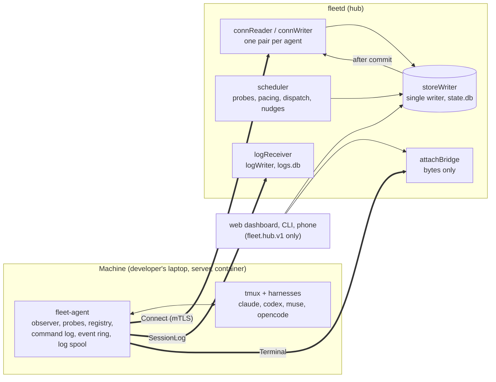
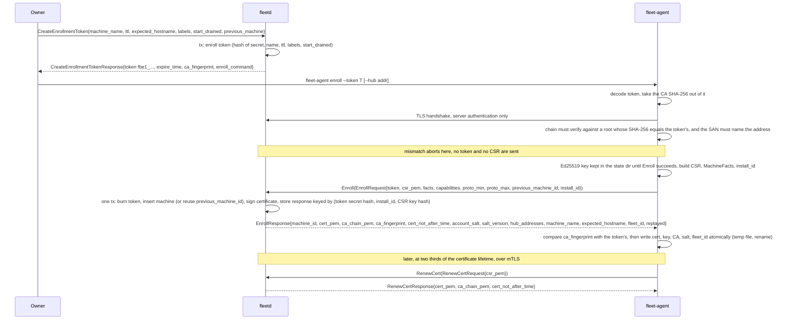
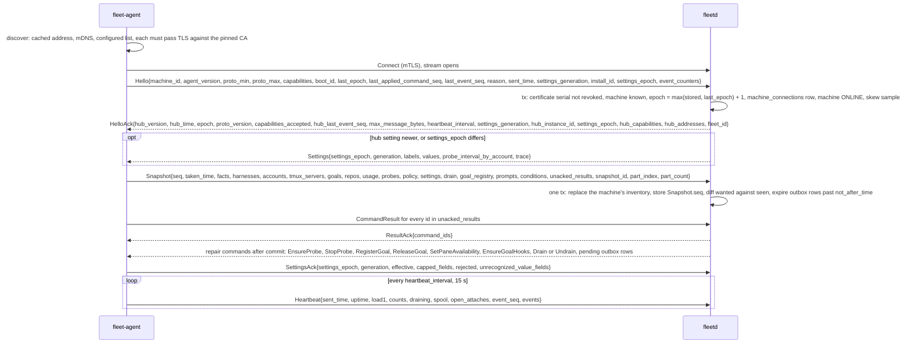
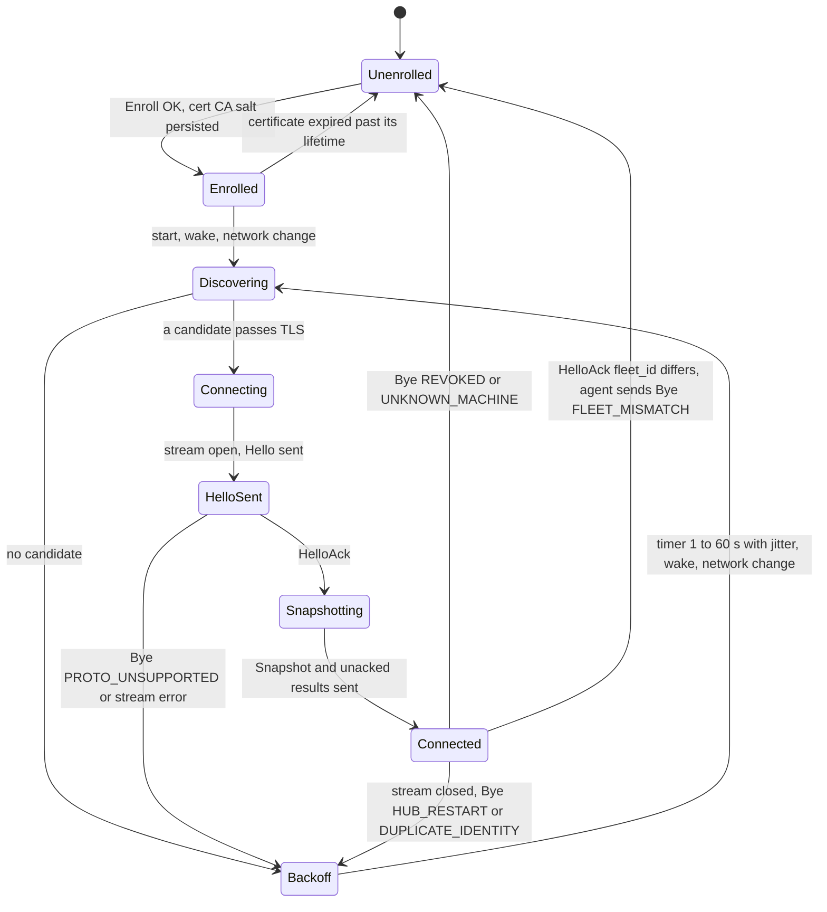

# Agent and hub flows, part 1: enrollment and connect (A1, A2)

- Status: Accepted
- Date: 2026-10-02
- Parts: **1** (this file: orientation, A1, A2) | [2](agent-hub-2.md) (A4 to A6) |
  [3](agent-hub-3.md) (A7) | [4](agent-hub-4.md) (A8) | [5](agent-hub-5.md) (A11 to A13) |
  [6](agent-hub-6.md) (A14) | [7](agent-hub-7.md) (A3) | [8](agent-hub-8.md) (A9, A10)
- Contracts: [`api/fleet/agent/v1/`](../../api/fleet/agent/v1/) and
  [`api/fleet/type/v1/`](../../api/fleet/type/v1/); the `.proto` files are the source
  of truth and every message, RPC and field name below is copied from them. Specs
  behind it: [02-contracts](../specs/02-contracts.md), [02g](../specs/02g-agent-security.md),
  [02h](../specs/02h-goal-binding-and-pane-signals.md),
  [02i](../specs/02i-delivery-and-sequencing.md), [03-workflows](../specs/03-workflows.md),
  [ADR 0019](../adr/0019-pre-implementation-contract-decisions.md).
- Protos named in this part: [`agent.proto`][agent] (`Enroll`, `Connect`, `Hello`,
  `HelloAck`, `Heartbeat`, `Bye`, `RenewCert`, `ResultAck`, `EventCounters`),
  [`snapshot.proto`][snapshot] (`Snapshot`, `MachineFacts`, `GoalRegistration`),
  [`command.proto`][command] (`Command`), [`events.proto`][events] (`Event`),
  [`streams.proto`][streams] (`TerminalRequest`, `SessionLogRequest`),
  [`status.proto`][status] (`Status`, `ReasonCode`), [`principal.proto`][principal] (`Capability`),
  [`ids.proto`][ids],
  hub API [`machine.proto`][machine] (`CreateEnrollmentToken`, `MachineState`).

This set of documents explains, one flow at a time, exactly how `fleetd` (the
hub) and `fleet-agent` (one per machine) talk to each other. It is written for
two readers: a developer about to implement either side, and the owner who wants
to see what really crosses the wire and why. Every flow has a plain-language
summary, a diagram, numbered steps that explain each arrow, what is stored where,
and what happens when it goes wrong. How the web dashboard, the CLI and a phone
talk to the hub (`fleet.hub.v1`) is a separate set of documents; here they appear
only as the thing that causes a command.

## The flows

| Flow | What | Part |
|---|---|---|
| A1 | Enrollment and certificates | 1 |
| A2 | Connect, Hello, HelloAck, Snapshot | 1 |
| A3 | Reconnect and replay | [7](agent-hub-7.md) |
| A4 | Command lifecycle: outbox, ack, progress, result, deadlines, idempotency | [2](agent-hub-2.md) |
| A5 | Events, delivery classes and `seq` | [2](agent-hub-2.md) |
| A6 | Usage probing and the inputs to pacing | [2](agent-hub-2.md) |
| A7 | Starting a goal (`StartGoal`) | [3](agent-hub-3.md) |
| A8 | A goal running: goal file, hooks, interrupts, limits, nudges | [4](agent-hub-4.md) |
| A9 | Prompts detected and answered | [8](agent-hub-8.md) |
| A10 | Terminal attach | [8](agent-hub-8.md) |
| A11 | Session logs | [5](agent-hub-5.md) |
| A12 | Settings and the local policy ceiling | [5](agent-hub-5.md) |
| A13 | Harness upgrade drift and parser support | [5](agent-hub-5.md) |
| A14 | System health: `AgentHealth`, ten signals, the SYSTEM triage item | [6](agent-hub-6.md) |

These ids belong to this document set. They are **not** the capability ids
(A1, A3, D1, G3 and so on) that appear in comments inside the `.proto` files and in
the capability map of [02-contracts](../specs/02-contracts.md#capability--message-map);
where a flow needs one it says "capability G3".

## How the two sides are wired

The agent always dials out; the hub never connects to a machine. All of it is one
gRPC service, `AgentService`, in [`agent.proto`][agent], over mutual TLS.

| RPC | Shape | Opened by | Carries | Flow |
|---|---|---|---|---|
| `Enroll` | unary, server-auth TLS plus a one-time token | agent, once per machine | token, CSR, certificate | A1 |
| `Connect` | bidirectional stream, one per agent | agent, on every start or reconnect | `ConnectRequest` up, `ConnectResponse` down: Hello, Snapshot, Heartbeat, events, commands, results, settings, Bye | A2 to A9, A12, A13 |
| `Terminal` | bidirectional stream, one per browser attach | agent, when the hub sends `OpenAttach` | `TerminalRequest{up TermUp}`, `TerminalResponse{down TermDown}` | A10 |
| `SessionLog` | bidirectional stream, one per agent | agent | `SessionLogRequest{chunk LogChunk}`, `SessionLogResponse{ack LogAck}` | A11 |
| `RenewCert` | unary, over the existing mTLS connection | agent, at two thirds of the certificate lifetime | CSR, new certificate | A1 |

`Terminal` and `SessionLog` are separate streams so bytes never delay commands.
Inside `fleetd` the work is split between goroutines that each own one kind of
decision ([03f](../specs/03f-hub-internals.md)); the flows below name them.

## Counters and ids you will meet in every flow

Five counters look alike and are easy to confuse. They live on different sides
and answer different questions.

| Name | Where | Who mints it | Monotonic across | Answers |
|---|---|---|---|---|
| `Command.command_id` | `Command`, `CommandAck`, `CommandResult` | hub | everything (unique) | "have I seen this command?" (the idempotency key) |
| `HelloAck.epoch` | `HelloAck`, `Command.epoch` | hub, `max(stored, Hello.last_epoch) + 1` per connection | restarts, restores | "is this command from the connection I am on?" |
| `Command.seq` | `Command` | hub, per epoch | one epoch only | "in what order did the hub send commands in this epoch?" |
| `Event.seq` | `Event`, `Hello.last_event_seq`, `HelloAck.hub_last_event_seq` | agent, agent-wide | crashes, restores, reconnects | "which events has the hub stored?" |
| `(settings_epoch, generation)` | `Settings`, `Hello`, `HelloAck`, `SettingsAck` | hub | restores (a new epoch wins) | "does the agent hold the current settings?" |

Ids that name things (wrappers in [`ids.proto`][ids]): `MachineId`, `GoalId`,
`SessionId`, `ProbeId`, `AttachId`, `AccountId` (hub); `PromptId`, `AccountKey`
(agent); `PaneKey` (tmux server, `server_start_id`, pane id).

Storage names: **hub store** is `state.db`, **log store** is `logs.db`, **agent
state dir** is `~/.local/state/fleet-agent/`. A hub transaction never spans a
network call: it commits a decision, then the message goes out.

---

## A1. Enrollment and certificates

**What happens and why.** A machine cannot join the fleet until the owner hands it
a one-time token. The token carries the SHA-256 fingerprint of the fleet's own
certificate authority, so the agent can check that it is talking to the real hub
before it sends anything: a stranger on the same network learns nothing, not even
the token. The agent then proves it holds a freshly generated Ed25519 key by
sending a certificate request, and the hub answers with a client certificate whose
subject is the new `machine_id`. From then on every connection is mutual TLS.
Enrollment is safe to repeat: if the answer is lost on the way, running the same
command again returns the stored answer instead of creating a second machine.

**Steps**

1. The owner asks for a token with `CreateEnrollmentToken`
   ([`machine.proto`][machine]) or `fleetd enroll-token`. The request names the
   machine, a `ttl` (default 15 minutes, at most 24 hours), the hostname the owner
   expects (`expected_hostname`), starting labels, and `start_drained` (a machine
   that came from an imported config always enrolls drained and takes no goals until the owner
   undrains it with `UndrainMachine`). Setting
   `previous_machine` re-enrolls a known machine and is allowed only for one that
   is `REVOKED` or past its certificate lifetime
   (`MACHINE_NOT_REENROLLABLE` otherwise).
2. The hub stores only a hash of the token's secret part. The token string
   `fbe1_<base64url(version byte, SHA-256 of the CA certificate, 32 secret bytes)>`
   is shown once; asking again with the same `request_id` fails with
   `SECRET_ALREADY_DELIVERED`.
3. On the machine, `fleet-agent enroll` decodes the token and opens TLS to the hub
   address (given with `--hub`, cached, or found by mDNS; discovery only proposes
   candidates, it grants no trust). It verifies the server chain against a root
   whose SHA-256 equals the fingerprint inside the token. A mismatch ends the
   command before anything secret leaves the machine.
4. The agent generates an Ed25519 key, builds a CSR, collects `MachineFacts`
   ([`snapshot.proto`][snapshot]) and its `Capability` list
   ([`status.proto`][status]), and sends `EnrollRequest`
   ([`agent.proto`][agent]). `install_id` is a random id minted once when the agent
   is installed; it survives restarts and re-enrollment.
5. In one transaction the hub burns the token, creates the machine row (labels,
   settings layer and `spec.drain` come from the token or from a pending imported
   entry of the same name), signs the certificate with URI SAN
   `fleet://machine/<machine_id>`, and stores the whole response. Signing is local
   CPU, not a network call.
6. `EnrollResponse` returns everything the agent needs: its `machine_id`, the
   client certificate and CA chain, the fleet-wide `account_salt` and `salt_version`
   (the agent hashes the identity a harness shows with it to get an `AccountKey`;
   the salt is never logged), `hub_addresses` as a hint for discovery, and
   `fleet_id`. The agent compares `ca_fingerprint` with the token's as a
   self-check, then pins and writes everything atomically.
7. At two thirds of the certificate lifetime the agent sends `RenewCert` over its
   existing connection with a new CSR. The lifetime is
   `SettingValues.cert_lifetime` and can only be shortened by local policy.

**Stored where**

| What | Where |
|---|---|
| Token secret hash, name, ttl, expected hostname, labels, `previous_machine`, used time | hub store, written when the token is made, burned in the Enroll transaction |
| Machine row, certificate serial and `not_after_time`, the stored `EnrollResponse` (kept for the token's ttl plus 24 h so a retry can be answered) | hub store, one transaction |
| Key (until Enroll succeeds), certificate, CA chain and pinned fingerprint, `machine_id`, salt, `fleet_id`, cached hub address | agent state dir, mode 0600, written before `enroll` returns |
| `account_salt`, CA key, `fleet_id` | the hub's `hub_identity` row, so a backup is a secret ([02g](../specs/02g-agent-security.md#hub-identity-and-restore)) |

**When it goes wrong**

| Failure | gRPC code, `ErrorDetail.reason` | What happens |
|---|---|---|
| The server chain does not match the token's CA fingerprint | none, the agent aborts | nothing was sent; the agent prints it and exits 1 |
| Token not issued by this hub, or wrong secret | `UNAUTHENTICATED`, `ENROLL_TOKEN_UNKNOWN` | audit row `machine.enroll_failed` (code and peer address, never the token) |
| Token past its ttl | `UNAUTHENTICATED`, `ENROLL_TOKEN_EXPIRED` | owner makes a new token |
| Token already used by another install or CSR key | `ALREADY_EXISTS`, `ENROLL_TOKEN_USED` | owner makes a new token |
| CSR does not parse, is not Ed25519, or names another subject | `INVALID_ARGUMENT`, `ENROLL_CSR_INVALID` | agent regenerates and retries |
| No common `proto_min` to `proto_max` | `FAILED_PRECONDITION`, `ENROLL_PROTO_UNSUPPORTED` | upgrade the older side |
| The token names a machine and `previous_machine_id` names a different one | `FAILED_PRECONDITION`, `ENROLL_PREVIOUS_MACHINE_MISMATCH` | the token alone decides: with a token that names none (or a deleted machine) the request id is ignored and a new machine is enrolled |
| Hub starting or store busy | `UNAVAILABLE`, `retryable = true` | the agent retries with backoff |
| The response is lost after the token burned | none | run `enroll` again: same token, `install_id` and CSR key return the stored response with `replayed = true`, same `machine_id`, no second row |
| A different machine uses a token whose `expected_hostname` it does not match | Enroll succeeds | machine flagged `hostname_mismatch`, triage info item `TRIAGE_KIND_HOSTNAME_MISMATCH` |
| The certificate expired while the machine was off | refused at TLS | `fleet-agent doctor` says "re-enroll"; the owner issues a token with `previous_machine` |

---

## A2. Connect, Hello, HelloAck, Snapshot

**What happens and why.** After enrollment the agent opens one long-lived `Connect`
stream and keeps it open. The first thing it says is `Hello`: who it is, what it
can do, and what it already knows (the last command epoch and sequence it applied,
the highest event sequence it has produced, the settings it holds). The hub answers
with `HelloAck`, which gives the connection its epoch and the clock. The agent
then sends a full `Snapshot` of the machine: panes, goals, harnesses, accounts,
settings and more. The snapshot, not the event stream, is the source of truth; the
hub replaces what it holds for that machine and then works out what to repair by
comparing what it wants with what it sees. Only after that do commands, events and
heartbeats flow.

**Steps**

1. **Discovery.** Candidate order: the cached last-good address, mDNS
   `_fleetd._tcp`, the configured addresses (`EnrollResponse.hub_addresses` and
   local config), and later a Tailscale name. A candidate counts only when TLS
   verifies against the pinned CA and the server certificate names the hub; an
   impostor fails and the next candidate is tried. A full cycle is one attempt, and
   attempts back off with full jitter between 1 and 60 seconds.
2. **Hello** ([`agent.proto`][agent]) is the first message; the hub accepts nothing
   else before it has answered. `reason` is a `ConnectReason`: `START`,
   `RECONNECT`, `WAKE` or `NETWORK_CHANGE` (the last two connect at once instead of
   waiting for backoff). `boot_id` changes on every agent process start, `install_id`
   does not.
3. **The hub's transaction.** It checks the certificate serial against the
   revocation list and that the `machine_id` in the certificate exists. It sets
   `epoch = max(stored epoch, Hello.last_epoch) + 1` (so an epoch never goes
   backwards, even after a restore), writes a `machine_connections` row, marks the
   machine `ONLINE`, and takes a clock-skew sample from `Hello.sent_time`.
   A newer `Hello` for a machine that already has a live stream wins silently and
   the old stream gets `Bye{DUPLICATE_IDENTITY}` (see A3).
4. **HelloAck** tells the agent: its `epoch`, `hub_time` (the authority for
   deadlines: the agent evaluates every `not_after_time` as `hub_time` plus its own
   monotonic elapsed time), the `hub_last_event_seq` to replay after,
   `max_message_bytes` (1 MiB), `heartbeat_interval`, the machine's own
   `settings_generation` and `settings_epoch`, `hub_instance_id` (new on every hub
   process start), `hub_capabilities` (`snapshot.parts`, `event.delivery`, ...),
   current `hub_addresses` and `fleet_id`. An agent that sees a different
   `fleet_id` sends `Bye{FLEET_MISMATCH}` and stops. One that gets an `epoch` not
   above its own `last_epoch` closes the stream and reconnects with backoff.
5. **Settings** follow `HelloAck` when the hub's generation for this machine is
   newer than `Hello.settings_generation` or the `settings_epoch` differs (flow A12).
6. **Snapshot** ([`snapshot.proto`][snapshot]) is built after the agent has raised
   its event sequence floor above `hub_last_event_seq` (A3). A snapshot over 960 KiB
   is sent in parts that share `snapshot_id` and `seq`, only if the hub listed
   `snapshot.parts`; parts split whole tmux servers, sessions or list entries, never
   a pane, and the hub applies it only when every part has arrived.
7. **The hub applies the snapshot in one transaction** and then diffs. The table
   below is that diff; every command it produces is sent after commit.
8. The agent re-sends a `CommandResult` for every id in `Snapshot.unacked_results`;
   the hub closes the outbox rows and answers `ResultAck`. Results for commands the
   hub never issued (a restored database) go to the audit log and a triage info item.
9. **Heartbeats** start. They carry no sequence number and are droppable. The hub
   marks the machine `STALE` after 45 s without one and `OFFLINE` after 3 minutes.

**What the hub does with the snapshot.** The inventory is replaced wholesale;
derived state (goals, triage) is diffed, never replaced.

| `Snapshot` field | Hub effect |
|---|---|
| `facts` (`MachineFacts`), `harnesses[]` (`HarnessInfo`), `accounts[]` (`AccountIdentity`), `forge_cli[]`, `repos[]`, `policy`, `settings` | replace the machine row and its inventories; `accounts[]` feeds account discovery (A6) |
| `drain` | compare `spec.drain` with `Snapshot.drain.draining`: a difference sends `Drain` or `Undrain` (so a `start_drained` machine and a drain set while offline reach the agent), except that a local drain is never undone |
| `tmux_servers[]` | replace sessions, windows, panes; sessions with `internal = true` are dropped |
| `seq` | stored as `hub_last_event_seq`; replayed events at or below it are history only (A3) |
| `usage[]`, `probes[]` | latest reading per account, probe health; a probe the hub does not assign to this machine gets `StopProbe` |
| `goals[]`, `goal_registry[]` | a live goal whose pane is absent becomes `PANE_LOST`; a registry entry for an unknown goal raises `TRIAGE_KIND_ORPHAN_GOAL_PANE`; a live goal with a pane (all live phases but `STARTING`, `START_UNKNOWN`, `PANE_LOST`) that the registry lacks gets `RegisterGoal`, and an ENDED goal's leftover entry gets `ReleaseGoal` |
| `prompts[]`, `conditions[]` | rebuild Triage at once (A9, A8) |
| `TmuxPane.availability` | marks the hub holds that are missing get `SetPaneAvailability` |
| `open_attaches[]` | informational: a hub restart already ended every attach (A10), so this lists only attaches still live on the agent |
| `last_applied_command_seq`, `unacked_results[]` | outbox rows in `pending` or `delivered` for this machine are re-sent after commit unless past `not_after_time`, which become `EXPIRED` |
| `RepoCheckout.goal_hooks[]` (per checkout) and `HarnessInfo.goal_hooks` | hook reconcile: `EnsureGoalHooks` for a missing, unverified or old state when `Repo.spec.hooks_mode` asks for it, never while a goal is live in a pane of that harness |

**Stored where.** `machine_connections{epoch, boot_id, peer_addr, reason,
connect_time}` and the machine's state in the hub store in the Hello transaction;
the inventory and outbox transitions in the snapshot transaction. The agent
persists nothing new at connect except what its own log already holds.

**Agent connection state (owned by the agent)**

**Machine state (`MachineState`, owned by the hub).** `ENROLLED` (never connected),
`ONLINE` (Hello and Snapshot applied), `STALE` (no heartbeat for 45 s), `OFFLINE`
(3 minutes, or `Bye`), and `REVOKED` (from any of them, by `RevokeMachine`; the row
is kept until `DeleteMachine`, and a token naming `previous_machine` returns it to
`ENROLLED`). The per-connection view is in A3.

**When it goes wrong**

| Failure | What happens |
|---|---|
| Hub unreachable, or every candidate fails TLS | backoff loop; `fleet-agent doctor` shows the last error per candidate; goals keep running |
| Machine revoked | `Bye{REVOKED}`, then close. The agent goes Unenrolled and needs a new token naming `previous_machine`. The hub already abandoned its never-started goals, set its other goals `STUCK` (`MACHINE_REVOKED`), expired its outbox rows and closed its attaches ([02g](../specs/02g-agent-security.md#machine-lifecycle-revoke-and-delete)) |
| Valid certificate, machine id unknown (store recreated, or a backup older than the enrollment) | `Bye{UNKNOWN_MACHINE}`; the agent goes Unenrolled. During the 24 hour restore reconcile window the hub adopts the machine instead |
| No common protocol version | `Bye{PROTO_UNSUPPORTED}` |
| `HelloAck.fleet_id` is another fleet | agent sends `Bye{FLEET_MISMATCH}` and does not reconnect until re-enrolled |
| Clock skew over 5 minutes | `HelloAck` still sent; the machine shows a warning. Over 15 minutes `MachineTelemetry.clock_untrusted` is set and its data is ordered by the hub's receive time |
| Snapshot over 960 KiB and the hub lacks `snapshot.parts` | one snapshot is sent; if still too big the agent logs `snapshot.oversize` and `doctor` says to upgrade the hub. The agent never drops a pane or goal to fit |
| Events arrive before the snapshot of this epoch | discarded with a counter; the snapshot makes them irrelevant |
| Many agents, or one flapping agent, reconnect | HTTP/2 flow control holds each stream and the single writer batches one snapshot per machine. An agent connects at most once per 5 s and the hub accepts one `Hello` per machine per 5 s |

[agent]: ../../api/fleet/agent/v1/agent.proto
[snapshot]: ../../api/fleet/agent/v1/snapshot.proto
[machine]: ../../api/fleet/hub/v1/machine.proto
[status]: ../../api/fleet/type/v1/status.proto
[principal]: ../../api/fleet/type/v1/principal.proto
[ids]: ../../api/fleet/type/v1/ids.proto
[command]: ../../api/fleet/agent/v1/command.proto
[events]: ../../api/fleet/agent/v1/events.proto
[streams]: ../../api/fleet/agent/v1/streams.proto
