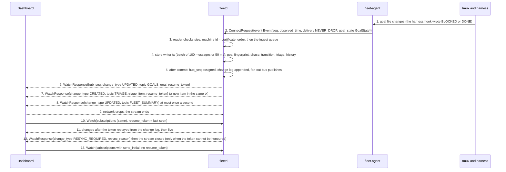
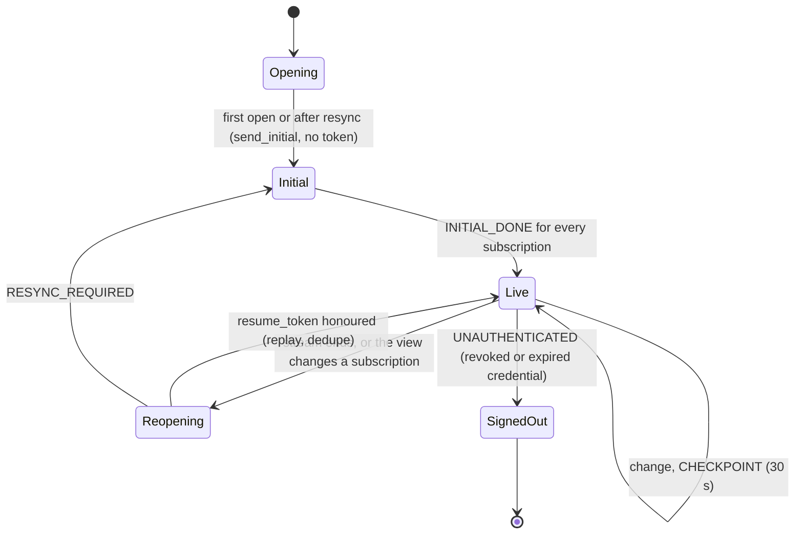
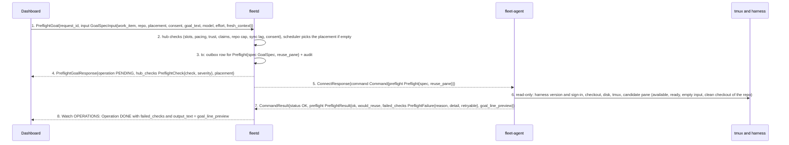
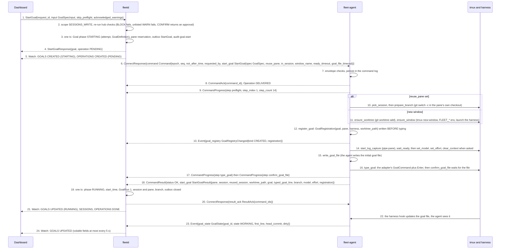
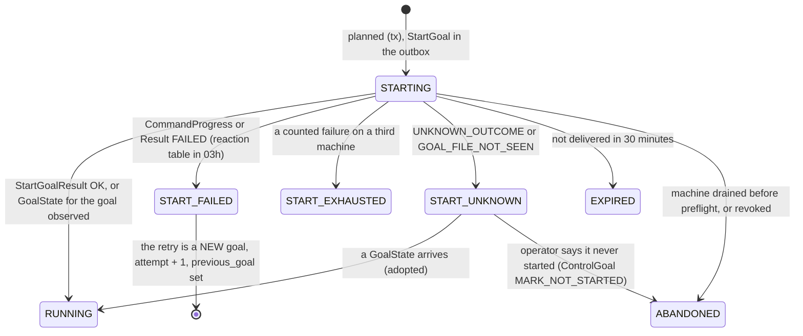
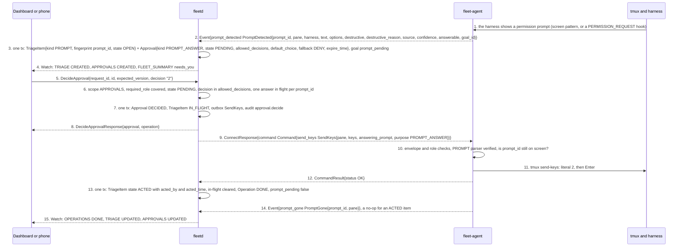
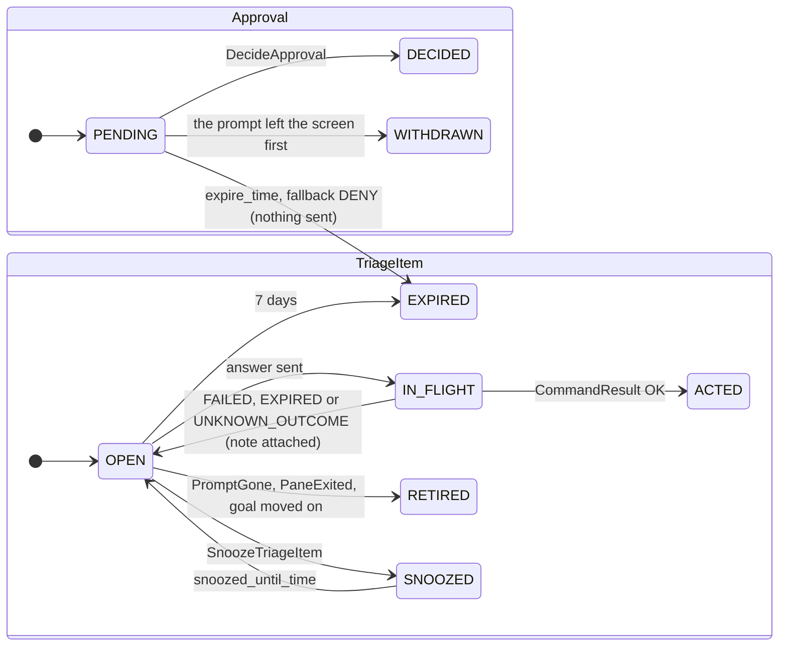

# Dashboard, hub and agent flows (part 2 of 4)

- Status: Draft for review
- Date: 2026-10-02
- Part of: [dashboard-hub-agent.md](dashboard-hub-agent.md), which has the cast, the two wires and the
  building blocks every flow here relies on (the Operation lifecycle, `request_id` idempotency, [`Watch`](../../api/fleet/hub/v1/service.proto)). Read its
  "Shared building blocks" first.
- Flows in this part: **D3** live updates, **D4** dispatch a goal end to end, **D5** answer a prompt via approvals
- Other parts: [1](dashboard-hub-agent.md) (D1, D2), [2](dashboard-hub-agent-2.md) (D3, D4, D5),
  [3](dashboard-hub-agent-3.md) (D6, D7, D8), [4](dashboard-hub-agent-4.md) (D9, D10, D11, D12)
- Conventions: arrows are numbered by hand and the numbered list under each diagram explains them. Where a
  spec and a proto disagree, the proto wins. Names are the proto names; the first mention of a message in a file links to its proto.

---

## D3. Live updates: resume token, RESYNC_REQUIRED, slow consumers

**What happens and why.** A fact reaches the dashboard in four hops: the agent
sends an [`Event`](../../api/fleet/agent/v1/events.proto), the hub's single store writer commits it (deriving goal and triage
state inside the same transaction), the fan-out bus filters it per subscription, and
the `Watch` stream delivers a [`WatchResponse`](../../api/fleet/hub/v1/watch.proto). Every message carries a `resume_token`, so
a dropped connection, a changed subscription or a tab reopened a minute later continues
from where it was. Only a token the hub cannot honour causes `RESYNC_REQUIRED`, and
then the client simply starts over with `send_initial`. A slow browser never slows the
hub: it loses intermediate pane summaries first, and if it lags on a never-dropped topic
it is told to resync rather than being sent an incomplete story.

1. to 2. The agent turns a fact into an `Event` with an agent-wide `seq`,
   `delivery` class and, for `COALESCE`, a `coalesce_key`. A goal state is
   `NEVER_DROP`: the persisted ring guarantees delivery across an outage.
3. The per-agent reader enforces the message cap, that `machine_id` equals the
   certificate, and the order (nothing but [`Hello`](../../api/fleet/agent/v1/agent.proto) before [`HelloAck`](../../api/fleet/agent/v1/agent.proto), no events before the
   [`Snapshot`](../../api/fleet/agent/v1/snapshot.proto)). Under pressure it sheds droppable kinds ([`Heartbeat`](../../api/fleet/agent/v1/agent.proto), [`PaneSummary`](../../api/fleet/agent/v1/events.proto),
   [`ResourceSample`](../../api/fleet/agent/v1/snapshot.proto), [`SpoolStatus`](../../api/fleet/agent/v1/snapshot.proto)) and blocks on never-dropped ones.
4. The store writer applies the event, runs the goal rules as pure functions over the row and
   the event, writes the transition and any triage item, and appends history in
   one transaction. An event with `seq <= Snapshot.seq` (a replay after reconnect) is history only and
   runs no rule.
5. The `hub_seq` of a commit is hub-wide and increasing within one `hub_instance_id`; gaps are
   normal (other topics, filtered out).
6. to 8. One transaction can produce several changes (a goal and its triage item).
   Per resource, changes arrive in order. `FLEET_SUMMARY` is coalesced to one per second.
9. to 11. The client reopens with the **last `resume_token` it saw**. The token names a
   position (`hub_instance_id`, `hub_seq`) and the subscriptions it covers (topic plus a hash
   of the filter). The hub replays changes after that position, possibly repeating ones the
   client has (the dedupe rule drops them), then goes live. A changed subscription is the same
   mechanism: open a new stream with the last token and the new list, then close the old one.
12. to 13. Reasons in [`ResyncReason`](../../api/fleet/hub/v1/watch.proto):

| `resync_reason` | Cause | The client |
|---|---|---|
| `TOKEN_TOO_OLD` | token older than the change log | reopen with `send_initial` on every subscription, no token |
| `HUB_RESTARTED` | `hub_instance_id` changed (restart or restore) | same |
| `FELL_BEHIND` | this client lagged on a never-dropped topic | same |
| `SCOPES_CHANGED` | the caller's role or grants changed | same; topics no longer allowed are refused, the rest return |

**Delivery classes** (what a slow client loses):

| Class | Topics | Rule |
|---|---|---|
| Latest-wins, not replayed | `PANE_SUMMARIES` | intermediate summaries are lost, never the latest; never in the change log, so a resume re-sends each matching pane's current summary as `INITIAL` |
| Coalesced | `FLEET_SUMMARY` | at most one per second; a resume re-sends the current value |
| Never dropped | every other topic | instead of dropping, the hub sends `RESYNC_REQUIRED` / `FELL_BEHIND` |

**Volatile fields** (status that changes at heartbeat rate) are coalesced before they
reach the stream: a change touching only volatile fields is sent at most once per interval
with the latest values; any other change goes at once and includes the current volatile values.

| Resource | Volatile fields | Interval |
|---|---|---|
| [`Machine`](../../api/fleet/hub/v1/machine.proto) | `status.telemetry.*`, `status.unfit[].next_check_time` | 30 s |
| [`Account`](../../api/fleet/hub/v1/account.proto) | `status.pacing.ahead_points`, `rank`, `projected_unused_percent`, `idle_causes` | 30 s |
| [`Session`](../../api/fleet/hub/v1/session.proto), [`Goal`](../../api/fleet/hub/v1/goal.proto) | pane `activity`, `last_input_time`, `ready_pattern_showing`, log counters; `status.attached_clients`; `status.first_line`, `head_commit`, `usage_consumed` | 5 s |
| [`WorkItem`](../../api/fleet/hub/v1/work.proto), [`Repo`](../../api/fleet/hub/v1/repo.proto) | `WorkItem.dispatch_block`, `Repo.status.dispatch_block` | 30 s |
| [`Device`](../../api/fleet/hub/v1/device.proto), [`Integration`](../../api/fleet/hub/v1/work.proto) | `status.last_seen_time`; `last_sync_time`, `sync_lag`, `rate_limits` | 30 s |

State changes are never volatile: a machine going `STALE`, a goal changing `phase` or a pacing
`state` change is sent at once.

| Persisted | Where |
|---|---|
| The change and its history row, in the same transaction that derived it | `state.db`, one tx per writer batch |
| Change log for resume | hub (bounded: 10 minutes or 100,000 changes) |
| Per-viewer queue | hub memory only; nothing about a viewer survives its stream |

| Failure | What happens |
|---|---|
| Browser tab suspended or slow | per-browser bounded queue; pane summaries replaced latest-wins; on a never-dropped topic `RESYNC_REQUIRED` / `FELL_BEHIND`; the writer is never blocked |
| Agent offline | the hub keeps the last state; the machine turns `STALE` at 45 s and `OFFLINE` at 3 min, and that state change reaches the stream like any other |
| Agent reconnects with a backlog | snapshot first, then the ring replayed at a bounded rate; replays at or below `Snapshot.seq` are history only, so the dashboard sees state jump to the snapshot, not a replay of old transitions |
| Hub restart | every stream ends; the reopened one carries an old token with another `hub_instance_id`, so `RESYNC_REQUIRED` / `HUB_RESTARTED` and a fresh initial state |
| Credential revoked, user disabled | the stream ends `UNAUTHENTICATED` at once |
| User demoted | `RESYNC_REQUIRED` / `SCOPES_CHANGED` |
| Token that does not parse | `INVALID_ARGUMENT` / `RESUME_TOKEN_INVALID` at open (not a resync) |
| A subscription the token does not cover (a new topic, or a changed filter) | it starts with its initial state if `send_initial`, else live from the moment the stream opens; the other topics resume |

## D4. Dispatch a goal end to end

**What happens and why.** A goal is the unit of work: "drive this issue to a
merged pull request" typed into a harness with its own native `/goal` command. The
owner picks a work item, the dashboard asks [`PreflightGoal`](../../api/fleet/hub/v1/service.proto) what would happen (the
hub's own checks, with a severity each, plus the agent's read-only checks and the exact
goal line it would type), and then calls [`StartGoal`](../../api/fleet/hub/v1/service.proto) with the **same** [`GoalSpecInput`](../../api/fleet/hub/v1/goal_dispatch.proto), so the
preview is computed from exactly what would be sent. The hub re-runs its checks and, in
**one transaction**, creates the `Goal` in phase `STARTING`, reserves the pane if it
reuses one, writes the outbox row and an audit row; the call returns the goal id and an
[`Operation`](../../api/fleet/hub/v1/common.proto) straight away. After commit the hub sends one `StartGoal` command. The agent
runs a 14-step composite under that single `command_id` (so it survives a hub outage),
**registers the goal in its goal registry before typing anything** (a running harness
cannot gain an environment variable, so the registry is how hooks find their goal), types
the harness's `/goal` line, confirms the goal file appeared and answers with one
[`CommandResult`](../../api/fleet/agent/v1/command.proto). The hub then moves the goal to `RUNNING`, and from there the harness's
hooks write the goal file, the agent reports [`GoalState`](../../api/fleet/agent/v1/snapshot.proto) events and `Watch` carries
every change to the dashboard.

### D4a. Preflight: what would happen, without doing it

1. [`GoalSpecInput`](../../api/fleet/hub/v1/goal_dispatch.proto) is everything an operator can choose.
   `placement` ([`GoalPlacement`](../../api/fleet/hub/v1/goal_dispatch.proto): `machine`, `harness`,
   `profile`, `account`, `reuse_pane`, `in_session`, `window_name`) may be empty:
   "next up" is `PreflightGoal` on the first item of `ListWorkItems{filter: stage = READY, order_by:
   dispatch_order}` with an empty placement, and the scheduler then chooses with the same rules as
   auto-dispatch. `consent` empty means repo consent intersected with the account's.
2. The hub's own findings arrive in the response at once, before anything is sent. Each is a
   [`PreflightCheck{check ErrorDetail, severity}`](../../api/fleet/hub/v1/goal_dispatch.proto) whose `reason` is a [`ReasonCode`](../../api/fleet/type/v1/status.proto), so a client branches on
   codes and never on strings.
3. to 4. The `Operation` (`PENDING`) tracks the agent half. The request writes no goal.
5. to 6. [`Preflight`](../../api/fleet/agent/v1/command_goal.proto) is read-only and idempotent. `reuse_pane` makes the agent also check that the pane is
   available, shows the ready pattern, has an empty input line and works in a **clean checkout of the goal's
   repo** (ADR 0019, decision 1); otherwise `would_reuse` is unset and a new window is planned.
7. Every failed check is returned, not just the first. `retryable` is true when the fact can change by
   itself (`DISK_LOW`, `CHECKOUT_DIRTY`) and false for durable facts (`HARNESS_NOT_SIGNED_IN`,
   `PUSH_ACCESS_MISSING`), which also mark the machine unfit.
8. The agent's failures come back as `Operation.failed_checks` (all `BLOCK`). The dashboard shows both lists.

| Severity ([`PreflightSeverity`](../../api/fleet/hub/v1/goal_dispatch.proto)) | Meaning | Example reasons |
|---|---|---|
| `BLOCK` | cannot start | `SLOTS_FULL`, `NO_FIT_MACHINE`, `WORK_ITEM_BUSY`, `BRANCH_BUSY`, `REPO_NOT_WATCHED`, `CONSENT_EMPTY`, `DRAINING`, `MACHINE_OFFLINE`, every agent failure |
| `CONFIRM` | an `OWNER` must approve first | `WORK_ITEM_UNTRUSTED`, `WORK_ITEM_CLAIMED`, `ACCOUNT_NOT_DISPATCHABLE` (`dollar_cap`), `HARNESS_VERSION_UNSUPPORTED` with unverified parsing |
| `WARN` | allowed once the reason is listed in `acknowledged_warnings` | `ACCOUNT_PACING_BLOCKED`, `ACCOUNT_USAGE_UNKNOWN`, `INTEGRATION_LAG`, `INTEGRATION_DEGRADED`, `REPO_PARALLEL_LIMIT` |
| `INFO` | shown | the pane that would be reused, the model the harness shows |

### D4b. StartGoal: accept, send, run, confirm

1. `skip_preflight` lets the hub reuse its own result if it is under a minute old; otherwise the
   `StartGoal` composite runs preflight itself (step 1). `acknowledged_warnings` is the list of `WARN`
   reasons the user saw: a `WARN` that is not listed fails the call with
   `PREFLIGHT_WARNINGS_UNACKNOWLEDGED`, so a client cannot dispatch past a warning it never showed.
2. A `BLOCK` check fails the call `FAILED_PRECONDITION` with that check's reason (all of them in
   [`ErrorDetail.violations`](../../api/fleet/type/v1/status.proto)). A `CONFIRM` check does **not** create a goal: the response carries
   `approval` (the id of an [`Approval`](../../api/fleet/hub/v1/triage.proto) of kind `DISPATCH_CONFIRM`, `required_role OWNER`) and nothing is sent until an
   owner approves it, when [`DecideApprovalResponse`](../../api/fleet/hub/v1/triage.proto) carries the `goal` and the `operation` (D5).
3. The hub fills the agent's [`GoalSpec`](../../api/fleet/agent/v1/command_goal.proto) from the input and the [`Repo`](../../api/fleet/hub/v1/repo.proto): `consent` is the repo's (else
   [`HubSettings.default_consent`](../../api/fleet/hub/v1/settings.proto)) intersected with the account's, an empty result is `CONSENT_EMPTY`;
   `worktree_mode` and `branch` come from [`RepoSpec.worktree_mode`](../../api/fleet/hub/v1/repo.proto) and `branch_pattern` (default
   `fleet/{work}`); a new `session_id` is minted when a new session is needed (it is also the tmux
   session name). The transaction inserts the goal (`attempt` = previous + 1 with `previous_goal`, unique
   live goal per work item and per `(repo, branch)`), reserves the pane when reusing
   (`panes.reserved_for_goal`, unique), writes the outbox row and the audit row (who, consent,
   text). A unique violation means another decision won: the call fails and nothing is sent.
4. There is no `QUEUED` phase: "waiting for the machine" is `STARTING` with the operation `PENDING`.
5. `Operation.id` equals the `command_id`, so the dashboard can match everything that follows.
6. After commit the hub sends one [`StartGoal`](../../api/fleet/agent/v1/command_goal.proto) command.
   Default `not_after_time` is 30 minutes. `requested_by` is the user (or the `SCHEDULER` principal for
   auto-dispatch). A reused pane's `GoalSpec` has the same repo as the pane's checkout, and the goal
   starts a **new branch in that checkout**; no worktree is made for it.
7. to 8. The command is persisted before [`CommandAck`](../../api/fleet/agent/v1/command.proto) is sent; a known `command_id` returns the logged
   result and never re-runs. If the machine's local policy requires approval, a [`CommandProgress`](../../api/fleet/agent/v1/command.proto) with step
   `awaiting_local_confirm` (status `AWAITING_LOCAL_CONFIRM`, outside the 14 steps) is sent first and the
   approval is asked **once, before step 1**.
9. to 17. The fixed vocabulary of 14 steps, each persisted `started` then `done`, so a restart knows where it was:
   `preflight`, `pick_session`, `prepare_branch`, `ensure_worktree`, `ensure_window`, `register_goal`,
   `start_log_capture`, `wait_ready`, `set_model`, `set_effort`, `clear_context`, `write_goal_file`,
   `type_goal`, `confirm_goal_file`. `step_count` is always 14 and a skipped step is not reported, so a
   progress bar is stable (the dashboard reads `Operation.step`, `step_index`, `step_count`).
   Steps 10 and 11 are the two paths (reuse versus new window). `clear_context` types `/clear` and only
   runs for `fresh_context` in a session the fleet started (`FRESH_CONTEXT_NOT_ALLOWED` otherwise).
   The agent never answers a trust, update or login screen (`TRUST_PROMPT_SEEN`, `STARTUP_PROMPT_SEEN`).
12. to 13. The registry is the only goal identity for every harness (Claude Code, Codex, Muse, OpenCode).
    `FLEET_GOAL_ID` in the environment is only a fast path for a window the fleet just created.
16. `type_goal` and `clear_context` are **not idempotent**: if the agent restarts after starting either
    one without finishing, the result is `UNKNOWN_OUTCOME` unless the goal file already shows this goal. The
    consent is rendered by the adapter from [`ConsentAct`](../../api/fleet/type/v1/consent.proto) values, so the hub can never inject text into the
    typed line; what was typed is returned as `typed_goal_line` for the audit log.
18. to 20. The result and the first `GoalState` may arrive in either order; the hub moves to `RUNNING` on
    whichever comes first and treats the other as confirmation. [`ResultAck`](../../api/fleet/agent/v1/agent.proto) (20) lets the agent forget its logged result. The hub then also queues
    [`EnsureProbe{run_now}`](../../api/fleet/agent/v1/command_tmux.proto) for the account so usage reflects the goal's start.
21. The dashboard sees the new session and window through `SESSIONS` as the agent's inventory events
    ([`SessionEvent`](../../api/fleet/agent/v1/events.proto), [`WindowEvent`](../../api/fleet/agent/v1/events.proto), [`PaneCreated`](../../api/fleet/agent/v1/events.proto)) are applied.
22. to 24. After this the goal's life is D3's pipeline: the harness's hooks maintain the goal file, the
    agent fingerprints `GoalState` and sends an event on every change, the hub derives the phase
    (`WAITING`, `BLOCKED_OWNER`, `STUCK`, `VERIFYING`, ...), and the dashboard sees `Goal.status` update.

What the dashboard shows over time, for one dispatch:

| After | Watch delivers | The dashboard shows |
|---|---|---|
| step 4 | `GOALS` `CREATED` phase `STARTING`; `OPERATIONS` `PENDING` | goal card "starting", "waiting for the machine" if `PENDING` stays |
| step 8 | `OPERATIONS` `DELIVERED` | "sent to the machine" |
| steps 9 to 17 | `OPERATIONS` `RUNNING` with `step`, `step_index`, `step_count` | a progress bar ("wait_ready", "type_goal") |
| step 19 | `GOALS` `UPDATED` phase `RUNNING`; `OPERATIONS` `DONE` | goal running, link to its session |
| step 24 | `GOALS` `UPDATED` (`first_line`, `head_commit` at most every 5 s) | what the goal says it is doing |

| Persisted | Where | Transaction |
|---|---|---|
| `Goal` ([`GoalDefinition`](../../api/fleet/hub/v1/goal.proto) spec, [`GoalStatus`](../../api/fleet/hub/v1/goal.proto)), `goal_transitions`, `goal_runs` | hub `state.db`, permanent | planning tx; result tx |
| Pane reservation, outbox row (`pending, delivered, done, expired, failed`), audit (consent, text, who) | hub `state.db` | planning tx; delivery and result txs |
| Composite step reached, worktree path, pane key | agent command log | before each `CommandProgress` is sent |
| Goal registry (`goal`, `pane`, `worktree_path`, `harness_session_id`) | agent `state.db`, reported in every `Snapshot.goal_registry` | `register_goal`; removed on [`ReleaseGoal`](../../api/fleet/agent/v1/command_goal.proto), pane exit, [`PruneWorktree`](../../api/fleet/agent/v1/command_goal.proto) |
| Goal file, worktree or branch, `FLEET_*` tags, log spool | the machine (git, tmux, agent spool) | n/a |

**Failures.** The full reason-to-reaction table is in [03h](../specs/03h-goal-phases-in-depth.md#start-failures-reason-to-reaction); the common ones:

| Failure | What happens |
|---|---|
| Machine offline between plan and send | outbox row stays `pending`; delivered on reconnect if within 30 minutes, else `Operation` `DONE` / `EXPIRED`, goal `EXPIRED`, work item back to `READY`, reservation released (D8 for drain) |
| Hub restarts after sending | the outbox re-sends the same `command_id` on reconnect; the agent answers from its log or continues the composite |
| Agent restarts mid-composite | declarative, read-only and verify steps run again; `clear_context` or `type_goal` started without done is `UNKNOWN_OUTCOME` (goal `START_UNKNOWN`, triage `start_unknown`, never retried automatically) |
| Pane no longer fit (`SESSION_NOT_AVAILABLE`, `PANE_BUSY`, `SESSION_WORKDIR_MISMATCH`, `CHECKOUT_DIRTY`) | nothing was changed; the hub retries once in a **new window** on the same machine; the agent never falls back silently |
| Durable refusal (`HARNESS_NOT_SIGNED_IN`, `PUSH_ACCESS_MISSING`, `FOLDER_UNTRUSTED`, ...) | goal `START_FAILED`; the machine gets a durable unfit marker (`Machine.status.unfit`) until the fact changes; work item `READY` for another machine |
| `READY_TIMEOUT`, harness crash in `wait_ready` | one retry in a new window, then another machine; counts toward giving up |
| Three counted failures on three machines | goal `START_EXHAUSTED`, work item `MANUAL_ONLY`, triage `START_FAILED` naming the three reasons |
| `GOAL_FILE_NOT_SEEN` after typing | goal `START_UNKNOWN`; hooks are re-checked once a day per `(machine, harness)` |
| Local approval needed and nobody there | `LOCAL_CONFIRM_TIMEOUT`; the machine is skipped for 30 minutes and the item is planned elsewhere |
| `not_after_time` passes mid-composite | the step in flight finishes, the rest is `EXPIRED`; a window already created is left tagged for a triage decision |
| Same `StartGoal` sent twice (client retry) | same `request_id` returns the same goal and operation; nothing is sent twice |
| Developer types into the reused pane | [`PaneInput`](../../api/fleet/agent/v1/events.proto) clears availability; the next check fails `SESSION_NOT_AVAILABLE`; new window |

At every failure the dashboard sees `Operation.error` and `GoalStatus.start_error` (`ErrorDetail` with the agent's reason).

## D5. Answer a prompt end to end via approvals

**What happens and why.** A harness stops and asks "Allow this command? 1, 2 or
3". Prompts are **never auto-answered**, destructive or not; a person decides. The
agent detects the prompt and reports it; the hub raises two linked records: a
**triage item** (explains: the prompt card with its options) and an **approval**
(acts: a small decision record sized for a phone notification). The person picks
an option; the dashboard calls [`DecideApproval`](../../api/fleet/hub/v1/service.proto) naming the exact approval version it
saw. The hub records the decision and sends one [`SendKeys`](../../api/fleet/agent/v1/command_tmux.proto) with purpose
`PROMPT_ANSWER` bound to that `prompt_id`; the agent re-checks that the prompt is
still on screen before it types a key. Silence never approves: if nobody decides
before the approval expires, nothing is sent and the prompt stays on screen for someone
at the machine. The same endpoint also confirms other risky actions (see the variants).

1. to 2. The agent detects the prompt from the adapter's screen pattern or a harness hook
   ([`PromptDetected`](../../api/fleet/agent/v1/screen.proto)). `destructive` is set for `rm -rf`,
   `docker compose down -v` or a command line that embeds a credential, and `destructive_reason`
   says why. `answerable` is false when the adapter's detection is not verified for this harness
   version. The event is `NEVER_DROP`. A prompt still on screen after a reconnect comes back in
   `Snapshot.prompts[]`; one that appeared and went while the hub was away is history only, because
   nobody can still answer it.
3. The writer raises the item and the approval **in the same transaction as the event**, so the feed is never
   ahead of or behind the pane. The item is unique while open (`fingerprint` includes the machine and
   `prompt_id`). The approval carries `preview` (the prompt text, 2 KiB), `allowed_decisions[]`
   ([`ApprovalChoice{key, label, destructive}`](../../api/fleet/hub/v1/triage.proto), the key being what is typed: "1", "y"), `default_choice`
   ("deny" or the deny option when destructive), `fallback = DENY`, `expire_time` (now plus
   `HubSettings.approval_timeout`) and `required_role`. Severity is `ACTION`, or `CRITICAL` for a
   destructive prompt. While the prompt is open `GoalStatus.prompt_pending` suppresses nudges. When
   `answerable` is false the item is **notice-only** (the card shows the `ssh -t ... tmux attach` line and
   no choices), so there is nothing to decide.
4. `TRIAGE` and `APPROVALS` need `READ|APPROVALS`, so a phone that only holds `APPROVALS` sees exactly these.
5. `expected_version` is **required and non-zero**: a decision names the exact state it saw.
   `decision` is one of `allowed_decisions[].key`. The same call comes from a paired device (D12).
6. Checks, in the contract's precedence: `APPROVALS` scope (`SCOPE_MISSING`), the decider's mapped role
   covers `required_role` (`ROLE_INSUFFICIENT`), the approval is still `PENDING` (`APPROVAL_CLOSED`, which
   wins over `VERSION_MISMATCH` so a phone says "already decided", not "reload"), and the hub's
   one-answer-in-flight rule for the prompt (a unique row keyed by `prompt_id`).
7. The decision, the in-flight marker, the outbox row and the audit row commit together. The `SendKeys`
   deadline is 2 minutes, so an old answer is never typed late.
8. The response carries the `Operation` (`Approval.operation` names it too). A deny sends nothing and
   returns no operation.
9. to 11. [`SendKeys`](../../api/fleet/agent/v1/command_tmux.proto) is gated by its **purpose**:
   `PROMPT_ANSWER` needs prompt detection verified for the harness version (`PARSER_FEATURE_PROMPT`) and `answering_prompt`
   still on screen (`PROMPT_GONE` otherwise). It needs no empty input line or ready pattern, because a
   menu has neither. `SendKeys` is **not idempotent**.
12. to 13. `CommandResult` is `OK`, `FAILED` / `PROMPT_GONE`, or `UNKNOWN_OUTCOME`. On `OK` the result transaction sets
    the item `ACTED` (`acted_by`, `acted_time`), clears the in-flight row and makes the `Operation` `DONE`.
14. to 15. [`PromptGone`](../../api/fleet/agent/v1/events.proto) follows when the prompt leaves the screen. It can arrive before the
    result: while the item is `IN_FLIGHT` it retires nothing, for an `ACTED` item it is a no-op, and only an item still `OPEN`
    becomes `RETIRED`.

**The same endpoint confirms other risky actions.** One rule covers them all: the first call returns the
`approval` and **no operation**, nothing is sent, and the operation exists only once the approval is approved
(`DecideApprovalResponse.operation`; for a dispatch also `goal`).

| [`ApprovalKind`](../../api/fleet/hub/v1/triage.proto) | Raised by | Choices | Approving does |
|---|---|---|---|
| `PROMPT_ANSWER` | `PromptDetected` | the prompt's own keys | `SendKeys{purpose PROMPT_ANSWER}` |
| `COMMAND_CONFIRM` | [`RunHarnessCommand`](../../api/fleet/agent/v1/command_tmux.proto) with a DESTRUCTIVE command, or [`KillWindow`](../../api/fleet/agent/v1/command_tmux.proto) on a developer's window | "approve" or "deny" | sends the confirmed command. A developer's window also needs a decider whose mapped role is `OWNER`, so a phone with only `APPROVALS` gets `ROLE_INSUFFICIENT` |
| `DISPATCH_CONFIRM` | `StartGoal` with a `CONFIRM` check (D4) | "approve" or "deny", `required_role OWNER` | creates the goal and sends `StartGoal`; a denied or expired approval creates no goal |

| Persisted | Where |
|---|---|
| [`TriageItem`](../../api/fleet/hub/v1/triage.proto) (unique open fingerprint, 7-day expiry), `Approval` (version bumps on every state change) | hub `state.db`, in the event's and the action's transactions |
| One answer in flight per `prompt_id` | hub `state.db` (unique), cleared in the result tx |
| Outbox row for `SendKeys`, audit `approval.decide` (who, device, option), `command.local_approval` if decided at the machine | hub `state.db`, permanent audit |
| Command log (the logged result) | agent state dir |

| Failure | What happens |
|---|---|
| Prompt answered at the keyboard first | `PromptGone` retires the item and the approval becomes `WITHDRAWN`; a late `DecideApproval` is `APPROVAL_CLOSED`; a late `SendKeys` gets `PROMPT_GONE` and types nothing |
| Two browsers answer | the second gets `APPROVAL_CLOSED` (or "already answered" from the in-flight rule) |
| Stale `expected_version` | `FAILED_PRECONDITION` / `VERSION_MISMATCH`, unless the approval is also closed |
| Nobody decides in time | `Approval` `EXPIRED`, fallback `DENY`: nothing is sent and the prompt stays on screen; the item stays open until it expires at 7 days |
| Machine offline when the answer is sent | the outbox row waits at most 2 minutes, then `Operation` `DONE` / `EXPIRED`; the item returns to `OPEN` with "not delivered, machine was offline" and the answer is never typed late |
| `UNKNOWN_OUTCOME` (agent restarted mid-type) | never retried; the item returns to `OPEN` with "unknown outcome, check pane" and a [`CapturePane`](../../api/fleet/hub/v1/service.proto) button |
| Machine requires local approval for `SendKeys` | the agent reports `AWAITING_LOCAL_CONFIRM`; if nobody is at the keyboard `LOCAL_CONFIRM_TIMEOUT` |
| Harness crashes while the prompt is open | [`PaneExited`](../../api/fleet/agent/v1/events.proto) retires the prompt and condition items; the goal goes through W6's stop handling |
| A provider error is also showing | both items exist; the condition card explains why an answer may not be processed yet |
| Developer typing in the pane | allowed (a prompt answer needs no empty input line) but the prompt check still runs |

**Second try.** After `IN_FLIGHT` falls back to `OPEN` (failed, expired or unknown outcome) the
`Approval` is already `DECIDED`, and `DecideApproval` on it is `APPROVAL_CLOSED`. So the hub raises a **new**
`Approval` for the same `prompt_id` when the item returns to `OPEN` and points `TriageItem.approval` at it
([03d](../specs/03d-triage-sessions-logs.md#w7-triage-items)).
