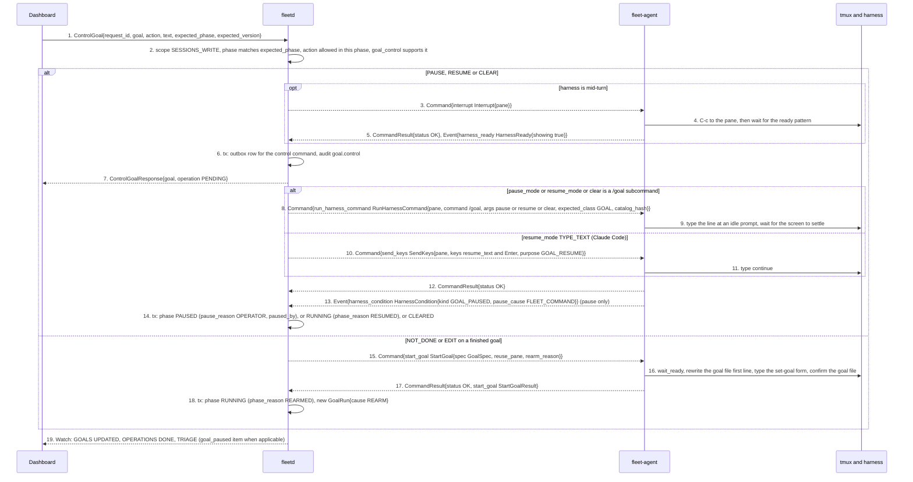
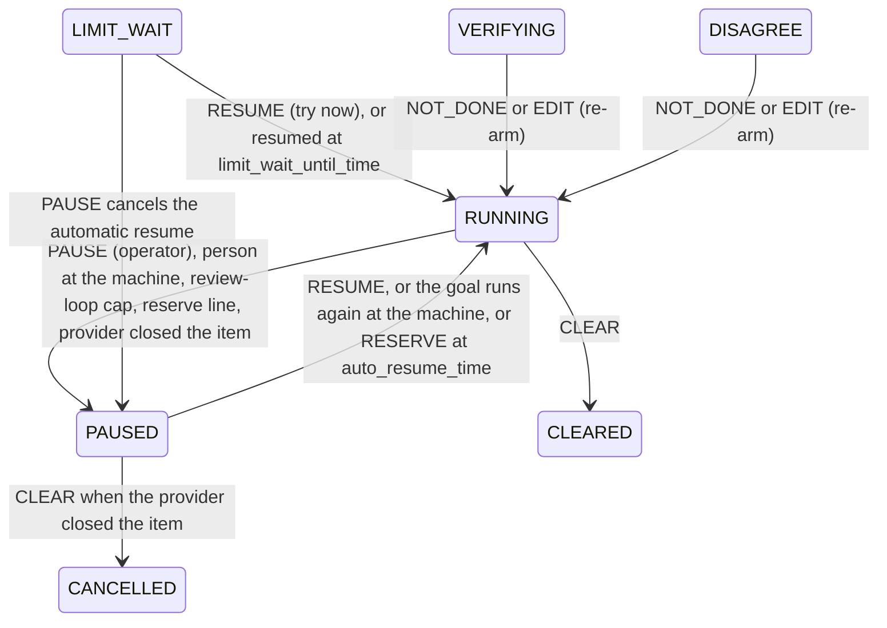
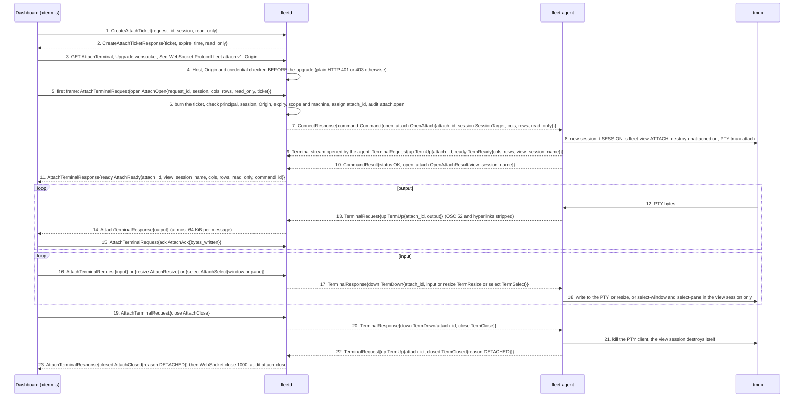
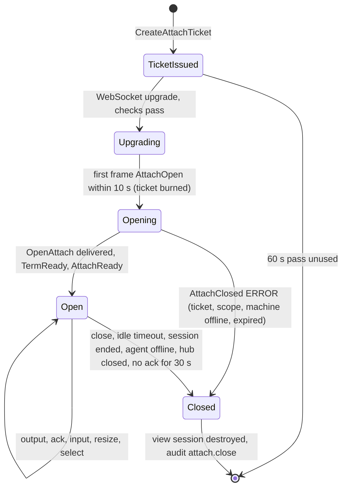
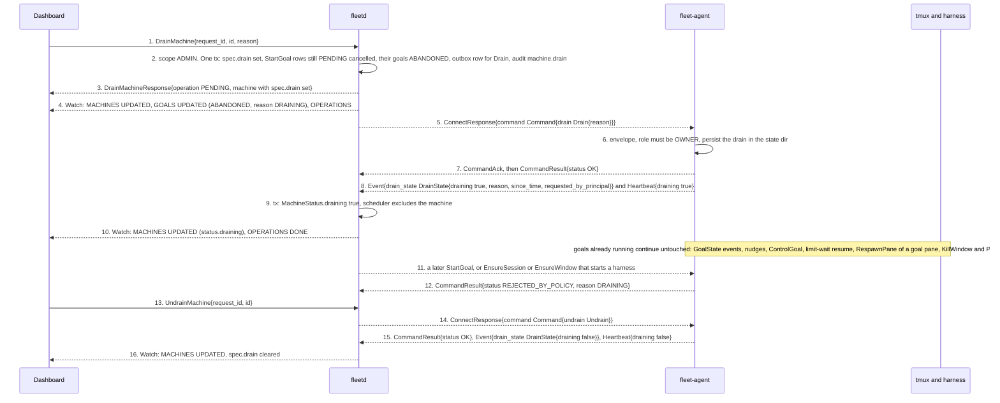

# Dashboard, hub and agent flows (part 3 of 4)

- Status: Draft for review
- Date: 2026-10-02
- Part of: [dashboard-hub-agent.md](dashboard-hub-agent.md), which has the cast, the two wires and the
  building blocks every flow here relies on (the Operation lifecycle, `request_id` idempotency, [`Watch`](../../api/fleet/hub/v1/service.proto)). Read its
  "Shared building blocks" first.
- Flows in this part: **D6** goal control, **D7** terminal attach, **D8** drain a machine
- Other parts: [1](dashboard-hub-agent.md) (D1, D2), [2](dashboard-hub-agent-2.md) (D3, D4, D5),
  [3](dashboard-hub-agent-3.md) (D6, D7, D8), [4](dashboard-hub-agent-4.md) (D9, D10, D11, D12)
- Conventions: arrows are numbered by hand and the numbered list under each diagram explains them. Where a
  spec and a proto disagreed while this was written, the spec or proto was corrected, so nothing here relies on an open question.
  Names are the proto names; the first mention of a message in a file links to its proto.

---

## D6. Goal control: pause, resume, not done, clear

**What happens and why.** The owner steers a running goal with [`ControlGoal`](../../api/fleet/hub/v1/service.proto),
naming an **intent** ([`GoalAction`](../../api/fleet/hub/v1/goal.proto)), never keystrokes. The hub translates the intent
using what the agent says the installed harness version supports
([`MachineHarness.goal_control`](../../api/fleet/hub/v1/machine.proto), reported by the adapter), so the hub keeps no table of harness
names: Claude Code, Codex and Muse each pause and resume differently. The hub typed-sends the
harness's own `/goal pause`, `/goal resume`, `/goal clear`, an [`Interrupt`](../../api/fleet/agent/v1/command_tmux.proto), or a typed
`continue`. "Not done" is different: after "Goal achieved" the harness has already cleared its
goal, so a typed "not done" would be an ordinary prompt with no goal loop. The hub therefore
**re-arms** the goal: the agent rewrites the goal file's first line and types the harness's set-goal
form again in the same pane, under the same goal id. Everything is guarded by the phase the
caller saw (`expected_phase`), so a click on a stale card is refused rather than sent.

1. [`ControlGoalRequest`](../../api/fleet/hub/v1/goal.proto): `action` is one of `PAUSE`, `RESUME`, `EDIT`,
   `CLEAR`, `RECHECK`, `NOT_DONE`, `MARK_NOT_STARTED`. `text` is the new objective for `EDIT` and the reason for
   `NOT_DONE` (4 KiB). `expected_phase` is the phase the caller saw (0 = do not check). `expected_version` is
   checked only for `EDIT`, the one action that changes the spec (`goal_text`).
2. Refusals: `FAILED_PRECONDITION` / `GOAL_PHASE_CHANGED` (stale card), `GOAL_ACTION_NOT_ALLOWED` (table below), and
   `GOAL_SUBCOMMAND_UNSUPPORTED`, which is raised **before**
   sending when `goal_control` says the mode is `NONE` or the subcommand is missing. For a pause the hub then
   falls back to `Interrupt` and records "paused by interrupt".
3. to 5. A typed command only goes in at an idle prompt. If the harness is mid-turn the hub sends `Interrupt`
   first, waits for ready, then types the subcommand. Where `goal_control.pause_mode` is `INTERRUPT` (a harness with no
   `/goal pause`) this `Interrupt` **is** the pause and arrows 8 to 11 are skipped.
6. to 7. As in every action the outbox row and audit row commit with the decision. `RECHECK` and
   `MARK_NOT_STARTED` are hub-only: no operation, [`ControlGoalResponse.operation`](../../api/fleet/hub/v1/goal.proto) is unset.
8. to 9. [`RunHarnessCommand`](../../api/fleet/agent/v1/command_tmux.proto) in class `GOAL` is allowed for an
   `OPERATOR` and above. The agent checks the command is in the catalog, `catalog_hash` is current and the
   class matches `expected_class`.
10. to 11. For Claude Code 2.1.286 an interrupt keeps the goal active and `continue` resumes it, so
    `resume_mode` is `TYPE_TEXT` and the text comes from [`GoalControl.resume_text`](../../api/fleet/type/v1/harness.proto). Codex 0.160.0 and Muse show
    "goal paused" after an interrupt and resume with `/goal resume`. None of the three resumed by itself.
12. to 14. [`HarnessCondition`](../../api/fleet/agent/v1/screen.proto) with `pause_cause FLEET_COMMAND` is the agent's way of saying the hub's own pause
    took effect; the hub keeps the reason it recorded. A pause by a person at the machine looks the same
    but with cause `DEVELOPER_INPUT` or `HARNESS`: that becomes `PAUSED` with `pause_reason OWNER_AT_MACHINE`, a `goal_paused` triage
    item, no nudge and no automatic resume.
15. to 18. `NOT_DONE` and `EDIT` are valid only in `VERIFYING` and `DISAGREE`. The hub sends [`StartGoal`](../../api/fleet/agent/v1/command_goal.proto) for the
    **same goal id**: `reuse_pane` is the goal's own pane (anything else is `SESSION_NOT_AVAILABLE`), and
    `rearm_reason` is the person's text. Steps that create something are skipped; `preflight` (unless skipped),
    `wait_ready`, `write_goal_file` (first line = the objective plus `reopened: <reason>`), `type_goal` and
    `confirm_goal_file` run as in D4. The registry entry is kept, the worker is not freed, and a new [`GoalRun`](../../api/fleet/hub/v1/goal_history.proto)
    with cause `REARM` begins. Claude Code works this way today; Codex and Muse are unprobed, so the audit row marks
    the re-arm unverified there.
19. The dashboard sees `GOALS`, `OPERATIONS` and, for a pause, a `TRIAGE` item.

**Which action is allowed in which phase** (anything else is `FAILED_PRECONDITION` / `GOAL_ACTION_NOT_ALLOWED`):

| `GoalAction` | Allowed in | Sends | Ends in |
|---|---|---|---|
| `PAUSE` | `RUNNING`, `STOPPED`, `COOLDOWN`, `WAITING`, `LIMIT_WAIT` | `goal_control.pause_mode`: `/goal pause` or `Interrupt` | `PAUSED` (`pause_reason OPERATOR`; from `LIMIT_WAIT` it also cancels the automatic resume) |
| `RESUME` | `PAUSED`, `LIMIT_WAIT` | `goal_control.resume_mode`: `/goal resume` or [`SendKeys{purpose GOAL_RESUME}`](../../api/fleet/agent/v1/command_tmux.proto) | `RUNNING` (reason `RESUMED`) |
| `EDIT` | `RUNNING` where `/goal edit` exists; `VERIFYING`, `DISAGREE` as a re-arm | `/goal edit`, or the re-arm `StartGoal` | `RUNNING` |
| `CLEAR` | every live phase but `STARTING` | `/goal clear` | `CLEARED` (work item `MANUAL_ONLY`), or `CANCELLED` when the goal was `PAUSED` with `WORK_ITEM_CLOSED` |
| `NOT_DONE` | `VERIFYING`, `DISAGREE` | the re-arm `StartGoal` | `RUNNING` (reason `REARMED`) |
| `RECHECK` | `VERIFYING`, `DISAGREE` | nothing (hub only) | re-runs verification against the code host |
| `MARK_NOT_STARTED` | `START_UNKNOWN` | nothing (hub only) | `ABANDONED`, work item `READY` |

| Persisted | Where |
|---|---|
| Goal phase, `pause_reason`, `paused_by`, `review_rounds_baseline`, transitions with actor and command, runs | hub `state.db` (`goal_transitions`, `goal_runs`) in the result tx |
| Outbox row for the typed command, audit `goal.control` or `goal.rearm` | hub `state.db` |
| The goal file, the harness's own goal | the machine; the hub never writes them |

| Failure | What happens |
|---|---|
| Card was stale | `GOAL_PHASE_CHANGED`; the dashboard reloads the goal (no command sent) |
| Action not valid in this phase | `GOAL_ACTION_NOT_ALLOWED` |
| Harness version lacks the subcommand or mode | `GOAL_SUBCOMMAND_UNSUPPORTED` before sending; pause falls back to `Interrupt` |
| Someone is typing in the pane | [`GoalStatus.human_at_keyboard_until_time`](../../api/fleet/hub/v1/goal.proto) (10 minutes after the latest [`PaneInput`](../../api/fleet/agent/v1/events.proto)) holds goal control: `ControlGoal` is refused, never queued (`FAILED_PRECONDITION` / `GOAL_ACTION_NOT_ALLOWED`, `metadata{"held": "person_typing"}`, [03c](../specs/03c-goals.md)); the dashboard disables the buttons and shows "someone is typing" |
| `PANE_BUSY` (turn running, input line not empty) | the hub interrupts first when mid-turn; a re-arm retries once |
| `UNKNOWN_OUTCOME` | typed input is never retried; the goal stays as it was and a triage item offers [`CapturePane`](../../api/fleet/hub/v1/service.proto) |
| Pane gone | `NOT_DONE` is refused; the operator dispatches again (a new goal naming this one as `previous_goal`) |
| Machine offline | the 2-minute deadline expires, [`Operation`](../../api/fleet/hub/v1/common.proto) `DONE` / `EXPIRED`, the goal's phase does not change |
| Local approval required on the machine | `AWAITING_LOCAL_CONFIRM`, then the result or `LOCAL_CONFIRM_TIMEOUT` |
| Drained machine | goal control still works: drain stops new work, not control of goals already running |

## D7. Terminal attach in the browser

**What happens and why.** The dashboard shows a live tmux session by streaming a
PTY. A browser cannot stream a request body, so it carries the hub's
[`AttachTerminalRequest`](../../api/fleet/hub/v1/terminal.proto) and [`AttachTerminalResponse`](../../api/fleet/hub/v1/terminal.proto) messages (never the agent
wire's [`TermUp`](../../api/fleet/agent/v1/streams.proto) and [`TermDown`](../../api/fleet/agent/v1/streams.proto)) over a **WebSocket**; the `fleet` CLI uses the same RPC
over HTTP/2 and needs no ticket. A WebSocket upgrade carries ambient authority
(the cookie, or nothing at all in `local_trusted`) and is not subject to CORS, so a
page on another site could open one. The defences are the Host and Origin checks plus a
**single-use attach ticket** that only a caller who passed those checks on a normal
call can hold. The hub then asks the agent to [`OpenAttach`](../../api/fleet/agent/v1/command_goal.proto); the agent creates a
**grouped view session** (so switching windows in the browser never moves the
developer's own current window), runs a PTY client in it and opens a [`Terminal`](../../api/fleet/agent/v1/agent.proto) stream
back to the hub. The hub only forwards bytes. Because neither WebSocket nor xterm.js
has backpressure, the browser **acknowledges written bytes** ([`AttachAck`](../../api/fleet/hub/v1/terminal.proto)) and the hub stops
reading the agent's stream when too many are unacknowledged, so HTTP/2 flow control
blocks the agent's PTY read and nothing is dropped.

1. to 2. [`CreateAttachTicket`](../../api/fleet/hub/v1/service.proto) needs `READ`, or `SESSIONS_WRITE` when `read_only` is false; the hub **clamps** the request to read-only for a
   caller without `SESSIONS_WRITE` and says so in `read_only` in the response. The ticket is 256 bits of randomness, valid 60 s, bound
   to the caller, the session, the read-only flag and the request's `Origin`, shown once and never in a URL. A replay of the
   call is `SECRET_ALREADY_DELIVERED`.
3. to 4. The endpoint is `/fleet.hub.v1.FleetService/AttachTerminal`. The hub refuses an upgrade that does not offer the `fleet.attach.v1`
   subprotocol, and it checks `Host`, `Origin` (required for every WebSocket upgrade) and the credential (cookie, bearer or
   device signature, nothing in `local_trusted`) before upgrading. Failures are plain HTTP 401 or 403 with a Connect error body.
5. The first frame must arrive within 10 s and be an [`AttachOpen`](../../api/fleet/hub/v1/terminal.proto) carrying the `ticket`. Its `session` must equal the ticket's (or
   be empty) and its `read_only` may only tighten the ticket's. Binary frames only; one frame is exactly one protobuf message;
   client frames are at most 8 KiB, hub frames 66 KiB.
6. The ticket is burned by the first frame **whether or not the attach then succeeds**. Failures, in order: `ATTACH_TICKET_INVALID`
   (not found, expired, used, another principal, session or Origin), `SCOPE_MISSING`, `MACHINE_OFFLINE`, `RESOURCE_NOT_FOUND`. The hub assigns
   the `attach_id` and writes an audit row (`attach.open`). The attach registry is hub memory.
7. [`OpenAttach`](../../api/fleet/agent/v1/command_goal.proto) needs role `VIEWER` (read-only) or `OPERATOR`. Its deadline is 2 minutes, and a
   second `OpenAttach` with the same `attach_id` returns the existing view. The hub drops input for a read-only attach and the agent also
   refuses it. A developer's session is addressed by `tmux_id` guarded by `server_start_id`.
8. to 10. The view session is `new-session -t <session>` (grouped), so the developer's own current window never moves and the developer's tmux
   prefix key works unchanged in the PTY. `destroy-unattached` makes it disappear when the PTY client exits. The agent, not the hub, opens
   the [`Terminal`](../../api/fleet/agent/v1/streams.proto) stream (the agent is the client of every RPC); the hub pairs it with the WebSocket by `attach_id`.
11. [`AttachReady.command_id`](../../api/fleet/hub/v1/terminal.proto) is the `OpenAttach` command id, for the audit trail.
12. to 15. Terminal bytes are raw and **untrusted**; xterm.js renders them as terminal output, never as markup. The browser sends `AttachAck`
    after xterm.js **has written** output, at least every 32 KiB written or 200 ms while output flows. The hub stops reading the agent's stream while
    sent minus acknowledged exceeds 256 KiB.
16. to 18. `input` is at most 4 KiB per message. `select` switches the **view session's** window or pane (the window strip cannot type the developer's
    prefix); it is allowed on read-only attaches and never affects the developer's client. The hub does not interpret any byte.
19. to 23. [`AttachClose`](../../api/fleet/hub/v1/terminal.proto) is a detach. [`AttachClosed.reason`](../../api/fleet/hub/v1/terminal.proto) ([`AttachCloseReason`](../../api/fleet/type/v1/status.proto)) tells the dashboard why the attach ended, and the WebSocket close code follows it:

| `AttachClosed.reason` / error | Close code |
|---|---|
| `DETACHED`, `SESSION_ENDED`, `IDLE_TIMEOUT` | 1000 normal |
| `AGENT_SHUTDOWN`, `HUB_CLOSED` (hub shutdown, revoked credential, no ack for 30 s) | 1001 going away |
| `AGENT_OFFLINE` | 1013 try again later |
| `ERROR` with `ATTACH_TICKET_INVALID`, `CREDENTIALS_*`, `SCOPE_MISSING`, `ROLE_INSUFFICIENT`, `DEVICE_NOT_ACTIVE`, `RESOURCE_NOT_FOUND` | 1008 policy violation |
| `ERROR` with `RATE_LIMITED`, `MACHINE_OFFLINE`, a retryable `UNAVAILABLE` | 1013 try again later |
| `ERROR` with `INVALID_ARGUMENT` (first frame not `open`, bad message) | 1007 invalid payload |
| `ERROR` with `INTERNAL` | 1011 internal error |

A WebSocket has no Connect error trailer, so a refused or failed attach is sent as `AttachClosed{reason ERROR, error ErrorDetail}` first,
then the socket closes; the close reason text is empty.

| Persisted | Where |
|---|---|
| Ticket (hash), attach registry (`attach_id`, session, principal, read_only, open time) | hub memory; losing them only makes a client reconnect |
| Audit rows `attach.open` and `attach.close` (byte counts, never content) | hub `state.db`, permanent |
| The grouped view session and PTY client | tmux and the agent process; nothing on disk |
| Terminal content | not stored by attach. It is stored only when log capture is on (D11) |

| Failure | What happens |
|---|---|
| Ticket reused, expired, minted for another session or Origin | `AttachClosed{reason ERROR, error ATTACH_TICKET_INVALID}`, close 1008; ask for a new ticket |
| No `READ` or `SESSIONS_WRITE` | `SCOPE_MISSING`; a viewer simply gets a read-only attach |
| Machine offline | `MACHINE_OFFLINE`, close 1013; if the agent drops mid-attach, `AGENT_OFFLINE` |
| `OpenAttach` not delivered in 2 minutes | `EXPIRED`; the UI says "not delivered" |
| Browser stops acknowledging for 30 s while output waits | `HUB_CLOSED`, close 1001 |
| No ping reply | the hub pings every 30 s and closes after 10 s without a pong |
| Text frame, or a frame over the cap | close 1003, or 1009 |
| User detaches (prefix `d`) or the idle timeout (`attach_idle_timeout`, a setting) passes | `DETACHED` or `IDLE_TIMEOUT`; the view session is destroyed |
| Session killed in tmux | [`SessionEvent{kind CLOSED}`](../../api/fleet/agent/v1/events.proto) and `SESSION_ENDED` |
| Credential or user revoked, machine revoked | the attach closes with `HUB_CLOSED` at once (machine revoke also closes `Terminal`) |
| Hub restarts | every attach drops, PTY clients exit, view sessions destroy themselves |
| Reconnect | nothing resumes: a new ticket, a new attach, a new view session |
| Browser reserves a shortcut (Ctrl+W) | documented limitation; the window strip and tmux prefix cover it |

## D8. Drain a machine

**What happens and why.** Draining means "finish what you are doing, take
nothing new", for example before an OS upgrade or when the owner needs the laptop
back. It **never kills** anything. The owner calls [`DrainMachine`](../../api/fleet/hub/v1/service.proto); in one transaction the hub marks the
machine drained (so the scheduler stops choosing it at once, whether or not it is online), cancels any
`StartGoal` that has not left the outbox and sends the agent a [`Drain`](../../api/fleet/agent/v1/command_goal.proto) command. The agent persists the
drain, refuses new work with `DRAINING` and reports back, so the dashboard shows what the agent itself
confirms. Goals already running keep running, and everything that serves them (nudges, goal control,
limit-wait resume, respawn of their pane, cleanup after merge) stays allowed. [`UndrainMachine`](../../api/fleet/hub/v1/service.proto) reverses
a hub drain; a drain done at the machine with `fleet-agent drain` can only be undone there.

1. [`DrainMachineRequest`](../../api/fleet/hub/v1/machine.proto) takes the machine id and a `reason` (up to 512 bytes).
2. The same transaction does four things. It sets [`MachineSpec.drain`](../../api/fleet/hub/v1/machine.proto) ([`MachineDrain{draining, reason, by, drain_time}`](../../api/fleet/hub/v1/machine.proto)) and bumps the
   machine's version. It marks every `StartGoal` outbox row for the machine that is still `PENDING` as expired ("cancelled by drain"), ends
   that goal `ABANDONED` with reason `DRAINING` and puts the work item back to `READY`; none of it counts as a failed attempt. It enqueues the
   `Drain` command. And it writes the audit row.
3. The response has the `Operation` for `Drain` and the machine with `spec.drain` already set.
5. to 7. [`Drain`](../../api/fleet/agent/v1/command_goal.proto) is `OWNER` only on the agent. The hub checks the `ADMIN` scope, and the agent re-checks
   the mapped role: a token or device holding only `ADMIN` maps to `VIEWER`, so the hub accepts the call and the agent
   answers `REJECTED_BY_POLICY` / `ROLE_INSUFFICIENT`. A principal needs `SESSIONS_WRITE`, `APPROVALS`, `SETTINGS` and `ADMIN` together to map to
   `OWNER`.
8. [`DrainState`](../../api/fleet/agent/v1/snapshot.proto) records who asked: a hub principal, or kind `LOCAL_USER` for a local drain. The
   dashboard's [`Machine.status.draining`](../../api/fleet/hub/v1/machine.proto) is the **effective** drain: the hub's request or a local one, as reported.
11. to 12. While draining the agent refuses `StartGoal`, and [`EnsureSession`](../../api/fleet/agent/v1/command_tmux.proto) or [`EnsureWindow`](../../api/fleet/agent/v1/command_tmux.proto) that start a harness, with `DRAINING`.
    [`RespawnPane`](../../api/fleet/agent/v1/command_tmux.proto) is refused too, **except** for a pane with a registered live goal (it restarts work already taken). A `StartGoal` composite already past `preflight` finishes.
13. to 16. `UndrainMachine` clears a hub drain. Against a local drain the operation ends `REJECTED_BY_POLICY` / `DRAINING` and the UI says "drained on the machine".

What happens to a `StartGoal` that is in flight when the drain is accepted:

| Where the `StartGoal` is | What happens |
|---|---|
| still `PENDING` in the outbox | cancelled in the drain transaction: operation `DONE` / `EXPIRED` ("cancelled by drain"), goal `ABANDONED` (`DRAINING`), item `READY` for another machine |
| delivered, not yet past `preflight` | the agent refuses `DRAINING`; the hub takes the same path: goal `ABANDONED`, item `READY` elsewhere |
| delivered and past `preflight` | finishes; the goal runs on the drained machine |

| Persisted | Where |
|---|---|
| `spec.drain` (who, why, when) and the machine's version | hub `state.db`, in the drain tx |
| Cancelled outbox rows, `ABANDONED` goals and their transitions, audit `machine.drain` | hub `state.db`, same tx |
| Drain state and reason (survives an agent restart) | agent state dir |
| `machine.local_drain` and `machine.local_undrain` audit rows for a drain done at the machine | hub `state.db`, written from the `drain_state` event with a `LOCAL_USER` principal |

| Failure | What happens |
|---|---|
| Machine offline | `spec.drain` is set at once, so the scheduler already excludes it; the `Drain` command waits in the outbox |
| `Drain` expires while offline | the default deadline is 10 minutes, after which the operation is `EXPIRED` and the agent never heard of it; the next `Snapshot` shows `drain.draining` false, so the reconnect diff re-sends `Drain` (see [W1](../specs/03-workflows.md)) |
| Machine revoked meanwhile | [`Bye{reason REVOKED}`](../../api/fleet/agent/v1/agent.proto), outbox rows `DONE` / `EXPIRED`, goals to `PANE_LOST` (see [02g](../specs/02g-agent-security.md#machine-lifecycle-revoke-and-delete)) |
| Caller lacks the scope | `PERMISSION_DENIED` / `SCOPE_MISSING` (`ADMIN`), or `ROLE_INSUFFICIENT` at the agent for a narrowed token |
| A goal's harness crashes on a drained machine | the goal recovers there (respawn, one nudge) or goes `STUCK` for a person; drain never turns it into a failed start |
| `UndrainMachine` after a local drain | `REJECTED_BY_POLICY` / `DRAINING` in the operation |
| Duplicate `DrainMachine` | same `request_id`: the stored response; a repeat with a new id is harmless because `Drain` is declarative |

