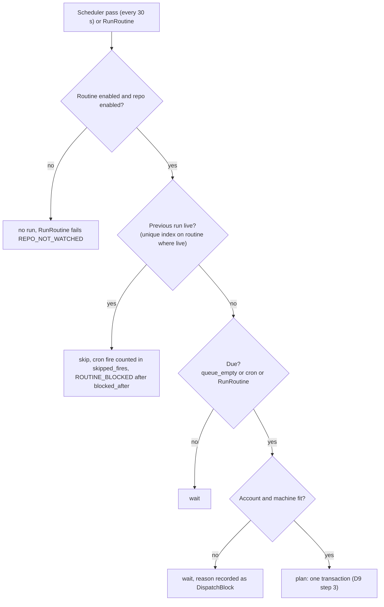
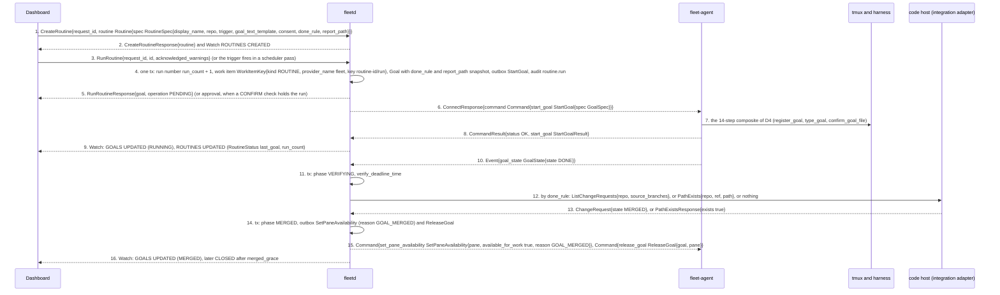
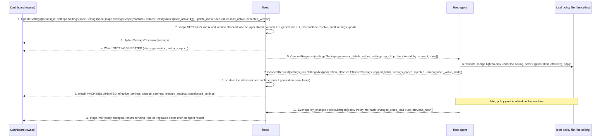
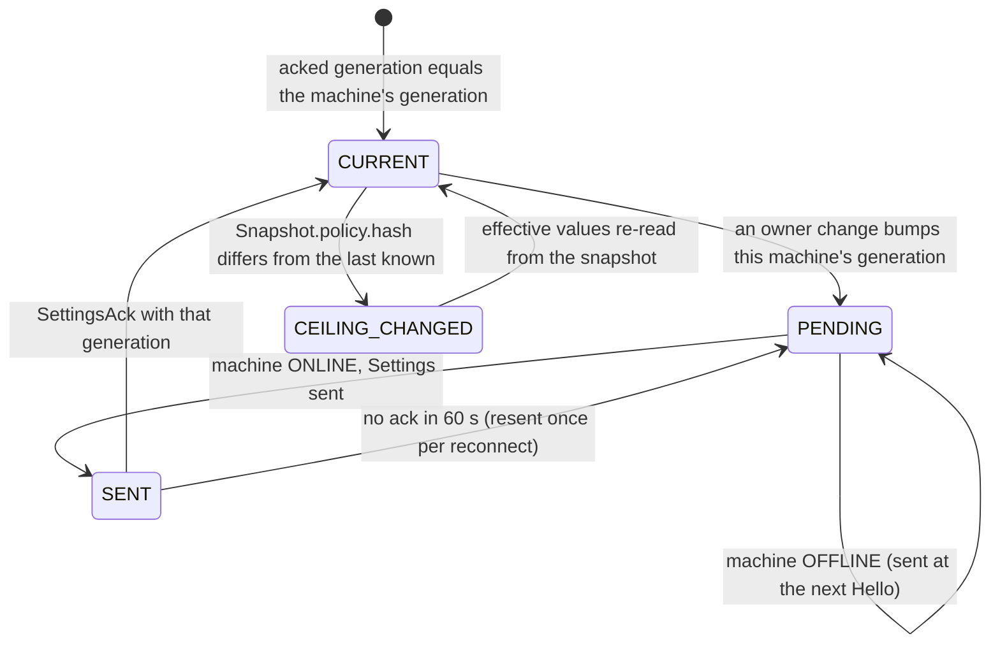
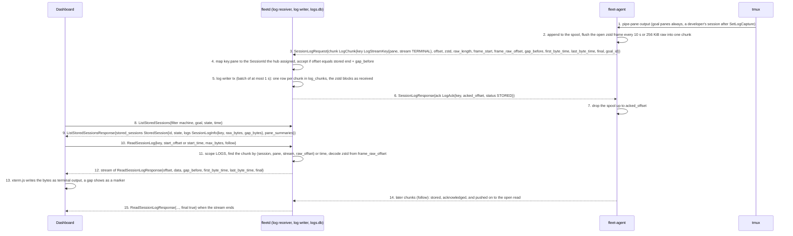
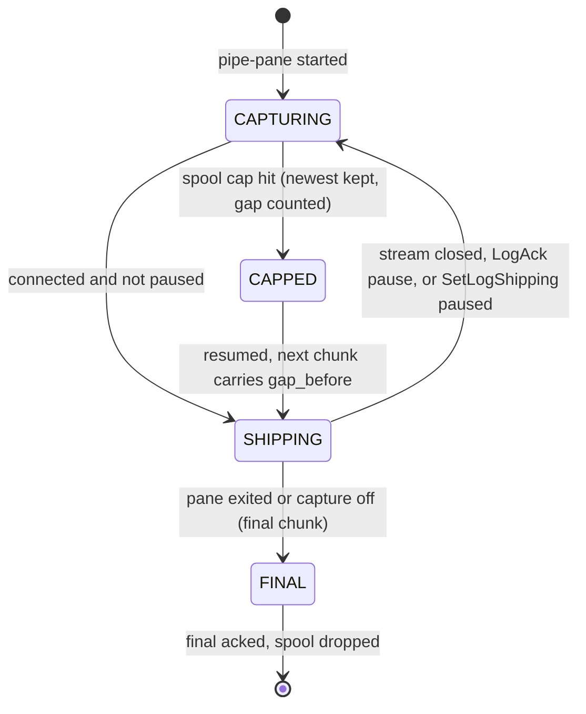
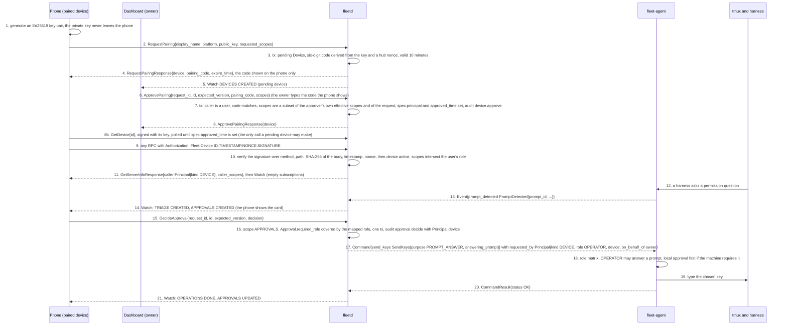

# Dashboard, hub and agent flows (part 4 of 6)

- Status: Accepted
- Date: 2026-10-02
- Part of: [dashboard-hub-agent.md](dashboard-hub-agent.md), which has the cast, the two wires and the
  building blocks every flow here relies on (the Operation lifecycle, `request_id` idempotency, [`Watch`](../../api/fleet/hub/v1/service.proto)). Read its
  "Shared building blocks" first.
- Flows in this part: **D9** run a routine, **D10** change a setting, **D11** replay a session log, **D12** pair a phone and approve from it
- Other parts: [1](dashboard-hub-agent.md) (D1, D2), [2](dashboard-hub-agent-2.md) (D3, D4, D5),
  [3](dashboard-hub-agent-3.md) (D6, D7, D8), [4](dashboard-hub-agent-4.md) (D9, D10, D11, D12),
  [5](dashboard-hub-agent-5.md) (D13), [6](dashboard-hub-agent-6.md) (D14 to D16)
- Conventions: arrows are numbered by hand and the numbered list under each diagram explains them. Where a
  spec and a proto disagree, the proto wins. Names are the proto names; the first mention of a message in a file links to its proto.

---

## D9. Run a routine

**What happens and why.** A routine is recurring fleet work that is not an issue:
a dependency bump, a flaky-test sweep, a weekly report. It is also how the fleet
spends **leftover quota**: with no harness pinned, the scheduler picks the
`(harness, account)` with the most projected unused quota. A run is not a new kind
of thing. It is a **normal goal** whose work item has kind `ROUTINE`, so slots,
pacing, consent, triage and verification apply unchanged and D4 and D6 describe
everything between "planned" and "done". What is different is how a run starts
(a trigger, or [`RunRoutine`](../../api/fleet/hub/v1/service.proto)), how it is numbered, and how "done" is judged: the
routine's rule is **snapshotted onto the goal** at plan time, so editing or deleting
the routine mid-run never changes what done means for a run in flight.

1. to 2. [`CreateRoutine`](../../api/fleet/hub/v1/service.proto) needs `SETTINGS`. [`RoutineSpec`](../../api/fleet/hub/v1/routine.proto) has the trigger
   ([`RoutineTrigger`](../../api/fleet/hub/v1/routine.proto): either [`QueueEmptyTrigger{min_interval}`](../../api/fleet/hub/v1/routine.proto) or [`CronTrigger{expression, timezone}`](../../api/fleet/hub/v1/routine.proto)), the goal text with placeholders
   `{repo}`, `{run}`, `{date}`, a consent list, optional `harness`, `account`, `machine`, `model`, `effort`, `fresh_context`, a
   [`DoneRule`](../../api/fleet/hub/v1/routine.proto), `report_path` and `blocked_after` (default 12 hours). A `REPORT_WRITTEN` rule can be saved only for a repo whose code host
   advertises [`IntegrationCapabilities.path_exists`](../../api/fleet/integration/v1/integration.proto) (`INVALID_ARGUMENT` otherwise).
3. `RunRoutine` needs `SESSIONS_WRITE` and is refused while the previous run is live (`WORK_ITEM_BUSY`) or the repo is paused
   (`REPO_NOT_WATCHED`). The scheduler path is the flowchart above: `queue_empty` runs when the repo has no `READY` work item and a slot and
   account are free, at most once per `min_interval` counted from the previous run's **start**; `cron` fires in the routine's IANA timezone, and
   after an outage **at most one** missed fire runs (the latest), the rest counted in [`RoutineStatus.skipped_fires`](../../api/fleet/hub/v1/routine.proto). Consent is the routine's
   intersected with the repo's and the account's.
4. One planning transaction, like a dispatch. The run number is never reused (a run that fails to start keeps its number), so a [`WorkItemKey`](../../api/fleet/type/v1/work.proto) never
   repeats. The hub-made work item is trusted (the owner configured the routine) and starts in stage `DISPATCHED`. The goal carries [`GoalDefinition.routine`](../../api/fleet/hub/v1/goal.proto),
   `done_rule` and `report_path` copied from the routine, the goal text with the placeholders filled, and model, effort and `fresh_context`.
5. [`RunRoutineResponse`](../../api/fleet/hub/v1/routine.proto) has the goal, the operation and an `approval` id, as [`StartGoalResponse`](../../api/fleet/hub/v1/goal_dispatch.proto) does, and the request has
   `acknowledged_warnings`. The checks are those of a manual dispatch: a `BLOCK` fails the call with its reason, a `WARN` must be acknowledged, and a `CONFIRM` returns the approval and starts nothing until an owner approves it (D5).
   A run started by a trigger acknowledges nothing, so a `WARN` or `CONFIRM` check means "do not start" and the reason lands in
   [`DispatchBlock`](../../api/fleet/hub/v1/dispatch_block.proto) ([03i](../specs/03i-routines.md)).
6. to 9. Identical to D4b. `RoutineStatus` (`last_run_time`, `next_run_time` for cron, `last_goal`, `run_count`, `skipped_fires`) is updated in the planning transaction.
10. to 11. All three done rules first need the goal line `DONE`.
12. to 14. The **snapshotted** rule decides:

| `DoneRule` | Verified by | Result |
|---|---|---|
| `GOAL_DONE_ONLY` | nothing | `DONE` becomes `MERGED` at once (the phase means "verified done" for a routine) |
| `CHANGE_REQUEST_MERGED` | the change request whose source branch is the goal's ([`GoalStatus.branch`](../../api/fleet/hub/v1/goal.proto)), via [`IntegrationProviderService.ListChangeRequests`](../../api/fleet/integration/v1/service.proto) | merged becomes `MERGED`; none found after `verify_grace` becomes `DISAGREE` |
| `REPORT_WRITTEN` | `IntegrationProviderService.PathExists{repo, ref = the branch head the goal reports, path = report_path}` | exists becomes `MERGED`; the file must be on the pushed branch |

15. to 16. As for any goal: the pane becomes available for reuse, the registry entry is released, and after `merged_grace` the fleet's own window is killed and
    its worktree pruned.

| Persisted | Where |
|---|---|
| [`Routine`](../../api/fleet/hub/v1/routine.proto) (`spec` versioned, `status` run bookkeeping), the hub-made work item, the goal with its routine snapshot | hub `state.db`, in the planning tx |
| Goal history (`goal_runs`, `goal_transitions`), audit `routine.run` | hub `state.db` |
| Everything on the machine | as D4 |

| Failure | What happens |
|---|---|
| Hub down across a cron fire | at most one run when it is back; `skipped_fires` counts the rest |
| Previous run still live at the next fire | no new run, the fire is skipped and counted; after `blocked_after` a `ROUTINE_BLOCKED` triage item says why |
| [`UpdateRoutine`](../../api/fleet/hub/v1/service.proto) mid-run | affects the next run only; the live run keeps its snapshot |
| [`DeleteRoutine`](../../api/fleet/hub/v1/service.proto) mid-run | the live run finishes under its snapshot; no new runs |
| The start fails | as D4: transient refusals plan again on another machine as a new goal (`attempt` + 1, same work item); three counted failures on three machines end the run `START_EXHAUSTED`, its item `CLOSED`, with a `START_FAILED` triage item; the next trigger starts a new run with a new number |
| Code host lacks `path_exists` after the integration changed | the run `DISAGREE`s and says why |
| No account or machine fits | nothing starts; the reason is on the idle account and the repo (`DispatchBlock`); a `queue_empty` routine waits |

## D10. Change a setting; SettingsAck and tighten-only capping

**What happens and why.** Settings are layered **fleet, then group, then machine**
and are edited as one message, [`SettingValues`](../../api/fleet/type/v1/settings.proto), that the hub also delivers to agents. The
owner calls [`UpdateSettings`](../../api/fleet/hub/v1/service.proto); in one transaction the hub stores the layer, bumps a
fleet-wide generation and re-resolves the effective values for every machine the change
touches; then it sends each connected agent a [`Settings`](../../api/fleet/agent/v1/agent.proto) message. The agent never
simply obeys it. It merges the hub's value with its own **local policy file, which is the
ceiling**: a hub value can only make a machine stricter than its local policy, never looser. The agent
answers with [`SettingsAck`](../../api/fleet/agent/v1/agent.proto) carrying the effective values, which fields the local ceiling lowered,
which fields it refused and which fields its (older) schema does not know. The dashboard therefore never
shows a setting as enforced when it is not: it reads the truth back from [`Machine.status`](../../api/fleet/hub/v1/machine.proto), not from
the request it sent.

1. [`UpdateSettingsRequest`](../../api/fleet/hub/v1/settings.proto) creates the layer if it does not exist (the id is derived from the scope:
   `"fleet"`, `"group/<label>"` or `"machine/<machine id>"`). Masks name fields of `Settings`, for example `spec.values.max_active` or
   `spec.hub.auto_dispatch`; an empty mask is `INVALID_ARGUMENT`, a path outside the updatable set `UPDATE_MASK_INVALID`.
   `expected_version` guards only the spec: delivery acks never bump `Settings.version`, so an open form is never made stale by a heartbeat.
2. The generation is one fleet-wide monotonic counter. For each machine the hub resolves machine, then groups by `priority`, then the fleet default, and
   records the generation at which that machine's resolved values last changed, so a change to one group does not resend settings to everyone.
   [`HubSettings`](../../api/fleet/hub/v1/settings.proto) (auto-dispatch, default consent, trusted gate, sign-in methods, log caps, approval timeout, ...) never reach an agent and take
   effect on the hub at once.
3. to 4. The response carries the stored layer; delivery is **not** part of it (there is no [`Operation`](../../api/fleet/hub/v1/common.proto)). The dashboard watches `SETTINGS` for the layer and
   `MACHINES` for what each machine did with it.
5. [`Settings`](../../api/fleet/agent/v1/agent.proto) goes to each affected connected machine; an offline machine gets it after its next [`Hello`](../../api/fleet/agent/v1/agent.proto)
   ([`HelloAck.settings_generation`](../../api/fleet/agent/v1/agent.proto) greater than `Hello.settings_generation`, or a different `settings_epoch`). Settings are ordered by
   `(settings_epoch, generation)`: an equal or lower generation under the same epoch is ignored and re-acked, and a new epoch (a hub restore) is accepted
   whatever its generation.
6. The merge, per field (the **tighten-only** rule):

| Field | Merge | Example |
|---|---|---|
| `max_active`, `max_total`, `max_windows`, `rate_limits`, `cert_lifetime`, `spool_cap_bytes`, `attach_idle_timeout` | `min(hub, local)` | hub 4, local 2: effective 2, the field is in `capped_fields` |
| `local_approval[].required`, `block_on_battery` | hub OR local | local says required, hub says not: required |
| `allowed_harnesses`, `allowed_repo_roots` | intersection | hub `claude, codex`, local `claude`: `claude` |
| `default_server` | `min` in the order `NONE`, `OBSERVE`, `CONTROL` | |
| `probe_interval` and `probe_interval_by_account` | `max(hub, local minimum)`: a local value can only make probing rarer | |
| `share_identity_email`, `idle_threshold` | hub wins (not machine safety ceilings) | |
| Labels | hub-assigned union local additions; a local file cannot remove a hub label | |
| `merged_grace` | hub-only; the agent echoes it unchanged | |

   Each field records its [`SettingSource.layer`](../../api/fleet/type/v1/settings.proto) (`SETTING_LAYER_LOCAL_CEILING` where the local value won). Fields the ceiling lowered are listed in
   `SettingsAck.capped_fields`, and the dashboard says "capped by local policy on <machine>".
7. A value the agent **cannot apply at all** is a different thing and is not a cap: it goes in `SettingsAck.rejected[]` as
   [`SettingRejection`](../../api/fleet/type/v1/settings.proto) (`field`, `reason` = `INVALID_ARGUMENT` for a bad value or `POLICY_SAFE_MODE`, `message`), and the previous effective value stands.
   An agent older than the hub lists the field numbers it does not recognise in `unrecognized_value_fields`, because `effective` would
   otherwise just omit them and the hub could not tell "not enforced here" from "no opinion".
8. to 9. The hub maps unrecognised field numbers to names and shows them as **not enforced on this machine** (`Machine.status.unenforced_settings`). If one is a
   safety limit (`max_*`, `rate_limits`, `local_approval`, `block_on_battery`, `allowed_*`, `default_server`, `spool_cap_bytes`) the machine is left out of auto-dispatch
   and a `settings_unenforced` triage item says to upgrade the agent. The owner can override that per machine.
10. to 11. The local policy file is read at start only. A change on disk raises `policy_changed` (and the hub shows "restart pending"); it applies after the
    developer restarts `fleet-agent`, never the hub. An **invalid** policy file at start puts the agent in **safe mode**: observe only, every control command is
    `REJECTED_BY_POLICY` / `POLICY_SAFE_MODE`, every hub setting is rejected with the same reason, [`PolicyInfo.safe_mode`](../../api/fleet/agent/v1/snapshot.proto) is true with a one-line `error`, and the hub raises
    a `policy_invalid` triage item.

| Persisted | Where |
|---|---|
| Layers (`settings_fleet`, `settings_groups`, `settings_machines`, labels), the generation counter, `machine_settings_sent` | hub `state.db`, in the change tx |
| Latest ack per machine: effective values, `capped_fields`, `rejected`, unenforced, ack time | hub `state.db`, in the ack tx |
| Audit `settings.update` (who, old and new) | hub `state.db`, permanent |
| `settings.json{generation, values, effective}` and the policy file with its loaded hash | the agent's state and config directories, written before `SettingsAck` is sent |

| Failure | What happens |
|---|---|
| Machine offline | stays `PENDING`; delivered at the next `Hello` |
| Hub restarts | generation and values are durable; resent on each `Hello` as needed |
| Same generation delivered twice | the agent re-acks, no re-apply |
| Invalid value (for example `max_windows = 0`) | rejected for that field, previous value stands, `rejected_settings` shows it |
| Hub newer than the agent | `unrecognized_value_fields`; shown as not enforced, safety limits keep the machine out of auto-dispatch |
| Policy file invalid at start | safe mode; all settings rejected with `POLICY_SAFE_MODE` |
| Hub restored from an older backup | `fleetd restore` mints a new `settings_epoch`, so agents accept the restored settings whatever their generation |
| Stale form | `FAILED_PRECONDITION` / `VERSION_MISMATCH` with `current_version` in `metadata` |
| Caller lacks `SETTINGS` | `PERMISSION_DENIED` / `SCOPE_MISSING` |

## D11. Replay a session log from logs.db

**What happens and why.** Terminal history is evidence: it explains what a goal did
while nobody watched. It is also dangerous, because terminal output can contain tokens
and secrets. So stored logs live in their own database (`logs.db`), are
reached through a separate **`LOGS` scope that only owners have** unless the owner grants it
explicitly, and are never part of `Watch`. The flow has two halves. **Shipping** is continuous
and invisible: the agent captures a pane with tmux `pipe-pane`, compresses it into chunks at
byte offsets and ships them over the [`SessionLog`](../../api/fleet/agent/v1/agent.proto) stream; the hub stores each chunk and acknowledges
it. **Replay** is a read: the dashboard finds the stream's key, calls [`ReadSessionLog`](../../api/fleet/hub/v1/service.proto) with a start
offset or time, and the hub decompresses the right frames and streams the bytes to xterm.js, optionally
following new data as it arrives.

1. A fleet goal pane is always captured. [`SetLogCapture{session, enabled}`](../../api/fleet/hub/v1/service.proto) turns it on for a developer's own session; the agent then starts a stream for each pane in it.
2. The agent keeps **one zstd frame open per stream** for up to 5 minutes or 4 MiB raw and flushes it every 10 s (a spike measured about 14 times compression this way,
   against 8 times for independent 10 s frames), so a chunk is a run of zstd blocks. Compressed, a busy pane costs roughly 65 B/s, so hours offline cost megabytes.
3. [`LogChunk`](../../api/fleet/agent/v1/streams.proto) names its stream by [`LogStreamKey{pane, stream}`](../../api/fleet/type/v1/harness.proto) (`LOG_STREAM_TERMINAL`; the harness transcript is `HARNESS_TRANSCRIPT`).
   The agent leaves `session_id` empty because a developer's session has no hub id the agent could know. `offset` counts **raw** bytes from the start of capture, and a lost span
   still takes offsets (`gap_before`). `frame_start` marks a chunk that opens a frame and `frame_raw_offset` where the open frame began. Chunks are at most 960 KiB compressed.
4. The hub accepts a chunk only when `offset == stored_end + gap_before`. A chunk wholly below the stored end is a `DUPLICATE`; anything else is a `HOLE`; a pane with no session
   yet is `UNKNOWN_STREAM` (the agent keeps its spool and retries after the next snapshot, at most every 60 s).
5. A chunk and its index are one `logs.db` row in one transaction, unique on `(session, pane, stream, raw_offset)`, so a hub crash leaves the whole chunk or none of it and no repair step is
   needed. There are no files and no rotation: a frame spans rows.
6. to 7. Every chunk gets a [`LogAck`](../../api/fleet/agent/v1/streams.proto) with the hub's stored end and a [`LogAckStatus`](../../api/fleet/agent/v1/streams.proto) (`STORED`, `DUPLICATE`, `HOLE`, `UNKNOWN_STREAM`). On `HOLE` the agent
   resends from `acked_offset`, or, if the hub's end is below the agent's spool floor (a hub restored from an older backup, or bytes the spool cap dropped), sends its oldest chunk with
   `gap_before` and `frame_start` set, so nothing wedges. The agent follows the hub's `acked_offset` even when it is lower than one it saw before.
8. to 9. [`ListStoredSessions`](../../api/fleet/hub/v1/service.proto) returns live **and ended** sessions: each [`StoredSession`](../../api/fleet/hub/v1/log_store.proto) lists every stream with its `LogStreamKey`, sizes and times, and the archived last pane summary of each pane
   (moved here when the session ended, so "what was it doing at the end" survives). A goal's run list ([`ListGoalRuns`](../../api/fleet/hub/v1/service.proto), [`GoalRun.logs`](../../api/fleet/hub/v1/goal_history.proto)) also carries the keys; listing keys needs only `READ`.
   [`SearchSessionLogs`](../../api/fleet/hub/v1/service.proto) is a case-insensitive literal scan of the decompressed frames (at most 256 MiB of raw text per call, continued with `page_token`, no index in v1); each
   [`SessionLogMatch`](../../api/fleet/hub/v1/log_store.proto) has the `key` and a `raw_offset` to pass as `start_offset`.
10. `ReadSessionLog` is a server stream (it works over plain Connect, no WebSocket). Exactly one of `start_offset` or `start_time` selects the start; `max_bytes` 0 means to the end; `follow` keeps
    the stream open and sends new data as it is stored.
11. `ReadSessionLog`, `ListStoredSessions`, `GetStoredSession`, `SearchSessionLogs`, `DeleteSessionLogs` and `GetLogStoreStatus` need `LOGS`; `SetLogCapture` needs `SESSIONS_WRITE`; `ListGoalRuns` needs `READ`. Owners hold `LOGS`; a viewer gets it through `UserSpec.extra_scopes`, an API token or paired device only if ticked at creation or approval, and a phone pairing never requests it by default. Replay decodes
    from the chunk at `frame_raw_offset`, which is at most 5 minutes of data before any byte it needs.
12. `data` is at most 256 KiB per message and is **untrusted** (terminal bytes with escape sequences, or transcript text). `gap_before` is the number of bytes missing before this span.
13. The dashboard draws the bytes through xterm.js and never as markup, and shows a gap marker and the `first_byte_time` and `last_byte_time` for time navigation.
14. to 15. In follow mode the read receives each newly committed chunk (one commit per batch of at most 1 s). `final` is true when the pane exited or capture was turned off. Export is the client
    paging `ReadSessionLog`; there is no export RPC.

| Persisted | Where |
|---|---|
| Spool: compressed chunks and `acked_offset` per stream | agent state dir `spool/<server>/<server_start_id>/<pane>/<stream>/`, fsync per chunk batch |
| `log_chunks`, `log_sessions`, `archived_pane_summaries` | `logs.db` (its own writer), one tx per batch of at most 1 s |
| Retention: `HubSettings.log_size_cap_bytes` (default 50 GiB) and `log_retention`; oldest ended sessions are pruned first, a session with an open stream never | `logs.db`; the delete audit row in `state.db` |
| Audit `logs.delete` (bytes, never content), `logs.search` | `state.db`, permanent |

| Failure | What happens |
|---|---|
| Caller lacks `LOGS` | `PERMISSION_DENIED` / `SCOPE_MISSING` with `metadata["scope"]`; a token or device never gets it implicitly |
| Agent offline for hours | the spool grows; chunks resend from `acked_offset` on reconnect |
| Hub restart | `logs.db` is durable and consistent; the agent resends from the hub's end in the next `LogAck` |
| Hub restored from an older backup | the first chunk gets `HOLE` with the hub's lower end; the agent declares a gap; the stream continues and a reader sees `gap_before` |
| Hub disk low | `LogAck{all_streams true, pause true}` to every agent (or [`SetLogShipping`](../../api/fleet/agent/v1/command_goal.proto)); capture continues into the spool; triage `log_disk_low`; resumes with hysteresis |
| Spool cap hit on the agent | newest kept, `gap_before` on the next chunk, [`SpoolStatus`](../../api/fleet/agent/v1/snapshot.proto) shows it |
| Agent crash mid-chunk | up to one chunk interval (10 s) of raw output lost; the gap is recorded |
| tmux server restart | new `server_start_id`, new pane keys, old streams go `FINAL` on the next snapshot diff |
| Session logs pruned or deleted | `RESOURCE_NOT_FOUND`; [`DeleteSessionLogs`](../../api/fleet/hub/v1/service.proto) is refused while a stream captures (`LOG_STREAM_OPEN`) |
| Machine revoked | streams are finalised at the last stored offset; the logs stay under the machine id and the `LOGS` rules |

## D12. Pair a phone and approve from it, with scopes

**What happens and why.** A phone is a client that holds its own **Ed25519 key
pair** and signs every request; it carries no cookie and no password, so a web page
cannot ride its credential. Pairing is a handshake with a human in the middle: the phone
asks to pair, the phone shows a **six-digit code** and the owner types it on the dashboard
and approves with the scopes to grant. The default for a phone is `READ` and `APPROVALS`, and
**never** `LOGS`, `ADMIN` or `SETTINGS`. From then on the phone sees the
fleet, gets the triage feed and can answer a permission prompt (D5) from anywhere. What it can do is
always the **narrowest** of three things: the scopes the owner granted, the role of the user it acts for, and, at the
agent, the role the hub derives from those scopes. Push delivery is not built in v1: the phone sees approvals through
`Watch` while its app is open.

1. to 4. [`RequestPairing`](../../api/fleet/hub/v1/device.proto) is unauthenticated (there is no principal yet) and rate limited per peer address; it is idempotent by
   `(peer address, public key)` (it carries no `request_id`), and a replay returns the pending device and a recomputed code. `public_key` is the raw 32-byte key. An **empty** `requested_scopes` means `READ` and
   `APPROVALS`. The code is six digits derived from the public key and a hub nonce and is never stored.
5. Pending devices need `ADMIN` to see (`DEVICES` topic: `ADMIN` for all, or `self` for the device itself).
6. to 8. [`ApprovePairing`](../../api/fleet/hub/v1/service.proto) needs `ADMIN` and a **user** principal (a token or device, even with `ADMIN`, gets `SCOPE_NOT_GRANTABLE`). `pairing_code` is what the owner read off the phone and typed (`PAIRING_CODE_MISMATCH`); a code older than 10 minutes is `PAIRING_EXPIRED`. `scopes` may be
   fewer than requested, never more, never above the approver's own effective scopes, and `SCOPE_LOGS` is granted **only if the owner lists it** and holds it, even if the device asked for it (`SCOPE_NOT_GRANTABLE` otherwise). `expected_version`
   guards the spec only, so a pending device that keeps pinging never makes the approval conflict with itself. Arrow 8b: the phone learns of the approval by
   polling `GetDevice` on itself with its signed request until `spec.approved_time` is set; every other call from a pending device is `DEVICE_NOT_ACTIVE` ([02d](../specs/02d-hub-authz.md)).
9. to 10. The signature covers the method, path, SHA-256 of the body, a timestamp and a nonce; the hub refuses a timestamp more than 60 s off or a nonce it saw in that window. A
   stream (`Watch`) is signed **once at open** and ends the moment the device is revoked. The hub also refuses a request with a second credential.
11. The device's scopes are re-intersected with the effective scopes of its user (role plus `extra_scopes`) on every call, so demoting the user narrows the phone at once.
12. to 14. Same path as D5. A phone that holds `APPROVALS` without `READ` (the owner unticked it) sees only the approval, its triage item, the summary strip and the operations it caused:
    those topics accept `READ|APPROVALS`.
15. to 16. [`Approval.required_role`](../../api/fleet/hub/v1/triage.proto) is a **role**, not a scope: the decider's mapped role must cover it. A prompt answer is within reach of the default phone; a developer's [`KillWindow`](../../api/fleet/hub/v1/service.proto)
    confirm needs a decider that maps to `OWNER`, so the phone gets `ROLE_INSUFFICIENT`.
17. to 18. For a device the hub puts in [`Command.requested_by.role`](../../api/fleet/agent/v1/command.proto) the **narrowest role that covers its effective scopes**: `OWNER` only with `SESSIONS_WRITE`, `APPROVALS`, `SETTINGS` and
    `ADMIN` together; else `OPERATOR` with `SESSIONS_WRITE` or `APPROVALS`; else `VIEWER`. So the default phone is an `OPERATOR` at the agent. The hub checks scopes, the agent checks
    the role against its matrix, local policy is the ceiling, and the stricter result stands.
19. to 21. As D5.

| Scopes on the phone | What it can do | At the agent it is |
|---|---|---|
| `READ`, `APPROVALS` (default) | see everything except stored logs, answer prompts, snooze or dismiss triage items | `OPERATOR` |
| `APPROVALS` only | see approvals, their triage items, the summary strip and its own operations; answer prompts | `OPERATOR` |
| `READ` only | see everything except logs; decide nothing | `VIEWER` |
| plus `SESSIONS_WRITE` | also dispatch and control goals, send keys, attach with input | `OPERATOR`; never `OWNER` unless it also holds `SETTINGS` and `ADMIN` |
| plus `LOGS` | only when the owner ticks it at approval | no change at the agent |

| Persisted | Where |
|---|---|
| [`Device`](../../api/fleet/hub/v1/device.proto) (`spec`: key, requested and granted scopes, approval and revocation times; `status.last_seen_time` at most one Watch message per 30 s) | hub `state.db`, permanent (revoked rows kept for audit) |
| Nonces (a 60 s window) | hub memory |
| Audit: `device.pair_request`, `device.approve`, `device.revoke`, then every action with [`Principal.device`](../../api/fleet/type/v1/principal.proto) | hub `state.db`, permanent |
| The private key | the phone only |

| Failure | What happens |
|---|---|
| Wrong code typed | `FAILED_PRECONDITION` / `PAIRING_CODE_MISMATCH` |
| Pairing not approved in 10 minutes | `PAIRING_EXPIRED`; the phone asks again |
| Clock off by more than 60 s, or a replayed nonce | the request is refused `UNAUTHENTICATED` / `CREDENTIALS_INVALID` |
| Device pending, revoked or its user disabled | `PERMISSION_DENIED` / `DEVICE_NOT_ACTIVE` on every call (a pending device may still call `GetDevice` on itself, which is how the phone learns that `spec.approved_time` is set); open `Watch` streams end and attaches close `HUB_CLOSED` |
| Phone asks for a scope its user lacks | `PERMISSION_DENIED` / `SCOPE_NOT_GRANTABLE` at approval |
| Phone calls something outside its scopes | `PERMISSION_DENIED` / `SCOPE_MISSING` with `metadata["scope"]`; a row its scopes hide is `NOT_FOUND`, so ids cannot be probed |
| Phone tries a developer's `KillWindow` or [`PruneWorktree{allow_dirty}`](../../api/fleet/agent/v1/command_goal.proto) | `ROLE_INSUFFICIENT` (hub or agent) |
| Phone tries to mint a credential (`ApprovePairing`, `CreateUserInvite`, `UpdateUser`, `CreateApiToken`) | `PERMISSION_DENIED` / `SCOPE_NOT_GRANTABLE`, even with `ADMIN` ([02d](../specs/02d-hub-authz.md#no-escalation)) |
| Phone is offline when a prompt appears | no push in v1; the card is waiting when the app opens, until `expire_time` (then fallback `DENY`) |
| User demoted | the phone narrows on its next call; open streams get `RESYNC_REQUIRED` / `SCOPES_CHANGED` |
| Phone lost | [`RevokeDevice`](../../api/fleet/hub/v1/service.proto) (`ADMIN`, or the device itself): effective at once, including open streams |
