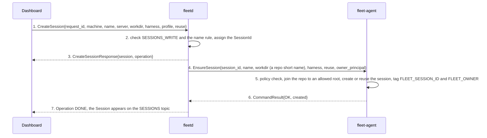
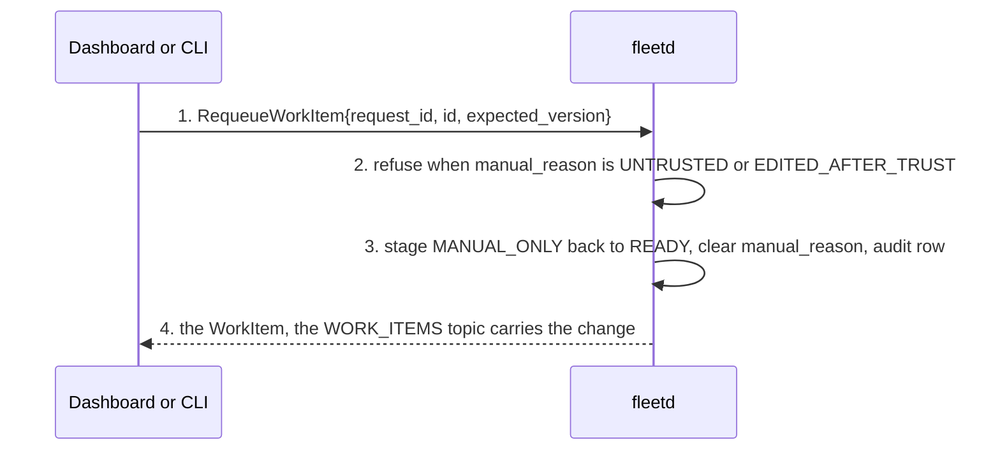
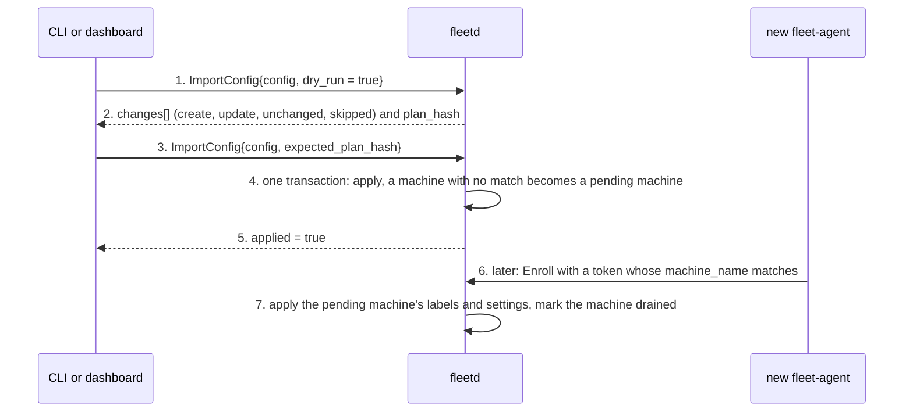

# Dashboard, hub and agent flows (part 6 of 6): new session, requeue, import a configuration

- Status: Accepted
- Date: 2026-10-02
- Part of: [dashboard-hub-agent.md](dashboard-hub-agent.md), which has the cast, the two wires and the
  building blocks every flow here relies on (the Operation lifecycle, `request_id` idempotency,
  [`Watch`](../../api/fleet/hub/v1/service.proto)). Read its "Shared building blocks" first.
- Flows in this part: **D14** a new developer session, **D15** put a work item back in the queue,
  **D16** import a configuration that names a machine that has not enrolled yet
- Other parts: [1](dashboard-hub-agent.md) (D1, D2), [2](dashboard-hub-agent-2.md) (D3, D4, D5),
  [3](dashboard-hub-agent-3.md) (D6, D7, D8), [4](dashboard-hub-agent-4.md) (D9 to D12),
  [5](dashboard-hub-agent-5.md) (D13), [6](dashboard-hub-agent-6.md) (D14 to D16)
- Revoking and forgetting a machine from the dashboard (`RevokeMachine`, `DeleteMachine`) is the flow in
  [agent-hub.md](agent-hub.md) and [agent-hub-2.md](agent-hub-2.md), started by a button; it has no
  separate dashboard flow.
- Specs: [02b](../specs/02b-hub-api.md), [03h](../specs/03h-goal-phases-in-depth.md),
  [02k](../specs/02k-v1-surface-and-cli.md) (which release serves each RPC).
- Conventions: as in the other parts. Names are the proto names.

---

## D14. A new developer session on a machine (v1)

**What happens and why.** The owner wants a tmux session on a machine from the dashboard (for example
to attach to it later), in an allowed repo root, optionally with a harness already started. It is
`EnsureSession` on the developer's own tmux server, so it shows up in their `tmux ls`, marked as started
by fleet. It is the same agent command that dispatch uses inside `StartGoal`, here on its own.

Steps 2 and 5. The name must match `[a-z0-9][a-z0-9-]{0,31}` (`INVALID_NAME` otherwise). The hub never
sends a path: the agent joins the repo name to one of its allowed repo roots and refuses `..`. With
`reuse` set, an existing session of that name is attached to instead of failing. `harness` empty means a
login shell. A machine that is draining refuses a harness start (`DRAINING`).

**When it goes wrong:** the machine is offline (the operation ends `EXPIRED` after its 10-minute deadline,
nothing is created); the repo is outside the allowed roots (`REPO_ROOT_NOT_ALLOWED`); the local policy
refuses the kind (`REJECTED_BY_POLICY`).

## D15. Put a work item back in the queue (v1)

**What happens and why.** A work item is `MANUAL_ONLY` after a person cleared its goal or after three
failed starts. The scheduler never redispatches it by itself. The owner decides it is worth another try
and puts it back.

An untrusted item needs the trusted label from an allow-listed person instead; a click must not bypass
the gate (`REQUEUE_NOT_ALLOWED`). A stale `expected_version` is `VERSION_MISMATCH`: read again. A requeue
starts nothing; the next scheduler pass (or a manual dispatch) does.

## D16. Import a configuration that names a machine not enrolled yet (v1)

**What happens and why.** The owner keeps the fleet in a `fleet.yaml` (the CLI's YAML for `FleetConfig`).
It names machines, some of which have not enrolled. Import applies what it can now and keeps the rest for
when the machine joins.

A plan with any `SKIPPED` line (for example an integration, which import never creates) applies nothing
unless `allow_skipped` is set. Import only creates and updates, and never drains a machine that is
already enrolled.

**What "drained" means here.** The hub records the new machine as drained (`spec.drain.draining = true`)
and the Machines view shows it. The mark takes effect at once: the machine takes no goals until the owner
undrains it with `UndrainMachine` (`DrainMachine` and `UndrainMachine` are v1 calls,
[02k](../specs/02k-v1-surface-and-cli.md)). Release: v1 (PR 13a builds `ExportConfig` and
`ImportConfig`, and the dispatch rows of the plan build drain and undrain).
