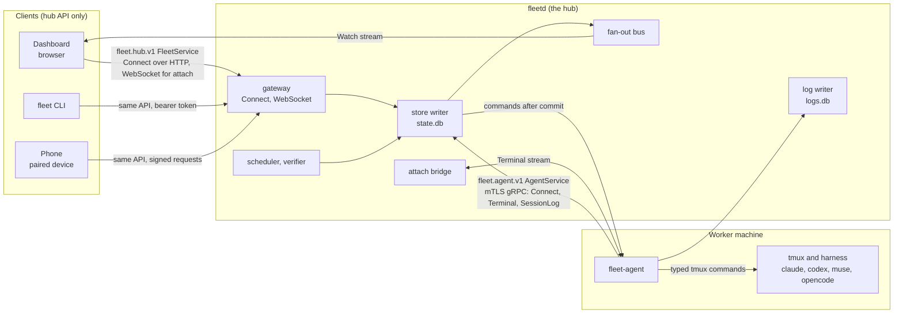
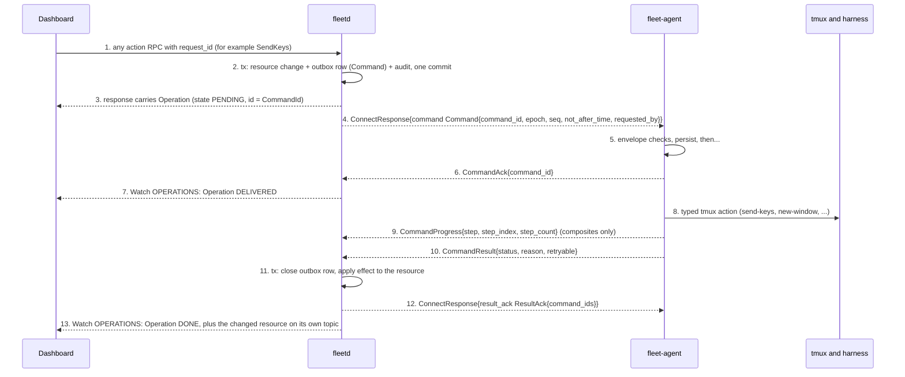
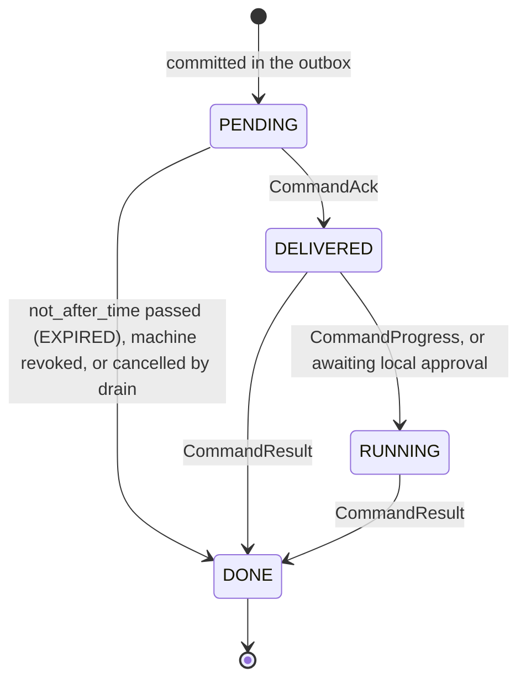
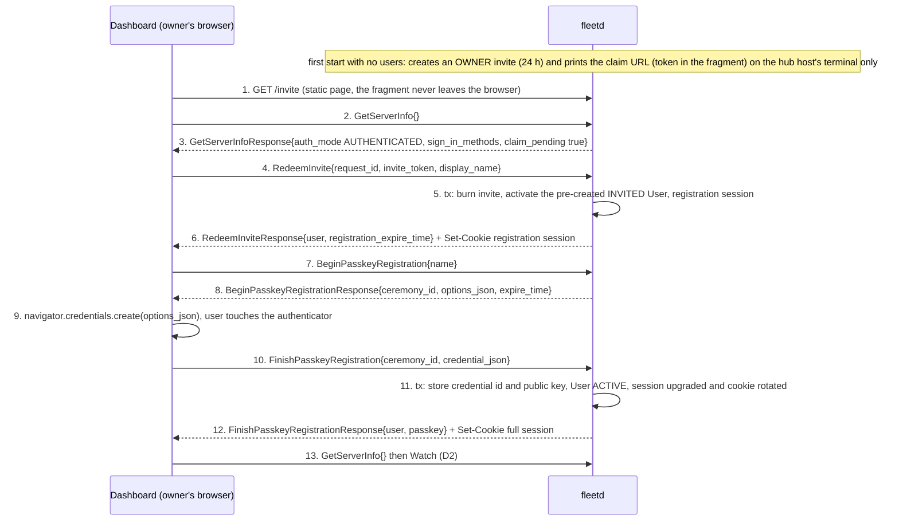
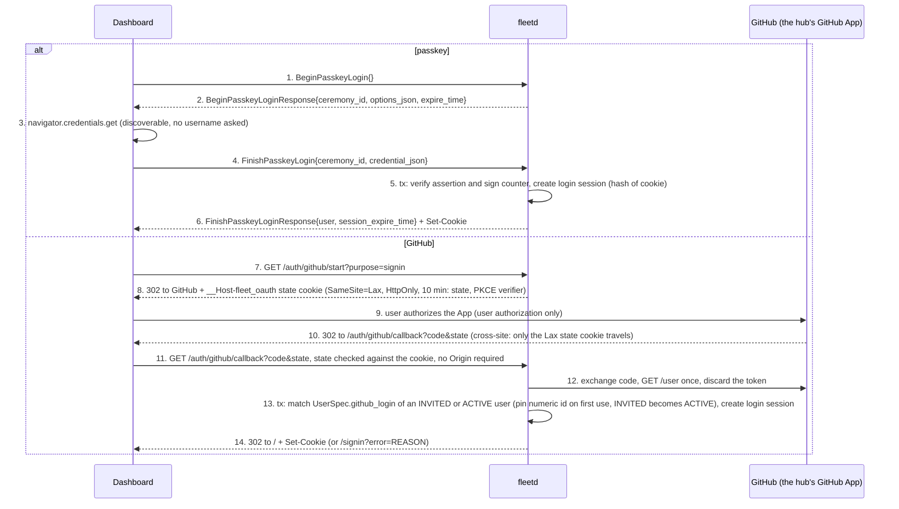
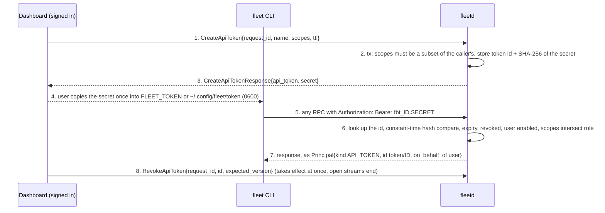
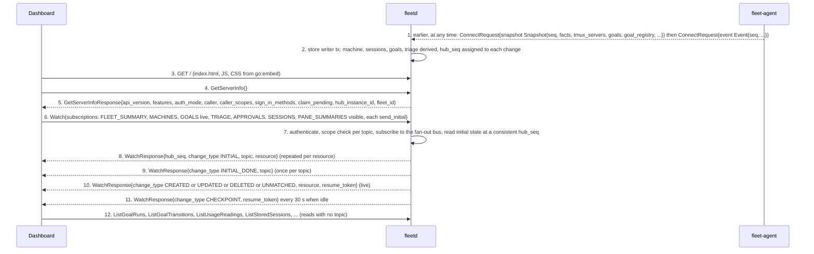

# Dashboard, hub and agent flows (part 1 of 4)

- Status: Draft for review
- Date: 2026-10-02
- Audience: the developer who is about to implement fleet-board, and the owner
  who wants to see exactly how the parts talk to each other
- Source of truth: the protos in [`api/fleet/`](../../api/fleet/). Where a spec
  and a proto disagree, the proto wins.
- Specs behind it: [02b](../specs/02b-hub-api.md), [02c](../specs/02c-hub-watch-and-filters.md),
  [02d](../specs/02d-hub-authz.md), [02f](../specs/02f-hub-authentication.md),
  [02g](../specs/02g-agent-security.md), [02h](../specs/02h-goal-binding-and-pane-signals.md),
  [02i](../specs/02i-delivery-and-sequencing.md), [03](../specs/03-workflows.md) and
  [ADR 0019](../adr/0019-pre-implementation-contract-decisions.md)

This is the dashboard to hub to agent half of the flow catalogue. It walks
twelve flows, **D1 to D12**, from the dashboard's click down to tmux and back
up to the screen. Each flow has a plain-language summary, a diagram that uses
the exact message, RPC and field names from the protos, numbered steps (one
per arrow), what is persisted where, and what happens when it goes wrong.

| Part | Flows |
|---|---|
| [1 (this file)](dashboard-hub-agent.md) | shared building blocks, **D1** sign-in, **D2** dashboard load |
| [2](dashboard-hub-agent-2.md) | **D3** live updates, **D4** dispatch a goal end to end, **D5** answer a prompt via approvals |
| [3](dashboard-hub-agent-3.md) | **D6** goal control, **D7** terminal attach, **D8** drain a machine |
| [4](dashboard-hub-agent-4.md) | **D9** run a routine, **D10** change a setting, **D11** replay a session log, **D12** pair a phone |

## The cast and the two wires



- **Hub API** ([`fleet.hub.v1`](../../api/fleet/hub/v1/service.proto),
  [`FleetService`](../../api/fleet/hub/v1/service.proto)): the only API a dashboard, the `fleet` CLI or a phone uses
  (ADR 0018). It never embeds an agent-wire type. Every call passes the Host
  and Origin checks, then carries exactly one credential ([02f](../specs/02f-hub-authentication.md)).
- **Agent wire** ([`fleet.agent.v1`](../../api/fleet/agent/v1/agent.proto),
  [`AgentService`](../../api/fleet/agent/v1/agent.proto)): the agent dials out to the hub over mTLS. [`Connect`](../../api/fleet/agent/v1/agent.proto) is one
  long-lived bidirectional stream per agent (commands, events, results);
  [`Terminal`](../../api/fleet/agent/v1/agent.proto) (one per browser attach) and [`SessionLog`](../../api/fleet/agent/v1/agent.proto) (one per agent) are
  separate streams so bytes never delay commands.
- **Pass-through rule**: the agent drives unmodified, interactive harnesses
  in tmux with typed commands only. There is no shell string anywhere, no
  root, and no harness is run headless.

Participants in the diagrams: **Dashboard** (the browser app; the CLI and
phone differ only in how they authenticate), **fleetd**, **fleet-agent** and
**tmux + harness**. Inside `fleetd` the diagrams name the internal owner
only when it matters (store writer, scheduler, attach bridge; see
[03f](../specs/03f-hub-internals.md)). Arrows are numbered by hand so the
step list under each diagram matches. A flow that never reaches a machine
(D1, D2, D12 up to approval) says so.

Notation: a hub API call is written as the RPC with its request fields, for example
[`StartGoal{request_id, input, ...}`](../../api/fleet/hub/v1/goal_dispatch.proto) (request message `StartGoalRequest`); its response is the `...Response` message. An agent command is always
written inside its envelope, [`Command{start_goal StartGoal{...}}`](../../api/fleet/agent/v1/command.proto), because several RPC names (`StartGoal`, [`SendKeys`](../../api/fleet/agent/v1/command_tmux.proto),
[`KillWindow`](../../api/fleet/agent/v1/command_tmux.proto), [`SetLogCapture`](../../api/fleet/agent/v1/command_goal.proto), ...) are also agent command messages. A diagram label such as
`phase RUNNING` or `state OPEN` shows an enum value after its field name. The first mention of a
message in each file links to the proto that defines it; where a name exists in two packages the link says
which one is meant by where it points.

## Shared building blocks

Four mechanisms recur in every flow below. They are described once here.

### 1. Hub API call conventions

A mutating call carries `request_id` (UUIDv4 or ULID, at most 64 bytes). The
hub stores `(principal id, request_id) -> response` for 24 h: the same key and
body returns the same response (same [`Operation`](../../api/fleet/hub/v1/common.proto), same `command_id`, nothing
sent to an agent twice); the same key with another body is
`ALREADY_EXISTS` / `REQUEST_ID_CONFLICT`. A secret in a response (invite token,
API token, attach ticket) is **not** stored in that record, so a replay is
`SECRET_ALREADY_DELIVERED`. Updates carry `update_mask` and `expected_version`
(the spec's ETag); a mismatch is `FAILED_PRECONDITION` / `VERSION_MISMATCH`.
Failures are Connect or gRPC errors whose detail is an
[`ErrorDetail`](../../api/fleet/type/v1/status.proto) (`reason`, `retryable`,
`retry_after`, `metadata`, `violations`). 64-bit integers (`version`,
`hub_seq`, byte counts) are decimal strings in JSON and `bigint` in TypeScript.

### 2. An action that reaches a machine returns an Operation



1. The client sends the action. The scope the RPC needs is checked first
   ([02d](../specs/02d-hub-authz.md)).
2. The decision and its outbox row commit in **one transaction** before
   anything is sent, so a hub crash after the commit is recovered from the
   outbox. A transaction never spans a network call (ADR 0001).
3. The response is the [`Operation`](../../api/fleet/hub/v1/common.proto) handle,
   never the final state. `Operation.id` is the [`CommandId`](../../api/fleet/type/v1/ids.proto), so the UI, the
   audit log and the agent's local log name the same thing.
4. After commit the hub writes the [`Command`](../../api/fleet/agent/v1/command.proto)
   on the agent's `Connect` stream. `requested_by` is the [`Principal`](../../api/fleet/type/v1/status.proto); for a
   device or API token its `role` is the narrowest role covering the effective
   scopes (02d, "Role sent to the agent").
5. The agent checks, in order: known `command_id` (returns the logged result),
   `not_after_time` in hub time, `epoch`, `seq`, `requires` capability, local
   policy, role, then local approval if the machine requires it.
6. [`CommandAck`](../../api/fleet/agent/v1/command.proto) means "persisted"; the operation becomes `DELIVERED`.
7. Operations reach the dashboard through [`Watch`](../../api/fleet/hub/v1/service.proto) topic `OPERATIONS` (a caller
   with only `APPROVALS` sees just the operations it requested) or [`GetOperation`](../../api/fleet/hub/v1/service.proto).
8. The agent acts on tmux.
9. Composites ([`StartGoal`](../../api/fleet/agent/v1/command_goal.proto)) report named steps; the operation is `RUNNING`.
10. Exactly one [`CommandResult`](../../api/fleet/agent/v1/command.proto) per `command_id`, kept in the agent's command log
    until acknowledged.
11. The result closes the outbox row and updates the resource in one transaction.
12. [`ResultAck`](../../api/fleet/agent/v1/agent.proto) lets the agent forget the result.
13. The operation ends `DONE` with the agent's [`Status`](../../api/fleet/type/v1/status.proto) and, if not OK, an
    `ErrorDetail`; the effect itself is visible on its own resource.



Default deadlines (`Command.not_after_time`): 2 min for [`SendKeys`](../../api/fleet/agent/v1/command_tmux.proto), [`Interrupt`](../../api/fleet/agent/v1/command_tmux.proto),
[`RunHarnessCommand`](../../api/fleet/agent/v1/command_tmux.proto), [`CapturePane`](../../api/fleet/agent/v1/command_tmux.proto), [`OpenAttach`](../../api/fleet/agent/v1/command_goal.proto); 30 min for `StartGoal`, `EnsureWorktree`, `PruneWorktree`, `EnsureGoalHooks`; 24 h
for [`StopProbe`](../../api/fleet/agent/v1/command_tmux.proto); 10 min otherwise. An action that needs an approval first
(a dispatch with a `CONFIRM` check, a DESTRUCTIVE command, [`KillWindow`](../../api/fleet/hub/v1/service.proto) on a
developer's window) returns the approval and **no operation**; the operation
exists only once the approval is approved (D5).

### 3. Watch is how the dashboard learns what happened

A resource changes in the hub store, the change gets a `hub_seq`, and the
fan-out bus pushes it to every `Watch` stream whose subscription matches (D2
opens the stream, D3 explains delivery). The dashboard never polls an action's
outcome: it sees the `Operation` and the changed resource arrive on the stream.

### 4. Where state lives

| Store | Holds | Written by |
|---|---|---|
| `state.db` (hub) | resources, outbox, goals, triage, approvals, users and credentials, audit (permanent), event history (1 week) | the single store writer, one transaction per batch |
| `logs.db` (hub) | compressed session-log chunks, archived last pane summaries | the log writer, one transaction per batch of at most 1 s |
| agent state dir | certificate and key, command log, event ring, `seq` high-water mark, spool, settings, goal registry, availability marks | the agent |
| tmux, the repo | panes, windows, `FLEET_*` tags, goal file, worktrees | tmux, git, the harness |

---

## D1. Sign-in: claim URL, passkey, GitHub, session, API token

**What happens and why.** In `authenticated` mode nobody is trusted until they
prove who they are, and the hub stores no passwords. The very first time,
`fleetd` prints a one-time **claim URL** on the hub host's terminal (never to a log); whoever opens it
becomes the owner and registers a passkey or links a GitHub account. After that
a browser signs in with a passkey or GitHub and holds an HttpOnly session cookie.
`authenticated` mode serves HTTPS only (an owner-supplied or Tailscale certificate).
The `fleet` CLI uses an **API token** the owner mints from a signed-in session,
and a phone uses a paired device (D12). In `local_trusted` mode (loopback only)
there is no sign-in at all: every call that passes the Host and Origin checks
runs as the fixed local owner. The agent is not involved in any of this; agents
authenticate with mTLS certificates ([02g](../specs/02g-agent-security.md)).

Every request first passes the **Host and Origin checks** (a disallowed `Host` is
HTTP 403 `HOST_NOT_ALLOWED`, a disallowed `Origin` 403 `ORIGIN_NOT_ALLOWED`, no CORS
headers are ever sent), then carries **one** credential: a cookie, a bearer
token or a device signature. Two kinds at once is `UNAUTHENTICATED` /
`CREDENTIALS_INVALID`. The hub scopes the call as the credential's scopes
intersected with its user's effective scopes ([02d](../specs/02d-hub-authz.md)). The Origin
rule covers POST RPCs, `Watch` and WebSocket upgrades; static `GET`s and the two GitHub
redirect endpoints are exempt, and the callback is protected by its `state` check instead.

### D1a. First run: claim, then register a passkey



1. The claim page is static; the token sits in the URL **fragment** so it reaches
   no server log or `Referer`. The URL is printed only on the operator's
   terminal (stderr of an interactive `fleetd`, or `fleetd claim`), never to the structured log.
2. to 3. [`GetServerInfo`](../../api/fleet/hub/v1/common.proto) needs no credential.
   `claim_pending` is true while the hub has no owner, so the UI shows "claim this hub".
4. [`RedeemInvite`](../../api/fleet/hub/v1/auth.proto) is unauthenticated. Its
   idempotency key is `(peer address, SHA-256 of invite_token)`; redemptions are
   limited to 10 a minute per peer address.
5. The invite is burned and the user (created with the invite, so a restart reuses the row) activated in one transaction. A wrong, used or
   expired token is `INVALID_ARGUMENT` / `INVITE_INVALID` with no hint.
6. The cookie is a **registration session**: it may register a credential and do
   nothing else, for 15 minutes. If nothing is registered the invite is reissued
   (shown only by `fleetd claim`) and `claim_pending` stays true. The owner may link GitHub
   instead of registering a passkey: in the registration session
   `GET /auth/github/start?purpose=link` works (D1b), its callback stores the link (and, for the
   claim owner, `spec.github_login`), makes the user `ACTIVE` and rotates the cookie, as
   `FinishPasskeyRegistration` does.
7. to 8. A passkey ceremony lives 5 minutes and is single use. `options_json` is
   W3C `PublicKeyCredentialCreationOptionsJSON`; no client code interprets it.
9. The browser and authenticator do the WebAuthn work. It needs a secure context, which HTTPS-only
   `authenticated` mode always is; a method the owner turned off shows as `SIGN_IN_METHOD_DISABLED` in
   [`GetServerInfoResponse.sign_in_methods`](../../api/fleet/hub/v1/common.proto).
10. to 12. The hub validates with its WebAuthn library (user verification required,
    discoverable credential required, attestation `none`). The first credential makes
    the user `ACTIVE` and rotates the cookie to a full session. Replaying `Finish`
    with the same ceremony id and body returns the stored response.
13. `GetServerInfoResponse.caller` and `caller_scopes` now describe the owner.

### D1b. Returning sign-in: passkey, or GitHub



1. to 6. Passkey sign-in is unauthenticated and rate limited per peer address. A bad
   assertion, an unknown credential and a disabled user all answer
   `UNAUTHENTICATED` / `CREDENTIALS_INVALID`, so the answer never reveals which users exist.
7. to 14. GitHub sign-in is two plain HTTP endpoints because it is a browser redirect,
   not RPCs. The hub asks for no repository access on the user's behalf. The allow-list
   is [`UserSpec.github_login`](../../api/fleet/hub/v1/auth.proto) of the `INVITED` and `ACTIVE` users, so a
   GitHub-only invitee can sign in; after the first sign-in the numeric
   GitHub id is what matches, so a renamed or recycled login cannot take over a user.
   A GitHub account that is not on the list ends at `GITHUB_NOT_ALLOWED`; GitHub sign-in
   without the App's client id and secret in hub config is `SIGN_IN_METHOD_DISABLED`.
   The `link` purpose (same endpoints) attaches GitHub to the signed-in user, or to the claim
   owner's registration session: the hub records the user server-side at `/start` (where the
   Strict session cookie does arrive) keyed by `state`, because the cross-site callback carries
   no session cookie. The linked login must equal `spec.github_login` (else `GITHUB_NOT_ALLOWED`), except for the claim owner, whose link sets it.
6. and 14. The cookie is `__Host-fleet_session` (HTTPS only), `Secure`, `HttpOnly`, `SameSite=Strict`, no `Domain`. The hub stores only its SHA-256, in a
   [`LoginSession`](../../api/fleet/hub/v1/auth.proto). It lasts `session_max_age` (30 days) and
   ends after `session_idle_timeout` (7 days) unused.

### D1c. The CLI: an API token



1. to 3. Only a signed-in user or the local owner (not a token or device) can mint a token. `scopes` is
   required and must be a subset of the creator's own effective scopes; `SCOPE_LOGS` only if the creator
   holds it and ticks it, else `PERMISSION_DENIED` / `SCOPE_NOT_GRANTABLE`. `ttl` of zero
   means 90 days, over 365 days is `INVALID_ARGUMENT`. The secret `fbt_<id>.<secret>` is
   shown once and never stored; a retry of the same `request_id` is
   `SECRET_ALREADY_DELIVERED` and the user makes a new one.
5. to 7. The `fbt_` prefix lets secret scanners find a leaked token. Because scopes are
   checked again on every call, demoting the user narrows the token at once.
8. Revoked tokens stay listed ([`ListApiTokens`](../../api/fleet/hub/v1/service.proto)) for the audit trail. Bootstrap without a
   browser: `fleetd token create` on the hub host talks to the running hub over its local
   admin socket (mode 0600, the `fleetd` OS user): the token acts for a named owner (`--user`, default the sole active
   owner), its scopes are capped to that owner's, and the audit actor is `LOCAL_USER` `local:<os user>`.

### D1: persisted, and what goes wrong

| What | Where | Transaction |
|---|---|---|
| Users, passkeys (credential id, public key), invites (hash) | `state.db` | redeem and finish txs |
| Login sessions (SHA-256 of cookie), API tokens (id, SHA-256 of secret), expiry, `revoked_time` | `state.db`; `last_used_time` at most once a minute | create and revoke txs |
| Ceremonies, nonces | memory is enough; losing them only makes a client retry | none |
| Audit | `state.db`, permanent: `auth.claim`, `auth.sign_in`, `auth.sign_in_failed`, `auth.sign_out`, `passkey.add`, `passkey.delete`, `user.invite`, `user.update`, `token.create`, `token.revoke`, `auth.session_revoke` | with each action |

| Failure | What happens |
|---|---|
| Wrong, used or expired claim token | `INVITE_INVALID`, no hint |
| Nothing registered in 15 minutes | registration session ends, invite reissued, `claim_pending` stays true |
| Ceremony expired or replayed with another body | `INVALID_ARGUMENT` / `PASSKEY_CEREMONY_INVALID` |
| Cookie expired or session revoked | `UNAUTHENTICATED` / `CREDENTIALS_EXPIRED` ("sign in again") or `CREDENTIALS_INVALID`; open `Watch` ends with `UNAUTHENTICATED` and attaches close with `HUB_CLOSED` |
| Removing the last sign-in method or the last active owner | `FAILED_PRECONDITION` / `LAST_CREDENTIAL` |
| A page on another site calls the hub | refused before any handler: `HOST_NOT_ALLOWED` or `ORIGIN_NOT_ALLOWED`; `SameSite=Strict` also keeps the cookie off the request |
| `local_trusted` mode | every invite, passkey and device RPC is `FAILED_PRECONDITION` (`GetServerInfo` still answers, and the local owner may mint API tokens); the caller is `Principal{id "local-owner", kind USER, role OWNER}`; a bearer header is not needed |

In `local_trusted` mode the local owner is a user, so it may mint API tokens
([`token.proto`](../../api/fleet/hub/v1/token.proto), [02f](../specs/02f-hub-authentication.md#api-tokens)).
Nothing needs one there, because loopback plus the Host and Origin checks are the
whole gate, so this changes no flow.

---

## D2. Dashboard load: GetServerInfo, initial reads, Watch

**What happens and why.** The dashboard is static files served by `fleetd`
(embedded with `go:embed`). On load it asks the one unauthenticated question,
`GetServerInfo`, to learn whether to show the sign-in page, the claim page or the
app, and which optional features exist. Then it opens **one `Watch` stream per
tab** with one subscription per topic the visible view needs, each with
`send_initial`, so the stream first delivers the current state of every matching
resource and then live changes with no gap between them. Anything with no Watch
topic (run history, usage readings, stored logs, users, tokens) is a plain `List` or
`Get` read. The agent is not involved: everything the hub returns here was put in its
store earlier by agent snapshots and events (D3).



1. to 2. The dashboard never talks to the agent. Everything the hub returns below was put in its store
   earlier by the agent's [`Snapshot`](../../api/fleet/agent/v1/snapshot.proto) (sent after every connect) and [`Event`](../../api/fleet/agent/v1/events.proto) messages (D3 follows one of them
   to the screen), applied by the store writer.
3. The assets need no credential. The Host check still applies.
4. to 5. If `caller` is unset the app shows sign-in (`sign_in_methods` says which
   buttons); if `claim_pending` it shows the claim page (D1a). `features` (for example
   `{"watch.pane_summaries", 1}`, `{"attach", 1}`) tells the UI what to hide.
   `hub_instance_id` changes on every hub start and invalidates every `resume_token`.
   `caller_scopes` is what the UI uses to hide actions the user cannot take; the hub still
   enforces every call.
6. [`WatchRequest`](../../api/fleet/hub/v1/watch.proto) has `subscriptions[]` of
   [`TopicSubscription{topic, filter, send_initial}`](../../api/fleet/hub/v1/watch.proto) (at most one per topic) and an empty
   `resume_token`. An empty list means "every topic my scopes allow except
   `PANE_SUMMARIES`, unfiltered, with `send_initial`", which is what a phone with only
   `APPROVALS` sends. A topic the caller cannot read is refused when the stream opens
   (`PERMISSION_DENIED`), never silently dropped.
7. The hub subscribes to the bus **before** it reads the initial state at a consistent
   `hub_seq`, then replays live changes after that sequence number, so nothing falls in the
   gap.
8. Each `INITIAL` carries one resource. `ACCOUNTS` never carries `raw_screen`.
9. `INITIAL_DONE` is per topic, so a slow topic does not hold up the others; the UI shows a
   skeleton for each topic until its `INITIAL_DONE`.
10. Live changes are described in D3.
11. `CHECKPOINT` carries a fresh `resume_token` and doubles as a keepalive.
12. Reads that have no topic: [`ListGoalRuns`](../../api/fleet/hub/v1/service.proto), [`ListGoalTransitions`](../../api/fleet/hub/v1/service.proto), [`ListUsageReadings`](../../api/fleet/hub/v1/service.proto)
    (burn-down), the stored-log RPCs (`LOGS`), [`ListUsers`](../../api/fleet/hub/v1/service.proto), `ListApiTokens`,
    [`ListLoginSessions`](../../api/fleet/hub/v1/service.proto), [`GetStoreStatus`](../../api/fleet/hub/v1/service.proto), [`ExportConfig`](../../api/fleet/hub/v1/service.proto). A `List` returns `page_size` (default
    50, at most 500) with `next_page_token` (valid 10 minutes); pages are consistent per
    resource version but are not a snapshot of the whole store, so use `Watch` with
    `send_initial` when a consistent view matters.

A suggested subscription set per view, from the [UI contract map](../specs/ui-contract-map.md):

| View | Topics (filter) |
|---|---|
| Every view (summary strip) | `FLEET_SUMMARY`, `ACCOUNTS`, `TRIAGE` (`state = OPEN`), `APPROVALS` (`state = PENDING`), `OPERATIONS` |
| Machines | `MACHINES`, `GOALS` (`start_time < "..." AND (end_time > "..." OR live = true)` for the 7-day timeline), `AUDIT` |
| Work | `WORK_ITEMS` (`stage = READY`, ...), `CHANGE_REQUESTS`, `GOALS`, `ROUTINES`, `REPOS` |
| Session | `SESSIONS`, `PANE_SUMMARIES` (`session in ("s-1", "s-2")` for the visible panes), `GOALS` |
| Settings | `SETTINGS`, `INTEGRATIONS`, `DEVICES`, `REPOS`, `NOTIFICATION_TARGETS` |

```json
{"subscriptions": [
  {"topic": "WATCH_TOPIC_FLEET_SUMMARY", "sendInitial": true},
  {"topic": "WATCH_TOPIC_GOALS", "filter": "live = true", "sendInitial": true},
  {"topic": "WATCH_TOPIC_PANE_SUMMARIES", "filter": "session in (\"s-1\")", "sendInitial": true}]}
```

The client keeps one map per topic keyed by resource id and applies the **dedupe
rule**: a message replaces the stored copy only if its `version` is greater, or equal
with a greater `status.hub_seq`; resources without a status compare `version` only. A
`DELETED` removes the entry, an `UNMATCHED` (the resource left the filter, current state
attached) also drops it, but the resource still exists.

| Persisted or read | Where |
|---|---|
| Resources, in memory in the client; nothing is stored by the hub per viewer | n/a |
| The hub's change log (at least 10 minutes or 100,000 changes), for resume | hub memory and store |
| Filters per view | the client; a sidebar filter cannot leak into another topic (a field a topic lacks is `FILTER_INVALID`) |

| Failure | What happens |
|---|---|
| Not signed in or cookie expired | `UNAUTHENTICATED`; the app goes to sign-in |
| A topic the scopes do not allow | `PERMISSION_DENIED` when the stream opens; reopen without it |
| Bad filter or token | `INVALID_ARGUMENT` / `FILTER_INVALID` or `RESUME_TOKEN_INVALID` at open |
| Hub starting or store busy | `UNAVAILABLE`, `retryable`; retry with backoff |
| Too many connections | one stream per tab keeps plain-HTTP localhost under the browser's 6-connection limit (ADR 0016); do not open one per component |

---
