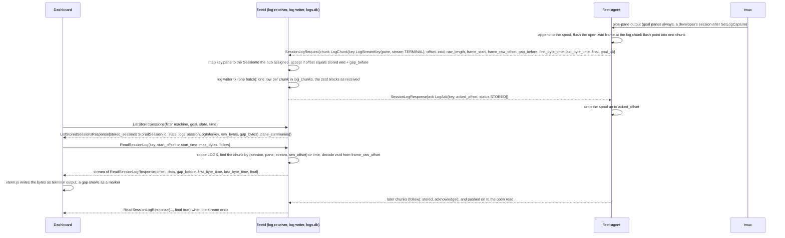

# 02b. Hub API (`fleet.hub.v1`)

- Status: Accepted; contracts unfrozen until v0.1 (ADR 0019)
- Date: 2026-10-02
- Part of: [02-contracts.md](02-contracts.md)
- Inputs: [03-workflows.md](03-workflows.md) and 03b–03f and 03h–03l,
  [ui-contract-map.md](ui-contract-map.md), the mockup, ADRs
  [0003](../adr/0003-transport-grpc.md), [0004](../adr/0004-agent-connectivity.md),
  [0008](../adr/0008-goal-consent-and-account-modes.md),
  [0009](../adr/0009-machine-groups-and-layered-settings.md),
  [0017](../adr/0017-contract-packages.md)
- Output: `api/fleet/hub/v1/*.proto` and
  [ADR 0018](../adr/0018-hub-api-and-contract-amendments.md)
- Second half (routines, goals, logs, accounts, config, audit actions):
  [02m](02m-hub-api-actions-and-audit.md)
- Companions: [02c](02c-hub-watch-and-filters.md) (Watch, filter grammar and
  fields), [02d](02d-hub-authz.md) (principals, scopes per RPC and topic,
  approvals, the role the agent sees), [02e](02e-contract-rules.md) (naming
  rules, codegen, freeze), [02f](02f-hub-authentication.md) (sign-in, tokens,
  devices, Host and Origin checks, terminal over WebSocket),
  [02g](02g-agent-security.md) (enrollment trust, hub identity, machine revoke,
  agent role matrix)

`FleetService` is the only API the web UI, the `fleet` CLI and a later phone
app use. It is served by `fleetd` over gRPC, gRPC-Web and Connect JSON from
the same handlers (ADR 0003). The agent wire (`fleet.agent.v1`) stays
between `fleetd` and `fleet-agent`; no hub API message embeds an agent wire
type. The hub API imports `fleet.type.v1` (ids, values) and
`fleet.integration.v1` (the provider-neutral work model), never
`fleet.agent.v1`.

## Resources

| Resource | Id | RPCs | Watch topic | Views |
|---|---|---|---|---|
| `Machine` | `MachineId` | List, Get, Update, Drain, Undrain, Revoke, Delete, CreateEnrollmentToken, EnsureMachineHooks | `MACHINES` | Machines |
| `Session` (windows, panes) | `SessionId` (hub-assigned to every observed session) | List, Get, Create, SendKeys, InterruptPane, RunHarnessCommand, CapturePane, SetPaneAvailability, RespawnPane, KillWindow, SetLogCapture, CreateAttachTicket, AttachTerminal, ReadSessionLog | `SESSIONS` | Session, ⌘K |
| `PaneSummary` | `PaneKey` | Watch only (live panes) | `PANE_SUMMARIES` (latest-wins) | Session sidebar |
| `StoredSession` (logs and archived pane summaries, live or ended) | `SessionId` | ListStoredSessions, GetStoredSession, DeleteSessionLogs, SearchSessionLogs, GetLogStoreStatus (all `LOGS`) | none | Session History, Settings |
| `Goal` | `GoalId` | List, Get, StartGoal, PreflightGoal, ControlGoal, ListGoalRuns, ListGoalTransitions | `GOALS` | Work, Session, Triage |
| `WorkItem`, `ChangeRequest` (mirrors) | `WorkItemKey` | List, Get, RequeueWorkItem | `WORK_ITEMS`, `CHANGE_REQUESTS` | Work |
| `Repo` (per-repository settings) | `RepoId` (`host/path`) | List, Get, Create, Update, Delete | `REPOS` | Settings, Work |
| `Integration` | `IntegrationId` | List, Update | `INTEGRATIONS` | Settings |
| `Account` (usage, pacing, probe) | `AccountId` | List, Get, Create (API-key only), Update, Delete, ProbeAccount, ListUsageReadings | `ACCOUNTS` | strip, Usage, Machines, Work dispatch |
| `TriageItem` | `TriageItemId` | List, Get, Snooze, Dismiss | `TRIAGE` | Triage |
| `Approval` | `ApprovalId` | List, Get, DecideApproval | `APPROVALS` | Triage, phone |
| `Routine` | `RoutineId` | List, Get, Create, Update, Delete, RunRoutine | `ROUTINES` | Work, Settings |
| `Settings` (fleet, group, machine layers) | `SettingsId`: `"fleet"`, `"group/<label>"`, `"machine/<id>"` | Get, List, Update | `SETTINGS` | Settings |
| `AuditEntry` | `AuditEntryId` | List | `AUDIT` | Machines, Session timeline |
| `Device` | `DeviceId` | RequestPairing, ApprovePairing, RevokeDevice, List, Get | `DEVICES` | Settings |
| `User` | `PrincipalId` | List, CreateUserInvite, Update, RedeemInvite, Begin/FinishPasskeyRegistration, DeletePasskey | none (List only) | Settings |
| `LoginSession` | `LoginSessionId` | SignOut, List, Revoke, Begin/FinishPasskeyLogin | none (List only) | Settings |
| `ApiToken` | `ApiTokenId` | Create, List, Revoke | none (List only) | Settings |
| `NotificationTarget` | `NotificationTargetId` | List, Create, Update, Delete | `NOTIFICATION_TARGETS` | Settings |
| `Operation` | `CommandId` | GetOperation | `OPERATIONS` | every action |
| `FleetSummary` | singleton | GetFleetSummary | `FLEET_SUMMARY` (≤ 1/s) | summary strip |
| Insights: rollups, `InsightReport`, `Suggestion`; `SystemStatus` (singleton) | `InsightReportId`, `SuggestionId` | GetInsights, ListInsightReports, GetInsightReport, ListSuggestions, DismissSuggestion, GetSystemStatus ([05](05-insights.md), [05b](05b-observability.md)) | none (re-read) | Usage, Insights, Machines (System) |

Plus `GetServerInfo` (API version, `fleet_id`, `hub_instance_id`, features,
`auth_mode`, `sign_in_methods`, `claim_pending`, the caller and its scopes),
`ExportConfig` and `ImportConfig` (below) and `GetStoreStatus`. Which release
serves each RPC and Watch topic: [02k](02k-v1-surface-and-cli.md).

**Authentication** (how a browser, the CLI and a phone prove who they are, the
claim URL, the credential carriers, Host and Origin checks) is
[02f](02f-hub-authentication.md); the hub API only says who may call what
([02d](02d-hub-authz.md)).

**Identity of a work item.** `WorkItemKey{integration, kind, project, key,
provider_name}` is the identity: two keys name the same item exactly when all
five fields are equal (`provider_name` only matters when `integration` is
empty, as for routine runs). It is the id of `WorkItem` and `ChangeRequest`,
the input of every Get, and the dedupe key on a client (canonical string in
`type/v1/work.proto`). `WorkItemRef` is the key plus the derived fields `url`,
`display` and `provider`; hub APIs ignore the derived fields on input and fill
them on output, and a client never compares two refs as whole messages. The
change-request mirror is keyed the same way (`kind = CHANGE_REQUEST`, `project`
the repo path), which 03f now says too.

## Conventions

- **Resource shape.** Field 1 is the id, 2 `version`, 3 `create_time`, 4
  `update_time`; resource fields start at 10. Ids are wrapper messages like
  the shared ones (`SettingsId`, `PrincipalId` included).
- **Spec and status.** A resource a person can edit, or that carries observed
  state, splits into two messages (table below):
  - `spec` (field 10) is what the owner or the hub decided: names, labels,
    mode, consent, triggers, the grant a device holds. `version` covers it,
    `expected_version` checks it, `update_time` is its last change.
  - `status` (field 11) is what was observed or computed: connection state,
    facts, inventories, usage, pacing, health, the goal's phase. It is
    output-only, never versioned and never checked by `expected_version`. It
    starts with `observed_time` (when the hub last changed it) and `hub_seq`
    (the Watch sequence of that change), which order it for Watch dedupe
    ([02c](02c-hub-watch-and-filters.md#watch)).
  - Resources with nothing observed (`NotificationTarget`, `AuditEntry`) or
    nothing editable (`TriageItem`, `Approval`, `Operation`, mirrors,
    summaries) have no split. Decision records (`TriageItem`, `Approval`)
    version every state change, because their actions guard on it; mirrors
    (`WorkItem`, `ChangeRequest`) bump `version` when their content changes,
    never for a sync that found nothing new.
- **Which resource is split.**

| Resource | `spec` | `status` |
|---|---|---|
| `Machine` | `display_name`, hub `labels`, `drain` request | state, facts, inventories, effective settings, `telemetry`, `unfit` markers |
| `Account` | name, mode, budget, reserve, consent, owner-mapped bindings | identity as shown, provider, origin, usage, pacing and `idle_causes`, probe, observed bindings |
| `Goal` | `GoalDefinition`: what, where, consent, text, attempt, routine snapshot | `GoalStatus`: phase and reason, timers, goal-file line, git state, counters, start and end time, usage |
| `Repo` | `enabled`, per-repo `auto_dispatch` (overrides `HubSettings`), consent, parallel cap, worktree mode, branch pattern, base branch, hooks mode, tracker mapping, trusted gate (label, `TrustedUser{integration, login}` entries) | integration health, live goals, checkouts and their hooks, why it takes no work |
| `Session` | `log_capture` | tmux identity, windows, panes, attach count, log counters, `state` (live or ended) and `end_time` |
| `Routine` | trigger, goal template, consent, done rule | last and next run, run count |
| `Integration` | label, watched tracker projects | provider, capabilities, health and `health_reason`, last provider error, rate limits, back-off time, sync lag |
| `Settings` | scope, values, priority, hub settings | generation and epoch delivered |
| `Device` | name, platform, key, requested and granted scopes, approval, revocation | `last_seen_time` |
| `User` | name, role, GitHub allow-list entry, disabled | state, passkeys, GitHub link, last sign-in |
| `LoginSession`, `ApiToken` | owner, method or scopes, expiry, revocation | `last_used_time` (and address) |

- **Update.** `update_mask` (`google.protobuf.FieldMask`, field names of the
  resource, e.g. `spec.display_name`) is required; an empty mask is
  `INVALID_ARGUMENT`, never "replace all". Output-only fields (`id`,
  `version`, times, everything under `status`) and fields outside the updatable
  list in the request comment are `INVALID_ARGUMENT` / `UPDATE_MASK_INVALID`
  with a `FieldViolation` per path.
- **List.** `page_size` (default 50, max 500, `int32`), `page_token` (opaque,
  valid for 10 min, from the same query), `filter` and `order_by` (grammar and
  the fields per resource: [02c](02c-hub-watch-and-filters.md)).
  Responses carry `next_page_token`, empty on the last page. Pages are
  consistent per resource version, not a snapshot of the whole store; use
  Watch with `send_initial` for a consistent view.
- **Actions** (custom methods) take the resource id and, where the outcome
  depends on state, `expected_version` (spec) or, for a goal, `expected_phase`.
- **Untrusted text** from screens, goal files, repos and providers is marked
  in the proto comments and rendered as text, never as markup.
- **Naming.** Timestamps end `_time`, durations are `Duration` or end in a
  unit, enums replace closed string sets (02e).

## Idempotency

Every mutating RPC takes `request_id`, a client-generated key (UUIDv4 or
ULID, at most 64 bytes). The hub stores `(principal id, request_id) →
response` for 24 h. The unauthenticated `RequestPairing` is keyed by
`(peer address, public key)` (it takes no `request_id`) and `RedeemInvite` by `(peer address, SHA-256 of
the invite token)`; the passkey ceremonies take no `request_id` (a `Begin` only
mints a 5-minute ceremony, and the single-use `ceremony_id` of a `Finish` is its
key):

- same key, same request body → the stored response, including the same
  `Operation` and `command_id`; nothing is sent to an agent twice;
- same key, different body → `ALREADY_EXISTS` with `REQUEST_ID_CONFLICT`;
- missing key → `INVALID_ARGUMENT` / `REQUEST_ID_MISSING`.

**Secrets are never stored in the idempotency record.** The enrollment token,
an invite token, an API token secret, an attach ticket, the pairing code and a
push handle are left out of the stored response. A replay of
`CreateEnrollmentToken`, `CreateUserInvite`, `CreateApiToken` or
`CreateAttachTicket` therefore fails with `ALREADY_EXISTS` /
`SECRET_ALREADY_DELIVERED` and the caller creates a new one; a replay of
`RequestPairing` returns the pending device and a recomputed code.

Clients retry network failures with the same `request_id`. A new user
intent (a second click after a result) gets a new key. `SendKeys` and prompt
answers are additionally guarded on the agent (`UNKNOWN_OUTCOME` is never
retried) and by the hub's one-answer-in-flight rule per `prompt_id` (03d).

## Versions and ETags

`version` starts at 1 and increases by 1 on every committed change to the
resource's **spec** (or, on a resource without a split, to any of its
fields); it is the resource's ETag. `expected_version = 0` skips the check;
any other value must equal the current version, else `FAILED_PRECONDITION`
with `VERSION_MISMATCH` and `metadata["current_version"]`.

`status` never bumps `version`. A heartbeat, a probe, a pacing evaluation, a
settings delivery acknowledgement, a goal changing phase or a device pinging
changes only `status`, so a form loaded at version N is not made stale by
them, and approving or revoking a device that keeps pinging cannot conflict
with itself. Settings delivery acks (`generation`, `settings_epoch`) are
status and do not bump `Settings.version`.

`DecideApproval` requires a non-zero `expected_version`, so a decision always
names the state that was shown. When an approval is both stale and closed,
`APPROVAL_CLOSED` wins over `VERSION_MISMATCH` (the phone shows "already
decided", not "reload"). Actions that depend on a goal's phase pass
`ControlGoalRequest.expected_phase`; a mismatch is `FAILED_PRECONDITION` /
`GOAL_PHASE_CHANGED`.

Clients order Watch messages by `(version, status.hub_seq)`; see
[02c](02c-hub-watch-and-filters.md#watch). Status that changes at heartbeat
rate is coalesced before it reaches Watch (same file, "Volatile fields").

## 64-bit integers

`version`, `expected_version`, `hub_seq`, byte counts and log offsets are
64-bit. The Connect JSON form (ADR 0016) writes them as **decimal strings**
(`"version": "7"`), and a parser must accept a string or a number. Generated
TypeScript (`protoc-gen-es` v2, `buf.gen.yaml`) types them as `bigint`; the
UI keeps them as opaque `bigint` values, compares and echoes them back, does no
arithmetic on them, and serializes messages with the generated `toJson`, never
`JSON.stringify` (which throws on `bigint`). No `jstype` option is used, so
the generated types and the JSON form stay as protobuf defines them. Fixtures
and the mockup use strings for these fields.

## Operations

An action that makes an agent do something returns an `Operation` at once
(state `PENDING`), never the final state. `Operation.id` is the agent
command's `CommandId`, so the UI, the audit log and the agent's local log
name the same thing. The operation follows the outbox: `PENDING` →
`DELIVERED` (`CommandAck`) → `RUNNING` (progress, local confirmation) →
`DONE` with `status` and, if not OK, `error` (`ErrorDetail`). Expiry
(`not_after_time`) ends it `DONE / EXPIRED` ("not delivered, machine was
offline"). Results that carry text (CapturePane, OBSERVE harness commands,
the preflight goal-line preview) land in `output_text` (requester and `LOGS` holders only). The effects show up
on their own resources (a new window on the `Session`, the goal's `phase`).
`Operation.kind` is an `OperationKind` enum numbered like the agent's
`Command.kind` arms, so a command kind and its operation share one number.

| Hub RPC | Agent command (02-contracts.md) |
|---|---|
| `CreateSession` | `EnsureSession` |
| `SendKeys`, `InterruptPane`, `RespawnPane`, `KillWindow`, `CapturePane`, `RunHarnessCommand`, `SetPaneAvailability`, `SetLogCapture` | the kind of the same name |
| `CreateAttachTicket` | none (hub only) |
| `AttachTerminal` | `OpenAttach` / `CloseAttach` + the `Terminal` stream |
| `RevokeMachine` | none to the agent but `Bye{REVOKED}` on its live stream ([02g](02g-agent-security.md#machine-lifecycle-revoke-and-delete)) |
| `StartGoal`, `RunRoutine` | `StartGoal` (after hub checks; `Preflight` inside the composite) |
| `PreflightGoal` | `Preflight` |
| `ControlGoal` | as `MachineHarness.goal_control` says: `RunHarnessCommand{/goal …}`, `Interrupt`, or `SendKeys{GOAL_RESUME}`; `NOT_DONE` and `EDIT` on a finished goal re-arm it (below); `RECHECK` and `MARK_NOT_STARTED` are hub-only |
| none (hub-internal) | `RegisterGoal`, `ReleaseGoal` (registry reconciliation, [02h](02h-goal-binding-and-pane-signals.md#goal-registry)) |
| `DecideApproval` | `SendKeys{purpose PROMPT_ANSWER, answering_prompt}` for prompts; the confirmed command otherwise; nothing for deny |
| `DrainMachine`, `UndrainMachine` | `Drain`, `Undrain` |
| `EnsureMachineHooks` | `EnsureGoalHooks`, one per `(harness, checkout)` it expands to |
| `ControlGoal` `NOT_DONE`, `EDIT` on a finished goal | `StartGoal` with `rearm_reason` for the same goal id (03h) |
| sign-in, user, token and login-session RPCs | none (hub only) |
| `ProbeAccount` | `EnsureProbe{run_now}` |

## Watch

`Watch(WatchRequest{subscriptions[]{topic, filter, send_initial}, resume_token})`
is one server stream per client view, with one filter per topic. Changing the
subscription opens a new stream with the last `resume_token`; unchanged
subscriptions resume, new or changed ones start with their initial state, and
`RESYNC_REQUIRED` is only for a token the hub cannot honour. The rules, the
filter grammar and the filterable fields of every resource are in
[02c](02c-hub-watch-and-filters.md); the scope each topic needs is in
[02d](02d-hub-authz.md).

## Reading a stored session log

Shipping (agent to hub) and replay (dashboard to hub) as messages. The rules are
in [03d](03d-triage-sessions-logs.md) (W9).

## Principals, scopes and approvals

Every call runs as a `Principal`; roles map to six scopes (`READ`,
`SESSIONS_WRITE`, `APPROVALS`, `SETTINGS`, `ADMIN`, `LOGS`) and every RPC and
Watch topic names its scope. `LOGS` (stored or scrolled-back terminal history, including `CapturePane` history lines) is owner-only unless the owner grants it
(`UserSpec.extra_scopes`, or a ticked scope on a token or device; ADR 0019). No credential or grant goes above the caller's scopes or comes from a token or device (02d). Pairing, approvals and the self-service rules are in
[02d](02d-hub-authz.md); the sign-in flows are in
[02f](02f-hub-authentication.md).

## Size limits

Hub requests are bounded so validation, JSON clients and abuse limits do not
depend on each implementation. Strings are UTF-8 with control characters
stripped (except `\n` and `\t` in multi-line text). An over-limit field is
`INVALID_ARGUMENT` / `FIELD_TOO_LARGE` with a `FieldViolation` on the field.
Whole messages stay under the 1 MiB Connect cap (02e).

| Item | Cap |
|---|---|
| `request_id` | 64 bytes |
| `page_token`, `resume_token` | 4 KiB |
| `filter` | 4 KiB, 32 terms, depth 4, 200 values per `in` |
| `order_by` | 256 bytes, 3 fields |
| `update_mask` | 32 paths |
| `Watch` subscriptions | 18, one per topic |
| `display_name`, `window_name`, session `name`, labels | 128 bytes (`CreateSessionRequest.name` also 32 by its pattern); 32 labels of 64 bytes |
| `CreateEnrollmentTokenRequest.machine_name`, `expected_hostname` | 128 bytes (a display name; a control or invisible format character, such as a direction override or zero-width space, is refused with `INVALID_NAME`, not stripped); 253 bytes of letters, digits, `.`, `-` and `_` |
| `DrainMachineRequest.reason`, `DismissTriageItemRequest.note` | 512 bytes |
| `GoalDefinition.goal_text`, `ControlGoalRequest.text`, `RoutineSpec.goal_text_template` | 4 KiB |
| `SearchSessionLogsRequest.query` | 256 bytes; 256 MiB of raw text scanned per call; `snippet` 512 bytes |
| `RepoSpec.branch_pattern` | 128 bytes; `trusted_gate.users` 64 entries of 64 bytes; `tracker_projects` 64 |
| `FleetConfig` | the 1 MiB message cap; `ImportConfig` plan lines 2000 |
| `GoalSpecInput.dispatch_reason` (in `StartGoalRequest.input`) | 512 bytes |
| `SendKeysRequest.keys` | 64 entries; literal text 4 KiB in total |
| `RunHarnessCommandRequest.args` | 4 KiB |
| `AttachTerminalRequest.input` | 4 KiB per message |
| `DeviceSpec.public_key` | 32 bytes (raw Ed25519) |
| `options_json`, `credential_json` (WebAuthn) | 16 KiB each |
| `UserSpec.display_name`, `ApiTokenSpec.name`, `PasskeyInfo.name` | 128 bytes; `github_login` 39 bytes |
| `CreateApiTokenRequest.scopes` | 6 entries; `ttl` at most 365 days |
| `AttachTerminalRequest` frame (WebSocket) | 8 KiB; response frame 66 KiB |
| `NotificationTarget.push_handle` | 4 KiB |
| `ChatBinding.provider`, `ChatBinding.destination` | 64 and 256 bytes |
| `ConsentAct` list | 3 distinct values |
| `ErrorDetail.metadata` | 16 entries of 256 bytes; `violations` 16 |
| `Operation.message` | 1 KiB; `output_text` 256 KiB (capture), 64 KiB (commands) |
| `Approval.preview` | 2 KiB |
| `PaneSummary.last_lines` | 4 KiB |
| `AttachTerminalResponse.output` | 64 KiB per message; `ReadSessionLogResponse.data` 256 KiB |
| `ListXxxRequest.page_size` | 500 |
| Rate limits | per principal and RPC class, values in the hub configuration ([02j](02j-hub-runtime.md)), never in the contract; `RATE_LIMITED` carries `retry_after` |

## Errors

RPC failures use gRPC/Connect codes with a `fleet.type.v1.ErrorDetail`
(`reason`, `retryable`, `retry_after`, `metadata`, `violations`) in the error
details. `violations` is a list of `FieldViolation{field, reason,
description}`, one per bad field, so a form can mark the field; `field` is a
path from the request (`update_mask.paths[0]`, `spec.display_name`, `filter`).
Agent command failures are not RPC errors: the RPC succeeds with an
`Operation`, which ends with the agent's `Status` and `ErrorDetail`.

| Code | When | `reason` |
|---|---|---|
| `INVALID_ARGUMENT` | bad field, name rule, over a size limit, bad mask, filter or order; unknown, used or expired invite; expired WebAuthn ceremony | `INVALID_ARGUMENT`, `INVALID_NAME`, `FIELD_TOO_LARGE`, `REQUEST_ID_MISSING`, `UPDATE_MASK_INVALID`, `FILTER_INVALID`, `ORDER_BY_INVALID`, `PAGE_TOKEN_INVALID`, `RESUME_TOKEN_INVALID`, `INVITE_INVALID`, `PASSKEY_CEREMONY_INVALID` |
| `NOT_FOUND` | unknown id, or one the caller's scopes hide | `RESOURCE_NOT_FOUND` |
| `ALREADY_EXISTS` | `request_id` reused with another body; create of an existing name; a one-time secret already handed out | `REQUEST_ID_CONFLICT`, `RESOURCE_ALREADY_EXISTS`, `SECRET_ALREADY_DELIVERED` |
| `FAILED_PRECONDITION` | `expected_version` or `expected_phase` mismatch; approval already decided or expired; goal action the harness lacks; machine offline for an attach or capture; pairing code wrong or expired; delete of a machine not revoked, or a command for a revoked one; sign-in RPC in `local_trusted` mode; a change that removes the last sign-in method or owner; the dispatch and goal reasons 540 to 562 (`status.proto`): a dispatch `BLOCK` reason, unacknowledged warnings, a goal action not allowed (or held while a person types), an account in use, a log stream open, a requeue not allowed, an invalid config | `VERSION_MISMATCH`, `GOAL_PHASE_CHANGED`, `APPROVAL_CLOSED`, `GOAL_SUBCOMMAND_UNSUPPORTED`, `MACHINE_OFFLINE`, `PAIRING_CODE_MISMATCH`, `PAIRING_EXPIRED`, `MACHINE_NOT_REVOKED`, `MACHINE_NOT_REENROLLABLE`, `MACHINE_REVOKED`, `SIGN_IN_METHOD_DISABLED`, `LAST_CREDENTIAL`, `WORK_ITEM_UNTRUSTED` … `CONFIG_INVALID` (540 to 562), `PREFLIGHT_WARNINGS_UNACKNOWLEDGED`, `GOAL_ACTION_NOT_ALLOWED`, `ACCOUNT_IN_USE`, `LOG_STREAM_OPEN`, `REQUEUE_NOT_ALLOWED` |
| `PERMISSION_DENIED` | scope or role missing; device not active; a grant above the grantor's own scopes, or a token or device minting a credential; Host or Origin not allowed (HTTP 403); attach ticket bad; GitHub account not on the allow-list | `SCOPE_MISSING` (`metadata["scope"]`), `ROLE_INSUFFICIENT`, `DEVICE_NOT_ACTIVE`, `SCOPE_NOT_GRANTABLE`, `HOST_NOT_ALLOWED`, `ORIGIN_NOT_ALLOWED`, `ATTACH_TICKET_INVALID`, `GITHUB_NOT_ALLOWED` |
| `UNAUTHENTICATED` | no, bad or expired credentials; a failed passkey assertion | `CREDENTIALS_INVALID`, `CREDENTIALS_EXPIRED` ("sign in again") |
| `RESOURCE_EXHAUSTED` | per-principal rate limit | `RATE_LIMITED` with `retry_after` |
| `UNAVAILABLE` | hub starting or store busy | `retryable = true` |

**Precedence.** When several apply, the hub reports the first of:
`UNAUTHENTICATED`, `PERMISSION_DENIED`, `NOT_FOUND`, `INVALID_ARGUMENT`,
`ALREADY_EXISTS`, then `FAILED_PRECONDITION` with `APPROVAL_CLOSED` before
`GOAL_PHASE_CHANGED` before `VERSION_MISMATCH`, then `RESOURCE_EXHAUSTED`.
A caller whose scopes hide a resource gets `NOT_FOUND`, so ids cannot be
probed. A page, resume or filter token the hub no longer accepts is
`INVALID_ARGUMENT` with the reason above; a well-formed resume token the hub
simply cannot continue from is `RESYNC_REQUIRED` on the stream, not an error.

**WebSocket attach.** A browser attach cannot read a Connect error trailer.
Before the upgrade, missing or bad credentials and a disallowed `Host` or
`Origin` are plain HTTP 401 and 403 responses with a Connect error body. After
it, a refused or failed attach is sent as `AttachClosed{reason: ERROR, error}`,
with the same `ErrorDetail` as an RPC error, and then the socket closes with the
code in [02f](02f-hub-authentication.md#terminal-attach-over-websocket), which
also has the endpoint, subprotocol, ticket, framing and ack rules.
