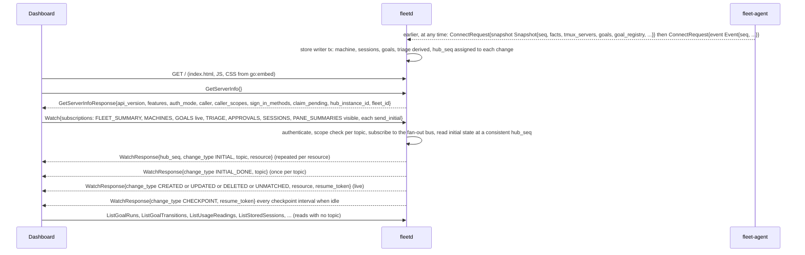

# 02c. Hub API: Watch, filters and field catalogue

- Status: Accepted; contracts unfrozen until v0.1 (ADR 0019)
- Date: 2026-10-02
- Part of: [02-contracts.md](02-contracts.md), [02b-hub-api.md](02b-hub-api.md)
- Output: `api/fleet/hub/v1/watch.proto`, the `filter` and `order_by` fields of
  every List request
- Review: `watch-subscription-model`, `watch-filter-resume-contradiction`,
  `volatile-fields-in-watched-resources`, `filter-grammar-and-field-catalogue`
  in [the contract review](../reviews/2026-10-02-contract-review.md)

## Watch

`Watch(WatchRequest{subscriptions, resume_token})` is one server stream per
client view (a browser tab, a CLI `fleet watch`). A browser opens one durable
stream per tab (ADR 0016) and puts every topic the view needs in it.

A **subscription** is `TopicSubscription{topic, filter, send_initial}`: one
topic, its own filter (grammar below), and whether to send the current state
first. At most one per topic. An empty list means every topic the caller's
scopes allow ([02d](02d-hub-authz.md)) except `PANE_SUMMARIES`, unfiltered,
with `send_initial`. A filter names fields of that topic's resource only; a
field the topic does not have is `INVALID_ARGUMENT` / `FILTER_INVALID`, never
ignored, so a sidebar filter cannot leak into the goal or triage topics.

- **Order.** `hub_seq` is the hub-wide sequence of committed changes in
  commit order, increasing within one `hub_instance_id`; gaps are normal.
  Per resource, changes arrive in order.
- **Initial state.** A subscription with `send_initial` first delivers every
  matching resource as `INITIAL`, then one `INITIAL_DONE` carrying the
  topic, then live changes, with no gap between them. `INITIAL_DONE` is per
  topic, so a slow topic does not hold up the others.
- **Leaving a filter.** When a change makes a resource stop matching the
  subscription's filter, the hub sends it once as `UNMATCHED` with its
  current state, so the client drops it without treating it as deleted.
- **Dedupe.** A message supersedes the client's copy when `version` is
  greater, or equal and `status.hub_seq` is greater (resources without a
  status compare `version` only). Equal or older messages (a replay after
  resume) are dropped. After a `fleetd restore` both `version` and
  `status.hub_seq` can be lower than a client's cached copy (03f), so a
  client drops its copies on `RESYNC_REQUIRED` or `HUB_RESTARTED` before
  the new `INITIAL` messages arrive, or keys its dedupe on
  `hub_instance_id` as well (plan row 12).
- **Checkpoints.** Every message carries a `resume_token`. An idle stream
  gets `CHECKPOINT` (new token, no resource) every checkpoint interval ([defaults](defaults.md)), which doubles as a
  keepalive.

### A dashboard load, as messages

The dashboard never talks to an agent. Everything the hub returns here was stored earlier from
agent snapshots and events. The hub subscribes to its fan-out bus **before** it reads the
initial state at one `hub_seq`, then replays live changes after that number, so nothing
falls in the gap. Reads with no Watch topic (run history, usage readings, stored logs,
users, tokens) are plain `List` and `Get` calls; a `List` page is consistent per resource
version but is not a snapshot of the whole store, so use `Watch` with `send_initial` when a
consistent view matters.



### Changing the subscription

The subscription lives in the request, so changing it means opening a new
stream with the last `resume_token` and the new list, then closing the old
one (the overlap is covered by dedupe). This is the only way, because a
browser cannot stream a request body.

The token names a position (`hub_instance_id`, `hub_seq`) and the
subscriptions it covers (topic plus a hash of its filter). For each
subscription of the new request:

| Subscription | What the hub does |
|---|---|
| In the token (same topic, same filter) | replays changes after the token's `hub_seq` from the change log, then live; with `send_initial` also sends the initial state |
| Not in the token (new topic or changed filter) | sends the initial state if `send_initial`, otherwise live only from the moment the stream opens |
| Topic dropped | nothing; no message |

So scrolling a session sidebar changes only the `PANE_SUMMARIES` filter:
that topic restarts with `send_initial`, every other topic resumes, and no
`RESYNC_REQUIRED` is sent. The visible-pane filter is
`session in ("s-1", "s-2", …)` (or `machine = "m-12"`): a pane is filtered
by its session or machine, never by `PaneKey`. `PaneKey` has a canonical string
form (`ids.proto`) for coalesce keys and `FLEET_PANE_KEY`, but it is not a filter
field.

### Resume and `RESYNC_REQUIRED`

The hub keeps a bounded change log (at least 10 minutes or 100,000 changes).
A resume inside it continues after the token, possibly repeating changes the
client already has. `RESYNC_REQUIRED` (then the stream closes) is sent **only**
when the token cannot be honoured, and says why in `resync_reason`:
`TOKEN_TOO_OLD` (outside the log), `HUB_RESTARTED` (`hub_instance_id`
changed), `FELL_BEHIND` (the client lagged on a never-dropped topic), or
`SCOPES_CHANGED` (the caller's scopes changed; reopen to see what is still
allowed). A changed subscription is never a reason. A token that does not
parse is `INVALID_ARGUMENT` / `RESUME_TOKEN_INVALID` at open. After
`RESYNC_REQUIRED` the client reopens with `send_initial` on every
subscription and no token.

### One change, from the harness to the screen

A goal file changes, the agent sends an `Event`, the store writer commits it (deriving goal
and triage state in the same transaction), and the fan-out bus delivers it to each matching
`Watch`. One transaction can produce several changes (a goal and its triage item); per
resource they arrive in order. After a drop the client reopens with the last `resume_token`;
`RESYNC_REQUIRED` comes only when the hub cannot honour that token.

```mermaid
sequenceDiagram
  participant D as Dashboard
  participant H as fleetd
  participant A as fleet-agent
  participant T as tmux and harness
  T->>A: goal file changes (the harness hook wrote BLOCKED or DONE)
  A->>H: ConnectRequest{event Event{seq, observed_time, delivery NEVER_DROP, goal_state GoalState}}
  H->>H: reader checks size, machine id = certificate, order, then the ingest queue
  H->>H: store writer tx (one batch): goal fingerprint, phase, transition, triage, history
  H->>H: in the commit tx: hub_seq assigned, change log appended; after commit: fan-out bus publishes
  H-->>D: WatchResponse{hub_seq, change_type UPDATED, topic GOALS, goal, resume_token}
  H-->>D: WatchResponse{change_type CREATED, topic TRIAGE, triage_item, resume_token} (a new item in the same tx)
  H-->>D: WatchResponse{change_type UPDATED, topic FLEET_SUMMARY} at most once per summary interval
  D--xH: network drops, the stream ends
  D->>H: Watch{subscriptions (same), resume_token = last seen}
  H-->>D: changes after the token replayed from the change log, then live
  H-->>D: WatchResponse{change_type RESYNC_REQUIRED, resync_reason} then the stream closes (only when the token cannot be honoured)
  D->>H: Watch{subscriptions with send_initial, no resume_token}
```

### Delivery classes

| Class | Topics | Rule |
|---|---|---|
| Latest-wins, not replayed | `PANE_SUMMARIES` | a slow client loses intermediate summaries, never the latest; never in the change log, so a resume re-sends the current summary of each matching pane as `INITIAL` |
| Coalesced | `FLEET_SUMMARY` | at most one per second; a resume re-sends the current value |
| Never dropped | every other topic | instead of dropping, the hub sends `RESYNC_REQUIRED` / `FELL_BEHIND` |

This matches 03f's fan-out rule (summaries shed first, goal, triage and
command notices re-read). Filtering `PANE_SUMMARIES` to the visible panes
keeps browser fan-out near 140 KB/s at A50 instead of 2 MB/s (04's load model).
Revoking a device or token closes its streams.

### Volatile fields

`version` covers the spec only and a status never bumps it
([02b](02b-hub-api.md#versions-and-etags)), but a status still has to reach
Watch. Fields that change at heartbeat or probe rate would turn the topic
into a firehose, so each status marks them. When a change touches only
volatile fields, the hub sends at most one Watch message per resource per
interval and the message carries the latest values; a change to any other
field is sent at once and includes the current volatile values. Volatile
values are held in memory and the change log stores the coalesced message.

| Resource | Volatile fields | Interval |
|---|---|---|
| `Machine` | `status.telemetry.*` (last seen, load, memory, disk, spool, battery, clock skew, `agent_health`), `status.unfit[].next_check_time` | 30 s |
| `Routine` | `status.dispatch_block` (recomputed each scheduler pass) | 30 s |
| `Account` | `status.pacing.ahead_points`, `rank`, `projected_unused_percent`, `idle_causes` (rewritten at every scheduler evaluation) | 30 s |
| `WorkItem`, `Repo` | `dispatch_block`, `status.dispatch_block` (recomputed each scheduler pass) | 30 s |
| `Session` | `status.attached_clients`, `status.windows[].panes[].activity`, `last_input_time`, `ready_pattern_showing`, `status.logs[]` counters | 5 s |
| `Goal` | `status.first_line`, `status.head_commit`, `status.usage_consumed` | 5 s |
| `Device` | `status.last_seen_time` | 30 s |
| `Integration` | `status.last_sync_time`, `status.sync_lag`, `status.rate_limits` | 30 s |

State changes are not volatile and are sent at once: a machine going `STALE`,
a goal changing `phase`, a pane going from `ACTIVE` to a dead pane, a pacing
`state` change. The `Settings` delivery fields are not volatile either; they
change once per delivery.

## Filter grammar

`filter` is an AIP-160 subset. Anything outside it is `INVALID_ARGUMENT` /
`FILTER_INVALID` with a `FieldViolation` on `filter` and the byte offset in
`metadata["offset"]`.

```
filter  = or
or      = and { "OR" and }
and     = not { "AND" not }          // adjacent terms are not an implicit AND
not     = [ "NOT" ] atom
atom    = "(" or ")" | field op value | field "in" "(" value { "," value } ")"
op      = "=" | "!=" | "<" | "<=" | ">" | ">=" | ":"
```

- Precedence: `NOT`, then `AND`, then `OR`; keywords are upper case.
- `:` is "has" for a repeated field (`label:"gpu"`); the other operators apply
  to scalar fields. `<` `<=` `>` `>=` only on numbers and timestamps.
- **Literals.** Strings are double-quoted with `\"` and `\\` escapes.
  Numbers are decimal. Booleans are `true` and `false`. **Enums are written
  by short name**, the value name without its enum prefix and unquoted:
  `phase = RUNNING` for `GOAL_PHASE_RUNNING`, `state in (ONLINE, STALE)`.
  **Timestamps** are RFC 3339 strings in UTC, quoted:
  `create_time > "2026-09-25T00:00:00Z"`.
- **Ids compare by value.** The filter name of an id field is the `.value`
  string: `machine = "m-12"`. A work item key compares as its canonical
  string (`WorkItemKey` in `type/v1/work.proto`); a repo as `host/path`.
- **Limits.** 4 KiB, 32 terms, nesting depth 4, 200 values in one `in` list.
- `order_by` is AIP-132: `"update_time desc, name"`; only the names in the
  catalogue, at most 3; default order is per List request (the proto comment).

The names below are the only filter and `order_by` names. **Derived** names
(computed from a repeated or nested field, marked D) have no resource field of
the same name; the path column says how the hub computes them. Every resource
also filters on `id` (the `.value` string; `in` allowed) and `create_time` and
`update_time` (spec change) as timestamps unless the row says otherwise.

## Field catalogue

`order_by` lists the sortable names; `ct` is `create_time`, `ut` `update_time`.

| Machine (`MACHINES`, `ListMachines`) | Path | Type | Operators |
|---|---|---|---|
| `name` | `spec.display_name` | string | `=` `!=` |
| `state` | `status.state` | `MachineState` | `=` `!=` `in` |
| `label` (D) | `status.labels` | repeated string | `:` |
| `harness` (D) | `status.harnesses[].harness.name` | repeated string | `:` |
| `draining` | `status.draining` | bool | `=` |
| `is_hub` | `status.is_hub` | bool | `=` |

`order_by`: `name`, `ct`, `last_seen_time` (`status.telemetry.last_seen_time`).
The default `ListMachines` order is display name.

Served so far (row 12 slices): `harness` and `is_hub` filters are refused
(`FILTER_INVALID`) until their store lands — the hub keeps no per-machine
harness inventory and no hub-machine link yet. `update_time` filters read as
`create_time` until `UpdateMachine` (row 13a) can move the version.

| Session (`SESSIONS`, `ListSessions`) | Path | Type | Operators |
|---|---|---|---|
| `machine` | `status.machine` | string | `=` `!=` `in` |
| `name` | `status.name` | string | `=` `!=` |
| `started_by_fleet` | `status.started_by_fleet` | bool | `=` |
| `harness` (D) | any pane's `harness.name` | repeated string | `:` |
| `goal` (D) | any pane's `goal` | repeated string | `:` |
| `available_for_work` (D) | any pane's `availability.available_for_work` | bool | `=` |
| `state` | `status.state` | `SessionState` | `=` `in` |

Unless the filter names `state`, `ListSessions` and the initial state of a
`SESSIONS` subscription return `LIVE` sessions only (`state = LIVE`).

`order_by`: `name`, `ct`.

Served so far (row 12 slices): `machine`, `name`, `started_by_fleet` and
`state` filters read the hub-started sessions each `CreateSession` stored;
`harness`, `goal` and `available_for_work` are refused (`FILTER_INVALID`)
until the pane mirror lands. Every stored row reads `LIVE` until the mirror
learns ends. The rows reflect the create record, not delivery: a session
whose command never reached its machine still reads `LIVE`; the create
call's `Operation` (`GetOperation`) tells whether it was delivered.

| PaneSummary (`PANE_SUMMARIES`, Watch only) | Path | Type | Operators |
|---|---|---|---|
| `session` | `session` | string | `=` `in` |
| `machine` | `machine` | string | `=` `in` |

| Goal (`GOALS`, `ListGoals`) | Path | Type | Operators |
|---|---|---|---|
| `phase` | `status.phase` | `GoalPhase` | `=` `!=` `in` |
| `machine` | `spec.machine` | string | `=` `in` |
| `account` | `spec.account` | string | `=` `in` |
| `repo` | `spec.repo` as `host/path` | string | `=` `in` |
| `routine` | `spec.routine` | string | `=` |
| `work_item` | `spec.work_item.key`, canonical string | string | `=` `in` |
| `session` | `status.session` | string | `=` |
| `phase_reason` | `status.phase_reason` | `GoalPhaseReason` | `=` `in` |
| `start_time` | `status.start_time` | timestamp | `<` `<=` `>` `>=` |
| `end_time` | `status.end_time` | timestamp | `<` `<=` `>` `>=` |
| `live` (D) | `status.phase` is ACTIVE or HELD (03c, "Phase classes") | bool | `=` |
| `attempt` | `spec.attempt` | number | `=` `>=` |
| `origin` | `spec.origin` | `GoalOrigin` | `=` `in` |

`order_by`: `ct`, `ut`, `phase_time` (`status.phase_time`), `start_time`. The
Machines timeline is `start_time < "<window end>" AND (end_time > "<window
start>" OR live = true)`: goals that ran in the window, including ones created
before it and ones still running. `create_time` is plan time and is not the
timeline.

Served so far (row 12 slices): `phase`, `machine`, `session`, `phase_reason`,
`origin`, `live`, `id` and the time filters read the observed goals the agents
reported; `account`, `repo`, `routine`, `work_item` and `attempt` are refused
(`FILTER_INVALID`) until the dispatch rows land. `live` follows the 03l
phase classes, so an open observed goal reads live; `create_time` is the
first sight, `update_time` the last observed change, and an open goal has no
`end_time`, so `end_time` comparisons match nothing until it closes. The
read reports the row's phase, reason and end over the stored status, so a
goal a snapshot drop ended reads `CLOSED` with its end_time. The
default `ListGoals` order is `start_time`.

| WorkItem (`WORK_ITEMS`, `ListWorkItems`) | Path | Type | Operators |
|---|---|---|---|
| `integration` | `id.integration` | string | `=` `in` |
| `kind` | `id.kind` | `WorkItemKind` | `=` `in` |
| `repo` (D) | `item.repos[]` as `host/path` | repeated string | `:` |
| `stage` | `stage` | `WorkStage` | `=` `!=` `in` |
| `state` | `item.state` | `WorkItemState` | `=` `in` |
| `trusted` | `trust.trusted` | bool | `=` |
| `label` (D) | `item.labels[].name` | repeated string | `:` |
| `goal` | `goal` | string | `=` |
| `manual_reason` | `manual_reason` | `WorkManualReason` | `=` `in` |

`order_by`: `ct`, `ut`, `provider_update_time` (`item.update_time`),
`dispatch_order` (the scheduler's order for READY items: oldest `create_time`
first, ties by canonical key; `desc` is not allowed).

Served so far (row 12 slices): `id` (the canonical key), `integration`,
`kind`, `repo`, `stage`, `state`, `trusted`, `label`, `manual_reason`,
`create_time` and `update_time` read the synced mirrors with the hub's
verdicts; `goal` is refused (`FILTER_INVALID`) until the dispatch rows
store the goal link. `update_time` filters read as `create_time` until a
later row stores the hub-change stamp; `provider_update_time` reads the
item's own update (0 when the mirror carries none). The default
`ListWorkItems` order is `ct`. `GetWorkItem` without `include_body`
returns the mirror with an empty body; `include_body` answers unimplemented
until a row builds the provider fetch.

| ChangeRequest (`CHANGE_REQUESTS`, `ListChangeRequests`) | Path | Type | Operators |
|---|---|---|---|
| `integration` | `id.integration` | string | `=` `in` |
| `repo` | `change_request.repo` as `host/path` | string | `=` `in` |
| `state` | `change_request.state` | `WorkItemState` | `=` `in` |
| `goal` | `goal` | string | `=` |
| `owned` (D) | `goal` is set | bool | `=` |

`order_by`: `ct`, `ut`, `provider_update_time` (`change_request.update_time`).

Served so far (row 12 slices): `id` (the canonical key), `integration`,
`repo`, `state`, `create_time` and `update_time` read the synced mirrors;
`goal` and `owned` are refused (`FILTER_INVALID`) until the dispatch rows
store the goal link. `ut` reads as `create_time` until a later row stores
the hub-change stamp; `provider_update_time` reads the change request's own
update (0 when the mirror carries none). The default `ListChangeRequests`
order is `ct`. `GetChangeRequest` returns the mirror with an empty goal
until the dispatch rows link goals.

| Account (`ACCOUNTS`, `ListAccounts`) | Path | Type | Operators |
|---|---|---|---|
| `harness` | `status.harness.name` | string | `=` `in` |
| `mode` | `spec.mode` | `AccountMode` | `=` `in` |
| `budget_kind` | `spec.budget_kind` | `BudgetKind` | `=` |
| `pacing_state` (refused `FILTER_INVALID` until the scheduler row stores pacing) | `status.pacing.state` | `PacingState` | `=` `in` |
| `provider` | `status.provider` | string | `=` `in` |
| `origin` | `status.origin` | `AccountOrigin` | `=` |

`order_by`: `name` (`spec.display_name`, the default), `rank` (0 for every account until the scheduler row writes pacing; the id tiebreak decides).

| UsageReading (`ListUsageReadings` only) | Path | Type | Operators |
|---|---|---|---|
| `read_time` | `read_time` | timestamp | `<` `<=` `>` `>=` |
| `source` | `source` | `UsageSource` | `=` `in` |

`order_by`: `read_time` (default `read_time desc`). No `id`, `create_time` or
`update_time`.

| TriageItem (`TRIAGE`, `ListTriageItems`) | Path | Type | Operators |
|---|---|---|---|
| `state` | `state` | `TriageState` | `=` `!=` `in` |
| `kind` | `kind` | `TriageKind` | `=` `in` |
| `severity` | `severity` | `Severity` | `=` `>=` `in` |
| `machine` `session` `goal` `account` | same | string | `=` `in` |

`order_by`: `severity` (rank order, so `>=` and the sort agree), `ct` (default `severity desc, ct`). Every field above reads a stored hub-state column.

| Approval (`APPROVALS`, `ListApprovals`) | Path | Type | Operators |
|---|---|---|---|
| `state` | `state` | `ApprovalState` | `=` `!=` `in` |
| `kind` | `kind` | `ApprovalKind` | `=` `in` |
| `severity` | `severity` | `Severity` | `=` `>=` `in` |
| `machine` `goal` | same | string | `=` `in` |

`order_by`: `ct`, `expire_time`.

| Repo (`REPOS`, `ListRepos`) | Path | Type | Operators |
|---|---|---|---|
| `enabled` | `spec.enabled` | bool | `=` |
| `host` (D) | `spec.repo.host` | string | `=` `in` |
| `hooks_mode` | `spec.hooks_mode` | `RepoHooksMode` | `=` `in` |
| `integration` | `spec.repo.code_host` | string | `=` `in` |

`order_by`: `name` (`id`), `ct`. The id is `host/path`.

Served so far (row 12 slices): `id` (the `host/path`), `enabled`, `host`,
`hooks_mode`, `integration` (the spec's code host) and the time filters read
the watched rows with their stored spec; the default `ListRepos` order is
`name`. `create_time` is the create write and `update_time` the last spec
write; the `status` stays unset until a later row computes it.

| StoredSession (`ListStoredSessions`; no Watch topic) | Path | Type | Operators |
|---|---|---|---|
| `machine` | `machine` | string | `=` `in` |
| `goal` (D) | `goals` | repeated string | `:` |
| `harness` (D) | `harnesses[].name` | repeated string | `:` |
| `state` | `state` | `SessionState` | `=` `in` |
| `first_time` `last_time` | same | timestamp | `<` `<=` `>` `>=` |

`order_by`: `last_time` (default `last_time desc`), `first_time`. No `id`,
`create_time` or `update_time`. `SearchSessionLogs` takes the same filter.

| Suggestion (`ListSuggestions`; no Watch topic) | Path | Type | Operators |
|---|---|---|---|
| `kind` | `kind` | `SuggestionKind` | `=` `in` |
| `state` | `state` | `SuggestionState` | `=` `!=` `in` |

`order_by`: `ct`, `ut` (default `state = OPEN` and `create_time desc`).

| InsightReport (`ListInsightReports`; no Watch topic) | Path | Type | Operators |
|---|---|---|---|
| `routine` | `routine` | string | `=` `in` |
| `harness` | `harness.name` | string | `=` `in` |

`order_by`: `ct` (default `ct desc`). Reports are immutable: no `update_time`.
`GetInsights` does not use the filter grammar: it takes the typed
`InsightFilter` (lists of harness, model, repo, account and machine).

| Routine (`ROUTINES`, `ListRoutines`) | Path | Type | Operators |
|---|---|---|---|
| `enabled` | `spec.enabled` | bool | `=` |
| `builtin` | `spec.builtin` | `RoutineBuiltin` | `=` `in` |
| `repo` | `spec.repo` as `host/path` | string | `=` `in` |

`order_by`: `name` (`spec.display_name`), `ct`.

| Integration (`INTEGRATIONS`, `ListIntegrations`) | Path | Type | Operators |
|---|---|---|---|
| `health` | `status.health` | `IntegrationHealth` | `=` `in` |
| `provider` | `status.provider_name` | string | `=` `in` |

| Settings (`SETTINGS`, `ListSettings`) | Path | Type | Operators |
|---|---|---|---|
| `layer` (D) | `fleet`, `group` or `machine` from the id | string | `=` `in` |

`id` is `"fleet"`, `"group/<label>"` or `"machine/<machine id>"`.

| AuditEntry (`AUDIT`, `ListAuditEntries`) | Path | Type | Operators |
|---|---|---|---|
| `actor` | `actor.id` | string | `=` `in` |
| `action` | `action` | string (open vocabulary) | `=` `!=` `in` |
| `target` | `target` | string | `=` |
| `machine` `goal` `command` | same | string | `=` `in` |

`order_by`: `ct` (default `ct desc`). Entries are immutable: no `update_time`.

| Device (`DEVICES`, `ListDevices`) | Path | Type | Operators |
|---|---|---|---|
| `principal` | `spec.principal` | string | `=` `in` |
| `platform` | `spec.platform` | `DevicePlatform` | `=` `in` |
| `revoked` (D) | `spec.revoked_time` is set | bool | `=` |
| `approved` (D) | `spec.approved_time` is set | bool | `=` |

| User (`ListUsers`; no Watch topic) | Path | Type | Operators |
|---|---|---|---|
| `role` | `spec.role` | `Role` | `=` `in` |
| `state` | `status.state` | `UserState` | `=` `in` |
| `github_login` | `spec.github_login` | string | `=` |

| LoginSession (`ListLoginSessions`; no Watch topic) | Path | Type | Operators |
|---|---|---|---|
| `user` | `spec.user` | string | `=` `in` |
| `method` | `spec.method` | `SignInMethod` | `=` `in` |
| `revoked` (D) | `spec.revoked_time` is set | bool | `=` |

| ApiToken (`ListApiTokens`; no Watch topic) | Path | Type | Operators |
|---|---|---|---|
| `principal` | `spec.principal` | string | `=` `in` |
| `revoked` (D) | `spec.revoked_time` is set | bool | `=` |
| `expired` (D) | `spec.expire_time` is past | bool | `=` |

`order_by` for the three: `ct`; users also `name` (`spec.display_name`), tokens
also `last_used_time` (`status.last_used_time`).

| NotificationTarget (`NOTIFICATION_TARGETS`) | Path | Type | Operators |
|---|---|---|---|
| `principal` | `principal` | string | `=` `in` |
| `channel` | `channel` | `NotificationChannel` | `=` `in` |
| `enabled` | `enabled` | bool | `=` |

| Operation (`OPERATIONS`; no List RPC) | Path | Type | Operators |
|---|---|---|---|
| `machine` `goal` | same | string | `=` `in` |
| `state` | `state` | `OperationState` | `=` `in` |
| `kind` | `kind` | `OperationKind` | `=` `in` |
| `requested_by` | `requested_by.id` | string | `=` |

`FLEET_SUMMARY` has no filter. A subscription to it with a filter is
`FILTER_INVALID`.
