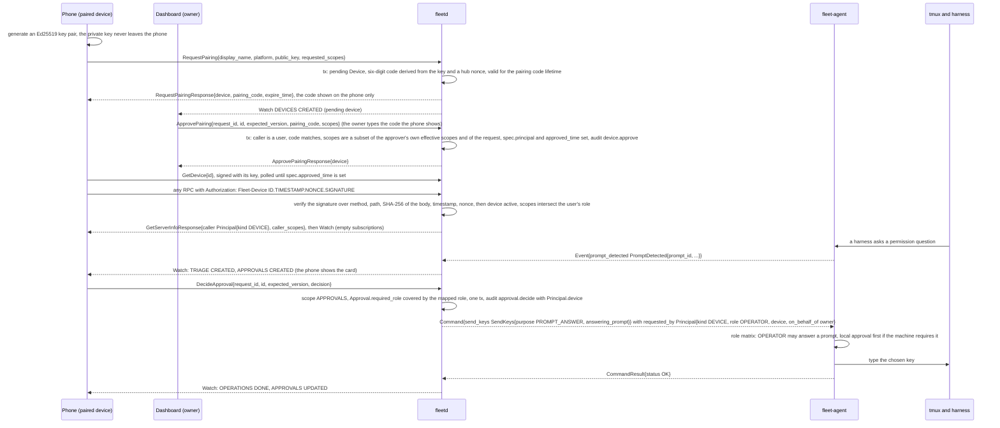

# 02d. Hub API: principals, scopes and approvals

- Status: Accepted; contracts unfrozen until v0.1 (ADR 0019)
- Date: 2026-10-02
- Part of: [02-contracts.md](02-contracts.md), [02b-hub-api.md](02b-hub-api.md)
- Output: `Scope`, `Role` and `Principal`, the scope notes in
  `api/fleet/hub/v1/service.proto`, `device.proto`
- Decisions: [ADR 0018](../adr/0018-hub-api-and-contract-amendments.md),
  [ADR 0019](../adr/0019-pre-implementation-contract-decisions.md) (sign-in,
  paired devices, LOGS scope; addendum 36 to 42 for no escalation, LOGS and
  field-level scopes)
- Review: `scope-model-incomplete`, `logs-scope-mismatch`,
  `small-doc-proto-contradictions` in
  [the contract review](../reviews/2026-10-02-contract-review.md)

How a caller proves who it is (passkey or GitHub sign-in, API tokens, device
keys, the claim URL) is in [02f](02f-hub-authentication.md). This file says
what an authenticated caller may do, and which `Role` the agent sees for it.
The agent's own permission matrix is in [02g](02g-agent-security.md).

## Principals and roles

Every call runs as a `Principal{id, name, role, kind, device,
on_behalf_of}`: a signed-in `USER`, an `API_TOKEN` or a `DEVICE` acting for
its user, or the hub's own `SCHEDULER` / `ARBITER` (never callers of this
API, but they appear as `requested_by`, `started_by` and in the audit log).
In `local_trusted` mode (loopback only) the caller is the fixed local owner
`{id "local-owner", kind USER, role OWNER}`: it is the `Principal.id` that
audit, `FLEET_OWNER` and idempotency scoping use there. `Role` is a named
permission set, never compared numerically; "role A covers role B" below means
A's scope set includes B's.

**Roles map to scopes** (one place, so a role can change without touching
RPCs):

| Role | Scopes |
|---|---|
| `VIEWER` | `READ` |
| `OPERATOR` | `READ`, `SESSIONS_WRITE`, `APPROVALS` |
| `OWNER` | `READ`, `SESSIONS_WRITE`, `APPROVALS`, `SETTINGS`, `ADMIN`, `LOGS` |
| `SCHEDULER` | none: it is never an API caller |

A user's **effective scopes** are the scopes of their role plus
`UserSpec.extra_scopes`: an owner-granted addition on top of the role, and in
v1 only `LOGS` is allowed (so a `VIEWER` or `OPERATOR` can read stored logs
without becoming `OWNER`, which would also hand over `SETTINGS` and `ADMIN`).
Setting it needs `ADMIN` and a user principal, and is audited as `user.update`.

A device or API token holds the scopes the owner granted when it was created
or approved, **intersected with the effective scopes of the user it acts for**
on every call (the role clamp, extra scopes included), so demoting a user or
removing its `extra_scopes` narrows its tokens at once. A `SCOPE_LOGS` grant to
a device or token is an explicit choice; pairing a phone never requests it by
default. The hub checks scopes. The agent sees the principal's `Role`, never
scopes, as the next section says.

| Scope | Allows |
|---|---|
| `READ` | every Get and List, Watch, **live viewing**: read-only attach, `CapturePane` of the visible screen, live `PANE_SUMMARIES`. Not stored or scrolled-back history (`LOGS`) |
| `SESSIONS_WRITE` | keys, attach input, harness commands, sessions, dispatch, goal control, routine runs, probes |
| `APPROVALS` | `DecideApproval`, snooze, dismiss, and reading what is needed to decide (below) |
| `SETTINGS` | settings, accounts (create, delete), repos, routines, integrations' watched projects, machine labels, hook installs, config import |
| `ADMIN` | enrollment, machine revoke, delete and drain, devices (list, approve), users (list, invite, update), other users' passkeys, login sessions and tokens, all notification targets, the store status, config import of machine entries, and the `HubSettings` fields for sign-in, session lifetime and log retention ([field-level scopes](#field-level-scopes)) |
| `LOGS` | stored or scrolled-back terminal history: stored session logs and their management (list, search, delete, status), transcripts, archived pane summaries, the raw usage screen, `CapturePane` history lines (`last_lines` above 0), and any `Operation.output_text` other than your own |

Scopes never imply each other: an owner holds all six because the role lists
them. `LOGS` is the one scope a `VIEWER` never has by role: stored or
scrolled-back terminal output can hold tokens and secrets (ADR 0010), so reading
it stays owner-only unless the owner grants it (`UserSpec.extra_scopes`, or a
ticked scope on a token or device). Watching the live screen, in a read-only
attach, a `CapturePane` of the visible screen or a live pane summary, is `READ`
by design. **Operation output:** `Operation.output_text` is returned only to the
principal that requested the operation and to `LOGS` holders; `GetOperation` and
the `OPERATIONS` topic leave it empty for any other `READ` caller, so a capture
never leaks through another principal's operation.

**Rows an `APPROVALS`-only caller can read.** A phone that only decides
approvals holds `APPROVALS` without `READ`. Marked `READ|APPROVALS` below,
those calls and topics accept either scope, so the phone sees the approval,
its triage item, the summary strip and the operation it caused, but not
sessions, goals, machines, screens or logs. A narrower dedicated read scope
can be added later without breaking anyone and is not needed now.

## Role sent to the agent

A person's `Principal.role` is the user's role. A device or API token has no
role of its own; the hub computes the `Principal.role` it puts in
`Command.requested_by` from the principal's **effective scopes** (granted,
intersected with the user's role) with the narrowest role that covers what the
agent cares about:

1. `OWNER` only when the effective scopes include `SESSIONS_WRITE`,
   `APPROVALS`, `SETTINGS` and `ADMIN` (every scope the owner-only agent
   actions stand for; `LOGS` does not matter to the agent).
2. Else `OPERATOR` when they include `SESSIONS_WRITE` or `APPROVALS` (typing
   into a pane, answering a prompt and goal control are operator actions at
   the agent).
3. Else `VIEWER`.

A narrowed device or token is therefore never `OWNER`: a phone granted
`SESSIONS_WRITE` alone cannot pass the agent's owner-only checks (a developer's
window in `KillWindow`, `PruneWorktree.allow_dirty`) and cannot run a
DESTRUCTIVE harness command without a local approval, even though the owner
approved it. `DrainMachine` and `UndrainMachine` are owner-level at the agent,
so the hub refuses them up front for any caller whose mapped role is not
`OWNER` (`ROLE_INSUFFICIENT`, no Operation, `spec.drain` unchanged): an
`ADMIN`-only token never leaves a machine flagged drained at the hub and not
draining. **Which check wins:** both, and
the stricter result stands. The hub checks the scope the RPC needs; the agent
checks the mapped role against the matrix in
[02g](02g-agent-security.md#what-each-principal-may-ask-an-agent-to-do); the
agent's local policy is the ceiling over both. `Principal.on_behalf_of` still
names the user for audit.

`Approval.required_role` is a role, not a scope: `DecideApproval` accepts the
decision when the decider's mapped role covers it (a developer's `KillWindow`
approval needs a decider that maps to `OWNER`, so a phone with only
`APPROVALS` cannot confirm it even though `APPROVALS` is enough for a prompt).
`KillWindow` is labelled `SESSIONS_WRITE` in `service.proto`; for a developer's
window it additionally needs an owner-level principal and an approval, which
the `KillWindowRequest` comment says.

## No escalation

Any RPC that creates or changes a credential or a grant (`ApprovePairing`,
`CreateUserInvite`, `UpdateUser`, `CreateApiToken`, and any later change to a
device's scopes) follows two rules, so no principal can end up with more than it
has:

1. **Only a user mints.** The caller must be a `USER` principal: a signed-in
   user, or the local owner (including `fleetd` through its local admin socket).
   A principal of kind `API_TOKEN` or `DEVICE` is refused with
   `PERMISSION_DENIED` / `SCOPE_NOT_GRANTABLE`, even when it holds `ADMIN`. The
   same applies to `DeletePasskey` and `RevokeLoginSession` on another user's
   rows: lockout-capable changes need a user.
2. **Never above yourself.** What is granted is a subset of the caller's own
   effective scopes: `ApprovePairingRequest.scopes`, `CreateApiTokenRequest.scopes`, the role
   given by `CreateUserInvite` or `UpdateUser` (its scope set must be covered by
   the caller's, so only an `OWNER` can create an `OWNER`), and
   `UserSpec.extra_scopes`. Anything else is `SCOPE_NOT_GRANTABLE`.

Because a token or device can mint nothing, revoking one leaves no credential
behind that it created; each mint and revoke is audited with the acting
principal and `on_behalf_of`. A change that would leave no active owner, or a
user with no sign-in method, is `LAST_CREDENTIAL`.

## Scope per RPC

Generated from `api/fleet/hub/v1/service.proto` by `scripts/gen-doc-tables.py`,
from each RPC's `[SCOPE]` tag ([02e](02e-contract-rules.md#comment-tags)).

`self` = any signed-in principal, on its own rows only; `ADMIN` widens it to
every row (for mint or lockout-capable changes a user principal, see above).
`none` = no authentication. `per-topic` = the scope of each topic, in the next
section. In `local_trusted` mode the sign-in RPCs and the device RPCs answer
`FAILED_PRECONDITION` ([02f](02f-hub-authentication.md#modes)). Credentials,
tickets and per-peer rate limits: [02f](02f-hub-authentication.md).

<!-- BEGIN GENERATED by scripts/gen-doc-tables.py from api/fleet/hub/v1/service.proto; do not edit by hand -->
| RPCs | Scope | Note |
|---|---|---|
| `GetServerInfo` | `none` |  |
| `GetFleetSummary` | `READ\|APPROVALS` |  |
| `Watch` | `per-topic` |  |
| `GetOperation` | `READ` | or the principal that requested the operation |
| `ListMachines`, `GetMachine` | `READ` |  |
| `UpdateMachine` | `SETTINGS` |  |
| `DrainMachine`, `UndrainMachine` | `ADMIN` | and a mapped role of `OWNER` (`ROLE_INSUFFICIENT` otherwise) |
| `RevokeMachine`, `DeleteMachine`, `CreateEnrollmentToken` | `ADMIN` |  |
| `EnsureMachineHooks` | `SETTINGS` |  |
| `ListSessions`, `GetSession` | `READ` |  |
| `CreateSession`, `SendKeys`, `InterruptPane`, `RunHarnessCommand` | `SESSIONS_WRITE` |  |
| `CapturePane` | `READ` | for the visible screen (`last_lines` 0); `LOGS` when `last_lines` is above 0 (scrollback) |
| `SetPaneAvailability`, `RespawnPane`, `KillWindow`, `SetLogCapture` | `SESSIONS_WRITE` |  |
| `CreateAttachTicket` | `READ` | `SESSIONS_WRITE` when `read_only` is false (clamped to read-only otherwise) |
| `AttachTerminal` | `READ` | `SESSIONS_WRITE` when `read_only` is false |
| `ReadSessionLog`, `ListStoredSessions`, `GetStoredSession`, `DeleteSessionLogs`, `SearchSessionLogs`, `GetLogStoreStatus` | `LOGS` |  |
| `ListGoals`, `GetGoal` | `READ` |  |
| `StartGoal`, `PreflightGoal`, `ControlGoal` | `SESSIONS_WRITE` |  |
| `ListGoalRuns`, `ListGoalTransitions`, `ListWorkItems`, `GetWorkItem`, `ListChangeRequests`, `GetChangeRequest`, `ListIntegrations` | `READ` |  |
| `UpdateIntegration` | `SETTINGS` |  |
| `RequeueWorkItem` | `SESSIONS_WRITE` |  |
| `ListRepos`, `GetRepo` | `READ` |  |
| `CreateRepo`, `UpdateRepo`, `DeleteRepo` | `SETTINGS` |  |
| `ListAccounts` | `READ` |  |
| `GetAccount` | `READ` | `include_raw_screen` also needs `LOGS` |
| `UpdateAccount`, `CreateAccount`, `DeleteAccount` | `SETTINGS` |  |
| `ProbeAccount` | `SESSIONS_WRITE` |  |
| `ListUsageReadings` | `READ` |  |
| `ListTriageItems`, `GetTriageItem` | `READ\|APPROVALS` |  |
| `SnoozeTriageItem`, `DismissTriageItem` | `APPROVALS` |  |
| `ListApprovals`, `GetApproval` | `READ\|APPROVALS` |  |
| `DecideApproval` | `APPROVALS` | also checks `Approval.required_role` |
| `ListRoutines`, `GetRoutine` | `READ` |  |
| `CreateRoutine`, `UpdateRoutine`, `DeleteRoutine` | `SETTINGS` |  |
| `RunRoutine` | `SESSIONS_WRITE` |  |
| `GetInsights`, `ListInsightReports`, `GetInsightReport`, `ListSuggestions` | `READ` |  |
| `DismissSuggestion` | `APPROVALS` |  |
| `GetSystemStatus`, `GetSettings`, `ListSettings` | `READ` |  |
| `UpdateSettings` | `SETTINGS` | plus `ADMIN` for the field-level fields (02d, Field-level scopes) |
| `ListAuditEntries`, `ExportConfig` | `READ` |  |
| `ImportConfig` | `SETTINGS` | plus `ADMIN` for machine entries and the field-level fields (02d, Field-level scopes) |
| `GetStoreStatus` | `ADMIN` |  |
| `RedeemInvite` | `none` |  |
| `BeginPasskeyRegistration`, `FinishPasskeyRegistration` | `self` | or the registration session `RedeemInvite` sets |
| `BeginPasskeyLogin`, `FinishPasskeyLogin` | `none` |  |
| `DeletePasskey` | `self` | own passkeys; `ADMIN` anyone's (user principal only) |
| `SignOut` | `self` | login-session callers only |
| `ListLoginSessions` | `self` | own sessions; `ADMIN` all |
| `RevokeLoginSession` | `self` | own sessions; `ADMIN` any (user principal only) |
| `ListUsers` | `ADMIN` |  |
| `CreateUserInvite`, `UpdateUser` | `ADMIN` | user principal only, granting at most the caller's own scopes (02d, No escalation) |
| `CreateApiToken` | `self` | a user or the local owner only (a token or device cannot mint another) |
| `ListApiTokens` | `self` | own tokens; `ADMIN` all |
| `RevokeApiToken` | `self` | own tokens; `ADMIN` any |
| `RequestPairing` | `none` |  |
| `ApprovePairing` | `ADMIN` | user principal only, `scopes` a subset of the approver's effective scopes (02d, No escalation) |
| `RevokeDevice` | `self` | `self` is the device itself |
| `ListDevices` | `ADMIN` |  |
| `GetDevice` | `self` | `self` is the device itself; the only call a pending device may make |
| `ListNotificationTargets` | `self` | own targets; `ADMIN` all |
| `CreateNotificationTarget`, `UpdateNotificationTarget`, `DeleteNotificationTarget` | `self` |  |
<!-- END GENERATED by scripts/gen-doc-tables.py from api/fleet/hub/v1/service.proto -->

Two HTTP endpoints are not RPCs and so are not in the table:

| Endpoint | Who may call |
|---|---|
| `GET /metrics` | a loopback peer, or an API token with `ADMIN`; never a cookie or a device ([05b](05b-observability.md#4-prometheus-endpoint-metrics)) |
| `/debug/pprof` (off by default) | loopback listener only, and `ADMIN` ([05b](05b-observability.md#9-pprof)) |

`NotificationTarget.principal` is output-only: the hub sets it from the
caller on create and ignores a value in the request. A write to a field a
scope does not cover is `PERMISSION_DENIED` / `SCOPE_MISSING` with
`metadata["scope"]` naming the scope.

### Field-level scopes

A few fields need a stronger scope than the RPC that carries them, in
`UpdateSettings` and, identically, in `ImportConfig` (a document that changes
one is refused as a whole):

| Fields | Scope | Bounds (`INVALID_ARGUMENT` outside) |
|---|---|---|
| `HubSettings.passkey_sign_in`, `github_sign_in` (sign-in) | `ADMIN` | the last method any active user can use stays on (`LAST_CREDENTIAL`) |
| `HubSettings.session_idle_timeout`, `session_max_age` (session lifetime) | `ADMIN` | idle 5 min to 30 days, max age 1 hour to 90 days, idle at most max age |
| `HubSettings.log_size_cap_bytes`, `log_retention` (log retention) | `ADMIN` | cap at least 1 GiB; retention at least 24 hours when set |
| Invites: the lifetime of an invite or claim token | not a setting: at most 7 days (`CreateUserInviteRequest.ttl`) | |
| Machine entries in a config document | `ADMIN` | |

A token or device with `SETTINGS` but not `ADMIN` therefore cannot turn off a
sign-in method, stretch a session, or set a tiny `log_retention` that would
prune every stored log (which would bypass the `LOGS`-only delete).

## Scope per Watch topic

A topic the caller cannot read is refused when the stream opens
(`PERMISSION_DENIED`), not silently dropped, so a client never mistakes a
hidden topic for an empty one. The default is the scope of the matching List
RPC. Row rules apply on top.

Generated from `api/fleet/hub/v1/watch.proto` by `scripts/gen-doc-tables.py`,
from each topic's `[SCOPE]` tag.

<!-- BEGIN GENERATED by scripts/gen-doc-tables.py from api/fleet/hub/v1/watch.proto; do not edit by hand -->
| Topics | Scope | Row rule |
|---|---|---|
| `MACHINES`, `SESSIONS` | `READ` | all rows |
| `PANE_SUMMARIES` | `READ` | live panes only (a live view, `last_lines` is the visible screen); the archived summary of an ended session is `ListStoredSessions` (`LOGS`) |
| `GOALS`, `WORK_ITEMS`, `CHANGE_REQUESTS` | `READ` | all rows |
| `ACCOUNTS` | `READ` | all rows; never carries `raw_screen` |
| `TRIAGE`, `APPROVALS` | `READ\|APPROVALS` | all rows |
| `ROUTINES`, `SETTINGS` | `READ` | all rows |
| `DEVICES` | `self` | `ADMIN`: all; otherwise the caller's own device |
| `OPERATIONS` | `READ\|APPROVALS` | `READ`: all, but `output_text` only for the requester or a `LOGS` holder; otherwise only operations the caller requested |
| `INTEGRATIONS` | `READ` | all rows |
| `FLEET_SUMMARY` | `READ\|APPROVALS` | all rows |
| `AUDIT` | `READ` | all rows |
| `NOTIFICATION_TARGETS` | `self` | own rows; `ADMIN`: all |
| `REPOS` | `READ` | all rows |
<!-- END GENERATED by scripts/gen-doc-tables.py from api/fleet/hub/v1/watch.proto -->

If a caller's scopes change while a stream is open, the hub ends it with
`RESYNC_REQUIRED` / `SCOPES_CHANGED`; revoking a device, token or login
session, disabling its user, revoking a machine, or the expiry of the
credential (cookie, session, token or device) closes the affected streams. Users, API tokens and login sessions have no Watch topic: they change
by owner action, and the Settings view lists them with the List RPCs.

## Pairing

The device generates a key pair and calls `RequestPairing` (no auth) with its
public key, platform and requested scopes; the hub creates a pending `Device`
and returns a six-digit `pairing_code` derived from the key and a hub nonce,
valid for the pairing code lifetime ([defaults](defaults.md)). The code is shown only on the device; the hub never
stores it and no `Device` or Watch field carries it. The call is idempotent by `(peer address, public key)`
instead of `(principal id, request_id)`, because there is no principal yet;
a replay returns the pending device and a recomputed code. The owner sees the
pending device in the UI, types the code the phone shows (a wrong code is
refused), and calls `ApprovePairing` with the granted scopes: a subset of the
owner's own effective scopes and of what the device asked for, never `LOGS`
unless ticked (an empty request defaults to `READ` and `APPROVALS`). From then on the device signs each request with its
Ed25519 key (`Authorization: Fleet-Device`, [02f](02f-hub-authentication.md));
the private key never leaves the device. A **pending** device polls `GetDevice`
to learn that the owner approved it (who may call it: the `GetDevice` row in
[Scope per RPC](#scope-per-rpc)); any other call it makes is
`DEVICE_NOT_ACTIVE`. `RevokeDevice` takes effect at once. Push delivery is not
built in v1; `NotificationTarget` stores the push handle opaque (write-only
through the API, excluded from stored idempotent responses) and a placeholder
chat binding.

**Pairing and a first approval, as messages.** The phone holds its own key and signs every
request, so no cookie exists for a web page to ride. What it may do is always the narrowest of
three things: the scopes the owner granted, the role of the user it acts for, and, at the
agent, the role the hub derives from those scopes.

## Approvals

Approvals are what a phone acts on: a small `preview`, the
`allowed_decisions`, a `default_choice` (deny for destructive ones), an
`expire_time`, and `fallback = DENY`: on expiry nothing is sent and a prompt
stays on screen for someone at the machine. `decided_by` records the
principal and, through `Principal.device`, the device. A prompt raises a
triage item and an approval; Triage's "Send choice…" is `DecideApproval`.
`SendKeys` never answers prompts, so every answer is bound to its `prompt_id`
and audited once.

### The local approval secret

Decided ([ADR 0032](../adr/0032-local-trusted-approval-secret.md), issue
#62, plan item 0.17). In `local_trusted` mode any process on the hub machine
counts as the owner for everyday calls, but two kinds of calls need the
local approval secret as well and fail with `CREDENTIALS_INVALID` without
it, even on loopback:

1. Approving a request: `DecideApproval`.
2. Changing settings: every call whose scope above is `SETTINGS` or `ADMIN`
   (`UpdateSettings`, `ImportConfig`, the repo, account, routine,
   integration, machine-label and hook calls, the machine admin calls,
   devices, users, passkeys, login sessions, API tokens, notification
   targets, `GetStoreStatus`).

The secret is 256-bit random, created at `fleetd init` beside the state
database (mode 0600) and shown once at the terminal; the first start of an
older store creates it the same way. It travels as the
`X-Fleet-Approval-Secret` header (02f), kept in the dashboard login session
and prompted for by `fleet` at the terminal: never in the shell environment
and never in a plain file. Row 19 enforces it on `DecideApproval` and
`CreateEnrollmentToken` (the only two of these calls it builds); the check
attaches to each further call as its row lands, from this list.
