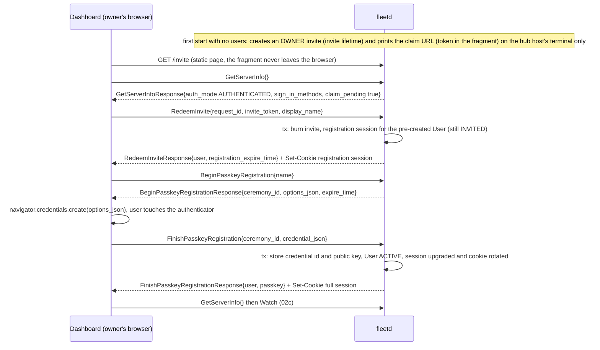
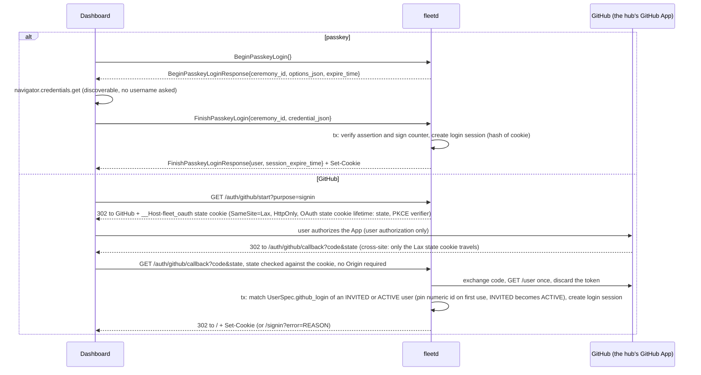
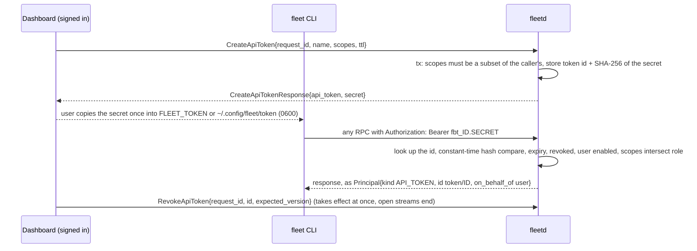
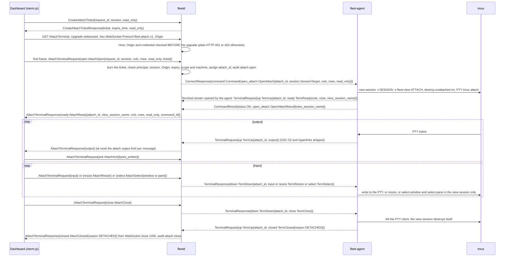

# 02f. Hub API: authentication and terminal attach

- Status: Accepted; contracts unfrozen until v0.1 (ADR 0019)
- Date: 2026-10-02
- Part of: [02-contracts.md](02-contracts.md), [02b-hub-api.md](02b-hub-api.md)
- Output: `api/fleet/hub/v1/auth.proto`, `token.proto`, `device.proto`,
  `terminal.proto`, `AuthMode` and `SignInMethod` in `common.proto`
- Decisions: [ADR 0019](../adr/0019-pre-implementation-contract-decisions.md)
  (sign-in, claim URL, API tokens, devices, loopback-only `local_trusted`,
  LOGS scope; addendum 10 to 16 for what this file adds)
- Review: `no-signin-flow`, `local-trusted-attack-surface`,
  `attach-websocket-contract-gaps` in
  [the contract review](../reviews/2026-10-02-contract-review.md)

[02d](02d-hub-authz.md) says what an authenticated caller may do. This file says
how a caller becomes authenticated, how the credential travels on each
transport, and how a terminal attach over WebSocket is opened and closed.

## Modes

**Release boundary.** v1 ships only `local_trusted`. Before admitting its fixed
owner, it refuses any present `Authorization` header and any exact
`__Host-fleet_session` cookie with `CREDENTIALS_INVALID`, including empty or
malformed carriers. Unrelated cookies, including `__Host-fleet_oauth`, grant no
identity. The local approval secret remains required for protected calls.
The credential flows below describe the planned v3 surface; [02k](02k-v1-surface-and-cli.md)
lists what is currently built.

| | `local_trusted` | `authenticated` |
|---|---|---|
| Listens on | loopback only (`127.0.0.1`, `::1`), plain HTTP; `fleetd` refuses to start on any other address, with no override flag | any address the owner configures, normally the Tailscale or LAN interface, **HTTPS only**: the owner supplies a certificate or uses a Tailscale certificate, and `fleetd` refuses to start in this mode without one (no plain-HTTP listener, no override flag) |
| Who calls | the owner, with no sign-in | users (passkey or GitHub), API tokens, paired devices |
| Principal | fixed `{id "local-owner", name "owner", kind USER, role OWNER}`; v1 refuses `Authorization`. When v3 API tokens ship, a valid `Authorization: Bearer` token narrows it to that token's scopes (a convenience, not a boundary: no header means OWNER); an invalid one is `CREDENTIALS_INVALID` | by credential, below |
| Sign-in and device RPCs | `FAILED_PRECONDITION`: every RPC of [auth.proto](../../api/fleet/hub/v1/auth.proto) (users, invites, passkeys, login sessions, sign-out) and the device RPCs of `device.proto` (`RequestPairing`, `ApprovePairing`, `ListDevices`, `GetDevice`, `RevokeDevice`). API-token RPCs and notification targets work for the local owner in v3; until built they return the unimplemented transport status | all of them |
| Attach | a WebSocket needs a ticket in both modes; a CLI over HTTP/2 needs none. Both pass the Host and Origin checks | same |

Listening only on the Tailscale interface, and needing login to attach, apply to
`authenticated` mode only.

**Decided** ([ADR 0032](../adr/0032-local-trusted-approval-secret.md), issue
#62, plan item 0.17). In `local_trusted` mode any process on the hub machine
still counts as the owner for everyday calls, but two kinds of calls need the
local approval secret as well and fail without it, even on loopback: approving
a request (`DecideApproval`), and changing settings (the calls with the
`SETTINGS` or `ADMIN` scope). The secret is created at `fleetd init`, shown
once at the terminal, and kept in the owner's dashboard session, never in the
shell or in a file a goal reads. Row 19 builds the check on `DecideApproval`,
the exact call list (02d) and the denied-path tests; until row 22 (goal
start) lands on top of it, no goal starts, manual or automatic.
`local_trusted` stays a convenience for one person on one machine, and the Host
and Origin checks below are what keep a web page the owner visits from using it.
The loopback rule applies to the API listener only: agents reach the hub on a
separate mTLS listener (default port 7443), which supersedes ADR 0004's "one
TLS port" ([02j](02j-hub-runtime.md#listeners)).

## Who sends which credential

| Caller | Credential | Carried as | Hub principal |
|---|---|---|---|
| Browser | session cookie | `Cookie: __Host-fleet_session=<256-bit random>`; `Secure`, `HttpOnly`, `SameSite=Strict`, `Path=/`, no `Domain`. The hub stores a SHA-256 of it. Authenticated mode only, so always over HTTPS | `{kind USER, id <user>, role <user's role>}` |
| `fleet` CLI, scripts | API token | `Authorization: Bearer fbt_<token id>.<secret>` (`FLEET_TOKEN`) | `{kind API_TOKEN, id "token/<id>", role mapped, on_behalf_of <user>}` |
| Phone | paired device | `Authorization: Fleet-Device <device id>.<unix seconds>.<nonce>.<Ed25519 signature>` over method, path, SHA-256 of the body, timestamp and nonce; the hub refuses a timestamp more than 60 s off or a nonce it saw in that window | `{kind DEVICE, device, id "device/<id>", role mapped, on_behalf_of <user>}` |
| Owner in `local_trusted` | none | nothing | the fixed local owner |
| Owner in `local_trusted`, for `DecideApproval` and the `SETTINGS`/`ADMIN` calls | local approval secret | `X-Fleet-Approval-Secret: <hex shown once by fleetd init>`, kept in the dashboard login session, prompted for by `fleet` at the terminal; never in the shell or a file. A missing or wrong secret is `CREDENTIALS_INVALID`, even on loopback | the fixed local owner |
| `fleet-agent`, `fleetd` peers | mTLS client certificate | not this API: `AgentService` only | n/a |

A request with two credential kinds (a cookie and an `Authorization` header) is
`UNAUTHENTICATED` / `CREDENTIALS_INVALID`, so a token script never silently
rides a browser cookie. A signed request covers a stream (`Watch`) once, at
open; the stream ends the moment the credential is revoked. The browser's
cookie covers unary calls, `Watch` and the same-origin WebSocket attach; the
bearer and device carriers cover the same calls for non-browser clients.

`GetServerInfo`, `RedeemInvite`, `BeginPasskeyLogin`, `FinishPasskeyLogin`,
`RequestPairing`, `GET /auth/github/start?purpose=signin` and the GitHub
callback need no credential and are rate limited per peer address
(`purpose=link` needs a session, below). Every other RPC needs one. A missing, unknown
or revoked credential is `UNAUTHENTICATED` / `CREDENTIALS_INVALID`; an expired
cookie, token or session is `CREDENTIALS_EXPIRED` ("sign in again").

## Host and Origin checks

Applied to every request on every transport, before any handler, in both modes:

1. **Host.** The `Host` header must be one of the hub's configured public hosts,
   plus in `local_trusted` mode the loopback names (`localhost`, `127.0.0.1`,
   `[::1]`) with the listening port. Anything else is HTTP 403 with
   `HOST_NOT_ALLOWED`. This is what stops DNS rebinding: the attacker's domain
   resolves to `127.0.0.1` but its `Host` is not on the list.
2. **Origin.** A request that carries an `Origin` header must carry exactly an
   allowed origin (scheme, host and port of a configured public origin, or the
   loopback origin in `local_trusted`); otherwise HTTP 403 with
   `ORIGIN_NOT_ALLOWED`. A cookie-authenticated POST RPC, `Watch`, and every
   WebSocket upgrade must carry an `Origin`. A bearer or device request, and in
   `local_trusted` a request from a non-browser process, may omit it.
   **Exempt:** plain `GET`s for the web app's static assets, and the two GitHub
   redirect endpoints. A top-level browser navigation sends no `Origin`, and
   the callback arrives as a cross-site redirect from github.com, so the
   callback is protected by its `state` check instead (GitHub sign-in, below).
   The exemption covers those paths only, never an RPC.
3. **No CORS.** The hub sends no `Access-Control-Allow-*` headers, so a page on
   another site cannot read a response even if it could send the request. A
   Connect POST must carry `Connect-Protocol-Version` or a gRPC content type
   (not CORS-safelisted, so a cross-site form cannot forge it), and no mutating
   RPC accepts a Connect GET.
4. **The session cookie is `SameSite=Strict`**, so the browser does not attach
   it to a cross-site request at all. The one exception is the short-lived
   GitHub state cookie, which is `SameSite=Lax` on purpose (below) and carries
   no authority of its own.

An HTTP-level refusal is a Connect error body (`{"code":
"permission_denied", "details": [ErrorDetail]}`) with status 401 for
credentials and 403 for Host and Origin. A WebSocket refused before the upgrade
gets the same.

**Operational endpoints.** `GET /metrics` and the optional `/debug/pprof` are
not RPCs. In v1, metrics accepts only the checked loopback peer and refuses the
credential carriers above; pprof is not built. The planned v3 endpoints take
only two credentials: a loopback TCP peer (proxy headers are
never trusted) or an API token (`Authorization: Bearer`) whose effective scopes
include `ADMIN`; `/debug/pprof` needs both the loopback listener and `ADMIN`. A
cookie or a device signature is refused, so a browser page cannot scrape them,
and the Host check applies ([05b](05b-observability.md#4-prometheus-endpoint-metrics)).

## First run: the claim URL

In `authenticated` mode a hub with no users has no owner. On start `fleetd`
creates a one-time owner invite exactly as `CreateUserInvite` would (role
`OWNER`, the invite lifetime in [defaults](defaults.md)) and prints the **claim URL** to the terminal only (stderr of
an interactive `fleetd`, or `fleetd claim`), never to the structured log or
journald; the log records only `auth.claim` and `claim_pending`:
`https://<public origin>/invite#<token>`. The token is in the fragment, so it
reaches no server log or `Referer`. Every start while the hub is unclaimed
replaces the token; `fleetd claim` prints a fresh one. The 15-minute reissue
below is shown only by `fleetd claim`, never re-printed or logged.
`GetServerInfo` reports `claim_pending` so the web UI shows "claim this hub".

1. The page reads the fragment and calls `RedeemInvite{invite_token,
   display_name}`. The invite already created the user (state `INVITED`; a
   restart reuses that same row, so restarts never leave orphan owners).
   `RedeemInvite` burns the invite and sets a **registration session** cookie
   for that user, which stays `INVITED` until step 2: it can register a passkey or link GitHub
   for that user and do nothing else, for 15 minutes.
2. The owner registers a passkey (`BeginPasskeyRegistration`,
   `FinishPasskeyRegistration`), or links a GitHub account (below). The first
   credential makes the user `ACTIVE` and upgrades the session to a full one.
3. If nothing is registered in 15 minutes the registration session ends and the
   invite is reissued; `claim_pending` stays true.

Whoever opens the URL first becomes the owner, so the URL is printed only to the
operator's terminal and the owner claims before exposing the hub. A wrong token
is `INVITE_INVALID` with no hint, and redemptions are limited to 10 a minute per
peer address. Other users come in the same way: `CreateUserInvite` (ADMIN)
returns an invite URL, or only a `github_login` for someone who will sign in
with GitHub. An invite never grants more than the inviter holds
([02d, no escalation](02d-hub-authz.md#no-escalation)); the claim invite is the
one exception, made by `fleetd` on the hub host.

**The claim and first passkey, as messages.** The page is static and the token stays in the
URL fragment, so it never reaches a server log. The registration session can register a
credential and nothing else.

## Passkeys

WebAuthn through a server library; the hub stores credential ids and public
keys, never a password. Relying-party id: the hub's public host. User
verification required, discoverable credential required (so sign-in asks for no
username), attestation `none`, sign counter checked when the authenticator has
one. The options and the credential travel as the W3C JSON forms in
`options_json` and `credential_json` (`auth.proto`), so the browser's own
`parseCreationOptionsFromJSON` and `toJSON` helpers apply and no client code
interprets them. Ceremonies live 5 minutes and are single use.

WebAuthn works only in a secure context, which `authenticated` mode always
provides because it serves HTTPS only (an owner-supplied or Tailscale
certificate). `GetServerInfoResponse.sign_in_methods` lists what is usable: a method
the owner turned off, or GitHub without its App settings, is
`SIGN_IN_METHOD_DISABLED`.

`FinishPasskeyLogin` sets the session cookie. A bad assertion, an unknown
credential and a disabled user all answer `CREDENTIALS_INVALID`, so the answer
does not reveal which users exist. `DeletePasskey` refuses to remove the last
sign-in method (`LAST_CREDENTIAL`).

## GitHub sign-in

Through the GitHub App the hub already has (ADR 0005), using its **user
authorization** (web flow) and nothing else: the hub asks for no repository
access on behalf of the user, reads `GET /user` once, and discards the user
token; it stores the numeric GitHub user id and the login. Two plain HTTP
endpoints, because it is a browser redirect:

| Endpoint | What it does |
|---|---|
| `GET /auth/github/start?purpose=signin\|link` | Sets the `__Host-fleet_oauth` **state cookie** and redirects to GitHub's authorize URL. The cookie is `Secure`, `HttpOnly`, **`SameSite=Lax`**, `Path=/` (the `__Host-` prefix requires it), no `Domain`, valid for the OAuth state cookie lifetime ([defaults](defaults.md)), and holds the random OAuth `state` and a PKCE verifier. `link` needs a full or registration session: this request is same-site, so the Strict session cookie arrives, and the hub records `state -> {purpose, user, session}` server-side (hashed, single use, the same lifetime) |
| `GET /auth/github/callback?code&state` | Arrives as a cross-site top-level redirect from github.com, so the Strict session cookie is not sent but the Lax state cookie is. Checks `state` against the cookie and the server-side record (either missing or different: `/signin?error=CREDENTIALS_INVALID`), burns it, exchanges the code, reads the user, then: `signin` finds the user whose `spec.github_login` equals the login (case-insensitive; pins the numeric id on first use) and sets the session cookie; `link` takes its user from the server-side record, never from a cookie. Redirects to `/` on success or `/signin?error=<REASON>` on failure; the page then re-reads the session with a same-site fetch |

The two endpoints are exempt from the Origin-required rule (above): they are
top-level `GET` navigations, and the `state` check is their CSRF defence.

A GitHub account that is not on the allow-list ends at `GITHUB_NOT_ALLOWED`. The
allow-list is `UserSpec.github_login` of the users in state `INVITED` or `ACTIVE`
(not `DISABLED`), so a GitHub-only invitee can sign in, and there is one list and
one place to edit it. A first sign-in from `INVITED` makes the user `ACTIVE`.
`link` links only a GitHub login equal to the user's `spec.github_login`
(else `GITHUB_NOT_ALLOWED`); it never writes the allow-list, with one exception:
the registration session of the claim owner, whose invite carried no login, may
set `spec.github_login` to the linked login. `github_login`, and the pinned
numeric id, are unique across users (`ALREADY_EXISTS`). After the first sign-in
the numeric id is what matches, so a renamed or recycled login cannot take over
a user. Setup adds the
App's client id and secret and the callback URL
`<public origin>/auth/github/callback` to the hub configuration file ([02j](02j-hub-runtime.md#configuration-file); secret
file mode 0600, like the private key); until then `github_sign_in` is
`SIGN_IN_METHOD_DISABLED`.

**Returning sign-in, as messages.** A passkey sign-in is a plain RPC pair. GitHub sign-in is a
browser redirect, so it is two HTTP endpoints, and the hub reads `GET /user` once and throws
the GitHub token away.

## Sessions and sign-out

A session cookie lasts `HubSettings.session_max_age` (30 days) and ends after
`session_idle_timeout` (7 days) without use. `SignOut` ends the caller's own
session and clears the cookie. `ListLoginSessions` and `RevokeLoginSession`
show and end a user's sessions (ADMIN: anyone's). Revoking a session, disabling
a user or revoking a token or device takes effect at once, including on open
streams: `Watch` ends `UNAUTHENTICATED`, an attach closes with `HUB_CLOSED`. So
does the **expiry** of a cookie, session, token or device (`expire_time`): the
hub ends open streams at the moment of expiry, not at the next call.
Demoting a user ends its streams with `RESYNC_REQUIRED` / `SCOPES_CHANGED`
([02d](02d-hub-authz.md#scope-per-watch-topic)).

## API tokens

For the CLI and scripts. A user (a signed-in session, or the local owner)
creates one with `CreateApiToken{name, scopes, ttl}`; a token or device cannot
create another (every credential-minting RPC needs a user, see
[02d](02d-hub-authz.md#no-escalation)). Scopes are required, are a subset of the
creator's own effective scopes, and include `LOGS` only if the creator holds it
and ticks it; anything else is `SCOPE_NOT_GRANTABLE`. Lifetime defaults to 90 days, at most 365. The secret
`fbt_<id>.<secret>` is shown once in the response and never stored (only a
SHA-256 of it); a retry of the same `request_id` gets `SECRET_ALREADY_DELIVERED`
and the user makes a new one. The `fbt_` prefix lets secret scanners find a
leaked token. The CLI keeps it in `FLEET_TOKEN` or `~/.config/fleet/token`
(mode 0600). `RevokeApiToken` takes effect at once. Because creating the first
token needs a session, `fleetd token create` does the same on the hub host. It
talks to the running hub through a local admin socket (mode 0600, owned by the
`fleetd` OS user, so nobody else can open it and it needs no network and no
password). The mode is not the only guard: on every connection the hub asks the
kernel for the peer's user id (`SO_PEERCRED` on Linux, `LOCAL_PEERCRED` on
macOS) and closes, unserved, any connection whose user is not `fleetd`'s,
logging `admin.peer_refused` and counting
`fleet_hub_auth_failures_total{reason="peer_uid"}`. That kernel user id is the
caller: `Principal{LOCAL_USER, local:<os user>}` (`local:uid-<n>` when the name
cannot be looked up). A request that carries any `Origin` header is refused
with 403 `ORIGIN_NOT_ALLOWED`, since a browser has no business on the socket.
The API token from `fleetd token create` acts for a named owner (`--user`,
default the sole active owner), its scopes are capped to that owner's, and the
audit actor is `Principal{LOCAL_USER, local:<os user>}` with `on_behalf_of` the
owner. `fleetd enroll-token` uses the same socket (plan row 2b); it has no
`--user` and no `on_behalf_of` (the caller is the local user itself), and it
writes `machine.enroll_token` with that `LOCAL_USER` actor and no
`on_behalf_of` ([02m](02m-hub-api-actions-and-audit.md#audit-actions)).
**Break-glass:** if the last owner loses every passkey and GitHub link,
`fleetd user invite --owner` (same socket) creates a new one-time owner invite
and prints it like the claim URL, audited as `auth.claim`; `fleetd claim` itself
works only while the hub is unclaimed.

**An API token, as messages.** Only a signed-in user or the local owner can mint one. The
secret is shown once, then every call carries it as a bearer header and the hub checks the
scopes again each time, so demoting the user narrows the token at once.

## Devices

Pairing is unchanged ([02d](02d-hub-authz.md#pairing)): `RequestPairing`, a
six-digit code the phone shows and the owner types, `ApprovePairing` with the
granted scopes (a subset of the approving user's effective scopes). An
empty `requested_scopes` means `READ` and `APPROVALS`. `LOGS`, `ADMIN` and
`SETTINGS` are never in the default, and `LOGS` is granted only when the owner
lists it. The device then signs every request with its Ed25519 key (table
above); the private key never leaves the device. Push providers are still open
(question 3 of 02b).

## Terminal attach over WebSocket

A browser cannot stream a request body, so it carries `AttachTerminalRequest`
and `AttachTerminalResponse` (the hub messages, never the agent's `TermUp` and
`TermDown`, which hub messages must not embed) over a WebSocket. A CLI uses the
same RPC over HTTP/2 with its bearer header and needs no ticket (in
`local_trusted` with no header at all: the local owner).

**Why a ticket.** A WebSocket upgrade carries ambient authority: the cookie, or
nothing at all in `local_trusted` mode. WebSockets are not subject to CORS, so a
page on another site can open one to `localhost` (cross-site WebSocket
hijacking). The Origin and Host checks refuse it, and the ticket is a second
lock: only a caller that passed the same checks on a Connect POST (which an
attacker's page cannot read) holds one.

**Flow.**

1. `CreateAttachTicket{session, read_only}` over the normal channel. The ticket
   is 256-bit random, valid 60 s, bound to the principal, the session, the
   read-only flag and the request's Origin, and shown once.
2. `GET /fleet.hub.v1.FleetService/AttachTerminal` with `Upgrade: websocket`
   and `Sec-WebSocket-Protocol: fleet.attach.v1` (the hub refuses an upgrade
   that does not offer it). Before the upgrade the hub checks Host, Origin
   (required) and the credential (cookie, bearer or device signature; none in
   `local_trusted`); failures are plain HTTP 401 and 403.
3. The first frame must arrive within 10 s and be an `AttachTerminalRequest`
   whose `open` carries the `ticket`. The hub burns the ticket on that frame,
   whether or not the attach then succeeds, and checks principal, session,
   Origin and expiry (`ATTACH_TICKET_INVALID`), then the scope and the machine
   (`SCOPE_MISSING`, `MACHINE_OFFLINE`, `RESOURCE_NOT_FOUND`, ...). `read_only`
   in `AttachOpen` can only tighten the ticket's.
4. The hub sends `AttachReady`, then `output`. The client sends `input`,
   `resize`, `select`, `ack` and finally `close`.

**Attach, as messages.** The ticket is burned by the first frame whether or not the attach
then succeeds. The agent opens the `Terminal` stream (the agent is the client of every RPC)
and the hub pairs it with the WebSocket by `attach_id`. The view session is grouped
(`new-session -t`), so the browser switching windows never moves the developer's own window.

**Framing.** Binary frames only (a text frame closes with 1003). One frame is
exactly one protobuf message. Client-to-hub frames are at most 8 KiB, hub-to-
client at most 66 KiB (a 64 KiB output plus the envelope); more is close 1009.
The hub pings every 30 s and closes after 10 s without a pong. `AttachAck`:
the client sends it at least every 32 KiB written or 200 ms while output flows,
the hub stops reading the agent past 256 KiB unacknowledged, and closes with
`HUB_CLOSED` if no ack arrives for 30 s while output waits (ADR 0016).

**Errors and close codes.** A refused or failed attach is sent as
`AttachClosed{reason ERROR, error ErrorDetail}` first, then the socket closes:

| `AttachClosed` | Close code |
|---|---|
| `DETACHED`, `SESSION_ENDED`, `IDLE_TIMEOUT` | 1000 normal |
| `AGENT_SHUTDOWN`, `HUB_CLOSED` (hub shutdown, revoked credential) | 1001 going away |
| `AGENT_OFFLINE` | 1013 try again later |
| `ERROR` with `ATTACH_TICKET_INVALID`, `CREDENTIALS_*`, `SCOPE_MISSING`, `ROLE_INSUFFICIENT`, `DEVICE_NOT_ACTIVE`, `RESOURCE_NOT_FOUND` | 1008 policy violation |
| `ERROR` with `RATE_LIMITED`, `MACHINE_OFFLINE`, or a retryable `UNAVAILABLE` | 1013 try again later |
| `ERROR` with `INVALID_ARGUMENT` (first frame not `open`, bad message) | 1007 invalid payload |
| `ERROR` with `INTERNAL` | 1011 internal error |

The close reason text is empty; the typed detail is the `AttachClosed` frame. A
client that reconnects asks for a new ticket and opens a new attach (a new view
session); nothing resumes.

## Audit

Sign-in and credential events are audited like any other action (catalogue in
[02m](02m-hub-api-actions-and-audit.md#audit-actions)): `auth.claim`, `auth.sign_in`,
`auth.sign_in_failed`, `auth.sign_out`, `passkey.add`, `passkey.delete`,
`user.invite`, `user.update`, `token.create`, `token.revoke`, `auth.session_revoke`,
`attach.open`, `attach.close`. Secrets never appear in `detail`.
