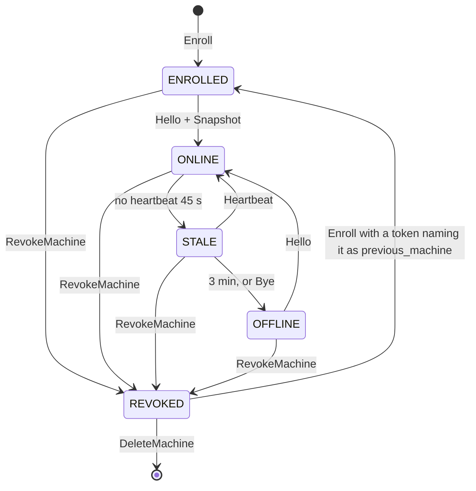

# 02g. Agent wire: trust, identity, lifecycle and permissions

- Status: Draft for review
- Date: 2026-10-02
- Part of: [02-contracts.md](02-contracts.md)
- Output: `agent/v1/agent.proto` (`EnrollRequest`, `EnrollResponse`, `HelloAck`,
  `ByeReason`), `command.proto` and `events.proto` (`trace`),
  `type/v1/trace.proto`, `type/v1/status.proto` (`ReasonCode` 521 to 532 and
  600 to 605), `hub/v1/machine.proto` (`RevokeMachine`, `MACHINE_STATE_REVOKED`),
  `hub/v1/settings.proto` (`AuditEntry`)
- Decisions: [ADR 0004](../adr/0004-agent-connectivity.md),
  [ADR 0019](../adr/0019-pre-implementation-contract-decisions.md) addendum
- Review: `enroll-trust-anchor-and-retry`, `connect-enroll-failure-wire`,
  `hub-identity-and-restore`, `machine-revoke-lifecycle`,
  `scheduler-role-permissions`, `local-actions-not-audited`,
  `no-trace-context-on-wire` in
  [the contract review](../reviews/2026-10-02-contract-review.md)

Authentication of people is [02f](02f-hub-authentication.md). This file is
about the machine side: who the agent trusts before it has a certificate, what
makes a hub the same hub, what happens when a machine is revoked, what each
principal may ask an agent to do, and how security-relevant decisions made at
the machine are kept.

## Enrollment trust anchor and retry (A1)

**The anchor is in the token.** `CreateEnrollmentToken` returns
`fbe1_<base64url(version byte, SHA-256 of the fleet CA certificate, 32 secret
bytes)>`. The hub stores only a hash of the secret part. `fleet-agent enroll
--token T` does this, in order:

1. Decode the token; take the CA fingerprint out of it.
2. Open TLS to the hub address (given, cached or found by mDNS: discovery only
   proposes candidates). Verify the server chain **against a root whose SHA-256
   equals that fingerprint**, and that the server certificate's SAN names the
   address. A mismatch aborts before anything secret is sent: no token, no CSR,
   no facts. An impostor on the LAN learns nothing, and a typed or discovered
   address needs no trust.
3. Generate the Ed25519 key (kept in the state directory until Enroll
   succeeds), send `EnrollRequest{token, csr_pem, facts, install_id, ...}`.
4. On success compare `EnrollResponse.ca_fingerprint` with the token's (a
   self-check) and pin the CA, certificate, key, salt and `fleet_id` atomically
   (write temp file, rename).

`CreateEnrollmentTokenResponse.ca_fingerprint` stays so the owner can check it
out of band, but nobody has to compare anything by eye for the protection to
hold. A token that reaches the wrong hub fails at step 2.

**Enroll is retry-safe.** The hub keys the response by `(SHA-256 of the token
secret, install_id, SHA-256 of the CSR public key)` for the token's lifetime
plus 24 h. In one transaction a first call burns the token, creates the machine
row and the certificate, and stores the response; the same triple later returns
the stored response with `replayed = true` (same `machine_id`, same
certificate). So a response lost in transit is recovered by running `enroll`
again, and no second machine row appears. Any other call with a used token is
`ENROLL_TOKEN_USED`.

**Typed failures.** An Enroll failure is a gRPC error whose `ErrorDetail.reason`
is a code the CLI prints and `doctor` shows:

| Case | gRPC code | `ErrorDetail.reason` |
|---|---|---|
| Not a token this hub issued, or the secret part is wrong | `UNAUTHENTICATED` | `ENROLL_TOKEN_UNKNOWN` |
| Past its TTL | `UNAUTHENTICATED` | `ENROLL_TOKEN_EXPIRED` |
| Burned by another install or CSR key | `ALREADY_EXISTS` | `ENROLL_TOKEN_USED` |
| CSR does not parse, is not Ed25519, or names another subject | `INVALID_ARGUMENT` | `ENROLL_CSR_INVALID` |
| No common `proto_min`/`proto_max` | `FAILED_PRECONDITION` | `ENROLL_PROTO_UNSUPPORTED` |
| `previous_machine_id` differs from the token's | `FAILED_PRECONDITION` | `ENROLL_PREVIOUS_MACHINE_MISMATCH` |
| Hub starting or store busy | `UNAVAILABLE` | `retryable = true` |

A failed Enroll writes an audit row (`machine.enroll_failed`) with the code and
peer address, never the token.

**Connect-level failures.** The agent finds out about problems after the TLS
handshake through `Bye` (`ByeReason`), not through a missing message:

| Situation | What the hub or agent does |
|---|---|
| Machine revoked | Hub: `Bye{REVOKED}`, then closes; the agent goes Unenrolled and `doctor` says "revoked, needs a new token" |
| Certificate valid, machine id unknown to the hub (store recreated with the CA kept, or a backup that predates the enrollment) | Hub: `Bye{UNKNOWN_MACHINE}`, except the restore adoption below. The agent goes Unenrolled; the owner issues a token (a `previous_machine` that no longer exists is ignored, so history cannot carry over) |
| `HelloAck.fleet_id` is not the enrolled fleet | Agent: `Bye{FLEET_MISMATCH}`, does not reconnect until re-enrolled. mTLS against the pinned CA already makes this rare; the field covers a hub rebuilt with the same CA and a new id |
| No common protocol version | Hub: `Bye{PROTO_UNSUPPORTED}` |

## Hub identity and restore

Everything that makes a hub *this* fleet's hub lives in one `hub_identity` row
inside `state.db` (03f), so one backup carries it and one restore restores it:

| Item | Rule |
|---|---|
| `fleet_id` | Minted once when the store is created. Never regenerated, never changed by restore. A new store is a new fleet and every agent must re-enroll |
| CA certificate and **private key** | Created with the store. The key signs agent certificates and the hub's server certificate. Rotating it cuts every agent off at once (ADR 0004) |
| Server certificate and SAN list | Signed by the CA for the configured hub addresses, the hostname and loopback. Re-issued (CA unchanged) when the address list changes |
| `account_salt`, `salt_version` | Minted once. Losing it would make machines enrolled afterwards compute different `AccountKey`s for the same login and silently split accounts, so a store without it refuses to start rather than mint a new one |
| `settings_epoch` | Incarnation id of the settings store; see restore |
| `hub_addresses` | What the owner configured; sent in `EnrollResponse` and, newer, in `HelloAck.hub_addresses` |

**A backup contains the CA private key and the salt, so it is a secret.** The
nightly `VACUUM INTO` (ADR 0014) writes it mode 0600; `fleetd backup --encrypt`
wraps it with a passphrase (age). Backups are stored like the private key of
the GitHub App.

**`fleetd restore <file> [--address <new>]`** is an offline command. It:

1. Checks the file has `hub_identity` and a matching schema version.
2. Mints a fresh **`settings_epoch`** (otherwise the agent still holds
   `(E, 20)` against a restored `(E, 15)` and ignores the hub's settings, the
   exact case the epoch exists for) and clears the live-connection and
   in-memory-queue state. `hub_instance_id` is new on every process start anyway.
3. If `--address` is given, issues a server certificate covering the old and
   the new address and adds it to `hub_addresses`. An agent that reaches the
   restored hub (by name, mDNS or its old address) receives the new list in
   `HelloAck.hub_addresses`; a hub that moves host should be reachable at its
   old address or name until every agent has reconnected once.
4. Sets `restore_reconcile` for 24 hours.

While `restore_reconcile` is set, the first `Hello` of each machine is answered
with a `SnapshotRequest{reason: "reconcile"}` and the hub diffs what the agent
knows against what it holds:

| Agent has, hub does not | Action |
|---|---|
| A machine (valid certificate from this CA, machine id unknown) enrolled after the backup | Adopt it: recreate the row from the certificate and snapshot in state `ONLINE`, raise an info triage item "machine adopted after restore"; outside the 24 h window it gets `Bye{UNKNOWN_MACHINE}` |
| A probe in `Snapshot.probes` for an account the hub has | Adopt the assignment; for an unknown account, `StopProbe` |
| A tmux session with a `FLEET_SESSION_ID` the hub does not know | Recreate the `Session` row under that id, as a fleet session |
| A pane with a `FLEET_GOAL_ID` the hub does not know | Existing `orphan_goal_pane` triage (W7) |
| Unacknowledged results for commands the hub never issued | Stored as history only, then acked |

Machines the hub knows but that never reconnect stay `OFFLINE`. Nothing in
restore touches `fleet_id`, the CA, the salt or the account bindings.

## Machine lifecycle: revoke and delete

`RevokeMachine` keeps the row; `DeleteMachine` then forgets it and is refused
for a machine that is not `REVOKED` (`MACHINE_NOT_REVOKED`). Revoking is the
action for a stolen or retired machine, deleting is housekeeping, and a machine
can be revoked without losing its history.

**Revoke, in one transaction** (then effects after commit):

| Thing | What happens |
|---|---|
| Certificate serials | All serials of the machine go on the revocation list; the next TLS handshake with them fails, and a `Hello` that still gets through is answered `Bye{REVOKED}` |
| Live streams | After commit the hub sends `Bye{REVOKED}` on Connect and closes Connect, `Terminal` and `SessionLog` at once. A compromised machine does not keep receiving commands until it next reconnects |
| Open attaches | Closed with `HUB_CLOSED` |
| Outbox | Rows `pending` or `delivered` for the machine become `DONE / EXPIRED`; nothing is sent to it again |
| Goals in a non-terminal phase | Move to `PANE_LOST` (its pane is unreachable), a triage item says why; the work item is freed for another machine by the usual rules |
| Probes | Assignments on the machine fail over to another machine in the next scheduler pass |
| Sessions, panes, windows | Rows stay, flagged by the machine's state; they are not shown as available |
| Log streams | Finalised at the last stored offset; stored logs stay under the machine id and `LOGS` rules |
| Triage items about the machine | Closed with a "machine revoked" note; one info item is raised for the revoke |
| Accounts and bindings | Unchanged; a Codex account bound to this machine stays bound but unusable until it reconnects |
| Settings, labels, drain | Kept on the row, so a re-enrolled machine gets them back |
| Audit | `machine.revoke` with the requester and reason |

**Re-enroll.** `CreateEnrollmentToken{previous_machine}` is allowed only for a
`REVOKED` machine or one whose certificate lifetime has passed, and only while
its row exists. The Enroll that uses it returns the same `machine_id` with new
certificate serials and sets the state back to `ENROLLED`; the revoked serials
stay revoked. The revocation record stays in the audit log. After delete, the
history under the machine id remains, and a new machine can only enroll as a
new id.

**Duplicate identity.** A newer `Hello` for a `machine_id` that has a live
stream always wins, silently. The old stream gets `Bye{DUPLICATE_IDENTITY}`
(when it can still be written to) and the epoch moves on; a sleeping laptop or
a restarted agent, whose old stream is half-open and silent, thereby produces
no warning. A **triage warning** is raised only when the displaced stream had
a heartbeat within 45 s and the pair of `boot_id`s then displace each other
again within 10 minutes: two hosts with one copied state directory ping-pong, a
restart does not. The warning is fingerprinted on the pair, re-raised at most
once an hour, and auto-dispatch to that machine is suspended until the owner
resolves it.

## What each principal may ask an agent to do

The hub checks scopes ([02d](02d-hub-authz.md)); the agent re-checks the role
in `requested_by.role` against this matrix. It is defence in depth against a
confused or compromised hub, and the local policy is the real ceiling: it can
make a cell stricter, never looser. A refusal is `REJECTED_BY_POLICY` /
`ROLE_INSUFFICIENT`.

`A` allowed. `L` allowed, and waits for local approval (`AWAITING_LOCAL_CONFIRM`,
then the result or `LOCAL_CONFIRM_TIMEOUT`) when the machine's local rule
covers that kind; the default rule is off. `L!` always waits for local approval.
`F` only in a session or window the fleet started. `—` refused.

| Command (class or variant) | VIEWER | OPERATOR | OWNER | SCHEDULER | ARBITER |
|---|---|---|---|---|---|
| `EnsureProbe` (`run_now` from `ProbeAccount`) | — | A | A | A | — |
| `StopProbe` | — | — | A | A | — |
| `Preflight`, `EnsureSession`, `EnsureWindow`, `EnsureWorktree` | — | A | A | A | — |
| `StartGoal` (incl. `model`, `effort` steps; class SESSION) | — | A | A | A | — |
| `StartGoal` with `fresh_context` (types `/clear`) | — | A, F | A, F | A, F | — |
| `SendKeys`, literal text | — | L | L | L, F (nudge, "continue") | — |
| `SendKeys` with `answering_prompt` | — | L | L | — | — |
| `Interrupt` | — | A | A | A | — |
| `RespawnPane` | — | L | L | L, F | — |
| `KillWindow` on a fleet window | — | L | L | L, F (after `merged_grace`) | — |
| `KillWindow` on a developer's window | — | — | L | — | — |
| `CapturePane` | A | A | A | A | A |
| `SetSessionAvailability` | — | A | A | A | — |
| `RunHarnessCommand` class OBSERVE | A | A | A | A | A |
| `RunHarnessCommand` class SESSION | — | A | A | — | — |
| `RunHarnessCommand` class GOAL (`/goal pause\|resume\|edit\|clear`) | — | A | A | A | — |
| `RunHarnessCommand` class REVIEW | — | A | A | — | — |
| `RunHarnessCommand` class DESTRUCTIVE | — | L! | A | — | — |
| `RunHarnessCommand` class DENY (and anything not in the catalog) | — | — | — | — | — |
| `PruneWorktree` | — | — | A | A (never `allow_dirty`) | — |
| `EnsureGoalHooks` | — | — | A | A | — |
| `OpenAttach`, `CloseAttach` | A (read-only) | A | A | — | — |
| `SetLogCapture` | — | A | A | A | — |
| `SetLogShipping` | — | — | A | A | — |
| `Drain`, `Undrain` | — | — | A | — | — |

Notes:

- **The scheduler** is the hub's own principal: unattended auto-dispatch (with
  `GoalSpec.model` and `effort`), the nudge, Claude's `continue` and limit-wait
  resume, `/goal pause` at the reserve line, `Interrupt`, probes, and
  `PruneWorktree` and `KillWindow` after `merged_grace`. It never answers a
  prompt, never types a REVIEW, SESSION-only or DESTRUCTIVE command on its own,
  never drains, and never touches a developer's window or session.
- **`fresh_context`** is judged as part of `StartGoal`, not as a separate
  DESTRUCTIVE command: the owner or operator chose it in the goal (or the
  routine), and the agent refuses it with `FRESH_CONTEXT_NOT_ALLOWED` in a
  session the fleet did not start, whatever the role.
- **Unattended recovery and local approval.** If a machine's rule makes
  `RespawnPane` or `SendKeys` `L`, the scheduler's recovery on that machine
  waits for someone at the keyboard; `LOCAL_CONFIRM_TIMEOUT` ends the wait and
  the goal goes `STUCK` (03c). That is the owner's choice, not a bug.
- **The arbiter** may read (`CapturePane`, OBSERVE commands) to build its
  answer. An answer reaches a pane through an approval a person decides or
  through the scheduler's own typed text, never as `ARBITER`. The matrix widens
  when the arbiter workflow exists.
- **A developer's window or `allow_dirty`** needs a role that covers OWNER,
  which a narrowed device or token never has ([02d](02d-hub-authz.md#role-sent-to-the-agent)).

## Audit of decisions made at the machine

A decision at the machine reaches the hub as an event (retained a week in
`events`), and that is not enough for security: the permanent audit log must
show who approved or denied a `KillWindow`, who drained a machine locally, and
what refused a command. The writer therefore appends an `AuditEntry` in the same
transaction that applies the event or result:

| Agent signal | `AuditEntry.action` | Actor | Fields |
|---|---|---|---|
| `Event.local_approval` (`LocalApprovalDecision`) | `command.local_approval` | `LOCAL_USER` `local:<os user>` | `command`, `machine`, `detail` = `approved` or `denied` and the channel (`cli`, `notification`), `occurred_time` = `decided_time` |
| `CommandResult` `REJECTED_BY_POLICY` (any reason), `LOCAL_DENIED`, `LOCAL_CONFIRM_TIMEOUT` | `command.refused` | the original requester (a person, token, device or the scheduler) | `command`, `machine`, `reason`, `outcome` |
| `Event.drain_state` with a `LOCAL_USER` principal | `machine.local_drain` / `machine.local_undrain` | `LOCAL_USER` | `machine`, `detail` = the reason |
| `Event.policy_changed` | `policy.changed` | the agent's OS user | `machine`, `detail` = old and new hash |
| Snapshot `PolicyInfo` with an empty `schema_version` (safe mode) | `policy.safe_mode` | the agent's OS user | `machine`, `detail` = the message |
| `Bye` from the hub, `Hello` refused | `machine.revoke`, `machine.connect_refused` | the requester, or none | `machine`, `reason` |

The full catalogue of audit actions is in
[02b](02b-hub-api.md#audit-actions); events keep their short retention, the
audit rows are permanent.

## Trace context on the wire

All commands, events and settings share one long-lived Connect stream, so gRPC
metadata cannot carry a W3C trace per message. `fleet.type.v1.TraceContext{
traceparent, tracestate}` (55 and 256 bytes at most) is an optional field on
`Command.trace`, `CommandResult.trace`, `Event.trace` (only when the event is
the consequence of a traced command) and `Settings.trace`. The hub sets it from
its issuing span (`hub.scheduler.plan` to `hub.command.send` to
`agent.start_goal`; `hub.settings.publish` to `agent.settings.merge`; `hub.drain`
to `agent.drain`) and the agent's spans are its children; the agent echoes its
own span in `CommandResult.trace` so the hub can link the result. A receiver
validates the format and drops a bad value without rejecting the message; an
absent trace never changes behaviour. `Operation.trace_id` lets a UI link to the
trace. Correlation by `command_id` attributes (03) remains the fallback.
