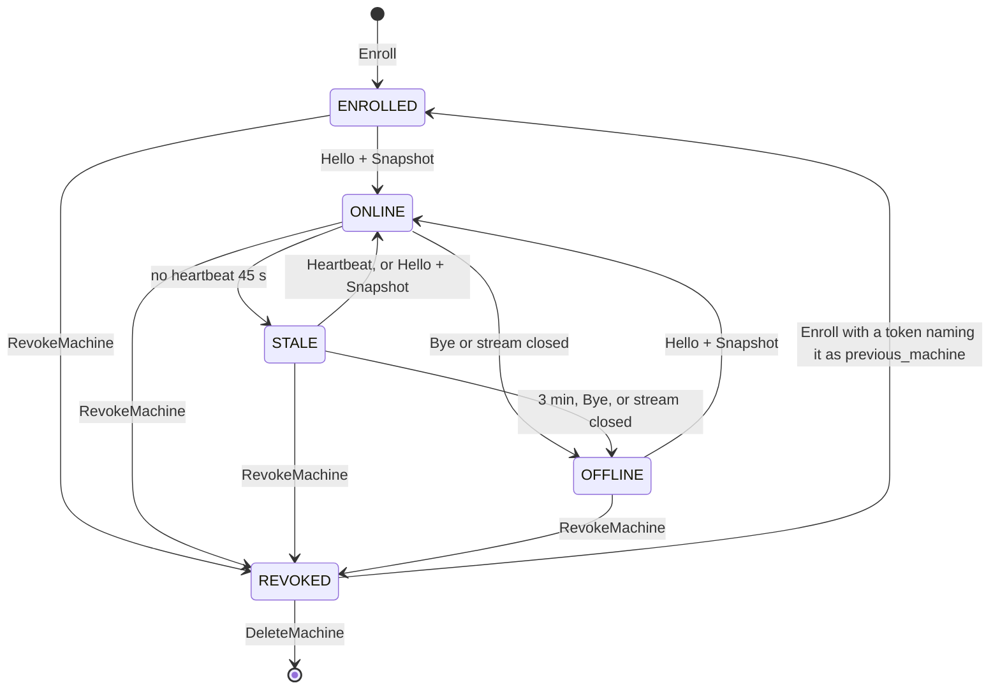

# 02g. Agent wire: trust, identity, lifecycle and permissions

- Status: Accepted; contracts unfrozen until v0.1 (ADR 0019)
- Date: 2026-10-02
- Part of: [02-contracts.md](02-contracts.md)
- Output: `agent/v1/agent.proto` (`EnrollRequest`, `EnrollResponse`, `HelloAck`,
  `ByeReason`), `command.proto` and `events.proto` (`trace`),
  `type/v1/trace.proto`, `type/v1/status.proto` (`ReasonCode` 521 to 532 and
  600 to 606), `hub/v1/machine.proto` (`RevokeMachine`, `MACHINE_STATE_REVOKED`),
  `hub/v1/settings.proto` (`AuditEntry`)
- Decisions: [ADR 0004](../adr/0004-agent-connectivity.md),
  [ADR 0019](../adr/0019-pre-implementation-contract-decisions.md) addendum
- Review: `enroll-trust-anchor-and-retry`, `connect-enroll-failure-wire`,
  `hub-identity-and-restore`, `machine-revoke-lifecycle`,
  `scheduler-role-permissions`, `local-actions-not-audited`,
  `no-trace-context-on-wire` in
  [the contract review](../reviews/2026-10-02-contract-review.md)

Authentication of people is [02f](02f-hub-authentication.md). This file is
about the machine side: who the agent trusts before it has a certificate, what
makes a hub the same hub, what happens when a machine is revoked, what each
principal may ask an agent to do, and how security-relevant decisions made at
the machine are kept.

## Enrollment trust anchor and retry (A1)

**The anchor is in the token.** `CreateEnrollmentToken` returns
`fbe1_<base64url(version byte, SHA-256 of the fleet CA certificate, 32 secret
bytes)>`: the 65 bytes (version 0x01, the 32-byte CA hash, the 32 secret bytes
from `crypto/rand`) in unpadded base64url (RFC 4648 section 5, no `=`), 87
characters after the prefix. The hub stores only SHA-256 of the 32 secret bytes
(`enroll_tokens.secret_hash`), never the token or the secret, and logs neither,
nor any part of the hash. `fleet-agent enroll --token T` does this, in order:

1. Decode the token; take the CA fingerprint out of it.
2. Open TLS to the hub address (given, cached or found by mDNS: discovery only
   proposes candidates). Verify the server chain **against a root whose SHA-256
   equals that fingerprint**, and that the server certificate's SAN names the
   address. The hub's agent listener sends its CA certificate after its own
   certificate, so the agent finds that root in the chain by the fingerprint;
   a chain without it fails. A mismatch aborts before anything secret is
   sent: no token, no CSR, no facts. A handshake the peer fails (the pin,
   the name, the key proof, or a non-TLS answer) is untrusted and never
   retried; a server that sends the right chain but cannot prove it holds
   the key is one. A connection that drops, resets or times out during the
   handshake is a lost connection and is retried within "Enroll tries"
   ([defaults](defaults.md)). An impostor on the LAN learns nothing, and a
   typed or discovered address needs no trust. With no address given the
   agent browses once and sends the request only to the first answer whose
   handshake passes this check; the others get nothing more, and if none
   passes it exits 1 having sent nothing (03 A2).
3. Make or reuse the pending Ed25519 key (`enroll.key`, kept in the state
   directory until Enroll succeeds). This may happen before step 2; nothing
   leaves the machine until step 2 passes. Send `EnrollRequest{token,
   csr_pem, facts, install_id, ...}`. A pin failure leaves the state folder,
   `agent.db` (with `install_id`) and `enroll.key`, and no identity.
4. On success compare `EnrollResponse.ca_fingerprint` with the token's (a
   self-check), then save the CA, certificate, key, salt and `fleet_id` in
   `identity.json`, written once: a temp file, fsync, then a hard link that
   never replaces an existing file, so it is whole or absent. The hub
   address is cached by temp file and rename. Then `enroll.key` is removed.

`CreateEnrollmentTokenResponse.ca_fingerprint` stays so the owner can check it
out of band, but nobody has to compare anything by eye for the protection to
hold. A token that reaches the wrong hub fails at step 2.

**Enroll is retry-safe.** The hub keys the response by `(SHA-256 of the token
secret, install_id, csr_key_hash)` for the token's lifetime plus 24 h, where
`csr_key_hash` is SHA-256 of the CSR's SubjectPublicKeyInfo DER. In one
transaction a first call burns the token, creates the machine row and the
certificate serial, and stores the response; the same triple later returns
the stored response with `replayed = true` (same `machine_id`, same
certificate). Only the certificate is stored; the rest of the response is
rebuilt from `hub_identity`. So a response lost in transit is recovered by
running `enroll` again, and no second machine row appears. **Check order:**
the request's own fields first, none of which burns the token (`install_id`,
the token's format and CA hash, the proto range, the CSR); then unknown
token, then (for a burned token) the replay triple, then expiry, so a replay
after the token's TTL still succeeds within the 24 h. Any other call with a
used token is `ENROLL_TOKEN_USED`, and so is a replay once the machine is
`REVOKED` or deleted: a stored response is never replayed for a machine that
is no longer live. Enroll ignores a valid client certificate on the
connection, but the listener checks any certificate it is given before Enroll
runs: an expired one fails the handshake, and so does a revoked one. So the
agent always calls Enroll without a client certificate, re-enroll included.

**The CSR rule.** `csr_pem` is at most 4 KiB and holds exactly one
PEM block of type "CERTIFICATE REQUEST" with only whitespace after it; it parses, its
self-signature checks, its key is Ed25519, its subject is empty and it asks
for no DNS, IP, URI or email SAN. Other requested extensions are ignored: the
hub uses only the public key. Any break is `ENROLL_CSR_INVALID`. The signed
certificate has common name = `machine_id`, the URI SAN `fleet://machine/<machine_id>`,
client-auth usage only, a random 128-bit serial and the 90-day lifetime of
[defaults](defaults.md), backdated 5 minutes and never past the CA.
`install_id` is 1 to 64 printable ASCII characters without spaces.
`previous_machine_id` is ignored until re-enroll exists (plan row 13a).

**Typed failures.** An Enroll failure is a gRPC error whose `ErrorDetail.reason`
is a code the CLI prints and `doctor` shows:

| Case | gRPC code | `ErrorDetail.reason` |
|---|---|---|
| Not a token this hub issued, the secret part is wrong, or the token names another CA (its CA hash is not this hub's) | `UNAUTHENTICATED` | `ENROLL_TOKEN_UNKNOWN` |
| Unburned and past its TTL | `UNAUTHENTICATED` | `ENROLL_TOKEN_EXPIRED` |
| Burned by another install or CSR key | `ALREADY_EXISTS` | `ENROLL_TOKEN_USED` |
| CSR breaks the CSR rule above | `INVALID_ARGUMENT` | `ENROLL_CSR_INVALID` |
| `install_id` over 64 bytes / empty, a space or a byte outside printable ASCII | `INVALID_ARGUMENT` | `FIELD_TOO_LARGE` / `INVALID_ARGUMENT` |
| No common `proto_min`/`proto_max` (0 is unset, `min > max`, or a range without 1); the token is not burned | `FAILED_PRECONDITION` | `ENROLL_PROTO_UNSUPPORTED` |
| `previous_machine_id` names a machine and the token names a different one (plan row 13a) | `FAILED_PRECONDITION` | `ENROLL_PREVIOUS_MACHINE_MISMATCH` |
| Not yet: the token names a previous machine before re-enroll exists (plan row 13a); the token is not burned | `INTERNAL` | `INTERNAL` |
| Hub starting, store busy, or a store error (a cancelled write has an unknown outcome; the retry finds the replay) | `UNAVAILABLE` | no reason, `retryable = true` |
| Request over the 1 MiB message cap ([02e](02e-contract-rules.md#size-limits-agent-wire)) | `RESOURCE_EXHAUSTED` | none (refused before the handler) |

**One rule for re-enrollment: the token alone decides.** The token's
`previous_machine` (an existing `REVOKED` or expired machine, set by the owner)
is the only thing that returns an old machine id. A request `previous_machine_id`
is a hint: it matters only as a mismatch when the token names a machine and the
request names a different one. A request id with a token that names none, or a
machine that was deleted, is ignored and Enroll creates a new machine; so an
agent that sends its old id after `Bye{UNKNOWN_MACHINE}` just enrolls fresh.

A refused Enroll writes an audit row (`machine.enroll_failed`, target
`machines`, no machine) with the reason, the gRPC code and the peer address
without its port, never the token, within the cap in
[defaults](defaults.md) ("`machine.enroll_failed` audit rows"): one row per
(reason, peer) per minute, 10 per minute in all, then one summary row per
minute (detail: the reason counts, the distinct peers, the suppressed count;
`occurred_time` the minute's start); the pair's next row carries
`suppressed` (for the 1,024 pairs suppressed most recently). The cap is in
memory: a restart empties it. A clean stop writes the summary of the minute
in progress after the listener stops and before the store closes; a crash
loses it (best effort). Every refusal is still the log
line `enroll.refused` (`reason`, `peer`) and `fleet_hub_enroll_total`
(03, W1). A failure of the hub's own (`enroll.failed`: store, signing) writes
no audit row. A successful first Enroll writes `machine.enroll` (target
`machines/<id>`, no actor; detail: the machine name, the expected hostname,
`hostname_mismatch` and the token row `enroll_tokens/<id>`, whose
`machine.enroll_token` row names who issued it) in the transaction that burns
the token; a replay writes none. Creating a token writes
`machine.enroll_token` (target `enroll_tokens/<id>`, the caller as actor,
no machine; detail: the machine name, the expected hostname and the expiry;
never the token, its secret or its hash) in the transaction that stores it.

**Connect-level failures.** The agent finds out about problems after the TLS
handshake through `Bye` (`ByeReason`) for the cases below, or through a Connect error (the `Hello` refusal table after it) for a `Hello` the hub refuses; never through a missing message:

| Situation | What the hub or agent does |
|---|---|
| Machine revoked | Hub: `Bye{REVOKED}`, then closes; the agent records the end in `ended.json` and does not reconnect until it is re-enrolled. The agent goes Unenrolled and `doctor` says "revoked, needs a new token" |
| Certificate valid, machine id unknown to the hub (store recreated with the CA kept, or a backup that predates the enrollment) | Hub: `Bye{UNKNOWN_MACHINE}`, except the restore adoption below. The agent goes Unenrolled; the owner issues a token (a request `previous_machine_id` that no longer exists is ignored, so history cannot carry over) |
| `HelloAck.fleet_id` is not the enrolled fleet | Agent: `Bye{FLEET_MISMATCH}`, does not reconnect until re-enrolled. mTLS against the pinned CA already makes this rare; the field covers a hub rebuilt with the same CA and a new id |
| No common protocol version | Hub: `Bye{PROTO_UNSUPPORTED}` |

**Hello refusals.** A `Hello` the hub refuses before `HelloAck` is a gRPC error with an `ErrorDetail`, the shape of the `RenewCert` table below. The hub checks, in order: the certificate (before it reads anything, so a stream without one holds nothing), the first message, `machine_id`, the fields, the proto range (`Bye{PROTO_UNSUPPORTED}`), the Hello rate limit, the in-memory revoked set (`Bye{REVOKED}`; after a restore `revoked-serials` may hold serials `state.db` lacks), then the Hello transaction. A refused `Hello` writes nothing and sends no `HelloAck`. A stream still waiting for its first message, or for its Hello transaction, when the hub shuts down gets `Bye{HUB_RESTART}`.

| Case | gRPC code | `ErrorDetail.reason` |
|---|---|---|
| No client certificate, or one without common name = machine id and the URI SAN `fleet://machine/<machine_id>` | `UNAUTHENTICATED` | `CREDENTIALS_INVALID` |
| No message within the hub's Hello wait ([defaults](defaults.md)) | `DEADLINE_EXCEEDED` | none, `retryable = true` |
| The first message is not `Hello`, or a second `Hello` arrives on a stream that has one | `INVALID_ARGUMENT` | `INVALID_ARGUMENT` |
| `Hello.machine_id` empty or not the certificate's machine id | `UNAUTHENTICATED` | `CREDENTIALS_INVALID` |
| `boot_id` or `install_id` over 64 bytes / empty, a space or a byte outside printable ASCII | `INVALID_ARGUMENT` | `FIELD_TOO_LARGE` / `INVALID_ARGUMENT` |
| A second `Hello` for the machine within 5 s of one the rate limit let through ([defaults](defaults.md), "Reconnect backoff"), counted when the limit passes it, before the transaction; a `Hello` the limit refuses does not extend the window | `RESOURCE_EXHAUSTED` | `RATE_LIMITED`, `retryable = true`, `retry_after` = the time left |
| The certificate's serial is stored for another machine | `UNAUTHENTICATED` | `CREDENTIALS_INVALID` |
| The next epoch would pass 2^63 - 2 ([02i](02i-delivery-and-sequencing.md), "Connection epoch"); nothing is written; the owner revokes, deletes and re-enrolls | `FAILED_PRECONDITION` | `EPOCH_MISMATCH`, not retryable |
| Hub starting, store busy or a store error (a cancelled write has an unknown outcome; the next `Hello` finds the row it left, if any, and displaces it) | `UNAVAILABLE` | no reason, `retryable = true` |
| Request over the 1 MiB message cap | `RESOURCE_EXHAUSTED` | none (refused before the handler) |

A `ConnectReason` the hub has no name for is stored as `unspecified`, never refused. The agent treats every row as a failed attempt (`connect.failed{step="hello"}`, then backoff; the loop never ends on one: [03](03-workflows.md) W1). The hub logs `connect.refused{cause, reason, peer, machine_id}` and counts `fleet_hub_connect_refused_total{cause}` (03 W1); the audit row `machine.connect_refused` comes with plan row 5e. Clock skew never refuses a `Hello` (03 W1 failure table).

## Certificate renewal (A4)

At two thirds of the life of the certificate in use (checked after each `HelloAck` and hourly while connected), the agent makes a new Ed25519 key, saves it as `renew.key` (0600) and sends `RenewCertRequest{csr_pem}` for it. The hub takes the machine id from the peer certificate only, needs a live machine row and an unrevoked peer serial, applies the Enroll CSR rule, refuses a CSR whose key is the peer certificate's (`RENEW_CSR_INVALID`), and signs a certificate for the agent lifetime, never past the CA. The same machine and CSR key return the same stored certificate, so a retry adds no serial. The old serial is not revoked; it expires. The agent checks the answer (the pinned CA, one certificate for `renew.key`, the machine id, a later `not_after`); then writes key and certificate together to `cert.pem` (temp file, fsync, rename), serves the new pair from the next handshake without dropping the stream, and removes `renew.key`. `identity.json` is never rewritten. The agent uses whichever valid pair ends later. A failed renewal is retried at the next check and never ends the connection loop. Amended by the arbiter for PR 3c: (a) the pair presented at each TLS handshake is chosen by the agent's clock: of the pairs inside their life the one that ends later, or, when neither is, the one that ends last; (b) the renewal's two-thirds point, the connection loop's expiry check and the expiry gauge follow the lead, the pair that ends last whether it has started or not; (c) the two-thirds point is judged on hub time, the last `HelloAck.hub_time` plus the time since (the larger of Go's monotonic clock and a clock that keeps counting while the machine sleeps, as 02i "Clocks" measures elapsed time), and on the agent's clock only before the first `HelloAck` or when it had no `hub_time`; (d) the expiry check and the expiry gauge use that same hub time; (e) after an attempt that presented one pair fails before Connected, the next attempt presents the other pair when it is inside its life by the agent's clock, until a stream connects; backoff is unchanged, and a refused handshake is never taken as a revoke. The check runs once each stream is connected (after its `HelloAck` and snapshot), and a renewal is not started within one check interval of the last one, nor for a lead that ends at the CA's end, nor for a lead that was already due by hub time when it was saved until a later `HelloAck` shows it not due (each logged once as `renew.skipped`).

The hub keeps each signed certificate in `cert_renewals`, keyed by the
machine id and SHA-256 of the CSR's SubjectPublicKeyInfo (unique), next to
its `cert_serials` row; signing and both inserts are one writer transaction
(signing is local CPU, not a network call). A `RenewCert` failure is a gRPC
error:

| Case | gRPC code | `ErrorDetail.reason` |
|---|---|---|
| No client certificate on the connection | `UNAUTHENTICATED` | `CREDENTIALS_INVALID` |
| No machine row for the certificate's machine id (never enrolled, or deleted) | `UNAUTHENTICATED` | `CREDENTIALS_INVALID` |
| The machine is `REVOKED` | `PERMISSION_DENIED` | `MACHINE_REVOKED` |
| The certificate's serial is not stored for that machine, or is revoked there | `UNAUTHENTICATED` | `CREDENTIALS_INVALID` |
| CSR breaks the Enroll CSR rule, or is for the presented certificate's key | `INVALID_ARGUMENT` | `RENEW_CSR_INVALID` |
| Hub store busy or failing (a cancelled write has an unknown outcome; the retry gets the stored certificate) | `UNAVAILABLE` | no reason, `retryable = true` |
| The hub could not sign the certificate or read the stored one back | `INTERNAL` | `INTERNAL`; the agent retries at the next check |
| Request over the 1 MiB message cap | `RESOURCE_EXHAUSTED` | none (refused before the handler) |

A malformed CSR is refused with `RENEW_CSR_INVALID` before the machine and serial checks.

A renewal writes an audit row (`machine.cert_renewed`, target
`machines/<id>`, no actor; detail: the new serial and its `not_after`) and
stamps the machine's status in the transaction that stores the certificate;
a replay writes none. A renewal is also the log line `cert.renewed` and a
refusal `cert.renew_refused`, with `fleet_hub_agent_cert_renewals_total`
([05b](05b-observability.md)).

## Hub identity and restore

Everything that makes a hub *this* fleet's hub lives in one `hub_identity` row
inside `state.db` (03f), so one backup carries it and one restore restores it.
`fleetd init` writes the whole row in the same step that creates `state.db`
([02j](02j-hub-runtime.md#commands)), so a store never exists without it, and
keys and certificates are never kept in separate files:

| Item | Rule |
|---|---|
| `fleet_id` | Minted once when the store is created (`fleetd init`). Never regenerated, never changed by restore. A new store is a new fleet and every agent must re-enroll |
| CA certificate and **private key** | Created with the store; an Ed25519 key, the certificate valid 10 years (defaults.md). The key signs agent certificates and the hub's server certificate. Rotating it cuts every agent off at once (ADR 0004) |
| Server certificate and SAN list | An Ed25519 key, signed by the CA for `tls.agent_names` (default: the hostname without `.local`, `<hostname>.local`, `localhost`, `127.0.0.1`, `::1`) and always `fleetd-<hostname>.local` (the mDNS name, [02j](02j-hub-runtime.md#listeners) Discovery), and the configured hub addresses. Valid 90 days and never past the CA. Re-issued (CA unchanged, one store transaction, served from the next handshake without a restart) at two thirds of its life, checked at start and hourly, and when the name list changes |
| `account_salt`, `salt_version` | Minted once. Losing it would make machines enrolled afterwards compute different `AccountKey`s for the same login and silently split accounts, so a store without it refuses to start rather than mint a new one |
| `settings_epoch` | Incarnation id of the settings store; see restore |
| `hub_addresses` | What the owner configured; sent in `EnrollResponse` and, newer, in `HelloAck.hub_addresses` |

**A backup contains the CA private key and the salt, so it is a secret.** The
nightly `VACUUM INTO` (ADR 0014) writes it mode 0600 in `backups/` (mode 0700,
names in [02j](02j-hub-runtime.md#state-directory)); `fleetd backup --encrypt`
wraps it with a passphrase (`filippo.io/age`, one scrypt recipient). The
passphrase is read only from the terminal, with echo off and asked twice; a
stdin that is not a terminal is refused before any prompt, and it is never
taken from a flag, an environment variable or a file, never logged and never
stored. The plaintext copy is built in the state folder (0700, mode 0600),
never in `backups/`, and removed on every return path, success and failure;
a backup killed mid-copy leaves it until the next `fleetd init` or `fleetd
run` removes it, once it is more than an hour old. `fleetd backup`
takes no lock: it reads `state.db` on a read-only connection of its own, so
it runs beside `fleetd run` (#92). Backups are stored like the private key of
the GitHub App.

**`fleetd restore <file> [--address <new>]`** is an offline command that
holds `fleetd.lock` throughout, so it is refused while `fleetd run` runs (#92). It:

1. Checks the file: a regular file, not age-encrypted, no non-empty
   `<file>-wal` beside it, `quick_check` ok, `hub_identity` present, a
   schema version this `fleetd` knows (older ones migrate forward), and the
   current `state.db`'s `fleet_id` when there is one (none: a hub moved to
   a new host). A refused restore changes nothing.
2. Mints a fresh **`settings_epoch`** (otherwise the agent still holds
   `(E, 20)` against a restored `(E, 15)` and ignores the hub's settings, the
   exact case the epoch exists for). It changes no `machine_connections`
   rows: a restored live row is displaced by that machine's next `Hello`,
   and PR 5k decides what restored live and `ONLINE` rows mean.
3. If `--address` is given (host[:port], port from `listen.agent`, else
   7443, spelled as the agent keeps it), adds it to `hub_addresses` and
   issues a server certificate from the same CA for the names `fleetd run`
   wants (its usual names plus every `hub_addresses` host), covering the old
   and new address. An agent that reaches the restored hub (by name, mDNS or
   its old address) gets the new list in `HelloAck.hub_addresses`; a hub that
   moves host should stay reachable at its old address or name until every
   agent has reconnected once.
4. Sets `restore_reconcile` for 24 hours (`hub_identity.restore_reconcile_until`,
   Unix ms). Steps 2 to 4 and the `hub.restore` audit row ([02m](02m-hub-api-actions-and-audit.md#audit-actions))
   are one transaction on a new store built in a temporary file, with
   `revoked-serials` applied; then the current `state.db` is checkpointed
   (refused while another process such as `fleetd backup` has it open),
   kept as `state.db.pre-restore-<UTC stamp>` ([02j](02j-hub-runtime.md#state-directory))
   and replaced by one rename, so a crash leaves one whole store.

While `restore_reconcile` is set, the first `Hello` of each machine is answered
with a `SnapshotRequest{reason: "reconcile"}` and the hub diffs what the agent
knows against what it holds:

| Agent has, hub does not | Action |
|---|---|
| A machine (valid certificate from this CA, **serial not revoked**, machine id unknown) enrolled after the backup | Adopt it: recreate the row from the certificate and snapshot in state `ONLINE`, raise an info triage item "machine adopted after restore"; outside the 24 h window, or for a revoked serial, it gets `Bye{UNKNOWN_MACHINE}` |
| A probe in `Snapshot.probes` for an account the hub has | Adopt the assignment; for an unknown account, `StopProbe` |
| A tmux session with a `FLEET_SESSION_ID` the hub does not know | Recreate the `Session` row under that id, as a fleet session |
| A `Snapshot.goal_registry` entry for a goal the hub does not know | Existing `orphan_goal_pane` triage (W7); `ReleaseGoal` only after the owner decides |
| Unacknowledged results for commands the hub never issued | Stored as history only, then acked |

Machines the hub knows but that never reconnect stay `OFFLINE`. Nothing in
restore touches `fleet_id`, the CA, the salt or the account bindings. **Restore
keeps revocations:** the revocation list is also appended to `revoked-serials`
in the hub's state directory, outside `state.db`, and `fleetd restore`
re-applies it, so a backup older than a revoke does not bring a revoked
certificate back.

**`revoked-serials` format.** Mode 0600. The first line is
`# fleet-board revoked-serials v1`; each further line is
`<serial> <not_after>`: the serial in lowercase hex without leading zeros
(as `cert_serials.serial` keeps it), one space, and the certificate's
`not_after` in RFC 3339 UTC. **Write order of a revoke:** append the lines and
fsync the file (fsync the folder too when the file is new), then add them to
the in-memory set every handshake reads, then submit the `state.db` write; a
`state.db` failure leaves the serial revoked (fail closed) and the next start
repairs it. **At start**, before the agent listener binds, `fleetd run` loads
the list: a missing file is normal; a loose mode refuses the start
(`mode_loose`); a torn last line with no newline (a crash mid-append) is
dropped with the warning `hub.revocations_torn_line`; any other bad line or an
unreadable file refuses the start (`revocations_invalid`). It reconciles both
ways (a serial revoked only in `state.db` is added to the file, one only in
the file is marked revoked in `state.db`), drops lines past their `not_after`,
and rewrites the file atomically when it changed (temp file, fsync, rename,
fsync the folder). The set is the union. The check runs in the TLS
connection-verify step (Go's VerifyConnection), so it covers resumed TLS 1.3
sessions as well.

## Machine lifecycle: revoke and delete

`RevokeMachine` keeps the row; `DeleteMachine` then forgets it and is refused
for a machine that is not `REVOKED` (`MACHINE_NOT_REVOKED`). Revoking is the
action for a stolen or retired machine, deleting is housekeeping, and a machine
can be revoked without losing its history.

**Revoke, in one transaction** (then effects after commit):

| Thing | What happens |
|---|---|
| Certificate serials | All serials of the machine go on the revocation list; the next TLS handshake with them fails, and a `Hello` that still gets through is answered `Bye{REVOKED}`. A revoked serial stays on the list until that certificate's `not_after`, independent of `DeleteMachine` |
| Live streams | After commit the hub sends `Bye{REVOKED}` on Connect and closes Connect, `Terminal` and `SessionLog` at once. A compromised machine does not keep receiving commands until it next reconnects |
| Open attaches | Closed with `HUB_CLOSED` |
| Outbox | Rows `pending` or `delivered` for the machine become `DONE / EXPIRED`; nothing is sent to it again |
| Goals | `STARTING` and `START_UNKNOWN` (never confirmed running) end `ABANDONED` with reason `MACHINE_REVOKED` and the work item returns to `READY`. Every other live goal goes straight to `STUCK` with `phase_reason MACHINE_REVOKED` (its pane never comes back, so no `PANE_LOST` wait) and a `STUCK` triage item says why; its work item stays held until an operator clears the goal (`CLEARED`) or requeues it |
| Probes | Assignments on the machine fail over to another machine in the next scheduler pass |
| Sessions, panes, windows | Rows stay, flagged by the machine's state; they are not shown as available |
| Log streams | Finalised at the last stored offset; stored logs stay under the machine id and `LOGS` rules |
| Triage items about the machine | Closed with a "machine revoked" note; one info item is raised for the revoke |
| Accounts and bindings | Unchanged; a Codex account bound to this machine stays bound but unusable until it reconnects |
| Settings, labels, drain | Kept on the row, so a re-enrolled machine gets them back |
| Audit | `machine.revoke` with the requester and reason |

**Re-enroll** (plan row 13a; until then `CreateEnrollmentToken` refuses
`previous_machine` and Enroll never burns a token that names one).
`CreateEnrollmentToken{previous_machine}` is allowed only for a
`REVOKED` machine or one whose certificate lifetime has passed, and only while
its row exists. The Enroll that uses it returns the same `machine_id` with new
certificate serials and sets the state back to `ENROLLED`; the revoked serials
stay revoked. The revocation record stays in the audit log. After delete, the
history under the machine id remains, and a new machine can only enroll as a
new id. **A revoked or deleted machine stays out:** `RenewCert`, `Terminal` and
`SessionLog` (and `Connect`) need a live machine row for the certificate's
machine id, checked on every call and not only at TLS and `Hello`; the one
exception is the restore adoption above.

**Duplicate identity.** A newer `Hello` for a `machine_id` that has a live
stream always wins, silently. The old stream gets `Bye{DUPLICATE_IDENTITY}`
(when it can still be written to) and the epoch moves on; a sleeping laptop or
a restarted agent, whose old stream is half-open and silent, thereby produces
no warning. A **triage warning** is raised only when the displaced stream had
a heartbeat within 45 s and the pair of `boot_id`s then displace each other
again within 10 minutes: two hosts with one copied state directory ping-pong, a
restart does not. The warning is fingerprinted on the pair, re-raised at most
once an hour, and auto-dispatch to that machine is suspended until the owner
resolves it.

## What each principal may ask an agent to do

The hub checks scopes ([02d](02d-hub-authz.md)); the agent re-checks the role in `requested_by.role` against this matrix. It is defence in depth against a confused or compromised hub, and the local policy is the real ceiling: it can make a cell stricter, never looser. A refusal is `REJECTED_BY_POLICY` / `ROLE_INSUFFICIENT`.

`A` allowed. `L` allowed, and waits for local approval (a `CommandProgress` in state `AWAITING_LOCAL_CONFIRM`, then the one result or `LOCAL_CONFIRM_TIMEOUT`) when the machine's local rule covers that kind; the default rule is off. A local rule names a command kind and makes every allowed cell of that kind wait, `A` cells included (the `StartGoal` note below); it never loosens a cell. `L!` always waits for local approval. `F` only in a session or window the fleet started. `F*` as `F`, or a pane the developer marked available with `fresh_context_on_reuse` (below). `—` refused. `F` and `F*` are judged by the kind's handler after the cell allows the command (only it sees tmux and the pane mark); "after `merged_grace`" is the hub's own timer ([03l](03l-goal-lifecycle-and-verification.md)) and the agent does not re-check it. A `KillWindow` the handler cannot place is judged as a developer's window.

An **observe command** is one the VIEWER column allows (`CapturePane`, `RunHarnessCommand` class OBSERVE, read-only `OpenAttach`, `CloseAttach`); every other kind is a control command, which policy safe mode refuses with `POLICY_SAFE_MODE` whatever the role ([03e](03e-settings-and-drift.md)).

| Command (class or variant) | VIEWER | OPERATOR | OWNER | SCHEDULER | ARBITER |
|---|---|---|---|---|---|
| `EnsureProbe` (`run_now` from `ProbeAccount`) | — | A | A | A | — |
| `StopProbe` | — | — | A | A | — |
| `Preflight`, `EnsureSession`, `EnsureWindow`, `EnsureWorktree` | — | A | A | A | — |
| `StartGoal` (incl. `model`, `effort` steps; class SESSION) | — | A | A | A | — |
| `StartGoal` with `fresh_context` (types `/clear`) | — | A, F* | A, F* | A, F* | — |
| `SendKeys` purpose `OPERATOR_TEXT` | — | L | L | — | — |
| `SendKeys` purpose `GOAL_NUDGE`, `GOAL_RESUME` (ready prompt, empty input line, goal-bound pane) | — | L | L | L, F | — |
| `SendKeys` purpose `PROMPT_ANSWER` (`answering_prompt`) | — | L | L | — | — |
| `Interrupt` | — | A | A | A | — |
| `RespawnPane` | — | L | L | L, F | — |
| `KillWindow` on a fleet window | — | L | L | L, F (after `merged_grace`) | — |
| `KillWindow` on a developer's window | — | — | L | — | — |
| `CapturePane` | A | A | A | A | A |
| `SetPaneAvailability` | — | A | A | A | — |
| `RegisterGoal`, `ReleaseGoal` | — | — | A | A | — |
| `RunHarnessCommand` class OBSERVE | A | A | A | A | A |
| `RunHarnessCommand` class SESSION | — | A | A | — | — |
| `RunHarnessCommand` class GOAL (`/goal pause\|resume\|edit\|clear`) | — | A | A | A | — |
| `RunHarnessCommand` class REVIEW | — | A | A | — | — |
| `RunHarnessCommand` class DESTRUCTIVE | — | L! | A | — | — |
| `RunHarnessCommand` class DENY (and anything not in the catalog) | — | — | — | — | — |
| `PruneWorktree` | — | — | A | A (never `allow_dirty`) | — |
| `EnsureGoalHooks` | — | — | A | A | — |
| `EnsureScratch` (before a scratch `StartGoal`, [05](05-insights.md)) | — | A | A | A | — |
| `CollectScratch` (the verifier reads the report, [05](05-insights.md)) | — | — | A | A | — |
| `OpenAttach`, `CloseAttach` | A (read-only) | A | A | — | — |
| `SetLogCapture` | — | A | A | A | — |
| `SetLogShipping` | — | — | A | A | — |
| `Drain`, `Undrain` | — | — | A | — | — |

The hub refuses `DrainMachine` and `UndrainMachine` up front for a caller whose
mapped role is not `OWNER` ([02d](02d-hub-authz.md#role-sent-to-the-agent)), so
`spec.drain` never changes for a drain the agent would refuse.

Notes:

- **The scheduler** is the hub's own principal: unattended auto-dispatch (with
  `GoalSpec.model` and `effort`), the nudge, Claude's `continue` and limit-wait
  resume, `/goal pause` at the reserve line, `Interrupt`, probes, and
  `PruneWorktree` and `KillWindow` after `merged_grace`. It never answers a
  prompt, never types a REVIEW, SESSION-only or DESTRUCTIVE command on its own,
  never drains, and never touches a developer's window or session.
  In a developer-marked pane the scheduler therefore cannot nudge, type
  `continue` or respawn: a stop there is `STUCK` with a triage item (03c).
- **`fresh_context`** is judged as part of `StartGoal`, not as a separate
  DESTRUCTIVE command: the owner or operator chose it in the goal (or the
  routine), and the agent refuses it with `FRESH_CONTEXT_NOT_ALLOWED` unless
  the session was started by fleet or the developer marked that pane available
  with `fresh_context_on_reuse` (off by default; `SetPaneAvailability`), whatever
  the role. A local approval rule for
  `StartGoal` is asked once, before step 1, never between `clear_context` and
  `type_goal`; a timeout is `LOCAL_CONFIRM_TIMEOUT`, nobody is at the keyboard,
  and the hub skips that machine for 30 minutes and plans elsewhere
  ([03h](03h-goal-phases-in-depth.md), [02h](02h-goal-binding-and-pane-signals.md#startgoal-steps)).
- **Unattended recovery and local approval.** If a machine's rule makes
  `RespawnPane` or `SendKeys` `L`, the scheduler's recovery on that machine
  waits for someone at the keyboard; `LOCAL_CONFIRM_TIMEOUT` ends the wait and
  the goal goes `STUCK` (03c). That is the owner's choice, not a bug.
- **The arbiter** may read (`CapturePane`, OBSERVE commands) to build its
  answer. An answer reaches a pane through an approval a person decides or
  through the scheduler's own typed text, never as `ARBITER`. The matrix widens
  when the arbiter workflow exists.
- **A developer's window or `allow_dirty`** needs a role that covers OWNER,
  which a narrowed device or token never has ([02d](02d-hub-authz.md#role-sent-to-the-agent)).

## What the agent reads and writes in harness configuration

The rule of [ADR 0004](../adr/0004-agent-connectivity.md), amended by
[ADR 0024](../adr/0024-pre-build-owner-decisions.md) (decision 3):

| | Rule (goal hooks: [01d](01d-goal-hooks.md)) |
|---|---|
| Auth files, keychain items, `gh` tokens | never opened |
| Harness settings and trust lists | Trust lists are never opened. The probe runs in one fleet-owned folder the owner trusted by hand; an untrusted folder is read from the harness's own screen (`FOLDER_UNTRUSTED`), and `fleet-agent doctor` explains it ([01](01-agent-capabilities.md) C3). The settings files are opened only to add, update or remove the agent's own named hook entries in the user-level settings files. Other keys are never read, file contents are never logged, a backup is made first |
| Repo project config (`.claude/settings.json` and the like) | read by `EnsureGoalHooks` only to see whether the repo ships its own goal hooks; never written |

`GoalHooksState` and the audit row carry the path, the backup name, the
`hook_hash` and the verdict, never file text.

## Audit of decisions made at the machine

A decision at the machine reaches the hub as an event (retained a week in
`events`), and that is not enough for security: the permanent audit log must
show who approved or denied a `KillWindow`, who drained a machine locally, and
what refused a command. The writer therefore appends an `AuditEntry` in the same
transaction that applies the event or result:

| Agent signal | `AuditEntry.action` | Actor | Fields |
|---|---|---|---|
| `Event.local_approval` (`LocalApprovalDecision`) | `command.local_approval` | `LOCAL_USER` `local:<os user>` | `command`, `machine`, `detail` = `approved` or `denied` and the channel (`cli`, `notification`), `occurred_time` = `decided_time` |
| `CommandResult` `REJECTED_BY_POLICY` (any reason), `LOCAL_DENIED`, `LOCAL_CONFIRM_TIMEOUT` | `command.refused` | the original requester (a person, token, device or the scheduler) | `command`, `machine`, `reason`, `outcome` |
| `Event.drain_state` with a `LOCAL_USER` principal | `machine.local_drain` / `machine.local_undrain` | `LOCAL_USER` | `machine`, `detail` = the reason |
| `Event.policy_changed` | `policy.changed` | the agent's OS user | `machine`, `detail` = old and new hash |
| Snapshot `PolicyInfo` with `safe_mode` | `policy.safe_mode` | the agent's OS user | `machine`, `detail` = `PolicyInfo.error` |
| `Bye` from the hub, `Hello` refused | `machine.revoke`, `machine.connect_refused` | the requester, or none | `machine`, `reason` |

The full catalogue of audit actions is in
[02m](02m-hub-api-actions-and-audit.md#audit-actions); events keep their short retention, the
audit rows are permanent. A row is written once per event, even for a replayed
event that is history-only for state: it is idempotent on `(machine,
event_generation, seq)` ([02i](02i-delivery-and-sequencing.md#replay-apply-rule)).
`machine.install_changed` (an agent rollback or a new `install_id` on a valid
certificate) is a further `machine.*` action.

## Trace context on the wire

All commands, events and settings share one long-lived Connect stream, so gRPC
metadata cannot carry a W3C trace per message. `fleet.type.v1.TraceContext{
traceparent, tracestate}` (55 and 256 bytes at most) is an optional field on
`Command.trace`, `CommandResult.trace`, `Event.trace` (only when the event is
the consequence of a traced command) and `Settings.trace`. The hub sets it from
its issuing span (`hub.scheduler.plan` to `hub.command.send` to
`agent.start_goal`; `hub.settings.publish` to `agent.settings.merge`; `hub.drain`
to `agent.drain`) and the agent's spans are its children; the agent echoes its
own span in `CommandResult.trace` so the hub can link the result. A receiver
validates the format and drops a bad value without rejecting the message; an
absent trace never changes behaviour. `Operation.trace_id` lets a UI link to the
trace. Correlation by `command_id` attributes (03) remains the fallback.
