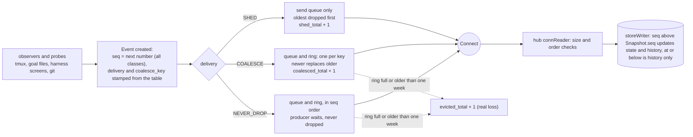
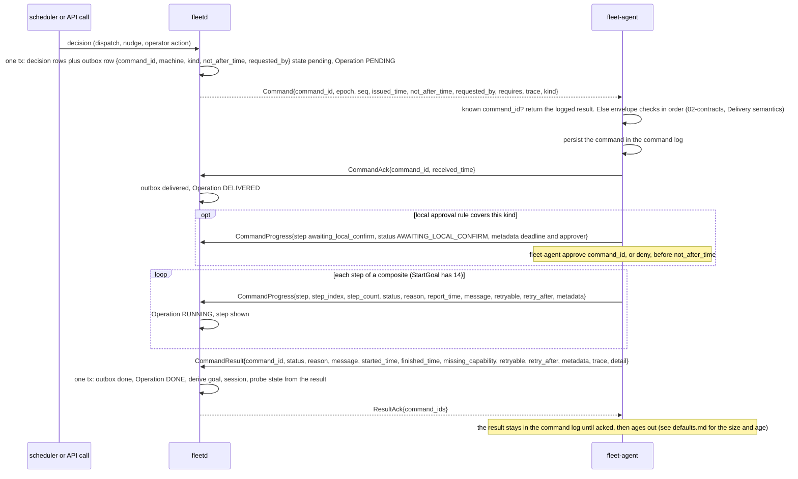
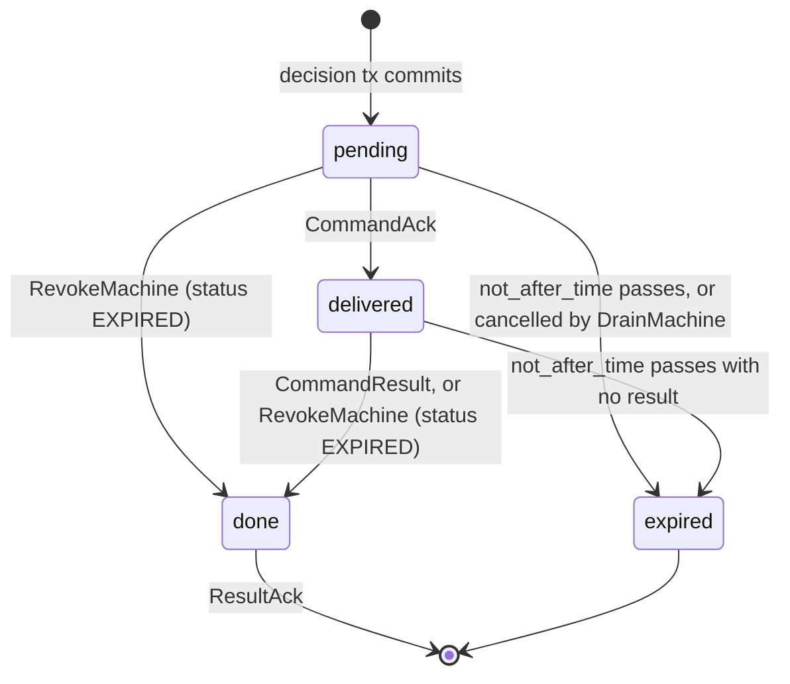

# 02i. Delivery, sequencing, gaps and clocks

- Status: Accepted; contracts unfrozen until v0.1 (ADR 0019)
- Date: 2026-10-02
- Part of: [02-contracts.md](02-contracts.md). Written for review theme D (the
  second contract review, [findings](../reviews/2026-10-02-contract-review.md)).
- Proto: `agent/v1/events.proto` (`Event`, `DeliveryClass`),
  `agent/v1/agent.proto` (`Hello`, `HelloAck`, `Heartbeat`, `EventCounters`)

What decides whether an event arrives, in what order, and what the hub does when
something did not. The rules here replace the shorter "backpressure classes" and
"events" paragraphs that 02 used to carry.

## Delivery class per event body

Generated from `api/fleet/agent/v1/events.proto` by `scripts/gen-doc-tables.py`,
from each `Event.body` arm's `[DELIVERY]` tag ([02e](02e-contract-rules.md#comment-tags)).

The agent stamps `Event.delivery` and `Event.coalesce_key` from those tags, so a
hub that does not know a newer kind still queues, sheds or coalesces it
correctly. A key names the thing the event is about; `<pane>` is
`<server>/<server_start_id>/<pane_id>` of the `PaneKey` (its canonical string form, `ids.proto`).

<!-- BEGIN GENERATED by scripts/gen-doc-tables.py from api/fleet/agent/v1/events.proto; do not edit by hand -->
| Body | Class | `coalesce_key` | Why |
|---|---|---|---|
| `resource_sample` | SHED |  | a sample every 30 s; the next one replaces it |
| `power_state` | NEVER_DROP |  | preflight depends on it; rare |
| `account_identity` | COALESCE | `identity:<harness>:<profile>` | a level: the latest identity is the identity |
| `harness_changed` | COALESCE | `harness:<harness>:<profile>` | carries the full `HarnessInfo`, so latest wins |
| `probe_health` | COALESCE | `probe:<probe_id>` | a level per probe |
| `usage_reading` | COALESCE | `usage:<account_key>` | the burn-down uses the latest; the hub keeps every reading it receives |
| `session_account_link` | COALESCE | `link:<pane>` | a level per pane |
| `tmux_server` | NEVER_DROP |  | structure changes are rare and the timeline shows them |
| `session` | NEVER_DROP |  | same |
| `window` | NEVER_DROP |  | same |
| `pane_created` | NEVER_DROP |  | same |
| `pane_exited` | NEVER_DROP |  | the one-nudge rule depends on it |
| `activity` | NEVER_DROP |  | goal and triage logic |
| `pane_summary` | SHED |  | at most one per pane per 5 s |
| `prompt_detected` | NEVER_DROP |  | a prompt must reach Triage and be retired |
| `prompt_gone` | NEVER_DROP |  | a prompt must reach Triage and be retired |
| `harness_ready` | COALESCE | `ready:<pane>` | a level |
| `harness_hook` | NEVER_DROP |  | the Stop guard's answer and the session id are facts nobody can re-read |
| `pane_harness_session` | NEVER_DROP |  | completes a registry entry (`binding`) |
| `availability` | NEVER_DROP |  | the dispatcher depends on it |
| `harness_condition` | NEVER_DROP |  | provider errors, `cleared` pairs |
| `pane_input` | COALESCE | `input:<pane>` | latest input time wins |
| `pane_changed` | COALESCE | `pane:<pane>` | the pane after the change; an upsert |
| `goal_state` | NEVER_DROP |  |  |
| `branch_state` | COALESCE | `branch:<worktree path>` | a level per worktree |
| `repo` | NEVER_DROP |  | a checkout appearing or going is rare |
| `goal_registry` | NEVER_DROP |  | the registry is the goal identity (02h) |
| `forge_cli_status` | COALESCE | `forge:<tool>:<host>` | a level per code host |
| `spool_status` | SHED |  | also summarized in `Heartbeat.spool` |
| `policy_changed` | NEVER_DROP |  | audited |
| `local_approval` | NEVER_DROP |  | audited |
| `drain_state` | NEVER_DROP |  | audited |
<!-- END GENERATED by scripts/gen-doc-tables.py from api/fleet/agent/v1/events.proto -->

Outside `Event`: `Heartbeat` is SHED (it carries no seq). `CommandAck`,
`CommandProgress`, `CommandResult`, `SettingsAck` and `Bye` are never dropped;
they are not events, have no seq and are replayed from the agent's command log
(`Snapshot.unacked_results`) or re-derived (`Settings` is re-sent on connect).
`Hello`, `HelloAck`, `Snapshot` and `SnapshotRequest` are not events either and
are never dropped; the handshake and recovery depend on them.

An inventory event (`tmux_server`, `session`, `window`, `pane_created`,
`pane_changed`, `repo`) carries the object after the change, so the hub applies
it as an **upsert** (closed: a delete). A hub that missed the earlier event of
the same object still reaches the right state.

## Queue and ring rules per class

The agent's send queue is bounded and sheds in this order and never beyond it:
SHED first, then (never) NEVER_DROP. The offline ring is persisted (one week,
size-capped) and holds only NEVER_DROP and COALESCE events.

| Class | Send queue under pressure | Ring while offline | A number that is not delivered |
|---|---|---|---|
| SHED | oldest dropped first | not kept | `EventCounters.shed_total`++ |
| COALESCE | a newer event with the same key replaces the queued one | one entry per key, replaced in place | `coalesced_total`++ (not loss) |
| NEVER_DROP | never dropped; the producer waits (the ring is the queue) | kept in seq order until the size cap or one week evicts the oldest | `evicted_total`++ (**loss**) |

Every event consumes a seq at the moment it is created, shed or coalesced ones
included, so **seq has holes by design** and contiguity means nothing. A
replaced COALESCE event keeps no seq of its own; the survivor keeps its own.

**One event's path.** An observer creates the event, stamps its number and class, and the
class decides what a slow or broken connection may do to it. The last two boxes are the hub
side: the reader checks size and order, and the store writer applies an event to state only
when its `seq` is above `Snapshot.seq` (at or below, it is history only).

## Sequence numbers

The event `seq` is agent-wide and must never repeat, whatever happens to the
agent or the hub. Only the ring was persisted before, and it holds a subset, so
numbers handed to shed events were forgotten and reissued after a crash; the hub
then dropped the new events as "already seen". The rules:

1. **High-water mark.** The agent persists `seq_hwm` in blocks of 1024: before
   it hands out a seq above `seq_hwm` it writes `seq_hwm = seq + 1023` (fsync).
   At start the next seq is `seq_hwm + 1`, so numbers that were handed out but
   never written are skipped, never reissued. Cost: one fsync per 1024 events.
2. **Floor from the hub.** After every `HelloAck` the agent raises its next seq
   to `max(own, HelloAck.hub_last_event_seq + 1)`, and discards ring entries
   with `seq <= hub_last_event_seq` that it did not send (they cannot be told
   from another incarnation's). `Snapshot.seq` is the highest number handed out
   after that floor when the snapshot starts to be built, so an event emitted
   while it is built gets a higher seq and is not superseded by it. A state-directory wipe, a restored VM image or a re-install
   (new `install_id`) therefore resumes above what the hub holds instead of
   being discarded as duplicates.
3. **Rollback on the hub's side.** The hub treats `Hello.last_event_seq <
   hub_last_event_seq`, a decrease of any `EventCounters` field, or a changed
   `install_id` on a valid certificate as **agent rollback**: it keeps history,
   bumps the machine's `event_generation` (history and idempotency are keyed
   `(machine, event_generation, seq)`), puts a "state reset" marker on the
   machine's timeline and writes an audit row. No extra request is needed
   because every connect is followed by a `Snapshot`; if the agent's `Snapshot.seq`
   is nonetheless not above the hub's stored value (an agent that ignores rule 2),
   the hub applies it (state is level-triggered), starts a new `event_generation`
   and sends `SnapshotRequest{reason: "seq_rollback"}`.
4. **Hub restore.** A restored store has a lower `hub_last_event_seq` than the
   agent holds. That is the benign direction: the agent replays everything above
   it from its ring and the `Snapshot` covers what the ring does not (coalesced
   and shed kinds), so a restore needs no special step for events.

Persisted by the agent: `seq_hwm`, `EventCounters`, `install_id`, and the
`last_epoch` and `last_applied_command_seq` it sends in `Hello` (`agent.db`;
W1, W2). Persisted by the hub: per machine `hub_last_event_seq`,
`event_generation`, last `EventCounters`, `install_id`, `epoch`.

## Connection epoch

The command epoch has to be monotonic too: the agent refuses a command whose
epoch is not the current one, and a command `seq` at or below the last applied
one for that epoch is `SEQ_REPLAYED`. After a hub restore the stored epoch can
be lower than one the agent already used, so the hub would reissue an epoch the
agent holds a `last_applied_command_seq` for (7 and 41 in W2) and the agent
would reject the new epoch's seq 1..41.

- The hub sets `HelloAck.epoch = max(stored epoch, Hello.last_epoch) + 1` and
  stores it in the Hello transaction. The epoch only increases, restore included.
- An agent that receives `HelloAck.epoch <= Hello.last_epoch` closes the stream,
  logs `epoch_regressed` and reconnects with backoff; it never accepts a
  command from such a connection.
- Commands re-issued under the new epoch keep their `command_id`; a known
  `command_id` is answered from the agent's log before any `seq` check
  ([02](02-contracts.md#delivery-semantics)).

## What agent.db keeps

Plan row 4 settles two tables of `agent.db` ([04](04-technology-review.md)
Q9). Row 4 (PR 3) adds the block allocator of rule 1: the agent raises
`seq_hwm` by 1024 before it hands out the first seq of a block, and after
`HelloAck` moves its next seq above `hub_last_event_seq`, saving that as
`seq_hwm` at once when it is above the stored mark. A `HelloAck.epoch`
above 2^63 - 2 or a `hub_last_event_seq` above 2^63 - 1 - 1024 is refused
before either is saved: the file keeps signed 64-bit values that never go
back, and the limits keep the hub's next epoch (the stored one plus 1) and
the first seq block above the floor from overflowing them. `Heartbeat.event_seq`
is the highest seq the running agent handed out, never a reserved one or a
floor no event has used yet; every `Snapshot` takes a seq, so it is set
from the first heartbeat on. The event ring
itself comes with the rows that emit events. Probe assignments, the goal
registry and the rest of 03n's W2 persistence table will come with their own
rows.

| Table | Holds | Rule |
|---|---|---|
| `agent_state`, one row | `install_id` (minted when the file is created), `seq_hwm`, the three `EventCounters`, and `last_epoch` and `last_applied_command_seq` (sent as `Hello.last_epoch` and `Hello.last_applied_command_seq`) | Nothing goes backwards: a lower `seq_hwm` or counter is ignored; an epoch at or below the last is refused (`epoch_regressed`) and a new epoch starts its command seq at 0; a seq of another epoch is `EPOCH_MISMATCH`, one at or below the last of the epoch `SEQ_REPLAYED`. Triggers in the file refuse any step back, a changed `install_id`, deleting the row and replacing it (an SQL insert-or-replace), so the next start cannot mint a new `install_id` |
| `command_log` | per `command_id` (the key): kind, epoch, seq, received time (the agent's wall clock; row 6's executor will take deadlines from `HelloAck.hub_time`, "Clocks"), `not_after_time`, status (`received`, `running`, `finished`), step reached, the encoded `CommandResult`, finished time, and the `ResultAck` time | Written before `CommandAck`. A known `command_id` saves nothing and is answered from its entry; the first result is kept. Triggers refuse a changed result, a second insert of a `command_id` (an SQL replace included) and a renamed `command_id`. A finished result with no `ResultAck` is re-sent after each `Snapshot`; a `ResultAck` sets the ack time once (a trigger refuses a change, or an ack on an unfinished entry) and one for an unknown or pruned `command_id` changes nothing. Pruning takes hub time (`HelloAck.hub_time` plus the time since, on the monotonic clock, "Clocks"), never the agent's wall clock, because `not_after_time` is the hub's deadline; a HelloAck with no `hub_time` (a non-conforming hub) falls back to the agent's clock at its arrival and logs `hub_time_ok=false`. Entries older than 7 days, measured against the agent-clock received time, are pruned when they are acked or past their `not_after_time`; past 10,000 entries, the oldest that are acked or past their `not_after_time` are pruned. An entry not acked and inside its deadline is never pruned, for age or for the count (an agent clock far behind the hub makes every entry look old), because the hub may still re-send it and a forgotten `command_id` would run twice ([defaults](defaults.md)) |

Losing `agent.db` is a re-install: a new `install_id` and `seq_hwm` from 0,
which the hub treats as an agent rollback (rule 3 above). Enrollment is not
in it: the key, certificate, CA, `machine_id`, salt, `fleet_id` and the
cached hub address are plain files in the state folder (04 Q9), so they
survive.

## Gaps: shedding is not loss

The hub **never** compares seq numbers hole by hole. It learns what was lost
from the counters:

| Signal | Meaning | Hub action |
|---|---|---|
| `shed_total` or `coalesced_total` rises | deliberate drops | metric only |
| `Heartbeat.event_seq` above the highest seq the hub stored | newer events are in flight, or were shed or coalesced | none; compared only to show replay progress |
| `evicted_total` rises in a `Heartbeat` | a NEVER_DROP or COALESCE event was lost while connected | `SnapshotRequest{reason: "event_lost"}` (at most one per 5 minutes per machine), a gap marker on the timeline |
| `evicted_total` in `Hello` is above the stored value | ring overflow while the agent was offline | gap marker with the seq range between `hub_last_event_seq` and the first replayed seq; the `Snapshot` that follows every connect already repairs state |
| any counter lower than stored | agent state lost | rollback (above) |

So a hub never fires a snapshot because pane summaries are being shed, and a
lost never-dropped event is never mistaken for shedding. The gap marker's wire
source is `EventCounters` plus the seq range.

## Replay apply rule

A reconnect delivers a `Snapshot` first and then events in `seq` order.

- An event with `seq <= Snapshot.seq` (replayed) is **history only**: it is
  written to the timeline and run history and runs **no rule**. It changes no
  derived state (goal phase, triage items, the one-nudge rule, "human at
  keyboard"), because the `Snapshot` already holds its effect.
- An event with `seq > Snapshot.seq` is applied to state and written to history.
- **Audit is not derived state.** `local_approval`, `policy_changed` and
  `drain_state` events with a local actor still produce their `AuditEntry` even
  when replayed, once: the audit row is idempotent on `(machine,
  event_generation, seq)` (02g).

Every NEVER_DROP event that a rule derives from therefore has a level
counterpart in the snapshot; this is the list the hub relies on:

| Replayed event | Where the snapshot carries its effect |
|---|---|
| `pane_exited` | the pane is dead or absent in `tmux_servers[]`; W6 evaluates the one-nudge rule from the snapshot, once, keyed on its fingerprint |
| `prompt_detected` / `prompt_gone` | `Snapshot.prompts[]` (only what is showing now) |
| `harness_condition` | `Snapshot.conditions[]` |
| `pane_input` | `TmuxPane.last_input_time` |
| `availability` | `TmuxPane.availability` |
| `goal_state` | `Snapshot.goals[]` |
| `goal_registry`, `pane_harness_session` | `Snapshot.goal_registry[]`, `TmuxPane.harness_session_id` |
| `activity`, `harness_ready` | `TmuxPane.activity`, `ready_pattern_showing` |
| `drain_state`, `policy_changed`, `power_state` | `Snapshot.drain`, `policy`, `power` |

A prompt that appeared and went while the hub was away is therefore only on the
timeline, never a triage item: nobody can still answer it.

## Durable facts and how they clear

A machine marked unfit for a durable preflight reason (03c) clears when the fact
it depends on is seen to change, by one of these, so it does not wait for a
reconnect that may be weeks away:

- **Forge CLI status** (sign-in, user, push access): the agent re-checks `gh` and
  `glab` every hour (H4) and on each `SnapshotRequest`; a change is sent as
  `Event.forge_cli_status`. The hub treats a `ForgeCliStatus` whose
  `checked_time` is older than two hours as unknown and asks for a snapshot, so
  planning never rests on a token that expired weeks ago.
- **Folder trust and every other agent-local fact** (`FOLDER_UNTRUSTED`,
  `CHECKOUT_MISSING`, `TMUX_TOO_OLD`): there is no event for them. The hub
  re-runs `Preflight` for each durably unfit `(machine, harness, repo)` after 10
  minutes, doubling up to one hour while the reason holds, and at once after a
  `forge_cli_status`, `harness_changed` or `policy_changed` event from that
  machine or when the owner presses re-check. `Preflight` is read-only and
  idempotent.

## Command lifecycle

The other direction: a command goes from the hub to an agent. The hub writes the outbox row
in the same transaction as the decision, then sends it. The agent saves the command, answers
`CommandAck`, runs it, and sends exactly one `CommandResult`; the hub then sends `ResultAck`
so the agent can forget it. Delivery is at least once, and `command_id` makes a repeat
harmless. The envelope checks, deadlines and the repeat rule per kind are in
[02](02-contracts.md#delivery-semantics).

The hub's outbox row moves like this. A `DrainMachine` or a revoke ends rows early (see
[03h](03h-goal-phases-in-depth.md#drain-the-outbox-and-respawn) and
[02g](02g-agent-security.md#machine-lifecycle-revoke-and-delete)). 02 also lists a state
`failed` that nothing triggers on its own, so an implementation can start with these four.

## Clocks

Time is the hub's. An agent's clock is used to say when something happened on
that machine and for nothing that decides between machines.

- The hub stores `received_time` (its own clock) with every event, command
  result and usage reading.
- **Skew.** One sample per `Hello.sent_time` (at connect) and per
  `Heartbeat.sent_time` (every 15 s) is `agent time - hub receive time`; the
  reported `MachineTelemetry.clock_skew` is the median of the last five, so one
  slow packet does not move it. The error is at most the one-way delay.
- **Hub-adjusted time** is the agent's time minus the machine's skew. It is
  clamped to `received_time` when it lies in the future by more than a minute,
  so a clock that runs ahead cannot plant a future timestamp. (Replayed events
  are legitimately old and are not clamped from below.)
- **Order inside one machine** is by `seq`; `Event.observed_time` is for
  display. **Order across machines** (the usage reading that is "newest" when
  two machines probe one account, `reading_stale` against the previous reset)
  uses the hub-adjusted `read_time`, ties broken by `received_time`. The hub
  `UsageReading` carries both `read_time` (adjusted) and `received_time`, plus
  `agent_read_time` as sent.
- **Thresholds.** Above 5 minutes of skew the machine shows a warning. Above 15
  minutes `clock_untrusted` is set: the hub orders that machine's data by
  `received_time` alone, does not let its readings override another machine's
  for the same account, does not pick it for a probe while another machine can
  read the account, and shows the reset text rather than a `resets_time` the
  agent resolved from a wrong date.
- **Deadlines** remain hub time: the agent evaluates `not_after_time` as
  `HelloAck.hub_time` plus the time elapsed since, so a wrong wall clock cannot
  expire or extend a command. Elapsed time is read from a clock that keeps
  counting while the machine sleeps and that setting the wall clock does not
  move: `CLOCK_BOOTTIME` on Linux, `CLOCK_MONOTONIC_RAW` on macOS (both through
  `golang.org/x/sys`). Go's own monotonic clock stops during sleep on both
  systems, so it is only a lower bound: elapsed time is the larger of the two.
  When the sleep-counting clock cannot be read, the command is treated as past
  its deadline. A command past its deadline answers `EXPIRED` and is never
  started.
