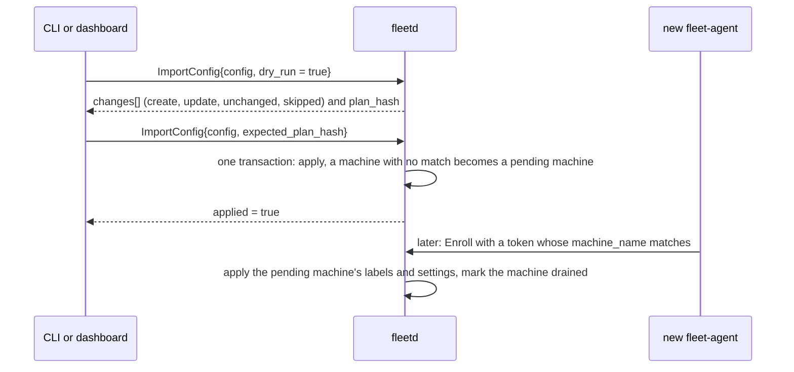

# 02m. Hub API, part 2: routines, goals, logs, accounts, config and audit

- Status: Accepted; contracts unfrozen until v0.1 (ADR 0019)
- Date: 2026-10-02
- Part of: [02b-hub-api.md](02b-hub-api.md), split out to keep each file under the 500-line cap.
  02b holds the resources, conventions, idempotency, versions, operations, Watch, scopes, size
  limits and errors. This part holds the actions by area: routines, goal dispatch and control
  (and the actions that need an approval), stored logs, accounts, config export and import,
  local commands, contract status and codegen, the audit actions and the open questions.

## Routines

A `Routine` is recurring fleet work that is not an issue (dependency bumps,
flaky-test sweeps, a weekly report). Its trigger is `queue_empty` or `cron`; each
run is a normal goal whose work item is `WorkItemKey{kind: ROUTINE, provider_name:
"fleet", key: "<routine id>/<run>"}`, with the goal text from `goal_text_template`,
consent `routine ∩ repo ∩ account`, pacing and triage unchanged, and a snapshot of
its `done_rule` and `report_path` on the goal. Trigger evaluation, run numbering,
missed fires, harness selection and the three done rules are the workflow in
[03i](03i-routines.md).

## Goals: dispatch, control and history

**Dispatch.** `StartGoal` and `PreflightGoal` take the same `GoalSpecInput`
(work item, repo, change request, placement, consent, text, model, effort,
fresh context, reason), so the preview is computed from what would be sent.
`PreflightGoal` returns the hub's checks as `PreflightCheck{ErrorDetail,
severity}` (`BLOCK`, `CONFIRM`, `WARN`, `INFO`) beside the agent's
`Operation.failed_checks`; the reasons are `ReasonCode`s and the severity of each is the table in
[03h](03h-goal-phases-in-depth.md#dispatch-checks-and-their-severity). `StartGoal`
re-runs the checks: a `BLOCK` fails with its reason, a `WARN` the request did
not list in `acknowledged_warnings` fails `PREFLIGHT_WARNINGS_UNACKNOWLEDGED`, and
a `CONFIRM` returns an `Approval` of kind `DISPATCH_CONFIRM` (required role
`OWNER`) instead of a goal; `RunRoutine` takes the same `acknowledged_warnings` and returns
the same `approval` (03i). "Next up" is `PreflightGoal` on the first item of
`ListWorkItems{filter: stage = READY, order_by: dispatch_order}` with an empty
placement.

### Actions that need an approval

One rule covers `StartGoal` with a `CONFIRM` check, `RunHarnessCommand` with a
DESTRUCTIVE command and `KillWindow` on a developer's window: the response
carries the `approval` and **no operation**, nothing is sent, and no `Operation`
exists until the approval is approved. `DecideApproval` then returns the
`operation` (and, for a dispatch, the `goal`); `Approval.operation` names it. A
denied or expired approval creates neither. A client therefore polls the approval,
not an operation that does not exist yet.

**Control.** `ControlGoal` guards on `expected_phase`; which action is allowed in
which phase is the table in [03l](03l-goal-lifecycle-and-verification.md#control-actions-by-phase), and a
refusal is `GOAL_ACTION_NOT_ALLOWED`. `NOT_DONE` and `EDIT` on a goal whose
harness already finished (`VERIFYING`, `DISAGREE`) **re-arm** it: the agent
rewrites the goal file's first line and the hub types the harness's set-goal
form in the same pane, same goal id ([03h](03h-goal-phases-in-depth.md#re-arm-after-done)).

**History.** `ListGoalRuns` (one run per harness process: start and end, cause,
end phase, nudges, usage consumed, log keys) and `ListGoalTransitions` (phase
changes with reason and actor) read what the hub stores with the goal. The
Machines timeline is `ListGoals` over `start_time` and `end_time`, not
`create_time`; a goal is either started by the fleet (`origin = DISPATCHED`) or seen in a pane the owner started by hand (`origin = OBSERVED`, [03k](03k-observed-goals.md)). The "Goal progress" task list of the mockup is **not** in the
contract: the goal file's first line and the run list answer "what is it doing".

## Stored logs

All under `SCOPE_LOGS` (owner by default): `ListStoredSessions` (the sessions
whose logs are stored, live or ended, with their stream keys, sizes, times and
the archived last pane summary of each pane), `GetStoredSession`,
`DeleteSessionLogs` (one transaction, audited as `logs.delete`, refused while a
stream is still capturing), `SearchSessionLogs` and `GetLogStoreStatus` (bytes
against the cap, free disk, oldest data, retention, shipping paused). The cap and
retention are `HubSettings.log_size_cap_bytes` and `log_retention` (a settings
change, `SETTINGS`). **Search** is a case-insensitive literal substring over the
ANSI-stripped, decompressed frames of the sessions the filter selects, at most
256 MiB of raw text per call, continued with `page_token`; there is no index and
no regular expression in v1, and a full-text index can be added without changing
the call. **Export** is the client paging `ReadSessionLog`; there is no export
RPC. An ended session stays in `ListSessions` (filter `state = ENDED`) while its
logs exist.

## Accounts: created, discovered, removed

Accounts are **discovered**: a subscription's identity probe, one placeholder per
`(machine, profile)` for a harness that shows no identity (Codex, whose key is
the hash of `<harness>:<machine id>`), and each OpenCode provider from `opencode
providers list` (03b, "Accounts"). The owner maps a Codex placeholder to the
account it really is with `UpdateAccount` bindings. `CreateAccount` exists only
for an **owner-defined API-key account** the agents cannot discover
(`BUDGET_KIND_DOLLAR_CAP`, never auto-dispatched). `DeleteAccount` removes an
account nothing uses (`ACCOUNT_IN_USE` otherwise: a live goal, or a machine that
still shows it signed in). There is no `MergeAccounts`: a stale duplicate is
deleted once signed out. `Account.status.provider` is the machine-readable
provider ("anthropic", "deepseek") the "never auto-dispatch OpenCode on an
Anthropic subscription" rule reads.

## Config export and import

`ExportConfig` returns the configuration as one `FleetConfig` (hub and fleet
settings, groups, machine entries by name, repos, tracker projects, routines,
account specs). The **hub database is the source of truth**; `fleet.yaml` is only
the CLI's YAML rendering of that message, never read by the hub, and it holds no
secrets and no ids. `ImportConfig` validates the whole document, diffs it, and
applies it in **one transaction or not at all**; `dry_run` returns the plan
(`ConfigChange` lines: create, update, unchanged, skipped) and its `plan_hash`,
and a real import passes that hash as `expected_plan_hash`, so what runs is what
was shown. A plan with any `SKIPPED` line applies nothing unless `allow_skipped` is set (`applied = false`). Import only creates and updates. A machine entry that matches an
enrolled machine's display name sets its labels and settings; one that matches
none is kept as a **pending machine**, applied when a machine enrolls under that
name (the token's `machine_name`), and that machine is **recorded as drained**
(`spec.drain`). The machine takes no goal until the owner calls
`UndrainMachine`. Import
never drains an enrolled machine. An integration is never created by import
(credentials are not in the document): it is skipped with a problem. The
enrollment token carries `expected_hostname`, `labels` and `start_drained` for the
same purpose by hand.

**Import with a machine that has not enrolled yet, as messages.** Import applies what it can
now and keeps the rest for when the machine joins. The mark "drained" is recorded at once and
the Machines view shows it, so the new machine takes no goal until the owner calls
`UndrainMachine`.

## Local commands

Not RPCs, on purpose: **`fleetd backup`, `fleetd restore`, `fleetd enroll-token`
(also an RPC), the claim URL and `fleetd debug agent-stream`**. A backup holds the
CA private key and the account salt (03f), so it is written on the hub host and
never returned through an API; the claim URL is printed where the owner is; the
agent-wire tap reads the hub's in-process bus and needs the host. `fleet backup`
in the older ADRs means `fleetd backup`. The store's own numbers (sizes, schema
version, last backup, free disk) are `GetStoreStatus` ([ADMIN]) and the log
store's are `GetLogStoreStatus` ([LOGS]). `fleet debug stream` decodes a **Watch**
tap only. Tokens, users and sign-in are RPCs ([02f](02f-hub-authentication.md)).

## Contract status and codegen

The contracts are **unfrozen until the first implementation release is tagged
`v0.1`** (ADR 0019). Until then renames and type changes are allowed, nothing
is `reserved` for a field no consumer ever saw, and every change must pass
`buf build` and `buf lint`. From the `v0.1` tag on, ADR 0003's additive-only
rule applies again and CI runs `buf breaking` against that tag, not against
`HEAD~1`. The freeze checklist, the naming rules and the codegen setup
(`buf.gen.yaml`: Go with `protoc-gen-go` and `connect-go`, TypeScript with
`protoc-gen-es` and connect-es v2) are in [02e](02e-contract-rules.md).

## Audit actions

`AuditEntry.action` is a dotted name. The vocabulary is open for display, but
every name in use is listed here and a new one is added in the same change. The
actor is the requester (a `Principal`), or none for steps the agent makes
(`machine.enroll`, `machine.cert_renewed`, `machine.enroll_failed`); decisions
made at the machine have actor kind `LOCAL_USER` ([02g](02g-agent-security.md#audit-of-decisions-made-at-the-machine)).
Filter on `action` with `=` or `in` ([02c](02c-hub-watch-and-filters.md)).

`AuditEntry.target` is `<collection>/<id>`, so the Session timeline filters
`target = "sessions/<id>"` and the machine view `machine = "<id>"`. Each action
writes: session actions (`session.*`, `attach.*`) `sessions/<id>`; goal actions
`goals/<id>`; machine actions `machines/<id>`; `repo.*` `repos/<host/path>`;
`account.*` `accounts/<id>`; `work_item.requeue` `work_items/<canonical key>`;
`logs.*` `sessions/<id>` (or `logs` for a search); `config.import` `config`;
settings `settings/<id>`; `machine.enroll_token` writes `enroll_tokens/<id>`;
`machine.enroll_failed` and `machine.connect_refused` write the collection
`machines` when no row exists; the others the collection of their resource. A
read-only attach toggle is a re-attach (a new `attach.open`).

| Area | Actions |
|---|---|
| Sign-in and credentials | `auth.claim`, `auth.sign_in`, `auth.sign_in_failed`, `auth.sign_out`, `passkey.add`, `passkey.delete`, `user.invite`, `user.update`, `auth.session_revoke`, `token.create`, `token.revoke`, `device.pair_request`, `device.approve`, `device.revoke` |
| Machines | `machine.enroll_token`, `machine.enroll`, `machine.enroll_failed`, `machine.cert_renewed`, `machine.update`, `machine.drain`, `machine.undrain`, `machine.revoke`, `machine.delete`, `machine.connect_refused`, `machine.local_drain`, `machine.local_undrain`, `machine.install_changed` |
| Commands | `session.create`, `session.keys`, `session.interrupt`, `session.harness_command`, `session.respawn`, `session.kill_window`, `session.availability`, `session.log_capture`, `attach.open`, `attach.close`, `command.refused`, `command.local_approval` |
| Goals and work | `goal.start`, `goal.control`, `goal.rearm`, `goal.state_change` (hub decisions: expiry, abandon, external merge), `work_item.requeue`, `routine.run`, `approval.decide`, `triage.snooze`, `triage.dismiss` |
| Configuration | `settings.update`, `account.create`, `account.update`, `account.delete`, `integration.update`, `repo.create`, `repo.update`, `repo.delete`, `config.import`, `machine.hooks`, `routine.create`, `routine.update`, `routine.delete`, `notification_target.create`, `notification_target.update`, `notification_target.delete`, `policy.changed`, `policy.safe_mode` |
| Logs | `logs.delete`, `logs.search` |
| Insights | `suggestion.dismiss` (`suggestions/<id>`), `insights.report_stored` (`insight_reports/<id>`, actor the verifier) |
| Hub | `hub.restore`, `hub.pprof_enable` |
