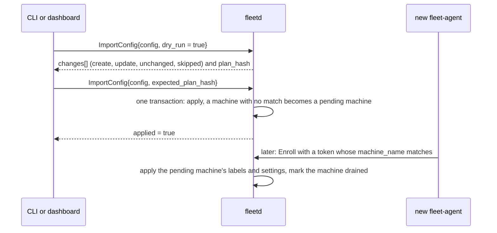

# 02m. Hub API, part 2: routines, goals, logs, accounts, config and audit

- Status: Accepted; contracts unfrozen until v0.1 (ADR 0019)
- Date: 2026-10-02
- Part of: [02b-hub-api.md](02b-hub-api.md), split out to keep each file under the 500-line cap.
  02b holds the resources, conventions, idempotency, versions, operations, Watch, scopes, size
  limits and errors. This part holds the actions by area: routines, goal dispatch and control
  (and the actions that need an approval), stored logs, accounts, config export and import,
  local commands, contract status and codegen, the audit actions and the open questions.

## Routines

A `Routine` is recurring fleet work that is not an issue (dependency bumps,
flaky-test sweeps, a weekly report). Its trigger is `queue_empty` or `cron`; each
run is a normal goal whose work item is `WorkItemKey{kind: ROUTINE, provider_name:
"fleet", key: "<routine id>/<run>"}`, with the goal text from `goal_text_template`,
consent `routine ∩ repo ∩ account`, pacing and triage unchanged, and a snapshot of
its `done_rule` and `report_path` on the goal. Trigger evaluation, run numbering,
missed fires, harness selection and the three done rules are the workflow in
[03i](03i-routines.md).

## Goals: dispatch, control and history

**Dispatch.** `StartGoal` and `PreflightGoal` take the same `GoalSpecInput`
(work item, repo, change request, placement, consent, text, model, effort,
fresh context, reason), so the preview is computed from what would be sent.
`PreflightGoal` returns the hub's checks as `PreflightCheck{ErrorDetail,
severity}` (`BLOCK`, `CONFIRM`, `WARN`, `INFO`) beside the agent's
`Operation.failed_checks`; the reasons are `ReasonCode`s and the severity of each is the table in
[03h](03h-goal-phases-in-depth.md#dispatch-checks-and-their-severity). `StartGoal`
re-runs the checks: a `BLOCK` fails with its reason, a `WARN` the request did
not list in `acknowledged_warnings` fails `PREFLIGHT_WARNINGS_UNACKNOWLEDGED`, and
a `CONFIRM` returns an `Approval` of kind `DISPATCH_CONFIRM` (required role
`OWNER`) instead of a goal; `RunRoutine` takes the same `acknowledged_warnings` and returns
the same `approval` (03i). "Next up" is `PreflightGoal` on the first item of
`ListWorkItems{filter: stage = READY, order_by: dispatch_order}` with an empty
placement.

### Actions that need an approval

One rule covers `StartGoal` with a `CONFIRM` check and `RunHarnessCommand`
with a DESTRUCTIVE command: the response carries the `approval` and **no
operation**, nothing is sent, and no `Operation` exists until the approval
is approved. (`KillWindow` on a developer's window joins this rule with the
row-5 session mirror, which tells hub windows from developer ones; until
then a `KillWindow` for an unknown session fails `SESSION_NOT_FOUND`.)
`DecideApproval` then returns the `operation` (and, for a dispatch, the
`goal`, once row 22 starts goals from decided approvals; until then an
approved dispatch decides but releases no operation); `Approval.operation`
names it. A denied or expired approval creates
neither. A client therefore polls the approval, not an operation that does
not exist yet. Raising the approval stamps `hub_seq` for Watch (the
APPROVALS topic ships with the row-5 mirror); the audit row lands when it
is decided, expires or is withdrawn (`approval.decide`,
`approval.expire`, `approval.withdraw`). Who may decide is
`Approval.required_role`: `DISPATCH_CONFIRM` and `COMMAND_CONFIRM` need
`OWNER`, a prompt answer needs `OPERATOR`.

**Control.** `ControlGoal` guards on `expected_phase`; which action is allowed in
which phase is the table in [03l](03l-goal-lifecycle-and-verification.md#control-actions-by-phase), and a
refusal is `GOAL_ACTION_NOT_ALLOWED`. `NOT_DONE` and `EDIT` on a goal whose
harness already finished (`VERIFYING`, `DISAGREE`) **re-arm** it: the agent
rewrites the goal file's first line and the hub types the harness's set-goal
form in the same pane, same goal id ([03h](03h-goal-phases-in-depth.md#re-arm-after-done)).

**History.** `ListGoalRuns` (one run per harness process: start and end, cause,
end phase, nudges, usage consumed, log keys) and `ListGoalTransitions` (phase
changes with reason and actor) read what the hub stores with the goal. The
Machines timeline is `ListGoals` over `start_time` and `end_time`, not
`create_time`; a goal is either started by the fleet (`origin = DISPATCHED`) or seen in a pane the owner started by hand (`origin = OBSERVED`, [03k](03k-observed-goals.md)). The "Goal progress" task list of the mockup is **not** in the
contract: the goal file's first line and the run list answer "what is it doing".

## Stored logs

All under `SCOPE_LOGS` (owner by default): `ListStoredSessions` (the sessions
whose logs are stored, live or ended, with their stream keys, sizes, times and
the archived last pane summary of each pane), `GetStoredSession`,
`DeleteSessionLogs` (one transaction, audited as `logs.delete`, refused while a
stream is still capturing), `SearchSessionLogs` and `GetLogStoreStatus` (bytes
against the cap, free disk, oldest data, retention, shipping paused). The cap and
retention are `HubSettings.log_size_cap_bytes` and `log_retention` (a settings
change, `SETTINGS`). **Search** is a case-insensitive literal substring over the
ANSI-stripped, decompressed frames of the sessions the filter selects, at most
256 MiB of raw text per call, continued with `page_token`; there is no index and
no regular expression in v1, and a full-text index can be added without changing
the call. **Export** is the client paging `ReadSessionLog`; there is no export
RPC. An ended session stays in `ListSessions` (filter `state = ENDED`) while its
logs exist.

## Accounts: created, discovered, removed

Accounts are **discovered**: a subscription's identity probe, one placeholder per
`(machine, profile)` for a harness that shows no identity (Codex, whose key is
the hash of `<harness>:<machine id>`), and each OpenCode provider from `opencode
providers list` (03b, "Accounts"). The owner maps a Codex placeholder to the
account it really is with `UpdateAccount` bindings. `CreateAccount` exists only
for an **owner-defined API-key account** the agents cannot discover
(`BUDGET_KIND_DOLLAR_CAP`, never auto-dispatched). `DeleteAccount` removes an
account nothing uses (`ACCOUNT_IN_USE` otherwise: a live goal, or a machine that
still shows it signed in). There is no `MergeAccounts`: a stale duplicate is
deleted once signed out. `Account.status.provider` is the machine-readable
provider ("anthropic", "deepseek") the "never auto-dispatch OpenCode on an
Anthropic subscription" rule reads.

## Config export and import

`ExportConfig` returns the configuration as one `FleetConfig` (hub and fleet
settings, groups, machine entries by name, repos, tracker projects, routines,
account specs). The **hub database is the source of truth**; `fleet.yaml` is only
the CLI's YAML rendering of that message, never read by the hub, and it holds no
secrets and no ids. `ImportConfig` validates the whole document, diffs it, and
applies it in **one transaction or not at all**; `dry_run` returns the plan
(`ConfigChange` lines: create, update, unchanged, skipped) and its `plan_hash`,
and a real import passes that hash as `expected_plan_hash`, so what runs is what
was shown. A plan with any `SKIPPED` line applies nothing unless `allow_skipped` is set (`applied = false`). Import only creates and updates. A machine entry that matches an
enrolled machine's display name sets its labels and settings; one that matches
none is kept as a **pending machine**, applied when a machine enrolls under that
name (the token's `machine_name`), and that machine is **recorded as drained**
(`spec.drain`). The machine takes no goal until the owner calls
`UndrainMachine`. Import
never drains an enrolled machine. An integration is never created by import
(credentials are not in the document): it is skipped with a problem. The
enrollment token carries `expected_hostname`, `labels` and `start_drained` for the
same purpose by hand.

**Import with a machine that has not enrolled yet, as messages.** Import applies what it can
now and keeps the rest for when the machine joins. The mark "drained" is recorded at once and
the Machines view shows it, so the new machine takes no goal until the owner calls
`UndrainMachine`.

### Import telemetry (slices 2-3: repos applied, rest diffed)

The first import slice plans and applies watched repos only; any other
non-empty section plans one SKIPPED line with `CONFIG_INVALID`, so the apply
answers `applied = false` with something to fix. Slice 3 extends the diff
(not the apply) to the hub settings, fleet values, integrations and
accounts: a section that carries what the hub holds plans unchanged, so
an export imports to an empty plan. A repo no integration
reaches is the one waivable skip: SKIPPED with `RESOURCE_NOT_FOUND`, applied
with the rest when `allow_skipped` is set. A dry run returns the plan and
its `plan_hash` and writes nothing. An apply with a stale
`expected_plan_hash` is refused with `VERSION_MISMATCH` before any write. An
apply writes its repos and one `config.import` audit row (target `config`,
with the plan hash and the created/updated counts in detail) in one
transaction, after verifying each updated repo still holds its plan-time
version; a repo rewritten since the dry run aborts the whole apply. The
idempotent response is kept for 24 h like every write.

- `fleet_hub_config_imports_total{outcome}` (`planned`, `applied`,
  `replayed`, `refused`, `failed`).
- Logs: `config.import_planned{lines, plan_hash, actor}`,
  `config.import_applied{plan_hash, created, updated, replayed, actor}`,
  `config.import_refused{reason, actor}`,
  `config.import_failed{step, err_kind, actor}` (`step`: `encode`,
  `decode`, `store`).

### Slice 3: accounts, settings, integrations, export

`CreateAccount` adds an owner-defined API-key account (`BUDGET_KIND_DOLLAR_CAP`
only): a new account gets reserve 10 and the push, pr-open and merge consent
when the request leaves them unset. The hub refuses a reserve outside 0 to
50 on create and update (defaults.md, ADR 0024). `UpdateAccount` rewrites the masked spec
fields (display name, mode, reserve, consent, budget kind, spend cap, and the
bindings that map a Codex account showing no identity to a machine);
`DeleteAccount` removes an account nothing uses (`ACCOUNT_IN_USE` follows with
the dispatch rows, which are the first tables that can reference one).
`UpdateSettings` rewrites the masked fields of the fleet settings layer,
creating it at version 1 with the fleet scope seeded (group and machine
layers follow with their management). The hub refuses `max_active`
outside 1 to 16 and `max_total` outside 1 to 32 when set (defaults.md,
ADR 0024). `UpdateIntegration` rewrites an integration's label and tracker
projects. Every write checks the caller, the local secret, the fields, then
the request id in one store transaction (a repeat id with the same body
returns what is stored, another body is refused), stamps the row, versions
it (+1 per spec change; a stale `expected_version` is refused with the
current version named) and leaves its audit row (`accounts/<id>`,
`settings/fleet`, `integrations/<id>`).

`ExportConfig` renders the whole configuration as one `FleetConfig`
(format 1, no secrets, no ids). Anything the hub does not hold yet stays
out of the document, so a fresh hub exports to a literally empty import
plan.

- `fleet_hub_config_writes_total{op, outcome}` (`op`: `account_create`,
  `account_update`, `account_delete`, `integration_update`,
  `settings_update`, `export`, `machine_update`, `machine_revoke`,
  `machine_delete`; `outcome`: `ok`, `replayed`, `refused`,
  `failed`).
- Logs: `config.account_written{op, resource, version, replayed, actor}`,
  `config.account_write_refused{reason, op, actor}`,
  `config.account_write_failed{step, err_kind, op, actor}`,
  `config.integration_written{op, resource, version, replayed, actor}`,
  `config.integration_write_refused{reason, op, actor}`,
  `config.integration_write_failed{step, err_kind, op, actor}`,
  `config.settings_written{op, resource, version, replayed, actor}`,
  `config.settings_write_refused{reason, op, actor}`,
  `config.settings_write_failed{step, err_kind, op, actor}`,
  `config.machine_written{op, resource, version, replayed, actor}`,
  `config.machine_write_refused{reason, op, actor}`,
  `config.machine_write_failed{step, err_kind, op, actor}`,
  `config.exported{repos, accounts, integrations, actor}`,
  `config.export_refused{reason, actor}`,
  `config.export_failed{step, err_kind, actor}` (`step`: `encode`,
  `decode`, `store`; the machine steps add `revocation` and `wiring`).

## Local commands

Not RPCs, on purpose: **`fleetd backup`, `fleetd restore`, `fleetd enroll-token`
(also an RPC), the claim URL and `fleetd debug agent-stream`**. A backup holds the
CA private key and the account salt (03f), so it is written on the hub host and
never returned through an API; the claim URL is printed where the owner is; the
agent-wire tap reads the hub's in-process bus and needs the host. `fleet backup`
in the older ADRs means `fleetd backup`. The store's own numbers (sizes, schema
version, last backup, free disk) are `GetStoreStatus` ([ADMIN]) and the log
store's are `GetLogStoreStatus` ([LOGS]). `fleet debug stream` decodes a **Watch**
tap only. Tokens, users and sign-in are RPCs ([02f](02f-hub-authentication.md)).

## Contract status and codegen

The contracts are **unfrozen until the first implementation release is tagged
`v0.1`** (ADR 0019). Until then renames and type changes are allowed, nothing
is `reserved` for a field no consumer ever saw, and every change must pass
`buf build` and `buf lint`. From the `v0.1` tag on, ADR 0003's additive-only
rule applies again and CI runs `buf breaking` against that tag, not against
`HEAD~1`. The freeze checklist, the naming rules and the codegen setup
(`buf.gen.yaml`: Go with `protoc-gen-go` and `connect-go`, TypeScript with
`protoc-gen-es` and connect-es v2) are in [02e](02e-contract-rules.md).

## Audit actions

`AuditEntry.action` is a dotted name. The vocabulary is open for display, but
every name in use is listed here and a new one is added in the same change. The
actor is the requester (a `Principal`), or none for steps the agent makes
(`machine.enroll`, `machine.cert_renewed`, `machine.enroll_failed`); decisions
made at the machine have actor kind `LOCAL_USER` ([02g](02g-agent-security.md#audit-of-decisions-made-at-the-machine)).
Filter on `action` with `=` or `in` ([02c](02c-hub-watch-and-filters.md)).

`AuditEntry.target` is `<collection>/<id>`, so the Session timeline filters
`target = "sessions/<id>"` and the machine view `machine = "<id>"`. Each action
writes: session actions (`session.*`, `attach.*`) `sessions/<id>`; goal actions
`goals/<id>`; machine actions `machines/<id>`; `repo.*` `repos/<host/path>`;
`account.*` `accounts/<id>`; `work_item.requeue` `work_items/<canonical key>`;
`logs.*` `sessions/<id>` (or `logs` for a search); `config.import` `config`;
settings `settings/<id>`; `machine.enroll_token` writes `enroll_tokens/<id>`;
`machine.enroll_failed` and `machine.connect_refused` write the collection
`machines` when no row exists. The machine admin writes (`machine.update`,
`machine.revoke`, `machine.delete`) are idempotent on `request_id` for 24 h
(02b "Idempotency": the same key and body replays the stored response,
another body is `REQUEST_ID_CONFLICT`), stamp the row, raise its version by
1 (a stale `expected_version` is refused with the current version named)
and audit it with the requester as actor: `machine.update` (detail: the
display name and the version), `machine.revoke` (detail: the reason and the
version), `machine.delete` (detail: the version). The hub-state triage writes
(`triage.snooze`, `triage.dismiss`) work the same way on `triage/<id>`: idempotent
on `request_id` for 24 h, the row stamped, its version raised by 1, and one audit
row with the requester as actor — `triage.snooze` (detail: the wake time and the
version), `triage.dismiss` (detail: the note and the version). An operator snoozes with
`SnoozeTriageItem` (an `OPEN` or `SNOOZED` item, a future `until_time`; a second snooze moves
the wake time) and closes without acting with `DismissTriageItem` (an `OPEN` or `SNOOZED` item,
an optional note of at most 512 bytes kept in the audit row only). Both need `APPROVALS` and
the local approval secret in `local_trusted` mode, name a non-zero `expected_version`, and take
the same `request_id` idempotency; a write against an item that already left `OPEN` and `SNOOZED`
is `TRIAGE_CLOSED`, which wins over `VERSION_MISMATCH` like `APPROVAL_CLOSED` does (03d W7).
`hub.restore` writes `hub`, with the OS user
that ran `fleetd restore` as actor (kind `LOCAL_USER`), in the same
transaction as the restore on the restored store, and a detail of closed
fields only: `backup` (the file's base name, letters, digits, `.`, `_` and
`-` kept, anything else `_`, at most 128 bytes; never a folder),
`schema_from` (the backup's schema version before migration),
`address_added` and `settings_epoch` (the new one). Audit rows written
after the backup (an earlier `hub.restore` row too) are not carried into
the restored store; they stay in `state.db.pre-restore-<stamp>`
([02j](02j-hub-runtime.md#state-directory)), which is kept or exported
before it is deleted (whether restore should carry them forward is open for
plan rows 12 and 13); the others the collection of their resource. A
read-only attach toggle is a re-attach (a new `attach.open`).

| Area | Actions |
|---|---|
| Sign-in and credentials | `auth.claim`, `auth.sign_in`, `auth.sign_in_failed`, `auth.sign_out`, `passkey.add`, `passkey.delete`, `user.invite`, `user.update`, `auth.session_revoke`, `token.create`, `token.revoke`, `device.pair_request`, `device.approve`, `device.revoke` |
| Machines | `machine.enroll_token`, `machine.enroll`, `machine.enroll_failed`, `machine.cert_renewed`, `machine.adopted`, `machine.update`, `machine.drain`, `machine.undrain`, `machine.revoke`, `machine.delete`, `machine.connect_refused`, `machine.local_drain`, `machine.local_undrain`, `machine.install_changed` |
| Commands | `session.create`, `session.keys`, `session.interrupt`, `session.harness_command`, `session.respawn`, `session.kill_window`, `session.availability`, `session.log_capture`, `attach.open`, `attach.close`, `command.refused`, `command.local_approval` |
| Goals and work | `goal.start`, `goal.control`, `goal.rearm`, `goal.state_change` (hub decisions: expiry, abandon, external merge), `work_item.requeue`, `routine.run`, `approval.decide`, `approval.expire` (the DENY fallback on timeout), `approval.withdraw` (the prompt left the screen), `triage.snooze`, `triage.dismiss` |
| Configuration | `settings.update`, `account.create`, `account.update`, `account.delete`, `integration.update`, `repo.create`, `repo.update`, `repo.delete`, `config.import`, `machine.hooks`, `routine.create`, `routine.update`, `routine.delete`, `notification_target.create`, `notification_target.update`, `notification_target.delete`, `policy.changed`, `policy.safe_mode` |
| Logs | `logs.delete`, `logs.search` |
| Insights | `suggestion.dismiss` (`suggestions/<id>`), `insights.report_stored` (`insight_reports/<id>`, actor the verifier) |
| Hub | `hub.restore`, `hub.pprof_enable` |
