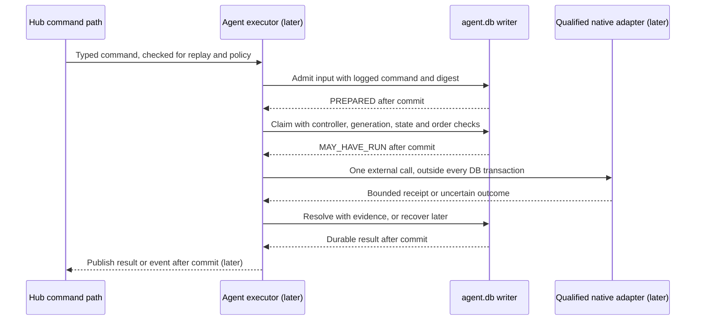

# Native execution journal and later runtime

This page covers the disabled machine-side journal introduced for #266. Native
execution stays off under [ADR 0033](../adr/0033-native-sessions-and-handoff.md)
until an exact interface, version, account and billing mode, approval behavior,
deployment, and real machine-side caller are qualified. The journal stores no
prompt, output, secret, process handle, or permission to launch a harness by
itself. Terminal sessions keep their current behavior.

## One session identity

The eventual hub contract extends the existing `Session` and `SessionId` with
an explicit backend. A stored legacy session with no backend is terminal; an
unknown explicit backend fails closed. A native session will carry harness and
interface, provider-native session identity, non-secret account reference,
repo/worktree reference, requested and observed model/effort, qualification
evidence, and confirmed control state. `SessionStatus.owner` names a principal;
it does not prove that a machine-side controller owns a live native process.
Goal attempt, turn, command, session, account, and provider IDs remain distinct.
Future hub native details belong in an extension row keyed by the existing
`hub_sessions.session_id`. This slice adds no hub table, public resource, wire
arm, event, capability, adapter, or runtime handler.

## Agent-owned records

`agent.db` migration 9 adds `native_sessions` and `native_effects` through the
existing [ring store](../../internal/agent/ring/README.md). One writer owns the
file. A session row binds Fleet `SessionId` to machine and installation,
harness/interface, non-secret account/profile and logical workdir references,
model/effort choice, qualification reference, controller, ownership generation,
control state, and an optional provider-native ID. A new managed session starts
at generation 1 with no provider-native ID or start-effect binding. Binding a
provider ID names one exact claimed start effect in the same session and
generation. The provider ID and start-effect ID are then kept as one immutable
pair. A bound start cannot later become `NO_EFFECT`. These checks record
correlation only: a qualified adapter must prove that the provider ID came
from that start or its reconciliation. This slice has no manual-adoption or
controller-transfer method and cannot increment the ownership generation. #270
must add checked transitions. Reconnect, connection epoch, command sequence,
and process restart do not grant control.

A provider-native ID, once known, is unique across its complete local namespace:
machine, harness/interface, account/profile. It cannot be changed or cleared.
The namespace matters because a provider ID alone may be reused by another
profile. A held session cannot become managed again through this slice.

An effect row holds one stable effect ID, originating logged command ID, Fleet
session ID, expected generation, kind, `CommandBodyDigest` (SHA-256 of the exact
saved encoded command body), per-session admission order, state, optional
earlier `NO_EFFECT` link, and a closed evidence kind plus evidence digest. It
holds no command body, prompt, SDK output, auth or environment data, or
free-form diagnostic. The command
body remains in `command_log` until its normal prune. The journal has no
foreign key to that table, so normal pruning cannot erase unresolved ownership
or block pruning. Retained effect ID, command ID, and digest still detect a
duplicate after pruning.

`CreateNativeSession`, `AdmitNativeEffect`, `ClaimNativeEffect`,
`ResolveNativeEffect`, `RecoverNativeEffects`, `ReadNativeSession`,
`ReadNativeEffect`, and paged `ListUnresolvedNativeEffects` are storage seams.
They have no production caller yet. Admission requires an existing logged
command whose kind and saved body match the effect kind and digest. The digest
is verified against `command_log.command`; it does not prove two native effect
inputs are canonically equivalent. The same effect ID and content returns its
existing row; changed content or a new effect ID for the same command
conflicts. A retry after `NO_EFFECT` needs a fresh effect and command ID linked
to the first effect in the same session, kind and
generation. Only one direct successor may link to each `NO_EFFECT` row; any
further retry links to the next proven `NO_EFFECT`. This link records lineage,
not equal-input proof. The later runtime must define and verify canonical
effect-input equivalence before it can enable automatic dispatch. No implicit
retry occurs.

## External-call boundary

The writer checks ownership, generation, control state, and applicable order
again at claim time. Only a successful **committed** `MAY_HAVE_RUN` claim can
authorize an external call. A cancelled or uncertain commit returns no
authority: the caller reads the row or enters recovery. Two claimers cannot
both receive permission. Ordinary start, send-turn, and resume claims wait for
earlier unresolved effects in the same session. Interrupt and stop may bypass
that order and may be admitted while a session is held; their later runtime
must still pass qualification, policy, and ownership checks. No SQL transaction
or ownership lock spans a provider call or process wait. Approval, interrupt,
stop, and heartbeat paths must remain responsive behind output handling.

The only shared state here is `agent.db`. `ring.DB` queues each write to
`internal/store`'s one writer. That writer holds one short SQLite transaction
while it checks current rows and changes them; jobs never wait on the adapter.
Read methods use a short read transaction. There is no native ownership mutex
and no nested lock order. The transaction ends before the caller may use a
committed claim.

| State | Meaning | Next durable state |
|---|---|---|
| `PREPARED` | Input is saved; no external call is authorized | `MAY_HAVE_RUN`, or `NO_EFFECT` with proof |
| `MAY_HAVE_RUN` | Claim committed; the effect may have happened | `CONFIRMED`, `NO_EFFECT`, or `RECONCILE_REQUIRED` |
| `RECONCILE_REQUIRED` | Restart found uncertainty; ordinary control is held | `CONFIRMED` or `NO_EFFECT` with proof |
| `CONFIRMED` | Evidence confirms the requested effect only | terminal for this effect |
| `NO_EFFECT` | Evidence establishes it did not happen | terminal for this effect |

Recovery pages at most 1,000 rows and turns each `MAY_HAVE_RUN` into
`RECONCILE_REQUIRED`, holding its session in the same transaction. It never
rewinds uncertainty to `PREPARED` or retries an effect. A provider's acceptance
of a send-turn is not turn completion; process exit, interruption accepted,
cleanup complete, and code-host verified goal completion remain separate facts.
An `UNKNOWN_OUTCOME` command result also does not settle ownership or clean up
a process. An observed-only goal stays read-only; manual adoption and transfer
belong to #270.

## Bounds and later gate

The two records accept only named, bounded metadata fields; digests are exactly
64 lowercase hexadecimal characters. Reconciliation evidence is a closed kind
and digest, never a free-form blob. Unresolved listing and recovery require a
page size from 1 to 1,000 and a stable effect-ID cursor. Every table keeps its
rows for now. Before a runtime producer is enabled, it needs measured admission
capacity, bounded recovery scans, and a retention/tombstone rule that never
forgets unresolved ownership or makes a duplicate input runnable. At capacity,
new admission must fail rather than discard unresolved rows. There is no
unmeasured time or row cap in this storage slice.

The later runtime adds typed start, send-turn, resume, interrupt, and stop
commands, structured output/tool/approval/usage events, a qualified adapter
and a real hub→outbox→agent→adapter caller together. Unknown interfaces and
event kinds fail closed. The current `internal/proc` helper is a bounded
one-shot process call with empty stdin; it needs a separate measured streaming
design before it can host a native session. Native capabilities remain
unadvertised until the real caller and all contract checks pass.

No-Observability-Change: this dormant store uses `store.opened`,
`store.migrated`, `fleet_agent_writer_*`, and `fleet_agent_store_*` with
`db="agent"`. The runtime producer must add admission, claim, reconciliation,
and capacity signals before enabling native execution. Tests with synthetic
external-call counts prove only the journal protocol; they do not prove
provider qualification, process cleanup, or the full acceptance of #266.
