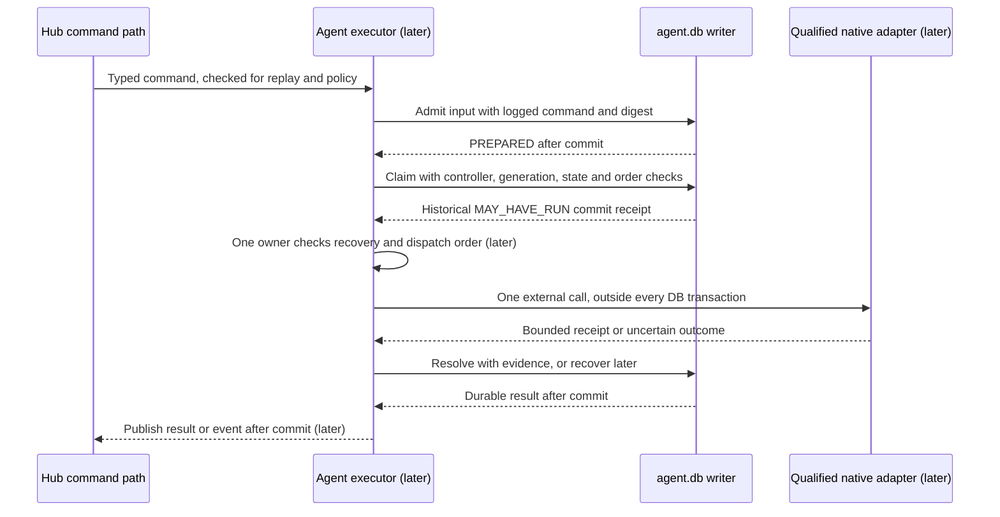

# Native execution journal and disabled runtime

This page covers the machine-side journal and the disabled runtime host for
#266. Native execution stays off under
[ADR 0033](../adr/0033-native-sessions-and-handoff.md) until an exact
interface, version, account and billing mode, approval behavior, deployment,
and real machine-side caller are qualified. The journal stores no prompt,
output, secret, process handle, or permission to launch a harness by itself.
Terminal sessions keep their current behavior.

## One session identity

The eventual hub contract extends the existing `Session` and `SessionId` with
an explicit backend. A stored legacy session with no backend is terminal; an
unknown explicit backend fails closed. A native session will carry harness and
interface, provider-native session identity, non-secret account reference,
repo/worktree reference, requested and observed model/effort, qualification
evidence, and confirmed control state. `SessionStatus.owner` names a principal;
it does not prove that a machine-side controller owns a live native process.
Goal attempt, turn, command, session, account, and provider IDs remain distinct.
Future hub native details belong in an extension row keyed by the existing
`hub_sessions.session_id`. This slice adds no hub table and no hub RPC: the
agent wire (N1 commands, N2 events, 700s reasons), the host, the adapter
boundary and the five executor handlers are the delivery. Hub reads, Watch
topics, outbox constructors and per-backend adapters belong to later slices.

## Agent-owned records

`agent.db` migration 9 adds `native_sessions` and `native_effects` through the
existing [ring store](../../internal/agent/ring/README.md). One writer owns the
file. A session row binds Fleet `SessionId` to machine and installation,
harness/interface, non-secret account/profile and logical workdir references,
model/effort choice, qualification reference, controller, ownership generation,
control state, and an optional provider-native ID. A new managed session starts
at generation 1 with no provider-native ID or start-effect binding. Binding a
provider ID names one exact claimed start effect in the same session and
generation. The provider ID and start-effect ID are then kept as one immutable
pair. A bound start cannot later become `NO_EFFECT`. These checks record
correlation only: a qualified adapter must prove that the provider ID came
from that start or its reconciliation. This slice has no manual-adoption or
controller-transfer method and cannot increment the ownership generation. #270
must add checked transitions. Reconnect, connection epoch, command sequence,
and process restart do not grant control.

A provider-native ID, once known, is unique across its complete local namespace:
machine, harness/interface, account/profile. It cannot be changed or cleared.
The namespace matters because a provider ID alone may be reused by another
profile. A held session cannot become managed again through this slice.

An effect row holds one stable effect ID, originating logged command ID, Fleet
session ID, expected generation, kind, `CommandBodyDigest` (SHA-256 of the exact
saved encoded command body), per-session admission order, state, optional
earlier `NO_EFFECT` link, and a closed evidence kind plus evidence digest. It
holds no command body, prompt, SDK output, auth or environment data, or
free-form diagnostic. The command
body remains in `command_log` until its normal prune. The journal has no
foreign key to that table, so normal pruning cannot erase unresolved ownership
or block pruning. Retained effect ID, command ID, and digest still detect a
duplicate after pruning.

`CreateNativeSession`, `AdmitNativeEffect`, `ClaimNativeEffect`,
`ResolveNativeEffect`, `RecoverNativeEffects`, `ReadNativeSession`,
`ReadNativeEffect`, and paged `ListUnresolvedNativeEffects` are storage seams.
The host (`internal/agent/native`) is their production caller. Admission
requires an existing logged command whose kind and saved body match the effect
kind and digest; the logged kind is the Command.kind arm's message name
(`StartNativeSession`, migration 10, NativeWireKind in code). The digest
is verified against `command_log.command`; it does not prove two native effect
inputs are canonically equivalent. The same effect ID and content returns its
existing row; changed content or a new effect ID for the same command
conflicts. The effect ID is always the command ID: one external effect per
command. A retry after `NO_EFFECT` needs a fresh effect and command ID linked
to the first effect in the same session, kind and
generation. Only one direct successor may link to each `NO_EFFECT` row; any
further retry links to the next proven `NO_EFFECT`. This link records lineage,
not equal-input proof. The later runtime must define and verify canonical
effect-input equivalence before it can enable automatic dispatch. No implicit
retry occurs.

## External-call boundary

The writer checks ownership, generation, control state, and applicable order
again at claim time. A successful `MAY_HAVE_RUN` receipt proves that the
checked transition committed. It is historical: a later recovery or
resolution may commit before the caller sees it. A canceled or uncertain
write returns no receipt: the caller reads the row or enters recovery. Two
claimers cannot both receive a successful claim receipt. Ordinary start,
send-turn, and resume claims wait for earlier unresolved effects in the same
session. Interrupt and stop may bypass
that order and may be admitted while a session is held; their later runtime
must still pass qualification, policy, and ownership checks. No SQL transaction
or ownership lock spans a provider call or process wait. Approval, interrupt,
stop, and heartbeat paths must remain responsive behind output handling.

The only shared state here is `agent.db`. `ring.DB` queues each write to
`internal/store`'s one writer. That writer holds one short SQLite transaction
while it checks current rows and changes them; jobs never wait on the adapter.
The six native mutations first take a context-aware per-DB gate, then queue a
job. The gate stays held until that job's actual commit or rollback completes,
even if its caller cancels and returns no receipt. One DB-owned waiter releases
the gate after such a canceled job; closing the DB drains and joins it. Ordinary
command and event writes, and all reads, stay outside this gate. The writer
never takes it; no SQL transaction or gate covers provider I/O. The gate
prevents a later native mutation from changing a claim inside the same commit.
It does not keep the receipt current after return. A future one-owner
controller must serialize claim completion, dispatch, recovery and resolution:
recovery first suppresses dispatch from the old receipt; dispatch first leaves
an outstanding effect that cannot become `NO_EFFECT` or runnable until the
operation finishes or is fenced against late effects with absence evidence.
Restart quiesces the old controller and adapter before recovery and new
dispatch. No ownership lock spans provider I/O.

One live `ring.DB` and store owner per `agent.db` is a caller precondition. The
existing `fleet-agent.lock` is held before `ring.Open` until the DB closes. This
gate is per DB; it does not fence another process or handle that ignores that
precondition. Read methods use a short read transaction.

| State | Meaning | Next durable state |
|---|---|---|
| `PREPARED` | Input is saved; no external call is authorized | `MAY_HAVE_RUN`, or `NO_EFFECT` with proof |
| `MAY_HAVE_RUN` | Claim committed; the effect may have happened | `CONFIRMED`, `NO_EFFECT`, or `RECONCILE_REQUIRED` |
| `RECONCILE_REQUIRED` | Restart found uncertainty; ordinary control is held | `CONFIRMED` or `NO_EFFECT` with proof |
| `CONFIRMED` | Evidence confirms the requested effect only | terminal for this effect |
| `NO_EFFECT` | Evidence establishes it did not happen | terminal for this effect |

Recovery pages at most 1,000 rows and turns each `MAY_HAVE_RUN` into
`RECONCILE_REQUIRED`, holding its session in the same transaction. It never
rewinds uncertainty to `PREPARED` or retries an effect. A provider's acceptance
of a send-turn is not turn completion; process exit, interruption accepted,
cleanup complete, and code-host verified goal completion remain separate facts.
An `UNKNOWN_OUTCOME` command result also does not settle ownership or clean up
a process. An observed-only goal stays read-only; manual adoption and transfer
belong to #270.

## Bounds and later gate

The two records accept only named, bounded metadata fields; digests are exactly
64 lowercase hexadecimal characters. Reconciliation evidence is a closed kind
and digest, never a free-form blob. Unresolved listing and recovery require a
page size from 1 to 1,000 and a stable effect-ID cursor. Every table keeps its
rows for now. Before a runtime producer is enabled, it needs measured admission
capacity, bounded recovery scans, and a retention/tombstone rule that never
forgets unresolved ownership or makes a duplicate input runnable. At capacity,
new admission must fail rather than discard unresolved rows. There is no
unmeasured time or row cap in this storage slice.

The runtime host (`internal/agent/native`) runs the five typed commands
through the existing executor, command log, outbox, event ring and hub
writer, and classifies the seven structured event arms. The Adapter
interface is the only boundary a backend crosses; per-backend adapters land
with qualification (#267-#269). Unknown interfaces and event kinds fail
closed. Process launch goes through `internal/proc` with a measured caller:
the one-shot helper stays the only spawn path, so a native session process
needs a separate measured streaming design before any adapter may host one.
Native capabilities remain unadvertised until a qualified adapter registers.

Bounds: turn input at most 32 KiB; output samples emit at most 64 chunks of
4 KiB (256 KiB), larger bursts cut with the gap counted; an ordinary effect
waits at most 30 s for earlier unresolved effects of its session before it
gives up its own admission; interrupt and stop never wait. Journal rows are
still retained: before a runtime producer is enabled, admission capacity,
bounded recovery scans and a retention rule that never forgets unresolved
ownership still need measurement (at capacity, admission fails rather than
discarding).

Telemetry: `fleet_agent_native_effects_total{kind,state}` counts terminal
resolutions (confirmed, no_effect, unknown_outcome), by journal kind;
`fleet_agent_native_buffer_dropped_bytes_total{kind}` counts shed output;
`fleet_agent_native_events_total{kind}` counts emitted arms (the emitter also
counts every arm in `fleet_agent_events_total`). Log lines
`native.effect_resolved`, `native.effect_abandon_failed`,
`native.recovery_completed` and `native.event_emitted` name ids, kinds and
enum outcomes only, never text.
Unqualified commands are refused by the executor's own `command.refused`
line, which names the missing `native.<backend>` capability. Tests with
synthetic external-call counts prove only the journal protocol and the
host's ordering; they do not prove provider qualification, process cleanup,
or the full acceptance of #266.
