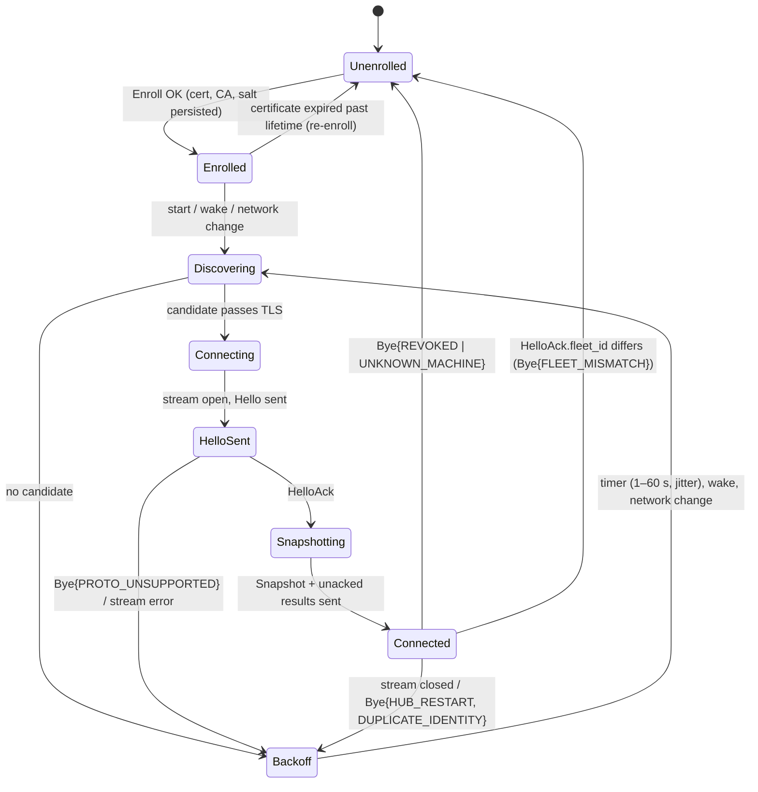
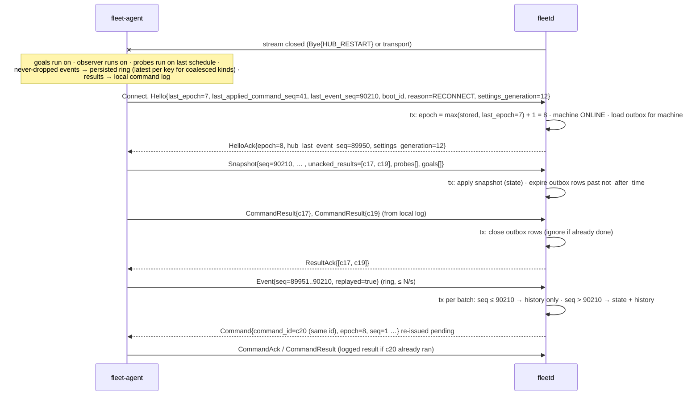
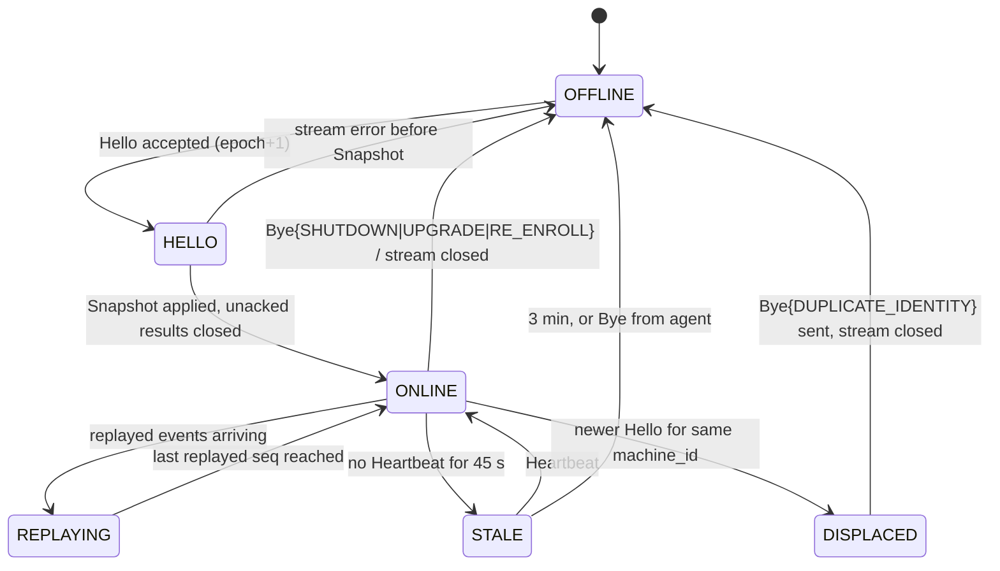

# 03. Agent ↔ hub workflows

- Status: Draft for review
- Date: 2026-10-02
- Inputs: [01-agent-capabilities.md](01-agent-capabilities.md),
  [01b-harness-commands.md](01b-harness-commands.md),
  [01c-handoff.md](01c-handoff.md) (measured volumes),
  [02-contracts.md](02-contracts.md), `api/fleet/*/v1/*.proto`,
  ADRs [0001](../adr/0001-system-architecture.md)–[0011](../adr/0011-contract-amendments.md),
  [design.md](../design.md), [research/paperclip.md](../research/paperclip.md)
- Output: the numbers and requirements step 4 (technology review) decides on.
  This step decides no technology.

Each workflow is a sequence of contract messages with its trigger, actors, state
machine (where the workflow owns state), what is persisted where and inside
which transaction, ordering rules, every failure mode, and the telemetry an
operator uses at 3 AM. Split across files to stay under 500 lines each:

| File | Workflows |
|---|---|
| this file | conventions, **W1** enrollment and first connect, **W2** reconnect |
| [03b-usage-and-sync.md](03b-usage-and-sync.md) | **W3** usage probing and pacing, **W4** work-source and code-host sync |
| [03c-goals.md](03c-goals.md) | **W5** dispatch a goal, **W6** goal lifecycle and verification |
| [03d-triage-sessions-logs.md](03d-triage-sessions-logs.md) | **W7** triage items, **W8** developer sessions, **W9** session logs |
| [03e-settings-and-drift.md](03e-settings-and-drift.md) | **W10** settings and policy, **W11** harness upgrade drift |
| [03f-hub-internals.md](03f-hub-internals.md) | hub concurrency model, data model sketch |
| [03g-load-and-handoff.md](03g-load-and-handoff.md) | load table, questions for step 4, required contract changes, open questions |
| [03h-goal-phases-in-depth.md](03h-goal-phases-in-depth.md) | start-failure reactions, dispatch checks, drain and the outbox, provider-side changes, limit wait, re-arm, scheduler explanations |
| [03i-routines.md](03i-routines.md) | **W5b** routine runs: triggers, numbering, done rules |
| [03j-provider-sync-and-trust.md](03j-provider-sync-and-trust.md) | the provider interface in use: queries, cursors and validators, rate limits, typed errors, the trusted-issues gate |

## Conventions

**Provider-neutral terms.** The hub integrates with a **work tracker** (lists
ready work items, claims, labels: GitHub Issues first; GitLab Issues, Jira,
Linear later) and a **code host** (repositories, **change requests** = PR/MR,
checks, reviews, merge state: GitHub first; GitLab, Bitbucket later). A Jira
ticket paired with a GitHub change request is valid. "Work item" replaces
"issue", "change request" replaces "PR", **forge CLI** (`gh`, `glab`) is the
agent-side tool that reports sign-in and push access.

**Contract names.** Diagrams use the message names in `api/fleet/*/v1`,
including the provider-neutral types merged in #7 (ADR 0012):
`RepoRef{host, path}`, `WorkItemKey{integration, kind, project, key,
provider_name}` (identity) and `WorkItemRef{key, provider, url, display}`, `ForgeCliStatus{tool, host, signed_in, user, access[]}`,
`GoalSpec.work_item` + `GoalSpec.repo` as separate fields, and
`integration/v1/` (`model.proto`: `WorkItem`, `ChangeRequest`, `CheckSummary`, `Review`,
`Claim`, `Label`; `integration.proto`: `IntegrationCapabilities`; `sync.proto`, `service.proto`) for hub-side mirrors. Anything a workflow
needs beyond those is listed in
[03g](03g-load-and-handoff.md#required-contract-changes).

**Persistence vocabulary.** *Hub store* = the hub's embedded database (ADR
0002, provisional until step 4). *Log store* = `logs.db`, the second SQLite file
with its own writer that holds session-log chunks (ADR 0015). *Agent state dir* = `~/.local/state/fleet-agent/` (cert, key,
pinned CA, command log, event ring, spool, settings, probe assignments, goal
registry, availability marks).
*Work tracker / code host* = the provider's own truth, never copied beyond a
mirror with cursors.

**Transaction rule** (ADR 0001): a hub transaction never spans a network call.
Every workflow below names the transaction that commits a decision, then the
message sent after commit. The single writer goroutine
([03f](03f-hub-internals.md)) executes all of them.

**Telemetry naming.** Metrics `fleet_hub_*` and `fleet_agent_*` (OTEL, Prometheus
style, unit suffix). Spans `hub.<area>.<action>` and `agent.<area>.<action>`.
Structured log events `<area>.<event>` with `machine_id`, `goal_id`,
`command_id`, `epoch`, `seq` as attributes wherever they apply. Every
never-dropped event kind has a counter with a `kind` label; every command kind
has `fleet_hub_commands_total{kind,status}` and
`fleet_hub_command_roundtrip_seconds{kind}` (issued → result). These are
assumed by every workflow and not repeated.

**Shared failure handling.** The envelope checks of 02-contracts.md (known
`command_id` → logged result; `not_after_time`; epoch; seq; capability; policy;
role; local approval) apply to every command and are not repeated per
workflow. "Duplicate command" below always means: the agent returns the logged
result without re-executing.

---

## W1. Enrollment and first connect

**Trigger.** Owner runs `fleetd enroll-token --machine <name> [--expect-host
<h>] --ttl 15m`, then on the machine `fleet-agent enroll --token T [--hub
addr]`; or a container boots with `FLEET_ENROLL_TOKEN`.

**Actors.** Owner (CLI/UI), `fleetd` gateway + writer, `fleet-agent`, the
developer's tmux server, the hidden `fleet-probe` server (identity probe only).

```mermaid
sequenceDiagram
  participant O as Owner
  participant H as fleetd
  participant A as fleet-agent
  participant T as tmux / harnesses
  O->>H: enroll-token --machine omarchy
  H->>H: tx: enroll_tokens{secret hash, name, expected_hostname, labels, start_drained, not_after_time}
  H-->>O: token (once; embeds the CA SHA-256)
  O->>A: fleet-agent enroll --token T
  A->>A: Ed25519 key, CSR · MachineFacts (B1)
  A->>H: TLS: verify server chain against the token's CA SHA-256 (abort here on mismatch)
  A->>H: Enroll(EnrollRequest{token, csr_pem, facts, capabilities, proto_min/max, install_id})
  H->>H: tx: burn token, insert machine (labels, settings layer and spec.drain from the token or a pending imported entry of that name; start_drained → drained), cert serial, store response keyed by (token, install_id, CSR key) · warn if hostname ≠ expected
  H-->>A: EnrollResponse{machine_id, cert_pem, ca_chain_pem, ca_fingerprint, account_salt, salt_version, hub_addresses, machine_name, fleet_id, replayed}
  A->>A: persist cert/key/CA/salt (0600), cache hub address
  A->>T: identity + catalog probe per harness (C2, C4) on fleet-probe
  A->>H: Connect [mTLS] Hello{machine_id, capabilities, boot_id, last_epoch=0, last_event_seq=0, reason=START, sent_time, settings_generation=0}
  H->>H: tx: machine_connections{epoch=1}, machine ONLINE · revocation lookup
  H-->>A: HelloAck{hub_time, epoch=1, proto_version, capabilities_accepted, hub_last_event_seq=0, max_message_bytes, heartbeat_interval, settings_generation}
  H-->>A: Settings{generation, labels, values} (if generation > 0)
  A->>H: Snapshot{seq, facts, harnesses[], accounts[], tmux_servers[], goals[], repos[], forge_cli, usage[], probes[], policy, settings, drain}
  H->>H: tx: replace inventory for machine · diff desired vs observed · enqueue EnsureProbe / SetLogCapture as needed
  H-->>A: Command{EnsureProbe …} (W3), ResultAck{}
  A->>H: SettingsAck{generation, effective, capped_fields}
  loop every 15 s
    A->>H: Heartbeat{counts, load1, spool, event_seq}
  end
```

**Hub discovery (A2).** Candidate order: cached last-good address → mDNS
`_fleetd._tcp` (macOS built-in; Linux needs `avahi`, otherwise skipped and
`doctor` says so) → configured addresses (`EnrollResponse.hub_addresses` plus
local config) → Tailscale name (v3, only if enabled on both ends). A candidate
is accepted only when TLS verifies against the pinned CA and the server
certificate names the hub; an impostor at a discovered address fails TLS and
the next candidate is tried. One full cycle through candidates is one attempt;
attempts back off with full jitter 1–60 s. On success the address is cached.

**Snapshot reconcile (A3).** Hub applies the snapshot in one transaction:
replace the machine's sessions/windows/panes/goals/repos/harness rows, store
`Snapshot.seq` as `last_event_seq`, then diff desired state: probe assignments
whose machine is this one but which the snapshot's `probes[]` does not show →
`EnsureProbe`, and the reverse, a probe the snapshot shows that the hub does not
assign to this machine (failed over while it was away, or an account removed) →
`StopProbe`; live goal rows (03c phase classes) with a pane that is absent from the
snapshot → goal `PANE_LOST` (W6); `goal_registry[]` entries the hub does not
know → triage `orphan_goal_pane` (W7), and goals the hub expects in `STARTING`
to `STOPPED` that the registry lacks → `RegisterGoal` (02h); availability marks
the hub holds that `TmuxPane.availability` lacks → `SetPaneAvailability`;
a `spec.drain.draining` that differs from `Snapshot.drain.draining` (and the
agent's drain is not local) → `Drain` or `Undrain`, so a `Drain` that expired while
the machine was offline is not lost; outbox rows `pending`/`delivered` for
this machine → re-sent after commit unless past `not_after_time`, which become
`EXPIRED`.

**Hook reconcile.** The same diff enqueues `EnsureGoalHooks{harness, workdir,
expected_version, profile}` for each `(harness, profile, enabled Repo checkout)`
on the machine whose `GoalHooksState` is missing, unverified, or behind the hub's
`expected_version`, when `Repo.spec.hooks_mode` is `GENERIC` (or `AUTO` and the
checkout does not ship its own hooks); `ESHU` only reports. Other triggers: a
`harness_changed` event (W11), a repo turned on or its mode changed, one
`GOAL_FILE_NOT_SEEN` per `(machine, harness)` per day, and the owner's
`EnsureMachineHooks`. It never runs while a goal is live in a pane of that harness
on the machine, and a machine whose local policy needs approval for it waits for
someone there (the scheduler principal may send it, 02g). The Muse goal registry
needs no hooks step: `register_goal` writes it inside `StartGoal` (02h).

### State machine (agent connection, owned by the agent)



Hub-side machine state: `ENROLLED` (never connected) → `ONLINE` (Hello +
Snapshot applied) → `STALE` (no heartbeat 45 s) → `OFFLINE` (3 min, or agent
`Bye`) → `ONLINE`; from any of them `RevokeMachine` → `REVOKED` (serials on the
revocation list, `Bye{REVOKED}` on the live stream, goals `ABANDONED` or `STUCK`, row
kept), and `DeleteMachine` forgets a revoked machine. The cascade and the
re-enroll rule are in [02g](02g-agent-security.md#machine-lifecycle-revoke-and-delete).

### Persistence

| What | Where | Transaction |
|---|---|---|
| Enrollment token secret hash, expected hostname, TTL, `used_time`, `previous_machine` | hub store | one tx at `enroll-token`; burned in the Enroll tx |
| Machine row (id, name, facts, labels), cert serial + `not_after_time`, the stored Enroll response (kept until the token's TTL + 24 h, keyed by token, `install_id` and CSR key, for replay) | hub store | the Enroll tx (token burn + machine + serial + response together; signing is local CPU, not a network call) |
| Key (kept until Enroll succeeds, so a retry sends the same CSR), cert, CA chain + pinned fingerprint, `machine_id`, salt, `fleet_id`, cached hub address | agent state dir, mode 0600 | written before `Enroll` returns to the shell; salt never logged |
| `machine_connections{epoch, boot_id, peer_addr, reason, connect_time}` | hub store | the Hello tx (also marks ONLINE) |
| Inventory from the snapshot | hub store | the snapshot tx (replace per machine) |
| Outbox transitions (`pending → delivered`, `→ expired`) | hub store | the snapshot tx; messages sent after commit |

### Ordering and consistency

- Nothing but `Hello` is accepted before `HelloAck`; events before the
  `Snapshot` of this epoch are discarded with a counter.
- `Snapshot.seq` supersedes every event with lower `seq`; later events apply
  only if `seq > last_event_seq` (strictly increasing per machine and
  `event_generation`; the agent keeps it so across crashes, 02i).
- The snapshot replaces inventory wholesale; derived hub state (goals, triage)
  is diffed, never replaced.
- Settings may arrive before the snapshot; the agent applies them and the
  `Snapshot.settings` already reflects the merge (W10).

### Failure modes

| Failure | What happens |
|---|---|
| Token unknown, expired or already used | `Enroll` fails with a gRPC error whose `ErrorDetail.reason` is `ENROLL_TOKEN_UNKNOWN`, `_EXPIRED` or `_USED` (02g); nothing persisted on the hub except an audit row (`machine.enroll_failed`); the agent prints the reason and exits 1 |
| Enroll response lost after the token burned | Run `enroll` again: the same token, `install_id` and CSR key return the stored response (`replayed = true`), same `machine_id` and certificate, no second machine row |
| Impostor at the address the owner typed or mDNS found | The agent verifies the server chain against the CA SHA-256 inside the token before sending the token or CSR; the impostor learns nothing and the agent aborts (no TOFU) |
| A different machine enrolls with a token tied to `expected_hostname` | Enroll succeeds; machine row flagged `hostname_mismatch`; triage info item (W7); owner deletes it if wrong |
| Hub unreachable / all candidates fail | Backoff loop; `doctor` shows the last error per candidate; nothing else blocks |
| Impostor at a discovered address | TLS verification fails; counted, next candidate |
| Hello from a valid certificate the hub does not know (store recreated, or a backup that predates the enrollment) | `Bye{UNKNOWN_MACHINE}`; the agent goes Unenrolled and the owner issues a token. During a restore reconcile window the hub adopts the machine instead (02g) |
| Hub restart between `Enroll` and first `Connect` | Enroll is durable; Connect retries |
| Agent restart before the state dir is fully written | Enroll is atomic on disk (write temp + rename); a half-written dir is detected and the user re-runs enroll with a new token |
| Certificate expired (machine offline longer than lifetime) | Hello refused at TLS; agent logs `cert_expired` and `doctor` says "re-enroll" |
| Duplicate identity (same cert from two hosts) | W2 |
| Clock skew > 5 min (`Hello.sent_time` or `Heartbeat.sent_time` vs hub receive time) | HelloAck still sent; machine warning; commands still evaluated in hub time; above 15 min `clock_untrusted` (02i, "Clocks") |
| Snapshot would exceed 960 KiB | Sent as parts (`snapshot_id`, `part_index`, `part_count`, same `seq`) that split whole servers, sessions or list entries, never a pane; the hub applies it once every part arrived (02, "Snapshot parts"). The agent never drops a pane or a goal to fit. A hub that does not list `snapshot.parts` gets one snapshot (`raw_screen` is always omitted); if that is still over the cap the agent logs `snapshot.oversize` and `doctor` says the hub must be upgraded |
| Hub writer backlog while 50 agents reconnect | HTTP/2 flow control holds the stream; snapshot apply is one tx per machine, batched by the writer ([03g](03g-load-and-handoff.md)) |
| Harness crash during the identity/catalog probe | `HarnessInfo` reported with `version_support` as detected and `AccountIdentity.signed_in=false`; probe retried in 1 min, max 3, then only on version change |
| Developer typing in a pane | Not relevant here; the identity probe runs on the hidden `fleet-probe` server |
| Work tracker / code host down | Not involved in W1 |

### Telemetry

- `fleet_agent_connect_attempts_total{result, source=cached|mdns|configured|tailscale}`,
  `fleet_agent_connected` (gauge 0/1), `fleet_agent_discovery_seconds`,
  `fleet_agent_cert_expiry_seconds`.
- `fleet_hub_enroll_total{result}`, `fleet_hub_agents_connected`,
  `fleet_hub_machine_state{machine, state}` (gauge 0/1 per state),
  `fleet_hub_snapshot_apply_seconds`, `fleet_hub_snapshot_bytes`,
  `fleet_hub_events_discarded_before_snapshot_total`, `fleet_hub_clock_skew_seconds{machine}`.
- Spans: `agent.enroll`, `agent.discover` (one child per candidate),
  `agent.connect.hello`, `hub.connect.hello`, `hub.snapshot.apply`.
- Logs: `enroll.issued`, `enroll.completed{hostname_mismatch}`,
  `connect.hello{epoch, boot_id, reason, skew_ms}`, `snapshot.applied{panes,
  goals, bytes, diff: probes_reissued, goals_pane_lost, orphan_panes}`.

At 3 AM: "machine X offline since when, why?" → `fleet_hub_machine_state` plus
the agent's `connect.attempt` logs (last candidate tried, last TLS error).

---

## W2. Reconnect after hub restart or hours offline

**Trigger.** Stream closes (hub restart, hub asleep, network change, agent
wake); the agent reconnects with backoff and immediately on wake/network change
(A6). Also: a second connection for the same `machine_id` (duplicate identity).

**Actors.** `fleet-agent` (ring, command log, probes keep running), `fleetd`
gateway/writer/scheduler, tmux (goals keep running untouched).



**Epoch bump.** Every new stream gets `max(stored epoch, Hello.last_epoch) + 1`,
so a hub restored from a backup never reissues an epoch the agent already used
(02i, "Connection epoch"). Commands from the old epoch
still in flight on the agent are finished normally (the agent already
persisted them); any that arrive late are refused `EPOCH_MISMATCH`, but the
known-`command_id` check comes first, so a re-issued command with the same id
returns the logged result rather than tripping the seq check.

**Replay rules.** The ring holds only never-dropped and coalesced kinds (02i),
persisted, 1 week, size-capped (latest state per key wins). The agent replays
everything with `seq > HelloAck.hub_last_event_seq` at a bounded rate (proposal:
200 events/s per agent; step 4 sets the hub-side ingest limit). The hub writes
replayed events with `seq ≤ Snapshot.seq` to the event history only (timeline,
run history) and runs **no rule** on them: the snapshot already holds their
effect, which is why it carries prompts, conditions, input time and the goal
registry. Events with `seq > Snapshot.seq` apply to live state as well. The
agent keeps `seq` monotonic: a persisted high-water mark across crashes, and a
floor of `HelloAck.hub_last_event_seq + 1` after a wipe or a restore. Gaps in
`seq` are normal (shed and coalesced events consume numbers); the hub reads
loss from `Hello.event_counters` and `Heartbeat.events` (`evicted_total`), not
from missing numbers, and answers a rise with `SnapshotRequest{reason="event_lost"}`
and a gap marker on the timeline (02i, "Gaps").

**Duplicate identity.** A second `Hello` for a `machine_id` with a live stream:
newest wins, silently. The hub sends `Bye{DUPLICATE_IDENTITY}` on the old stream
(if it can still be written to) and bumps the epoch. A sleeping laptop or a
restarted agent leaves a half-open, silent old stream, so a benign reconnect
raises nothing. A triage warning, fingerprinted on the pair of `boot_id`s, is
raised only when the displaced stream had a heartbeat within 45 s and the two
`boot_id`s then displace each other again within 10 minutes (two hosts with one
copied state dir ping-pong; a restart does not). It is re-raised at most once
per hour and auto-dispatch to that machine is suspended until the owner
resolves it.

### State machine (hub-side connection for one machine)



Hub start: every machine is set to `STALE` with `since_time = hub_start`, so the
usual 3-minute rule turns silent ones `OFFLINE`; nothing is scheduled on a
machine until it is `ONLINE` again. On graceful shutdown the hub sends
`Bye{HUB_RESTART}` so agents reconnect quickly with backoff rather than
waiting for keepalive timeouts.

### Persistence

| What | Where | Transaction |
|---|---|---|
| Event ring (`seq`, body, 1 week, size cap) | agent state dir (append file + index) | per event, fsync batched ≤ 1 s |
| `seq_hwm` (reserved in blocks of 1024), `EventCounters`, `install_id` | agent state dir | one fsync per block; counters with it |
| Command log (last 10,000 or 7 days; status, result, step reached) | agent state dir | per state change, before `CommandAck` is sent |
| Probe assignments (`EnsureProbe` as received) | agent state dir | with the command log |
| Goal registry (`GoalRegistration` per pane) and availability marks (per pane key) | agent state dir | `register_goal`, `RegisterGoal`, `ReleaseGoal`, mark commands; both reported in every snapshot (02h) |
| Outbox rows (`pending/delivered/done/expired/failed`, epoch, seq) | hub store | Hello tx (expiry), result tx (close) |
| Event history (replayed and live, 1 week) | hub store | per writer batch |
| `machine_connections` (epoch, boot_id, reason, peer, displaced_by) | hub store | Hello tx |
| Per machine: `hub_last_event_seq`, `event_generation`, last `EventCounters`, `install_id` | hub store | writer batch (seq); Hello tx (the rest) |

### Ordering and consistency

- Per machine: Snapshot first, then unacked results, then replayed events in
  `seq` order, then live events. The agent enforces this order on its side;
  the hub discards anything out of order and asks for a snapshot.
- Results for commands the hub already closed are ignored (idempotent by
  `command_id`); results for commands the hub never issued (DB restored from an
  older backup) go to the audit log and a triage info item.
- Re-issued commands keep their `command_id`; the agent's log answers them.
- A `StartGoal` that expired during the outage is `EXPIRED` on the hub, but if
  `Snapshot.goal_registry` binds that goal to a pane, the goal is adopted as
  `RUNNING` (W5) rather than re-planned.

### Failure modes

| Failure | What happens |
|---|---|
| Agent offline for hours | Goals run on; ring fills (latest per key); on reconnect snapshot gives truth, ring gives timeline; ring overflow shows as a rise of `evicted_total` and a `gap` on the timeline |
| Agent crashed, or its state directory was wiped or a VM image reverted | `seq` resumes above `seq_hwm` after a crash; after a wipe `Hello.last_event_seq` is below the hub's, the hub records an agent rollback (new `event_generation`, timeline marker, audit row) and the agent floors `seq` above `hub_last_event_seq`, so nothing is dropped as a duplicate |
| Hub restart mid-snapshot apply | Stream drops; the partial tx rolls back; the agent reconnects and sends a fresh snapshot |
| Hub store restored from backup | Epoch rises above the agent's `last_epoch` (no `SEQ_REPLAYED`); `hub_last_event_seq` is lower, so the agent replays its ring and the snapshot covers the rest; registry entries for unknown goals → `orphan_goal_pane` triage; unknown results → audit only; settings generation on the agent may be newer than the hub's → hub re-sends its current generation and the agent applies it (settings are ordered by `(settings_epoch, generation)`, and a different epoch is accepted whatever its generation; 02, "Settings order") |
| Duplicate `command_id` re-issued | Logged result returned, nothing re-executed |
| Deadline expired while offline | Hub marks `EXPIRED` without sending; UI shows "not delivered, machine was offline"; dispatch re-plans (W5), prompt answers are dropped (W7) |
| Harness crashed while offline | `PaneExited{goal_id}` is in the ring (never dropped); replayed as history only; the snapshot already shows the pane dead, and W6 evaluates the one-nudge rule once from the snapshot, keyed on its fingerprint |
| Provider error while offline | `HarnessCondition` with `cleared` pairs replay into history; current conditions come from the snapshot (requires `Snapshot.conditions[]`, 03g) |
| Prompt appeared and vanished while offline | `PromptDetected` + `PromptGone` replay into history only (nobody can still answer it, so no triage item); a prompt still showing comes from `Snapshot.prompts[]` (03g) |
| Developer typed in a goal pane while offline | `PaneInput` in the ring (coalesced, latest time) and `TmuxPane.last_input_time` in the snapshot; W6's "human at keyboard" suppression is derived from the snapshot's `last_input_time` (the replayed `PaneInput` is history only) |
| Work tracker / code host unavailable at reconnect | W4 lag rises; verification waits; dispatch stays paused while lag exceeds its threshold |
| Flapping network (reconnect every few seconds) | Each reconnect costs a snapshot; the agent rate-limits reconnects to one per 5 s and the hub to one Hello per machine per 5 s; `fleet_hub_reconnects_total` shows it |
| Ring replay floods the hub after a long outage | Replay is rate-limited per agent; the writer batches; HTTP/2 flow control blocks the agent, never the hub's other machines (per-stream windows) |

### Telemetry

- `fleet_agent_ring_events`, `fleet_agent_ring_bytes`, `fleet_agent_ring_dropped_total`,
  `fleet_agent_replayed_events_total`, `fleet_agent_unacked_results`,
  `fleet_agent_events_shed_total`, `fleet_agent_events_coalesced_total`, `fleet_agent_events_evicted_total`,
  `fleet_agent_reconnects_total{reason}`.
- `fleet_hub_reconnects_total{machine, reason}`, `fleet_hub_epoch{machine}`,
  `fleet_hub_commands_expired_total{kind}`, `fleet_hub_duplicate_identity_total{machine}`,
  `fleet_hub_event_gap_total{machine}` (rises of `evicted_total`), `fleet_hub_agent_rollback_total{machine}`, `fleet_hub_replay_backlog_events{machine}`,
  `fleet_hub_results_unknown_command_total`.
- Spans: `hub.reconnect` (children `hub.snapshot.apply`, `hub.outbox.reconcile`,
  `hub.replay.ingest`), `agent.reconnect` (children `agent.ring.replay`).
- Logs: `reconnect.hello{epoch, last_epoch, last_event_seq, hub_last_event_seq,
  reason}`, `outbox.expired{command_id, kind, age}`, `identity.duplicate{old_boot_id,
  new_boot_id, old_peer, new_peer}`, `replay.gap{from_seq, to_seq}`.

At 3 AM: "did the hub lose anything during the restart?" →
`fleet_hub_event_gap_total` and `replay.gap` logs; "why is this goal shown
twice / missing?" → `snapshot.applied{diff}` and `orphan_goal_pane` items.
