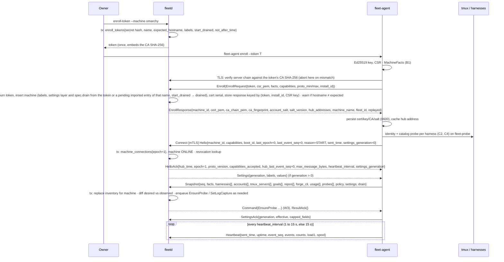
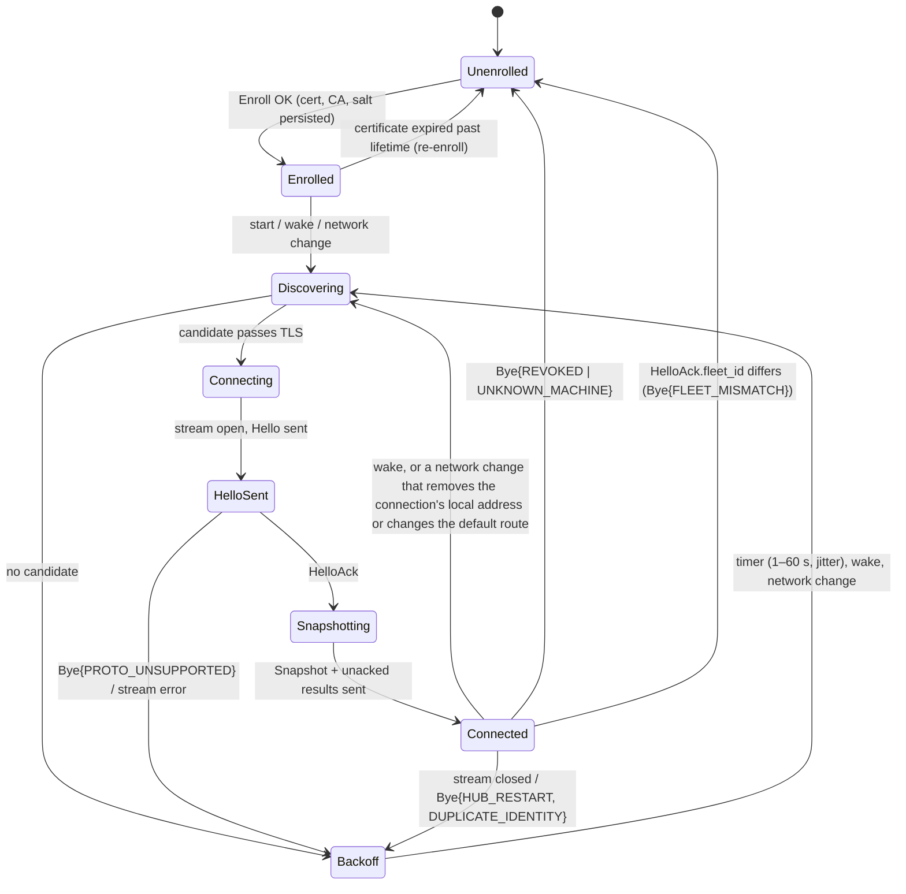

# 03. Agent ↔ hub workflows

- Status: Accepted
- Date: 2026-10-02
- Inputs: [01-agent-capabilities.md](01-agent-capabilities.md),
  [01b-harness-commands.md](01b-harness-commands.md),
  [verified-facts.md](../research/verified-facts.md) (measured volumes),
  [02-contracts.md](02-contracts.md), `api/fleet/*/v1/*.proto`,
  ADRs [0001](../adr/0001-system-architecture.md)–[0011](../adr/0011-contract-amendments.md),
  [research/paperclip.md](../research/paperclip.md)
- Output: the numbers and requirements step 4 (technology review) decides on.
  This step decides no technology.

Each workflow is a sequence of contract messages with its trigger, actors, state
machine (where the workflow owns state), what is persisted where and inside
which transaction, ordering rules, every failure mode, and the telemetry an
operator uses at 3 AM. Split across files to stay under 500 lines each:

| File | Workflows |
|---|---|
| this file | conventions, **W1** enrollment and first connect |
| [03b-usage-and-sync.md](03b-usage-and-sync.md) | **W3** usage probing and pacing |
| [03c-goals.md](03c-goals.md) | **W5** dispatch a goal |
| [03d-triage-sessions-logs.md](03d-triage-sessions-logs.md) | **W7** triage items, **W8** developer sessions, **W9** session logs |
| [03e-settings-and-drift.md](03e-settings-and-drift.md) | **W10** settings and policy, **W11** harness upgrade drift |
| [03f-hub-internals.md](03f-hub-internals.md) | hub concurrency model, data model sketch |
| [03g-load-and-handoff.md](03g-load-and-handoff.md) | a stub: the load table moved to [04](04-technology-review.md#load-model-a4-and-a50) |
| [03h-goal-phases-in-depth.md](03h-goal-phases-in-depth.md) | start-failure reactions, dispatch checks, drain and the outbox, provider-side changes, limit wait, re-arm, scheduler explanations |
| [03i-routines.md](03i-routines.md) | **W5b** routine runs: triggers, numbering, done rules |
| [03j-provider-sync-and-trust.md](03j-provider-sync-and-trust.md) | the provider interface in use: queries, cursors and validators, rate limits, typed errors, the trusted-issues gate |
| [03k-observed-goals.md](03k-observed-goals.md) | goals the owner starts by hand (observed goals): what the hub stores and shows, and what it never does |
| [03l-goal-lifecycle-and-verification.md](03l-goal-lifecycle-and-verification.md) | **W6** goal lifecycle and verification |
| [03m-work-source-and-code-host-sync.md](03m-work-source-and-code-host-sync.md) | **W4** work-source and code-host sync |
| [03n-reconnect.md](03n-reconnect.md) | **W2** reconnect after a hub restart or hours offline |

## Conventions

**Provider-neutral terms.** The hub integrates with a **work tracker** (lists
ready work items, claims, labels: GitHub Issues first; GitLab Issues, Jira,
Linear later) and a **code host** (repositories, **change requests** = PR/MR,
checks, reviews, merge state: GitHub first; GitLab, Bitbucket later). A Jira
ticket paired with a GitHub change request is valid. "Work item" replaces
"issue", "change request" replaces "PR", **forge CLI** (`gh`, `glab`) is the
agent-side tool that reports sign-in and push access.

**Contract names.** Diagrams use the message names in `api/fleet/*/v1`,
including the provider-neutral types merged in #7 (ADR 0012):
`RepoRef{host, path}`, `WorkItemKey{integration, kind, project, key,
provider_name}` (identity) and `WorkItemRef{key, provider, url, display}`, `ForgeCliStatus{tool, host, signed_in, user, access[]}`,
`GoalSpec.work_item` + `GoalSpec.repo` as separate fields, and
`integration/v1/` (`model.proto`: `WorkItem`, `ChangeRequest`, `CheckSummary`, `Review`,
`Claim`, `Label`; `integration.proto`: `IntegrationCapabilities`; `sync.proto`, `service.proto`) for hub-side mirrors. The contract changes
the workflows needed were applied in
[ADR 0018](../adr/0018-hub-api-and-contract-amendments.md); the protos are the record.

**Persistence vocabulary.** *Hub store* = the hub's embedded database (ADR
0002, confirmed by ADR 0014). *Log store* = `logs.db`, the second SQLite file
with its own writer that holds session-log chunks (ADR 0015). *Agent state dir* = `~/.local/state/fleet-agent/` (cert, key,
pinned CA, command log, event ring, spool, settings, probe assignments, goal
registry, availability marks).
*Work tracker / code host* = the provider's own truth, never copied beyond a
mirror with cursors.

**Transaction rule** (ADR 0001): a hub transaction never spans a network call.
Every workflow below names the transaction that commits a decision, then the
message sent after commit. The single writer goroutine
([03f](03f-hub-internals.md)) executes all of them.

**Telemetry naming.** Metrics `fleet_hub_*` and `fleet_agent_*` (OTEL, Prometheus
style, unit suffix). Spans `hub.<area>.<action>` and `agent.<area>.<action>`.
Structured log events `<area>.<event>` with `machine_id`, `goal_id`,
`command_id`, `epoch`, `seq` as attributes wherever they apply. Every
never-dropped event kind has a counter with a `kind` label; every command kind
has `fleet_hub_commands_total{kind,status}` and
`fleet_hub_command_roundtrip_seconds{kind}` (issued → result). These are
assumed by every workflow and not repeated.

**Shared failure handling.** The envelope checks of 02-contracts.md (known
`command_id` → logged result; `not_after_time`; epoch; seq; capability; policy;
role; local approval) apply to every command and are not repeated per
workflow. "Duplicate command" below always means: the agent returns the logged
result without re-executing.

---

## W1. Enrollment and first connect

**Trigger.** Owner runs `fleetd enroll-token --machine <name> [--expect-host
<h>] --ttl 15m`, then on the machine `fleet-agent enroll --token T [--hub
addr]`; later, a container that boots with `FLEET_ENROLL_TOKEN` (not built
yet; `fleet-agent enroll` takes `--token` only).

**Actors.** Owner (CLI/UI), `fleetd` gateway + writer, `fleet-agent`, the
developer's tmux server, the hidden `fleet-probe` server (identity probe only).

**Heartbeat (A5).** Once Connected the agent sends a `Heartbeat` every
`HelloAck.heartbeat_interval` when it is 1 to 15 s, else every 15 s
([defaults](defaults.md)); the first comes one interval after the `Snapshot`
and its unacked results. The stream's one sender sends it, so it never lands
between a snapshot and its results; it is SHED and has no seq (02i), and a
tick missed while a send waits is dropped, never queued. Plan row 4 fills
`sent_time`, `uptime` (monotonic, since the process started), `event_seq`
(the highest seq handed out) and `events` (agent.db's counters, as in
`Hello`); later rows fill the rest. `connect.hello` logs the interval chosen.

**Capabilities at enroll.** The agent has no capability list yet, so it
leaves `EnrollRequest.capabilities` empty; capabilities are first sent in
`Hello` (later in plan row 4, PR 3).

**Hub discovery (A2).** Candidate order: cached last-good address → mDNS
`_fleetd._tcp` (`hashicorp/mdns`, ADR 0023; skipped with no usable multicast
interface, and `doctor` says so) → configured addresses (`EnrollResponse.hub_addresses` plus
local config) → Tailscale name (v3, only if enabled on both ends). A candidate
is accepted only when TLS verifies against the pinned CA and the server
certificate names the hub; an impostor at a discovered address fails TLS and
the next candidate is tried. One full cycle through candidates is one attempt;
attempts back off with full jitter 1–60 s. On success the address is cached.
mDNS is best effort (ADR 0028): one browse per attempt, sent only after the
cached address failed, and a browse that finds nothing moves on to the
configured addresses in the same attempt. Only names ending in
`._fleetd._tcp.local.` are kept; each kept entry is a candidate, tried as it
arrives, and the first that passes TLS wins, so the agent does not wait out the
browse timeout. Wake, network change and a successful connect reset the backoff
to its first step; the attempt a wake or network change starts waits a short
random delay first ([defaults](defaults.md)), so machines that see the same
event do not query together. A network change here means a confirmed one
(01 A6): a push message with no change in the interface, address or
default-route list is ignored.

**Snapshot reconcile (A3).** Hub applies the snapshot in one transaction:
replace the machine's sessions/windows/panes/goals/repos/harness rows, store
`Snapshot.seq` as `last_event_seq`, then diff desired state: probe assignments
whose machine is this one but which the snapshot's `probes[]` does not show →
`EnsureProbe`, and the reverse, a probe the snapshot shows that the hub does not
assign to this machine (failed over while it was away, or an account removed) →
`StopProbe`; live goal rows (03l phase classes) with a pane that is absent from the
snapshot → goal `PANE_LOST` (W6); `goal_registry[]` entries the hub does not
know → triage `orphan_goal_pane` (W7), and goals the hub expects in `STARTING`
to `STOPPED` that the registry lacks → `RegisterGoal` (02h); availability marks
the hub holds that `TmuxPane.availability` lacks → `SetPaneAvailability`;
a `spec.drain.draining` that differs from `Snapshot.drain.draining` (and the
agent's drain is not local) → `Drain` or `Undrain`, so a `Drain` that expired while
the machine was offline is not lost; outbox rows `pending`/`delivered` for
this machine → re-sent after commit unless past `not_after_time`, which become
`EXPIRED`.

**Hook reconcile.** The same diff enqueues `EnsureGoalHooks{harness, workdir,
expected_version, profile}` for each `(harness, profile, enabled Repo checkout)`
on the machine whose `GoalHooksState` is missing, unverified, or behind the hub's
`expected_version`, when `Repo.spec.hooks_mode` is `GENERIC` (or `AUTO` and the
checkout does not ship its own hooks); `ESHU` only reports. Other triggers: a
`harness_changed` event (W11), a repo turned on or its mode changed, one
`GOAL_FILE_NOT_SEEN` per `(machine, harness)` per day, and the owner's
`EnsureMachineHooks`. It never runs while a goal is live in a pane of that harness
on the machine, and a machine whose local policy needs approval for it waits for
someone there (the scheduler principal may send it, 02g). The Muse goal registry
needs no hooks step: `register_goal` writes it inside `StartGoal` (02h).

### State machine (agent connection, owned by the agent)

Hub-side machine state: `ENROLLED` (never connected) → `ONLINE` (Hello +
Snapshot applied) → `STALE` (no heartbeat 45 s) → `OFFLINE` (3 min, or agent
`Bye`) → `ONLINE`; from any of them `RevokeMachine` → `REVOKED` (serials on the
revocation list, `Bye{REVOKED}` on the live stream, goals `ABANDONED` or `STUCK`, row
kept), and `DeleteMachine` forgets a revoked machine. The cascade and the
re-enroll rule are in [02g](02g-agent-security.md#machine-lifecycle-revoke-and-delete).

### Persistence

| What | Where | Transaction |
|---|---|---|
| Enrollment token secret hash, expected hostname, TTL, `used_time`, `previous_machine` | hub store | one tx at `enroll-token`; burned in the Enroll tx |
| Machine row (id, name, facts, labels), cert serial + `not_after_time`, the stored Enroll response (kept until the token's TTL + 24 h, keyed by token, `install_id` and CSR key, for replay) | hub store | the Enroll tx (token burn + machine + serial + response together; signing is local CPU, not a network call) |
| Key (kept until Enroll succeeds, so a retry sends the same CSR), cert, CA chain + pinned fingerprint, `machine_id`, salt, `fleet_id`, cached hub address | agent state dir, mode 0600: a pending key file until success, then `identity.json` (written once, never replaced) and `hub-address`; `install_id` is in `agent.db` | written before `Enroll` returns to the shell; salt never logged |
| `status.json` (the running agent's last-known state; its entries are listed in plan row 6) and `enroll.json` (the last enroll failure code) | agent state dir, mode 0600 | each written whole (temp file, sync, rename) by its one writer: `fleet-agent run` and `fleet-agent enroll` |
| The end the connection loop stopped on (revoked, unknown machine, fleet mismatch) | agent state dir, `ended.json`, mode 0600 | written whole before `run` exits; removed by enroll |
| `machine_connections{epoch, boot_id, peer_addr, reason, connect_time}` | hub store | the Hello tx (also marks ONLINE) |
| Inventory from the snapshot | hub store | the snapshot tx (replace per machine) |
| Outbox transitions (`pending → delivered`, `→ expired`) | hub store | the snapshot tx; messages sent after commit |

### Ordering and consistency

- Nothing but `Hello` is accepted before `HelloAck`; events before the
  `Snapshot` of this epoch are discarded with a counter.
- `Snapshot.seq` supersedes every event with lower `seq`; later events apply
  only if `seq > last_event_seq` (strictly increasing per machine and
  `event_generation`; the agent keeps it so across crashes, 02i).
- The snapshot replaces inventory wholesale; derived hub state (goals, triage)
  is diffed, never replaced.
- Settings may arrive before the snapshot; the agent applies them and the
  `Snapshot.settings` already reflects the merge (W10).

### Failure modes

| Failure | What happens |
|---|---|
| Token unknown, expired or already used | `Enroll` fails with a gRPC error whose `ErrorDetail.reason` is `ENROLL_TOKEN_UNKNOWN`, `_EXPIRED` or `_USED` (02g); nothing persisted on the hub except an audit row (`machine.enroll_failed`; not yet: plan row 5, #104, until then only `enroll.refused` with `reason` and `peer`); `fleet_hub_enroll_total{result="refused"}`; the agent prints the reason and exits 1 |
| Bad CSR, bad `install_id` or no common proto version | `ENROLL_CSR_INVALID`, `FIELD_TOO_LARGE` / `INVALID_ARGUMENT` or `ENROLL_PROTO_UNSUPPORTED` (02g); checked before the store, so the token is not burned and a fixed request still enrolls; `enroll.refused` |
| Hub store busy or failing during `Enroll` | `UNAVAILABLE` with `retryable = true`; `enroll.failed{step="store"}` and `fleet_hub_enroll_total{result="failed"}`. A write cancelled mid-way has an unknown outcome: the agent retries and gets the replay. The agent retries a retryable answer or a lost connection a bounded number of times ([defaults](defaults.md), "Enroll tries"), each with the same token, key and `install_id`, logging `enroll.retry{attempt, err_kind}`; when the tries run out, or the whole-enroll time cap ends a call or a wait, it logs `enroll.failed{step="call"}`, says running the same command again is safe, and exits 1 (the cap logs `err_kind="timeout"`; the caller's own cancel during a call gets no advice). A bare `INTERNAL` or `UNKNOWN` (a cut stream) is retried; an `INTERNAL` with the hub's `ErrorDetail` is not retried, and the agent does not advise a rerun, since the same request fails the same way. A request over the 1 MiB cap (refused as resource exhausted, [02g](02g-agent-security.md)) is not retried. Only a non-retryable reason is a refusal (`enroll.refused`) |
| Enroll response lost after the token burned | Run `enroll` again: the same token, `install_id` and CSR key return the stored response (`replayed = true`), same `machine_id` and certificate, no second machine row |
| Impostor at the address the owner typed or mDNS found | The agent verifies the server chain against the CA SHA-256 inside the token before sending the token or CSR (the hub sends its CA certificate after its own so the agent can find that root); the impostor learns nothing and the agent aborts (no TOFU). A handshake the peer fails (the pin, the name, the key proof, or a non-TLS answer) is untrusted and never retried, including one that fails after the pin passed (a copied chain without its key); `enroll.hub_untrusted{peer}`, exit 1. A connection that drops, resets or times out during the handshake is a lost connection and is retried within "Enroll tries" |
| `enroll` with no `--hub` (until discovery lands, plan row 4) or a malformed token | Exit 1 with a line that says so; no state folder is created and nothing is sent |
| `enroll` on a machine that is already enrolled | Until re-enroll exists (later in plan row 4, and row 13a's `previous_machine`): refused before any network call, naming the machine; the identity is never replaced. To start again the owner removes only `identity.json` (and `enroll.key` if present) and keeps `agent.db`, which holds `install_id`, so the next enroll with a new token keeps it; exit 1. A leftover `enroll.key` next to a valid identity is removed |
| Enroll response that fails the agent's checks (another CA or fingerprint, a certificate not for this key or machine id, no fleet id or salt) | Nothing saved, the key kept for a retry; `enroll.failed{step="response"}`, exit 1 |
| A different machine enrolls with a token tied to `expected_hostname` | Enroll succeeds; machine row flagged `hostname_mismatch` (compared lower case without a trailing `.` or `.local`; an empty reported hostname is a mismatch) and `enroll.completed{hostname_mismatch=true}`; triage info item (W7; not yet: plan row 5); owner deletes it if wrong. The agent prints one warning line on stderr naming both hostnames |
| Hub unreachable / all candidates fail | Backoff loop; `doctor` shows the last error per candidate (the loop keeps it in memory: step, `err_kind`, time); nothing else blocks |
| Hub silent (hung, or the path died without a reset) | Transport keepalive ([defaults](defaults.md)): a ping after 10 s with nothing received, the connection closed 20 s later; `connect.closed{step="stream"}`, then backoff. Works with wake and network-change detection off |
| Impostor at a discovered address | TLS verification fails; counted, next candidate |
| Hello from a valid certificate the hub does not know (store recreated, or a backup that predates the enrollment) | `Bye{UNKNOWN_MACHINE}`; the agent goes Unenrolled and the owner issues a token. During a restore reconcile window the hub adopts the machine instead (02g) |
| Hub restart between `Enroll` and first `Connect` | Enroll is durable; Connect retries |
| Agent restart before the state dir is fully written | `identity.json` is written once (temp file, fsync, then a hard link that never replaces a file), so it is whole or absent. Until it exists `enroll.key` is kept, so running `enroll` again with the same token replays the hub's stored answer; no new token is needed |
| Certificate expired (machine offline longer than lifetime) | Checked before every attempt: the loop ends without dialing, `connect.ended{state="cert_expired"}`, `fleet-agent run` exits 1 and `doctor` says "re-enroll". A hub refuses it at TLS anyway |
| Agent restarted (supervisor) after `Bye{REVOKED}`, `Bye{UNKNOWN_MACHINE}` or `FLEET_MISMATCH` | `ended.json` (written before the agent stops) makes `run` refuse before any network call, naming the end and the fix; re-enroll removes it; the owner may remove it to retry |
| `ended.json` damaged (not whole JSON, another layout, an end it never records, no machine id) or open to other users | `run` refuses before any network call, exit 1, `run.failed{step="ended"}` (`err_kind="parse"` for a damaged file, `"constraint"` for a loose one); for a damaged file it says to remove it to try again, for one open to other users to chmod it 600; a damaged file is not guessed at, as for `identity.json` |
| `HelloAck.epoch` above 2^63 - 2 or `hub_last_event_seq` above 2^63 - 1 - 1024 (a broken or hostile hub) | Refused before either is saved, `connect.failed{step="hello", err_kind="constraint", check, value}`, then backoff. `agent.db` keeps signed 64-bit values that never go back, and the limits keep the hub's next epoch (the stored one plus 1) and the first seq block above the floor from overflowing them |
| Duplicate identity (same cert from two hosts) | [03n](03n-reconnect.md) W2 |
| Clock skew > 5 min (`Hello.sent_time` or `Heartbeat.sent_time` vs hub receive time) | HelloAck still sent; machine warning; commands still evaluated in hub time; above 15 min `clock_untrusted` (02i, "Clocks") |
| Snapshot would exceed 960 KiB | Sent as parts (`snapshot_id`, `part_index`, `part_count`, same `seq`) that split whole servers, sessions or list entries, never a pane; the hub applies it once every part arrived (02, "Snapshot parts"). The agent never drops a pane or a goal to fit. A hub that does not list `snapshot.parts` gets one snapshot (`raw_screen` is always omitted); if that is still over the cap the agent logs `snapshot.oversize` and `doctor` says the hub must be upgraded |
| Hub writer backlog while 50 agents reconnect | HTTP/2 flow control holds the stream; snapshot apply is one tx per machine, batched by the writer ([load model](04-technology-review.md#load-model-a4-and-a50)) |
| Harness crash during the identity/catalog probe | `HarnessInfo` reported with `version_support` as detected and `AccountIdentity.signed_in=false`; probe retried in 1 min, max 3, then only on version change |
| Developer typing in a pane | Not relevant here; the identity probe runs on the hidden `fleet-probe` server |
| Work tracker / code host down | Not involved in W1 |

### Telemetry

- `fleet_agent_connect_attempts_total{result=connected|failed|untrusted, source=cached|mdns|configured|tailscale}`
  (one per hub address tried; a stop mid-attempt is not counted),
  `fleet_agent_connected` (gauge 0/1), `fleet_agent_discovery_seconds`,
  `fleet_agent_cert_expiry_seconds`.
- `fleet_hub_enroll_tokens_total{result}` (token creation, plan row 2b),
  `fleet_hub_enroll_total{result}` (`enrolled`, `replayed`, `refused`: the
  caller's error, `failed`: the hub's; plan row 3), `fleet_hub_agents_connected`,
  `fleet_hub_machine_state{machine, state}` (gauge 0/1 per state),
  `fleet_hub_snapshot_apply_seconds`, `fleet_hub_snapshot_bytes`,
  `fleet_hub_events_discarded_before_snapshot_total`, `fleet_hub_clock_skew_seconds{machine}`.
- Spans: `agent.enroll`, `agent.discover` (one child per candidate),
  `agent.connect.hello`, `hub.connect.hello`, `hub.snapshot.apply`.
- Logs: `enroll.issued{machine, expire_time, actor}`, `enroll.issue_refused{reason}`,
  `enroll.issue_failed{step, err_kind}`,
  `enroll.completed{machine_id, replayed, hostname_mismatch}`,
  `enroll.refused{reason, peer}` (`reason` is the ErrorDetail reason without
  `REASON_CODE_`), `enroll.failed{step, err_kind}` (`step`: `store`,
  `previous_machine`, `random`, `sign`, `encode`). The agent logs the same
  names from its side: `enroll.completed{machine_id, replayed,
  hostname_mismatch}`, `enroll.refused{reason, peer}` (the hub's
  non-retryable answer), `enroll.retry{attempt, err_kind}` (a retryable
  answer or a lost connection; the next try follows),
  `enroll.hub_untrusted{peer}` (the peer failed the handshake; nothing
  sent) and
  `enroll.failed{step, err_kind}` (`step`: `token`, `hub_address`, `state`,
  `already_enrolled`, `key`, `call`, `response`, `save`, `cleanup`),
  `connect.hello{peer, epoch, last_epoch, last_event_seq, hub_last_event_seq,
  boot_id, reason, skew_ms, hub_time_ok, heartbeat_ms}` (`hub_time_ok` is
  false when the HelloAck had no `hub_time`: then `skew_ms` is 0, not
  measured, and hub time starts from the agent's clock), `snapshot.applied{panes,
  goals, bytes, diff: probes_reissued, goals_pane_lost, orphan_panes}`. No
  enroll line carries the token, its secret, any part of its hash, or the
  facts. A revoked certificate at the handshake is 05b's
  `tls.client_cert_revoked`.
- Wake and network change (A6, ADR 0029), agent logs:
  `wake.detected{signal, asleep_delta_ms, wall_gap_ms}` (`signal` is
  `asleep`, `wall_clock` or `both`), `wake.wall_clock_back{wall_gap_ms}`,
  `wake.clock_read_failed{err}` for the first of a run of failed clock reads
  and `wake.clock_read_recovered{failures}` when a read works again;
  `netchange.detected{source, hints, changes, kinds, interfaces}` (interface
  names, never addresses), `netchange.unchanged{source, hints}` and
  `netchange.baseline{source, interfaces}` at debug level,
  `netchange.read_failed{source, err}` for the first of a run of failed reads
  and `netchange.read_recovered{source, failures}` when one works again,
  `netchange.push_off{err, poll_s}` once per run when the push socket cannot be
  opened or stops working, then the connection loop's decision,
  `netchange.acted{why, close_stream, changes}` or `netchange.ignored{why,
  changes}`. `source` is `push` (a settled hint, or a retry after a failed
  read: 2 s, then every 15 s), `poll` (the 15 s poll), or `start` (the
  reading taken when the watcher starts, so only on `netchange.baseline` and
  `netchange.read_failed`). No counter: these are not wire events, and the
  attempts they start are counted by `fleet_agent_connect_attempts_total`.
- The connection loop (`fleet-agent run`), agent logs:
  `connect.attempt{peer, source, reason}`; `connect.failed{peer, step,
  err_kind}` before Connected (`step`: `discover`, `dial` when the connection
  never got past TLS, `state`, `hello`, `snapshot`; also `save` when the
  cached address or `ended.json` cannot be written; a stop is not a failure;
  a HelloAck that fails a check adds `check`, one of `proto_version`,
  `epoch_out_of_range`, `seq_out_of_range`, `epoch_regressed`, and `value`,
  the hub's number) and
  `connect.closed{peer, step, err_kind}` after (`stream`, `snapshot`,
  `result_ack`, `heartbeat`), where a peer that failed the handshake or refused the
  certificate is `err_kind="refused"`; `connect.bye{peer, reason, message}`;
  `connect.shutdown_cut{peer, wait_ms}` when the hub did not close the stream
  within the Bye wait after a stop ([defaults](defaults.md));
  `connect.epoch_regressed{epoch, last_epoch}`;
  `connect.backoff{failures, wait_ms, reason}` each time the loop waits
  before the next try (`wait_ms` is the planned backoff wait; `failures` is
  the count in a row the wait doubles from, 0 after a wake or network
  change, which resets it);
  `connect.message_ignored{kind}` (a `Command` or `Settings` before plan rows
  6 and 10 handle them); `connect.ended{state}` (`revoked`,
  `unknown_machine`, `fleet_mismatch`, `cert_expired`);
  `snapshot.sent{seq, bytes, unacked_results}`, `snapshot.requested{reason}`,
  `snapshot.oversize{bytes, max_bytes}`, `snapshot.result_unreadable{command_id,
  err_kind}`; `result.acked{acked, ignored}` (debug) and `result.pruned{count}`.
  Before the loop starts, `run.failed{step, err_kind}` (`step`: `identity`,
  `lock` when another `run` holds `fleet-agent.lock`, `ended` when
  `ended.json` is damaged or cannot be read or removed, `store`, `loop`),
  `run.refused{end}` when `ended.json` names this machine (exit 1, nothing
  sent) and `run.ended_removed{file}` when it named another machine; every
  `run.*` line after the identity is read carries `machine_id`. A signal
  during startup is a clean stop: `run.stopped{step}` and exit 0, not
  `run.failed`.

At 3 AM: "why did `fleet-agent enroll` fail?" → `enroll.refused` (the reason
the agent printed, and the peer) or `enroll.failed` (the hub's step). "machine X offline since when, why?" → `fleet_hub_machine_state` plus
the agent's `connect.attempt` logs (last candidate tried, last TLS error).
"why is machine X waiting so long to reconnect?" → `connect.backoff`
(`failures`, `wait_ms`); the real time to the next try is the longer of
`wait_ms` and what is left of the 5 s minimum gap since the last try
started.
"why does `fleet-agent run` exit at once?" → `run.refused{end}` (the end
recorded in `ended.json`) or `run.failed{step}`.
"why did machine X reconnect just now?" → the agent's `wake.detected` or
`netchange.acted` (its `why`); "why did it not reconnect after a network
change?" → `netchange.ignored` (the change did not touch the connection),
`netchange.push_off` if the push socket is off, or, with debug logging on,
`netchange.unchanged` (a hint whose reading showed no change).
