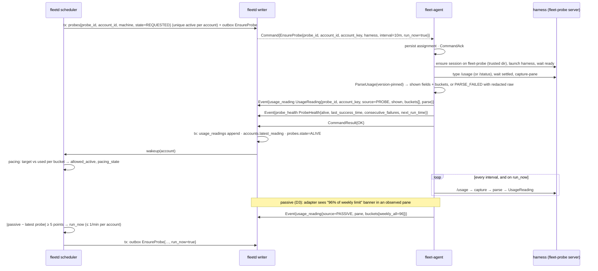
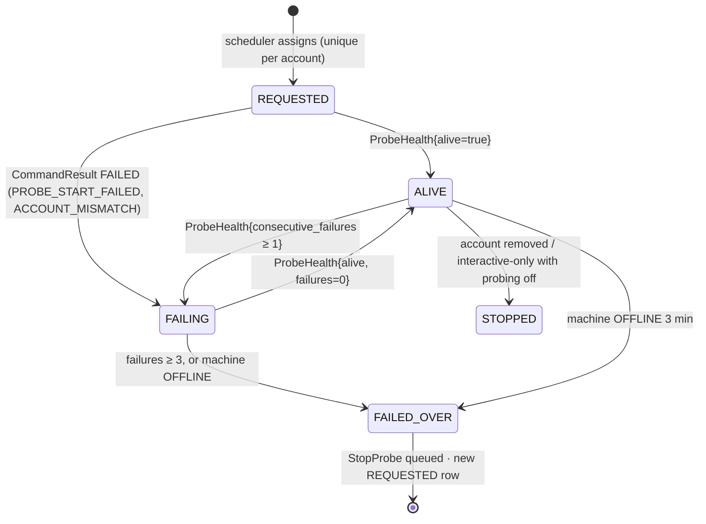
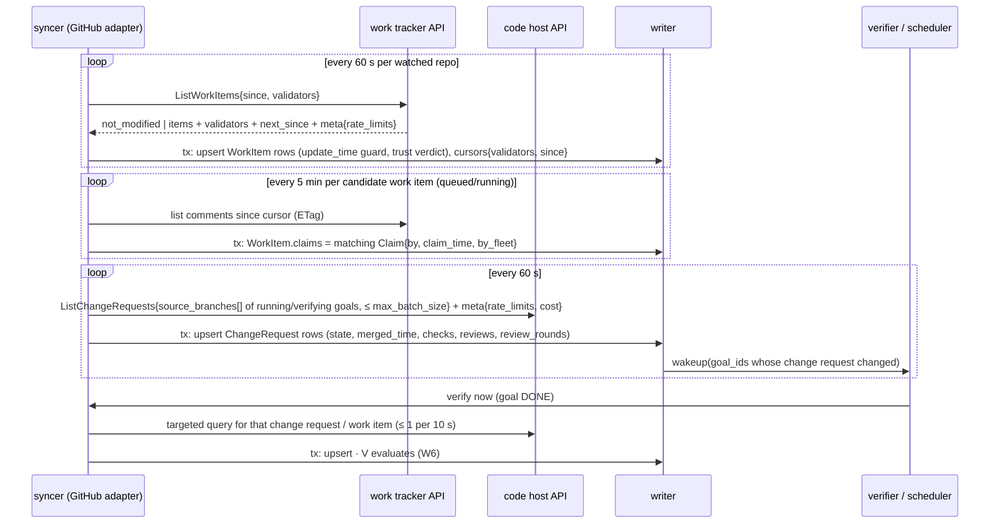
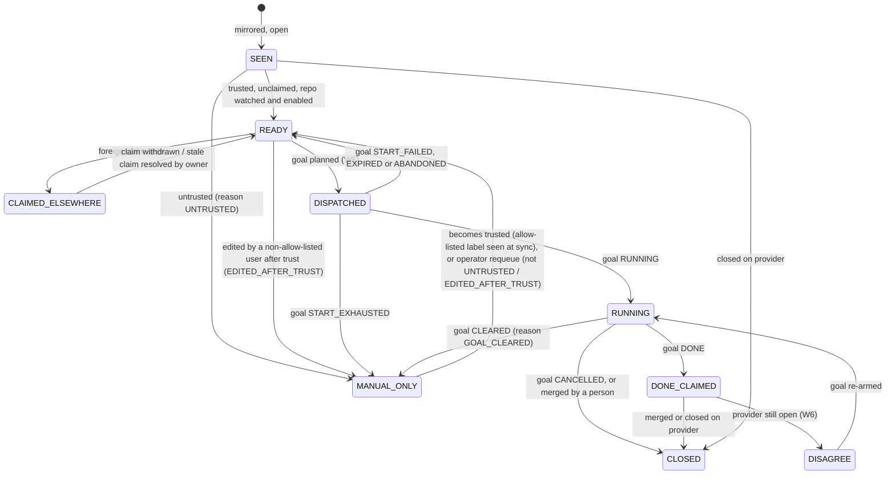

# 03b. Usage probing and pacing; work-source and code-host sync

- Part of: [03-workflows.md](03-workflows.md) (conventions apply)

## W3. Usage probing and pacing

**Trigger.** Hub sees an account (from `AccountIdentity` in a snapshot, or the
owner maps a Codex account to a machine) with no live probe; a probe's machine
goes `OFFLINE` or its `ProbeHealth` fails; a goal on the account starts or
finishes; a passive reading (D3) jumps; the 10-minute schedule on the agent.

**Actors.** Scheduler (probe assignment + pacing), writer, `fleet-agent`
probe runner on the hidden `fleet-probe` tmux server, the harness, the
adapter's versioned parser.

**Probe assignment.** Candidates for an account: machines `ONLINE`, not
draining, whose `Snapshot.accounts[]` carries that `account_key` with
`signed_in=true` (or the owner's Codex mapping), whose `HarnessInfo.version_support`
is `SUPPORTED` (or `UNVERIFIED_PARSING` with `ParserSupport{USAGE}` verified or `parsing_live`), and that advertise `usage.probe.<harness>`. Preference: label
`always-on` > not `laptop` > the hub machine > most recently successful. The
`probes` table has a unique constraint on `(account_id) WHERE state IN
(REQUESTED, ALIVE, FAILING)`, so two scheduler passes cannot assign twice.

**Failover.** Machine `OFFLINE` (not `STALE`: a sleeping laptop flaps through
STALE and a 45 s blip must not move probes) or `ProbeHealth.consecutive_failures ≥ 3`
→ probe `FAILED_OVER`, `StopProbe` queued to the old machine (24 h `not_after_time`;
harmless if the session is already gone), new probe assigned. A machine that
returns after the deadline has an expired `StopProbe`, so the snapshot
reconcile is the safety net: a probe in `Snapshot.probes[]` that the hub no longer
assigns to that machine gets a fresh `StopProbe` (W1, "Snapshot reconcile"). Two
probes briefly alive for one account during failover is harmless: status
commands are expected to cost no quota (plan 0.8 measures it) and both are idle sessions; the hub keeps readings from
either, newest hub-adjusted `read_time` wins (agent time minus the machine's
measured skew, clamped to the hub's `received_time`; ties by `received_time`; a
`clock_untrusted` machine never overrides a trusted one; 02i, "Clocks").

**Readings (D2).** Every reading is stored with both halves: `shown.fields[]`
+ `shown.raw_screen` (redacted; 7-day retention) for display in the harness's
own terms, and `buckets[]` (`key`, `percent_used`, `resets_time`, `window`,
`kind`) for the scheduler. `Percent` is never 0-as-unknown; a `PARSE_FAILED`
reading has no buckets and the account becomes `UNKNOWN` for pacing until a
good reading arrives. Readings from an unsupported harness version carry
`PercentUnknown{HARNESS_VERSION_UNSUPPORTED}` (W11).

**Passive signals (D3).** The adapter parses banners and status lines in panes
it already observes and emits `UsageReading{source=PASSIVE}` only when a
bucket's `percent_used` or `resets_time` differs from the last passive value it
emitted for that account (so a status line that repaints every second costs
nothing). The scheduler never paces on a passive reading alone; it uses it to
trigger a probe.

**Event-triggered probes.** `StartGoal` result `OK` and goal `MERGED`/`CLEARED`
for an account → `EnsureProbe{run_now=true}` (the command is declarative; the
agent runs once and keeps the schedule). Rate-limited to one `run_now` per
account per minute.

### Accounts: discovered, mapped, created, removed

An `Account` row comes from one of two origins (`Account.status.origin`):

- **Discovered.** A subscription from an identity probe (`AccountKey` is the salted
  hash of the identity). A harness that shows no identity (Codex) yields one
  **placeholder per `(machine, profile)`**, keyed by the hash of `<harness>:<machine
  id>` with `identity_not_shown`; the hub creates it at the first snapshot that
  carries it, so there is always a record for the owner's mapping to attach to.
  OpenCode accounts are discovered from `opencode providers list` (01b), one per
  provider signed in (`provider` "anthropic", "deepseek", "moonshot"), with
  `BUDGET_KIND_DOLLAR_CAP` for the API-key ones and `EXCLUDED` pacing. A new
  account starts with `reserve_percent` 10, `mode` fleet and `consent` push,
  pr-open, merge (ADR 0008; [defaults](defaults.md)); the owner changes them
  with `UpdateAccount`.
- **API-key spend (decision 7 of [ADR 0024](../adr/0024-pre-build-owner-decisions.md)).**
  An API-key account shows **spent so far**, the all-time cost `opencode stats`
  reports, in the tool's own counting, with no monthly period and no reset. The
  owner may set one limit (`spend_cap_micros`, one amount, no period); the card
  reads "spent so far $6.40 of your $20 limit". The hub never sums readings into
  a month, never resets the figure and never blocks on the limit (these accounts
  are manual-dispatch only). If the tool prints one total for all providers, the
  card says "all providers together" and the hub does not split it.
- **Owner-created.** An API-key account no agent can list (a key set in an
  environment variable) is added with `CreateAccount{harness, provider, spec}`
  (`DOLLAR_CAP` only; subscriptions are never created by hand). Discovery never
  overwrites it.

**Codex mapping.** The owner says "this Codex account is that one" by adding a
binding for a machine and profile to the real account (`UpdateAccount`, `spec.bindings`).
The hub then folds that machine's placeholder into it (the machine's
observations follow the binding) and deletes the placeholder once nothing uses
it. **Removal.** `DeleteAccount` works when no live goal or session spends from the
account and, for a discovered one, no machine shows it signed in
(`ACCOUNT_IN_USE`), which is also how a stale duplicate (re-keyed by a salt
change) goes away; there is no merge. `Account.status.provider` is what the rule
"OpenCode on an Anthropic subscription is never auto-dispatched" reads.

### Pacing decision (scheduler, per account, per bucket)

Inputs: latest `PROBE` reading per account (age ≤ `stale_after`, default 3 ×
interval), account `reserve_percent`, `BudgetKind`, `mode` (fleet /
interactive-only, ADR 0008), active goal count per account (from goals ×
`SessionAccountLink`).

1. For each bucket with a known window: `elapsed = now − (resets_time − window)`,
   `target = elapsed / window × (100 − reserve)`. Weekly buckets without a
   `window` assume 7 days; a short bucket without a window is used only as a
   speed limit (step 4 below).
2. `ahead = percent_used − target` on the weekly bucket the work needs (Claude:
   `weekly_all` and the per-model bucket of the goal's model; an account is
   exhausted when **any** needed bucket is).
3. `allowed_active`: `base_cap` (a fixed 2 per account, the same for every
   harness: [defaults](defaults.md)) adjusted: `ahead > +5` → `base_cap − 1`; `ahead > +10` → 0 new
   dispatches; `ahead < −5` → `base_cap + 1`. In the last 24 h before the
   weekly reset the line is ignored (`allowed_active = base_cap`) until the
   reserve.
4. Speed limit: any `WINDOW_KIND_SHORT` bucket ≥ 95 % → no new dispatch on the
   account until its reset; running goals continue (the harness throttles).
5. Reserve line: any needed bucket ≥ `100 − reserve` → `RESERVE`: no new
   dispatch; a triage pacing alert (W7) fingerprinted on `(account, bucket,
   resets_time)`. Running goals continue. Automatically pausing `WORKING` goals
   with `/goal pause` at the reserve is an **owner setting, default off**
   (decided 2026-10-02); `BLOCKED_WATCH` goals are never paused for pacing.
6. Excluded from auto-dispatch regardless of numbers: `mode=interactive-only`;
   `BUDGET_KIND_DOLLAR_CAP` (spend is shown, manual dispatch only); readings
   `UNKNOWN` or older than `stale_after`; OpenCode sessions on an Anthropic
   account (policy from 01b). OpenCode sessions linked to an Anthropic account
   still **count** toward that account's active goals and its readings, since
   they spend the same pool.

7. **Conditions.** An open `USAGE_LIMIT` `HarnessCondition` on a goal pane of the
   account marks it `SHORT_LIMIT` until the condition's `resets_time` (or the
   deciding bucket's), so no new goal starts into a limit the harness already hit
   (03h, "Limit wait"). It never edits a reading and ends with the condition.

**Projection.** With `f = elapsed / window` (so `0 < f <= 1`) and the same
`reserve`: `projected_used = percent_used / f`, `projected_unused_percent =
max(0, (100 − reserve) − projected_used)`, computed on the weekly bucket the work
needs (step 2). It is unset (shown as unknown, never
guessed) during the **first 24 hours of each usage window** (`elapsed < 24 h`; the
Usage view says "waste line starts after the first day"), when the reading is
`UNKNOWN` or stale, or when the bucket has no reading. Only the projection waits:
pacing (`ahead`, `allowed_active`) runs from the first reading, and a routine that
needs `projected_unused_percent` (03i) simply does not start in those hours. A `percent_used` lower than the previous reading's in the
same window is taken as the new truth, not smoothed; a new `resets_time` starts
a new window. A very small `f` makes the projection noisy, which is why it
waits 24 hours (decision 17 of [ADR 0024](../adr/0024-pre-build-owner-decisions.md)).

**Worked examples** (7-day window, reserve 10, base cap 2; these are the first
rows of the PR 10 table tests):

| Elapsed | `percent_used` | target | ahead | `allowed_active` | `projected_unused_percent` | Note |
|---|---|---|---|---|---|---|
| 12 h (f 0.071) | 10 | 6.4 | +3.6 | 2 (OK) | unset | first 24 h: no projection yet |
| 84 h (f 0.50) | 30 | 45.0 | −15.0 | 3 (BEHIND) | 30.0 | one more worker |
| 84 h | 47 | 45.0 | +2.0 | 2 (OK) | 0 | projected 94, above 90 |
| 84 h | 52 | 45.0 | +7.0 | 1 (AHEAD) | 0 | one fewer |
| 84 h | 56 | 45.0 | +11.0 | 0 (AHEAD) | 0 | no new dispatch |
| 150 h (f 0.893) | 60 | 80.4 | −20.4 | 2 | 22.8 | last 24 h: the line is ignored |
| any | 90 | | | 0 (RESERVE) | 0 | at `100 − reserve`: reserve alert |
| any, short bucket at 95 | | | | 0 (SHORT_LIMIT) | | speed limit, running goals continue |

Output per account: `pacing_state ∈ {OK, AHEAD, BEHIND, SHORT_LIMIT, RESERVE,
UNKNOWN, STALE, EXCLUDED}`, `allowed_active`, `rank` (most unused quota
relative to time left first), `projected_unused_percent`, and `idle_causes`: why
the fleet is not using it while it is dispatchable (03h, "Scheduler
explanations"). W5 consumes it.

### State machine (probe, owned by the hub)

### Persistence

| What | Where | Transaction |
|---|---|---|
| `probes{probe_id, account_id, machine, interval, state, last_health}` | hub store | assignment tx (with outbox row); health tx per event |
| `usage_readings` (append; buckets 1 year, `raw_screen` 7 days) and `accounts.latest_reading_id` | hub store | one tx per reading event (writer batch) |
| `account_pacing{state, allowed_active, target, ahead, computed_time}` | hub store (derived; rewritten per evaluation for the UI and CLI) | scheduler job tx |
| Probe assignment + schedule, last reading (for `Snapshot.usage`) | agent state dir | with the command log |
| Fixtures and parser version | agent binary / fixtures dir | n/a |

### Ordering and consistency

- Readings are ordered by hub-adjusted `read_time` per account (`received_time`
  breaks ties and orders a `clock_untrusted` machine's readings); a replayed
  reading older than `latest_reading.read_time` is stored but does not become
  latest. `reading_stale` compares the adjusted time with the previous reset.
- Pacing is evaluated by the single scheduler goroutine from a consistent read;
  dispatch (W5) re-reads `account_pacing` in the same pass, so the decision and
  the dispatch use one view.
- `EnsureProbe` is declarative: duplicates and re-issues are no-ops on the
  agent except `run_now`, which runs once per distinct `command_id`.

### Failure modes

| Failure | What happens |
|---|---|
| Probe harness crashes or exits | Agent respawns the probe session (3 attempts, 30 s apart), then reports `alive=false`, `last_failure=PROBE_START_FAILED`; hub fails over at 3 failures |
| Parse fails (new screen layout) | Reading `PARSE_FAILED` with redacted raw; account `UNKNOWN`; no auto-dispatch; triage `usage_parse_failed` fingerprinted on `(harness, harness_version, parser_version)`; W11 |
| Harness version unsupported | Reading `UNKNOWN{HARNESS_VERSION_UNSUPPORTED}`, raw still shown; the hub prefers another machine with a supported version for the probe; W11 |
| Probe pane stuck on a startup screen (trust, update, release notes, login) | `alive=false`, `last_failure=STARTUP_PROMPT_SEEN` with the screen kind in metadata; the agent types nothing (an update screen answered blind once ran `brew upgrade`, 01b); failover is tried first; a `CONDITION` triage item says "answer the screen on <machine>: `tmux -L fleet-probe attach`"; the account is `UNKNOWN` meanwhile |
| Sign-in required in the probe pane | `HarnessCondition{SIGN_IN_REQUIRED}` from the probe pane; triage "sign in to <harness> on <machine>"; account `UNKNOWN`; failover tried on another machine first |
| Account mismatch (harness shows another identity) | `CommandResult{FAILED, ACCOUNT_MISMATCH}`; the hub re-maps from the snapshot's `accounts[]` and assigns elsewhere |
| Agent offline (laptop asleep) | Readings stop; after `stale_after` the account is `STALE` → no new dispatch; after `OFFLINE` the probe fails over |
| Hub restart | Agent keeps probing on its persisted schedule; the snapshot carries `probes[]` and latest `usage[]`; the hub reconciles assignments (W1) |
| Duplicate `EnsureProbe` / `StopProbe` | Declarative; logged result returned |
| `EnsureProbe` deadline (10 min) expires while offline | `EXPIRED` on the hub; next scheduler pass re-assigns (same or another machine) |
| Provider error during the probe | Status commands are not expected to call the model; if the harness fails to start because the provider is down, `HarnessCondition` from the probe pane and `PROBE_START_FAILED` |
| Developer attached to the probe session (`tmux -L fleet-probe attach`) | Agent sees `attached_clients > 0`, skips the run and reports `ProbeHealth.message` ("skipped: attached"); a skip is not a failure, so `consecutive_failures` and `last_failure` stay as they were and it never feeds failover; never types into a watched probe |
| Passive readings disagree with probe | Passive only triggers a probe; the probe wins |
| Two readings arrive out of order after a reconnect | hub-adjusted `read_time` ordering; latest by time, not by arrival |
| A machine's clock is minutes fast or slow | Its readings are adjusted by the measured skew; above 15 minutes the machine is `clock_untrusted` (readings ordered by `received_time`, reset text shown instead of a resolved `resets_time`, probe moved to a trusted machine) |
| Reset text unresolvable ("Resets Sep 30 at 10pm" with no year around New Year) | `ResetTime.resolved_time` unset, `original_text` kept; bucket treated as `UNKNOWN` for the line, shown as text |

### Telemetry

- `fleet_hub_usage_percent_used{account, bucket}`, `fleet_hub_usage_target_percent{account, bucket}`,
  `fleet_hub_usage_reading_age_seconds{account}`, `fleet_hub_pacing_state{account, state}`,
  `fleet_hub_account_allowed_active{account}`, `fleet_hub_account_active_goals{account}`,
  `fleet_hub_probe_state{account, state}`, `fleet_hub_probe_failovers_total{account, reason}`,
  `fleet_hub_usage_parse_total{harness, harness_version, outcome}`.
- `fleet_agent_probe_run_seconds{harness, result}`, `fleet_agent_probe_consecutive_failures{account}`,
  `fleet_agent_usage_passive_total{harness}`.
- Spans: `agent.probe.run` (children `ensure_session`, `type_command`,
  `capture`, `parse`), `hub.pacing.evaluate{account}`, `hub.probe.assign`.
- Logs: `pacing.decision{account, bucket, used, target, ahead, allowed_active,
  state, reason}` on every change of state or `allowed_active`;
  `probe.failover{account, from_machine, to_machine, reason}`;
  `usage.parse_failed{harness, version, parser_version}`.

At 3 AM: "why did nothing dispatch on Codex?" → `fleet_hub_pacing_state` and
the last `pacing.decision`; "is the usage number real?" →
`fleet_hub_usage_reading_age_seconds` and `fleet_hub_probe_state`.

---

## W4. Work-source and code-host sync

**Trigger.** Timers per resource (defaults below), a verifier request for one
change request or work item (goal said `DONE`, W6), a dispatch about to happen
(claim re-check, W5), and later webhooks for providers that offer them.

**Actors.** The hub's syncer goroutine(s) (one per integration), the work
tracker adapter, the code host adapter, writer, scheduler, verifier.

**Two roles, one mirror.** An *integration* is configured as a work tracker,
a code host, or both. The hub stores mirrors in the shapes of
`integration/v1/model.proto`: `WorkItem{ref WorkItemRef, state, title, author,
labels[] Label{name, applied_by, applied_time}, claims[] Claim, last_editor,
last_edit_time, create_time, update_time}` plus the hub's own `trust`
(`TrustVerdict`), and `ChangeRequest{ref, repo RepoRef, source_branch (the head
ref), head_commit (the head sha), head_repo, state, merged_time, merged_by,
merge_state, review_decision, checks CheckSummary{counts, rollup}, reviews[]
Review, linked_work_items[] WorkItemRef, review_rounds}`. `IntegrationCapabilities{sync_modes,
claim_mechanisms, labels, labels_with_actor, edit_evidence, merge_detection,
max_batch_size, path_exists, ...}` tells the syncer which loop to run. The
calls, cursors, rate limits, typed errors and the trusted-issues gate are in
[03j](03j-provider-sync-and-trust.md); the hub owns all polling state.

**GitHub adapter (first).** Credential: a GitHub App installation token (ADR
0005), refreshed before expiry; the App is the only access in v1, with no
fine-grained token fallback (decision 15 of ADR 0024). Work items: REST
`GET /repos/{owner}/{repo}/issues?state=open&since=…&per_page=100` with
`If-None-Match`. Claims: issue comments matching a configurable pattern
(default: the eshu-issue-driver claim comment), with `by_this_fleet = author ∈
{ForgeCliStatus.user of every machine}`. Trusted gate: the adapter
returns evidence (`author`, `Label.applied_by` from the `LABELED_EVENT` timeline
for the trusted label, `last_editor`); the hub applies the allow-list
([03j](03j-provider-sync-and-trust.md#the-trusted-issues-gate)).
Change requests: GraphQL `repository.pullRequests(headRefName:)` using the
branch the agent reports in `BranchState.branch`, so the link needs no naming
convention; `closingIssuesReferences` and "Fixes #n" in the body add
`linked_work_items[]`. Merge detection: `merged`/`mergedAt`. Review rounds:
count of `CHANGES_REQUESTED` reviews each followed by a new commit; it never
resets, and failed CI is not a round (the review-loop cap compares it with a
stored baseline, 03c). The rollup and `reviewDecision` surface as
`checks.rollup` and `review_decision`. Rate limits: the adapter reads `x-ratelimit-*` and
GraphQL `rateLimit` into `meta.rate_limits`; the hub applies the rules in
[03j](03j-provider-sync-and-trust.md#rate-limits) (remaining < 10 % →
intervals × 4; 0 → sleep to `reset_time`; 403/429 with `Retry-After` is a
`RATE_LIMITED` error with `retry_after`). ADR 0005's note stands: confirm
the current installation-token limits and whether 304s are free: 04 Q8 found
5,000 requests an hour per installation and free 304s, so conditional requests
are the rule.

**What differs for other providers.**

| Concern | GitHub | GitLab | Jira (tracker only) |
|---|---|---|---|
| Push vs poll | Poll (webhooks need a public URL; optional via tunnel) | Webhooks per project/group are common on self-hosted; poll fallback | Jira Cloud webhooks; Server/DC poll |
| Conditional requests | ETag / 304 | ETag on some endpoints; `updated_after_time` filter | `updated >= …` JQL; no ETag |
| Batch query (`max_batch_size`) | GraphQL, one call for 50 change requests | GraphQL (less coverage; REST per MR for pipelines) | REST search, 50–100 per page |
| Repo identity | `RepoRef{host="github.com", path="owner/repo"}` | nested: `RepoRef{host, path="group/sub/repo"}` | none; code lives on a separate code host |
| Change request ref | `WorkItemRef{kind=CHANGE_REQUEST, key="7412"}` | `key="!12"` (iid), project path | n/a |
| Claim mechanism | comment pattern | comment pattern or assignee | assignee or a transition to "In Progress" by the fleet's user |
| Trusted gate | author allow-list, `agent-ready` label `applied_by` | same with labels / "ready" label events | label or status transition by an allow-listed user (`Label.applied_by`) |
| Linked ticket | `closingIssuesReferences`, "Fixes #n" | "Closes #n" in MR description, branch `n-…` | ticket key in branch or MR/PR title (`PROJ-123`); the code host adapter extracts it |
| Merge detection | `merged`, `mergedAt` | MR `state=merged`, `merged_time` | from the paired code host |

A tracker-only integration (Jira) must be paired with a code host; a goal's
`GoalSpec.work_item` and `GoalSpec.repo` are separate fields for that reason.

### State machine (work item stage, owned by the hub)

What each goal end does to the stage, with the reasons, is the table in
[03h](03h-goal-phases-in-depth.md#work-item-stage-after-a-goal-ends); a cleared
item is not redispatched behind a person's back. A repo that is not `enabled`
(`Repo.spec`) keeps its items `SEEN`.

### Persistence

| What | Where | Transaction |
|---|---|---|
| `work_items` mirror (per `WorkItemRef`), `change_requests` mirror, `claims` | hub store | one tx per API response page, outside any network wait |
| `sync_cursors{integration, resource, page, etag, last_modified_time, since, last_ok_time}` | hub store | same tx as the page it covers |
| `rate_limit_state{integration, kind, limit, remaining, reset_time}`, `backoff_until_time` | hub store (also in memory) | per response |
| Nothing on agents; nothing written to the provider (ADR 0005: read-only) | — | — |

### Ordering and consistency

- Per resource, pages apply in order; an `update_time` older than the stored
  row is ignored (late poll result after a targeted verify).
- The scheduler reads mirrors only; freshness is bounded by the interval and
  shown as `fleet_hub_sync_lag_seconds`. Auto-dispatch pauses when the lag for
  the work item's integration exceeds `max_sync_lag` (default 10 min) because
  claims may be stale; manual dispatch is allowed with a warning.
- Claim race: our goal's driver posts its claim after dispatch. If a foreign
  claim with an earlier timestamp appears, the hub cannot know who was first
  from the provider's clock alone; it raises triage `double_claim` and does
  not auto-act.

### Failure modes

Provider failures arrive as a `ProviderError` kind (03j has the mapping to RPC codes, `retryable` and health).

| Failure | What happens |
|---|---|
| Provider 5xx / network down (`UNAVAILABLE`) | Exponential backoff per integration (max 5 min); `BACKING_OFF`; lag rises; dispatch pauses at `max_sync_lag`; verification waits (W6) |
| Primary rate limit exhausted (`RATE_LIMITED`) | Sleep until `reset_time`; `fleet_hub_rate_limited_total`; lag rises; nothing else |
| Secondary / abuse limit (`RATE_LIMITED`, kind `SECONDARY`, `retry_after`) | Honour `retry_after`, then halve request concurrency for 1 h |
| Token refresh fails (`UNAUTHENTICATED`) / App uninstalled / repo removed (`NOT_FOUND`, `FORBIDDEN`) | Triage `integration_access_lost{integration, project}` fingerprinted; integration `DEGRADED` with `health_reason` `CREDENTIALS_INVALID` or `ACCESS_LOST`; dispatch for its repos stops |
| Hub restart | Cursors and ETags are durable; first pass after start is a normal poll |
| Validators reused after provider change (false `not_modified`) | Not observed; a periodic full poll (every 30 min) without validators bounds it |
| Claim comment pattern changes | Claims stop parsing → everything looks unclaimed → the pre-dispatch targeted re-check still fails to see it; mitigation: `claims_seen_total` drops to 0 for a repo with running goals → warning |
| Change request not found by head ref (driver used another branch) | Goal `VERIFYING` cannot resolve; falls back to `ListChangeRequests{linked_work_item}` (change requests that close or reference the goal's item); else `DONE` disagreement (W6) |
| Webhook delivery lost (providers with webhooks) | Webhooks only shorten latency; the poll loop stays on at a longer interval as the backstop |
| Provider clock skew on claim timestamps | Only ordering between claims matters; treated as untrusted; `double_claim` goes to a person |

### Telemetry

- `fleet_hub_sync_requests_total{integration, resource, status}`,
  `fleet_hub_sync_rate_remaining{integration, kind}`, `fleet_hub_sync_lag_seconds{integration, resource}`,
  `fleet_hub_sync_poll_seconds{integration, resource}`, `fleet_hub_sync_not_modified_ratio{integration}`,
  `fleet_hub_rate_limited_total{integration, kind}`, `fleet_hub_work_items{integration, stage}`,
  `fleet_hub_change_requests{integration, state}`, `fleet_hub_claims_seen_total{integration, by_this_fleet}`,
  `fleet_hub_integration_state{integration, state}`.
- Spans: `hub.sync.work_items{integration, repo}`, `hub.sync.claims`,
  `hub.sync.change_requests` (attribute `batch_size`, `cost`),
  `hub.sync.verify_one{goal_id}`.
- Logs: `sync.rate_limited{integration, remaining, resets_time}`,
  `sync.access_lost{integration, repo, status}`, `sync.double_claim{work_item,
  ours_time, theirs_time, theirs_author}`, `sync.cursor_reset{resource}`.

At 3 AM: "why is the queue empty / dispatch paused?" → `fleet_hub_sync_lag_seconds`
and `fleet_hub_integration_state`; "why is this goal stuck in verifying?" →
`hub.sync.verify_one` spans for the goal and `change_requests` state.
