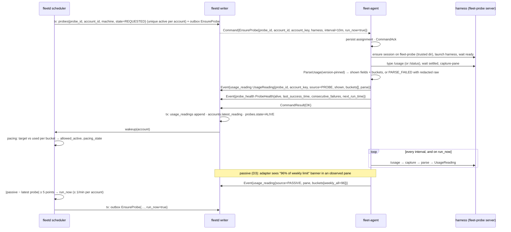
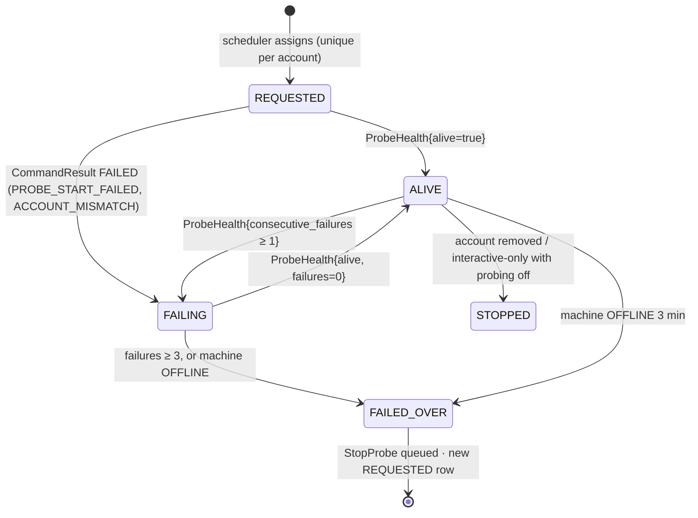

# 03b. Usage probing and pacing

- Part of: [03-workflows.md](03-workflows.md) (conventions apply)
- W4, work-source and code-host sync, is in [03m](03m-work-source-and-code-host-sync.md).

## W3. Usage probing and pacing

**Trigger.** Hub sees an account (from `AccountIdentity` in a snapshot, or the
owner maps a Codex account to a machine) with no live probe; a probe's machine
goes `OFFLINE` or its `ProbeHealth` fails; a goal on the account starts or
finishes; a passive reading (D3) jumps; the 10-minute schedule on the agent.

**Actors.** Scheduler (probe assignment + pacing), writer, `fleet-agent`
probe runner on the hidden `fleet-probe` tmux server, the harness, the
adapter's versioned parser.

**Probe assignment.** Candidates for an account: machines `ONLINE`, not
draining, whose `Snapshot.accounts[]` carries that `account_key` with
`signed_in=true` (or the owner's Codex mapping), whose `HarnessInfo.version_support`
is `SUPPORTED` (or `UNVERIFIED_PARSING` with `ParserSupport{USAGE}` verified or `parsing_live`), and that advertise `usage.probe.<harness>`. Preference: label
`always-on` > not `laptop` > the hub machine > most recently successful. The
`probes` table has a unique constraint on `(account_id) WHERE state IN
(REQUESTED, ALIVE, FAILING)`, so two scheduler passes cannot assign twice.

**Failover.** Machine `OFFLINE` (not `STALE`: a sleeping laptop flaps through
STALE and a 45 s blip must not move probes) or `ProbeHealth.consecutive_failures ≥ 3`
→ probe `FAILED_OVER`, `StopProbe` queued to the old machine (24 h `not_after_time`;
harmless if the session is already gone), new probe assigned. A machine that
returns after the deadline has an expired `StopProbe`, so the snapshot
reconcile is the safety net: a probe in `Snapshot.probes[]` that the hub no longer
assigns to that machine gets a fresh `StopProbe` (W1, "Snapshot reconcile"). Two
probes briefly alive for one account during failover is harmless: status
commands are expected to cost no quota (plan 0.8 measures it) and both are idle sessions; the hub keeps readings from
either, newest hub-adjusted `read_time` wins (agent time minus the machine's
measured skew, clamped to the hub's `received_time`; ties by `received_time`; a
`clock_untrusted` machine never overrides a trusted one; 02i, "Clocks").

**Readings (D2).** Every reading is stored with both halves: `shown.fields[]`
+ `shown.raw_screen` (redacted; 7-day retention) for display in the harness's
own terms, and `buckets[]` (`key`, `percent_used`, `resets_time`, `window`,
`kind`) for the scheduler. `Percent` is never 0-as-unknown; a `PARSE_FAILED`
reading has no buckets and the account becomes `UNKNOWN` for pacing until a
good reading arrives. Readings from an unsupported harness version carry
`PercentUnknown{HARNESS_VERSION_UNSUPPORTED}` (W11). A probe that fails
without reading a screen sends no reading, so the last good one keeps pacing
until it is older than `stale_after`; a `PARSE_FAILED` reading makes the
account `UNKNOWN` at once.

**Passive signals (D3).** The adapter parses banners and status lines in panes
it already observes and emits `UsageReading{source=PASSIVE}` only when a
bucket's `percent_used` or `resets_time` differs from the last passive value it
emitted for that account (so a status line that repaints every second costs
nothing). The scheduler never paces on a passive reading alone; it uses it to
trigger a probe.

**Event-triggered probes.** `StartGoal` result `OK` and goal `MERGED`/`CLEARED`
for an account → `EnsureProbe{run_now=true}` (the command is declarative; the
agent runs once and keeps the schedule). Rate-limited to one `run_now` per
account per minute.

### Accounts: discovered, mapped, created, removed

An `Account` row comes from one of two origins (`Account.status.origin`):

- **Discovered.** A subscription from an identity probe (`AccountKey` is the salted
  hash of the identity). A harness that shows no identity (Codex) yields one
  **placeholder per `(machine, profile)`**, keyed by the hash of `<harness>:<machine
  id>` with `identity_not_shown`; the hub creates it at the first snapshot that
  carries it, so there is always a record for the owner's mapping to attach to.
  OpenCode accounts are discovered from `opencode providers list` (01b), one per
  provider signed in (`provider` "anthropic", "deepseek", "moonshot"), with
  `BUDGET_KIND_DOLLAR_CAP` for the API-key ones and `EXCLUDED` pacing. A new
  account starts with `reserve_percent` 10, `mode` fleet and `consent` push,
  pr-open, merge (ADR 0008; [defaults](defaults.md)); the owner changes them
  with `UpdateAccount`.
- **API-key spend (decision 7 of [ADR 0024](../adr/0024-pre-build-owner-decisions.md)).**
  An API-key account shows **spent so far**, the all-time cost `opencode stats`
  reports, in the tool's own counting, with no monthly period and no reset. The
  owner may set one limit (`spend_cap_micros`, one amount, no period); the card
  reads "spent so far $6.40 of your $20 limit". The hub never sums readings into
  a month, never resets the figure and never blocks on the limit (these accounts
  are manual-dispatch only). If the tool prints one total for all providers, the
  card says "all providers together" and the hub does not split it. A total
  lower than the one before is shown as reported (the tool's own count can
  shrink, for example when its local history is cleared); the hub keeps no
  highest-seen value.
- **Owner-created.** An API-key account no agent can list (a key set in an
  environment variable) is added with `CreateAccount{harness, provider, spec}`
  (`DOLLAR_CAP` only; subscriptions are never created by hand). Discovery never
  overwrites it.

**Codex mapping.** The owner says "this Codex account is that one" by adding a
binding for a machine and profile to the real account (`UpdateAccount`, `spec.bindings`).
The hub then folds that machine's placeholder into it (the machine's
observations follow the binding) and deletes the placeholder once nothing uses
it. **Removal.** `DeleteAccount` works when no live goal or session spends from the
account and, for a discovered one, no machine shows it signed in
(`ACCOUNT_IN_USE`), which is also how a stale duplicate (re-keyed by a salt
change) goes away; there is no merge. `Account.status.provider` is what the rule
"OpenCode on an Anthropic subscription is never auto-dispatched" reads.

### Pacing decision (scheduler, per account, per bucket)

The `pacing` package (`internal/hub/pacing`) makes this decision and assigns the probes; it writes
`account_pacing` and `insight_pacing_interval`. The scheduler that also acts on it (dispatch) is a second
package that reads the same decision ([03f](03f-hub-internals.md#who-owns-which-decision)).

Inputs: latest `PROBE` reading per account (age ≤ `stale_after`, default 3 ×
interval), account `reserve_percent`, `BudgetKind`, `mode` (fleet /
interactive-only, ADR 0008), active goal count per account (from goals ×
`SessionAccountLink`).

1. For each bucket with a known window: `elapsed = now − (resets_time − window)`,
   `target = elapsed / window × (100 − reserve)`. Weekly buckets without a
   `window` assume 7 days; a `WINDOW_KIND_MONTHLY` bucket never assumes a
   length (see [Monthly windows](#monthly-windows-cursor)); a short bucket
   without a window is used only as a speed limit (step 4 below).
2. `ahead = percent_used − target` on each weekly or monthly bucket the work
   needs (Claude: `weekly_all` and the per-model bucket of the goal's model;
   Cursor: every `WINDOW_KIND_MONTHLY` bucket); the largest `ahead` decides (an
   account is exhausted when **any** needed bucket is).
3. `allowed_active`: `base_cap` (a fixed 2 per account, the same for every
   harness: [defaults](defaults.md)) adjusted: `ahead > +5` → `base_cap − 1`; `ahead > +10` → 0 new
   dispatches; `ahead < −5` → `base_cap + 1`. In the last 24 h before the
   deciding bucket's reset the line is ignored (`allowed_active = base_cap`)
   until the reserve.
4. Speed limit: any `WINDOW_KIND_SHORT` bucket ≥ 95 % → no new dispatch on the
   account until its reset; running goals continue (the harness throttles).
5. Reserve line: any needed bucket ≥ `100 − reserve` → `RESERVE`: no new
   dispatch; a triage pacing alert (W7) fingerprinted on `(account, bucket,
   resets_time)`. Running goals continue. Automatically pausing `WORKING` goals
   with `/goal pause` at the reserve is an **owner setting, default off**
   (decided 2026-10-02); `BLOCKED_WATCH` goals are never paused for pacing.
6. Excluded from auto-dispatch regardless of numbers: `mode=interactive-only`;
   `BUDGET_KIND_DOLLAR_CAP` (spend is shown, manual dispatch only); readings
   `UNKNOWN` or older than `stale_after`; OpenCode sessions on an Anthropic
   account (policy from 01b); `overage_billing` `ON` or `UNKNOWN` (cause
   `overage_billing`). OpenCode sessions linked to an Anthropic account
   still **count** toward that account's active goals and its readings, since
   they spend the same pool.

7. **Conditions.** An open `USAGE_LIMIT` `HarnessCondition` on a goal pane of the
   account marks it `SHORT_LIMIT` until the condition's `resets_time` (or the
   deciding bucket's), so no new goal starts into a limit the harness already hit
   (03h, "Limit wait"). It never edits a reading and ends with the condition.

**Projection.** With `f = elapsed / window` (so `0 < f <= 1`) and the same
`reserve`: `projected_used = percent_used / f`, `projected_unused_percent =
max(0, (100 − reserve) − projected_used)`, computed on the weekly or monthly bucket
the work needs (step 2). It is unset (shown as unknown, never
guessed) during the **first 24 hours of each usage window** (`elapsed < 24 h`; the
Usage view says "waste line starts after the first day"), when the reading is
`UNKNOWN` or stale, or when the bucket has no reading. Only the projection waits:
pacing (`ahead`, `allowed_active`) runs from the first reading, and a routine that
needs `projected_unused_percent` (03i) simply does not start in those hours. A `percent_used` lower than the previous reading's in the
same window is taken as the new truth, not smoothed; a new `resets_time` starts
a new window. A very small `f` makes the projection noisy, which is why it
waits 24 hours (decision 17 of [ADR 0024](../adr/0024-pre-build-owner-decisions.md)).

**Worked examples** (7-day window, reserve 10, base cap 2; these are the first
rows of the PR 10 table tests):

| Elapsed | `percent_used` | target | ahead | `allowed_active` | `projected_unused_percent` | Note |
|---|---|---|---|---|---|---|
| 12 h (f 0.071) | 10 | 6.4 | +3.6 | 2 (OK) | unset | first 24 h: no projection yet |
| 84 h (f 0.50) | 30 | 45.0 | −15.0 | 3 (BEHIND) | 30.0 | one more worker |
| 84 h | 47 | 45.0 | +2.0 | 2 (OK) | 0 | projected 94, above 90 |
| 84 h | 52 | 45.0 | +7.0 | 1 (AHEAD) | 0 | one fewer |
| 84 h | 56 | 45.0 | +11.0 | 0 (AHEAD) | 0 | no new dispatch |
| 150 h (f 0.893) | 60 | 80.4 | −20.4 | 2 | 22.8 | last 24 h: the line is ignored |
| any | 90 | | | 0 (RESERVE) | 0 | at `100 − reserve`: reserve alert |
| any, short bucket at 95 | | | | 0 (SHORT_LIMIT) | | speed limit, running goals continue |

Output per account: `pacing_state ∈ {OK, AHEAD, BEHIND, SHORT_LIMIT, RESERVE,
UNKNOWN, STALE, EXCLUDED}`, `allowed_active`, `rank` (most unused quota
relative to time left first), `projected_unused_percent`, and `idle_causes`: why
the fleet is not using it while it is dispatchable (03h, "Scheduler
explanations"). W5 consumes it.

### Monthly windows (Cursor)

Cursor's `/usage` shows one plan, one reset date and three percentages (01 D2).
The adapter reports three buckets, `monthly_included`, `monthly_auto` and
`monthly_api`, each `WINDOW_KIND_MONTHLY` with its own `percent_used` and the
one shown reset. Until plan row 30 shows which of them a goal's model draws
from, a Cursor goal needs all three: the largest `ahead` decides, and any of
them at `100 − reserve` is `RESERVE`. A row the screen should show and does not
is `PercentUnknown{NOT_SHOWN}`, and the account is `UNKNOWN`.

- **Reset.** Cursor shows a date with no time ("Resets Nov 4"). The agent
  resolves it to the end of that date (00:00 the next day) in the machine's
  timezone and sets `ResetTime.date_only`: the latest the reset can be, so the
  line errs low. The UI shows the date, not a countdown.
- **Window.** Months differ in length, so a monthly window is never assumed.
  In order: (1) the window the hub saw, from the reset of the same bucket in the
  newest good reading of the window before, when the two resets are 28 days to
  31 days 1 hour apart; (2) `LimitBucket.window`, which the agent sets only when
  the shown day D is not the last day of its month and the month before has a
  day D ("Resets Nov 4": 31 days); (3) otherwise unknown: the account is
  `UNKNOWN` for the line (`ACCOUNT_USAGE_UNKNOWN`, cause `window_unknown`) until
  the hub sees a reset, and the reserve line still applies to every known
  percent. When (1) and (2) differ by more than an hour, (1) wins and
  `pacing.decision` records it. The hub API's `AccountUsage.buckets[].window`
  is the window pacing used, so the dashboard draws the same line.
- **Money.** Cursor's On-Demand row says whether use past the plan is billed.
  `AccountUsage.overage_billing` `ON` or `UNKNOWN` makes the account `EXCLUDED`
  (step 6).

**Monthly worked examples** (reserve 10, base cap 2; also PR 10 table tests):

| Window | Elapsed | `percent_used` | target | ahead | `allowed_active` | `projected_unused_percent` | Note |
|---|---|---|---|---|---|---|---|
| 30 d | 12 d (f 0.400) | Included 40, Auto 45, API 0 | 36.0 | +9.0 (Auto) | 1 (AHEAD) | 0 | Auto decides; projected 112.5 |
| 31 d | 12 d (f 0.387) | 45 | 34.8 | +10.2 | 0 (AHEAD) | 0 | same day and percent, longer month |
| 28 d | 12 d (f 0.429) | 45 | 38.6 | +6.4 | 1 (AHEAD) | 0 | February |
| 30 d | 12 h (f 0.017) | 3 | 1.5 | +1.5 | 2 (OK) | unset | first 24 h |
| 30 d | 15 d (f 0.500) | 30 | 45.0 | −15.0 | 3 (BEHIND) | 30.0 | one more worker |
| 30 d | 29.5 d (f 0.983) | 70 | 88.5 | −18.5 | 2 | 18.8 | last 24 h: the line is ignored |
| unknown ("Resets Mar 31", no reset seen) | | 20 | | | 0 (UNKNOWN) | unset | never 7 days; the reserve still applies |
| any | | one bucket at 90 | | | 0 (RESERVE) | 0 | reserve alert |
| any, On-Demand on or not shown | | | | | 0 (EXCLUDED) | | manual dispatch only |

### State machine (probe, owned by the hub)

### Persistence

| What | Where | Transaction |
|---|---|---|
| `probes{probe_id, account_id, machine, interval, state, last_health}` | hub store | assignment tx (with outbox row); health tx per event |
| `usage_readings` (append; buckets 1 year, `raw_screen` 7 days) and `accounts.latest_reading_id` | hub store | one tx per reading event (writer batch) |
| `account_pacing{state, allowed_active, target, ahead, computed_time}` | hub store (derived; rewritten per evaluation for the UI and CLI) | scheduler job tx |
| Probe assignment + schedule, last reading (for `Snapshot.usage`) | agent state dir | with the command log |
| Fixtures and parser version | agent binary / fixtures dir | n/a |

### Ordering and consistency

- Readings are ordered by hub-adjusted `read_time` per account (`received_time`
  breaks ties and orders a `clock_untrusted` machine's readings); a replayed
  reading older than `latest_reading.read_time` is stored but does not become
  latest. `reading_stale` compares the adjusted time with the previous reset.
- Pacing is evaluated by the single scheduler goroutine from a consistent read;
  dispatch (W5) re-reads `account_pacing` in the same pass, so the decision and
  the dispatch use one view.
- `EnsureProbe` is declarative: duplicates and re-issues are no-ops on the
  agent except `run_now`, which runs once per distinct `command_id`.

### Failure modes

| Failure | What happens |
|---|---|
| Probe harness crashes or exits | Agent respawns the probe session (3 attempts, 30 s apart), then reports `alive=false`, `last_failure=PROBE_START_FAILED`; hub fails over at 3 failures |
| Parse fails (new screen layout) | Reading `PARSE_FAILED` with redacted raw; account `UNKNOWN`; no auto-dispatch; triage `usage_parse_failed` fingerprinted on `(harness, harness_version, parser_version)`; W11 |
| Harness version unsupported | Reading `UNKNOWN{HARNESS_VERSION_UNSUPPORTED}`, raw still shown; the hub prefers another machine with a supported version for the probe; W11 |
| Probe pane stuck on a startup screen (trust, update, release notes, login) | `alive=false`, `last_failure=STARTUP_PROMPT_SEEN` with the screen kind in metadata; the agent types nothing (an update screen answered blind once ran `brew upgrade`, 01b); failover is tried first; a `CONDITION` triage item says "answer the screen on <machine>: `tmux -L fleet-probe attach`"; the account is `UNKNOWN` meanwhile |
| Sign-in required in the probe pane | `HarnessCondition{SIGN_IN_REQUIRED}` from the probe pane; triage "sign in to <harness> on <machine>"; account `UNKNOWN`; failover tried on another machine first |
| Account mismatch (harness shows another identity) | `CommandResult{FAILED, ACCOUNT_MISMATCH}`; the hub re-maps from the snapshot's `accounts[]` and assigns elsewhere |
| Agent offline (laptop asleep) | Readings stop; after `stale_after` the account is `STALE` → no new dispatch; after `OFFLINE` the probe fails over |
| Hub restart | Agent keeps probing on its persisted schedule; the snapshot carries `probes[]` and latest `usage[]`; the hub reconciles assignments (W1) |
| Duplicate `EnsureProbe` / `StopProbe` | Declarative; logged result returned |
| `EnsureProbe` deadline (10 min) expires while offline | `EXPIRED` on the hub; next scheduler pass re-assigns (same or another machine) |
| Provider error during the probe | Status commands are not expected to call the model; if the harness fails to start because the provider is down, `HarnessCondition` from the probe pane and `PROBE_START_FAILED` |
| Developer attached to the probe session (`tmux -L fleet-probe attach`) | Agent sees `attached_clients > 0`, skips the run and reports `ProbeHealth.message` ("skipped: attached"); a skip is not a failure, so `consecutive_failures` and `last_failure` stay as they were and it never feeds failover; never types into a watched probe |
| Passive readings disagree with probe | Passive only triggers a probe; the probe wins |
| Two readings arrive out of order after a reconnect | hub-adjusted `read_time` ordering; latest by time, not by arrival |
| A machine's clock is minutes fast or slow | Its readings are adjusted by the measured skew; above 15 minutes the machine is `clock_untrusted` (readings ordered by `received_time`, reset text shown instead of a resolved `resets_time`, probe moved to a trusted machine) |
| Reset text unresolvable ("Resets Sep 30 at 10pm" with no year around New Year) | `ResetTime.resolved_time` unset, `original_text` kept; bucket treated as `UNKNOWN` for the line, shown as text |

### Telemetry

- `fleet_hub_usage_percent_used{account, bucket}`, `fleet_hub_usage_target_percent{account, bucket}`,
  `fleet_hub_usage_reading_age_seconds{account}`, `fleet_hub_pacing_state{account, state}`,
  `fleet_hub_account_allowed_active{account}`, `fleet_hub_account_active_goals{account}`,
  `fleet_hub_probe_state{account, state}`, `fleet_hub_probe_failovers_total{account, reason}`,
  `fleet_hub_usage_parse_total{harness, harness_version, outcome}`.
- `fleet_agent_probe_run_seconds{harness, result}`, `fleet_agent_probe_consecutive_failures{account}`,
  `fleet_agent_usage_passive_total{harness}`.
- Spans: `agent.probe.run` (children `ensure_session`, `type_command`,
  `capture`, `parse`), `hub.pacing.evaluate{account}`, `hub.probe.assign`.
- Logs: `pacing.decision{account, bucket, used, target, ahead, allowed_active,
  state, reason, window_source}` on every change of state or `allowed_active`
  (`window_source`: `reading`, `seen_resets`, `seen_overrides_reading` when the
  two differ by more than an hour, `seven_day_default` or `none`);
  `probe.failover{account, from_machine, to_machine, reason}`;
  `usage.parse_failed{harness, version, parser_version}`.

At 3 AM: "why did nothing dispatch on Codex?" → `fleet_hub_pacing_state` and
the last `pacing.decision`; "is the usage number real?" →
`fleet_hub_usage_reading_age_seconds` and `fleet_hub_probe_state`.
