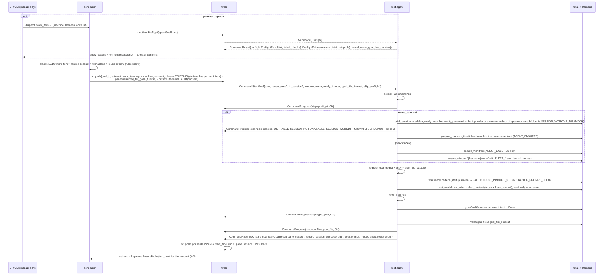
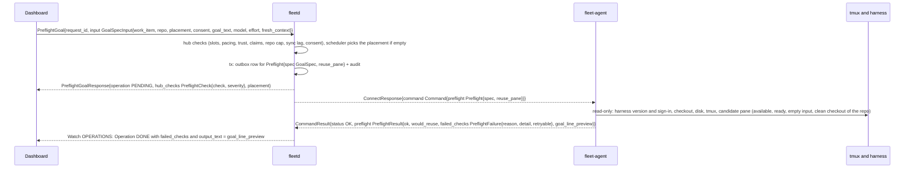
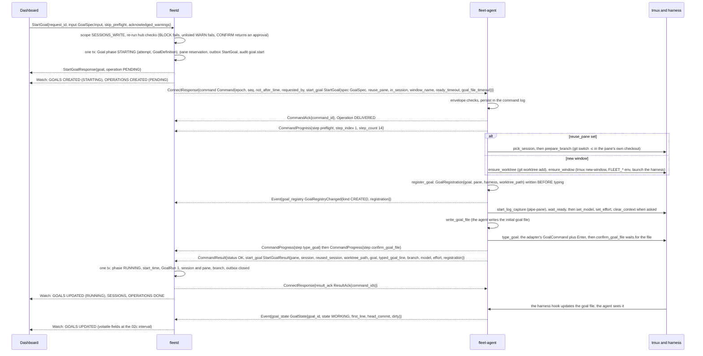
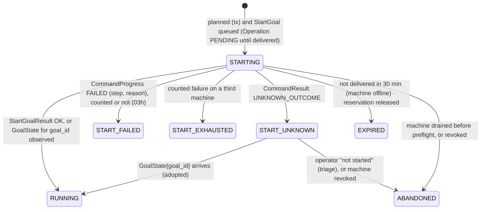

# 03c. Dispatch a goal (W5)

- Part of: [03-workflows.md](03-workflows.md) (conventions apply)
- Goal lifecycle and verification (W6) is [03l](03l-goal-lifecycle-and-verification.md).
- Continued in [03h](03h-goal-phases-in-depth.md) (start-failure reactions,
  dispatch checks, provider-side changes, limit wait, re-arm),
  [03i](03i-routines.md) (routine runs), [03k](03k-observed-goals.md) (observed goals)

## W5. Dispatch a goal

**Trigger.** *Auto:* scheduler tick (every 30 s) plus coalesced wakeups on
`AvailabilityChanged`, goal `MERGED`/`CLEARED`, machine `ONLINE`, a new usage
reading, a work-item sync that produced `READY` items, `Undrain`. *Manual:*
operator picks a work item and a `(machine, harness, account)` on the Work
view or `fleet dispatch`.

**Actors.** Scheduler (single goroutine), writer, `fleet-agent` (composite
`StartGoal`), tmux (developer's server), the harness, the goal file written by
the harness's hooks (eshu's or fleet's generic ones).

### The same dispatch through the API

The dashboard asks first with `PreflightGoal` (it reads, and writes no goal),
then starts with `StartGoal` and the same `GoalSpecInput`.

Preflight, what would happen without doing it:

Start, accept then send then run then confirm:

### Planning rules (auto-dispatch, one scheduler pass)

1. **Work items:** stage `READY` (open, trusted, unclaimed, repo watched; the
   trusted-issues verdict is recomputed from the mirror at plan time, so an
   edit since the last sync demotes the item before it is taken, 03j),
   integration lag ≤ `max_sync_lag`, no live goal for the same `WorkItemKey` (DB
   unique) or on the same branch, the repo `enabled` and below its cap
   (`Repo.spec.max_parallel_goals`, else `HubSettings.max_parallel_goals_per_repo`,
   default 3), counted over live goals. Items go in `dispatch_order`: oldest
   hub `create_time` first, ties by key; "next up" is the first.
2. **Accounts:** `pacing_state ∈ {OK, BEHIND, AHEAD}` with
   `active_goals < allowed_active`; ranked by waste risk (W3). Excluded:
   `RESERVE`, `SHORT_LIMIT`, `UNKNOWN`, `STALE`, `EXCLUDED` (interactive-only,
   dollar cap, OpenCode on Anthropic).
3. **Machines:** `ONLINE`, not draining, no durable unfit marker for the
   harness or repo (03h), `HarnessInfo{launch_allowed, version_support = SUPPORTED, or
   UNVERIFIED_PARSING while usage and ready parse live screens}` for the harness,
   the account's `AccountIdentity` present
   and `signed_in`, `ForgeCliStatus.signed_in` with `push_access` for the repo
   (`checked_time` under 2 h old, else the hub asks for a snapshot first),
   a checkout of the repo, `active < max_active` and `total < max_total`
   (the hub owns this and counts phases by class, below; if the heartbeat's
   `goals_active` or `goals_total` differs from the hub's matching count by more
   than one on two heartbeats, the hub sends `SnapshotRequest{"slot_mismatch"}`
   and skips the machine this pass; the agent's own cap is
   `AGENT_GOAL_CAP_REACHED`, [02h](02h-goal-binding-and-pane-signals.md#slots)),
   not on battery when
   `block_on_battery`. Preference: a **pane** that is `available_for_work`
   (E11), ready, with `workdir.repo` equal to the goal's repo and
   `workdir.dirty` false → reuse (the goal starts a new branch in that checkout,
   no new window); else a new window and worktree, preferring non-hub, then
   most free active slots. Auto-dispatch into a reused pane sets
   `fresh_context = true` only when fleet started its session or the developer
   marked the pane with `fresh_context_on_reuse`; otherwise the goal is typed
   into the existing context.
4. **No catch-up floods:** at most one dispatch per account and per machine
   per pass, and at most one pass every 30 s; after a hub restart the first
   pass waits for the first sync lap to finish.
5. **Consent:** `GoalSpec.consent = repo consent ∩ account consent` (ADR 0008),
   where repo consent is `Repo.spec.consent`, else `HubSettings.default_consent`;
   an empty result is `CONSENT_EMPTY`. Recorded in the audit row with the goal
   text.
6. **Where the checkout comes from** (`Repo.spec`): `worktree_mode` becomes
   `GoalSpec.worktree_mode` (`AUTO` is `REPO_DRIVER` where the chosen machine's
   checkout ships its own hooks, else `AGENT_ENSURES`); `branch_pattern` (default
   `fleet/{work}`) becomes `GoalSpec.branch`; `base_branch` the worktree's base.
7. **Transaction:** insert goal (`STARTING`, `attempt` = previous + 1, with
   `previous_goal`), reserve the session if reusing (`panes.reserved_for_goal`,
   unique), insert the outbox row, audit. Unique violations mean another
   decision won; the pass moves on. What the pass skipped, and why, is recorded
   as `DispatchBlock`s (03h, "Scheduler explanations").

**Composite steps on the agent** (G3; each persisted `started` and `done`):
14 steps in a fixed vocabulary, with the restart class and failure reasons of
each in [02h](02h-goal-binding-and-pane-signals.md#startgoal-steps):
`preflight` (skipped when `skip_preflight` and the hub's preflight is < 1 min
old) → reuse path `pick_session` (`reuse_pane` re-checked just before typing;
fails with its own reason rather than silently opening a window) and
`prepare_branch`, or new-window path `ensure_worktree` (only `AGENT_ENSURES`;
eshu's driver makes its own, so `REPO_DRIVER` starts in the main checkout) and
`ensure_window` (template `{harness} {work}`, e.g. `muse eshu#7398`; `FLEET_*`
env as a fast path) →
`register_goal` (the agent's registry, the goal's identity for every harness) →
`start_log_capture` → `wait_ready` → `set_model` → `set_effort` →
`clear_context` → `write_goal_file` → `type_goal` → `confirm_goal_file`. A
reused pane keeps its directory; one in another repo or a dirty checkout is not reused.

**Consent form.** When the checkout ships eshu's hooks (`GoalHooksState.repo_ships_own`
for that harness and workdir) the adapter types `/goal consent push,pr-open,merge
-- <goal_text>` and the hook writes the `CONSENT:` line. Otherwise the adapter
writes consent into the objective text: `/goal <goal_text> (consent: push,
pr-open, merge)`, having written `.fleet-board/goal-<goal_id>` itself just
before typing (Codex hooks never see `/goal` lines, [01d](01d-goal-hooks.md)).
Known limit: Claude Code in `default` permission mode asks for approval on every
file edit, so such a goal waits on each approval (Triage shows the prompt,
[03d](03d-triage-sessions-logs.md); 01d). The exact
line typed is reported back for the audit log (`StartGoalResult.typed_goal_line`).
The consent list on the wire is `repeated ConsentAct`, never text: the adapter
renders and joins the acts itself, so nothing the hub sends can add a `--`, a
comma or a newline to the typed line; an act the agent does not know is
`INVALID_ARGUMENT` and the goal is not typed.

### State machine (goal start, owned by the hub)

`START_FAILED`, `START_EXHAUSTED`, `EXPIRED` and `ABANDONED` are terminal
(`ENDED`). Nothing returns them to `STARTING`: the **work item stage** goes back to
`READY` (or `MANUAL_ONLY` after `START_EXHAUSTED`, 03h) and the next attempt is a
**new goal** with `attempt + 1` and `previous_goal`, so each attempt keeps its own
machine, `start_error` and transitions. There is no `QUEUED` phase: the goal and
its outbox row commit together, so "waiting for the machine" is `STARTING` with the
operation `PENDING`. What each failure reason does (unfit marker, skip, new
window, elsewhere, triage; which count toward `START_EXHAUSTED`) is the table in
[03h](03h-goal-phases-in-depth.md#start-failures-reason-to-reaction); the
`StartGoal` steps and their restart classes are in 02h.

### Persistence

| What | Where | Transaction |
|---|---|---|
| `goals` row (`goal_id`, `attempt`, `previous_goal`, `work_item WorkItemKey`, `repo RepoRef`, machine, account, harness, consent, text, phase, pane, session, timestamps, routine snapshot) | hub store | planning tx; result tx |
| `panes.reserved_for_goal` | hub store | planning tx; released in result/expiry tx |
| Outbox `StartGoal` (`pending → delivered → done/expired/failed`) | hub store | planning tx; delivery and result txs |
| Audit: who dispatched, consent written, machine, account | hub store (permanent) | planning tx |
| Composite step reached (`started`/`done`), worktree path, pane key | agent command log | before each `CommandProgress` is sent |
| Goal registry: `(goal, pane, worktree_path, harness_session_id)` per pane; availability marks per pane key | agent state dir (`agent.db`) | `register_goal`; released on `ReleaseGoal`, pane exit, prune; reported in every snapshot (02h) |
| Window/pane tags (`FLEET_*`) | tmux environment on the machine | n/a (tmux) |
| Worktree (agent-ensured) | machine disk | git |

### Ordering and consistency

- Plan then send: the goal row and outbox row commit before the command leaves
  the hub, so a hub crash after send is recovered from the outbox (W2).
- `CommandProgress` steps arrive in order on one stream; a step for an unknown
  `command_id` goes to audit only.
- `GoalState{goal_id}` may arrive before `StartGoalResult` (hooks write the
  file fast); the hub moves to `RUNNING` on whichever comes first and treats
  the other as confirmation.
- Manual dispatch's `PreflightResult` is advisory; `StartGoal` re-runs
  preflight unless `skip_preflight` and the hub's result is < 1 min old.

### Failure modes

| Failure | What happens |
|---|---|
| Agent offline between plan and send | Outbox `pending`; delivered on reconnect if within 30 min; else the operation is `EXPIRED` → goal `EXPIRED`, work item `READY`, reservation released; no re-plan while the machine is `OFFLINE` |
| Hub restart after send, or a duplicate `StartGoal` | Outbox re-sends the same `command_id`; the agent answers from its log or continues the composite, never restarting one in progress (W2) |
| Agent restart mid-composite | Re-runs declarative, read-only and verify steps; `clear_context` or `type_goal` started without `done` → `UNKNOWN_OUTCOME` unless the goal file is now present → `OK` (02h) |
| `not_after_time` (30 min) passes mid-composite | The agent finishes the step in flight, then reports `EXPIRED` for the remainder; a window already created is left (tagged) and the hub kills it only after a triage decision |
| Harness crashes during `wait_ready` | `PaneExited` + `READY_TIMEOUT`; one retry with a new window; then another machine |
| Provider error at start (sign-in, 5xx) | `HarnessCondition` from the new pane; the composite waits up to `ready_timeout`, then `READY_TIMEOUT`; the condition item (W7) explains why |
| Trust prompt appears | `TRUST_PROMPT_SEEN`; preflight should have refused `FOLDER_UNTRUSTED`; the agent never answers trust prompts (C3); machine marked unfit for that repo |
| Goal typed into a developer-marked pane | No `/clear` unless marked with `fresh_context_on_reuse`; the scheduler may not nudge, type `continue` or respawn there (02g, `F`), so a stop is `STUCK` with triage |
| Developer typing in the reused session, or it is in another repo or has changes | Input clears idle (`PaneInput`); `pick_session` fails `SESSION_NOT_AVAILABLE`, `SESSION_WORKDIR_MISMATCH` or `CHECKOUT_DIRTY`; nothing was changed; new window on the same machine |
| Developer typing in the new window during `wait_ready` | `type_goal` refuses `PANE_BUSY` (input line not empty); retry once after 30 s; then fail the step |
| Agent state directory lost | Registry rebuilt for new windows from `FLEET_GOAL_ID`; a missing entry for a reused pane shows in `Snapshot.goal_registry` and the hub sends `RegisterGoal` |
| Integration lag > `max_sync_lag` | Auto-dispatch paused for that integration; manual allowed with a warning (`WARN`, 03h) |
| Foreign claim appears after dispatch | `double_claim` triage (W4); the goal keeps running until a person decides |
| Slots disagree with heartbeat counts | `SnapshotRequest{"slot_mismatch"}`; machine skipped this pass |
| Two scheduler decisions for one work item (bug) | DB unique `(work_item) WHERE live` rejects the second; counted as `fleet_hub_plan_conflicts_total` |

### Telemetry

- `fleet_hub_dispatch_total{mode=auto|manual, result}`, `fleet_hub_dispatch_latency_seconds`
  (plan → `RUNNING`), `fleet_hub_scheduler_pass_seconds`, `fleet_hub_scheduler_skips_total{reason}`
  (the lower-cased short names of the 540-range `ReasonCode`s: `no_ready_items`,
  `account_pacing_blocked`, `account_usage_unknown`, `account_not_dispatchable`,
  `no_fit_machine`, `integration_lag`, `flood_guard`, `repo_parallel_limit`), `fleet_hub_goals{state, origin}`,
  `fleet_hub_machine_slots_used{machine, kind=active|total}` and `_limit`,
  `fleet_hub_machine_unfit{machine, harness, reason}`, `fleet_hub_plan_conflicts_total`.
- `fleet_agent_start_goal_step_seconds{step, result}`, `fleet_agent_start_goal_total{result, reason}`.
- Spans: `hub.scheduler.pass` → `hub.scheduler.plan{goal_id}` →
  `hub.command.send{command_id}`; `agent.start_goal{goal_id}` with one child
  span per step; the link is `Command.trace` and `CommandResult.trace` (02g).
- Logs: `dispatch.planned{goal_id, work_item, repo, machine, account, harness,
  reuse_pane, consent}`, `dispatch.step{goal_id, step, status, reason}`,
  `dispatch.skipped{reason, detail}` (one per pass, summarised).

At 3 AM: "why is nothing starting?" → `Account.status.pacing.idle_causes` (or
`fleet_hub_scheduler_skips_total{reason}` over the last hour); "why did this start
fail?" → the goal's `start_error`, the `agent.start_goal` span and `dispatch.step{reason}`.
