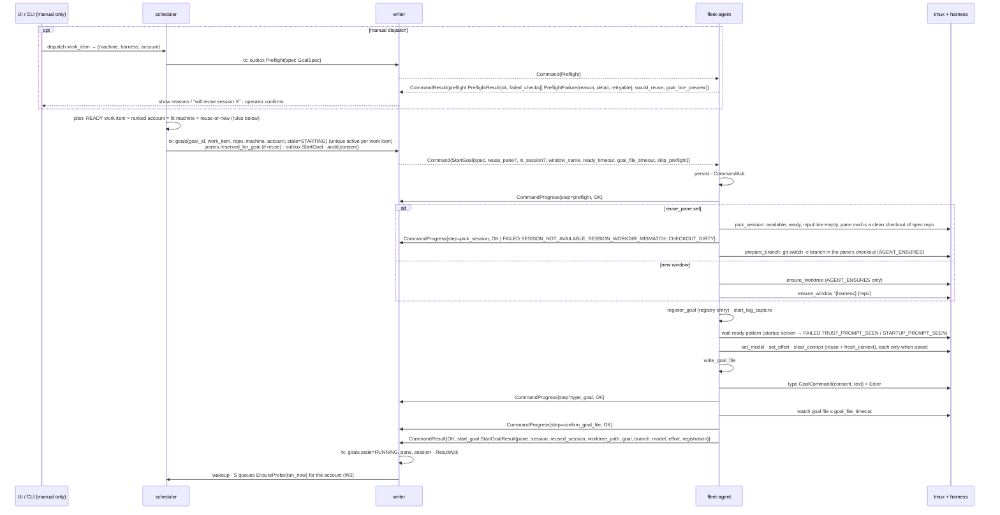
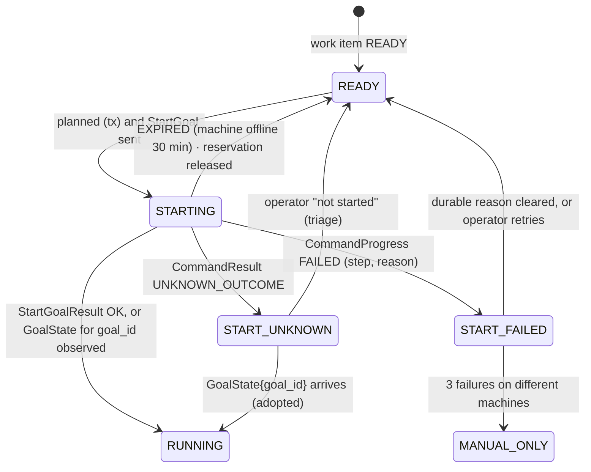
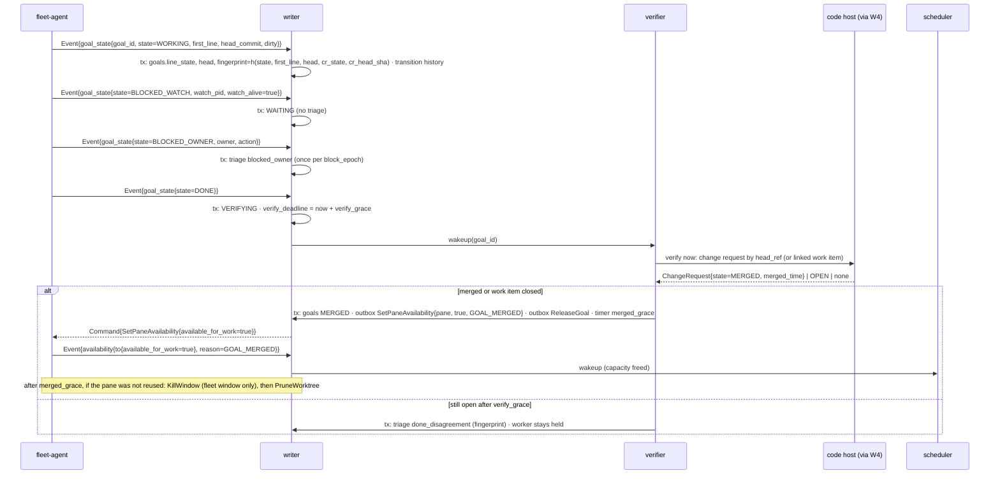

# 03c. Dispatch a goal; goal lifecycle and verification

- Part of: [03-workflows.md](03-workflows.md) (conventions apply)

## W5. Dispatch a goal

**Trigger.** *Auto:* scheduler tick (every 30 s) plus coalesced wakeups on
`AvailabilityChanged`, goal `MERGED`/`CLEARED`, machine `ONLINE`, a new usage
reading, a work-item sync that produced `READY` items, `Undrain`. *Manual:*
operator picks a work item and a `(machine, harness, account)` on the Work
view or `fleet dispatch`.

**Actors.** Scheduler (single goroutine), writer, `fleet-agent` (composite
`StartGoal`), tmux (developer's server), the harness, the goal file written by
the harness's hooks (eshu's or fleet's generic ones).

### Planning rules (auto-dispatch, one scheduler pass)

1. **Work items:** stage `READY` (open, trusted, unclaimed, repo watched),
   integration lag ≤ `max_sync_lag`, no active goal for the same
   `WorkItemKey` (DB unique), no active goal on the same branch, repo below
   `max_parallel_goals_per_repo` (default 3, open question).
2. **Accounts:** `pacing_state ∈ {OK, BEHIND, AHEAD}` with
   `active_goals < allowed_active`; ranked by waste risk (W3). Excluded:
   `RESERVE`, `SHORT_LIMIT`, `UNKNOWN`, `STALE`, `EXCLUDED` (interactive-only,
   dollar cap, OpenCode on Anthropic).
3. **Machines:** `ONLINE`, not draining, `HarnessInfo{launch_allowed,
   version_support = SUPPORTED}` for the harness, the account's `AccountIdentity` present
   and `signed_in`, `ForgeCliStatus.signed_in` with `push_access` for the repo
   (`checked_time` under 2 h old, else the hub asks for a snapshot first),
   a checkout of the repo, `active < max_active` and `total < max_total`
   (the hub owns this and counts from its goal table; if the heartbeat's
   `goals_active` or `goals_total` differs from the hub's by more than one on
   two heartbeats, the hub sends `SnapshotRequest{"slot_mismatch"}` and skips
   the machine this pass; the agent's own cap is `AGENT_GOAL_CAP_REACHED`,
   [02h](02h-goal-binding-and-pane-signals.md#slots)), not on battery when
   `block_on_battery`. Preference: a **pane** that is `available_for_work`
   (E11), ready, with `workdir.repo` equal to the goal's repo and
   `workdir.dirty` false → reuse (the goal starts a new branch in that checkout,
   no new window); else a new window and worktree, preferring non-hub, then
   most free active slots. Auto-dispatch into a reused pane sets
   `fresh_context = true`.
4. **No catch-up floods:** at most one dispatch per account and per machine
   per pass, and at most one pass every 30 s; after a hub restart the first
   pass waits for the first sync lap to finish.
5. **Consent:** `GoalSpec.consent = repo.consent ∩ account.consent` (ADR
   0008); recorded in the audit row with the goal text.
6. **Transaction:** insert goal (`STARTING`), reserve the session if reusing
   (`panes.reserved_for_goal`, unique), insert the outbox row, audit.
   Unique violations mean another decision won; the pass moves on.

**Composite steps on the agent** (G3; each persisted `started` and `done`):
14 steps in a closed vocabulary, with the restart class and failure reasons of
each in [02h](02h-goal-binding-and-pane-signals.md#startgoal-steps):
`preflight` (skipped when `skip_preflight` and the hub's preflight is < 1 min
old) → reuse path `pick_session` (`reuse_pane` re-checked just before typing;
fails with its own reason rather than silently opening a window, so the hub's
reservation stays truthful) and `prepare_branch`, or new-window path
`ensure_worktree` (only `AGENT_ENSURES`; eshu's driver creates its own, so
`REPO_DRIVER` starts in the main checkout) and `ensure_window` (template
`{harness} {repo}#{key}`, e.g. `muse eshu#7398`; `automatic-rename off` on this
window only; `FLEET_*` in the pane environment as a fast path) →
`register_goal` (the agent's registry, the goal's identity for every harness) →
`start_log_capture` → `wait_ready` → `set_model` → `set_effort` →
`clear_context` → `write_goal_file` → `type_goal` → `confirm_goal_file`. A
harness cannot change folder, so a reused pane keeps its directory and the
goal gets a new branch in it; a pane in another repo or a dirty checkout is not
reused.

**Consent form.** When the checkout ships eshu's hooks (`GoalHooksState.repo_ships_own`
for that harness and workdir) the adapter types `/goal consent push,pr-open,merge
-- <goal_text>` and the hook writes the `CONSENT:` line. Otherwise the adapter
writes consent into the objective text: `/goal <goal_text> (consent: push,
pr-open, merge)`, having written the goal file itself just before typing
(Codex hooks never see `/goal` lines, [01d](01d-goal-hooks.md)). The exact
line typed is reported back for the audit log (03g: `StartGoalResult.typed_goal_line`).
The consent list on the wire is `repeated ConsentAct` (`PUSH`, `PR_OPEN`,
`MERGE`), never text: the adapter renders each act as its lowercase hyphenated
word and joins them itself, so nothing the hub sends can add a `--`, a comma
or a newline to the typed line. An act the agent does not know is
`INVALID_ARGUMENT` and the goal is not typed.

### State machine (goal start, owned by the hub)

Retry policy per failure step: preflight reasons are **durable per `(machine,
harness)`** (`HARNESS_NOT_SIGNED_IN`, `PUSH_ACCESS_MISSING`, `CHECKOUT_MISSING`,
`FOLDER_UNTRUSTED`, `TMUX_TOO_OLD`, `HARNESS_VERSION_UNSUPPORTED`, and a
`STARTUP_PROMPT_SEEN` of kind `update` or `login`, which also opens a triage
item instead of retrying)
→ the machine is marked unfit for that harness/repo with the reason until a
fact it depends on changes: a snapshot or an event (`Event.forge_cli_status`
from the agent's hourly `gh`/`glab` re-check, `harness_changed`,
`policy_changed`), or the hub's own re-check, which re-runs `Preflight` for
each durably unfit `(machine, harness, repo)` after 10 minutes, doubling to one
hour while the reason holds (folder trust and other agent-local facts have no
event, so this is how `FOLDER_UNTRUSTED` clears; 02i, "Durable facts"). The
work item is re-planned on another machine next pass. `DISK_LOW`, `AGENT_GOAL_CAP_REACHED`
and `CHECKOUT_DIRTY` are transient. `READY_TIMEOUT`, `TRUST_PROMPT_SEEN`,
`PANE_BUSY`, `SESSION_NOT_AVAILABLE`, `CHECKOUT_DIRTY` → one retry on the same
machine with a new window (not a reuse); then another machine.
`SESSION_WORKDIR_MISMATCH` → new window at once, and the pane is not offered
again for that repo until `PaneChanged` says its directory changed.
`MODEL_NOT_AVAILABLE`, `EFFORT_NOT_SUPPORTED` → durable per `(account,
harness, model)`: triage, no retry. `GOAL_FILE_NOT_SEEN` → the harness
accepted the command but no file appeared: `START_UNKNOWN` with a triage item
("check pane, goal file missing"); hooks may be absent → `EnsureGoalHooks`
suggested.

### Persistence

| What | Where | Transaction |
|---|---|---|
| `goals` row (`goal_id`, `work_item WorkItemKey`, `repo RepoRef`, machine, account, harness, consent, text, state, pane, session, timestamps) | hub store | planning tx; result tx |
| `panes.reserved_for_goal` | hub store | planning tx; released in result/expiry tx |
| Outbox `StartGoal` (`pending → delivered → done/expired/failed`) | hub store | planning tx; delivery and result txs |
| Audit: who dispatched, consent written, machine, account | hub store (permanent) | planning tx |
| Composite step reached (`started`/`done`), worktree path, pane key | agent command log | before each `CommandProgress` is sent |
| Goal registry: `(goal, pane, worktree_path, harness_session_id)` per pane; availability marks per pane key | agent state dir (`state.db`) | `register_goal`; released on `ReleaseGoal`, pane exit, prune; reported in every snapshot (02h) |
| Window/pane tags (`FLEET_*`) | tmux environment on the machine | n/a (tmux) |
| Worktree (agent-ensured) | machine disk | git |

### Ordering and consistency

- Plan then send: the goal row and outbox row commit before the command leaves
  the hub, so a hub crash after send is recovered from the outbox (W2).
- `CommandProgress` steps arrive in order on one stream; a step for an unknown
  `command_id` goes to audit only.
- `GoalState{goal_id}` may arrive before `StartGoalResult` (hooks write the
  file fast); the hub moves to `RUNNING` on whichever comes first and treats
  the other as confirmation.
- Manual dispatch's `PreflightResult` is advisory; `StartGoal` re-runs
  preflight unless `skip_preflight` and the hub's result is < 1 min old.

### Failure modes

| Failure | What happens |
|---|---|
| Agent offline between plan and send | Outbox `pending`; delivered on reconnect if within 30 min; else `EXPIRED` → goal `READY`, reservation released; no re-plan while the machine is `OFFLINE` |
| Hub restart after send | Outbox re-sends the same `command_id`; the agent answers from its log or continues the composite (W2) |
| Duplicate `StartGoal` | Logged result; a composite in progress is not restarted |
| Agent restart mid-composite | Re-runs declarative, read-only and verify steps; `clear_context` or `type_goal` started without `done` → `UNKNOWN_OUTCOME` unless the goal file is now present → `OK` (02h) |
| `not_after_time` (30 min) passes mid-composite | The agent finishes the step in flight, then reports `EXPIRED` for the remainder; a window already created is left (tagged) and the hub kills it only after a triage decision |
| Harness crashes during `wait_ready` | `PaneExited` + `READY_TIMEOUT`; one retry with a new window; then another machine |
| Provider error at start (sign-in, 5xx) | `HarnessCondition` from the new pane; the composite waits up to `ready_timeout`, then `READY_TIMEOUT`; the condition item (W7) explains why |
| Trust prompt appears | `TRUST_PROMPT_SEEN`; preflight should have refused `FOLDER_UNTRUSTED`; the agent never answers trust prompts (C3); machine marked unfit for that repo |
| Developer typing in the reused session | Input clears idle (`PaneInput`) → `pick_session` fails `SESSION_NOT_AVAILABLE`; new window on the same machine next pass |
| Reused pane in another repo, or its checkout has changes | `SESSION_WORKDIR_MISMATCH` / `CHECKOUT_DIRTY` at `pick_session`; nothing was changed; new window |
| Developer typing in the new window during `wait_ready` | `type_goal` refuses `PANE_BUSY` (input line not empty); retry once after 30 s; then fail the step |
| Agent state directory lost | Registry rebuilt for new windows from `FLEET_GOAL_ID`; a missing entry for a reused pane shows in `Snapshot.goal_registry` and the hub sends `RegisterGoal` |
| Integration lag > `max_sync_lag` | Auto-dispatch paused for that integration; manual allowed with a warning |
| Foreign claim appears after dispatch | `double_claim` triage (W4); the goal keeps running until a person decides |
| Slots disagree with heartbeat counts | `SnapshotRequest{"slot_mismatch"}`; machine skipped this pass |
| Two scheduler decisions for one work item (bug) | DB unique `(work_item) WHERE active` rejects the second; counted as `fleet_hub_plan_conflicts_total` |

### Telemetry

- `fleet_hub_dispatch_total{mode=auto|manual, result}`,
  `fleet_hub_dispatch_latency_seconds` (plan → `RUNNING`),
  `fleet_hub_scheduler_pass_seconds`, `fleet_hub_scheduler_skips_total{reason}`
  (`no_ready_items`, `no_account_capacity`, `pacing_ahead`, `no_fit_machine`,
  `sync_stale`, `flood_guard`, `repo_cap`), `fleet_hub_goals{state}`,
  `fleet_hub_machine_slots_used{machine, kind=active|total}` and `_limit`,
  `fleet_hub_machine_unfit{machine, harness, reason}`,
  `fleet_hub_plan_conflicts_total`.
- `fleet_agent_start_goal_step_seconds{step, result}`,
  `fleet_agent_start_goal_total{result, reason}`.
- Spans: `hub.scheduler.pass` → `hub.scheduler.plan{goal_id}` →
  `hub.command.send{command_id}`; `agent.start_goal{goal_id}` with one child
  span per step; the link is `Command.trace` and `CommandResult.trace` (02g).
- Logs: `dispatch.planned{goal_id, work_item, repo, machine, account, harness,
  reuse_pane, consent}`, `dispatch.step{goal_id, step, status, reason}`,
  `dispatch.skipped{reason, detail}` (one per pass, summarised).

At 3 AM: "why is nothing starting?" → `fleet_hub_scheduler_skips_total{reason}`
over the last hour; "why did this start fail?" → `agent.start_goal` span for
the `goal_id` and `dispatch.step{reason}`.

---

## W6. Goal lifecycle and verification

**Trigger.** `Event.goal_state` (never dropped; first line + HEAD + dirty in
one message), `PaneExited{goal_id}`, `ActivityTransition`, `HarnessCondition`,
change request / work item mirror updates (W4), timers (cooldown expiry,
`merged_grace`, verify grace), operator actions (pause, resume, edit, clear,
nudge).

**Actors.** Writer (applies state), verifier, scheduler (frees capacity),
`fleet-agent` (typed `/goal` subcommands via `RunHarnessCommand`, `Interrupt`,
`SendKeys` nudges, `RespawnPane`, `PruneWorktree`, `KillWindow`,
`SetPaneAvailability`, `ReleaseGoal`), the harness and its hooks, the code host.

### State machine (goal, owned by the hub)

```mermaid
stateDiagram-v2
  [*] --> RUNNING: StartGoal OK / adopted
  RUNNING --> WAITING: BLOCKED_WATCH with watch_alive
  WAITING --> RUNNING: goal line back to working
  RUNNING --> BLOCKED_OWNER: BLOCKED with OWNER + ACTION (triage once)
  BLOCKED_OWNER --> RUNNING: goal line changes
  RUNNING --> STUCK: BLOCKED_STUCK, or watch pid dead, or stopped twice without DONE
  WAITING --> STUCK: watch pid dead
  RUNNING --> STOPPED: PaneExited, or idle at ready prompt with WORKING line
  STOPPED --> RUNNING: corrective nudge (once), progress seen
  STOPPED --> STUCK: stops again
  RUNNING --> COOLDOWN: 2 consecutive no-progress evaluations
  COOLDOWN --> RUNNING: cooldown expired, nudge typed
  RUNNING --> PAUSED: operator pause / review-loop cap / (opt-in) reserve line / goal interrupted or paused at the machine
  PAUSED --> RUNNING: operator resume (reserve: at auto_resume_time; at the machine: when the goal runs again)
  RUNNING --> LIMIT_WAIT: HarnessCondition USAGE_LIMIT or RATE_LIMITED with resets_time
  LIMIT_WAIT --> RUNNING: resets_time + 1 min and the condition cleared, resumed per goal_control
  RUNNING --> VERIFYING: DONE
  VERIFYING --> MERGED: change request merged or work item closed
  VERIFYING --> DISAGREE: open after verify_grace (triage)
  DISAGREE --> VERIFYING: provider changes, or operator "re-check"
  DISAGREE --> RUNNING: operator nudges "not done"
  MERGED --> CLOSED: merged_grace elapsed · worktree pruned, window closed or session reused
  RUNNING --> CLEARED: /goal clear (operator)
  RUNNING --> PANE_LOST: pane missing from snapshot (W2)
  PANE_LOST --> RUNNING: pane reappears with same FLEET_GOAL_ID
  PANE_LOST --> STUCK: 10 min
  STUCK --> RUNNING: operator action (nudge, restart, clear + redispatch)
```

Sub-flags held alongside the state and used by the rules below:
`provider_condition` (set while a `HarnessCondition` for the pane is not
cleared), `prompt_pending` (an open prompt item for the pane),
`human_at_keyboard_until` (10 min after the latest `PaneInput` on the pane, or
`Pane.last_input_time` after a reconnect), `pause_reason`, `nudges`, `no_progress_runs`, `cooldown_until_time`, `review_rounds`,
`block_epoch`.

### Rules

- **Fingerprint.** `h(line_state, first_line, head_commit, cr_state,
  cr_head_sha)`. Triage items and nudges are keyed on it, so one stopped or
  disagreeing state is reviewed once; a change in any component is a new
  state. `block_epoch` increments each time the line enters `BLOCKED_*` from
  another state, so leaving and re-entering Blocked notifies the owner again.
- **Stopped without DONE.** Detected by `PaneExited{goal_id}` or by
  `ActivityTransition{to=IDLE}` on a goal pane whose `line_state=WORKING`
  with `ready_pattern_showing` for longer than `idle_threshold` (the Stop hook
  should prevent this; its absence is itself a finding). Suppressed while
  `provider_condition`, `prompt_pending`, `human_at_keyboard_until` or an open
  `GOAL_INTERRUPTED` / `GOAL_PAUSED` condition hold.
- **Interrupted or paused at the machine.** An open `GOAL_INTERRUPTED`, or a
  `GOAL_PAUSED` with cause `DEVELOPER_INPUT` or `HARNESS`, on a goal pane is the
  owner's decision (01d): phase `PAUSED` with `pause_reason =
  OWNER_AT_MACHINE`, a `goal_paused` triage item, no corrective nudge, no
  no-progress counting, never resumed automatically. It ends when the condition
  clears (the goal runs again: `RUNNING`) or an operator resumes it. A
  `FLEET_COMMAND` cause is the hub's own pause and keeps the reason the hub
  recorded (`OPERATOR`, `REVIEW_LOOP`, `RESERVE`). Only `RESERVE` has an
  `auto_resume_time`.
- **Limit wait.** A `USAGE_LIMIT` or `RATE_LIMITED` condition with `resets_time`
  moves the goal to `LIMIT_WAIT` (no nudges, no no-progress counting) until
  `resets_time` + 1 min; without a time the hub re-checks every 10 min and on
  each probe reading, capped at the weekly reset. The resume is the harness's
  own, from `goal_control`, and is unverified where
  `limit_resume_verified` is false (02h).
- **One corrective nudge.** First stop: if the pane is dead →
  `RespawnPane{harness, resume=true, harness_session_id}` (dangerous kind; may
  need local approval; the id keeps `--last` from picking another conversation),
  wait for ready, then `SendKeys{purpose=GOAL_NUDGE, keys:
  ["Your goal is still active. Continue, or write DONE, or BLOCKED: <reason>
  with WATCH=<pid> or OWNER=<who> ACTION=<what>.", ENTER]}` (not idempotent:
  `UNKNOWN_OUTCOME` → no second attempt, triage). Second stop → `STUCK` →
  triage `recovery_required`.
- **Progress** = `head_commit` or `first_line` changed since the last
  evaluation. Each stop/nudge evaluation with no progress increments
  `no_progress_runs`; at 2 → `COOLDOWN` with `cooldown = min(30 min, 2 min ×
  2^(n−2))`; progress resets both. No nudges during cooldown.
- **Review-loop cap.** `ChangeRequest.review_rounds - review_rounds_baseline ≥
  3` without a merge → `PAUSED{REVIEW_LOOP}`, the baseline set to the current
  `review_rounds`, so an operator's resume is not paused again at once; the pause
  is `goal_control.pause_mode` (`/goal pause`, or `Interrupt`); triage
  `review_loop` (one per `cr_head_sha`).
- **Verification.** `DONE` → `VERIFYING` → targeted sync (W4). Merged
  (`ChangeRequest.state=MERGED`) or the work item closed → `MERGED`. Open
  after `verify_grace` (default 10 min, covers sync lag) → `DISAGREE` with a
  triage item; the worker stays held. Without `merge` consent (ADR 0008) the
  done state is "approved and green": `review_decision=APPROVED` and
  `checks.rollup=SUCCESS` → triage `ready_for_human_merge`; still `VERIFYING`
  until the merge is seen.
- **Free the worker.** Only on `MERGED`: `SetPaneAvailability{true, GOAL_MERGED}`
  makes the pane `available_for_work` (E11) and `ReleaseGoal` drops its registry
  entry; the scheduler may reuse the pane at once (new branch in the same
  checkout). After `merged_grace` (setting), if no new goal took the pane:
  `KillWindow` (fleet windows only; never a developer's), then
  `PruneWorktree{repo, goal_id, path}` (agent-created worktrees only, and only
  once no live pane works in it). A pane that was reused is left alone.
- **Pause / resume / edit / clear** are operator actions typed as the
  developer would (01b): `RunHarnessCommand{pane, "/goal", args, expected_class
  = GOAL, catalog_hash}` at an idle prompt. If the harness is mid-turn the hub
  first sends `Interrupt`, waits for ready (`HarnessReady` or ready pattern),
  then types the subcommand. After an interrupt (probed 2026-10-02): Muse shows
  "goal paused by interrupt — resume with /goal resume"; Codex 0.160.0 shows
  "Goal paused" and resumes with `/goal resume`, checking where it stopped;
  Claude Code 2.1.286 keeps the goal active (bare `/goal` shows "Goal active")
  and resumes when `continue` is typed, so resume on Claude is
  `SendKeys{purpose=GOAL_RESUME, "continue", Enter}`. The hub does not keep this
  table: it reads `MachineHarness.goal_control` (subcommands, `pause_mode`,
  `resume_mode`, `resume_text`) that the adapter reports for the installed
  version. None of the three resumed on its own during 30
  idle seconds. Completion shows on screen ("✔ Goal achieved" on Claude), and
  Claude clears its goal once achieved. `/goal clear` → `CLEARED`: the session
  is idle but **not** available for work (fleet started it, nothing merged);
  the operator marks it available or closes it.
- **Pacing reserve** (opt-in): `RESERVE` → pause (`goal_control.pause_mode`)
  on `WORKING` goals of that account, never on `WAITING`, `pause_reason =
  RESERVE`; resumed at `auto_resume_time`, the deciding bucket's `resets_time`.

### Persistence

| What | Where | Transaction |
|---|---|---|
| `goals` (state, flags above, fingerprint, `cr_ref`, timestamps) | hub store | one tx per applying event or timer; commands enqueued in the same tx |
| `goal_transitions` (history: from, to, reason, fingerprint, at) and `goal_runs` (nudges, restarts, usage consumed from readings, transcript path) | hub store (7-day timeline; run history kept with the goal) | same tx |
| Triage items raised here | hub store | same tx (W7) |
| On the agent: the command log and the goal registry (02h); the goal file itself belongs to the harness and lives in the worktree | machine disk | n/a |

### Ordering and consistency

- `GoalState` events apply in `seq` order; an older `observed_time` than the
  stored one is history only.
- Verification joins two sources (agent goal line, provider mirror); the
  fingerprint includes both, so re-evaluation after either changes is
  idempotent.
- Timers (`cooldown_until_time`, `verify_deadline`, `merged_grace`) are persisted
  and re-armed from the store at hub start; no decision depends on in-memory
  timers surviving.
- Nudges and goal-control commands are typed input (not idempotent): the hub
  never retries them after `UNKNOWN_OUTCOME`.

### Failure modes

| Failure | What happens |
|---|---|
| Agent offline | Goal state frozen at last known; stuck/no-progress evaluation suspended while `OFFLINE`; timers that fire act only when `ONLINE` |
| Hub restart | All flags and timers are in the store; re-armed at start; a nudge sent but unacked is in the outbox and may be `EXPIRED` (2 min) → nothing typed |
| Duplicate command | Logged result |
| Nudge `not_after_time` expires | `EXPIRED`; the next stop evaluation may nudge again only if `nudges` is still 0 (it is not incremented for an undelivered nudge) |
| Harness crash (`PaneExited`) | `STOPPED`; respawn + nudge once; second crash → `STUCK` |
| Provider error / rate limit / usage limit (`HarnessCondition`) | `provider_condition` set; no stop or no-progress counting; `USAGE_LIMIT` also marks the account `SHORT_LIMIT`/`RESERVE` in W3; cleared → counting resumes |
| Prompt appears | `prompt_pending`; nudges suppressed; W7 handles the answer |
| Developer typing in the goal pane | `PaneInput` sets `human_at_keyboard_until`; nudges and goal-control suppressed for 10 min; the board shows "someone is typing" from `Pane.last_input_time` |
| Developer interrupts or pauses the goal | `GOAL_INTERRUPTED` / `GOAL_PAUSED`: phase `PAUSED{OWNER_AT_MACHINE}`, triage `goal_paused`, no nudge, no automatic resume |
| Code host unavailable | `VERIFYING` holds past `verify_grace` without raising `DISAGREE` while the integration is `DEGRADED` (the disagreement is unknowable); shows "verification waiting on <integration>" |
| Change request found but head differs from the agent's HEAD | Not a disagreement by itself (driver may have rebased); verification uses provider merge state only |
| `RespawnPane` needs local approval and times out | `LOCAL_CONFIRM_TIMEOUT`; goal `STUCK` with reason; triage explains "approval needed on machine" |
| Pause or resume mode `NONE` in `goal_control`, or the version changed | `GOAL_SUBCOMMAND_UNSUPPORTED`, before sending when the hub knows; the hub falls back to `Interrupt` and records "paused by interrupt" |
| Session killed by the developer while a goal runs | `SessionEvent{CLOSED}` + `PaneExited`; `STOPPED` → nudge is impossible (no pane) → `STUCK` with reason `session_closed`; the operator redispatches |
| Worktree prune fails (`WORKTREE_DIRTY`) | Left in place; triage info "dirty worktree after merge" with the diff stat line; `allow_dirty` needs `ROLE_OWNER` |

### Telemetry

- `fleet_hub_goal_transitions_total{from, to, reason}`, `fleet_hub_goals{state}`,
  `fleet_hub_goal_age_seconds{state}` (histogram), `fleet_hub_goal_nudges_total{kind=corrective|cooldown, result}`,
  `fleet_hub_goals_in_cooldown`, `fleet_hub_verify_latency_seconds` (DONE → MERGED),
  `fleet_hub_verify_disagreements_total`, `fleet_hub_review_loop_pauses_total`,
  `fleet_hub_goal_control_total{subcommand, harness, result}`,
  `fleet_hub_workers_freed_total`, `fleet_hub_goal_stop_without_done_total{harness}`.
- `fleet_agent_goal_state_events_total{state}`, `fleet_agent_goal_file_watch_errors_total`.
- Spans: `hub.goal.apply_state{goal_id}`, `hub.verifier.check{goal_id}`,
  `hub.goal.nudge{goal_id}` → `agent.respawn_pane`, `agent.send_keys`;
  `hub.goal.control{goal_id, subcommand}` → `agent.run_harness_command`.
- Logs: `goal.transition{goal_id, from, to, reason, fingerprint}`,
  `goal.nudge{goal_id, nudges, no_progress_runs, cooldown}`,
  `goal.verify{goal_id, cr_ref, cr_state, outcome}`, `goal.freed{goal_id,
  session, reused}`.

At 3 AM: "why is this goal stuck / why was the worker not freed?" →
`goal.transition` history for the `goal_id` and `hub.verifier.check` spans;
"is the fleet nudging in a loop?" → `fleet_hub_goal_nudges_total` rate.
