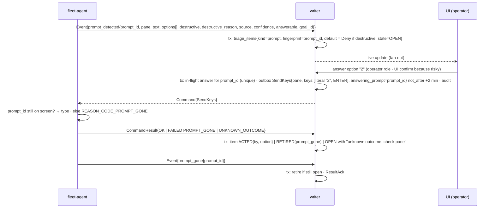
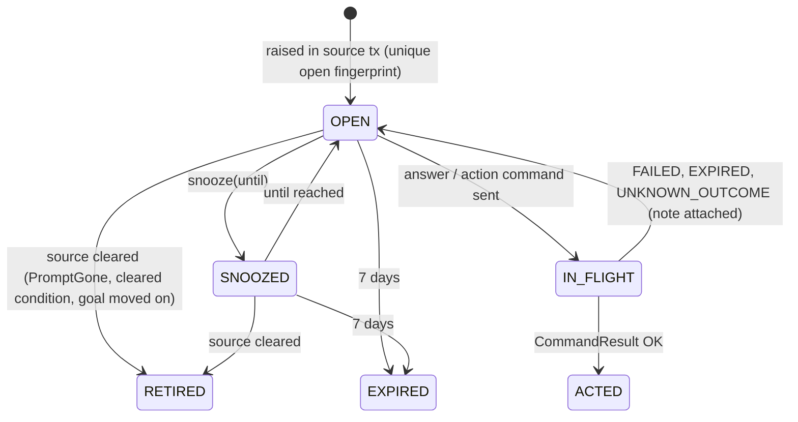
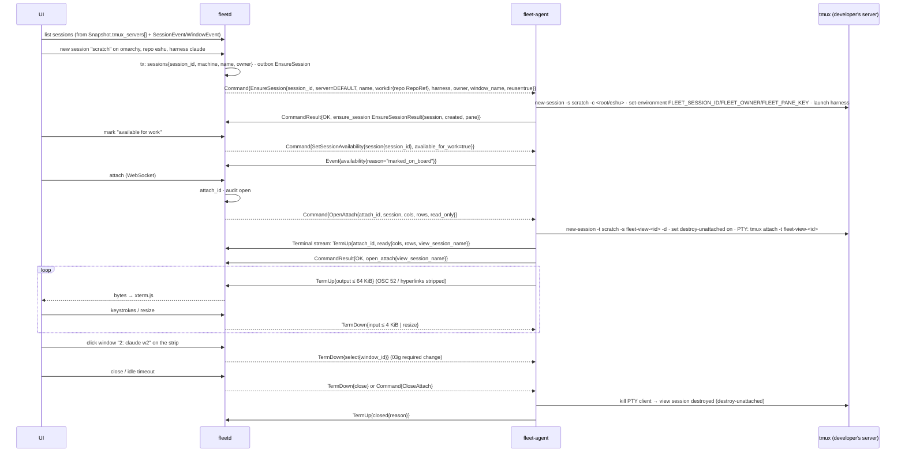
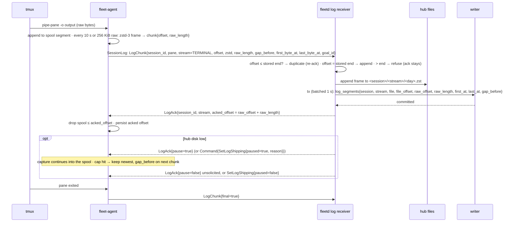
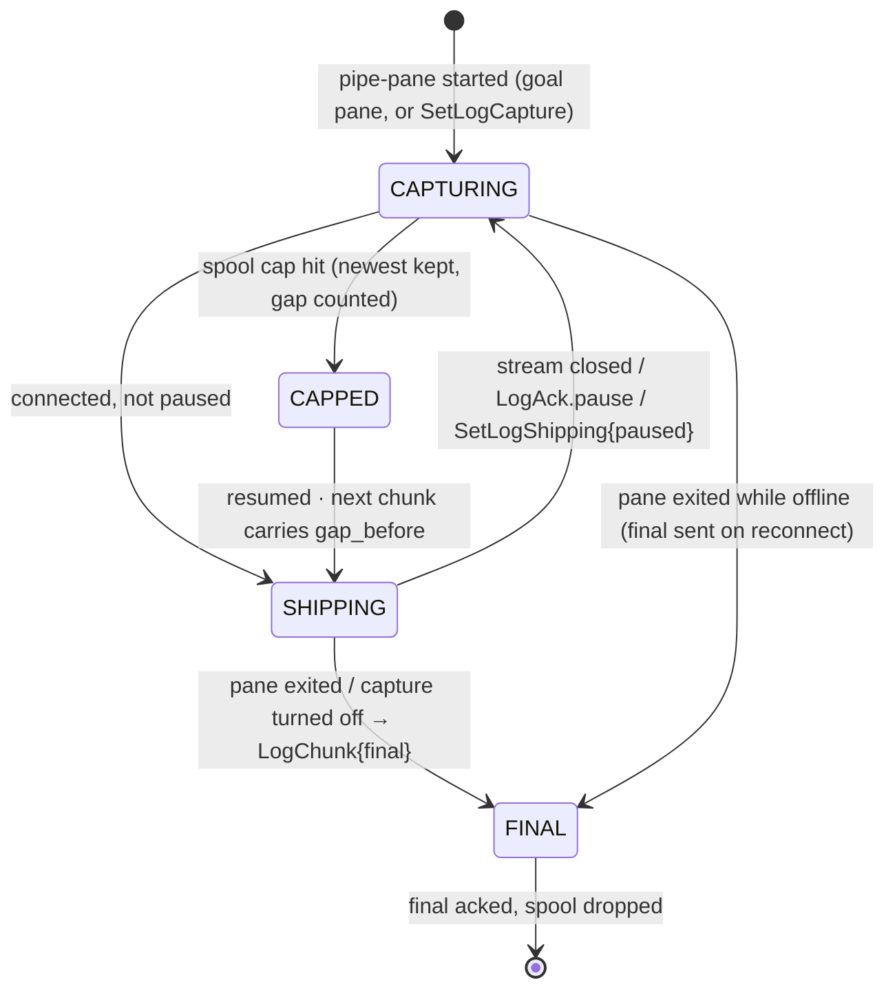

# 03d. Triage items; developer sessions; session logs

- Part of: [03-workflows.md](03-workflows.md) (conventions apply)

## W7. Triage items

**Trigger.** Any source below produces or retires an item; the operator acts,
snoozes or dismisses; items expire after 7 days.

| Kind | Source | Key (fingerprint) | Retired by |
|---|---|---|---|
| `prompt` | `PromptDetected` | `prompt_id` | `PromptGone`, `PaneExited`, answer `OK` |
| `condition` | `HarnessCondition` (provider error, rate limit, usage limit, sign-in, network) | `(pane, kind)` | same event with `cleared=true`, `PaneExited` |
| `stuck` / `recovery_required` | W6 `STUCK` | goal fingerprint | goal leaves `STUCK` |
| `blocked_owner` | W6 `BLOCKED_OWNER` | `(goal_id, block_epoch)` | goal line changes |
| `done_disagreement`, `ready_for_human_merge` | W6 verifier | goal fingerprint | `MERGED`, or goal line changes |
| `review_loop` | W6 | `(goal_id, cr_head_sha)` | merge, or operator resume |
| `pacing` | W3 `RESERVE` / `UNKNOWN` > 1 h / `STALE` > 1 h | `(account, bucket, reset_at, kind)` | state leaves that kind |
| `start_unknown`, `orphan_goal_pane`, `double_claim`, `integration_access_lost`, `usage_parse_failed`, `parser_unsupported`, `duplicate_identity`, `policy_changed`, `hostname_mismatch`, `dirty_worktree` | W2, W4, W5, W10, W11 | stated in each workflow | stated in each workflow |

**Actors.** Writer (raises and retires inside the event's transaction), UI /
CLI (operator), `fleet-agent` (`SendKeys` bound to `prompt_id`,
`CapturePane`), notifier (v3, once per item for `blocked_owner` and
destructive prompts).

**Rules.** Prompts are never auto-answered, destructive or not (design.md
safety rails); a destructive prompt (`rm -rf`, `docker compose down -v`, a
credential on a command line) shows Deny preselected and `destructive_reason`.
`answerable=false` (detection not verified for that harness version) → the
item is notice-only with the `ssh -t … tmux attach` line (W8). One answer in
flight per `prompt_id` (DB unique); a second click is refused until the
result lands. `UNKNOWN_OUTCOME` keeps the item open with a `CapturePane`
button; the hub never retries typing. Snooze sets `snoozed_until`; the item
reappears unless retired meanwhile. Expiry at 7 days moves it to `EXPIRED`
and audits it; a prompt that is still on screen after 7 days is re-raised by
the next `Snapshot.prompts[]` (03g) because the fingerprint is new only if the
`prompt_id` changed, so the UI shows "expired, still showing".

### State machine (item, owned by the hub)

### Persistence

| What | Where | Transaction |
|---|---|---|
| `triage_items{id, kind, fingerprint (unique while OPEN/SNOOZED/IN_FLIGHT), machine, goal, pane, account, payload, default_option, state, snoozed_until, raised_at, acted_by, acted_at, notified_at}` | hub store | the source event's tx; action txs |
| In-flight answer per `prompt_id` | hub store (unique) | action tx; cleared in result tx |
| Audit of every action (who, option, outcome) | hub store (permanent) | action and result txs |
| Nothing on the agent beyond the command log and the local audit log (M1) | agent state dir | per command |

### Ordering and consistency

- Raise and retire happen in the same transaction as the event that caused
  them, so the item list is never ahead of or behind the goal/pane state it
  describes.
- A `PromptGone` that arrives before the hub processed the `PromptDetected`
  (reordered replay cannot happen: same stream, `seq` order) is impossible;
  a `PromptGone` for an unknown `prompt_id` is logged and ignored.
- Items are ranked for the feed on read (kind weight, age, goal state), not
  stored ranked.

### Failure modes

| Failure | What happens |
|---|---|
| Agent offline when the operator answers | `SendKeys` `pending` in the outbox; delivered on reconnect only if within 2 min; else `EXPIRED` → item `OPEN` with "not delivered, machine was offline" |
| Hub restart | Items and in-flight markers durable; an in-flight answer whose result never arrives is closed by the outbox expiry pass |
| Duplicate `SendKeys` | Not idempotent; the agent refuses a re-send after `UNKNOWN_OUTCOME` by `command_id` (logged result); a new `command_id` for the same `prompt_id` is refused by the hub's in-flight unique until cleared |
| Deadline expiry | As above; never typed late |
| Harness crash | `PaneExited` retires prompt and condition items for the pane; W6 raises `stuck`/`recovery_required` instead |
| Provider error while a prompt is open | Both items exist; the condition item explains why the answer may not be processed yet |
| Prompt already answered at the keyboard | `PromptGone` retires; a late answer gets `PROMPT_GONE`, nothing typed |
| Developer typing in the pane while the operator answers | The agent's `require_empty_input_line` is false for prompt answers (menus), but the prompt check still runs; if the prompt moved, `PROMPT_GONE` |
| Code host unavailable | Only verification-derived items are delayed; prompts and conditions are unaffected |
| Fingerprint collision across machines | Fingerprints include `machine_id` (and `pane` where relevant); `prompt_id` is agent-minted and scoped by machine in the hub key |

### Telemetry

- `fleet_hub_triage_items{kind, state}`, `fleet_hub_triage_open_age_seconds{kind}`
  (histogram), `fleet_hub_triage_raised_total{kind}`, `fleet_hub_triage_retired_total{kind, reason}`,
  `fleet_hub_prompt_answer_latency_seconds` (detected → `OK`),
  `fleet_hub_prompt_answers_total{result, destructive}`,
  `fleet_hub_triage_expired_total{kind}`.
- `fleet_agent_prompt_detected_total{harness, source, destructive, answerable}`,
  `fleet_agent_prompt_gone_total{harness}`, `fleet_agent_send_keys_total{result}`.
- Spans: `hub.triage.raise{kind}`, `hub.prompt.answer{prompt_id}` →
  `agent.send_keys{prompt_id}`.
- Logs: `triage.raised{kind, fingerprint, goal_id, machine}`,
  `prompt.answered{prompt_id, by, option, destructive, result}`,
  `triage.expired{kind, age}`.

At 3 AM: "a prompt has been waiting for hours" →
`fleet_hub_triage_open_age_seconds{kind="prompt"}` and whether `answerable`
was false; "did my answer land?" → `prompt.answered{result}`.

---

## W8. Developer sessions

**Trigger.** Operator opens the Session view (list), creates or reuses a
session, marks one "available for work", attaches from the browser, switches
windows/panes, or copies the ssh attach line.

**Actors.** UI, hub (gateway, attach bridge, writer), `fleet-agent` (tmux
control-mode observer, PTY client per attach), the developer's tmux server.

**Rules.** The list shows every session on the developer's server, marked
"yours" or "started by fleet" from `FLEET_*` tags, windows by index and name
as the status bar shows them, the harness per pane from the process, activity
and availability. Creating uses `EnsureSession` with `reuse=true` so a repeated
click is harmless. The browser attaches through a **grouped view session**
(`new-session -t <session>`) so switching windows in the browser never moves
the developer's own current window; the developer's prefix key and bindings
work unchanged in the PTY. The window strip and pane switcher need a typed
`select` on the view session because the hub does not know the developer's
prefix key (03g). `viewer` role attaches are read-only: the hub drops input and
the agent also refuses it. Idle timeout `attach_idle_timeout` (setting). The
ssh line `ssh -t <user>@<host> tmux attach -t '<session>'` is rendered in the
browser from `MachineFacts.username` (03g) and the hostname or the connection's
peer address; the hub never runs it.

### Persistence

| What | Where | Transaction |
|---|---|---|
| `sessions{session_id, machine, name, owner, created_at, available_for_work, log_capture, reserved_for_goal}` | hub store | create tx; availability tx on event |
| Attach registry (`attach_id`, session, principal, read_only, opened_at) | hub memory + audit row open/close with byte counts (no content) | audit tx |
| `FLEET_*` tags, view session | tmux environment on the machine | n/a |
| Developer-created sessions | hub mirror from snapshot/events only; never owned | snapshot/event tx |

### Ordering and consistency

- Session identity survives renames and reconnects via `FLEET_SESSION_ID`;
  developer sessions are addressed by `tmux_id` + `server_start_id` and
  become stale when the server restarts (`SESSION_NOT_FOUND`).
- `Terminal` bytes are never dropped (HTTP/2 flow control; the PTY blocks);
  input is never dropped for operators; terminal traffic is a separate
  stream, so it cannot delay commands.
- `SetSessionAvailability` is declarative; the agent's `AvailabilityChanged`
  is the truth the scheduler uses, not the command result.

### Failure modes

| Failure | What happens |
|---|---|
| Agent offline | Attach closes (`hub_closed`); UI offers reconnect; session list shows last known with "offline" |
| Hub restart | All attaches drop; the agent's PTY clients see the stream end and exit; view sessions self-destroy; sessions table durable |
| Duplicate `EnsureSession` / `OpenAttach` | Declarative / logged result; a second `OpenAttach` with the same `attach_id` returns the existing view |
| Deadline (2 min for `OpenAttach`) | `EXPIRED`; UI shows "not delivered" |
| Harness crash in the session | Pane `dead=true` with `exit_status`; UI offers `RespawnPane{resume=true}` (dangerous kind) |
| Provider error | `HarnessCondition` shown inline on the session card |
| Prompt appears | W7 item; the session card shows it; answering from the attach is just typing |
| Developer typing at the same time | Two tmux clients on one session is normal; availability flips to not idle (`keystroke`) |
| tmux server not running | `TMUX_SERVER_DOWN`; `EnsureSession` would start it, but only if local policy allows `control` |
| Session renamed or killed by the developer | Renamed: still recognised by tag; killed: `SessionEvent{CLOSED}`, attaches closed `session_ended`, any goal in it goes `STOPPED` (W6) |
| `view` session name collides | Names carry `attach_id`; unique |
| Browser reserves a shortcut (Ctrl+W) | The strip and the tmux prefix cover it; documented, not a failure |
| Work tracker / code host | Not involved |

### Telemetry

- `fleet_hub_sessions{machine, origin=fleet|developer}`, `fleet_hub_sessions_available{machine}`,
  `fleet_hub_attaches_open`, `fleet_hub_attach_bytes_total{direction}`,
  `fleet_hub_attach_open_latency_seconds`, `fleet_hub_attach_closed_total{reason}`,
  `fleet_hub_ensure_session_total{result}`.
- `fleet_agent_attach_open_total{result}`, `fleet_agent_attaches_open`,
  `fleet_agent_pty_write_block_seconds` (backpressure visibility).
- Spans: `hub.session.ensure{session_id}` → `agent.ensure_session`;
  `hub.attach.open{attach_id}` → `agent.attach.open`.
- Logs: `session.created{session_id, machine, harness, by}`,
  `attach.opened/closed{attach_id, session, by, read_only, reason, bytes}`,
  `availability.changed{session, reason}`.

---

## W9. Session logs

**Trigger.** A fleet goal pane starts (always captured); `SetLogCapture{enabled}`
for a developer session; chunk cadence; `LogAck`; hub disk thresholds;
retention pass; a UI replay request.

**Actors.** `fleet-agent` capture (tmux `pipe-pane -o`), spool and shipper;
hub log receiver (per agent `SessionLog` stream), hub files, writer (index),
UI replay.

**Rules.** The spool stores **compressed** chunks (65 B/s per busy pane
measured, 01c), so hours offline cost megabytes, not gigabytes. Chunk cadence
10 s / 256 KiB raw is a proposal: shorter means less loss on an agent crash,
longer means better ratio; step 4 may tune it. The hub appends frames as
received (no recompression) to one file per `(session, stream, day)` and
indexes each chunk. Ack after the file write and the index commit (batched
≤ 1 s); durability of the file is fsync per batch. Offsets are the ordering
key; a chunk is accepted only at the stored end. `LogAck.pause` is a stream
level backpressure signal and `SetLogShipping` the command form; resuming
needs an unsolicited `LogAck{pause=false}` or `SetLogShipping{paused=false}`
because a paused agent sends no chunks to ack (semantic note, 03g). Retention:
total size cap (setting), oldest sessions pruned first; per-session delete is
one audited action. Replay: the UI asks for `(session, from_raw_offset | from
time)`; the hub maps through the index, decompresses frames, streams to
xterm.js; chunk `first_byte_at/last_byte_at` give time navigation. Harness
transcripts (K3, v3) reuse the path with `stream=HARNESS_TRANSCRIPT` from
`PaneHarnessSession.transcript_path`, opt-in per repo or machine.

### State machine (one log stream, owned by the agent; mirrored on the hub)

### Persistence

| What | Where | Transaction |
|---|---|---|
| Spool: compressed chunks + `acked_offset` per stream | agent state dir (`spool/<session>/<stream>/`), fsync per chunk batch | per chunk |
| Log files: one per `(session, stream, day)`, append-only zstd frames | hub files | append + fsync per batch |
| `log_segments` index (file, file_offset, raw_offset, raw_length, times, gap) and `log_sessions{session, machine, goal, bytes, first_at, last_at}` | hub store | one tx per ≤ 1 s batch across all streams |
| Retention state (total bytes, prune cursor) | hub store | prune tx per session removed |
| `SpoolStatus` (pending, cap, gaps, paused) | heartbeat / snapshot, latest only | not persisted beyond last heartbeat |

### Ordering and consistency

- Per stream, offsets are contiguous except across an explicit `gap_before`;
  the hub records the gap in the index and the UI shows it.
- Duplicate chunks after an ack was lost are detected by offset and re-acked.
- Index and file are written in that order (file append first); on a hub
  crash between them the chunk is re-sent (unacked) and the file's trailing
  partial frame is truncated at startup to the last indexed `file_offset`.
- Terminal-log traffic is a separate stream and never delays commands;
  HTTP/2 flow control plus `pause` bound hub memory.

### Failure modes

| Failure | What happens |
|---|---|
| Agent offline for hours | Spool grows at ~65 B/s per busy pane (compressed); cap (setting, e.g. 256 MiB) far away; resends from `acked_offset` on reconnect |
| Hub restart | Index durable; truncate partial frame; agent resends from last ack |
| Chunk arrives twice | Offset ≤ stored end → re-ack, not stored |
| Chunk arrives with a hole (offset > end, no `gap_before`) | Refused; ack stays at stored end; the agent resends from there (its spool still has it); counted |
| Hub disk below threshold | `LogAck{pause=true}` to every agent; capture continues; triage `log_disk_low`; resume above a higher threshold (hysteresis) |
| Spool cap hit on the agent | Newest kept, `gap_marks++`, `gap_before` on the next chunk; `SpoolStatus` in heartbeat shows it |
| Agent crash mid-chunk | Up to one chunk interval (10 s) of raw output lost before compression; the pipe-pane process keeps writing to the spool file, so loss is bounded by what was not yet durable |
| Harness crash | `final=true` after the pane exits; a respawned pane is a new pane key and a new stream under the same `session_id` |
| tmux server restart | New `server_start_id`; new pane keys; old streams `FINAL` on the next snapshot diff |
| Developer typing | Captured only in their own sessions when capture is on for that session |
| Provider error / prompts | Captured as output; no special handling |
| Work tracker / code host | Not involved |
| Retention prunes a session with an open stream | Never: only `FINAL` sessions older than the cursor are pruned |

### Telemetry

- `fleet_agent_spool_bytes{machine}`, `fleet_agent_spool_gap_total`, `fleet_agent_log_chunks_total{stream}`,
  `fleet_agent_log_raw_bytes_total{stream}`, `fleet_agent_log_zstd_bytes_total{stream}`
  (ratio = raw/zstd), `fleet_agent_log_shipping_paused`, `fleet_agent_log_unacked_bytes`.
- `fleet_hub_log_bytes_total{stream}`, `fleet_hub_log_disk_bytes`, `fleet_hub_log_disk_free_bytes`,
  `fleet_hub_log_ack_latency_seconds`, `fleet_hub_log_streams_open`, `fleet_hub_log_paused{machine}`,
  `fleet_hub_log_duplicate_chunks_total`, `fleet_hub_log_hole_refused_total`,
  `fleet_hub_log_pruned_bytes_total`, `fleet_hub_log_index_batch_seconds`.
- Spans: `agent.log.flush{session}`, `hub.log.batch` (attributes: chunks,
  bytes, streams), `hub.log.replay{session}`.
- Logs: `log.gap{session, machine, bytes_lost}`, `log.paused{machine, reason}`,
  `log.resumed`, `log.pruned{session, bytes}`, `log.hole_refused{session, offset, end}`.

At 3 AM: "are logs still arriving?" → `fleet_hub_log_ack_latency_seconds` and
`fleet_agent_log_unacked_bytes`; "why is there a gap in this session?" →
`log.gap` and `fleet_agent_spool_gap_total`.
