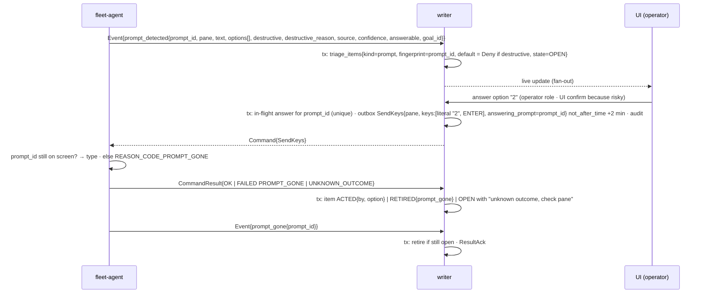
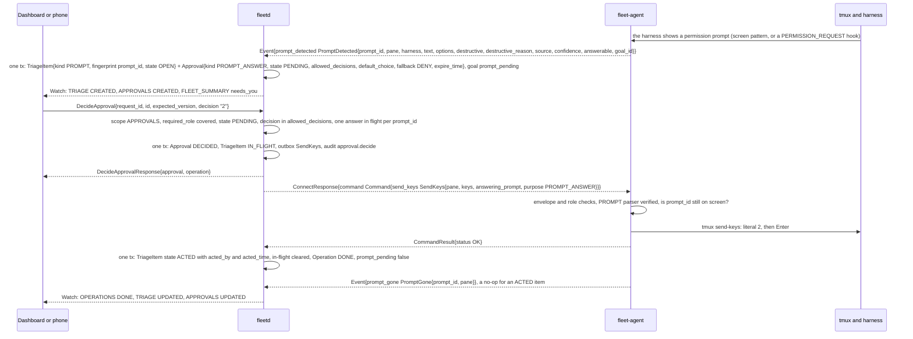
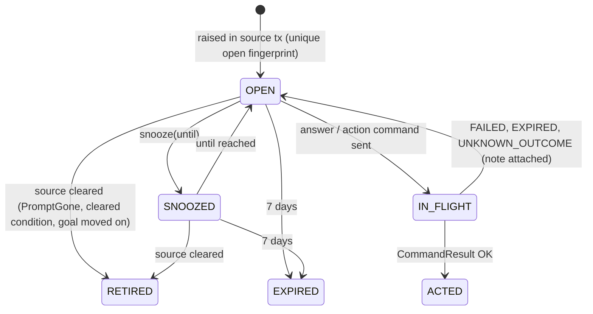
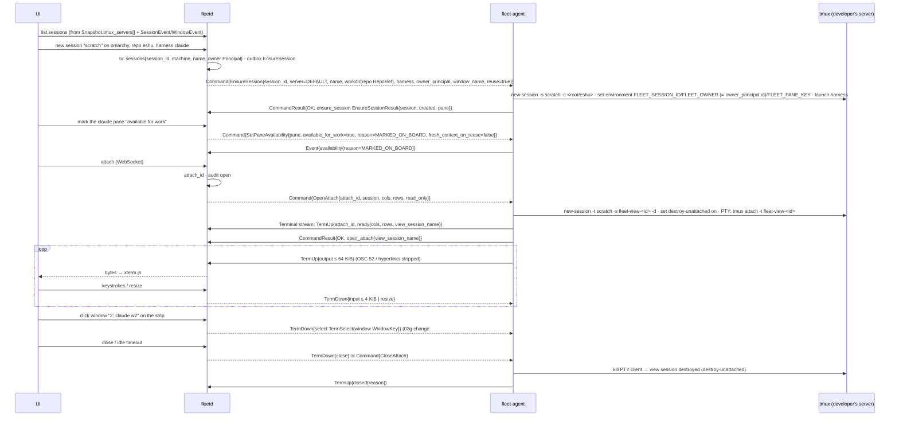
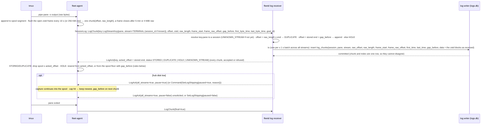
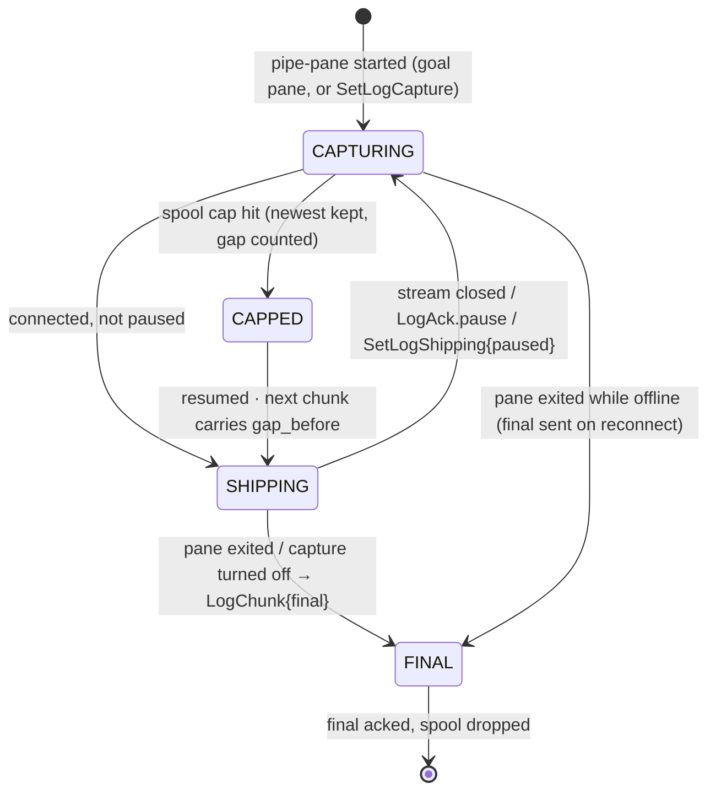

# 03d. Triage items; developer sessions; session logs

- Part of: [03-workflows.md](03-workflows.md) (conventions apply)

## W7. Triage items

**Trigger.** Any source below produces or retires an item; the operator acts,
snoozes or dismisses; items expire after 7 days.

| Kind | Source | Key (fingerprint) | Retired by |
|---|---|---|---|
| `prompt` | `PromptDetected` | `prompt_id` | `PromptGone`, `PaneExited`, answer `OK` |
| `condition` | `HarnessCondition` (provider error, rate limit, usage limit, sign-in, network) | `(pane, kind)` | same event with `cleared=true`, `PaneExited` |
| `stuck` | W6 `STUCK`; the UI chip "recovery required" is `Goal.status.phase_reason` `SESSION_CLOSED` or `LOCAL_CONFIRM_TIMEOUT`, not a separate kind | goal fingerprint | goal leaves `STUCK` |
| `goal_paused` | W6 `PAUSED` at the machine or by an operator (01d) | `(goal_id, pause_reason, block_epoch)` | goal runs again, or resumed |
| `limit_wait` | W6 `LIMIT_WAIT` expected over 30 min, or a resume that did not take (03h) | `(goal_id, phase_time)` | goal leaves `LIMIT_WAIT` |
| `start_failed` | a start needing a person: update or login screen, model or effort missing, three attempts failed, a leftover worktree (03h) | `(work_item, reason)` | the fact clears, or the item is requeued |
| `work_item_changed` | the provider closed, cancelled or reopened the item under a live goal (03h) | `(goal_id, provider state)` | goal resumed, cleared or ended |
| `routine_blocked` | a routine run live longer than `blocked_after` (03i) | `(routine, run)` | the run ends |
| `log_disk_low` | W9 hub disk below 5 GiB free (resumes above 8 GiB, [defaults](defaults.md)) | `hub` | disk above the higher threshold |
| `system` | a signal about fleetd or an agent itself left OK ([05b](05b-observability.md#8-the-system-health-model)): writer lag, disk, clock skew, an always-on machine offline | `system:<signal>:<subject>` | the signal stays OK for 5 minutes |
| `suggestion` | a rule-based insight, only with `HubSettings.suggestions_in_triage` ([05](05-insights.md#8-suggestions)), `SEVERITY_INFO`, never notified | `SuggestionId` | the rule stops firing, or dismissed |
| `policy_invalid` | W10 agent policy file invalid (safe mode) | `machine` | snapshot shows safe mode off |
| `parser_degraded` | W11 three parse failures on a supported version | `(machine, harness, version)` | a good reading |
| `settings_unenforced` | W10 a safety setting the agent does not know | `(machine, field)` | agent upgraded |
| `blocked_owner` | W6 `BLOCKED_OWNER` | `(goal_id, block_epoch)` | goal line changes |
| `done_disagreement`, `ready_for_human_merge` | W6 verifier | goal fingerprint | `MERGED`, or goal line changes |
| `review_loop` | W6 | `(goal_id, cr_head_sha)` | merge, or operator resume |
| `pacing` | W3 `RESERVE` / `UNKNOWN` > 1 h / `STALE` > 1 h (STALE itself starts at `stale_after`, 30 min; 05b raises its signal then and goes CRITICAL at 2 h) | `(account, bucket, resets_time, kind)` | state leaves that kind |
| `start_unknown`, `orphan_goal_pane`, `double_claim`, `integration_access_lost`, `usage_parse_failed`, `parser_unsupported`, `duplicate_identity`, `policy_changed`, `hostname_mismatch`, `dirty_worktree` | W2, W4, W5, W10, W11 | stated in each workflow | stated in each workflow |

Every kind in this table is a `TriageKind` value (`TRIAGE_KIND_<NAME>`); `other`
is for nothing the hub raises today.

**Actors.** Writer (raises and retires inside the event's transaction), UI /
CLI (operator), `fleet-agent` (`SendKeys` bound to `prompt_id`,
`CapturePane`), notifier (v3, once per item for `blocked_owner` and
destructive prompts; until v3 "notified" means the Triage item and the
browser's indicator, nothing is pushed).

**Rules.** Prompts are never auto-answered, destructive or not
([02h](02h-goal-binding-and-pane-signals.md#sendkeys-purposes), ADR 0004); a destructive prompt (`rm -rf`, `docker compose down -v`, a
credential on a command line) shows Deny preselected and `destructive_reason`.
`answerable=false` (detection not verified for that harness version) → the
item has no answer buttons and shows the `ssh -t … tmux attach` line (W8). One answer in
flight per `prompt_id` (DB unique); a second click is refused until the
result lands. `UNKNOWN_OUTCOME` keeps the item open with a `CapturePane`
button; the hub never retries typing. When an item returns to `OPEN` after a failed
answer its `Approval` is already `DECIDED`, so the hub raises a new `Approval` for the
same `prompt_id` and points `TriageItem.approval` at it: that is the second try. Snooze sets `snoozed_until_time`; the item
reappears unless retired meanwhile. Expiry at 7 days (`HubSettings.triage_expiry`) moves it to `EXPIRED`
and audits it; that is a different clock from `Approval.expire_time`
(`HubSettings.approval_timeout`, 30 minutes: on expiry the fallback `DENY` applies and the
item stays open) ([defaults](defaults.md)); a prompt that is still on screen after 7 days is re-raised by
the next `Snapshot.prompts[]` (03g) because the fingerprint is new only if the
`prompt_id` changed, so the UI shows "expired, still showing".

**Answering through an approval, as messages.** The writer raises the triage item and its
`Approval` in the same transaction as the event. The person decides with `DecideApproval`
naming the exact version they saw (`APPROVAL_CLOSED` wins over `VERSION_MISMATCH`, so a phone
says "already decided", not "reload"). The agent re-checks that the prompt is still showing
before it types. A deny sends nothing and returns no operation.

### State machine (item, owned by the hub)

### Persistence

| What | Where | Transaction |
|---|---|---|
| `triage_items{id, version, kind, severity, fingerprint (unique while OPEN/SNOOZED/IN_FLIGHT), machine, session, pane, goal, account, work_item, detail, approval, state, snoozed_until_time, expire_time, create_time, update_time, acted_by, acted_time, last_operation, notified_time}` (the `TriageItem` message; `notified_time` is hub-internal, for the v3 notifier) | hub store | the source event's tx; action txs |
| In-flight answer per `prompt_id` | hub store (unique) | action tx; cleared in result tx |
| Audit of every action (who, option, outcome) | hub store (permanent) | action and result txs |
| Nothing on the agent beyond the command log and the local audit log (M1) | agent state dir | per command |

### Ordering and consistency

- Raise and retire happen in the same transaction as the event that caused
  them, so the item list is never ahead of or behind the goal/pane state it
  describes.
- A `PromptGone` that arrives before the hub processed the `PromptDetected`
  (reordered replay cannot happen: same stream, `seq` order) is impossible;
  a `PromptGone` for an unknown `prompt_id` is logged and ignored.
- Items are ranked for the feed on read (severity, then age, as the API
  orders them), not stored ranked.

### Failure modes

| Failure | What happens |
|---|---|
| Agent offline when the operator answers | `SendKeys` `pending` in the outbox; delivered on reconnect only if within 2 min; else `EXPIRED` → item `OPEN` with "not delivered, machine was offline" |
| Hub restart | Items and in-flight markers durable; an in-flight answer whose result never arrives is closed by the outbox expiry pass |
| Duplicate `SendKeys` | Not idempotent; the agent refuses a re-send after `UNKNOWN_OUTCOME` by `command_id` (logged result); a new `command_id` for the same `prompt_id` is refused by the hub's in-flight unique until cleared |
| Deadline expiry | As above; never typed late |
| Harness crash | `PaneExited` retires prompt and condition items for the pane; W6 raises `stuck` instead |
| Provider error while a prompt is open | Both items exist; the condition item explains why the answer may not be processed yet |
| Prompt already answered at the keyboard | `PromptGone` retires; a late answer gets `PROMPT_GONE`, nothing typed |
| Developer typing in the pane while the operator answers | A `PROMPT_ANSWER` `SendKeys` needs no empty input line or ready pattern (menus have neither), but the prompt check still runs; if the prompt moved, `PROMPT_GONE` |
| Code host unavailable | Only verification-derived items are delayed; prompts and conditions are unaffected |
| Fingerprint collision across machines | Fingerprints include `machine_id` (and `pane` where relevant); `prompt_id` is agent-minted and scoped by machine in the hub key |

### Telemetry

- `fleet_hub_triage_items{kind, state}`, `fleet_hub_triage_open_age_seconds{kind}`
  (histogram), `fleet_hub_triage_raised_total{kind}`, `fleet_hub_triage_retired_total{kind, reason}`,
  `fleet_hub_prompt_answer_latency_seconds` (detected → `OK`),
  `fleet_hub_prompt_answers_total{result, destructive}`,
  `fleet_hub_triage_expired_total{kind}`.
- `fleet_agent_prompt_detected_total{harness, source, destructive, answerable}`,
  `fleet_agent_prompt_gone_total{harness}`, `fleet_agent_send_keys_total{result}`.
- Spans: `hub.triage.raise{kind}`, `hub.prompt.answer{prompt_id}` →
  `agent.send_keys{prompt_id}`.
- Logs: `triage.raised{kind, fingerprint, goal_id, machine}`,
  `prompt.answered{prompt_id, by, option, destructive, result}`,
  `triage.expired{kind, age}`.

At 3 AM: "a prompt has been waiting for hours" →
`fleet_hub_triage_open_age_seconds{kind="prompt"}` and whether `answerable`
was false; "did my answer land?" → `prompt.answered{result}`.

---

## W8. Developer sessions

**Trigger.** Operator opens the Session view (list), creates or reuses a
session, marks one "available for work", attaches from the browser, switches
windows/panes, or copies the ssh attach line.

**Actors.** UI, hub (gateway, attach bridge, writer), `fleet-agent` (tmux
control-mode observer, PTY client per attach), the developer's tmux server.

**Rules.** The list shows every session on the developer's server, marked
"yours" or "started by fleet" from `FLEET_*` tags, windows by index and name
as the status bar shows them, the harness per pane from the process, activity
and availability (one mark per harness pane, never per session; 02h). Sessions
the fleet made for itself (`TmuxSession.internal`: attach views, anything on the
probe server) are never listed, and their panes are not counted: a view shares
its windows, so the same `PaneKey`, with the real session. A pane that
starts a harness or changes directory arrives as `PaneChanged`, so the list is
not stale until the next reconnect. Creating uses `EnsureSession` with `reuse=true` so a repeated
click is harmless. The browser attaches through a **grouped view session**
(`new-session -t <session>`) so switching windows in the browser never moves
the developer's own current window; the developer's prefix key and bindings
work unchanged in the PTY. The window strip and pane switcher need a typed
`select` on the view session because the hub does not know the developer's
prefix key (03g). `viewer` role attaches are read-only: the hub drops input and
the agent also refuses it. Idle timeout `attach_idle_timeout` (setting). The
ssh line `ssh -t <user>@<host> tmux attach -t '<session>'` is rendered in the
browser from `MachineFacts.username` (03g) and the hostname or the connection's
peer address; the hub never runs it.

### Persistence

| What | Where | Transaction |
|---|---|---|
| `sessions{session_id, machine, name, owner Principal, create_time, log_capture}` and `panes{pane_key, available_for_work, reserved_for_goal}` | hub store | create tx; availability tx on event |
| Attach registry (`attach_id`, session, principal, read_only, open_time) | hub memory + audit row open/close with byte counts (no content) | audit tx |
| `FLEET_*` tags, view session | tmux environment on the machine | n/a |
| Developer-created sessions | hub mirror from snapshot/events only; never owned | snapshot/event tx |

### Ordering and consistency

- Session identity survives renames and reconnects via `FLEET_SESSION_ID`;
  developer sessions are addressed by `tmux_id` + `server_start_id` and
  become stale when the server restarts (`SESSION_NOT_FOUND`).
- `Terminal` bytes are never dropped (HTTP/2 flow control; the PTY blocks);
  input is never dropped for operators; terminal traffic is a separate
  stream, so it cannot delay commands.
- `SetPaneAvailability` is declarative; the agent's `AvailabilityChanged`
  is the truth the scheduler uses, not the command result. The agent keeps
  each mark per pane key, with its `fresh_context_on_reuse` choice, and reports
  it in `TmuxPane.availability` on every snapshot, so the hub re-sends one that
  is missing.

### Failure modes

| Failure | What happens |
|---|---|
| Agent offline | Attach closes (`AGENT_OFFLINE`); UI offers reconnect; session list shows last known with "offline" |
| Hub restart | All attaches drop; the agent's PTY clients see the stream end and exit; view sessions self-destroy; sessions table durable |
| Duplicate `EnsureSession` / `OpenAttach` | Declarative / logged result; a second `OpenAttach` with the same `attach_id` returns the existing view |
| Deadline (2 min for `OpenAttach`) | `EXPIRED`; UI shows "not delivered" |
| Session created on a machine that is offline (`CreateSession`) | `EnsureSession` ends `EXPIRED` after its deadline; nothing is created |
| Repo outside the machine's allowed roots, or local policy refuses the kind | `REPO_ROOT_NOT_ALLOWED`, or `REJECTED_BY_POLICY`; nothing is created |
| Harness crash in the session | Pane `dead=true` with `exit_status`; UI offers `RespawnPane{resume=true}` (dangerous kind) |
| Provider error | `HarnessCondition` shown inline on the session card |
| Prompt appears | W7 item; the session card shows it; answering from the attach is just typing |
| Developer typing at the same time | Two tmux clients on one session is normal; the agent reports `PaneInput` and the pane stops being idle |
| tmux server not running | `TMUX_SERVER_DOWN`; `EnsureSession` would start it, but only if local policy allows `control` |
| Session renamed or killed by the developer | Renamed: still recognised by tag; killed: `SessionEvent{CLOSED}`, attaches closed `session_ended`, any goal in it goes `STOPPED` (W6) |
| `view` session name collides | Names carry `attach_id`; unique |
| Browser reserves a shortcut (Ctrl+W) | The strip and the tmux prefix cover it; documented, not a failure |
| Work tracker / code host | Not involved |

### Telemetry

- `fleet_hub_sessions{machine, origin=fleet|developer}`, `fleet_hub_sessions_available{machine}`,
  `fleet_hub_attaches_open`, `fleet_hub_attach_bytes_total{direction}`,
  `fleet_hub_attach_open_latency_seconds`, `fleet_hub_attach_closed_total{reason}`,
  `fleet_hub_ensure_session_total{result}`.
- `fleet_agent_attach_open_total{result}`, `fleet_agent_attaches_open`,
  `fleet_agent_pty_write_block_seconds` (backpressure visibility).
- Spans: `hub.session.ensure{session_id}` → `agent.ensure_session`;
  `hub.attach.open{attach_id}` → `agent.attach.open`.
- Logs: `session.created{session_id, machine, harness, by}`,
  `attach.opened/closed{attach_id, session, by, read_only, reason, bytes}`,
  `availability.changed{session, reason}`.

---

## W9. Session logs

**Trigger.** A fleet goal pane starts (always captured); `SetLogCapture{enabled}`
for a developer session; chunk cadence; `LogAck`; hub disk thresholds;
retention pass; a UI replay request.

**Actors.** `fleet-agent` capture (tmux `pipe-pane -o`), spool and shipper;
hub log receiver (per agent `SessionLog` stream), the log writer (its own
goroutine and `logs.db`, ADR 0015), UI replay.

**Rules.** The spool stores **compressed** chunks (65 B/s per busy pane
measured, 01c), so hours offline cost megabytes, not gigabytes. **Framing**
(spike S2, [02e](02e-contract-rules.md#log-framing)): the agent keeps one zstd
frame per stream open for up to 5 minutes or 4 MiB raw and flushes it every
10 s (or 256 KiB raw, a proposal: shorter means less loss on an agent crash,
longer a better ratio; step 4 may tune it), so a chunk is a run of zstd
blocks; `frame_start` marks the chunk that opens a frame and `frame_raw_offset`
where the open frame began. The hub stores the blocks as received (no
recompression) as one `log_chunks` row per chunk, unique on `(session, pane,
stream, raw_offset)`, with `frame_start` and `frame_raw_offset` beside the data,
since replay decodes from the chunk at `frame_raw_offset`. There is no file and
no rotation: a frame spans rows, and pruning deletes whole sessions. `LogAck`
follows the commit of the batch (≤ 1 s), one sync per batch (ADR 0015).

**Stream identity.** The agent names a stream `(pane, stream)`: `PaneKey` is
unique on the machine, and a developer's own session has no hub `SessionId`
the agent could know. The agent leaves `LogStreamKey.session_id` empty (or
sets it, for a fleet session, from its registry); the hub resolves the pane to
the `SessionId` it assigned to `(machine, server_start_id, tmux id)`, stores
and indexes under it, and `LogAck` echoes the key as sent. The agent's spool is
`spool/<server>/<server_start_id>/<pane>/<stream>/`. `SetLogCapture` addresses
the session by tmux id, and the agent starts the stream for each pane in it.

**Offsets, acks and gaps.** Offset is the raw byte count of the stream from the
start of capture; lost bytes still take up offsets. The hub answers **every**
chunk with `LogAck{key, acked_offset = its stored end, status}`:

| Chunk | Hub action | `status` |
|---|---|---|
| `offset == stored_end + gap_before` | store the row, ack the new end (the row records `gap_before` as lost bytes) | `STORED` |
| `offset + raw_length ≤ stored_end` | ignore | `DUPLICATE` (re-ack) |
| anything else (a hole, or the hub is ahead) | store nothing, count `log.hole_refused` | `HOLE` with the hub's end |
| the pane maps to no session yet | store nothing | `UNKNOWN_STREAM` |

On `HOLE` the agent resumes from `acked_offset`: if its spool still holds those
bytes it resends from there; if the hub's end is **below its spool floor** (it
dropped everything up to an earlier ack, or the hub was restored from an older
backup or lost its tail), it sends its oldest chunk with
`gap_before = floor - acked_offset`, `offset = floor` and `frame_start = true`,
which the accept rule takes at once. The agent follows the hub's `acked_offset`
even when lower than one it saw before; it never treats it as monotonic. On
`UNKNOWN_STREAM` it keeps the spool and retries after the next snapshot, at
most every 60 s. `LogAck.pause` is a stream
level backpressure signal and `SetLogShipping` the command form; resuming
needs an unsolicited `LogAck{all_streams=true, pause=false}` or `SetLogShipping{paused=false}`
because a paused agent sends no chunks to ack (semantic note, 03g). Retention:
the size cap and the optional age limit are hub settings
(`HubSettings.log_size_cap_bytes`, `log_retention`; default 50 GiB, no age
limit), the oldest ended sessions are pruned first and a session with an open
stream never is. Replay: the UI asks for `(session, from_raw_offset | from
time)`; the hub finds the chunks by `(session, pane, stream, raw_offset)` or time, decompresses frames, streams to
xterm.js; chunk `first_byte_time/last_byte_time` give time navigation. Harness
transcripts (K3, v3) reuse the path with `stream=HARNESS_TRANSCRIPT` from
`PaneHarnessSession.transcript_path`, opt-in per repo or machine.

**Management and ended sessions.** (Until the logs row of the plan lands, a pane's latest summary row is
deleted with its pane and the last screen of an ended session is not kept: ADR 0025 decision 6, which replaces ADR 0024 decision 23.) When a session ends, the last pane summary of
each of its panes moves from `state.db` to `logs.db` (ADR 0015, amending 0013) and the session row becomes
`ENDED` (`Session.status.state`, `end_time`), kept while its logs exist. A client
finds ended sessions with `ListStoredSessions` (filter machine, goal, harness,
state, time), which returns each stream's `LogStreamKey`, the sizes and times,
and the archived summaries, so `ReadSessionLog` and `fleet logs export <session>`
have an entry point after the window is gone. `DeleteSessionLogs` removes one
session's chunks, `log_sessions` row and summaries in one `logs.db` transaction, with one audit row in `state.db`
(`logs.delete`: bytes, never content) and is refused while a stream still
captures (`LOG_STREAM_OPEN`). Right after it commits the hub also removes the
**ended** `Session` row from `state.db` (a row is kept only while its logs
exist), so `ListSessions(state = ENDED)` no longer lists it; goals and goal runs stay. `SearchSessionLogs` is a literal, case-insensitive
scan of the decompressed frames the filter selects, bounded per call and
continued by `page_token` (no index in v1). `GetLogStoreStatus` reports bytes
against the cap, free disk, the oldest data (days retained) and whether shipping
is paused. All five need `SCOPE_LOGS`; export is the client paging
`ReadSessionLog`.

### State machine (one log stream, owned by the agent; mirrored on the hub)

### Persistence

| What | Where | Transaction |
|---|---|---|
| Spool: compressed chunks + `acked_offset` per stream | agent state dir (`spool/<server>/<server_start_id>/<pane>/<stream>/`), fsync per chunk batch | per chunk |
| `logs.db`: `log_chunks{session, pane, stream, raw_offset, raw_length, frame_start, frame_raw_offset, first_time, last_time, gap_before, data}` keyed `(session, pane, stream, raw_offset)`, `log_sessions{session, machine, goals, bytes, first_time, last_time, end_time}`, `archived_pane_summaries{pane, last_lines, last_output_time, archived_time}` | `logs.db` (own writer; same pragmas as `state.db` plus `auto_vacuum=INCREMENTAL`) | one tx per ≤ 1 s batch across all streams |
| Retention state (total bytes, prune cursor); the per-session delete audit row | `logs.db` (bytes); `state.db` (audit) | prune tx per session removed |
| `SpoolStatus` (pending, cap, gaps, paused) | heartbeat / snapshot, latest only | not persisted beyond last heartbeat |

### Ordering and consistency

- Per stream, a chunk lands at `stored_end + gap_before`; a nonzero
  `gap_before` is recorded on the row as lost bytes and the UI shows it.
- Duplicate chunks after an ack was lost are detected by offset and re-acked
  (`DUPLICATE`); a refused chunk is answered `HOLE` with the hub's end, so the
  agent always learns where the hub is.
- A chunk and its index are one `logs.db` row in one transaction, so a hub
  crash leaves either the whole chunk or none of it; an unacked chunk is re-sent
  and there is no startup repair step (ADR 0015).
- Terminal-log traffic is a separate stream and never delays commands;
  HTTP/2 flow control plus `pause` bound hub memory.

### Failure modes

| Failure | What happens |
|---|---|
| Agent offline for hours | Spool grows at ~65 B/s per busy pane (compressed); cap (`spool_cap_bytes`, [defaults](defaults.md)) far away; resends from `acked_offset` on reconnect |
| Hub restart | `logs.db` is durable and consistent; the agent resends from the hub's end (the next `LogAck`) |
| Hub restored from an older backup, or its end lost below what the agent already dropped from its spool | The first chunk gets `HOLE` with the hub's lower end; the agent sees it is below its spool floor and sends its oldest chunk with `gap_before = floor - end`, `frame_start = true`; the stream continues and the rows show the gap (`log.gap`), nothing wedges |
| Chunk arrives twice | `offset + raw_length ≤ stored end` → `DUPLICATE`, not stored |
| Chunk arrives with a hole (offset ≠ end + `gap_before`) | Refused with `HOLE` and the hub's end; the agent resends from there (its spool still has it) or declares a gap; counted |
| Chunk for a pane the hub has no session for yet | `UNKNOWN_STREAM`; the agent keeps the spool and retries after the next snapshot |
| Hub disk below threshold | `LogAck{all_streams=true, pause=true}` to every agent; capture continues; triage `log_disk_low`; resume above a higher threshold (hysteresis) |
| Spool cap hit on the agent | Newest kept, `gap_marks++`, `gap_before` on the next chunk; `SpoolStatus` in heartbeat shows it |
| Agent crash mid-chunk | Up to one chunk interval (10 s) of raw output lost before compression; the pipe-pane process keeps writing to the spool file, so loss is bounded by what was not yet durable |
| Harness crash | `final=true` after the pane exits; a respawn keeps the pane key, so the stream continues on the same key at the stored end with a new `frame_start` (a new window or server restart makes new keys) |
| tmux server restart | New `server_start_id`; new pane keys; old streams `FINAL` on the next snapshot diff |
| Developer typing | Captured only in their own sessions when capture is on for that session |
| Provider error / prompts | Captured as output; no special handling |
| Work tracker / code host | Not involved |
| Retention prunes a session with an open stream | Never: only `FINAL` sessions older than the cursor are pruned |

### Telemetry

- `fleet_agent_spool_bytes{machine}`, `fleet_agent_spool_gap_total`, `fleet_agent_log_chunks_total{stream}`,
  `fleet_agent_log_raw_bytes_total{stream}`, `fleet_agent_log_zstd_bytes_total{stream}`
  (ratio = raw/zstd), `fleet_agent_log_shipping_paused`, `fleet_agent_log_unacked_bytes`.
- `fleet_hub_log_bytes_total{stream}`, `fleet_hub_log_disk_bytes`, `fleet_hub_log_disk_free_bytes`,
  `fleet_hub_log_ack_latency_seconds`, `fleet_hub_log_streams_open`, `fleet_hub_log_paused{machine}`,
  `fleet_hub_log_duplicate_chunks_total`, `fleet_hub_log_hole_refused_total`,
  `fleet_hub_log_pruned_bytes_total`, `fleet_hub_log_batch_seconds`.
- Spans: `agent.log.flush{session}`, `hub.log.batch` (attributes: chunks,
  bytes, streams), `hub.log.replay{session}`.
- Logs: `log.gap{session, machine, bytes_lost}`, `log.paused{machine, reason}`,
  `log.resumed`, `log.pruned{session, bytes}`, `log.hole_refused{session, offset, end}`.

At 3 AM: "are logs still arriving?" → `fleet_hub_log_ack_latency_seconds` and
`fleet_agent_log_unacked_bytes`; "why is there a gap in this session?" →
`log.gap` and `fleet_agent_spool_gap_total`.
