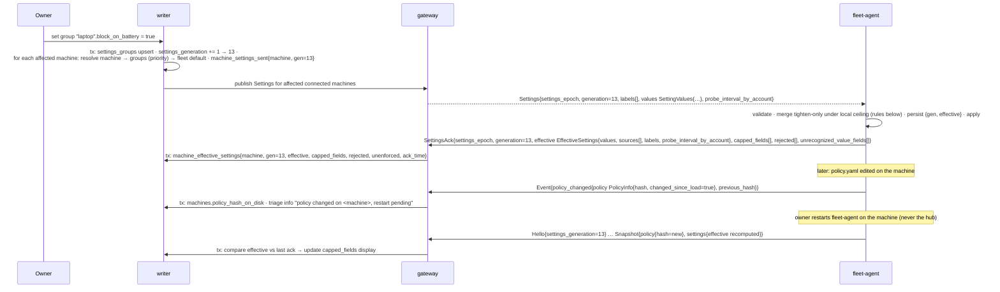
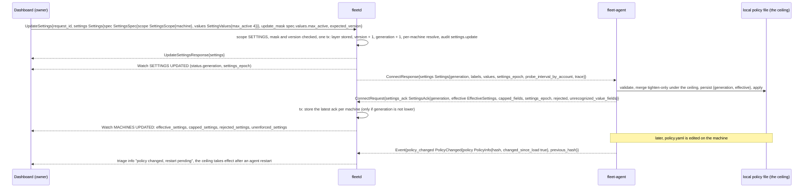
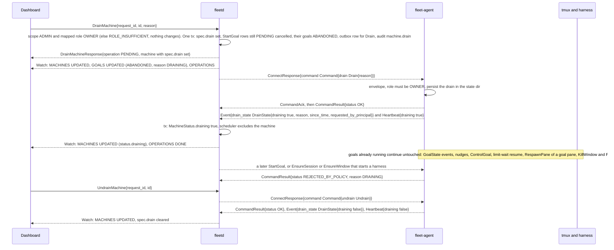
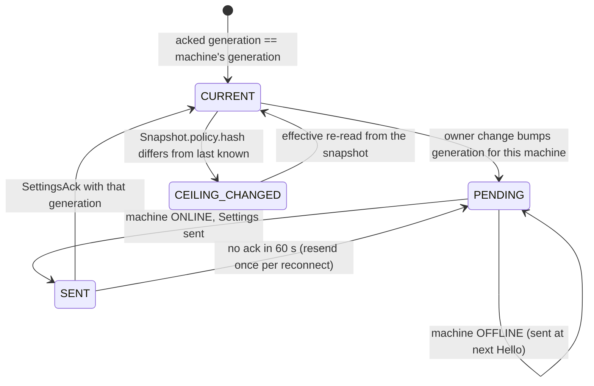
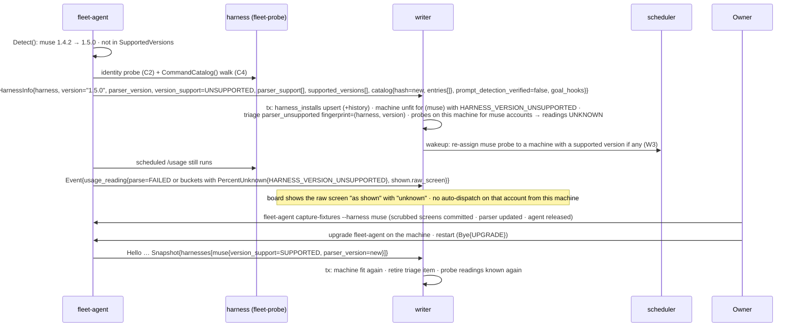
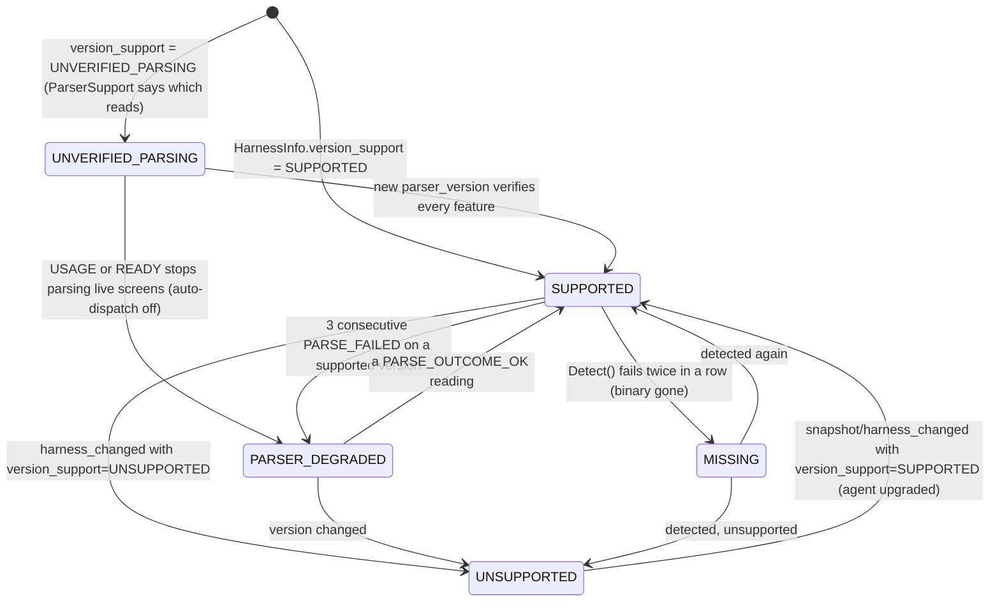

# 03e. Settings and policy; harness upgrade drift

- Part of: [03-workflows.md](03-workflows.md) (conventions apply)

## W10. Settings and policy

**Trigger.** Owner edits fleet, group or machine settings or labels (UI/CLI);
an agent connects with an older `Hello.settings_generation`; the local policy
file changes on a machine; `Drain`/`Undrain` from the hub or `fleet-agent
drain|undrain` locally.

**Actors.** Owner, writer (generation counter, resolution), gateway,
`fleet-agent` (tighten-only merge, file watcher), the local policy file
(`~/.config/fleet-agent/policy.yaml`, the ceiling, ADR 0009).

The same flow as the dashboard's `UpdateSettings` call and the messages it causes:

**Tighten-only merge (per field, on the agent).** Numeric limits
(`max_active`, `max_total`, `max_windows`, `rate_limits`, `cert_lifetime`,
`spool_cap_bytes`): `min(hub, local)`. Durations where shorter is stricter
(`idle_threshold` is not a safety field: hub wins; `attach_idle_timeout`:
`min`). Booleans that require something (`local_approval[].required`,
`block_on_battery`): `hub OR local`. Sets (`allowed_harnesses`,
`allowed_repo_roots`): `hub ∩ local`. Enum `default_server`: `min(hub, local)`
in the order `NONE < OBSERVE < CONTROL`. `share_identity_email`: hub wins (it is
an owner privacy choice, not a machine safety ceiling). Labels: hub-assigned ∪
local additions; a local file cannot remove a hub label. Each field records its
`SettingSource.layer`; fields where the local value won over a hub value are listed in
`capped_fields` so the UI says "capped by local policy on linux-box". A value the
agent cannot apply at all is a different thing and is **not** a cap: it goes in
`SettingsAck.rejected[]` as `{field, reason, message}` (see the failure table).
The agent names a field whose hub value stood `SETTING_LAYER_HUB` (it sees resolved values only); the hub replaces it with the fleet, group or machine layer from its own resolve when it stores the `SettingsAck` and when it re-reads `Snapshot.settings`.
How the agent checks, merges, keeps and reports each field: [03e2](03e2-settings-merge-on-the-agent.md).

**Probe interval.** A machine's probe interval for an account has three
carriers, and one rule picks among them: the first set of
`Settings.probe_interval_by_account[account]`, then `SettingValues.probe_interval`
(the layered default), then `EnsureProbe.interval` (which therefore only
matters before any settings arrived; `run_now` ignores it) is the hub's value.
The local policy holds a **minimum interval**, a floor on how often the agent
probes, so the effective interval is `max(hub value, local minimum)`: a local
value can only make probing rarer. The result is reported per account in
`EffectiveSettings.probe_interval_by_account`, and `capped_fields` names
`probe_interval` when the local minimum won. `merged_grace` is a hub-only
setting: the agent receives it so the owner sees one list of settings, never
acts on it and echoes it unchanged.

**Skew with an older agent.** The hub may be a minor version ahead of an agent
(02l, versioning), so it can send a `SettingValues` field the agent does not
know; protobuf drops it silently and the agent's `effective` simply omits it.
The agent therefore lists the field numbers its schema did not recognize in
`SettingsAck.unrecognized_value_fields` (and `unrecognized_settings_fields` for
`Settings` itself). The hub maps them to names and shows each as **not enforced
on this machine** (`Machine.status.unenforced_settings`), never as "no
opinion". When an unenforced field is one of the safety limits (`max_*`,
`rate_limits`, `local_approval`, `block_on_battery`, `allowed_*`,
`default_server`, `spool_cap_bytes`) the machine is left out of auto-dispatch
and a `settings_unenforced` triage item says to upgrade the agent; the owner can
override that per machine.

**Generation.** One fleet-wide monotonic counter; a machine's `Settings`
carries the counter value at which that machine's resolved values last
changed, and `HelloAck.settings_generation` is that same per-machine value (not
the fleet counter), so a change to one group does not resend settings to every
machine. The agent persists the last applied `(settings_epoch, generation)` and
reports it in `Hello`; the hub sends `Settings` when its value for that machine
is newer or its epoch differs. The agent ignores a generation ≤ the one it holds
under the same epoch and re-acks the held one; a different epoch (a restore) is
accepted whatever its generation (02, "Settings order"). Applying is immediate for rate limits,
approval rules, idle threshold, spool cap, window template, probe intervals;
`cert_lifetime` at the next renewal; the hub enforces `max_active`/`max_total`
slots and the agent applies the effective values only as a local safety cap at
`StartGoal` preflight (`AGENT_GOAL_CAP_REACHED`).

**Drain.** `Drain{reason}` → agent `DrainState{draining, requested_by_principal}` (the hub principal; kind `LOCAL_USER` for a local drain)
→ `Event.drain_state` + `Heartbeat.draining=true`; the scheduler excludes the
machine; running goals continue (drain never kills). `Undrain` clears a hub
drain; a local `fleet-agent drain` can only be undone locally (`Undrain` →
`REJECTED_BY_POLICY/DRAINING`), and the UI shows "drained on the machine".
While draining, `StartGoal` and harness-starting `EnsureSession`/`EnsureWindow`
are refused with `DRAINING`, and so is `RespawnPane` except for a pane with a
registered live goal (it restarts work already taken); a composite already past
`preflight` finishes. The hub also cancels `StartGoal` rows still `PENDING` in the
outbox when it accepts `DrainMachine` (the goal is `ABANDONED`, the item `READY`
elsewhere); the whole interplay is in
[03h](03h-goal-phases-in-depth.md#drain-the-outbox-and-respawn).

**Drain, as messages.** The hub marks the machine drained in the same transaction that cancels
the `StartGoal` rows still waiting, so the scheduler stops choosing it at once, online or not.
The dashboard then shows what the agent itself confirms (`drain_state`). Goals already
running keep running, and everything that serves them stays allowed.

### The local policy file (L1): `policy.yaml`

`~/.config/fleet-agent/policy.yaml` (`$XDG_CONFIG_HOME/fleet-agent/policy.yaml` when that variable is set to an absolute path; `--config-dir` overrides) is the machine's ceiling (ADR 0009). The
owner of the machine edits it by hand; the hub never writes it, and a change
takes effect at the next agent restart. Its keys have the names and types of the
matching `SettingValues` field ([settings.proto](../../api/fleet/type/v1/settings.proto)),
so there is one vocabulary; a key that is absent states no local opinion, and the
built-in default in the table is what the agent uses. Decision 4 of
[ADR 0024](../adr/0024-pre-build-owner-decisions.md) fixes the fresh-agent rules:

- **A missing `policy.yaml` is a normal first run.** The agent runs on the built-in
  defaults below, reports `PolicyInfo` with an empty `schema_version` and `hash`,
  is not in safe mode and raises no triage item. Deleting the file while the agent
  runs is a hash change (`policy_changed`) like any edit. An unreadable or invalid
  file is safe mode (see the failure table).
- **`allowed_repo_roots` is empty until the owner sets it.** Empty means the agent
  inventories no repo, reports no `PaneWorkdir` and reads no goal file (H1, G2,
  and the observed goals of [03k](03k-observed-goals.md)), and `fleet-agent doctor`
  says so. The agent never guesses a folder.
- **`allowed_harnesses` defaults to every installed harness** (the ones C1 found).
  Until C1 runs (plan row 8) the agent reports the names the contract knows
  (ids.proto) when neither layer has an opinion; an explicit empty list is an
  opinion and allows none.
- **`fleet-agent enroll` asks for the repos folder and writes a starter file.** It
  prompts "Folder that holds your repos (for example ~/repos):" (or takes
  `--repos <dir>` when not interactive), checks that the folder exists, and writes
  `policy.yaml` (mode 0644, owner only writes it) with `schema_version: "1"`,
  `allowed_repo_roots: [<that folder>]` and every other key as a commented-out
  line showing its default. Keys that have no default (`min_probe_interval`,
  `labels`, `metrics_listen`, `pprof_listen`, `telemetry`) are named in a closing
  comment instead. It never overwrites an existing file, and with no
  answer it writes the file with an empty `allowed_repo_roots` and says so. A
  `--repos` that is not an existing folder stops `enroll` before the token is
  used, even when a `policy.yaml` already exists.
- **The file's mode is the owner's business; doctor only warns.** `fleet-agent
  doctor` fails when the file or its folder is writable by every user and warns
  when its group may write it; the agent itself loads the file either way. A
  file every user may write lets any local account loosen the ceiling. A file
  only its group may write is common (Ubuntu and Debian make a hand-made file
  0664 and a folder 0775, with a group that holds only the owner), so it is a
  warning with the line `chmod g-w`, not a failure.

Every key (the merge column is the tighten-only rule above, applied per key). Default values are in [defaults.md](defaults.md); the empty-by-default and every-installed-harness rules are in the bullets above:

| Key | Type | Range | Merge with the hub |
|---|---|---|---|
| `schema_version` | string | `"1"` | reported in `PolicyInfo`; an unknown value is safe mode |
| `default_server` | `none`, `observe` or `control` | | `min(hub, local)` in that order |
| `max_active` | uint | 1 to 16 | `min` |
| `max_total` | uint | 1 to 32 | `min` |
| `max_windows` | uint | at least 1 | `min` |
| `allowed_harnesses` | list of harness names | names C1 knows | `hub ∩ local` |
| `allowed_repo_roots` | list of absolute paths | existing directories | `hub ∩ local` |
| `local_approval` | list of `{command_kind, required}` | known command kinds; both fields stated, each kind once | `hub OR local` per kind |
| `rate_limits` | list of `{command_kind, per_minute}` | at least 1 | `min` per kind |
| `cert_lifetime` | duration | up to 365 days | `min` |
| `attach_idle_timeout` | duration | above zero | `min` |
| `spool_cap_bytes` | uint | | `min` |
| `block_on_battery` | bool | | `hub OR local` |
| `window_name_template` | string | no control characters | the hub wins (not a safety field) |
| `idle_threshold` | duration | above zero | the hub wins (not a safety field) |
| `share_identity_email` | bool | | the hub wins (not a safety field) |
| `min_probe_interval` | duration | at least 1 minute | `max(hub, local)` (a floor, see "Probe interval") |
| `labels` | list of strings | `[a-z0-9][a-z0-9-]{0,31}` | `hub ∪ local`; local cannot remove a hub label |
| `metrics_listen`, `pprof_listen` | loopback `host:port` | loopback only | local only, never delivered ([05b](05b-observability.md)) |
| `telemetry` | the keys of 05b section 5 | | local only |
| `exec.raw` (written `exec:` then `raw: true`) | bool | | none |

`min_probe_interval`, `metrics_listen` and `pprof_listen` are local-only names
carried by no proto. `exec.raw` is reserved: never honoured, never advertised.
`merged_grace` is a hub setting and not a policy key. The
ranges for `max_active`, `max_total` and `reserve_percent` (0 to 50) are the same
ones the hub validates (decision 18 of ADR 0024, [defaults](defaults.md)); a value
outside its range is invalid and puts the agent in safe mode. The hub shows the
result and which layer won (`EffectiveSettings`).

**How the file is read and watched** (plan row 6, PR 6b). The agent reads at most
64 KiB; a larger file, one that is not a regular file and one it cannot open are
safe mode. `policy.yaml` may be a symlink to a regular file (a dotfile manager
links it; the watch also covers the target's folder, and a link replaced by a
rename is seen by the watch on Linux and at the next `Snapshot` on macOS); a link to anything else, or to nothing, is unreadable like any other
file that is not a regular file (a FIFO is refused without waiting for a writer).
The parse is strict and never guesses: an unknown key, a key given
twice, a wrong type, a `local_approval` entry that leaves out `required`, a value
outside its range, a relative or missing
`allowed_repo_roots` entry, a `command_kind` that is not an arm of `Command.kind`
and a second YAML document are safe mode. A key with no value (`key:`) states no
opinion, like an absent one; a list written as `[]` is an opinion (none).
`schema_version` absent is `"1"`. `exec.raw` is known and never honoured; the
agent logs once that it ignored it and stays out of safe mode. The one-line
`PolicyInfo.error` is built from a line number, a key name this table defines and
a fixed reason, never from the file's text. `PolicyInfo.hash` is the SHA-256, in
lowercase hex, of the file's bytes: of the loaded file in a `Snapshot`, and of the
file now on disk in `PolicyChanged.policy` (the hub keeps the second as
`policy_hash_on_disk`). A file that exists but is invalid still has a hash;
one that could not be read has none. A file over 64 KiB is hashed over the first
64 KiB + 1 bytes it was read for, so an edit inside that prefix is seen as a
change and one beyond it is not; a file of exactly 64 KiB is read whole.

A change is noticed by a directory watch on the config folder, not the file,
because editors replace a file by renaming another over it. Any event naming
`policy.yaml` starts a 500 ms wait; each further event restarts it; then the
file is hashed again and a different hash is the change (`policy.changed`, the
`policy.changed` local audit row, `PolicyInfo.changed_since_load`, and the Changed
seam that row 7 turns into the `policy_changed` event, saved in the agent's
event ring before the callback returns). Nothing else re-reads the file
on a timer (ADR 0022 rule 6). The safety net is event-driven too: the file is
hashed again when each `Snapshot` is built (this PR) and when a `Settings` message
arrives (from PR 6f). When the watch cannot be set (the inotify limit, no file
handles) the agent logs `policy.watch_off` once, and `status.json` says
`policy_watch: off` (from PR 6d). It does not poll. The loaded policy never
changes while the agent runs. A change is reported (counter, log line, audit row,
the Changed seam) by a goroutine of the policy loader, in order, so building a
`Snapshot` never waits for the audit sync or for the seam's consumer.

### State machine (settings delivery per machine, owned by the hub)

Machine drain state: `ACTIVE` → `DRAINING{hub}` → `ACTIVE` (Undrain);
`ACTIVE` → `DRAINING{local}` → `ACTIVE` (local undrain only).

### Persistence

| What | Where | Transaction |
|---|---|---|
| `settings_fleet`, `settings_groups{label, priority, values}`, `settings_machines{machine, values}`, `machine_labels{machine, label, source=hub}` | hub store | the owner's change tx (with the generation bump) |
| `settings_generation` (one row), `machine_settings_sent{machine, gen, sent_time}` | hub store | change tx; send tx |
| `machine_effective_settings{machine, gen, effective, capped_fields, rejected, unenforced, ack_time}` | hub store | ack tx |
| `machines.policy_hash`, `policy_schema_version`, `policy_loaded_time`, `policy_changed_since_load`, `policy_safe_mode`, `policy_error` (cut to 256 bytes and scrubbed before the tx); `policy_hash_on_disk` comes with the `policy_changed` event (plan row 7) | hub store | snapshot tx; `policy_changed` tx |
| Audit: who changed what (old → new) | hub store (permanent) | change tx |
| Settings `{generation, values, effective}` and the loaded policy hash; the policy file itself stays the owner's | `agent.db` / config dir | before `SettingsAck` is sent (not in safe mode, where nothing is kept and the ack carries the defaults: [03e2](03e2-settings-merge-on-the-agent.md)) |
| Drain state and reason | `agent.db` (survives restart) and hub `machines.drain`; the drain the agent reports is `machines.agent_draining` and `agent_drain_local` (snapshot tx) | per change |

### Ordering and consistency

- The generation bump and the stored values commit together; a send that
  races with the next change simply gets superseded by a newer generation.
- The agent applies settings in generation order; acks are per generation; the
  hub keeps only the latest ack per machine.
- The local ceiling takes effect only after an agent restart (L1), so the hub
  can show a precise "restart pending" state instead of guessing.
- `Settings` may precede `Snapshot` on connect (W1); the snapshot's
  `settings.generation` tells the hub which generation it reflects.

### Failure modes

| Failure | What happens |
|---|---|
| Agent offline | `PENDING`; delivered after the next `Hello` (`HelloAck.settings_generation` > `Hello.settings_generation`, or a different `settings_epoch`) |
| Hub restart | Generation and values durable; resend on each Hello as needed |
| Duplicate `Settings` (same generation) | Agent re-acks; no re-apply |
| Out-of-order generations (two gateways; cannot happen with one hub) | Agent ignores the lower; counted |
| Invalid value (e.g. `max_windows=0`, bad duration) | Agent rejects that field, keeps the previous effective value and lists it in `SettingsAck.rejected[]` as `{field, INVALID_ARGUMENT, message}` (not in `capped_fields`); `Machine.status.rejected_settings` shows it and `fleet_hub_settings_rejected_fields_total` counts it |
| Hub sends a setting the agent's version does not know | The agent lists the field number in `unrecognized_value_fields`; the hub shows "not enforced on this machine" and, for a safety limit, leaves the machine out of auto-dispatch |
| Policy file invalid on restart | Agent starts in **safe mode**: observe only (the kinds the VIEWER column of [02g](02g-agent-security.md) allows), every other command `REJECTED_BY_POLICY` / `POLICY_SAFE_MODE`, every hub setting rejected with the same reason; `PolicyInfo.safe_mode = true` with a one-line `PolicyInfo.error` (no file contents) in the snapshot; the hub raises triage `policy_invalid` and the `policy.safe_mode` audit row |
| Policy file missing at start, or deleted while running | A normal first run: the agent uses the built-in defaults (empty `allowed_repo_roots`, every installed harness), reports an empty `PolicyInfo.hash`, is not in safe mode and raises no triage item; deleting it while running is a `policy_changed` hash change; `doctor` says what the defaults are |
| Hub store restored from an older backup (generation goes backwards) | `fleetd restore` mints a new `settings_epoch` (03f, 02g); the agent orders settings by `(settings_epoch, generation)` and accepts any generation under a new epoch (02-contracts.md, replaces 03g's `settings_restored`) |
| `Drain` while `StartGoal` in flight | Still in the outbox → cancelled, goal `ABANDONED` (03h); in flight past preflight → completes; delivered but not past preflight → `DRAINING` at preflight, goal `ABANDONED` |
| `Undrain` against a local drain | `REJECTED_BY_POLICY/DRAINING`; UI explains |
| Machine offline when `DrainMachine` is accepted | `spec.drain` is set at once, so the scheduler already skips it; the `Drain` command waits in the outbox, and if it expires the reconnect diff sends it again ([03](03-workflows.md#w1-enrollment-and-first-connect)) |
| Harness crash, prompts, provider errors, developer typing | Not affected by this workflow |
| Work tracker / code host | Not involved |

### Telemetry

- `fleet_hub_settings_generation`, `fleet_hub_settings_pending_machines`,
  `fleet_hub_settings_ack_lag_seconds{machine}` (sent → acked),
  `fleet_hub_settings_capped_fields{machine}` (count), `fleet_hub_settings_rejected_fields_total{field}`,
  `fleet_hub_machines_draining{requested_by}`, `fleet_hub_policy_restart_pending{machine}`.
- `fleet_agent_settings_applied_generation`, `fleet_agent_settings_capped_total{field}`,
  `fleet_agent_policy_changed_total`, `fleet_agent_policy_safe_mode` (gauge),
  `fleet_agent_draining{requested_by}`.
- Spans: `hub.settings.publish{generation}`, `agent.settings.merge{generation}`,
  `hub.drain{machine}` → `agent.drain`; linked across processes by
  `Settings.trace` and `Command.trace` (02g, "Trace context").
- Agent logs (L1; never a path or file text): `policy.loaded{hash, schema_version, safe_mode}`
  at start; `policy.watch_off{err_kind}` (the directory watch could not be set,
  once); `policy.watch_error{err_kind, suppressed}` (the watch reported an error or lost
  events, so the file is read once after the settle; at most once a minute); `policy.check_failed{err_kind}`
  (the file exists but could not be read; nothing changes); `policy.key_ignored{key}`
  (`exec.raw` was in the file); `policy.config_dir_failed{err_kind}` (`run` could
  not make the config folder and went on without a watch).
- Logs: `settings.changed{by, scope, field, old, new, generation}`,
  `settings.capped{machine, field, hub_value, local_ceiling}`,
  `settings.rejected{machine, field, reason}`, `policy.changed{machine, old_hash,
  new_hash}`, `policy.safe_mode{machine, error}`, `drain.changed{machine,
  draining, requested_by, reason}`.

At 3 AM: "why is this machine observe-only?" → `fleet_agent_policy_safe_mode`
and the `policy.safe_mode{error}` line (a line number and a key, not the file);
"why did a policy edit not apply?" → it applies at restart:
`PolicyInfo.changed_since_load`, `policy.changed`, `fleet_agent_policy_changed_total`.

At 3 AM: "why does this machine ignore the group setting?" →
`settings.capped` for the machine, or `fleet_hub_settings_ack_lag_seconds`
(never acked) and `fleet_hub_policy_restart_pending`.

---

## W11. Harness upgrade drift

**Trigger.** The agent's periodic `Detect()` (every 5 min, and before each
probe run) reports a different version or path for a harness; a probe or
passive parse fails on a supported version repeatedly; a
`RunHarnessCommand` is refused `CATALOG_STALE`; a new agent release with new
fixtures is installed on the machine (by the developer, never by the hub).

**Actors.** `fleet-agent` (adapter `Detect()`, `CommandCatalog()`, parsers
with `SupportedVersions`, `capture-fixtures` job), writer, scheduler, triage,
the owner (commits fixtures, upgrades the agent).

**Rules.**

- `version_support=UNSUPPORTED` ⇒ usage readings from that harness on that machine
  are `UNKNOWN{HARNESS_VERSION_UNSUPPORTED}` (still shown raw), preflight
  refuses `HARNESS_VERSION_UNSUPPORTED`, auto-dispatch excludes `(machine,
  harness)`, prompts from that harness are `answerable=false` until
  `prompt_detection_verified` for the new version (no answer buttons, only the attach line, W7), and
  goal hooks are re-verified by the hook reconcile (`EnsureGoalHooks`, 03-workflows
  "Hook reconcile"; `harness_changed` triggers it).
- **Parser degraded** on a supported version: 3 consecutive `PARSE_FAILED`
  readings from one probe → treated like unsupported for scheduling
  (`PARSER_DEGRADED`), fingerprinted triage; a good reading clears it.
- **Catalog hash.** Any `RunHarnessCommand` carrying an old `catalog_hash` is
  refused `CATALOG_STALE`; the hub refreshes from `harness_changed` and
  retries **once, automatically, only for `OBSERVE` class**; other classes
  go back to the operator with "catalog changed, confirm again". Commands
  new to the catalog are classified by the adapter table for that version;
  unknown ones are `DENY`; a command that moved to a stricter class is
  stricter immediately; local policy can only tighten further.
- Manual dispatch to a version whose parsing is unverified
  (`UNVERIFIED_PARSING`, or `PARSER_DEGRADED`) is allowed after a confirm
  (`CONFIRM`, 03h): the harness runs fine, only fleet-board's parsing is behind, but
  the goal shows "usage unknown" and counts against the account's `allowed_active`
  as 1. For `UNSUPPORTED` the agent refuses `HARNESS_VERSION_UNSUPPORTED` and it is
  a `BLOCK`; there is no override.
- Fixture capture is a scripted local job (`fleet-agent capture-fixtures`),
  scrubbed of emails, names and installed skill names before commit ([plan](../plan/v1-implementation-plan.md#6-how-it-is-tested), section 6).
  Nothing in it crosses the agent ↔ hub contract.

### State machine (per `(machine, harness)`, owned by the hub)

### Persistence

| What | Where | Transaction |
|---|---|---|
| `harness_installs{machine, harness, version, path, parser_version, supported, catalog_hash, prompt_detection_verified, hooks, state, since_time}` + history rows for the timeline | hub store | `harness_changed` tx; snapshot tx |
| `catalog_entries{machine, harness, catalog_hash, name, class, tightened_by_policy}` | hub store | same tx |
| Triage `parser_unsupported`, `parser_degraded` | hub store | same tx |
| Machine unfit markers `(machine, harness, reason)` | hub store (derived, used by W5) | same tx |
| Detected versions, catalog cache, fixtures | agent state dir / binary | local |

### Ordering and consistency

- `harness_changed` carries the full `HarnessInfo`, so the hub never merges
  partial catalogs; the catalog hash in the latest event is the only one the
  hub will send.
- A `RunHarnessCommand` issued before the event but delivered after it is
  refused by the agent (`CATALOG_STALE`), never typed.
- The snapshot after an agent upgrade is authoritative; `harness_installs`
  rows for harnesses absent from the snapshot become `MISSING`.

### Failure modes

| Failure | What happens |
|---|---|
| Detect fails during an upgrade in progress (binary missing for seconds) | Two consecutive failures required before `MISSING`; a probe run in that window reports `PROBE_START_FAILED` once |
| Agent offline | Drift learned from the next snapshot |
| Hub restart | State in `harness_installs`; snapshot re-confirms |
| Duplicate `harness_changed` | Same content, idempotent upsert |
| Probe crashes on the new version (TUI changed) | `ProbeHealth` failures → failover to another machine (W3); if all machines run the new version, the account is `UNKNOWN` until fixtures land |
| Prompt detection silently wrong on the new version | `answerable=false` by default for an unverified version, so nothing is typed into a misdetected prompt |
| Goal hooks incompatible with the new version | `GoalHooksState.verified=false` after re-verification; preflight refuses `HOOKS_INSTALL_FAILED`-class failures only when hooks are fleet's; repos shipping their own are left alone |
| Deny-class command appears under a new name | Unknown ⇒ `DENY`; never sendable |
| Developer typing / provider error | Not specific to this workflow |
| Work tracker / code host | Not involved |

### Telemetry

- `fleet_hub_harness_state{machine, harness, state}`, `fleet_hub_harness_versions{harness, version}`
  (count of machines), `fleet_hub_catalog_stale_total{harness}`,
  `fleet_hub_harness_drift_total{harness, to_state}`,
  `fleet_hub_usage_parse_total{harness, harness_version, outcome}` (shared with W3).
- `fleet_agent_harness_detect_total{harness, result}`, `fleet_agent_catalog_changes_total{harness}`,
  `fleet_agent_parser_version{harness}` (info gauge), `fleet_agent_fixture_capture_total{harness, result}`.
- Spans: `agent.harness.detect{harness}`, `agent.harness.catalog{harness}`,
  `hub.harness.apply_change{machine, harness}`.
- Logs: `harness.drift{machine, harness, from_version, to_version, supported,
  catalog_hash}`, `harness.parser_degraded{machine, harness, version,
  failures}`, `harness.catalog_stale{machine, harness, command}`.

At 3 AM: "usage shows unknown for Muse" → `fleet_hub_harness_state{state=
UNSUPPORTED|PARSER_DEGRADED}` and the `harness.drift` log naming the version.
