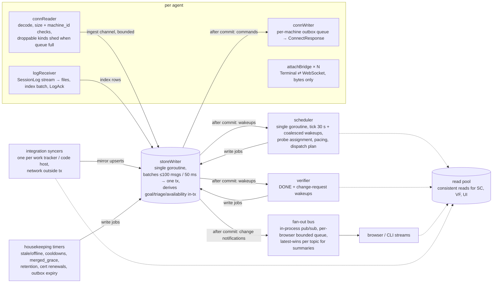

# 03f. Hub internals: concurrency model and data model sketch

- Part of: [03-workflows.md](03-workflows.md)

## Concurrency model

ADR 0001's principle: one goroutine owns each kind of decision, a single
writer owns every store write, and database unique constraints back the
owners up. No distributed locks, no lock ordering beyond "the writer channel
is the serialization point". Transactions never span a network call.

### Who owns which decision

| Owner | Decides | Reads | Writes through |
|---|---|---|---|
| `connReader` (per agent) | Accept or drop a message: size cap, `machine_id` = certificate, order (Hello first, Snapshot before events), droppable kinds when the ingest queue is full (`Heartbeat`, `PaneSummary`, `ResourceSample`, `SpoolStatus` shed first) | nothing from the store | ingest channel |
| `storeWriter` | Everything that changes the store: snapshot apply, event apply, outbox transitions, derived goal state (W6 rules are pure functions over the row + the event), triage raise/retire, availability, settings acks, sync mirror upserts, log index, audit | its own tx | one tx per batch |
| `scheduler` | Probe assignment, pacing state, dispatch plan, nudges and cooldown actions, machine unfit markers | consistent read | write jobs to `storeWriter`; commands are enqueued inside the resulting tx and handed to `connWriter` after commit |
| `verifier` | `VERIFYING → MERGED / DISAGREE`, review-loop cap, free worker | consistent read + targeted sync request | write jobs |
| `integration syncer` | When to poll what; rate-limit backoff | cursors, rate state | write jobs (mirror upserts per page) |
| `logReceiver` (per agent) | Accept chunk at stored end, append file, ack after index commit, pause on disk threshold | per-stream end offset (memory, loaded from index at stream open) | file append directly; index rows via `storeWriter` |
| `attachBridge` | None; forwards bytes; drops input for viewers | registry | audit rows at open/close only |
| `housekeeping` | STALE/OFFLINE marking, timer expiry, retention, outbox expiry, cert renewal reminders | consistent read | write jobs |
| `fan-out bus` | Which browser gets which change; coalescing; dropping summaries for slow consumers | nothing | nothing |

### What can race and what backs it up

| Race | Backstop |
|---|---|
| Scheduler plans a goal for a work item while an event marks it claimed elsewhere | `goals` unique `(work_item) WHERE state IN (STARTING, RUNNING, …)`; and the planning tx re-checks the mirror row's claim inside the tx (same writer, no network); loser re-plans next pass |
| Two scheduler passes assign a probe for one account (should not happen: one goroutine; guards a future second scheduler) | `probes` unique `(account_id) WHERE state IN (REQUESTED, ALIVE, FAILING)` |
| Reuse a pane that a `PaneInput` just cleared | `panes.reserved_for_goal` set in the planning tx; the agent re-checks at `pick_session` and fails `SESSION_NOT_AVAILABLE`; the reservation is released in the result tx |
| Two browsers answer one prompt | `prompt_answers_in_flight` unique `(prompt_id)`; second insert fails, UI shows "already answered" |
| Snapshot apply while live events from the same stream are queued | `connReader` tags each message with its epoch and position; the writer applies in arrival order per machine; events with `seq ≤ Snapshot.seq` become history only |
| Duplicate `Hello` (duplicate identity) | `machine_connections` unique `(machine_id) WHERE live`; the Hello tx displaces the old row and the old stream gets `Bye` after commit |
| Verifier and the goal-state apply both move a goal | Both are jobs on the single writer; transitions are computed from the current row inside the tx; an impossible transition is rejected and logged |
| Log chunk arrives twice from two reconnects | Per-stream end offset in memory, loaded from the index; `log_segments` unique `(session, stream, raw_offset)` |
| Triage raised twice for one state | `triage_items` unique `(fingerprint) WHERE state IN (OPEN, SNOOZED, IN_FLIGHT)` |
| Outbox command delivered on two epochs | `commands` unique `(command_id)`; the agent's own command log makes the second delivery return the logged result |
| Settings change while a `SettingsAck` is in flight | Latest ack per machine wins only if `ack.generation ≥ stored.generation` |

**Lock ordering.** None required. The only mutexes are the per-connection send
queue, the fan-out subscriber registry and the per-stream log offset map; no
goroutine holds one while blocking on another or on the writer channel.

**Backpressure chain.** HTTP/2 per-stream flow control → `connReader` bounded
queue (sheds droppable kinds, blocks on never-dropped kinds) → ingest channel
(bounded; blocking a reader blocks only that agent's stream) → writer batches.
Log streams have their own chain (`LogAck`, `pause`). The fan-out bus never
blocks the writer: slow browsers lose summaries, never goal, triage or command
notifications (those are re-read from the store on reconnect anyway).

## Data model sketch

Entities and keys the workflows need; no SQL. "Writes" are steady-state rates
at **4 machines** / **50 machines × 10 panes** from the load table in
[03g](03g-load-and-handoff.md); "reads" is the dominant read pattern.

| Entity | Key | Written by | Writes/s (4 / 50) | Read pattern | Retention |
|---|---|---|---|---|---|
| `hub_identity` | singleton | store creation, `fleetd restore` | ≈ 0 | at start; at Enroll and Hello | permanent; **secret** (CA key, salt); see below |
| `machines` | `machine_id` | W1, W2, W10, W11, revoke | ≈ 0 (state changes) + last_seen every heartbeat if persisted: 0.27 / 3.3 | by id; list for Machines view | permanent until deleted (revoke keeps the row) |
| `machine_connections` | `(machine_id, epoch)` | W1, W2 | per connect | latest per machine | 30 days |
| `enroll_tokens`, `enroll_responses`, `cert_serials` | token secret hash; `(token hash, install_id, CSR key hash)`; serial (with a `revoked_time`) | W1, revoke | rare | lookup at Enroll/Hello; revocation list at TLS and Hello | token until used / expired + 30 days; stored response until TTL + 24 h; serials while the machine exists |
| `users`, `passkeys`, `invites` | `principal_id`; credential id; invite token hash | sign-in, owner | rare | at sign-in | permanent; invites until used / expired |
| `login_sessions`, `api_tokens`, `devices` | cookie hash; token id (secret hash); `device_id` | sign-in, owner | per sign-in; `last_used_time` at most 1/min | every authenticated request (cached in memory by hash) | sessions until expiry + 30 days; tokens and devices permanent (revoked rows kept for audit) |
| `ceremonies`, `attach_tickets`, `device_nonces` | ceremony id; ticket hash; `(device, nonce)` | sign-in, attach, device calls | per sign-in / attach / device call | one lookup per use | minutes (in memory is enough; losing them only makes a client retry) |
| `accounts`, `account_machines` (Codex mapping) | `account_id`; `(account_id, machine_id)` | W3, owner | rare | by id; per machine | permanent |
| `probes` | `probe_id`; unique active per `account_id` | W3 | ≈ 0 | per account | history 30 days |
| `usage_readings` | `(account_id, read_at)` | W3 | 0.005 / 0.005 (+ passive ≤ 0.07 / 0.8 worst) | latest per account; time series for burn-down | buckets 1 year; `raw_screen` 7 days |
| `account_pacing` | `account_id` | scheduler | per evaluation (≤ 1/30 s) | per account | current only |
| `sessions` | `session_id`; unique `(machine_id, name)` | W5, W8 | rare | per machine; available set | permanent (fleet-created) |
| `panes` (latest state per pane) | `(machine_id, server, server_start_id, pane_id)` | snapshots, pane events | activity 0.33 / 5 (peak 20); summaries 4 / 100 **if persisted** | per machine; per session | current only |
| `pane_summaries` | pane key | E5 | 4 / 100 | per visible pane | **latest only** (see 03g question Q2) |
| `events` (history, never-dropped kinds + replays) | `(machine_id, seq)` | all | ≈ 0.4 / 7 steady; bursts 2,500/s at hub restart (rate-limited) | timeline by machine/goal/time | 1 week |
| `resource_samples` | `(machine_id, at)` | B2 | 0.13 / 1.7 | last 24 h per machine (chart) | 1 week |
| `harness_installs`, `catalog_entries` | `(machine_id, harness)`; `(…, catalog_hash, name)` | W11 | rare (bursts of ≤ 100 rows per catalog) | per machine | current + 30-day history |
| `work_items` (mirror) | `WorkItemKey` (`integration_id, kind, project, key`; `provider_name` when no integration) | W4 | ≤ 2 / ≤ 10 (page upserts, bursty) | by stage; by repo | while open + 30 days |
| `change_requests` (mirror) | `WorkItemKey` (`integration_id, kind = CHANGE_REQUEST, project = repo path, key`); `repo RepoRef` is a column for lookups | W4 | ≤ 1 / ≤ 5 | by head_ref; by goal | while linked goal exists + 30 days |
| `claims` | `(work_item, author)` | W4 | rare | per work item | with the work item |
| `sync_cursors`, `rate_limit_state` | `(integration, resource)` | W4 | per poll (≈ 0.05 / 0.3) | per syncer | current |
| `goals` | `goal_id`; unique active per `work_item`; unique `(repo, branch)` active | W5, W6 | 0.02 / 1 (goal + branch state) | by state; per machine; per account | permanent (run history) |
| `goal_transitions`, `goal_runs` | `(goal_id, at)` | W6 | same | per goal timeline | transitions 7 days; runs permanent |
| `commands` (outbox) + `command_results` | `command_id`; `(machine_id, epoch, seq)` | all command-issuing flows | 0.05 / 0.5 (+ progress steps) | pending per machine; by id | 30 days |
| `triage_items` | id; unique open `fingerprint` | W7 sources | 0.01 / 0.2 | open ranked; per goal/machine | 7 days after close |
| `prompt_answers_in_flight` | `prompt_id` | W7 | rare | by prompt | until result |
| `settings_*`, `machine_effective_settings`, `machine_labels` | scope ids; `machine_id` | W10 | rare | resolve per machine | permanent + audit |
| `log_sessions`, `log_segments` | `session_id`; `(session_id, stream, raw_offset)` | W9 | 1 / 30 (chunk index, batched) | by session + offset/time | until pruned by size cap |
| `attaches` (audit only) | `attach_id` | W8 | rare | per session | permanent audit |
| `audit_log` | `(at, id)` | everything mutating | ≈ 0.05 / 0.5 | filter/export | permanent (ADR 0005/design) |

Derived, not stored: free slots per machine (from `goals` + limits),
`allowed_active` per account (stored only as a cache row for the UI), triage
ranking, the summary strip counts.

**Index needs implied by the read patterns:** `goals(state)`,
`goals(machine_id, state)`, `goals(account_id, state)`, `commands(machine_id,
state)`, `triage_items(state, kind, raised_at)`, `events(machine_id, seq)`,
`events(goal_id, at)`, `log_segments(session_id, stream, raw_offset)` and
`(session_id, stream, first_at)`, `change_requests(integration_id, head_ref)`,
`work_items(stage, integration_id)`.

## Hub identity, backup and restore

The data above is rebuildable from agents and providers except what makes this
hub *this* fleet's hub. That lives in the one `hub_identity` row (details in
[02g](02g-agent-security.md#hub-identity-and-restore)):

| Field | Why it cannot be regenerated |
|---|---|
| `fleet_id` | An agent refuses a hub with another one |
| CA certificate and private key; server certificate and SAN list | Every agent pins the CA; the key signs agent certificates |
| `account_salt`, `salt_version` | `AccountKey` is a hash over it; a new salt splits accounts silently |
| `settings_epoch` | Orders settings across restores; **is** regenerated on restore |
| `hub_addresses` | Where agents find the hub; sent in `HelloAck` |

It is stored **inside `state.db`**, so the nightly `VACUUM INTO` backup (ADR
0014) carries it, and therefore **a backup is a secret**: it holds the CA
private key and the salt. Backups are written mode 0600 and `fleetd backup
--encrypt` wraps one with a passphrase. A store without the row refuses to
start instead of minting a new identity.

`fleetd restore` is offline. It checks the backup, mints a new `settings_epoch`
(so agents holding a higher generation under the old epoch accept the restored
settings), can add an address and re-issue the server certificate, and sets a
24 h reconcile flag. While it is set the first `Hello` of each machine is
answered with a `SnapshotRequest{reason: "reconcile"}` and the hub adopts what
agents know and it does not: machines enrolled after the backup, probes,
fleet sessions (02g has the table). `fleet_id`, the CA and the salt are never
touched.
