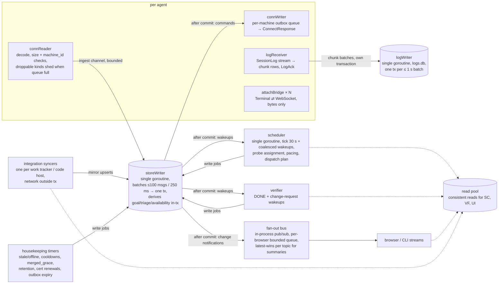

# 03f. Hub internals: concurrency model and data model sketch

- Part of: [03-workflows.md](03-workflows.md)

## Concurrency model

ADR 0001's principle: one goroutine owns each kind of decision, a single
writer owns every store write, and database unique constraints back the
owners up. No distributed locks, no lock ordering beyond "the writer channel
is the serialization point". Transactions never span a network call.

### Who owns which decision

| Owner | Decides | Reads | Writes through |
|---|---|---|---|
| `connReader` (per agent) | Accept or drop a message: size cap, `machine_id` = certificate, order (Hello first, Snapshot before events), droppable kinds when the ingest queue is full (`Heartbeat`, `PaneSummary`, `ResourceSample`, `SpoolStatus` shed first) | nothing from the store | ingest channel |
| `storeWriter` | Everything that changes `state.db`: snapshot apply, event apply, outbox transitions, derived goal state (W6 rules are pure functions over the row + the event), triage raise/retire, availability, settings acks, sync mirror upserts, audit | its own tx | one tx per batch |
| `scheduler` | Probe assignment, pacing state, dispatch plan, nudges and cooldown actions, machine unfit markers | consistent read | write jobs to `storeWriter`; commands are enqueued inside the resulting tx and handed to `connWriter` after commit |
| `verifier` | `VERIFYING → MERGED / DISAGREE`, review-loop cap, free worker | consistent read + targeted sync request | write jobs |
| `integration syncer` | When to poll what; rate-limit backoff | cursors, rate state | write jobs (mirror upserts per page) |
| `logReceiver` (per agent) | Accept a chunk at the stored end, ack after the batch commit, pause on disk threshold | per-stream end offset (memory, loaded from `logs.db` at stream open) | chunk rows through `logWriter` (the one writer of `logs.db`, ADR 0015); the delete audit row through `storeWriter` |
| `attachBridge` | None; forwards bytes; drops input for viewers | registry | audit rows at open/close only |
| `housekeeping` | STALE/OFFLINE marking, timer expiry, retention, outbox expiry, cert renewal reminders | consistent read | write jobs |
| `fan-out bus` | Which browser gets which change; coalescing; dropping summaries for slow consumers | nothing | nothing |

**The `scheduler` is built in two steps.** First comes the probe assignment and pacing work, done by the
`pacing` package (`internal/hub/pacing`, with `pacing/probe`) on the same 30 s tick, as write jobs to
`storeWriter` (ADR 0022 B.1, plan PR 10). The dispatching part (dispatch plan, nudges, cooldowns, unfit
markers) and the `verifier` come in the dispatch rows of the plan, which build on `pacing` and read its
decision. Until those rows land, every row in this file that says "scheduler" for probe assignment, pacing
state or `insight_pacing_interval` means `pacing`.

### What can race and what backs it up

| Race | Backstop |
|---|---|
| Scheduler plans a goal for a work item while an event marks it claimed elsewhere | `goals` unique `(work_item) WHERE phase IN live` (the ACTIVE and HELD phases of 03c, "Phase classes"); and the planning tx re-checks the mirror row's claim inside the tx (same writer, no network); loser re-plans next pass |
| Two scheduler passes assign a probe for one account (should not happen: one goroutine; guards a future second scheduler) | `probes` unique `(account_id) WHERE state IN (REQUESTED, ALIVE, FAILING)` |
| Reuse a pane that a `PaneInput` just cleared | `panes.reserved_for_goal` set in the planning tx; the agent re-checks at `pick_session` and fails `SESSION_NOT_AVAILABLE`; the reservation is released in the result tx |
| Two browsers answer one prompt | `prompt_answers_in_flight` unique `(prompt_id)`; second insert fails, UI shows "already answered" |
| Snapshot apply while live events from the same stream are queued | `connReader` tags each message with its epoch and position; the writer applies in arrival order per machine; events with `seq ≤ Snapshot.seq` become history only |
| Duplicate `Hello` (duplicate identity) | `machine_connections` unique `(machine_id) WHERE live`; the Hello tx displaces the old row and the old stream gets `Bye` after commit |
| A `Snapshot` of a stream a newer `Hello` displaced while it waited for the writer | The Snapshot tx applies only while the machine's live `machine_connections` row is the stream's epoch and equals `last_epoch`; otherwise it changes nothing (`snapshot.refused{reason=not_current}`), so an old stream's Snapshot never marks the machine `ONLINE` or overwrites the newer one's facts |
| A housekeeping pass reads the machine before the `Snapshot` commits, then marks it `STALE` or `OFFLINE` | The mark is one writer job that applies only while the state, the live epoch and `last_seen_time` are what the pass read; the Snapshot tx keeps the epoch and sets `ONLINE` but moves `last_seen_time`, so the stale mark changes nothing and the stream is not cut (a `Hello` or a Heartbeat's once-a-minute `last_seen_time` write that commits in between makes the mark stand down the same way). A pass that reads after the commit counts silence from that `last_seen_time` |
| The displaced stream closes after the newer `Hello` | Its close changes the machine's state only while its own `machine_connections` row is still the live one, so a displaced stream never marks the machine `OFFLINE`; only that machine's rows are read |
| Verifier and the goal-state apply both move a goal | Both are jobs on the single writer; transitions are computed from the current row inside the tx; an impossible transition is rejected and logged |
| Log chunk arrives twice from two reconnects | Per-stream end offset in memory, loaded from `logs.db`; `log_chunks` unique `(session, pane, stream, raw_offset)`; every chunk is answered with the stored end (03d) |
| Triage raised twice for one state | `triage_items` unique `(fingerprint) WHERE state IN (OPEN, SNOOZED, IN_FLIGHT)` |
| The sender reads a pending row just inside its deadline, then housekeeping or a Snapshot job expires it before the send is queued or recorded | The agent's start deadline: the command reaches it past `not_after_time` and is refused `EXPIRED`, never started (02i "Clocks"); its result lands on a closed row and is dropped as late (`outbox.late_result`); the row stays `expired` |
| A `CommandResult` and the expiry of the same row race | Both are writer jobs: the result's job reloads the row and decides again inside the job (`needs`), so a row expired first takes the result as a late one (acked, logged, stored nowhere) and a result committed first leaves nothing open to expire |
| Outbox command delivered on two epochs | `commands` unique `(command_id)`; the agent's own command log makes the second delivery return the logged result |
| Settings change while a `SettingsAck` is in flight | Latest ack per machine wins only if `ack.generation ≥ stored.generation` |

**Lock ordering.** None required. The only mutexes are the per-connection send
queue, the fan-out subscriber registry and the per-stream log offset map; no
goroutine holds one while blocking on another or on the writer channel.

**Backpressure chain.** HTTP/2 per-stream flow control → `connReader` bounded
queue (sheds droppable kinds, blocks on never-dropped kinds) → ingest channel
(bounded; blocking a reader blocks only that agent's stream) → writer batches.
Log streams have their own chain (`LogAck`, `pause`). The fan-out bus never
blocks the writer: slow browsers lose summaries, never goal, triage or command
notifications (those are re-read from the store on reconnect anyway).

### The writer's job contract

`internal/store` implements the writer the same way for `state.db`, `logs.db`
and `agent.db` (plan row 2):

- **A write is a job:** a function the writer runs inside the batch
  transaction. It touches only that transaction: no network call, no wait on
  another goroutine.
- **Batches** close at 100 jobs or 250 ms after their first job, whichever
  comes first ([defaults](defaults.md)), and commit as one BEGIN IMMEDIATE
  transaction. A lone job therefore waits at most the window plus the commit.
- **One job's failure stays its own.** Each job runs under its own savepoint;
  a job that returns an error (a unique-constraint loss from the race table
  above, for example) is rolled back alone and the rest of the batch commits.
  If the transaction itself breaks, every job in the batch gets the error.
- **Outcomes follow the commit.** A job's result reaches its caller only after
  the commit is durable, so an ack sent on it (`LogAck`, `CommandAck`,
  `ResultAck`) is never ahead of the disk.
- **The queue is bounded** (the writer queue in [defaults](defaults.md));
  submitting waits while it is full. This is where the ingest channel's
  backpressure reaches the writer.
- **Migrations** are forward-only and numbered from 1, each committed with its
  row in `schema_migrations` (version, name, a checksum of its SQL, time). A
  binary refuses a file with a newer version or an applied migration whose SQL
  changed.

### The command path

`internal/hub/outbox` (plan row 5, PR 5f) holds the outbox and the
`Operation` in one `commands` row, and results in `command_results`. The
[02i lifecycle](02i-delivery-and-sequencing.md#command-lifecycle) is the
contract; this is how the hub runs it.

- **Enqueue** is `outbox.Enqueue(tx, …)` inside the writer job of the
  decision that caused it, so both commit or neither does. A known
  `command_id` is a no-op that returns the stored row. After the commit the
  caller hands the row back to the outbox, which logs `outbox.enqueued` and
  wakes the sender. A REVOKED machine is refused (`MACHINE_REVOKED`, 02b)
  and nothing is written.
- **Send.** One sender goroutine does every send. A machine
  gets commands only after the Snapshot of its current epoch committed: the
  Snapshot step calls the gateway's `ready(machine, epoch)` seam after its
  transaction commits (the Snapshot arm's after-commit hook, wired
  when the listener is built), so nothing is sent between `Hello` and `Snapshot`. The sender reads the pending rows not yet sent on that epoch
  through the read pool, a page at a time in send order (so rows it skips
  never hide the rows behind them); queues each on the stream of exactly
  that epoch, never blocking (a full queue is looked at again after 50 ms,
  doubling to 2 s while it stays full); then records every send of the pass
  (`sent_epoch`, `sent_seq`, `sent_time`) in one writer job. A stored
  command that does not decode is logged and skipped. A send is not a
  state: the row stays `pending` until `CommandAck`, so a stream that dies
  leaves it pending and the next epoch re-sends it with the same
  `command_id` and that epoch's seqs from 1. A seq is used only when the
  command was queued, and `(machine_id, sent_epoch, sent_seq)` is unique.
  Rows past `not_after_time` are not sent after the sender's read; one
  sent within milliseconds of its deadline is refused `EXPIRED` by the
  agent (02i "Clocks") and its result is dropped as late
  (`outbox.late_result`).
- **Deadline.** `outbox.Enqueue` fills an unset `not_after_time` with the hub
  clock plus the kind's default (02 "Deadlines": 2 min, 30 min, 24 h for
  `StopProbe`, 10 min else), in the row and in the stored `Command`, so no
  command leaves without one (the agent takes an unset deadline as past).
- **Expiry.** An open row (`pending` or `delivered`) whose deadline came
  with no result is closed: `expired`, `Operation` `DONE` with status and
  reason `EXPIRED`, `done_time` set, each row its own version and
  `hub_seq` stamp. It runs inside the Snapshot transaction for that
  machine (after the appliers, before `ONLINE`; at most 500 rows), so a
  command that came due while the machine was away is closed before
  anything is sent on the new epoch (`snapshot.applied{expired}` counts
  them), and in the housekeeping job
  `outbox_expiry` at every tick for every machine (writer jobs of at most
  500 rows). Each closed row is logged after its commit, except the rows of
  a Snapshot job whose stream ended and whose teardown stopped waiting
  before the job committed: they are closed but not logged (the same
  accepted gap as that job's state change). A result that
  arrives for a row already closed with no result is answered with
  `ResultAck` (so the agent stops re-sending it), stored nowhere, logged
  `outbox.late_result` and counted as outcome `late`; the row stays as it
  is.
- **Revoke.** `outbox.CloseForRevoke(tx, machine)` closes every open row
  of the machine inside the revoke's transaction, whatever its deadline:
  `done`, `DONE`, status `EXPIRED`, reason `MACHINE_REVOKED` (02g; 02i).
  `RevokeMachine` (plan row 13a) calls it.
- **Prune.** The housekeeping job `outbox_prune` deletes, every hour,
  the rows that closed more than 30 days before (`done_time`), their
  results with them, in writer jobs of at most 1,000 rows; an open row is
  never pruned.
- **Answers.** `CommandAck`, `CommandProgress` and `CommandResult` are
  handled on the stream's ingest goroutine: the free text is cut to its cap
  and scrubbed there ([04b](04b-hub-scrubber-cost.md)), then one writer job
  applies the message. `ResultAck` is queued after that job commits. A
  message from a stream that is no longer its machine's live one, or for a
  command with no row or of another machine, is refused and counted; it
  writes nothing and is never answered; so is a malformed `command_id`, never
  logged. So is a refusal the agent sends without logging the command
  (`EPOCH_MISMATCH`, `SEQ_REPLAYED`): no result is stored, no row moves, and
  the command goes out again under the live epoch (02i). A repeat, a
  progress the row already holds included, changes nothing; a repeated
  result is answered again. The read pool decides first, so a repeat or a
  refusal costs no writer job. Every change bumps the `Operation` version
  and takes a `hub_seq` stamp; a send does neither. A result's `metadata` is
  cut to 16 entries of 256 bytes without control characters, and a status
  or reason this hub has no name for is stored and counted as `UNKNOWN`.
- **Not yet.** A result for a command the hub never issued (a store
  restored from an older backup) is only counted and logged here; the audit
  row and triage info item 03n asks for come with plan row 5k (restore
  reconcile). A result's `detail` (screen text up to 256 KiB) is stored as
  the agent sent it, so one result row can approach the 1 MiB message cap;
  bounding it is still open (#33). Each answer waits for its own writer
  batch window on the ingest goroutine (about 250 to 350 ms a result, one
  after another), and each sender pass waits for its record job: plan row
  5c2's fork-6 benchmark includes the command arms and the sender.

**Telemetry.** Metrics: `fleet_hub_commands_total{kind, status}` and
`fleet_hub_command_roundtrip_seconds{kind}` (03 conventions; a stored
result), `fleet_hub_command_messages_total{arm, outcome}` (`arm`:
`command_ack`, `command_progress`, `command_result`; `outcome`: `applied`,
`known`, `late` (a result for a row the hub closed with none: expired or
revoked), `unknown_command`, `wrong_machine`, `stale_stream`, `invalid`,
`epoch_mismatch`, `seq_replayed`, `failed`), `fleet_hub_results_unknown_command_total` (03n),
`fleet_hub_outbox_sends_total{result}` (`queued`, `full`, `not_live`,
`invalid`: a stored command that does not decode, skipped),
`fleet_hub_outbox_pending{machine}` and
`fleet_hub_outbox_oldest_age_seconds{machine}` (05b, read at scrape time),
`fleet_hub_scrub_total{field, result}` (`clean`, `redacted`, `unsettled`)
and `fleet_hub_scrub_oversize_total{field}` (text cut to its cap before the
scrub), `fleet_hub_commands_expired_total{kind, cause}` (`cause`: `deadline`,
`revoked`) and `fleet_hub_outbox_pruned_total`. Logs:
`outbox.enqueued{command_id, machine_id, kind}`, `outbox.sent{command_id,
machine_id, kind, epoch, seq}`, `outbox.acked{command_id, machine_id,
epoch}`, `outbox.resulted{command_id, machine_id, epoch, kind, status,
reason, roundtrip_ms}`, `outbox.refused{arm, cause, command_id, machine_id,
epoch}` (warn), `outbox.failed{step, err_kind, …}` (error; `step`: `load`,
`decode`, `mark`, or the arm), `outbox.result_ack_unsent{command_id,
machine_id, epoch}` (the stream ended first; the agent re-sends the result
after its next Snapshot), `outbox.expired{command_id, machine_id, kind,
from, cause, age_ms}` (`from`: `pending`, `delivered`; `age_ms` from the
enqueue), `outbox.late_result{command_id, machine_id, kind, status, reason,
late_ms}` (a result for a row already closed with none; `late_ms` after the
close) and `outbox.pruned{commands, before_ms}`. Spans
`hub.command.send{command_id}` (a child of the span that issued the command;
its context is the one the agent receives) and `hub.command.result{command_id}`
(linked to the agent's span). At 3 AM: "why did machine X not get its
command?" → `fleet_hub_outbox_pending{machine}` and its oldest age,
`fleet_hub_outbox_sends_total{result}`, `outbox.sent`; "why is this
operation stuck?" → `outbox.acked`, `outbox.refused{cause}`,
`fleet_hub_command_messages_total{outcome}`; "the Operation says EXPIRED; did it run?" → `outbox.late_result`
(its `status`) and `fleet_hub_command_messages_total{outcome="late"}`; "why was this command
never run?" → `outbox.expired` (`from` `pending`: it never reached the
agent; `delivered`: the agent took it and sent no result in time) and
`fleet_hub_commands_expired_total{kind, cause}`; "is the outbox
growing?" → `fleet_hub_outbox_pruned_total` and
`hub.housekeeping_failed{job="outbox_prune"}`.

## Data model sketch

Entities and keys the workflows need; no SQL. "Writes" are steady-state rates
at **4 machines** / **50 machines × 10 panes** from the load table in
[04](04-technology-review.md#load-model-a4-and-a50); "reads" is the dominant read pattern.

| Entity | Key | Written by | Writes/s (4 / 50) | Read pattern | Retention |
|---|---|---|---|---|---|
| `hub_identity` | singleton | `fleetd init` (store creation), server certificate re-issue, `fleetd restore` | ≈ 0 | at start; at Enroll and Hello | permanent; **secret** (CA key, salt); see below |
| `machines` | `machine_id` | W1, W2, W10, W11, revoke | ≈ 0 (state changes) + `last_seen` at most once a minute per machine: 0.07 / 0.83 | by id; list for Machines view | permanent until deleted (revoke keeps the row) |
| `machine_connections` | `(machine_id, epoch)` | W1, W2 | per connect | latest per machine | 30 days |
| `enroll_tokens`, `enroll_responses`, `cert_serials` | token secret hash; `(token hash, install_id, CSR key hash)`; serial (with a `revoked_time`) | W1, revoke | rare | lookup at Enroll/Hello; revocation list at TLS and Hello | token until used / expired + 30 days; stored response until TTL + 24 h (not replayed once the machine is revoked or deleted); serials while the machine exists, and a **revoked** serial until its certificate's `not_after` even after `DeleteMachine` (also kept in `revoked-serials` outside `state.db`, 02g) |
| `cert_renewals` | `(machine_id, CSR key hash)`; serial (unique, a `cert_serials` row) | `RenewCert` (02g A4) | rare (one per machine per 60 days) | lookup at `RenewCert` | as long as its `cert_serials` row |
| `users`, `passkeys`, `invites` | `principal_id`; credential id; invite token hash | sign-in, owner | rare | at sign-in | permanent; invites until used / expired |
| `login_sessions`, `api_tokens`, `devices` | cookie hash; token id (secret hash); `device_id` | sign-in, owner | per sign-in; `last_used_time` at most 1/min | every authenticated request (cached in memory by hash) | sessions until expiry + 30 days; tokens and devices permanent (revoked rows kept for audit) |
| `ceremonies`, `attach_tickets`, `device_nonces` | ceremony id; ticket hash; `(device, nonce)` | sign-in, attach, device calls | per sign-in / attach / device call | one lookup per use | minutes (in memory is enough; losing them only makes a client retry) |
| `accounts` (with `origin`, `provider`), `account_machines` (Codex mapping; placeholders per `(machine, profile)`) | `account_id`; `(account_id, machine_id)` | W3, owner (`CreateAccount`, `DeleteAccount`) | rare | by id; per machine | permanent until deleted |
| `probes` | `probe_id`; unique active per `account_id` | W3 | ≈ 0 | per account | history 30 days |
| `usage_readings` | `(account_id, read_time)` | W3 | 0.005 / 0.005 (+ passive ≤ 0.07 / 0.8 worst) | latest per account; time series for burn-down | buckets 1 year; `raw_screen` 7 days |
| `account_pacing` | `account_id` | `pacing`, then the scheduler once the dispatch rows land | per evaluation (≤ 1/30 s) | per account | current only |
| `insight_pacing_interval` | `(account_id, start_time)` | `pacing`, then the scheduler once the dispatch rows land, on a change of `(PacingState, idle_while_behind)` | a few per account per day | efficiency windows (05) | 1 year |
| `insight_*` rollups (`insight_goal_daily`, `insight_label_daily`, `insight_quota_window`, `insight_stuck_daily`, `insight_incident`, `insight_routine_daily`), `suggestions`, `insight_reports` | see [05](05-insights.md#2-rollup-tables) | one hourly housekeeping job through the writer; the verifier for a report | ≤ 600 rows/day at A50 (one transaction an hour); one report a week | `GetInsights`, `ListSuggestions`, `ListInsightReports` on the read pool | rollups and reports 1 year; dismissed or resolved suggestions 30 days |
| `sessions` | `session_id`; unique `(machine_id, name)` | W5, W8 | rare | per machine; available set | permanent (fleet-created) |
| `panes` (latest state per pane) | `(machine_id, server, server_start_id, pane_id)` | snapshots, pane events | activity 0.33 / 5 (peak 20); summaries go to `pane_summaries` (next row) | per machine; per session | current only |
| `pane_summaries` | pane key | E5 | 4 / 100 | per visible pane | **latest per pane, always persisted** (ADR 0013, 0015). `state.db` keeps only the latest summary of each live pane and deletes the row when the pane goes away. **Once the logs row lands**, the last summary of each pane is archived to `logs.db` when its session ends, so the last screen of an ended session is kept (03d, ADR 0015, ADR 0025 decision 6, which replaces the deferral in ADR 0024 decision 23). Until then nothing is archived |
| `events` (history, never-dropped kinds + replays: every NEVER_DROP event and every replayed one, never a live SHED or COALESCE one; plus the hub's `gap` and `state_reset` markers; body as protobuf wire bytes) | `(machine_id, event_generation, seq)` (02i rule 3) | all | ≈ 0.4 / 7 steady; bursts 2,500/s at hub restart (rate-limited) | timeline by machine/goal/time | 1 week |
| `harness_installs`, `catalog_entries` | `(machine_id, harness)`; `(…, catalog_hash, name)` | W11 | rare (bursts of ≤ 100 rows per catalog) | per machine | current + 30-day history |
| `work_items` (mirror) | `WorkItemKey` (`integration_id, kind, project, key`; `provider_name` when no integration); `manual_reason`; `trust` verdict; `dispatch_block` | W4, W5 | ≤ 2 / ≤ 10 (page upserts, bursty) | by stage; by repo; READY in `dispatch_order` | while open + 30 days |
| `change_requests` (mirror) | `WorkItemKey` (`integration_id, kind = CHANGE_REQUEST, project = repo path, key`); `repo RepoRef` is a column for lookups | W4 | ≤ 1 / ≤ 5 | by source_branch (head ref); by goal | while linked goal exists + 30 days |
| `claims` | `(work_item, author)` | W4 | rare | per work item | with the work item |
| `sync_cursors` (since, validators per page), `rate_limit_state` (per kind), integration `backoff_until_time` and last `ProviderError` | `(integration, resource, page)`; `(integration, kind)` | W4 | per poll (≈ 0.05 / 0.3) | per syncer | current |
| `goals` | `goal_id`; `attempt` and `previous_goal`; unique live per `work_item`; unique live `(repo, branch)`; unique live `(routine)` | W5, W6 | 0.02 / 1 (goal + branch state) | by phase; per machine; per account; timeline by `start_time` / `end_time` | permanent (run history) |
| `goal_transitions`, `goal_runs` | `(goal_id, seq)`; `(goal_id, number)` | W6 | same | per goal timeline and run list (`ListGoalTransitions`, `ListGoalRuns`) | permanent with the goal (a few rows per goal; the 7-day timeline filters goals, not rows) |
| `repos` | `repo_id` (`host/path`) | owner (`CreateRepo`, `UpdateRepo`, `ImportConfig`) | rare | by id; list; per planning pass (cached) | permanent until deleted |
| `machine_unfit` | `(machine_id, harness, repo?)` | W5 start failures, W11 | rare | per planning pass | until the fact clears |
| `pending_machines` | `name` | `ImportConfig` | rare | at Enroll | until a machine enrolls under the name |
| `commands` (outbox) + `command_results` | `command_id`; `(machine_id, epoch, seq)` | all command-issuing flows | 0.05 / 0.5 (+ progress steps) | pending per machine; by id | 30 days |
| `triage_items` | id; unique open `fingerprint` | W7 sources | 0.01 / 0.2 | open ranked; per goal/machine | 7 days after close |
| `prompt_answers_in_flight` | `prompt_id` | W7 | rare | by prompt | until result |
| `settings_*`, `machine_effective_settings`, `machine_labels` | scope ids; `machine_id` | W10 | rare | resolve per machine | permanent + audit |
| `log_sessions`, `log_chunks` (the zstd data and its index in one row), `archived_pane_summaries` (all in `logs.db`, ADR 0015) | `session_id`; `(session_id, pane, stream, raw_offset)`; pane key | W9 | 1 / 30 (chunk rows, batched per second) | by session + offset/time; `ListStoredSessions`; `SearchSessionLogs` scans frames | until pruned by the size cap or `log_retention`, or `DeleteSessionLogs` |
| `attaches` (audit only) | `attach_id` | W8 | rare | per session | permanent audit |
| `audit_log` | `(time, id)` | everything mutating | ≈ 0.05 / 0.5 | filter/export | permanent (ADR 0005/design) |
| `hub_counters` (one row, `id = 1`) | `hub_seq`, which only rises within one store (triggers refuse a second row, a delete or a lower value); a restore restarts it from the backup's counter (see restore, below) | every writer job, once per changed resource; `observed_time` is the hub clock the job's caller read, not the commit time | one update per changed resource | none (rows carry their own stamp) | permanent |

Derived, not stored: free slots per machine (from `goals` + limits),
`allowed_active` per account (stored only as a cache row for the UI), triage
ranking, the summary strip counts.

**Index needs implied by the read patterns:** `goals(state)`,
`goals(machine_id, state)`, `goals(account_id, state)`, `commands(machine_id,
id) WHERE state = 'pending'`, `triage_items(state, kind, raise_time)`, `events(machine_id, event_generation, seq)`, `events(machine_id, observed_time)`,
`events(goal_id, observed_time)`, `log_chunks(session_id, pane, stream, raw_offset)` and
`(session_id, pane, stream, first_time)`, `change_requests(integration_id, source_branch)`,
`work_items(stage, integration_id)`.

## Hub identity, backup and restore

The data above is rebuildable from agents and providers except what makes this
hub *this* fleet's hub. That lives in the one `hub_identity` row (details in
[02g](02g-agent-security.md#hub-identity-and-restore)):

| Field | Why it cannot be regenerated |
|---|---|
| `fleet_id` | An agent refuses a hub with another one |
| CA certificate and private key; server certificate and SAN list | Every agent pins the CA; the key signs agent certificates |
| `account_salt`, `salt_version` | `AccountKey` is a hash over it; a new salt splits accounts silently |
| `settings_epoch` | Orders settings across restores; **is** regenerated on restore |
| `hub_addresses` | Where agents find the hub; sent in `HelloAck` |
| `restore_reconcile_until` | End of the 24 h reconcile window after a restore (Unix ms, 0 when none); set by `fleetd restore` |

It is stored **inside `state.db`**, so the nightly `VACUUM INTO` backup (ADR
0014) carries it, and therefore **a backup is a secret**: it holds the CA
private key and the salt. Backups are written mode 0600 and `fleetd backup
--encrypt` wraps one with a passphrase read from the terminal only (asked
twice; a non-terminal stdin is refused; [02g](02g-agent-security.md#hub-identity-and-restore)).
A store without the row refuses to start instead of minting a new identity.

A copy never goes through the writer or the read pool. `VACUUM INTO` fails on
a `query_only` connection, so the nightly job inside `fleetd run` and
`fleetd backup` each open `state.db` on a read-only (`mode=ro`) connection of
their own, outside any transaction (`store.VacuumInto`); the copy holds every
committed row, WAL included. Neither takes `fleetd.lock`: `fleetd backup`
works whether or not the hub runs (#92). Names, schedule and pruning are in
[02j](02j-hub-runtime.md#state-directory).

`fleetd restore` is offline: it takes `fleetd.lock`, so it is refused while
`fleetd run` is up (#92). It checks the backup, mints a new `settings_epoch`
(so agents holding a higher generation under the old epoch accept the restored
settings), needs no step for the connection epoch or event seq (the hub issues
`max(stored, Hello.last_epoch) + 1` and agents floor `seq` above
`hub_last_event_seq`, 02i), can add an address and re-issue the server certificate, and sets a
24 h reconcile flag. While it is set the first `Hello` of each machine is
answered with a `SnapshotRequest{reason: "reconcile"}` and the hub adopts what
agents know and it does not: machines enrolled after the backup, probes,
fleet sessions (02g has the table). `fleet_id`, the CA and the salt are never
touched. A restore restarts `hub_seq` from the backup's counter, lower than
the replaced store's: `hub_seq` rises within one store and one
`hub_instance_id`, and a restore always comes with a new `hub_instance_id`,
since the hub must be stopped for it and the id is minted at each process
start (`HelloAck.hub_instance_id`, 02c `HUB_RESTARTED`).
