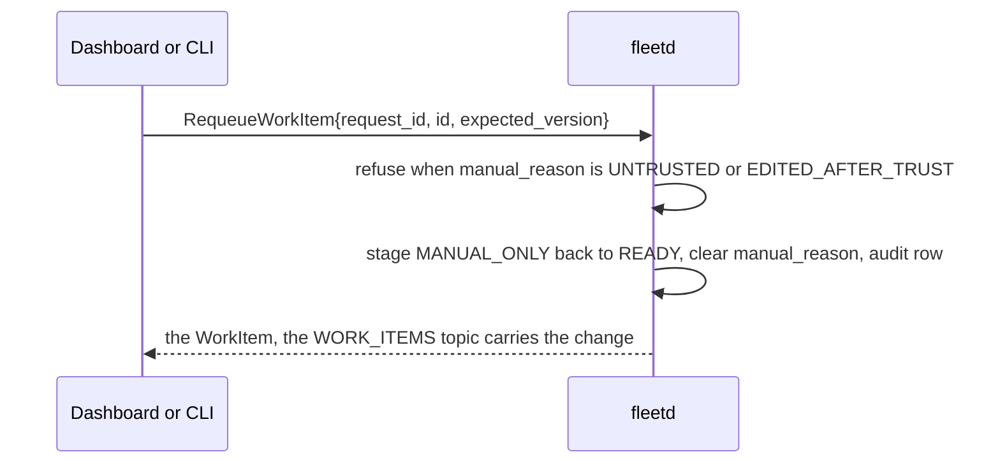

# 03h. Goal phases in depth: start failures, dispatch checks, provider changes, limit wait, re-arm

- Part of: [03-workflows.md](03-workflows.md) (conventions apply)
- Extends: [03c-goals.md](03c-goals.md) (W5 dispatch) and [03l](03l-goal-lifecycle-and-verification.md) (W6 lifecycle), which hold
  the phase classes and both state machines; this file holds the rules that did
  not fit there
- Review: `start-failure-reaction-table-incomplete`,
  `external-provider-transitions`, `rearm-after-done`,
  `limit-wait-missing-from-state-machine`, `hub-dispatch-refusal-reasons-missing`,
  `goal-active-set-undefined`, `dispatch-contract`,
  `scheduler-explanation-state-unexposed`, `goal-hooks-trigger` in
  [the contract review](../reviews/2026-10-02-contract-review.md)

Everything here is the hub's decision, taken from facts the agent and the
providers report. Nothing here adds an agent command, except that `StartGoal`
takes a `rearm_reason` (see "Re-arm").

## Attempts

A dispatch attempt is a goal. A start that fails, expires or is abandoned ends
that goal (`START_FAILED`, `EXPIRED`, `ABANDONED`); the next try for the same
work item is a **new goal** with `attempt + 1` and `previous_goal` set, so the
history of "what happened on which machine" is the chain of goals, each with its
own `start_error`, machine and transitions. A row is never revived. The work
item stage is what returns to `READY`; the goal rows stay as history.

Which failures count toward giving up: a **counted** failure is one that says
something about this item, repo or account on this machine (the "Counts" column
below). The hub keeps the set of machines with counted failures for the work
item; when it holds three, the third attempt's goal ends `START_EXHAUSTED`, the
work item becomes `MANUAL_ONLY` with reason `START_EXHAUSTED`, and a
`TRIAGE_KIND_START_FAILED` item names the three reasons. Transient and
operational refusals do not count; they are bounded by the machine skip below, so
the scheduler cannot loop on them.

## Start failures: reason to reaction

This table is normative: every reason a `StartGoal` can end with, and what the
hub does. The reactions:

- **UNFIT(scope)**: a durable marker `(machine, harness[, repo])` with the agent's
  reason (`Machine.status.unfit`). The scheduler skips that scope until a fact it
  depends on changes: a snapshot, an event (`forge_cli_status`, `harness_changed`,
  `policy_changed`, `PaneChanged`), a settings change, or the hub's own re-check,
  which re-runs `Preflight` for each marked scope after 10 minutes and doubles
  the delay to one hour while the reason holds (folder trust and other
  agent-local facts have no event, so this is how they clear; 02i, "Durable
  facts").
- **SKIP(machine, t)**: the machine is left out of planning for `t`; no marker.
  For facts that change by themselves.
- **NEW_WINDOW**: one retry on the same machine in a new window (never a reuse),
  then ELSEWHERE.
- **ELSEWHERE**: the item is planned again next pass on another machine; this one
  is excluded for the item for 1 hour.
- **TRIAGE**: raises `TRIAGE_KIND_START_FAILED` (the note names the reason and
  what to do) in addition to the reaction.

The goal of the failed attempt ends `START_FAILED` in every row unless the row
says otherwise.

| Reason | Reaction | Counts |
|---|---|---|
| `HARNESS_NOT_INSTALLED` | UNFIT(machine, harness), clears on snapshot or `harness_changed` | no |
| `HARNESS_VERSION_UNSUPPORTED` | UNFIT(machine, harness), clears on `harness_changed`. The agent emits it only for `UNSUPPORTED`; `UNVERIFIED_PARSING` is eligible when usage and ready parse live screens (03c rule 3), so the two documents agree | no |
| `HARNESS_NOT_SIGNED_IN` | UNFIT(machine, harness), clears on snapshot, `harness_changed` or the re-check | no |
| `ACCOUNT_MISMATCH` | UNFIT(machine, harness, account) until the binding changes or the harness shows that account; TRIAGE once | yes |
| `PUSH_ACCESS_MISSING` | UNFIT(machine, repo), clears on `forge_cli_status` | no |
| `CHECKOUT_MISSING` | UNFIT(machine, repo), clears when a snapshot lists the checkout | no |
| `FOLDER_UNTRUSTED`, `TRUST_PROMPT_SEEN` | UNFIT(machine, repo), re-check; TRIAGE once ("trust the folder in your own terminal on the machine", steps in 01 C3). The agent never answers a trust prompt, and learns the fact only from the harness's own screen, never from a trust file (01 C3, ADR 0024) | no |
| `WORKTREE_DIRTY` | SKIP(machine and repo, 10 min), then ELSEWHERE | no |
| `DISK_LOW` | SKIP(machine, 10 min). Retryable, as `PreflightFailure.retryable` says; the agent's disk samples in the telemetry show it. Not a marker (03c used to list it as durable; it is not) | no |
| `TMUX_TOO_OLD` | UNFIT(machine, every harness) until facts change | no |
| `TMUX_SERVER_DOWN` | SKIP(machine, 5 min) | no |
| `ON_BATTERY_BLOCKED` | SKIP(machine) until telemetry shows `on_battery` false | no |
| `POLICY_DENIED`, `HARNESS_NOT_ALLOWED`, `REPO_ROOT_NOT_ALLOWED` | UNFIT(machine, harness or repo) until `policy_changed` or a settings change | no |
| `POLICY_SAFE_MODE` | UNFIT(machine, every harness) until a snapshot shows safe mode off (triage `policy_invalid` already exists) | no |
| `CAPABILITY_MISSING` | UNFIT(machine, every harness) until `Hello` lists the capability; the agent is too old | no |
| `HARNESS_PROFILE_MISSING` | UNFIT(machine, harness, profile) until a snapshot lists it | no |
| `DRAINING` | goal `ABANDONED` (`DRAINING`), item `READY`; drain rules below | no |
| `AGENT_GOAL_CAP_REACHED` | SKIP(machine, 5 min) and `SnapshotRequest{"slot_mismatch"}` | no |
| `MAX_WINDOWS_REACHED` | SKIP(machine, 5 min) | no |
| `PANE_BUSY`, `SESSION_NOT_AVAILABLE` | NEW_WINDOW; the second one ELSEWHERE | first no, second yes |
| `SESSION_WORKDIR_MISMATCH`, `CHECKOUT_DIRTY` | NEW_WINDOW at once; the pane is not offered again for that repo until `PaneChanged` says its directory changed | no |
| `FRESH_CONTEXT_NOT_ALLOWED` | NEW_WINDOW without `fresh_context` (the planner sets it only for a fleet-started session or a mark with `fresh_context_on_reuse`, so this means the session or mark changed since the plan) | no |
| `READY_TIMEOUT` | NEW_WINDOW once, then ELSEWHERE | yes |
| `STARTUP_PROMPT_SEEN` | `update`, `login`: UNFIT(machine, harness) until `harness_changed` or the re-check, TRIAGE; `trust`: as `TRUST_PROMPT_SEEN`; `release_notes`: NEW_WINDOW once | no |
| `MODEL_NOT_AVAILABLE`, `EFFORT_NOT_SUPPORTED` | UNFIT(machine, harness, account) with the model or effort in the reason; TRIAGE; no retry with the same value | yes |
| `GOAL_FILE_WRITE_FAILED`, `GIT_FAILED` | ELSEWHERE; the second on one `(machine, repo)` makes it UNFIT(machine, repo) with the re-check | yes |
| `WORKTREE_EXISTS` | SKIP(machine and repo, 1 h), TRIAGE (a leftover worktree on another branch) | yes |
| `LOCAL_DENIED` | UNFIT(machine, repo) for 1 h, TRIAGE ("denied at the machine") | no |
| `LOCAL_CONFIRM_TIMEOUT` | SKIP(machine, 30 min): nobody is at the keyboard; then ELSEWHERE | no |
| `INVALID_NAME`, `INVALID_ARGUMENT`, `ROLE_INSUFFICIENT` | no retry; TRIAGE (the hub built a bad command: a bug) | yes |
| `EXPIRED` (not delivered, 30 min) | goal `EXPIRED`, item `READY`; no re-plan while the machine is `OFFLINE` | no |
| `GOAL_FILE_NOT_SEEN` | goal `START_UNKNOWN`, `start_unknown` triage; also `EnsureGoalHooks` once per `(machine, harness)` per day (hooks may be missing) | n/a |
| `UNKNOWN_OUTCOME` at any step | goal `START_UNKNOWN`, `start_unknown` triage; never retried automatically; the operator says "not started" (`ABANDONED`) or it is adopted when a `GoalState` arrives | n/a |
| `SLOTS_FULL` | never from an agent; the planner only plans into free slots, and a lost race fails the planning transaction's unique index | n/a |

## Drain, the outbox and respawn

`Drain` means "finish current work, take nothing new" and never kills (03e). The
interplay with commands:

- **`DrainMachine` cancels what has not left.** In the same transaction the hub
  marks every `StartGoal` outbox row for the machine that is still `PENDING`
  (not delivered) as `EXPIRED` with message "cancelled by drain", ends its goal
  `ABANDONED` (`DRAINING`) and sets the work item `READY`. A `StartGoal` already
  delivered and past `preflight` finishes (the composite is not interrupted); one
  delivered but not yet past `preflight` is refused `DRAINING` by the agent and
  takes the `DRAINING` row above. Either way the item is planned on another
  machine, and none of it counts as a failed attempt.
- **A goal that is already running keeps running** on a drained machine, and
  everything that serves it stays allowed: nudges, goal control, limit-wait
  resume, `RespawnPane` of its pane, `ReleaseGoal`, `KillWindow` and
  `PruneWorktree` after merge.
- **`RespawnPane` is allowed while draining only for a pane with a registered
  live goal** (it restarts the harness of work already taken). Any other
  `RespawnPane`, and `EnsureSession` or `EnsureWindow` that starts a harness, is
  refused `DRAINING`. This is the agent's rule (01, M4); the hub's own recovery
  respects it by only respawning goal panes.
- A goal whose harness crashes on a drained machine therefore recovers there
  (respawn, one nudge) and, if it cannot, goes `STUCK` for a person; drain never
  turns it into a failed start.

## Dispatch checks and their severity

The hub's own checks run in `PreflightGoal` and again in `StartGoal`, before
anything is sent. Each finding is a `PreflightCheck{ErrorDetail, severity}`;
the agent's `failed_checks` come back in `Operation.failed_checks` and are all
`BLOCK`. The reasons are hub `ReasonCode`s (540 to 564; 540 to 556 are dispatch
rules, 557 to 564 other hub refusals; `SLOTS_FULL`, `DRAINING` and `MACHINE_OFFLINE`
keep their agent and hub-API codes), so a client branches on codes, never on strings.

| Severity | Meaning | Reasons |
|---|---|---|
| `BLOCK` | `StartGoal` fails `FAILED_PRECONDITION` with the first one's reason, every BLOCK listed in `violations` | `SLOTS_FULL`, `NO_FIT_MACHINE`, `WORK_ITEM_BUSY`, `BRANCH_BUSY`, `REPO_NOT_WATCHED`, `CONSENT_EMPTY`, `MACHINE_UNFIT` (for a pinned machine), `DRAINING`, `MACHINE_OFFLINE`, `ACCOUNT_NOT_DISPATCHABLE` with `cause` `interactive_only` or `opencode_on_anthropic`, and every agent failure |
| `CONFIRM` | `StartGoal` returns `approval` (`DISPATCH_CONFIRM`, required role `OWNER`) and starts nothing; approving creates the goal and sends `StartGoal` | `WORK_ITEM_UNTRUSTED` (also an item edited after it was trusted; the card shows `TrustVerdict.denial`), `WORK_ITEM_CLAIMED` (bypassing a safety gate), `ACCOUNT_NOT_DISPATCHABLE` with `cause` `dollar_cap` or `overage_billing` (spends or may spend money), `HARNESS_VERSION_UNSUPPORTED` with `parsing = unverified` (a version whose usage or ready parse is not live) |
| `WARN` | allowed once the request lists the reason in `acknowledged_warnings` | `ACCOUNT_PACING_BLOCKED`, `ACCOUNT_USAGE_UNKNOWN`, `INTEGRATION_LAG`, `INTEGRATION_DEGRADED`, `REPO_PARALLEL_LIMIT`, `ROUTINE_NEEDS_SPARE_QUOTA` (`RunRoutine` of a spare-quota routine with no spare account; a trigger fire never acknowledges it) |
| `INFO` | shown | the session that would be reused, the model the harness shows |

`AUTO_DISPATCH_OFF`, `NO_READY_ITEMS` and `FLOOD_GUARD` are explanations only
and never appear in a preflight: a manual dispatch ignores them. The
unacknowledged-warning rule means a client cannot dispatch past a warning it
never showed: the CLI prints the warnings and needs `--yes-warnings`, the UI
ticks them. "Manual dispatch allowed with a warning" (03m, 03c, 03e) is exactly
the `WARN` and `CONFIRM` rows. Row 22 implements this table in
internal/hub/goals: the Evaluate function emits one `PreflightCheck` per
failed finding in table order, and DecideStart maps the set to proceed,
block, unacknowledged-warning refusal, or `DISPATCH_CONFIRM` approval.

**Operation versus approval.** `StartGoal` with a CONFIRM check, `RunHarnessCommand`
with a DESTRUCTIVE command and `KillWindow` on a developer's window are one
case with one rule, in [02m](02m-hub-api-actions-and-audit.md#actions-that-need-an-approval): the
response carries the approval and no operation; the operation exists only after
an approval is approved.

## Work item stage after a goal ends

| Goal ends | Work item stage | Why |
|---|---|---|
| `MERGED`, `CLOSED` | `CLOSED` | done |
| `CANCELLED` | `CLOSED` | the provider closed it; nothing to redo |
| `START_FAILED`, `EXPIRED`, `ABANDONED` | `READY` | it never ran (or cannot be known to have); retry elsewhere, bounded by the three-machine rule |
| `START_EXHAUSTED` | `MANUAL_ONLY` (`START_EXHAUSTED`) | the fleet tried and failed three times |
| `CLEARED` | `MANUAL_ONLY` (`GOAL_CLEARED`) | a person stopped it; the scheduler does not redispatch it behind their back |
| `STUCK` then cleared | as `CLEARED` | same |

`MANUAL_ONLY` has two ways out and no timer: the item becomes trusted (an
allow-listed person labels it, or labels it again after an outsider's edit;
seen at the next sync, [03j](03j-provider-sync-and-trust.md#the-trusted-issues-gate))
or an operator calls `RequeueWorkItem`, which is refused for an `UNTRUSTED` or
`EDITED_AFTER_TRUST` item, so a click cannot bypass the gate. A routine run's item (03i) is hub-made: it goes `CLOSED` in
every ended case, and the next trigger starts a new run.

**Requeue, as messages.** A requeue starts nothing: it only puts the item back to `READY`.
The next scheduler pass (or a manual dispatch) starts the work. The refusal for an untrusted
item is `REQUEUE_NOT_ALLOWED`, and a stale `expected_version` is `VERSION_MISMATCH`: read again.

## Provider-side changes under a live goal

Mirror updates (W4) are applied in the same transaction as the mirror upsert, so
the goal and the item never disagree for a pass. The rules, for a goal in a
live phase (03c, "Phase classes") unless stated:

| Provider says | Goal | Hub does |
|---|---|---|
| The change request **merged** while the goal line is not `DONE` (a person merged it, or the goal moments before writing `DONE`) | any live phase except `VERIFYING`, `DISAGREE` becomes `VERIFYING` with reason `EXTERNAL_MERGE` | The harness goal is still active, so the pane cannot be freed yet: the hub clears it (`/goal clear` through `goal_control`, an `Interrupt` first if mid-turn, held while someone is typing), then the verifier concludes `MERGED` and frees the worker (03c). The merge is found by the goal's branch (`GoalStatus.branch`) |
| The change request **closed unmerged**, or the work item closed or cancelled ("not planned", "Won't Do", deleted or transferred) without a merge from this goal | `PAUSED` with `pause_reason = WORK_ITEM_CLOSED` | The harness is paused (`goal_control.pause_mode`) so it stops spending quota, `TRIAGE_KIND_WORK_ITEM_CHANGED` (severity ACTION) says which provider fact changed. The owner decides: `RESUME` (keep going; nothing is auto-resumed) or `CLEAR`, which ends it `CANCELLED` |
| The item is **reopened** after the pause | stays `PAUSED` | The triage note is updated ("reopened"); resuming is still the owner's decision |
| After `DONE`, the change request is closed unmerged and the item is closed | `VERIFYING` becomes `CANCELLED` (`CHANGE_REQUEST_CLOSED`) | frees the worker with no success metric |
| After `DONE`, the change request is closed unmerged and the item is still open | `DISAGREE` | triage `done_disagreement`; the operator re-arms (below) or clears |
| `CHANGES_REQUESTED` arrives after `DONE` (`VERIFYING`, `DISAGREE`) | unchanged | counts toward the review-loop cap; triage `done_disagreement` with note "changes requested after done". **No automatic re-arm in v1**: the operator's `NOT_DONE` re-arms (ADR 0019 records this choice) |
| The item is edited by someone outside the allow-list after dispatch | unchanged | trust is evaluated at plan time only; a running goal is never demoted. (The body that reached the harness was already gated.) |
| The integration goes `DEGRADED` | unchanged | verification waits (03c failure modes); nothing is concluded from a stale mirror |

A closed or cancelled goal that was `PAUSED{WORK_ITEM_CLOSED}` and is cleared
becomes `CANCELLED`, not `CLEARED`, so its work item does not turn `MANUAL_ONLY`.

## Limit wait

`LIMIT_WAIT` is the phase of a goal whose harness stopped on a usage or rate
limit. It is `HELD`: a total slot, no active slot, for up to a week.

**Entry.** A goal in `RUNNING`, `STOPPED` or `COOLDOWN` with an open
`HarnessCondition` of kind `USAGE_LIMIT`, or `RATE_LIMITED` that is not
retrying (the harness gave up) or whose `resets_time` is more than 10 minutes
away. A short retrying rate limit is not a phase: the harness handles it and
`provider_condition` only suppresses stop detection. `WAITING` and
`BLOCKED_OWNER` goals keep their phase and `provider_condition` (nothing is
spending). `PAUSED` wins over `LIMIT_WAIT`: the pause is a person's decision, so
the limit is recorded and, when the pause ends and the limit still shows, the
goal goes to `LIMIT_WAIT`.

**When it ends.** `limit_wait_until_time` is, in order: the condition's
`resets_time` plus 1 minute; if the harness showed none (`resets_time` is
optional on the screen), the `resets_time` of the account's deciding bucket from
its latest reading; if that is unknown too, now plus 10 minutes, re-checked every
10 minutes and on every probe reading, capped at the weekly reset. A
`TRIAGE_KIND_LIMIT_WAIT` item (severity WARNING, once) is raised on entry when
the wait is expected to exceed 30 minutes or is unknown.

**Resume.** At the time, if the condition has cleared (or the bucket's reading is
below the limit), the hub resumes with the harness's own action from
`goal_control` (`/goal resume`, or `SendKeys{GOAL_RESUME, resume_text}`; the
scheduler is allowed to, 02g), then watches 2 minutes for the goal line or
activity to show work: `RUNNING` with reason `RESUMED`. If the condition still
shows, the wait is extended by 10 minutes. Failures:

| Failure | What happens |
|---|---|
| `PANE_BUSY` (someone is typing, or a turn is running) | retried every minute for 10 minutes, then triage `limit_wait` ("resume it yourself or clear") |
| `UNKNOWN_OUTCOME` | not retried (typed input is not idempotent); triage with a `CapturePane` button; the goal stays `LIMIT_WAIT` until a `GoalState` or activity shows it moved, or an operator acts |
| Pane gone | `PANE_LOST` rules (03c); a resume cannot be typed |
| Machine drained or offline | drain does not stop a resume (above); offline suspends the timer, and it acts when the machine is back |
| `limit_resume_verified` is false for the harness version | the resume is typed all the same and the outcome is marked unverified; the 2-minute check decides `RUNNING` or the triage item |

**Control actions in `LIMIT_WAIT`.** `RESUME` (try now), `CLEAR` (`CLEARED`) and
`PAUSE` (`PAUSED` with `OPERATOR`, which cancels the automatic resume) are
allowed; `EDIT` and `NOT_DONE` are not (`GOAL_ACTION_NOT_ALLOWED`).

**Pacing.** Pacing reads probe readings, not conditions (03b), so the hub adds
one rule: an open `USAGE_LIMIT` condition on a goal pane of an account marks the
account `SHORT_LIMIT` until the condition's `resets_time` (or the deciding bucket's), so
the scheduler does not start another goal into a limit the harness already hit.
It never changes a reading, and it ends with the condition.

## Re-arm after DONE

`NOT_DONE` and `EDIT` mean "keep going" on a goal whose harness already stopped.
After "Goal achieved" Claude Code has cleared its goal; the goal file's first
line still says `DONE`; a typed "not done" would be an ordinary prompt with no
goal loop and no Stop guard, and nothing would move `GoalState` out of `DONE`.
So the hub re-arms instead of nudging:

1. `ControlGoal{NOT_DONE | EDIT, text}` is valid only in `VERIFYING` and
   `DISAGREE` (refused `GOAL_ACTION_NOT_ALLOWED` elsewhere, and when the pane no
   longer exists; then the operator dispatches again, a new goal that names this
   one as `previous_goal`). Held while a person is typing, like every typed
   input.
2. The hub sends `StartGoal` for the **same goal id** with `reuse_pane` set to the
   goal's pane, `rearm_reason = text` and `spec.goal_text` = the objective (EDIT:
   the new text). The agent skips every step that creates something, `pick_session` included (02h), writes
   the first line as the objective plus `reopened: <reason>`, waits ready, types
   the harness's set-goal form (`/goal <text>`, in the consent form the checkout's
   hooks need), and confirms the goal file.
3. On the result the goal returns to `RUNNING` with reason `REARMED`, a new
   `GoalRun` (cause `REARM`) begins, the pane's registry entry is unchanged and
   the worker is not freed. The same exit applies if a person re-arms at the
   keyboard: whenever the goal line returns to `WORKING` the goal leaves
   `VERIFYING` or `DISAGREE` for `RUNNING`.
4. Failure follows `StartGoal`: `PANE_BUSY` (retry once), `UNKNOWN_OUTCOME`
   (triage, never retried), `READY_TIMEOUT`.

**Probe record 2026-10-12 (issue #59, plan item 0.14).** Muse 1.4.6 accepts
`/goal <text>` after a completed goal in the same session, so re-arm there is
verified. Codex 0.162.1 could not be probed (it would not start, below), so a
re-arm on Codex stays unverified in the audit row, and a failed set-goal falls
back to the operator typing the line (the triage item carries it).

Setup: `fleet-live-probe` skill, throwaway tmux servers (killed at the end),
one empty scratch folder per harness (deleted), macOS tmux 3.8. Two one-line
prompts spent on Muse, none on Codex or Claude Code. Baselines: Codex
`config.toml` and Muse `settings.json` had the same sha256 before and after;
Muse `trust.json` regained its exact bytes after the throwaway trust entry was
removed (verified with `cmp`); `~/.claude.json` was never opened (mtime
unchanged); `auth.json` files, the keychain and `gh` auth were never opened.

| Step | Observed |
|---|---|
| Muse 1.4.6 trust box in the new folder | read, then trusted on purpose (throwaway folder only) |
| "/goal Reply with exactly the words probe done and then stop" | "Goal set", "probe done", "Goal already met — marking it complete.", "Completed goal 100%", footer "Goal (8s) 100%" |
| "/goal Second probe goal ..." in the same session after DONE | "Goal set", ran, "Completed goal 100%", footer "Goal (4s) 100%": re-arm works |
| Muse "/usage" | Current 21% (resets 10:24 PM), Weekly 10% (resets Oct 18): no limit live |
| Codex 0.162.1 start, scratch folder and home, 5 tries | every start failed before the first screen: "account/read failed ... failed to load workspace requirements (code -32603)"; no goal could run |
| Claude Code 2.1.296 start in a plain scratch folder | trust box ("No, exit" default); declined with Esc, nothing trusted, no prompt sent |

Resume after a usage limit is still unprobed on all three harnesses: no limit
was live to wait out, provoking one would burn quota, and the wait itself is
multi-day. `limit_resume_verified` stays false everywhere until a limit is
caught on its own and the resume past the reset is seen.

**Probe record 2026-10-25 (issue #59, plan item 0.14).** Re-arm verified on
Codex 0.163.0 and on Muse 1.4.12 (in-TUI header showed 1.4.13; both noted).
Resume after a usage limit still unprobed on all three: no limit was live to
wait out (closest: Claude weekly all-models 94%, Codex weekly 2% left).

Setup: `fleet-live-probe` skill, throwaway tmux servers (`-L probe59-*`,
all killed at the end), one empty scratch folder per harness (all deleted),
macOS tmux 3.8. Four one-line prompts spent in total (two per re-arm case);
the usage reads sent no model prompt. Baselines: Codex `config.toml`, Muse
`trust.json` and `settings.json`, a copy of `~/.claude.json`, the Cursor
trust-dir listing. `auth.json` files, the keychain and `gh` auth were never
opened.

| Step | Observed |
|---|---|
| Codex 0.163.0 start in a fresh git repo | starts clean (the 0.162.1 `account/read` failure is gone); trust box read, trusted on purpose (throwaway folder only); passive "Update available 0.163.0 -> 0.164.0" banner, no blocking prompt and no daemon-settings prompt this start |
| Codex `/status` | weekly limit 2% left, resets 1:42 PM Oct 30; model GPT-6.1-Sol low |
| Codex "/goal Reply with exactly the words probe done and then stop" | "Goal active", model replied "probe done", footer "Goal achieved (6s)" |
| "Approaching rate limits / Switch to gpt-6-luna?" picker | read, answered "Keep current model" (no persistent change; the "never show again" option avoided) |
| Codex second `/goal` in the same session after DONE | "Goal active", "probe two", footer "Goal achieved (5s)": re-arm works |
| Muse 1.4.12 trust box in a fresh git repo | read, trusted on purpose (throwaway folder only); passive "updated 1.4.11 -> 1.4.13" line, no action |
| Muse first `/goal` | "Goal set", "probe done", "Completed goal 100%", footer "Goal (6s) 100%" |
| Muse second `/goal` after DONE | "Goal set", "probe two", "Completed goal 100%", footer "Goal (3s) 100%": re-arm works on the new version |
| Muse `/usage` | Current 3% (resets 3:40 AM), Weekly 77% (resets Oct 25 8:00 PM): no limit live |
| Claude Code 2.1.303 start in an empty plain folder | trust box ("No, exit" default) read, trusted on purpose (throwaway folder only); ready with Sonnet 5.5, auto mode; passive "Update installed - Restart to update" line, no action |
| Claude `/usage` | session 13% (resets 2:49 AM ET), weekly all-models 94% (resets Oct 26 9:59 PM ET), weekly Fable 32%, usage credits off, session totals $0.00: no limit live |

**Cleanup:** all three servers killed; all scratch folders deleted;
`cursor-agent` never started and its trust-dir listing is unchanged; Muse
`trust.json` and `settings.json` match their baseline sha256; the Codex
trust stanza was removed from `config.toml` (no `probe59` refs left; the
sha still differs by Codex's own per-start counter write, as in the
2026-10-10 probe); the Claude probe project entry was removed from
`~/.claude.json` (valid JSON, no `probe59` refs; ambient self-writes from
the run remain, as any start produces). No pane captures or logs kept;
what stays in the owner's history is the four probe prompts plus the three
usage reads.

## Scheduler explanations

The scheduler records why it did not use something, at the narrowest scope, in
the pass that decided it (`DispatchBlock`, the same words as the
`fleet_hub_scheduler_skips_total{reason}` label):

| Where | Field | Reasons |
|---|---|---|
| An account that is dispatchable and below `allowed_active` | `Account.status.pacing.idle_causes` | the causes in order: `NO_READY_ITEMS`, `AUTO_DISPATCH_OFF`, `INTEGRATION_LAG`, `REPO_PARALLEL_LIMIT`, `NO_FIT_MACHINE` (with the best machine's missing piece in metadata), `ACCOUNT_*` |
| A machine | `Machine.status.unfit[]` | the durable markers above, with `since_time` and `next_check_time` |
| A repo | `Repo.status.dispatch_block` | `REPO_PARALLEL_LIMIT`, `INTEGRATION_LAG`, `AUTO_DISPATCH_OFF` |
| A READY item not taken | `WorkItem.dispatch_block` | the reason this item in particular was held back |
| The fleet | `FleetSummary.dispatch_blocks` | `AUTO_DISPATCH_OFF`, `NO_READY_ITEMS`, `INTEGRATION_*` |

They are recomputed each pass, kept only while true (`since_time` marks the start
of an unbroken run), and reach Watch at most once per 30 s when only they change.
"Why is nothing starting?" is therefore a field on the account, not a metrics
query.

## Goal hooks reconcile

`EnsureGoalHooks` has a sender (see [03-workflows.md](03-workflows.md), "Hook
reconcile"), and an owner button, `EnsureMachineHooks`. The reconcile enqueues it
per `(harness, profile, enabled repo checkout)` when the state is missing,
unverified or behind `expected_version`, and never while a goal is live in a pane
of that harness on the machine. `Repo.spec.hooks_mode` decides: `GENERIC` installs
and verifies, `ESHU` only reports (a checkout that does not ship the hooks raises
a warning), `AUTO` follows `repo_ships_own` of the checkout.
