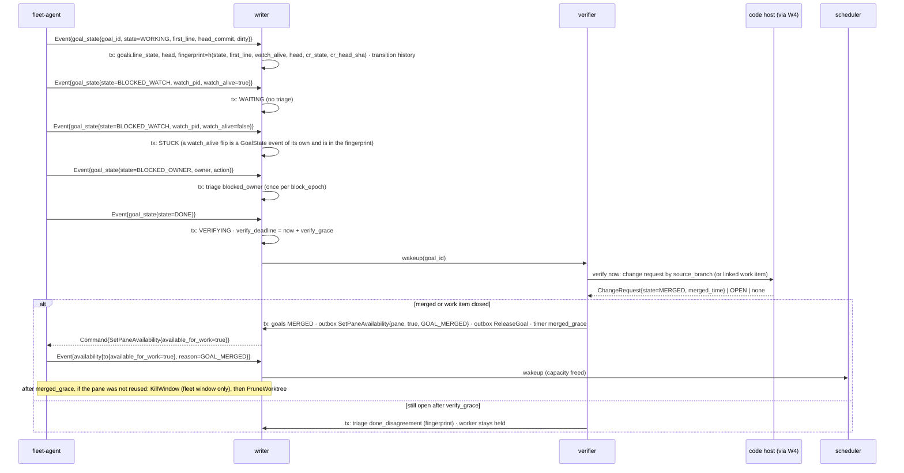
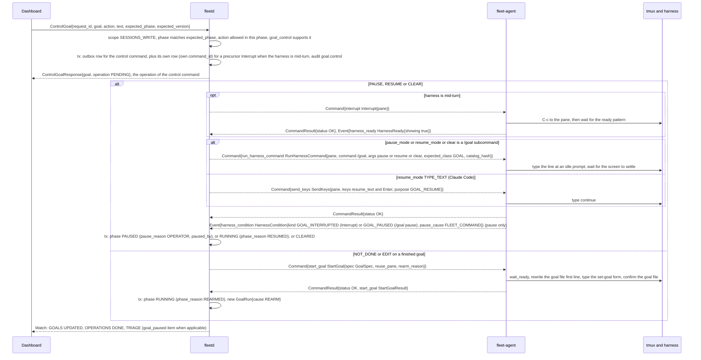

# 03l. Goal lifecycle and verification (W6)

- Part of: [03-workflows.md](03-workflows.md) (conventions apply). Split out of
  [03c](03c-goals.md) to keep each file under the 500-line cap: 03c holds W5 (dispatch a goal),
  this file holds W6 (the goal's state machine, phase classes, control actions by phase,
  the rules, persistence, ordering, failure modes and telemetry)
- Continued in [03h](03h-goal-phases-in-depth.md) (start-failure reactions,
  dispatch checks, provider-side changes, limit wait, re-arm),
  [03i](03i-routines.md) (routine runs), [03k](03k-observed-goals.md) (observed goals)

## W6. Goal lifecycle and verification

**Trigger.** `Event.goal_state` (never dropped; first line + HEAD + dirty in
one message), `PaneExited{goal_id}`, `ActivityTransition`, `HarnessCondition`,
change request / work item mirror updates (W4), timers (cooldown expiry,
`merged_grace`, verify grace), operator actions (pause, resume, edit, clear,
nudge).

**Actors.** Writer (applies state), verifier, scheduler (frees capacity),
`fleet-agent` (typed `/goal` subcommands via `RunHarnessCommand`, `Interrupt`,
`SendKeys` nudges, `RespawnPane`, `PruneWorktree`, `KillWindow`,
`SetPaneAvailability`, `ReleaseGoal`), the harness and its hooks, the code host.

### State machine (goal, owned by the hub)

```mermaid
stateDiagram-v2
  [*] --> RUNNING: StartGoal OK / adopted
  RUNNING --> WAITING: BLOCKED_WATCH with watch_alive
  WAITING --> RUNNING: goal line back to working
  RUNNING --> BLOCKED_OWNER: BLOCKED with OWNER + ACTION (triage once)
  BLOCKED_OWNER --> RUNNING: goal line changes
  RUNNING --> STUCK: BLOCKED_STUCK, watch pid dead, stopped twice without DONE, or machine revoked (any live phase)
  WAITING --> STUCK: watch pid dead
  RUNNING --> STOPPED: PaneExited, or idle at ready prompt with WORKING line
  STOPPED --> RUNNING: corrective nudge (once), progress seen
  STOPPED --> STUCK: stops again
  RUNNING --> COOLDOWN: 2 consecutive no-progress evaluations
  COOLDOWN --> RUNNING: cooldown expired, nudge typed
  RUNNING --> PAUSED: operator pause / review-loop cap / (opt-in) reserve line / paused at the machine / provider closed it
  PAUSED --> RUNNING: operator resume (reserve: at auto_resume_time, at the machine: when the goal runs again)
  RUNNING --> LIMIT_WAIT: USAGE_LIMIT, or RATE_LIMITED not retrying (also from STOPPED, COOLDOWN)
  LIMIT_WAIT --> RUNNING: resumed at limit_wait_until_time (03h)
  LIMIT_WAIT --> PAUSED: operator pause (cancels the automatic resume)
  PAUSED --> LIMIT_WAIT: pause ended, limit still showing
  RUNNING --> VERIFYING: DONE
  VERIFYING --> MERGED: change request merged or work item closed as done
  VERIFYING --> DISAGREE: open after verify_grace (triage)
  VERIFYING --> CANCELLED: change request closed unmerged, item closed
  DISAGREE --> VERIFYING: provider changes, or operator "re-check"
  VERIFYING --> RUNNING: re-arm, or goal line back to WORKING
  DISAGREE --> RUNNING: operator "not done" (re-arm, 03h)
  RUNNING --> VERIFYING: change request merged while not DONE (EXTERNAL_MERGE)
  PAUSED --> CANCELLED: operator clears after the provider closed the item
  MERGED --> CLOSED: merged_grace elapsed · worktree pruned, window closed or session reused
  RUNNING --> CLEARED: /goal clear (operator)
  RUNNING --> PANE_LOST: pane missing from snapshot (W2)
  PANE_LOST --> RUNNING: pane reappears with same FLEET_GOAL_ID
  PANE_LOST --> STUCK: 10 min, or machine revoked
  STUCK --> RUNNING: operator action (nudge, restart, clear + redispatch)
```

Where the diagram draws `RUNNING` as the source of pause, clear or a provider
change, the exact source phases are the control table below and, for a human
merge or a close, [03h](03h-goal-phases-in-depth.md#provider-side-changes-under-a-live-goal).

### Phase classes

One table decides what a goal holds. The unique indexes, `MachineSlots`,
`AccountPacing.active_goals`, the repo cap and the heartbeat check all read it,
so "active" means one thing.

| Class | Phases | Holds |
|---|---|---|
| **ACTIVE** (uses quota) | `STARTING`, `START_UNKNOWN`, `RUNNING`, `STOPPED` | an active slot, a total slot, the repo cap; counts in `AccountPacing.active_goals` |
| **HELD** (keeps its worker, spends almost no quota) | `WAITING`, `BLOCKED_OWNER`, `STUCK`, `COOLDOWN`, `PAUSED`, `LIMIT_WAIT`, `VERIFYING`, `DISAGREE`, `PANE_LOST` | a total slot and the repo cap only |
| **ENDED** | `MERGED` (until `CLOSED`), `CLOSED`, `START_FAILED`, `START_EXHAUSTED`, `EXPIRED`, `ABANDONED`, `CLEARED`, `CANCELLED` | nothing: `MERGED` frees the worker, so the pane is reusable at once |

**Live** = ACTIVE ∪ HELD (an observed goal, 03k, holds nothing). The DB unique indexes are `(work_item) WHERE live`,
`(repo, branch) WHERE live` (one agent per branch) and, for routines, `(routine)
WHERE live`. A `LIMIT_WAIT` goal therefore holds a total slot and its branch for
up to a week, by design; an operator can clear it. The heartbeat check compares
the agent's `goals_total` with the hub's count of live goals that have a pane
(all live phases but `STARTING`, `START_UNKNOWN`, `PANE_LOST`), and its
`goals_active` with the live goals whose `line_state` is `WORKING` and whose pane
is live, regardless of phase (a `PAUSED` or `LIMIT_WAIT` goal still shows a
`WORKING` line), never with `goal_panes_by_state`.

`GoalLineState` has no `PAUSED` value on purpose: the goal file still says
`WORKING` while the harness is paused, because a pause is a harness condition the
hub reads from the screen and records as the phase `PAUSED`, not a line state the
hooks write.

`GoalPhaseReason` and `pause_reason` carry the cause where a phase has several;
the same words are on every recorded transition (`ListGoalTransitions`).

### Control actions by phase

| Action | Allowed in | Sends |
|---|---|---|
| `PAUSE` | `RUNNING`, `STOPPED`, `COOLDOWN`, `WAITING`, `LIMIT_WAIT` | `goal_control.pause_mode` |
| `RESUME` | `PAUSED`, `LIMIT_WAIT` | `goal_control.resume_mode` |
| `EDIT` | `RUNNING` where `/goal edit` exists; `VERIFYING`, `DISAGREE` as a re-arm | `/goal edit`, or the re-arm `StartGoal` |
| `CLEAR` | every live phase but `STARTING` | `/goal clear` |
| `RECHECK` | `VERIFYING`, `DISAGREE` | hub only |
| `NOT_DONE` | `VERIFYING`, `DISAGREE` | the re-arm `StartGoal` (03h) |
| `MARK_NOT_STARTED` | `START_UNKNOWN` | hub only; goal `ABANDONED` |

Anything else is `FAILED_PRECONDITION` / `GOAL_ACTION_NOT_ALLOWED`; a stale phase
is `GOAL_PHASE_CHANGED` (02b).

`ControlGoal` as messages (the dashboard sends an intent, the hub turns it into
the harness's own command):

Sub-flags held with the phase (on `GoalStatus`): `provider_condition`,
`prompt_pending`, `human_at_keyboard_until_time` (10 min after the latest
`PaneInput`), `pause_reason`, the counters, `block_epoch`, `verify_deadline_time`.

### Rules

- **Fingerprint.** `h(line_state, first_line, watch_alive, head_commit,
  cr_state, cr_head_sha)`. Triage items and nudges are keyed on it, so one stopped or
  disagreeing state is reviewed once; a change in any component is a new
  state. `block_epoch` increments each time the line enters `BLOCKED_*` from
  another state, so leaving and re-entering Blocked raises a new Triage item.
- **Stopped without DONE.** Detected by `PaneExited{goal_id}` or by
  `ActivityTransition{to=IDLE}` on a goal pane whose `line_state=WORKING`
  with `ready_pattern_showing` for longer than `idle_threshold` (the Stop hook
  should prevent this; its absence is itself a finding). Suppressed while
  `provider_condition`, `prompt_pending`, `human_at_keyboard_until_time` or an open
  `GOAL_INTERRUPTED` / `GOAL_PAUSED` condition hold.
- **Interrupted or paused at the machine.** An open `GOAL_INTERRUPTED`, or a
  `GOAL_PAUSED` with cause `DEVELOPER_INPUT` or `HARNESS`, on a goal pane is the
  owner's decision (01d): phase `PAUSED` with `pause_reason =
  OWNER_AT_MACHINE`, a `goal_paused` triage item, no corrective nudge, no
  no-progress counting, never resumed automatically. It ends when the condition
  clears (the goal runs again: `RUNNING`) or an operator resumes it. A
  `FLEET_COMMAND` cause is the hub's own pause and keeps the reason the hub
  recorded (`OPERATOR`, `REVIEW_LOOP`, `RESERVE`). Only `RESERVE` has an
  `auto_resume_time`.
- **Limit wait.** Entry, the end time with its fallbacks, the resume, its
  failures and the pacing rule are in [03h](03h-goal-phases-in-depth.md#limit-wait):
  no nudges and no no-progress counting meanwhile; the resume is the harness's own,
  from `goal_control`.
- **One corrective nudge.** First stop: if the pane is dead but remains (registry entry kept, same `PaneKey`) →
  `RespawnPane{harness, resume=true, harness_session_id}` (dangerous kind; may
  need local approval; the id keeps `--last` from picking another conversation),
  wait for ready, then `SendKeys{purpose=GOAL_NUDGE, keys:
  ["Your goal is still active. Continue, or write DONE, or BLOCKED: <reason>
  with WATCH=<pid> or OWNER=<who> ACTION=<what>.", ENTER]}` (not idempotent:
  `UNKNOWN_OUTCOME` → no second attempt, triage). Second stop → `STUCK` →
  triage `stuck` (the chip "recovery required" is its `phase_reason`).
- **Progress** = `head_commit` or `first_line` changed since the last
  evaluation. Each stop/nudge evaluation with no progress increments
  `no_progress_runs`; at 2 → `COOLDOWN` with `cooldown = min(30 min, 2 min ×
  2^(n−2))`; progress resets both. No nudges during cooldown.
- **Review-loop cap.** `ChangeRequest.review_rounds - review_rounds_baseline ≥
  3` without a merge → `PAUSED{REVIEW_LOOP}`, the baseline set to the current
  `review_rounds`, so an operator's resume is not paused again at once; the pause
  is `goal_control.pause_mode` (`/goal pause`, or `Interrupt`); triage
  `review_loop` (one per `cr_head_sha`).
- **Verification.** `DONE` → `VERIFYING` → targeted sync (W4). Merged
  (`ChangeRequest.state=MERGED`) or the work item closed as done → `MERGED`; closed
  without being done (`CANCELLED` state) is never `MERGED` (03h). A routine run
  uses its snapshotted done rule ([03i](03i-routines.md)). Open
  after `verify_grace` (default 10 min, covers sync lag) → `DISAGREE` with a
  triage item; the worker stays held. Without `merge` consent (ADR 0008) the
  done state is "approved and green" (owner-confirmed, ADR 0024 decision 19): `review_decision=APPROVED` and
  `checks.rollup=SUCCESS` (both computed by the adapter for `head_commit`, 03j;
  `UNSPECIFIED` is "not known", never green) → triage `ready_for_human_merge`; still `VERIFYING`
  until the merge is seen.
- **Free the worker.** Only on `MERGED`: `SetPaneAvailability{true, GOAL_MERGED}`
  makes the pane `available_for_work` (E11) and `ReleaseGoal` drops its registry
  entry; the scheduler may reuse the pane at once (new branch in the same
  checkout). After `merged_grace` (setting), if no new goal took the pane:
  `KillWindow` (fleet windows only; never a developer's), then
  `PruneWorktree{repo, goal_id, path}` (agent-created worktrees only, and only
  once no live pane works in it). A pane that was reused is left alone.
- **Pause / resume / edit / clear** are operator actions typed as the
  developer would (01b): `RunHarnessCommand{pane, "/goal", args, expected_class
  = GOAL, catalog_hash}` at an idle prompt. If the harness is mid-turn the hub
  first sends `Interrupt`, waits for ready (`HarnessReady` or ready pattern),
  then types the subcommand. After an interrupt (probed 2026-10-02) Muse and
  Codex 0.160.0 show "goal paused" and resume with `/goal resume`; Claude Code
  2.1.286 keeps the goal active and resumes when `continue` is typed
  (`SendKeys{purpose=GOAL_RESUME}`). The hub keeps no such table: it reads
  `MachineHarness.goal_control` (subcommands, `pause_mode`, `resume_mode`,
  `resume_text`) that the adapter reports for the installed version. None of the
  three resumed on its own in 30 idle seconds. Completion shows on screen ("✔
  Goal achieved" on Claude) and Claude clears its goal then, which is why "not
  done" is a re-arm ([03h](03h-goal-phases-in-depth.md#re-arm-after-done)).
  `/goal clear` → `CLEARED`: the session is idle but **not** available for work
  (fleet started it, nothing merged); the operator marks it available or closes it.
- **Pacing reserve** (opt-in): `RESERVE` → pause (`goal_control.pause_mode`)
  on `WORKING` goals of that account, never on `WAITING`, `pause_reason =
  RESERVE`; resumed at `auto_resume_time`, the deciding bucket's `resets_time`.

### Persistence

| What | Where | Transaction |
|---|---|---|
| `goals` (state, flags above, fingerprint, `cr_ref`, timestamps) | hub store | one tx per applying event or timer; commands enqueued in the same tx |
| `goal_transitions` (seq, from, to, reason, pause_reason, actor, command, fingerprint, transition_time) and `goal_runs` (number, cause, start and end, end phase and reason, machine, pane, harness session id, nudges, usage consumed from readings, log and transcript keys) | hub store, kept with the goal (`ListGoalTransitions`, `ListGoalRuns`); the 7-day timeline filters goals by `start_time` and `end_time` | same tx |
| Triage items raised here | hub store | same tx (W7) |
| On the agent: the command log and the goal registry (02h); the goal file itself belongs to the harness and lives in the worktree | machine disk | n/a |

### Ordering and consistency

- `GoalState` events apply in `seq` order; an older `observed_time` than the
  stored one is history only.
- Verification joins two sources (agent goal line, provider mirror); the
  fingerprint includes both, so re-evaluation after either changes is
  idempotent.
- Timers (`cooldown_until_time`, `verify_deadline`, `merged_grace`) are persisted
  and re-armed from the store at hub start; no decision depends on in-memory
  timers surviving.
- Nudges and goal-control commands are typed input (not idempotent): the hub
  never retries them after `UNKNOWN_OUTCOME`.

### Failure modes

| Failure | What happens |
|---|---|
| Agent offline | Goal state frozen at last known; stuck/no-progress evaluation suspended while `OFFLINE`; timers that fire act only when `ONLINE` |
| Hub restart | All flags and timers are in the store; re-armed at start; a nudge sent but unacked is in the outbox and may be `EXPIRED` (2 min) → nothing typed |
| Duplicate command | Logged result |
| Machine offline when an operator control (`ControlGoal`) is sent | the 2-minute deadline passes, the `Operation` is `DONE` / `EXPIRED`, and the goal's phase does not change |
| Nudge `not_after_time` expires | `EXPIRED`; the next stop evaluation may nudge again only if `nudges` is still 0 (it is not incremented for an undelivered nudge) |
| Harness crash (`PaneExited`) | `STOPPED`; respawn + nudge once; second crash → `STUCK` |
| Provider error / rate limit / usage limit (`HarnessCondition`) | `provider_condition` set; no stop or no-progress counting; a usage limit moves the goal to `LIMIT_WAIT` and marks the account `SHORT_LIMIT` until its reset (the W3 rule in 03h); cleared → counting resumes |
| Prompt appears | `prompt_pending`; nudges suppressed; W7 handles the answer |
| Developer typing in the goal pane | `PaneInput` sets `human_at_keyboard_until_time`; nudges suppressed and `ControlGoal` refused (never queued) for 10 min: `FAILED_PRECONDITION` / `GOAL_ACTION_NOT_ALLOWED` with `metadata{"held": "person_typing"}`; the board shows "someone is typing" from `Pane.last_input_time` |
| Developer interrupts or pauses the goal | `GOAL_INTERRUPTED` / `GOAL_PAUSED`: phase `PAUSED{OWNER_AT_MACHINE}`, triage `goal_paused`, no nudge, no automatic resume |
| Code host unavailable | `VERIFYING` holds past `verify_grace` without raising `DISAGREE` while the integration is `DEGRADED` (the disagreement is unknowable); shows "verification waiting on <integration>" |
| Change request found but head differs from the agent's HEAD | Not a disagreement by itself (driver may have rebased); verification uses provider merge state only |
| `RespawnPane` needs local approval and times out | `LOCAL_CONFIRM_TIMEOUT`; goal `STUCK` with reason; triage explains "approval needed on machine" |
| Pause or resume mode `NONE` in `goal_control`, or the version changed | `GOAL_SUBCOMMAND_UNSUPPORTED`, before sending when the hub knows; the hub falls back to `Interrupt` and records "paused by interrupt" |
| Session killed by the developer while a goal runs | `SessionEvent{CLOSED}` + `PaneExited`; `STOPPED` → nudge is impossible (no pane) → `STUCK` with reason `session_closed`; the operator redispatches |
| Worktree prune fails (`WORKTREE_DIRTY`) | Left in place; triage info "dirty worktree after merge" with the diff stat line; `allow_dirty` needs `ROLE_OWNER` |

### Telemetry

- `fleet_hub_goal_transitions_total{from, to, reason}`, `fleet_hub_goals{state, origin}`, `fleet_hub_goal_age_seconds{state}`
  (histogram), `fleet_hub_goal_nudges_total{kind=corrective|cooldown, result}`, `fleet_hub_goals_in_cooldown`,
  `fleet_hub_verify_latency_seconds` (DONE → MERGED), `fleet_hub_verify_disagreements_total`,
  `fleet_hub_review_loop_pauses_total`, `fleet_hub_goal_control_total{subcommand, harness, result}`,
  `fleet_hub_workers_freed_total`, `fleet_hub_goal_stop_without_done_total{harness}`.
- `fleet_agent_goal_state_events_total{state}`, `fleet_agent_goal_file_watch_errors_total`.
- Spans: `hub.goal.apply_state{goal_id}`, `hub.verifier.check{goal_id}`, `hub.goal.nudge{goal_id}` →
  `agent.respawn_pane`, `agent.send_keys`; `hub.goal.control{goal_id, subcommand}` → `agent.run_harness_command`.
- Logs: `goal.transition{goal_id, from, to, reason, fingerprint}`, `goal.nudge{goal_id, nudges, no_progress_runs,
  cooldown}`, `goal.verify{goal_id, cr_ref, cr_state, outcome}`, `goal.freed{goal_id, session, reused}`.

At 3 AM: "why is this goal stuck / why was the worker not freed?" → `goal.transition` history for the
`goal_id` and `hub.verifier.check` spans; "is the fleet nudging in a loop?" → `fleet_hub_goal_nudges_total` rate.
