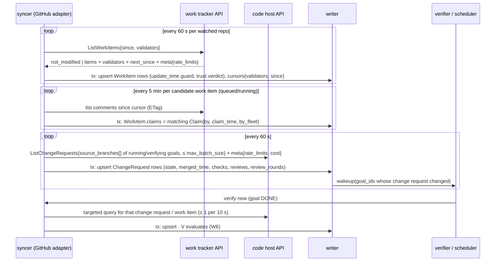
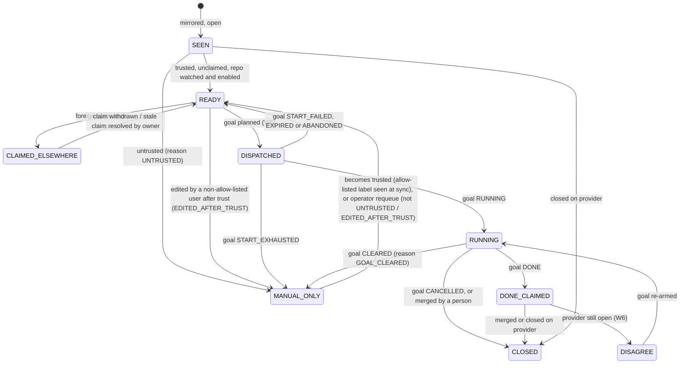

# 03m. Work-source and code-host sync

- Part of: [03-workflows.md](03-workflows.md) (conventions apply)

## W4. Work-source and code-host sync

**Trigger.** Timers per resource (defaults below), a verifier request for one
change request or work item (goal said `DONE`, W6), a dispatch about to happen
(claim re-check, W5), and later webhooks for providers that offer them.

**Actors.** The hub's syncer goroutine(s) (one per integration), the work
tracker adapter, the code host adapter, writer, scheduler, verifier.

**Two roles, one mirror.** An *integration* is configured as a work tracker,
a code host, or both. The hub stores mirrors in the shapes of
`integration/v1/model.proto`: `WorkItem{ref WorkItemRef, state, title, author,
labels[] Label{name, applied_by, applied_time}, claims[] Claim, last_editor,
last_edit_time, create_time, update_time}` plus the hub's own `trust`
(`TrustVerdict`), and `ChangeRequest{ref, repo RepoRef, source_branch (the head
ref), head_commit (the head sha), head_repo, state, merged_time, merged_by,
merge_state, review_decision, checks CheckSummary{counts, rollup}, reviews[]
Review, linked_work_items[] WorkItemRef, review_rounds}`. `IntegrationCapabilities{sync_modes,
claim_mechanisms, labels, labels_with_actor, edit_evidence, merge_detection,
max_batch_size, path_exists, ...}` tells the syncer which loop to run. The
calls, cursors, rate limits, typed errors and the trusted-issues gate are in
[03j](03j-provider-sync-and-trust.md); the hub owns all polling state.

**GitHub adapter (first).** Credential: a GitHub App installation token (ADR
0005), refreshed before expiry; the App is the only access in v1, with no
fine-grained token fallback (decision 15 of ADR 0024). Work items: REST
`GET /repos/{owner}/{repo}/issues?state=open&since=…&per_page=100` with
`If-None-Match`. Claims: issue comments matching a configurable pattern
(default: the eshu-issue-driver claim comment), with `by_this_fleet = author ∈
{ForgeCliStatus.user of every machine}`. Trusted gate: the adapter
returns evidence (`author`, `Label.applied_by` from the `LABELED_EVENT` timeline
for the trusted label, `last_editor`); the hub applies the allow-list
([03j](03j-provider-sync-and-trust.md#the-trusted-issues-gate)).
Change requests: GraphQL `repository.pullRequests(headRefName:)` using the
branch the agent reports in `BranchState.branch`, so the link needs no naming
convention; `closingIssuesReferences` and "Fixes #n" in the body add
`linked_work_items[]`. Merge detection: `merged`/`mergedAt`. Review rounds:
count of `CHANGES_REQUESTED` reviews each followed by a new commit; it never
resets, and failed CI is not a round (the review-loop cap compares it with a
stored baseline, 03c). The rollup and `reviewDecision` surface as
`checks.rollup` and `review_decision`. Rate limits: the adapter reads `x-ratelimit-*` and
GraphQL `rateLimit` into `meta.rate_limits`; the hub applies the rules in
[03j](03j-provider-sync-and-trust.md#rate-limits) (remaining < 10 % →
intervals × 4; 0 → sleep to `reset_time`; 403/429 with `Retry-After` is a
`RATE_LIMITED` error with `retry_after`). ADR 0005's note stands: confirm
the current installation-token limits and whether 304s are free: 04 Q8 found
5,000 requests an hour per installation and free 304s, so conditional requests
are the rule.

**What differs for other providers.**

| Concern | GitHub | GitLab | Jira (tracker only) |
|---|---|---|---|
| Push vs poll | Poll (webhooks need a public URL; optional via tunnel) | Webhooks per project/group are common on self-hosted; poll fallback | Jira Cloud webhooks; Server/DC poll |
| Conditional requests | ETag / 304 | ETag on some endpoints; `updated_after_time` filter | `updated >= …` JQL; no ETag |
| Batch query (`max_batch_size`) | GraphQL, one call for 50 change requests | GraphQL (less coverage; REST per MR for pipelines) | REST search, 50–100 per page |
| Repo identity | `RepoRef{host="github.com", path="owner/repo"}` | nested: `RepoRef{host, path="group/sub/repo"}` | none; code lives on a separate code host |
| Change request ref | `WorkItemRef{kind=CHANGE_REQUEST, key="7412"}` | `key="!12"` (iid), project path | n/a |
| Claim mechanism | comment pattern | comment pattern or assignee | assignee or a transition to "In Progress" by the fleet's user |
| Trusted gate | author allow-list, `agent-ready` label `applied_by` | same with labels / "ready" label events | label or status transition by an allow-listed user (`Label.applied_by`) |
| Linked ticket | `closingIssuesReferences`, "Fixes #n" | "Closes #n" in MR description, branch `n-…` | ticket key in branch or MR/PR title (`PROJ-123`); the code host adapter extracts it |
| Merge detection | `merged`, `mergedAt` | MR `state=merged`, `merged_time` | from the paired code host |

A tracker-only integration (Jira) must be paired with a code host; a goal's
`GoalSpec.work_item` and `GoalSpec.repo` are separate fields for that reason.

### State machine (work item stage, owned by the hub)

What each goal end does to the stage, with the reasons, is the table in
[03h](03h-goal-phases-in-depth.md#work-item-stage-after-a-goal-ends); a cleared
item is not redispatched behind a person's back. A repo that is not `enabled`
(`Repo.spec`) keeps its items `SEEN`.

### Persistence

| What | Where | Transaction |
|---|---|---|
| `work_items` mirror (per `WorkItemRef`), `change_requests` mirror, `claims` | hub store | one tx per API response page, outside any network wait |
| `sync_cursors{integration, resource, page, etag, last_modified_time, since, last_ok_time}` | hub store | same tx as the page it covers |
| `rate_limit_state{integration, kind, limit, remaining, reset_time}`, `backoff_until_time` | hub store (also in memory) | per response |
| Nothing on agents; nothing written to the provider (ADR 0005: read-only; a claim comment is posted by the harness through `gh`, as part of the goal text) | — | — |

### Ordering and consistency

- Per resource, pages apply in order; an `update_time` older than the stored
  row is ignored (late poll result after a targeted verify).
- The scheduler reads mirrors only; freshness is bounded by the interval and
  shown as `fleet_hub_sync_lag_seconds`. Auto-dispatch pauses when the lag for
  the work item's integration exceeds `max_sync_lag` (default 10 min) because
  claims may be stale; manual dispatch is allowed with a warning.
- Claim race: our goal's driver posts its claim after dispatch. If a foreign
  claim with an earlier timestamp appears, the hub cannot know who was first
  from the provider's clock alone; it raises triage `double_claim` and does
  not auto-act.

### Failure modes

Provider failures arrive as a `ProviderError` kind (03j has the mapping to RPC codes, `retryable` and health).

| Failure | What happens |
|---|---|
| Provider 5xx / network down (`UNAVAILABLE`) | Exponential backoff per integration (max 5 min); `BACKING_OFF`; lag rises; dispatch pauses at `max_sync_lag`; verification waits (W6) |
| Primary rate limit exhausted (`RATE_LIMITED`) | Sleep until `reset_time`; `fleet_hub_rate_limited_total`; lag rises; nothing else |
| Secondary / abuse limit (`RATE_LIMITED`, kind `SECONDARY`, `retry_after`) | Honour `retry_after`, then halve request concurrency for 1 h |
| Token refresh fails (`UNAUTHENTICATED`) / App uninstalled / repo removed (`NOT_FOUND`, `FORBIDDEN`) | Triage `integration_access_lost{integration, project}` fingerprinted; integration `DEGRADED` with `health_reason` `CREDENTIALS_INVALID` or `ACCESS_LOST`; dispatch for its repos stops |
| Hub restart | Cursors and ETags are durable; first pass after start is a normal poll |
| Validators reused after provider change (false `not_modified`) | Not observed; a periodic full poll (every 30 min) without validators bounds it |
| Claim comment pattern changes | Claims stop parsing → everything looks unclaimed → the pre-dispatch targeted re-check still fails to see it; mitigation: `claims_seen_total` drops to 0 for a repo with running goals → warning |
| Change request not found by head ref (driver used another branch) | Goal `VERIFYING` cannot resolve; falls back to `ListChangeRequests{linked_work_item}` (change requests that close or reference the goal's item); else `DONE` disagreement (W6) |
| Webhook delivery lost (providers with webhooks) | Webhooks only shorten latency; the poll loop stays on at a longer interval as the backstop |
| Provider clock skew on claim timestamps | Only ordering between claims matters; treated as untrusted; `double_claim` goes to a person |

### Telemetry

- `fleet_hub_sync_requests_total{integration, resource, status}`,
  `fleet_hub_sync_rate_remaining{integration, kind}`, `fleet_hub_sync_lag_seconds{integration, resource}`,
  `fleet_hub_sync_poll_seconds{integration, resource}`, `fleet_hub_sync_not_modified_ratio{integration}`,
  `fleet_hub_rate_limited_total{integration, kind}`, `fleet_hub_work_items{integration, stage}`,
  `fleet_hub_change_requests{integration, state}`, `fleet_hub_claims_seen_total{integration, by_this_fleet}`,
  `fleet_hub_integration_state{integration, state}`.
- Spans: `hub.sync.work_items{integration, repo}`, `hub.sync.claims`,
  `hub.sync.change_requests` (attribute `batch_size`, `cost`),
  `hub.sync.verify_one{goal_id}`.
- Logs: `sync.rate_limited{integration, remaining, resets_time}`,
  `sync.access_lost{integration, repo, status}`, `sync.double_claim{work_item,
  ours_time, theirs_time, theirs_author}`, `sync.cursor_reset{resource}`.

At 3 AM: "why is the queue empty / dispatch paused?" → `fleet_hub_sync_lag_seconds`
and `fleet_hub_integration_state`; "why is this goal stuck in verifying?" →
`hub.sync.verify_one` spans for the goal and `change_requests` state.
