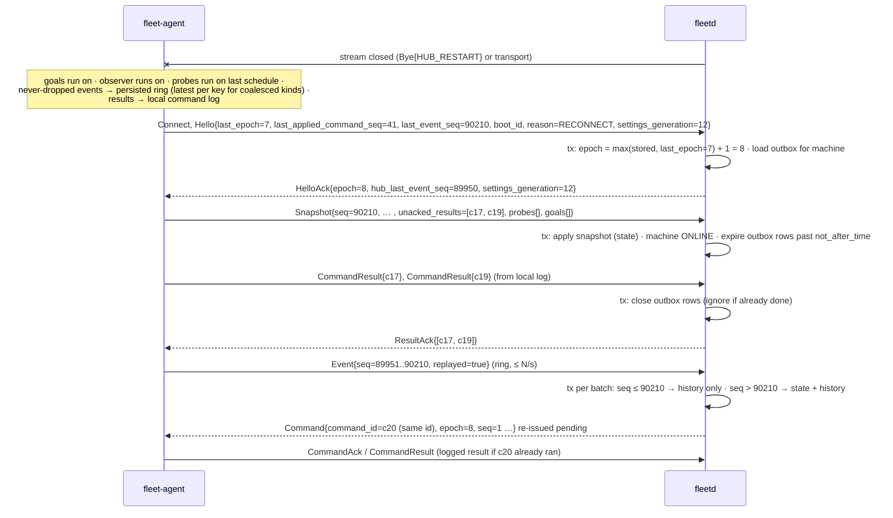
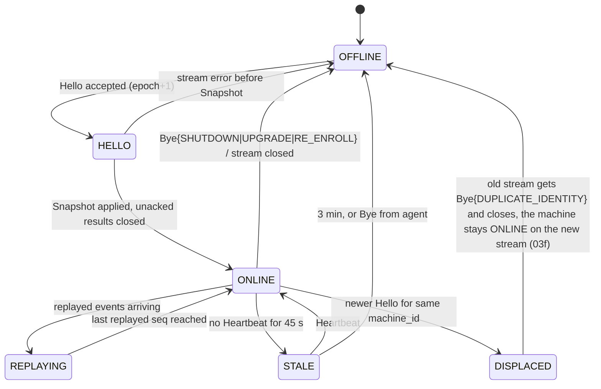

# 03n. Reconnect after hub restart or hours offline

- Part of: [03-workflows.md](03-workflows.md) (conventions apply; W1 is the first connect)

## W2. Reconnect after hub restart or hours offline

**Trigger.** Stream closes (hub restart, hub asleep, network change, agent
wake); the agent reconnects with backoff, and after a short random delay on
wake/network change (A6, A2). Also: a second connection for the same
`machine_id` (duplicate identity).

**Actors.** `fleet-agent` (ring, command log, probes keep running), `fleetd`
gateway/writer/scheduler, tmux (goals keep running untouched).

**Epoch bump.** Every new stream gets `max(stored epoch, Hello.last_epoch) + 1`,
so a hub restored from a backup never reissues an epoch the agent already used
(02i, "Connection epoch"). Commands from the old epoch
still in flight on the agent are finished normally (the agent already
persisted them); any that arrive late are refused `EPOCH_MISMATCH`, but the
known-`command_id` check comes first, so a re-issued command with the same id
returns the logged result rather than tripping the seq check.

**Replay rules.** The ring holds only never-dropped and coalesced kinds (02i),
persisted, 1 week, size-capped (latest state per key wins). The agent replays
everything with `seq > HelloAck.hub_last_event_seq` at a bounded rate (200 events/s per
agent, 2,500 events/s per hub: 04 Q7). The hub writes
replayed events with `seq ≤ Snapshot.seq` to the event history only (timeline,
run history) and runs **no rule** on them: the snapshot already holds their
effect, which is why it carries prompts, conditions, input time and the goal
registry. Events with `seq > Snapshot.seq` apply to live state as well. The
agent keeps `seq` monotonic: a persisted high-water mark across crashes, and a
floor of `HelloAck.hub_last_event_seq + 1` after a wipe or a restore. Gaps in
`seq` are normal (shed and coalesced events consume numbers); the hub reads
loss from `Hello.event_counters` and `Heartbeat.events` (`evicted_total`), not
from missing numbers, and answers a rise with `SnapshotRequest{reason="event_lost"}`
and a gap marker on the timeline (02i, "Gaps").

**Duplicate identity.** A second `Hello` for a `machine_id` with a live stream:
newest wins, silently. The hub sends `Bye{DUPLICATE_IDENTITY}` on the old stream
(if it can still be written to) and bumps the epoch. A sleeping laptop or a
restarted agent leaves a half-open, silent old stream, so a benign reconnect
raises nothing. A triage warning, fingerprinted on the pair of `boot_id`s, is
raised only when the displaced stream had a heartbeat within 45 s and the two
`boot_id`s then displace each other again within 10 minutes (two hosts with one
copied state dir ping-pong; a restart does not). It is re-raised at most once
per hour and auto-dispatch to that machine is suspended until the owner
resolves it.

### State machine (hub-side connection for one machine)

Hub start: before the agent listener serves (so no `Hello` races it), every
`ONLINE` machine is set to `STALE` and its silence is counted from the hub's
start, so the usual 3-minute rule turns silent ones `OFFLINE`; nothing is
scheduled on a machine until it is `ONLINE` again. The same pass closes every
`machine_connections` row left live (no stream of the new process holds it) as
`hub_restart`. A `STALE` from this pass ends with the `Snapshot` of a new
connection; a Heartbeat brings a machine back from `STALE` only on the stream
that was live when silence made it `STALE`.

How the hub judges silence (plan row 5b): a housekeeping job every 5 s
([defaults](defaults.md)) takes the newest of the hub's start, the `Snapshot` of
the live connection's epoch (until plan row 5c lands it, the live row's `Hello`)
and the live stream's last `Heartbeat` (hub clock). 45 s makes an
`ONLINE` machine `STALE`; 3 minutes makes it `OFFLINE`, closes its live row as
`offline` and cuts the stream. While `STALE`, a stream whose reader has been
blocked for 45 s handing a message to its full ingest queue is cut too
(`ingest_stalled`), and that close takes the machine `OFFLINE`; a reader
waiting for the agent's next message is never cut. A cut sends no `Bye`: the
hub's handler returns and the stream ends with an OK status; the agent sees the
stream end, backs off and reconnects. Every change is one writer
job that holds only while the state and the live epoch are what the job read,
stamped for Watch; no audit row (02m has no state-change action). The live
row's close by the stream or the agent's `Bye` takes an `ONLINE` or `STALE`
machine `OFFLINE` in the same job; a displaced stream's close, the hub's own
shutdown (`hub_restart`) and a machine that never got `ONLINE` change nothing.
`last_seen_time` is written by the `Hello`, by each close and at most once a
minute from Heartbeats. On graceful shutdown the hub sends
`Bye{HUB_RESTART}` so agents reconnect quickly with backoff rather than
waiting for keepalive timeouts.

### Persistence

| What | Where | Transaction |
|---|---|---|
| Event ring (`seq`, body, 1 week or 64 MiB, [defaults](defaults.md)) | `agent.db` | per event, fsync batched ≤ 1 s |
| `seq_hwm` (reserved in blocks of 1024), `EventCounters`, `install_id`, `last_epoch`, `last_applied_command_seq` | `agent.db` | one fsync per block; counters with it; the epoch and command marks never step back |
| Command log (last 10,000 or 7 days; status, result, step reached) | `agent.db` | per state change, before `CommandAck` is sent |
| Probe assignments (`EnsureProbe` as received) | `agent.db` | with the command log |
| Goal registry (`GoalRegistration` per pane) and availability marks (per pane key) | `agent.db` | `register_goal`, `RegisterGoal`, `ReleaseGoal`, mark commands; both reported in every snapshot (02h) |
| Outbox rows (`pending/delivered/done/expired/failed`, epoch, seq) | hub store | Hello tx (expiry), result tx (close) |
| Event history (replayed and live, 1 week) | hub store | per writer batch |
| `machine_connections` (epoch, boot_id, install_id, peer, connect_reason, started and ended time, end_reason, displaced_by, last_heartbeat_age_ms at displacement) and the machine's `last_epoch` | hub store | Hello tx (opens the row, closes the one it displaces); stream close or `Bye` (closes it, and marks the machine `OFFLINE` in the same tx); housekeeping's `OFFLINE` (closes it as `offline`). A row can stay open with no stream behind it after a hub crash, or after a graceful shutdown that stopped waiting for a Hello whose transaction then committed; the hub-start sweep closes such rows as `hub_restart` |
| Per machine: `hub_last_event_seq`, `event_generation`, last `EventCounters`, `install_id` | hub store | writer batch (seq); Hello tx (the rest) |

### Ordering and consistency

- Per machine: Snapshot first, then unacked results, then replayed events in
  `seq` order, then live events. The agent enforces this order on its side;
  the hub discards anything out of order and asks for a snapshot.
- Results for commands the hub already closed are ignored (idempotent by
  `command_id`); results for commands the hub never issued (DB restored from an
  older backup) go to the audit log and a triage info item.
- Re-issued commands keep their `command_id`; the agent's log answers them.
- A `StartGoal` that expired during the outage is `EXPIRED` on the hub, but if
  `Snapshot.goal_registry` binds that goal to a pane, the goal is adopted as
  `RUNNING` (W5) rather than re-planned.

### Failure modes

| Failure | What happens |
|---|---|
| Agent offline for hours | Goals run on; ring fills (latest per key); on reconnect snapshot gives truth, ring gives timeline; ring overflow shows as a rise of `evicted_total` and a `gap` on the timeline |
| Agent crashed, or its state directory was wiped or a VM image reverted | `seq` resumes above `seq_hwm` after a crash; after a wipe `Hello.last_event_seq` is below the hub's, the hub records an agent rollback (new `event_generation`, timeline marker, audit row) and the agent floors `seq` above `hub_last_event_seq`, so nothing is dropped as a duplicate |
| Hub restart mid-snapshot apply | Stream drops; the partial tx rolls back; the agent reconnects and sends a fresh snapshot |
| Hub store restored from backup | Epoch rises above the agent's `last_epoch` (no `SEQ_REPLAYED`); `hub_last_event_seq` is lower, so the agent replays its ring and the snapshot covers the rest; registry entries for unknown goals → `orphan_goal_pane` triage; unknown results → audit only; settings generation on the agent may be newer than the hub's → hub re-sends its current generation and the agent applies it (settings are ordered by `(settings_epoch, generation)`, and a different epoch is accepted whatever its generation; 02, "Settings order") |
| Duplicate `command_id` re-issued | Logged result returned, nothing re-executed |
| Deadline expired while offline | Hub marks `EXPIRED` without sending; UI shows "not delivered, machine was offline"; dispatch re-plans (W5), prompt answers are dropped (W7) |
| Harness crashed while offline | `PaneExited{goal_id}` is in the ring (never dropped); replayed as history only; the snapshot already shows the pane dead, and W6 evaluates the one-nudge rule once from the snapshot, keyed on its fingerprint |
| Provider error while offline | `HarnessCondition` with `cleared` pairs replay into history; current conditions come from the snapshot (requires `Snapshot.conditions[]`, 03g) |
| Prompt appeared and vanished while offline | `PromptDetected` + `PromptGone` replay into history only (nobody can still answer it, so no triage item); a prompt still showing comes from `Snapshot.prompts[]` (03g) |
| Developer typed in a goal pane while offline | `PaneInput` in the ring (coalesced, latest time) and `TmuxPane.last_input_time` in the snapshot; W6's "human at keyboard" suppression is derived from the snapshot's `last_input_time` (the replayed `PaneInput` is history only) |
| Work tracker / code host unavailable at reconnect | W4 lag rises; verification waits; dispatch stays paused while lag exceeds its threshold |
| Flapping network (reconnect every few seconds) | Each reconnect costs a snapshot; the agent rate-limits reconnects to one per 5 s and the hub to one Hello per machine per 5 s (`RESOURCE_EXHAUSTED` / `RATE_LIMITED` with `retry_after`; 02g "Hello refusals"); `fleet_hub_reconnects_total` shows it |
| Ring replay floods the hub after a long outage | Replay is rate-limited per agent; the writer batches; HTTP/2 flow control blocks the agent, never the hub's other machines (per-stream windows) |

### Telemetry

- `fleet_agent_ring_events`, `fleet_agent_ring_bytes`, `fleet_agent_ring_dropped_total`,
  `fleet_agent_replayed_events_total`, `fleet_agent_unacked_results`,
  `fleet_agent_events_shed_total`, `fleet_agent_events_coalesced_total`, `fleet_agent_events_evicted_total`,
  `fleet_agent_reconnects_total{reason=reconnect|wake|network_change}` (each
  stream connected with that `Hello.reason`).
- `fleet_hub_reconnects_total{machine, reason}` (every accepted `Hello`, by
  `Hello.reason`: `start`, `reconnect`, `wake`, `network_change`,
  `unspecified`), `fleet_hub_epoch{machine}` (the epoch of the last accepted
  `Hello`),
  `fleet_hub_commands_expired_total{kind}`, `fleet_hub_duplicate_identity_total{machine}`,
  `fleet_hub_event_gap_total{machine}` (rises of `evicted_total`), `fleet_hub_agent_rollback_total{machine}`, `fleet_hub_replay_backlog_events{machine}`,
  `fleet_hub_results_unknown_command_total`.
- Spans: `hub.reconnect` (children `hub.snapshot.apply`, `hub.outbox.reconcile`,
  `hub.replay.ingest`); `agent.reconnect` (children `agent.ring.replay`) comes
  with the event ring, in the rows that emit events. Until then the agent's
  side of a reconnect is W1's `agent.connect.hello` span and `connect.hello`.
- Logs (the hub's, plan row 5): `reconnect.hello{machine_id, epoch, last_epoch, last_event_seq,
  hub_last_event_seq, reason, peer}`, `reconnect.closed{machine_id, epoch, reason, row_closed}`
  (a stream ended; `reason` is the stored end reason: `displaced`, `stream_closed`,
  `agent_bye`, `hub_restart`, `offline`, `ingest_stalled`; `row_closed` false when a
  newer `Hello` or housekeeping's `OFFLINE` had closed it;
  a stream with a certificate that ended before a `Hello` was accepted has `epoch` 0,
  `reason` `before_hello` and `err_kind`: `oversize`, `reset`, `timeout`, `shutdown`,
  counted in 03's `fleet_hub_connect_closed_before_hello_total`),
  `outbox.expired{command_id, kind, age}`, `identity.duplicate{machine_id, old_epoch, new_epoch,
  old_boot_id, new_boot_id, old_peer, new_peer, heartbeat_age_ms}` (a live stream got
  `Bye{DUPLICATE_IDENTITY}`; -1 when it had no Heartbeat; a row a hub crash or a shutdown that cancelled a waiting Hello left live is
  displaced silently), `replay.gap{from_seq, to_seq}`. The span `hub.connect.hello` covers
  a `Hello` from receipt to the queued `HelloAck` or the refusal (a root span: `Hello`
  carries no trace context).

- Machine state (plan row 5b): `machine.state_changed{machine_id, from, to, reason}`
  (info; every committed change of `machines.state`: `reason` is `silence`
  (housekeeping: 45 s to `STALE`, 3 minutes to `OFFLINE`), `heartbeat` (`STALE` back to
  `ONLINE`), `hub_start` (the start sweep), or the end reason of the live row's close:
  `stream_closed`, `agent_bye`, `ingest_stalled`, `offline`); 05b's `hub.stream_closed{machine_id,
  epoch, reason, stalled_s, queue_depth}` (warn) and `fleet_hub_stream_closed_total{reason}`
  (`ingest_stalled`, `offline`) for a stream housekeeping cut; 03's
  `fleet_hub_machine_state{machine, state}` (set at every change and every housekeeping
  pass) and `fleet_hub_clock_skew_seconds{machine}` (the median of the last five
  `Hello.sent_time` and `Heartbeat.sent_time` samples, 02i "Clocks"; the warning and
  `clock_untrusted` come with plan row 5e). A Heartbeat's store job that fails logs
  `connect.failed{step="heartbeat"}`.
- The hub's `Connect` before `HelloAck` (plan row 5a-ii; the names are 03 W1's):
  `fleet_hub_connect_refused_total{cause}` and `connect.refused{cause, reason, peer,
  machine_id}` (warn) for a refused `Hello` (02g "Hello refusals"; `cause`:
  `no_client_cert`, `cert_no_san`, `hello_timeout`, `not_hello`, `second_hello`,
  `machine_id_mismatch`, `field_invalid`, `serial_other_machine`, `epoch_out_of_range`,
  `rate_limited`, `revoked`, `unknown_machine`, `proto_unsupported`; `reason` the
  ErrorDetail reason without `REASON_CODE_`, the `ByeReason`, or `none`);
  `connect.failed{step, err_kind, machine_id}` (error; `step`: `validate`, `store`,
  `wiring`: the listener put no response controller on the request, `INTERNAL`;
  `heartbeat`: a Heartbeat's last_seen or `STALE` to `ONLINE` job failed);
  `fleet_hub_connect_closed_before_hello_total{err_kind}` (a stream with a client
  certificate that ended before a `Hello` was accepted: `oversize`, `reset`, `timeout`
  (the Hello wait), `shutdown`; also `reconnect.closed` above);
  `fleet_hub_connect_unhandled_total{kind}` (a message whose arm has no handler yet, by
  oneof arm name; ignored, never fatal; 05b's `hub.connect.unhandled` once per kind per
  stream).

At 3 AM: "why is machine X offline, since when?" → `machine.state_changed` (its
`reason`), `fleet_hub_machine_state`, and `hub.stream_closed` when the hub cut the
stream. "why does machine X keep reconnecting?" → `fleet_hub_reconnects_total`
and `fleet_hub_epoch` climbing, `reconnect.closed{reason}` for how each stream
ended, `identity.duplicate` (two hosts with one identity ping-pong) and
`connect.refused{cause}` (03 W1). "did the hub lose anything during the restart?" →
`fleet_hub_event_gap_total` and `replay.gap` logs; "why is this goal shown
twice / missing?" → `snapshot.applied{diff}` and `orphan_goal_pane` items.
