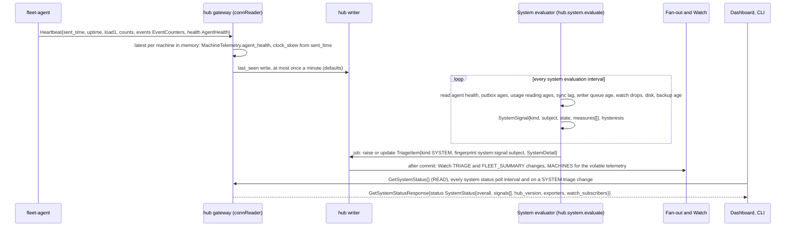

# 05b. Observability: fleetd and fleet-agent watching themselves

- Status: Accepted; contracts unfrozen until v0.1 (ADR 0019)
- Date: 2026-10-02
- Part of: [README](README.md), step 5; companion of [05-insights.md](05-insights.md)
- Output: `api/fleet/hub/v1/system.proto` (`GetSystemStatus`,
  `TRIAGE_KIND_SYSTEM`), `agent/v1/agent.proto` (`AgentHealth` in
  `Heartbeat`), `hub/v1/machine.proto` (`MachineAgentHealth`)
- Decision: [ADR 0021](../adr/0021-insights-and-observability.md); libraries
  in [ADR 0020](../adr/0020-dependencies.md)
- Builds on: the Telemetry list of every workflow in
  [03](03-workflows.md) to [03j](03j-provider-sync-and-trust.md),
  [02g](02g-agent-security.md#trace-context-on-the-wire) (trace context),
  [02i](02i-delivery-and-sequencing.md) (counters, clocks)

The product's job is to run unattended on someone's own machines. Its own
health therefore has to be visible without installing anything else, and
visible with a collector for the owner who has one. Three rules:

1. **Works with nothing.** Logs go to stderr, metrics are served on `/metrics`,
   the System section and the triage feed show the hub's own state. No
   collector, Prometheus or Grafana is required, and none is assumed.
2. **Collector optional.** OTLP export of traces and metrics is off by
   default and is configured on the hub or agent host only.
3. **Telemetry never costs correctness.** Metrics, spans and logs use bounded
   queues and drop when full (counted); they never block the single writer,
   the scheduler or a command. An exporter failure is a counter and a log
   line, never an outage.

## 1. Signals

| Signal | Library (ADR 0020) | Where it goes by default | Optional |
|---|---|---|---|
| Logs | stdlib `log/slog`, JSON | stderr (the supervisor, launchd or systemd, keeps it) | OTLP logs through the OTel slog bridge (v0, off) |
| Metrics | OpenTelemetry Go SDK, Prometheus exporter | the hub's `/metrics` | OTLP metrics to a collector |
| Traces | OpenTelemetry Go SDK | trace ids in logs and on the wire; no exporter | OTLP traces to a collector |

**Resource attributes** on every signal: `service.name` (`fleetd` or
`fleet-agent`), `service.version`, `service.instance.id` (the hub's
`hub_instance_id`, the agent's `boot_id`), and for agents `machine_id`. The
hub's `fleet_id` is not an attribute (it is pseudonymous but not needed).

**Never in telemetry** (fleet-telemetry-coverage, fleet-security): credentials,
tokens, harness auth data, raw pane or screen text, goal text, issue bodies,
prompt text, file paths from the owner's machine, emails. Attributes and labels
are ids, enums, counts and result classes. Redaction happens before the signal
is created, never in an exporter.

## 2. Logs

One JSON object per line. `msg` is the event name `<area>.<event>` (03:
`enroll.completed`, `snapshot.applied`, `dispatch.planned`); the fixed fields
are:

| Field | Meaning |
|---|---|
| `time`, `level` | RFC 3339 UTC; `debug`, `info`, `warn`, `error` |
| `msg` | the event name |
| `component` | `scheduler`, `writer`, `verifier`, `syncer`, `logwriter`, `watch`, `api`, `agent.conn`, ... |
| `machine_id`, `goal_id`, `command_id`, `epoch`, `seq` | wherever they apply |
| `trace_id`, `span_id` | when a span is active, so a log line finds its trace without a collector |
| `err_kind` | a closed class (`timeout`, `refused`, `constraint`, `io`, `parse`); never an error string that could echo user text |

The harness version check has its own failure kinds (`not_on_path`,
`empty_version_output`, `invalid_version_output`; 01 C1). They are local
only: the agent logs them and counts them as a failed `Detect()` (03e W11).
They are not `err_kind` values and add no value to the wire. The tmux
control-mode parser (`internal/agent/tmux`) also has its own closed set, the
`err_kind` of `tmux.parse_error`: `partial_line`, `stray_line`, `bad_guard`,
`unmatched_guard`, `bad_notification`, `bad_escape`, `truncated_reply`,
`reply_too_large`. It is local too and never reaches the wire.

Levels: `error` is a fault the owner or developer must look at; `warn` is a
degraded but handled state; `info` is a state change worth keeping; `debug`
(off by default, runtime switch on the local admin socket) is per-message.
Per-heartbeat and per-summary events are never logged above `debug`. The hub
does not rotate logs; the agent, which launchd leaves with a bare stderr,
writes `agent.log` in its state directory, size-rotated (10 MiB, 3 files).
A line that would need user text (a prompt, a screen, a goal line) is a line
that carries only the id and the length instead.

The workflow events are in each workflow's Telemetry section (03 to 03j); the
failure events are in section 10. The platform's own lifecycle events:

| Event | Level, fields | When |
|---|---|---|
| `backup.completed` | info; `trigger` (`nightly`, `manual`), `bytes`, `encrypted` | the nightly job in `fleetd run` or `fleetd backup` published a copy of `state.db` in `backups/` ([02j](02j-hub-runtime.md#state-directory)) |
| `backup.failed` | error; `trigger`, `step` (`passphrase`, `source`, `dir`, `copy`, `verify`, `encrypt`, `publish`, `cleanup`, `prune`), `err_kind` | a backup failed. Before the link that publishes the copy, nothing was published and the backup removed its temporary files on the way out. `publish` after the link means the stat or the folder sync failed: the copy exists but may not survive a power loss, and `fleetd backup` still prints its path. `cleanup` and `prune` come after the copy was published: `cleanup`, a temporary file could not be removed (the copy stands, and `fleetd backup` still prints its path); `prune`, old nightly copies could not be removed. A backup killed mid-copy leaves its temporary files until the next `fleetd init` or `run` removes them, once more than an hour old (`hub.leftovers_removed`). `err_kind` is `refused`, `timeout` or `io`. Never a path, the passphrase or file contents |
| `backup.stamp_ahead` | warn; `files`, `ahead_seconds` | the nightly job found backups stamped more than 10 minutes past the hub clock (the clock was wrong when they were made); they do not count as the newest copy for the schedule or `fleet_hub_backup_age_seconds`. Logged once each time the newest such stamp changes; `ahead_seconds` is how far ahead it is |
| `command.intake_full` | warn; `kind` (`command`, `settings`), `command_id` (a command's, when it is printable) | the connection loop handed a hub `Command` or `Settings` to its receiver and the receiver's bounded intake was full: the message is dropped unlogged and unacked, so the hub's at-least-once re-send covers it ([03 W1](03-workflows.md#w1-enrollment-and-first-connect)). Counted in `fleet_agent_command_intake_dropped_total`. Never the message body |
| `command.result_unreadable` | warn; `command_id` (when printable), `err_kind` (`parse`) | a `CommandResult` was offered to the connection loop but the copy logged in `agent.db` for that command cannot be decoded, so it is refused and not sent ([03n](03n-reconnect.md#commands-settings-and-the-outbound-queue)). Never the result bytes |
| `command.received` | info; `command_id`, `kind`, `epoch`, `seq` | the executor took a command from the hub off its intake, before any check ([02](02-contracts.md#delivery-semantics) "Envelope checks"). `kind` is the `Command.kind` message name, or `unknown` for an empty or newer arm. Never the command body |
| `command.refused` | info; `command_id`, `kind`, `status`, `reason` | the executor's own checks answered a command and no handler ran: `EXPIRED`, `FAILED`/`EPOCH_MISMATCH` and `REJECTED_BY_POLICY`/`SEQ_REPLAYED` (both unlogged and unacked), `UNSUPPORTED`, `REJECTED_BY_POLICY` with `POLICY_SAFE_MODE`, `RATE_LIMITED`, `ROLE_INSUFFICIENT`, `LOCAL_DENIED` or `LOCAL_CONFIRM_TIMEOUT`, and `UNKNOWN_OUTCOME` for a logged command that cannot be read back (reason `UNSPECIFIED`). Counted in `fleet_agent_commands_refused_total` and in the executor's refused count (for `AgentHealth.commands_refused_total`, wired in plan row 6i); each `REJECTED_BY_POLICY` is also a `command.refused` row in `audit.log` (02g) |
| `command.finished` | info; `command_id`, `kind`, `status`, `reason`, `elapsed_ms` | a handler's result, or `UNKNOWN_OUTCOME` for a command that was running when the agent stopped or when a store write failed (the resume pass took it up at a connect) and is not repeat safe, was logged and queued |
| `command.resumed` | info; `command_id`, `kind`, `class` (`repeat_safe`, `not_repeat_safe`, `per_step`) | at a connect, once the stream's snapshot was out, the executor took up a command that was running and that no goroutine held: one a restart or a failed store write left behind ([02i](02i-delivery-and-sequencing.md#what-agentdb-keeps) `command_log`) |
| `command.dropped` | warn; `reason` (`invalid_command_id`), `kind` | a command whose `command_id` is empty, over 128 bytes or not printable cannot be logged or answered; it is dropped. A steady rise is a hub bug |
| `command.store_failed` | warn; `step` (`read`, `encode`, `decode`, `log`, `running`, `result`, `open`, `window`), `err_kind` (`store`, `canceled`), `command_id` (when printable) | an `agent.db` read or write of the command log failed; the command stays as the log left it and an unlogged one is re-sent by the hub at its next connect, a logged one with no result is taken up by the resume pass at the next connect. Counted in `fleet_agent_command_store_failed_total{step}` |
| `command.send_failed` | warn; `err_kind` (`not_logged`, `queue_full`, `other`), `kind`, `command_id` (when printable) | the connection loop refused an ack, progress or result for a reason other than "no stream" (which is normal: the result is re-sent after the next snapshot) |
| `command.text_emptied` | warn; `field` (`result_message`, `progress_message`), `kind`, `bytes` (the length before the cut), `command_id` (when printable) | a handler's message was longer than 8 KiB with no line end in its first 8 KiB, so the line pre-cut ([02e](02e-contract-rules.md) size limits) left it empty rather than risk a secret's head; the command's own result is unchanged. Counted in `fleet_agent_text_scrub_total{result="pre_cut"}`. Logged per attempt, like the counter. Never the text |
| `hub.leftovers_removed` | info; `command`, `files` | `fleetd init`, `run` or `restore` removed a crashed init's or restore's temporary files (`.state.db.init-*`, `.state.db.restore-*`), or a crashed backup's (`.backup-plain-*`, `backups/.partial-*`) more than an hour old |
| `hub.connect.unhandled` | info; `machine_id`, `epoch`, `kind` | the first Connect message of an arm with no handler yet on a stream (`kind` is the oneof arm name, `unknown` for an arm the hub does not know); it is ignored and every one is counted in `fleet_hub_connect_unhandled_total{kind}` (03 W1). At 3 AM: "is the hub dropping what this agent sends?" |
| `restore.completed` | info; `address_added`, `previous_kept`, `reconcile_until` | `fleetd restore` put the backup in place as `state.db` with a new `settings_epoch` and the reconcile window open until `reconcile_until` (RFC 3339); `previous_kept` says the replaced store was kept as `state.db.pre-restore-<stamp>` ([02g](02g-agent-security.md#hub-identity-and-restore)). Answers "did the restore finish, and when does reconcile end?" The restored store also holds its `hub.restore` audit row (who, from which backup and schema version; [02m](02m-hub-api-actions-and-audit.md#audit-actions)) |
| `restore.failed` | error; `step` (`address`, `source`, `copy`, `verify`, `fleet`, `rewrite`, `checkpoint`, `keep`, `swap`, `sync`, `cleanup`), `err_kind` | `fleetd restore` stopped. Up to `rewrite` the current `state.db` and its WAL were not touched (`revoked-serials` may have been rewritten at `rewrite`: it only gains serials or drops expired lines, so it fails closed); `checkpoint` with `err_kind` `refused` means the current store could not be read or checkpointed, or a `state.db-wal` sits there with no `state.db` (move them away and restore again), and with `timeout` that another process (a `fleetd backup`?) has `state.db` open (wait and restore again); after `swap` the new store is in place (`sync`: the folder sync failed; `cleanup`: the temporary file could not be removed). `err_kind` is `refused` (bad address, encrypted, a backup with its own non-empty WAL, corrupt, unknown schema or another fleet's backup), `timeout` (the store is in use) or `io`. Never a path or file contents. Answers "why did my restore not take?" |
| `hub.stream_closed` | warn; `machine_id`, `epoch`, `reason` (`ingest_stalled`, `offline`), `stalled_s`, `queue_depth` | housekeeping cut a Connect stream (no `Bye`: the stream ends with an OK status; [03n](03n-reconnect.md) "Telemetry"; a stream that ended on its own first is not counted): `offline` at 3 minutes of silence, `ingest_stalled` at `STALE` when the stream's reader had been blocked handing a message to its full ingest queue (`queue_depth` messages) for 45 s or more (`stalled_s`). Counted in `fleet_hub_stream_closed_total{reason}`. At 3 AM: "why did the hub drop machine X's stream?" |
| `hub.shutdown_wait_timeout` | warn; `handlers` | the agent listener's stop ran out of its 10 s grace ([defaults](defaults.md) "Stop grace (hub)") with `handlers` handlers still running (a Connect stream's row close stuck on a busy store, [03n](03n-reconnect.md)): the store closes anyway, their rows stay live, and the next start's sweep closes them as `hub_restart`. At 3 AM: "why did this restart take the full 10 s, or leave connection rows open?" |
| `hub.start_sweep` | info; `stale`, `rows_closed` | `fleetd run`, before the agent listener serves, made every `ONLINE` machine `STALE` (each also a `machine.state_changed{reason="hub_start"}`) and closed the connection rows left live as `hub_restart` ([03n](03n-reconnect.md) "Hub start") |
| `hub.housekeeping_failed` | error; `job`, `err_kind` (`io`, `timeout`, `panic`); a panic adds `panic` (the value's type, never the value) and `stack` (at most 4 KiB) | one housekeeping job (`machine_state`, `outbox_expiry`, `outbox_prune`, later the other prune jobs) failed or panicked; the other jobs still ran and the job runs again at its next turn. A job that ends because the hub is stopping is not a failure. Counted in `fleet_hub_housekeeping_failures_total{job}` |
| `hub.initialized` | info; `server_names`, `config_written` | `fleetd init` created the store |
| `hub.listener_opened` | info; `listener`, `port` (the admin socket has none) | `fleetd run` opened a listener |
| `hub.started` | info; `mode`, `listeners` | `fleetd run` is serving |
| `hub.listener_failed` | error; `err_kind` | a listener stopped with an error |
| `hub.revocations_torn_line` | warn | `fleetd run` dropped a last `revoked-serials` line that had no newline |
| `hub.stopped` | info | `fleetd run` shut down |
| `proc.killed` | warn; `caller`, `cause` (`time_cap`, `output_cap`, `cancelled`), `killed` (a group kill signalled a process; `false` for an output cap passed by a child that had already exited), `pid`, `elapsed_ms`, `output_bytes`, `time_cap_ms`, `output_cap_bytes` | `internal/proc` ended a one-shot child: its time cap or output cap passed, or the caller's context ended, while it ran, and its whole process group was killed; or its output passed the cap after it had already exited (nothing to kill). One line per call. Never the program, its arguments, environment or output |
| `proc.pipe_held` | warn; `caller`, `pid`, `elapsed_ms`, `output_bytes` | a one-shot child is gone but a descendant still holds its stdout or stderr after the 2 s `WaitDelay`, so `internal/proc` stopped waiting and returned `ErrHeldPipe`. The descendant is not killed (the child was reaped, so its process group id may be free) and keeps running. Counted in `proc_pipe_held_total` |
| `sample.failed` | warn; `source` (`load`, `mem`, `mem_pressure`, `disk`, `os_version`, `ram`, `timezone`, `binary_hash`, `username`, `tmux`, `rss`), `err_kind` | a reading of the machine's own facts or resources (B1, B2) or of the agent's own resident memory (`AgentHealth.rss_bytes`) failed; the field stays unset in the snapshot, never 0. Logged once at the start of a run of failures of that source (a read of `load`, `mem`, `rss` or a `disk` path that did not return in 10 s is `err_kind` `timeout`, and is not started again while the last one is still out; a `disk` path over the 32-path cap is `constraint`; an `rss` of 0 with no error, which gopsutil returns on macOS when `proc_pidinfo` fails, is `parse`); every failure is counted in `fleet_agent_sample_failures_total`. `tmux` not on PATH is not a failure. Never a path, a user name or the error text |
| `sample.recovered` | info; `source` | the first pass in which that source read without a failure after `sample.failed` |
| `sample.stale` | warn; `reason` (`age`, `boot_clock`) | a Snapshot or Heartbeat found the latest resource sample too old to send, so its resources and `load1` went out unset (the hub shows unknown). `age`: older than three intervals, counting the time the machine slept; `boot_clock`: the clock that counts sleep could not be read (02i "Clocks"), so no age can be vouched for. Logged once at the start of a run of them; every withheld sample is counted in `fleet_agent_sample_stale_total`. It answers "why is this machine's load missing while the agent is connected" when `sample.failed` is silent: a sampler stuck inside a reading shows here |
| `sample.fresh` | info | the first fresh sample after `sample.stale` |
| `typing.refused` | warn; `reason` (`purpose`, `pane`, `empty`, `too_long`, `newline`, `control_char`, `invalid_utf8`, `key`), `purpose` (`prompt_answer`, `goal_nudge`, `goal_resume`, `operator_text`, `probe_command`, `harness_command`, `goal_start`, or `unknown`) | `internal/agent/tmux/typing` refused to build a `send-keys` line, so nothing was typed. One line per refusal. Never the text, never the pane given (it is caller input too). Counted in `typing_refused_total` |
| `typing.sent` | info; `purpose`, `server_kind` (`default`, `fleet`, `probe`), `pane_id`, `bytes` (literal text; 0 for named keys) | tmux took a `typing.Line` the client sent; logged by the package that built the line (control, start or probe), not by the client. One line per line sent. Ids and counts only, never the text |
| `store.opened`, `store.closed` | info; `schema_version` when opened | a database (`state.db`, `logs.db`, `agent.db`) opened or closed |
| `store.migrated` | info; `schema_version` | one migration was applied |
| `audit.write_failed` | warn; `err_kind` (`io`, `constraint`), `suppressed` (failures since the last such line) | the agent could not append an entry to `audit.log` (the file cannot be opened or written, or the entry had a field that is not a closed value). The product goes on and the result is still sent; the hub's permanent audit table is the security record. Logged once a minute at most; every failure is counted in `fleet_agent_audit_write_failures_total{err_kind}`. Never the entry, a path or the error text |
| `store.batch_failed` | error; `jobs`, `err_kind`, `sqlite_code` (SQLite's numeric result code) | a writer batch's transaction failed; never a path or SQL text |
| `tmux.attached` | info; `server_kind` (`default`, `fleet`, `probe`), `version` (the server's `#{version}`), `flags` (`ignore-size,pause-after=1`, the two the client checked in `client_flags`), `session` (`developer`, or `internal` when only sessions the fleet marked internal exist) | the tmux control client attached to a server and every registered subscription was sent: the start of `fleet_agent_tmux_control_up` = 1. 3 AM: "is the agent watching this machine's tmux?" |
| `tmux.exit` | warn (info for `cancelled`); `server_kind`, `reason` (`exit`: tmux wrote `%exit`, the attached session or the server ended; `eof`: the stream ended without one, as when the server is killed; `desync`: a reply came for no command; `attach_failed`: a step before the client came up failed, retried with backoff, with `err_kind` = `version` (`tmux -V` did not run), `list` (`list-sessions` failed for a reason other than no server, such as a permission or protocol error), `start` (the `tmux -C` process did not start), `handshake` (no or a bad answer to the first command) or `subscribe` (tmux refused or did not answer a registered subscription); `write_stalled`: tmux stopped reading its input and a command write passed its bound, so the attach was ended; `write_canceled`: the caller's context ended while its write was blocked, so the attach was ended (a part-written command would desync the stream); `too_old`: tmux before 3.2 or without the flags in `client_flags`, not retried; `absent`: no server on the socket, logged once until a server is found again; `cancelled`: the agent stopped it) | a control client ended or could not attach. 3 AM: "why is `tmux_control_down` above 0?" Never the `%exit` text or tmux's stderr (they can name a session or the socket path) |
| `tmux.session_switched` | info; `server_kind`, `from`, `to` (session ids, never names) | the control client, on an internal session because no developer session existed, moved to the lowest developer session with `switch-client -E` after `%sessions-changed` announced one. 3 AM: "why is the agent attached to the attach-view session?" (no developer session then) |
| `tmux.repick_failed` | warn; `server_kind`, `err_kind` (`list`: the session list through the control client failed or could not be read; `switch`: tmux refused `switch-client`) | a re-pick off an internal session failed (the attach ending is not one: `tmux.exit` says why); the client stays up on the internal session and tries again on the next `%sessions-changed`. At most one line a minute |
| `tmux.subscription_confirmed` | info; `server_kind`, `name` (the client's own subscription name) | the first `%subscription-changed` of a registered subscription on this attach: tmux took it, and 7f's backup `list-clients` poll may stop (02h). 3 AM: "is typing detection on push or on the backup poll?" |
| `tmux.line_too_long` | warn; `bytes`, `limit_bytes`, `suppressed` | a control-mode line passed the parser's line bound (defaults) and was skipped to its newline; outside a reply it is lost, inside one the reply's count of dropped lines rises. At most one line a minute; `suppressed` is how many were not logged since the last. Never a byte of the line |
| `tmux.parse_error` | warn; `err_kind` (the parser's set above), `bytes`, `suppressed` | a control-mode line or reply the parser could not use: a line outside any reply that is not a notification, a guard or notification not in tmux's form, a bad `\ooo` escape, a stream that ended in a line or a reply, or a reply body past its bound. At most one line a minute per `err_kind`. Never a byte of the stream: pane text and reply lines are data |

## 3. Metrics

**Naming** is the existing rule (03, conventions): `fleet_hub_*` and
`fleet_agent_*`, Prometheus style, unit suffix (`_total`, `_seconds`,
`_bytes`), counters end in `_total`, durations are histograms in seconds,
gauges name what they hold. Runtime and process metrics come from the Go and
process collectors of `client_golang`, the Prometheus library the Prometheus
exporter is built on, registered on the program's own registry; they keep
their library names (`go_*`, `process_*`). Every product metric is made
through the OTel SDK (the arbiter's ruling on PR 2, recorded in
`internal/telemetry/AGENTS.md`). **Labels are
closed and bounded**: enums, kinds, result classes, and ids that grow with the
fleet, not with data (`machine`, `account`, `integration`, `routine`); never
`goal_id`, a path, a title or a session name. At A50 the largest label set is
50 machines.

The per-workflow metrics are listed in each workflow's Telemetry section (03
to 03j) and in [05-insights.md](05-insights.md#9-telemetry). The platform
metrics below fill the gaps between them.

| Metric | Type, labels | Answers |
|---|---|---|
| `fleet_hub_writer_batch_messages{db}`, `fleet_hub_writer_batch_seconds{db}` | histograms | how big are the batches, how long does the transaction take (BEGIN IMMEDIATE to the end of COMMIT) |
| `fleet_hub_writer_queue_age_seconds{db}` | histogram | how long a message waited for the writer, from submit to its commit (the lag the System signal reads) |
| `fleet_hub_writer_jobs_total{db, result}` | counter | write jobs `committed`, `failed` (rolled back alone, such as a unique-constraint loss) or `aborted` (the batch's transaction failed) |
| `fleet_hub_writer_oldest_job_age_seconds{db}`, `fleet_hub_writer_queue_depth{db}` | gauges, read at scrape time | the age of the oldest job not yet answered (0 when none waits) and the jobs queued behind the writer; both rise while a writer is stuck and commits nothing, when the histograms above stay silent. The age is the "oldest message waiting" that `WRITER_BATCH_LAG` reads |
| `fleet_hub_writer_queue_full_total{db}` | counter | submits that found the writer queue full and gave up when their context ended |
| `fleet_hub_ingest_queue_depth{machine}`, `fleet_hub_ingest_blocked_seconds_total{machine}` | gauge, counter | is one agent's stream backed up; are never-dropped readers blocked |
| `fleet_hub_ingest_shed_total{kind}` | counter | which droppable kinds the hub shed |
| `fleet_hub_stream_closed_total{reason}` | counter | Connect streams housekeeping cut: `ingest_stalled` (a reader blocked 45 s on a full ingest queue while the machine was `STALE`) or `offline` (3 minutes of silence); each also logs `hub.stream_closed` ([03n](03n-reconnect.md)) |
| `fleet_hub_housekeeping_failures_total{job}` | counter | housekeeping job runs that failed or panicked (`hub.housekeeping_failed`); a steady rise for `machine_state` means machine states are not moving to `STALE` or `OFFLINE` |
| `fleet_hub_outbox_pending{machine}`, `fleet_hub_outbox_oldest_age_seconds{machine}` | gauges | are commands piling up for an online machine |
| `fleet_hub_watch_subscribers`, `fleet_hub_watch_queue_depth` | gauges | how many streams, the deepest queue |
| `fleet_hub_watch_messages_total{topic}`, `fleet_hub_watch_dropped_total{topic}`, `fleet_hub_watch_resync_total{reason}` | counters | fan-out volume, summaries dropped for slow browsers, streams ended `RESYNC_REQUIRED` |
| `fleet_hub_rpc_total{rpc, code}`, `fleet_hub_rpc_seconds{rpc}` | counter, histogram | API errors and latency per RPC |
| `fleet_hub_auth_failures_total{reason}` | counter | sign-in, token, device, Host (`host`), Origin (`origin`, on the API listener and the admin socket), `/metrics` (`metrics`), admin socket peer (`peer_uid`: another OS user, or credentials the kernel would not give) and agent listener handshake with a revoked client certificate serial (`revoked`, with the log event `tls.client_cert_revoked`) refusals |
| `fleet_hub_enroll_tokens_total{result}` | counter | `CreateEnrollmentToken` calls (`fleetd enroll-token`): `issued`, `refused` (the caller's error; the log line `enroll.issue_refused` names the reason) or `failed` (the hub's; `enroll.issue_failed` with `step` = `encode`, `random` or `store`). Each issued token logs `enroll.issued` with `machine`, `expire_time` and `actor`, never the token, its secret or any part of its hash |
| `fleet_hub_enroll_audit_rows_total{result}` | counter | refused Enrolls by their `machine.enroll_failed` audit row ([02g](02g-agent-security.md)): `written` (a row of its own), `suppressed` (past the cap in [defaults](defaults.md); counted in the minute's summary row), `summary` (a minute's summary row written) or `write_failed` (rows the store did not take; `enroll.audit_failed` with `rows` and `err_kind`). Answers "why is this refusal not in the audit log?" |
| `fleet_hub_start_failures_total{command, reason}` | counter | why `fleetd init`, `fleetd run` or `fleetd restore` refused to start (`command`: `init`, `run`, `restore`; `reason`: `config_invalid`, `lock_held`, `mode_loose`, `store_missing`, `store_exists`, `identity_missing`, `store_failed`, `store_not_synced` (state.db was created but the folder sync after it failed), `identity_failed`, `cert_failed`, `listen_failed`, `revocations_invalid` (run: `revoked-serials` has a bad line or cannot be read, or the list could not be reconciled with state.db; [02g](02g-agent-security.md#hub-identity-and-restore))); each refusal also logs `hub.start_failed` with the same fields and an `err_kind` |
| `fleet_hub_server_cert_issues_total{reason, result}` | counter | re-issues of the agent listener's certificate (`reason`: `names_changed`, `renewal`; `result`: `ok`, `failed`), with the log events `tls.server_cert_issued` and `tls.server_cert_issue_failed` |
| `fleet_hub_discovery_advertise_total{result, reason}`, `fleet_hub_discovery_advertising` | counter, gauge (0/1) | is the hub findable over mDNS: one `advertise_total` per start (none when the instruments could not be registered: `advertise_failed` with `step` = `telemetry` says so and the hub still advertises), `result` = `started`, `disabled` (`discovery.mdns` false), `refused` (`reason` = `no_hostname`, `no_addresses`, `bad_listener`, `cert_missing_target`) or `failed`; `advertising` is 1 while the responder runs. Log events: `discovery.advertise_started` (`iface`, `port`, `addresses`, `families`), `discovery.advertise_disabled`, `discovery.advertise_refused` (warn; `reason`), `discovery.advertise_failed` (warn; `step` = `addresses`, `bind`, `serve` or `telemetry`, `err_kind`), `discovery.family_unavailable` (warn; `family` = `udp4` or `udp6`, `err_kind`: that family cannot join the mDNS group) and `discovery.advertise_stopped`. Never the host name, an address or the error text |
| `fleet_hub_agent_cert_renewals_total{result}` | counter | agent `RenewCert` calls ([02g](02g-agent-security.md#certificate-renewal-a4)): `renewed` (a new certificate and serial), `replayed` (the stored certificate for the same machine and CSR key), `refused` (the caller's error) or `failed` (the hub's). Each success logs `cert.renewed` (`machine_id`, `result`, `serial`, `not_after`); each refusal or failure logs `cert.renew_refused` with `result`: a refusal (warn) has `reason` (the ErrorDetail reason without `REASON_CODE_`), `cause` (`no_client_cert`, `csr_invalid`, `csr_same_key`, `machine_unknown`, `machine_revoked`, `serial_unknown`), `peer` and `machine_id` when a certificate was given; a failure (error) has `step` (`store`, `sign`, `encode`), `err_kind` and `machine_id`. Never the CSR, a key or a certificate |
| `fleet_hub_proc_kills_total{caller, cause}`, `fleet_agent_proc_kills_total{caller, cause}`, `fleet_hub_proc_pipe_held_total{caller}`, `fleet_agent_proc_pipe_held_total{caller}` | counters | one-shot child processes ended by `internal/proc` ([01](01-agent-capabilities.md) principle 8), by named caller (the names in the defaults row "One-shot child process"). `proc_kills_total` counts every run that passed a cap or was cancelled while the child ran (its group was killed) and every output cap passed after the child had exited, by cause (`time_cap`, `output_cap`, `cancelled`). `proc_pipe_held_total` counts runs that returned `ErrHeldPipe`. A rise for one caller is a program that hangs, floods or leaves a helper behind; `proc.killed` and `proc.pipe_held` have the pid, the elapsed time and the bytes kept. A run that ends by itself, with any exit code, is in neither |
| `fleet_agent_typing_refused_total{reason}` | counter | `send-keys` lines `internal/agent/tmux/typing` refused to build ([01f](01f-agent-control-goals-and-policy.md) F3), by the `reason` of `typing.refused`. Answers "why did the agent type nothing into that pane?": `newline`, `control_char` or `too_long` is text the caller should have split or cleaned; `pane` or `purpose` is a caller bug; a line that was built is not counted |
| `fleet_hub_store_bytes{db}`, `fleet_hub_store_wal_bytes{db}`, `fleet_hub_store_disk_free_bytes`, `fleet_hub_store_checkpoint_seconds`, `fleet_hub_read_pool_wait_seconds{db}`, `fleet_hub_backup_age_seconds` | gauges, histograms | store size, WAL growth, free disk, reader pool pressure, last backup (`fleet_hub_backup_age_seconds`: read at scrape time from the stamp in the newest backup file's name, either kind; no value while `backups/` holds none) |
| `fleet_hub_system_signal_state{signal, subject}`, `fleet_hub_system_signal_value{signal, subject}` | gauges (0 ok, 1 warning, 2 critical, 3 unknown) | the System section as a metric |
| `fleet_hub_agent_ring_events{machine}`, `_ring_bytes`, `_unacked_results`, `_rss_bytes`, `_reconnects_since_start`, `_tmux_control_down`, `_probes_failing`, `_commands_refused_since_start`, `_events_evicted` | gauges per machine | the latest `AgentHealth`, so one scrape of the hub shows every agent |
| `fleet_hub_telemetry_export_failures_total{signal}`, `fleet_hub_log_lines_total{level}` | counters | the telemetry pipeline's own health |
| `fleet_agent_sample_failures_total{source}`, `fleet_agent_sample_stale_total{reason}`, `fleet_agent_sample_seconds` | counters, histogram | readings of the machine's own facts and resources that failed, by `source` (the values of `sample.failed`), resource samples withheld as too old, by `reason` (the values of `sample.stale`), and the wall time of one resource sample (B2: load, memory, memory pressure, disk free). A rising `disk` count with a long `sample_seconds` is a hung mount; the dashboard shows the field as unknown, not 0 |
| `fleet_agent_rss_bytes`, `fleet_agent_goroutines`, `fleet_agent_probe_failing{harness}` | gauges | the same facts on the agent's own endpoint, for a collector that scrapes agents (`fleet_agent_commands_refused_total{reason}` is in the command executor's row below) |
| `fleet_agent_tmux_control_up{server_kind}` | gauge (0/1) | 1 while the control client for that server is attached (after `tmux.attached`), 0 while it attaches, waits out its backoff, finds no server, or refused an old tmux. `AgentHealth.tmux_control_down` is the count of servers at 0 (`tmux.ControlDown`, read when the health message is built). 3 AM: "why does the dashboard say the agent cannot see tmux?": read `tmux.exit`'s `reason` |
| `fleet_agent_tmux_parse_errors_total{err_kind}`, `fleet_agent_tmux_lines_too_long_total` | counters | "why is this pane's output or this reply missing?": control-mode lines or replies the parser dropped, by the `err_kind` of `tmux.parse_error`, and lines over the line bound. A steady rise of `stray_line` or `bad_guard` means the stream lost its place (the client should reconnect); `lines_too_long` or `reply_too_large` means a pane or a capture went past the bounds in defaults |
| `fleet_agent_command_intake_dropped_total{kind}` | counter | Commands (`kind="command"`) and Settings (`settings`) the agent dropped unacked because its receiver's intake was full (`command.intake_full`); a steady rise is a receiver that cannot keep up, and the hub re-sends |
| `fleet_agent_text_scrub_total{field, result}` | counter | "why is this command's message blank or `[redacted]`?": agent-written messages the line pre-cut or the scrubber changed, by `field` (`result_message`, `progress_message`) and `result`: `pre_cut` (lines past 8 KiB dropped; a field with none left is also `command.text_emptied`), `redacted` (a secret or the home folder replaced), `cut` (cut to the 1 KiB cap), `unsettled` (replaced whole). Counted per attempt: a result whose write failed is scrubbed again when the resume pass takes it up at the next connect, and counted (and, when emptied, logged) again |
| `fleet_agent_command_store_failed_total{step}` | counter | "is a command stuck because agent.db failed?": command log reads and writes that failed, by `step` (as `command.store_failed`); a `running` or `result` failure leaves an entry with no result, which the resume pass takes up at the next connect |
| `fleet_agent_commands_total{kind, status}`, `fleet_agent_command_seconds{kind}`, `fleet_agent_commands_running`, `fleet_agent_commands_refused_total{reason}` | counter, histogram, gauge, counter | "what is this machine doing with the hub's commands?": every answered command by kind and final status; time from start to result for handler runs (refusals are not timed); commands held between their ack and their result; refusals by the executor's own checks, by reason (`EXPIRED`, `EPOCH_MISMATCH`, `SEQ_REPLAYED`, `UNSPECIFIED` for `UNSUPPORTED`, `POLICY_SAFE_MODE`, `RATE_LIMITED`, `ROLE_INSUFFICIENT`, `LOCAL_DENIED`, `LOCAL_CONFIRM_TIMEOUT`, and `UNSPECIFIED` for the `UNKNOWN_OUTCOME` of a logged command that cannot be read back) |
| `fleet_agent_outbound_blocked_total{kind, result}`, `fleet_agent_outbound_lost_total` | counters | sends that found a stream's outbound queue full, by kind (`command_ack`, `command_progress`, `command_result`, `settings_ack`) and result (`waited`; `refused`: a send from a hook, which never waits; `connect.outbound_blocked` is logged once per stream), and messages left in a queue when its stream ended (a lower bound; they come back as 02i "Event kinds" says) |
| `fleet_agent_audit_write_failures_total{err_kind}` | counter | audit entries the agent could not write to `audit.log` (`io`, or `constraint` for an entry with free text); a rise means the local audit file is not keeping up, and the log line `audit.write_failed` (once a minute) says so |
| `fleet_agent_writer_*`, `fleet_agent_read_pool_wait_seconds`, `fleet_agent_store_*`, `fleet_agent_log_lines_total` | as the `fleet_hub_` rows above, with `db="agent"` | the same store and log signals for `agent.db` (one `internal/store` and `internal/telemetry` for both programs) |

## 4. Prometheus endpoint (`/metrics`)

Served by the hub on its API listener ([02j](02j-hub-runtime.md)), or on `--metrics-addr` when the owner
wants a separate one. It exposes numbers only, with the labels above: no names
(machine display names are not labels), no text, no secrets.

**Who may read it.** Exactly one of:

- the TCP peer is **loopback** (`127.0.0.1` or `::1`, the connection itself;
  `X-Forwarded-For` and similar headers are ignored, the hub trusts no proxy
  header), or
- the request carries an **API token** (`Authorization: Bearer fbt_...`,
  [02f](02f-hub-authentication.md)) whose effective scopes include `ADMIN`.

A cookie, a device signature or a tokenless remote request is refused (401, or
403 for a wrong Host), so a web page cannot scrape the hub even with a
logged-in browser. The Host allow-list of 02f applies, and no CORS header is
sent, so DNS rebinding does not work either. `local_trusted` mode is loopback
only, so every local process may read it, the same trust as the local owner.
A scrape is rate limited per peer (60 per minute) and counted
(`fleet_hub_rpc_total{rpc="metrics"}`); both arrive with plan row 12, the API
row that builds the rate limits and `fleet_hub_rpc_total`. Until then a scrape
is not rate limited, and only its refusals are counted
(`fleet_hub_auth_failures_total`). The agent has no listener and so no
`/metrics` by default; an owner who scrapes agents sets a loopback
`metrics_listen` in the agent's **local** policy file (the hub cannot push it,
there is no config-push RPC), and most owners will not need it, because the hub
exports each agent's `AgentHealth` (section 6).

## 5. Optional OTLP export

Off by default. Enabled in the hub's or the agent's local configuration, never
by an RPC or a hub setting:

| Key | Meaning |
|---|---|
| `telemetry.otlp.endpoint` | collector URL; the standard `OTEL_EXPORTER_OTLP_ENDPOINT` is honoured |
| `telemetry.otlp.protocol` | `grpc` (default) or `http/protobuf` |
| `telemetry.otlp.headers_env` | the **name** of an environment variable that holds the headers (a token for a hosted collector); the secret is never in the file or the logs |
| `telemetry.otlp.insecure` | plaintext, accepted only for a loopback endpoint |
| `telemetry.signals` | any of `traces`, `metrics`, `logs` (default `traces`, `metrics` once an endpoint is set) |

**Sampling.** Spans rooted at a command, an API call or the scheduler are always
recorded (about 0.5 per second at A50, 04's load model). High-rate roots are
sampled 1 in 100 and still counted in metrics: `hub.log.batch`,
`agent.log.flush`, `hub.ingest.batch`. Heartbeats and pane summaries have no
span at all. The SDK queue holds 2,048 spans; beyond that spans are dropped and
`fleet_hub_telemetry_export_failures_total` rises. The OTLP trace and metric
exporters (`otlptracegrpc`, `otlpmetricgrpc` and their HTTP twins, stable v1)
are added to the ADR 0020 table by ADR 0021; the Prometheus exporter and the
slog bridge stay v0 and pinned.

## 6. Agent health reaches the hub without a collector

An agent has one outbound stream and no listener, so the hub is the one place
to look. What already arrives, and what was missing:

| Arrives today | Where |
|---|---|
| liveness and uptime, load, pane counts, draining, open attaches, spool state | `Heartbeat` every 15 s (`sent_time`, `uptime`, `load1`, `counts`, `draining`, `spool`, `open_attaches`) |
| event delivery: shed, coalesced, evicted (loss) | `Heartbeat.events` and `Hello.event_counters` (`EventCounters`, 02i) |
| agent version, boot id, capabilities, install id, certificate expiry | `Hello`, `MachineFacts`, `Machine.status` |
| clock skew | measured by the hub from `sent_time` (`MachineTelemetry.clock_skew`) |
| resources: memory pressure, disk, battery | `ResourceSample` (SHED), `MachineTelemetry` |
| usage probe health | `ProbeHealth` per account, `AccountProbe` |
| command outcomes and refusals | `CommandResult` (`status`, `reason`, `message` up to 1 KiB) |

**Added** (`AgentHealth`, `Heartbeat.health`): event ring events and bytes,
unacknowledged results, reconnects since start, resident memory, tmux control
connections down, accounts whose probe failed three times in a row, and
commands refused since start. The hub keeps the latest in
`MachineTelemetry.agent_health` (a volatile field: at most one Watch message
per 30 s), shows it in the System section, and exports it as
`fleet_hub_agent_*{machine}`. Where the agent gets each number, all read from
memory on the heartbeat's sending goroutine: `unacked_results` is an atomic in
the command log's store, seeded at start and moved by the writer's own jobs
(`ring.DB.UnackedCount`); `reconnects_total` is the connection loop's count of
streams after the first (`conn.Loop.Reconnects`); `rss_bytes` is the agent's own
resident memory, read by the resource sampler on its 30 s tick (gopsutil
`process`, [ADR 0031](../adr/0031-gopsutil-process-for-own-rss.md)), unset when
it could not be read or the sample is older than three intervals;
`commands_refused_total` and `tmux_control_down` come from the command executor
and the tmux control clients (rows 6e and 7), and read 0 until those exist;
`ring_events` and `ring_bytes` are what the event ring holds (entries and
bytes, `events.Emitter.Size`), set by the connection loop at each heartbeat;
`probes_failing` is row 8's. The agent's own gauge `fleet_agent_unacked_results` is set by the connection loop at each snapshot and `ResultAck`, so it can differ for a moment from the exact `unacked_results` of the heartbeat, which is the store's count. Counters are plain numbers, because 0 is a true
zero for them; `rss_bytes` is `optional`, because a process always holds some
memory and a 0 would be a failed read, which the hub shows as unknown. Not added: goroutine counts and GC data (the
agent's own `/metrics` or OTLP, for the developer who wants them), and agent log
lines (paths and text: they stay on the machine; `fleet-agent doctor` reads
the agent's status file, not the log, and names `agent.log` for detail).

## 7. Spans and trace context

The hub sets `Command.trace` from its issuing span; the agent's spans are its
children; the agent echoes its own span in `CommandResult.trace` and `Event.trace` when an
event is the consequence of a traced command; `Settings.trace` does the same for
settings (02g). The streams that carry bytes (`SessionLog`, `Terminal`) have no
per-message context, so their spans are separate roots linked by attributes.
`Operation.trace_id` lets a UI link a command to its trace; without a
collector, the same id is on every log line of the flow.

On the agent every command that is logged runs under one
`agent.command{kind}` span, a child of `Command.trace`. It starts in the
command's own goroutine once the envelope checks and the ack are done and
lasts to the result, the approval wait included; the kind's own spans
below are its children, and `CommandResult.trace` carries it, unset when
the command carried none. The unlogged `EPOCH_MISMATCH` and `SEQ_REPLAYED`
answers have no span.

| Flow | Span tree (hub, then agent) | Notes |
|---|---|---|
| Dispatch | `hub.scheduler.pass` > `hub.scheduler.plan{goal_id}` > `hub.command.send{command_id}` > `agent.start_goal{goal_id}` > one child per step (`preflight`, `ensure_window`, `register_goal`, `wait_ready`, `type_goal`, `confirm_goal_file`, 02h) > `hub.goal.apply_state` | the planning transaction is inside `plan`; the agent echoes its span in `CommandResult.trace` |
| Prompt answer | `hub.api.DecideApproval` > `hub.prompt.answer{prompt_id}` > `hub.command.send` > `agent.send_keys` > `hub.prompt.result` | an `APPROVALS` decision, one answer in flight per prompt |
| Attach | `hub.api.AttachTerminal` > `hub.attach.open{attach_id}` > `hub.command.send` > `agent.attach.open` | the byte stream is not spans: `fleet_hub_attach_bytes_total{direction}`; a long-lived `hub.attach.bridge` span records open to close with the close reason |
| Command result | `hub.command.result{command_id}` (a root on the stream, linked to the agent span in `CommandResult.trace`); `hub.command.send` is a child of the issuing span and its context is the `Command.trace` the agent receives | [03f](03f-hub-internals.md#the-command-path) |
| Log chunk | `agent.log.flush{session}` (root, sampled 1 in 100) and `hub.log.batch{chunks, bytes}` (root, sampled) | linked by the `session` attribute, no parent across the stream |
| Probe | `hub.probe.assign` > `hub.command.send` > `agent.probe.run{account}` > event with `Event.trace` > `hub.usage.apply` | a periodic probe has no hub parent: `agent.probe.run` is a root and `hub.usage.apply` a linked span |
| Snapshot and replay | `agent.connect.hello` > `hub.connect.hello` > `hub.snapshot.apply`; `agent.ring.replay` > `hub.replay.ingest` | one trace per connect |
| Settings | `hub.settings.publish` > `agent.settings.merge` | |
| Insights | `hub.insights.rollup{day}`, `hub.insights.export_bundle` > `hub.command.send` (`EnsureScratch`) > `agent.scratch.ensure`; `hub.insights.collect_report` > `agent.scratch.collect` | 05 |
| System | `hub.system.evaluate` (every system evaluation interval, root, sampled 1 in 20) | |

## 8. The System health model

Ten signals, evaluated by the hub every system evaluation interval ([defaults](defaults.md)) from numbers it already has
(`hub.system.evaluate`). Each has one or more measures (`SystemMeasure`): a
reading, a unit, the direction it gets worse, a WARNING and a CRITICAL level
where it has one, and how long a level must hold (the hub's defaults, not
owner settings in v1). Most have one (`MAIN`); `WRITER_BATCH_LAG` has three.
Each signal also has a state. The signals and their latest values are `GetSystemStatus` ([READ]); the System
section of the Machines view draws them; `FleetSummary.system_warnings` and
`system_critical` drive the strip's dot.

**The path of a health reading, as messages.** The agent's heartbeat carries `AgentHealth`.
The hub keeps the latest per machine in memory, judges the signals every system evaluation interval ([defaults](defaults.md)), and a signal that
leaves OK raises one deduplicated `TRIAGE_KIND_SYSTEM` item. The dashboard reads the whole list
with `GetSystemStatus`.

| Signal | Subject | Value | WARNING | CRITICAL | Item raised at |
|---|---|---|---|---|---|
| `AGENT_CONNECTED` | machine | seconds since the last heartbeat. Only machines labelled `always-on` or with a live goal count: a laptop that sleeps is not a fault | offline 10 min | offline 1 h | WARNING |
| `USAGE_PROBE_FRESHNESS` | account | age of the last good reading, FLEET-mode accounts | 3 probe intervals (30 min by default): the reading is STALE and the account stops dispatching (03b `stale_after`) | 2 h stale | WARNING |
| `INTEGRATION_SYNC_LAG` | integration | `IntegrationStatus.sync_lag` | half of `max_sync_lag` (5 min) | `max_sync_lag` (10 min, dispatch pauses) | CRITICAL |
| `WRITER_BATCH_LAG` | hub | three measures: `MAIN`, the oldest message's wait, and `WRITER_COMMIT_TIME`, the batch commit time (each p95 over one minute); `WRITER_QUEUE_FULL`, how long the writer queue has been full without a break (0 when it is not full) | wait over 1 s, or commit over 250 ms | wait over 5 s, or `WRITER_QUEUE_FULL` over 30 s; commit time has no CRITICAL level | CRITICAL |
| `OUTBOX_BACKLOG` | machine | age of the oldest pending command for a machine that has been online 2 min | 2 min | 10 min | CRITICAL |
| `WATCH_DROPS` | hub | streams ended `RESYNC_REQUIRED / FELL_BEHIND` in 10 min | over 3 | over 20 | CRITICAL |
| `LOG_STORE_USAGE` | hub | live bytes of `logs.db` (the retention measure of [04](04-technology-review.md) Q6; freed pages not yet vacuumed do not count) over the `log_size_cap_bytes` in force, percent. Sitting at the cap is the normal steady state: retention prunes the oldest ended sessions to stay under it, so up to 100 % is OK. Over 100 % means the prune is behind or blocked (only sessions with an open stream are left, or a prune fails). **It reads UNKNOWN until the logs row of the plan lands**: before then `logs.db` does not exist, so it shows as unknown and raises nothing. Both levels 100 %; `warning_hold` 10 min, `critical_hold` 1 h | over 100 % for 10 min (normal for a few minutes after the cap is lowered) | over 100 % for 1 h (the cap is not being held: raise it or turn capture off for long-running panes; `log.prune_blocked` says why) | CRITICAL |
| `DISK_FREE` | hub | free bytes on the volume of `state.db`; direction `BELOW`; `critical_clear_threshold` 3 GiB | under 10 GiB | under 2 GiB, back to WARNING above 3 GiB | WARNING |
| `CLOCK_SKEW` | machine | absolute `MachineTelemetry.clock_skew` | 5 min | 15 min (`clock_untrusted`) | CRITICAL |
| `BACKUP_AGE` | hub | age of the newest backup in `backups/`, nightly or manual (`fleet_hub_backup_age_seconds`); unknown while there is none | 36 h | 7 days | WARNING |

**What a signal raises.** One triage item of the new kind
`TRIAGE_KIND_SYSTEM`, with `SystemDetail{signal, state, measure}`, where
`measure` is the one that set the state (`MAIN` first, then enum order, when
several reach it). It is **deduplicated** by fingerprint
`system:<signal>:<subject>`, so a flapping signal is one item whose severity
changes in place, never a new one (03f: unique open fingerprint). Severity
follows the state: WARNING raises `SEVERITY_WARNING`, CRITICAL raises
`SEVERITY_ACTION`, except `DISK_FREE` and `WRITER_BATCH_LAG` at CRITICAL, which
can lose work and raise `SEVERITY_CRITICAL`. UNKNOWN (no reading yet, a source
not enabled) is shown as unknown and raises nothing.

**Judging a signal.** A measure with a value reaches a level when the value
is past that level's threshold (over it for direction `ABOVE`, under it for
`BELOW`) and has stayed past it for that level's hold (`warning_hold`,
`critical_hold`; unset means at once). Leaving CRITICAL needs the value back
past `critical_clear_threshold` when it is set. The signal takes the worst
state of its measures, then the hysteresis below. The signal is UNKNOWN when
`MAIN` has no value; any other measure without a value does not count.

**Hysteresis.** A signal needs two consecutive evaluations in a worse
state to leave OK, and 5 minutes in OK to return, when the item retires. An
owner may snooze a SYSTEM item like any other.

**Overlaps stay single.** `USAGE_PROBE_FRESHNESS` does not raise while
`USAGE_PARSE_FAILED`, `PARSER_UNSUPPORTED` or `PARSER_DEGRADED` is open for the
account (those say why). `DISK_FREE` at CRITICAL coexists with `log_disk_low`:
the first says the hub may stop writing, the second that log shipping is
paused (03d W9). `LOG_STORE_USAGE` is about the cap, not the disk: it
coexists with `DISK_FREE` and `log_disk_low`, and a full disk does not raise
it. `AGENT_CONNECTED` does not duplicate the goal items a
vanished pane raises (`PANE_LOST`, 03h); it explains the machine.

**Where it shows.** The Machines view's **System** section: a hub row (version,
uptime, which exporters are on, overall state) and the signal table, with the
machine signals repeated in each machine card next to the agent's own health
(ring, unacknowledged results, reconnects, memory). A SYSTEM item in Triage
links to the same row. There is no Watch topic: the view re-reads
`GetSystemStatus` every system status poll interval ([defaults](defaults.md)) and on any `TRIAGE` change of kind SYSTEM.

## 9. pprof

Off by default. `--pprof-addr` enables `/debug/pprof` on a **separate loopback
listener**; the hub refuses to start with any non-loopback value. A request
must also hold `ADMIN`: in `local_trusted` mode the local owner has it, in
`authenticated` mode it needs an ADMIN API token, so loopback alone is not
enough. `cmdline` is disabled (flags may name secret environment variables),
CPU profiles are capped at 60 s, and enabling it is a log line at start and
`SystemExporters.pprof` in `GetSystemStatus`. The agent exposes pprof only
through a loopback flag in its local policy file. A heap profile is not secret
text but can hint at structure, hence the double guard.

## 10. Failure modes

| Failure | What happens |
|---|---|
| A one-shot child (`git`, `gh`, `loginctl`, a `tmux` command, a version check) hangs, floods its output, outlives its caller or leaves a descendant holding its output | While the child runs, a passed cap or a cancelled caller makes `internal/proc` kill its whole process group and return with the cause; `proc.killed` (`killed` true) and `fleet_agent_proc_kills_total{caller, cause}`. An output cap passed after the child exited counts the same (`killed` false). A call lasts at most its time cap plus the 2 s `WaitDelay`. After the child is gone, a descendant that still holds the output is reported, never killed (the group id may be free by then): `ErrHeldPipe` whatever the exit status, `proc.pipe_held` and `fleet_agent_proc_pipe_held_total{caller}`, and the helper keeps running; a caller that cancels during that wait gets its own error at once instead. A descendant that holds no pipe and outlives a child that exited by itself is not noticed |
| A caller asks to type text holding a newline, a carriage return, another control character, more than 4 KiB, or into a target that is not a whole `PaneKey` (known server, start id, `%<n>` pane id) | `internal/agent/tmux/typing` refuses before any key is typed: the constructor returns the zero `typing.Line` and a `typing.RefusedError` with the reason, logged as `typing.refused` and counted in `fleet_agent_typing_refused_total{reason}`. The client refuses the zero `typing.Line` (plan row 7). Nothing is escaped or cut short: a line is typed whole or not at all |
| The tmux server dies, the control client's session closes, or the stream loses its place | the client marks itself down (`fleet_agent_tmux_control_up` = 0, `tmux.exit` with the reason), fails every command waiting for a reply, and attaches again with backoff to the then-lowest session (a developer session first; an internal one only while none exists, left by `switch-client -E` on `%sessions-changed`) (defaults), sending its subscriptions again before it reports up. With no server on the socket it waits, with no timer, until the socket-folder watch (7d) wakes it; a new server gets a new `server_start_id`, so a `typing.Line` built before the restart is refused (the client's wrong-server error) |
| tmux older than 3.2, or a control client whose `client_flags` lack `ignore-size` or `pause-after` | refused before any key or command reaches a pane: `tmux.exit{reason="too_old"}`, and the client stops with its too-old error (no retry), which its caller reports as `TMUX_TOO_OLD` (03h) |
| tmux control mode sends a line the parser cannot use, a line longer than its bound, or a reply larger than its bound | the line is skipped to its newline (memory stays at the bound), the parser goes on with the next line, and the parser reports the loss as a discarded message or in the reply's count of dropped lines; `tmux.parse_error` or `tmux.line_too_long` (at most one a minute per class) and `fleet_agent_tmux_parse_errors_total{err_kind}` or `fleet_agent_tmux_lines_too_long_total`. A line inside a reply that looks like a guard or a notification stays reply text unless it is the exact closing guard |
| Collector down or slow | exports retry with backoff, queues are bounded, spans are dropped and counted; the hub is unaffected; `/metrics` and logs still work |
| `/metrics` scraped without a credential from a remote address | 401; counted in `fleet_hub_auth_failures_total{reason="metrics"}`; no body |
| A request to the API listener with a foreign Host or Origin header | 403 `HOST_NOT_ALLOWED` or `ORIGIN_NOT_ALLOWED` before any handler; counted in `fleet_hub_auth_failures_total{reason="host"}` or `{reason="origin"}` |
| Another OS user (or a peer whose credentials cannot be read) connects to `admin.sock` | the connection is closed before anything is read; `admin.peer_refused` (warn; `cause` = `uid_mismatch` with `peer_uid` and `uid`, or `unreadable`) and `fleet_hub_auth_failures_total{reason="peer_uid"}` |
| A request on `admin.sock` carries an Origin header | 403 `ORIGIN_NOT_ALLOWED`; `fleet_hub_auth_failures_total{reason="origin"}` |
| `fleetd enroll-token` is refused or fails | the CLI prints the reason and exits non-zero; `enroll.issue_refused` (`reason`, `actor`) or `enroll.issue_failed` (error; `step`, `err_kind`) and `fleet_hub_enroll_tokens_total{result="refused"}` or `{result="failed"}`. With no hub running it prints "fleetd is not running" and the hub records nothing |
| A peer fails the TLS handshake or breaks a connection on any listener, or a handler panics | net/http's error line becomes one `http.server_error` event (`listener`, `kind`): `panic` at error level, `tls_handshake` or `other` at debug level; its text, which names the peer and can echo what it sent, is dropped, and nothing reaches stderr as plain text |
| `fleetd` refuses to start (bad config, lock held, loose mode, missing store or identity, port in use) | exits non-zero; one `hub.start_failed` line (`command`, `reason`, `err_kind`; no path, no key) and `fleet_hub_start_failures_total{command, reason}` |
| `fleetd restore` while `fleetd run` holds `fleetd.lock`, or with a backup it refuses | exits non-zero and changes nothing: `hub.start_failed{command="restore", reason="lock_held"}` and "stop fleetd run before restoring" for the lock, otherwise `restore.failed` with its `step` and `err_kind` `refused`; the message names the cause (another fleet, encrypted, the backup's own WAL, corrupt, unknown schema version, bad address). With another process holding `state.db` open, `restore.failed{step="checkpoint", err_kind="timeout"}` and "wait and restore again". A failure after the rename (`sync`, `cleanup`) still prints that the new store is in place and where the old one is kept |
| The server certificate re-issue fails | the old certificate stays in service until its `not_after`; `tls.server_cert_issue_failed` and `fleet_hub_server_cert_issues_total{result="failed"}`; the hourly check retries |
| An agent on the LAN does not find the hub over mDNS | `fleet_hub_discovery_advertising` is 0 and one log line at start says why: `advertise_disabled` (`discovery.mdns` false), `advertise_refused` (`no_addresses`: the machine has only loopback addresses or none; the agent listener is bound to loopback; only bridge, tunnel, VM or point-to-point interfaces have addresses and none holds the default route; only IPv6 link-local addresses; no default route could be found and every real interface lacks an address; or the address the listener is bound to is on no up, multicast interface; `no_hostname`; `bad_listener`; `cert_missing_target`: the served certificate lacks `fleetd-<host>.local`, see `tls.server_cert_issue_failed`), `advertise_failed` (`step` = `addresses`, `bind`, `serve` or `telemetry`). With the gauge at 1 the cause is on the network or the worker (a firewall that drops direct UDP replies, [ADR 0028](../adr/0028-mdns-best-effort.md)): the agent's `connect.browse` and `fleet-agent doctor` say what it saw. The hub keeps serving and the agents use their cached or configured addresses. The interface and its address are chosen once at start (the default-route interface, or the first real one; [02j](02j-hub-runtime.md#listeners) Discovery): when the hub moved to another network, restart `fleetd` or give the agent the new address. A gauge at 1 with `iface` naming the wrong interface (the log line has it) means the default route is on that interface, or no route was found and it was the first real one |
| An agent's `RenewCert` is refused (no client certificate, an unknown, deleted or revoked machine, an unknown or revoked serial, a bad CSR or the current key) | nothing is stored; the error of [02g](02g-agent-security.md#certificate-renewal-a4); `cert.renew_refused` (warn; `reason`, `cause`) and `fleet_hub_agent_cert_renewals_total{result="refused"}`; the agent keeps its pair and tries again at its next check |
| The hub store fails during `RenewCert` | `UNAVAILABLE` with `retryable = true`; `cert.renew_refused` (error; `step` = `store`, `err_kind`) and `fleet_hub_agent_cert_renewals_total{result="failed"}`. A write cancelled mid-way has an unknown outcome: the retry with the same CSR gets the stored certificate, never a second serial |
| The agent's `cert.pem` (a renewed pair) is not a valid pair for this machine at start: damaged, not one certificate then one key, a key that does not match, another CA or machine id, or open to other users | the agent uses the enrolled pair from `identity.json`, never removes or changes the file, and logs `cert.file_invalid` (warn; `file`, `check`: `parse`, `key`, `chain`, `machine_id`, `past_ca` or `file` when it cannot be read as a private regular file; `err_kind`); `doctor` (row 6) reports it, and the next renewal replaces it ([03 W1](03-workflows.md#failure-modes)) |
| An agent presents a client certificate whose serial is revoked | the TLS handshake fails (fresh or a resumed TLS 1.3 session), before any RPC; `tls.client_cert_revoked` (warn; `serial`, `machine_id` from the certificate's CN) and `fleet_hub_auth_failures_total{reason="revoked"}` |
| A backup fails (the nightly job, or `fleetd backup [--encrypt]`) | `backup.failed` (`trigger`, `step`, `err_kind`). A failure before the link publishes nothing (a `publish` failure after it, a failed stat or folder sync, keeps the copy and its path), and the backup removes its temporary files, including the plaintext of an encrypted copy, on the way out; one killed mid-copy leaves them until the next `fleetd init` or `run` removes them once more than an hour old. `step` `cleanup` (a temporary file could not be removed) and `prune` (old nightly copies could not be removed) mean the copy was published. `fleetd backup` prints the reason (and, for `cleanup` or a `publish` failure after the link, the path) and exits non-zero; a nightly failure is tried again at the next 03:00 or the next start or wake, and `fleet_hub_backup_age_seconds` keeps rising until `BACKUP_AGE` warns at 36 h. `--encrypt` with a stdin that is not a terminal, or an empty or mismatched passphrase, is refused before anything is written (`step` = `passphrase`, `err_kind` = `refused`) |
| `revoked-serials` ends in a line with no newline at start (a crash mid-append) | the line is dropped and the file rewritten; `hub.revocations_torn_line` (warn). Any other bad line refuses the start (`revocations_invalid`) |
| An agent too old to send `AgentHealth` | the fields stay unset (unknown, not 0); the System section says "not reported" and raises nothing |
| The evaluator itself stalls | `hub.system.evaluate` stops, `observed_time` goes stale; the UI shows "System status is old" above 60 s; `fleet doctor` reads the same status |
| Hub restart | metrics reset (counters restart at 0; Prometheus handles it), `hub_instance_id` changes, SYSTEM items persist in the store and re-evaluate within 30 s |
| The same heartbeat arrives twice | the latest wins; the second changes nothing |
| Too many labels | a new label value space is a review block; the bounded sets above are the contract |

## 11. Verifying it

Per fleet-telemetry-coverage: drive the production path with an OTel
in-memory exporter or manual reader and assert metric names, labels and
values, including each failure branch; a test that calls an instrument
directly proves nothing. The System model has a table test per signal with
seeded inputs just below, at and above each threshold, and a hysteresis test
(two evaluations to leave OK, five minutes to return). A scrape test asserts
the loopback and ADMIN-token rules and the refusal of a cookie, and that no
label value contains a goal title or session name. What a static check cannot
prove (that the signal fires in a real `fleetd`) is reported as observed or
`NOT_CHECKED`.
